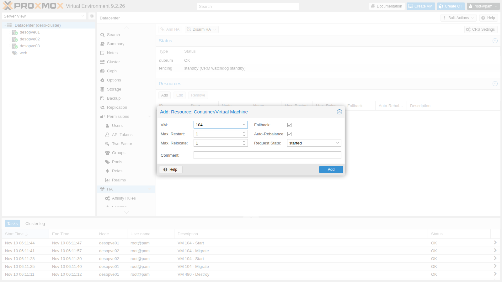
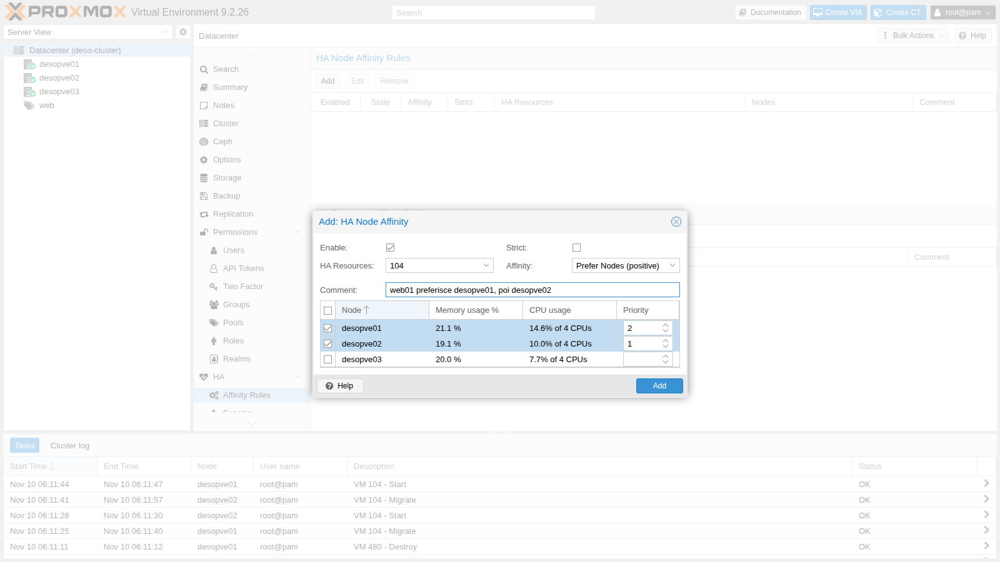
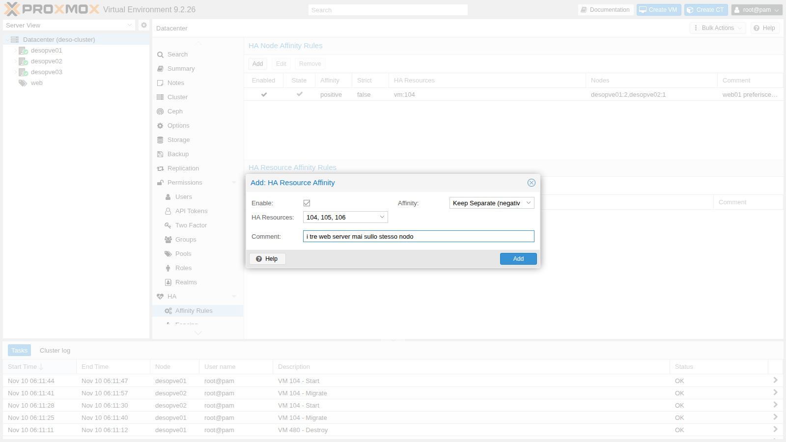
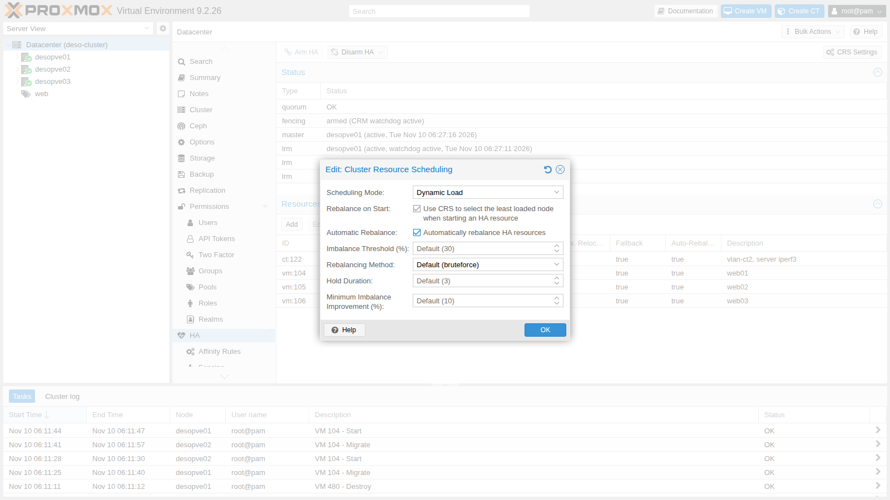
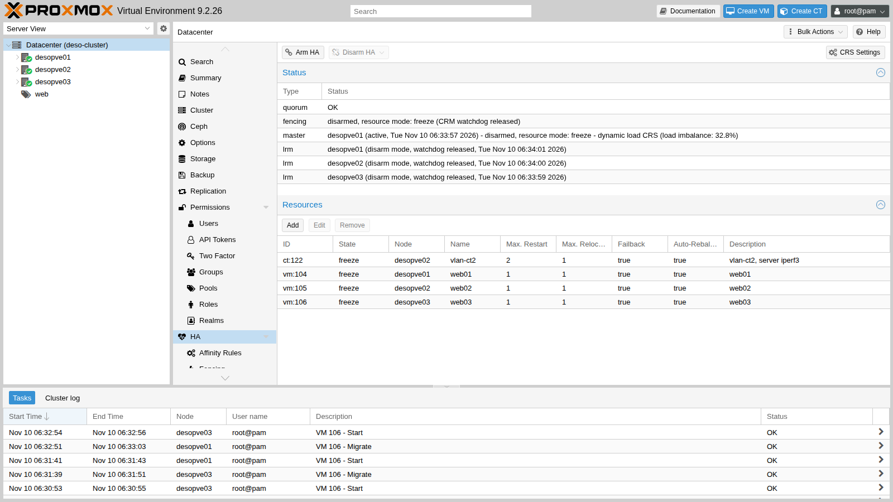
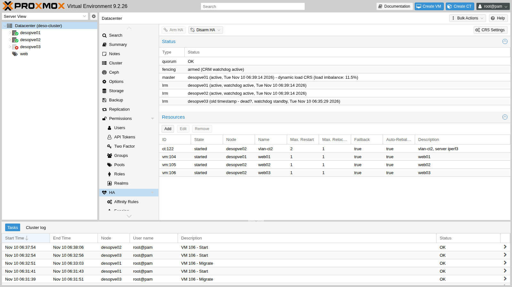

## Dependencies

- **Previous labs:**
  - [Lab 06](/06-cluster-corosync/): the 3-node `deso-cluster` cluster, with Corosync on two links;
  - [Lab 17](/17-ceph-installation/): the shared storage `rbd-vm`, which holds all the disks of the HA resources;
  - [Lab 20](/20-bridges-stable-names-vlans/): CT 122 `vlan-ct2` on VLAN 10;
  - [Lab 22](/22-dedicated-networks/): the migration network on VLAN 100;
  - [Lab 40](/40-templates-cloud-init-clones/): the VMs `web01`-`web03` (104-106) with nginx;
  - [Lab 48](/48-migrations/): live migration, which HA uses to move resources.
- **Systems:**
  - nodes `desopve01`, `desopve02`, `desopve03`;
  - VMs 104 `web01`, 105 `web02`, 106 `web03` (172.27.199.104-106, nginx on port 80), all on `rbd-vm`;
  - CT 122 `vlan-ct2` (10.10.10.122 on VLAN 10), on `rbd-vm`.
- **Measurements:** from the management network, one HTTP request per second to `web03` (with a 1-second timeout) and the `ha-manager` status every 5 s, with two loops left running in two terminals:

  ```bash
  while :; do printf '%s ' "$(date +%T)"; curl -s -m 1 -o /dev/null -w '%{http_code}\n' http://172.27.199.106/; sleep 1; done
  watch -n5 ha-manager status
  ```

  In the lab outputs, the `+N s` lines show the seconds elapsed since the start of the operation.

- **Credentials:** `root@pam` → [Appendix B](/b-credentials-and-addresses/).

## Objectives

- VMs 104-106 and CT 122 under HA, with `ha-manager status` showing fencing `armed` and the watchdog active on all three nodes.
- The PVE 9 **affinity rules** in place: node affinity for `web01`, a negative resource affinity rule for the web servers and a positive one for `web02` and CT 122, knowing why the first combination you try is refused.
- The **dynamic CRS** with **automatic rebalancing** enabled, and a rebalancing migration found in the CRM log.
- A node drained with **maintenance mode** and repopulated at the end, once the rule that blocked the evacuation has been reduced.
- HA **disarmed** and armed again for work on the whole cluster, with the watchdogs released and then active again.
- A node failure handled without manual intervention: `web03` restarted on another node, with the fencing and recovery times read from the master's log and kept separate from the service interruption measured from the network.

## How it works

**Two daemons.** Every node runs the *Local Resource Manager* (`pve-ha-lrm`), which starts, stops and migrates the resources of its own node. The *Cluster Resource Manager* (`pve-ha-crm`) also runs on every node, but only one of them is the **master**: it decides where each resource must run. The shared state lives in `/etc/pve/ha/` (`resources.cfg`, `rules.cfg`, `manager_status`), so it is valid only as long as the cluster has **quorum**.

**Self-fencing with the watchdog.** A node that hosts HA resources keeps a *watchdog* armed: `watchdog-mux` opens it and the LRM renews it at every cycle. If the node loses quorum it can no longer renew it, and after 60 s the watchdog reboots it: the node "fences" itself. The other nodes wait for its *lock* in the cluster file system to expire; at that point they are sure that the node is no longer writing to the shared disks, and they restart its resources elsewhere (*recovery*). The documentation gives about 2 minutes as the typical time for detecting a failure and failing over. The default watchdog is `softdog`, a software watchdog in the kernel; with a hardware watchdog (for example `ipmi_watchdog`) you choose the module in `/etc/default/pve-ha-manager`.

**Requirements:** at least 3 votes in the cluster (with an even number of nodes you add a *QDevice*, `pvecm qdevice setup <ip>`, which gives one extra vote to one of the two sides), shared storage for the resources, and reliable networks for Corosync.

**HA resources.** Every VM or CT under HA has a *requested state* (`started`, `stopped`, `disabled`, `ignored`), the number of attempts to restart it in place (`max_restart`) and to relocate it (`max_relocate`), `failback` and, new in 9.2, `auto-rebalance`.

**Affinity rules (PVE 9).** The old **HA groups** have been replaced by rules, and during the upgrade they are automatically converted into node affinity rules:

- **node affinity**: resources prefer (or avoid) certain nodes, with priorities; `strict` prevents them from using other nodes;
- **resource affinity**: resources stay **together** (*positive*) or **apart** (*negative*).

**CRS (Cluster Resource Scheduling).** It chooses the node for start and recovery:

- `basic`: counts only the number of resources per node;
- `static`: uses the *configured* CPU and RAM of the resources;
- `dynamic` (new in 9.2): also uses the *actual* CPU and RAM usage of the nodes.

With **Automatic Rebalance**, the CRS moves resources on its own when the imbalance between the nodes exceeds a threshold (default 30%) for a certain number of HA rounds (default 3) and the move reduces it by at least a margin (default 10%). Each HA round lasts about 10 seconds.

### Test environment and versions

The times and outputs in this lab come from a run carried out on 10 November 2026 (last checked in November 2026), with this configuration:

| Component | Configuration used |
|---|---|
| Proxmox VE | 9.2.26, kernel `7.0.14-28-pve` ([Lab 04](/04-first-access-repositories-updates/)), on the three cluster nodes |
| Cluster | `deso-cluster`, three nodes with one vote each; Corosync link 0 on the management network, link 1 on VLAN 40 ([Lab 06](/06-cluster-corosync/), [Lab 22](/22-dedicated-networks/)) |
| Watchdog | `softdog`, the default (step 1) |
| Shared storage | `rbd-vm`: Ceph 20.2.5 (tentacle), replicated pool `size 3` / `min_size 2`, OSDs on all three nodes ([Lab 17](/17-ceph-installation/), [Lab 18](/18-ceph-growth-maintenance-failures/)) |
| Migrations | network on VLAN 100, type `secure` ([Lab 22](/22-dedicated-networks/)) |
| HA resources | VMs 104-106: Debian 13 from template 9000, 2 GiB of RAM, nginx ([Lab 40](/40-templates-cloud-init-clones/)); CT 122 ([Lab 20](/20-bridges-stable-names-vlans/)) |
| CRS | `dynamic`, with rebalance on start and automatic rebalancing at the default thresholds (step 4) |

**What the test measures, and what it does not.** The times of the HA events come from the log of the CRM master. Since the HA manager works in rounds of about 10 seconds, their resolution is of that order. The `+N s` lines come from a `ha-manager status` read every 5 seconds. The service check sends one HTTP request per second, with a 1-second timeout, from the management network: it tells you when nginx answers again, not when the VM finished booting. The failure was simulated once, by powering a node off. The test therefore does not cover a node that keeps running but loses the network, the case where the watchdog's self-fencing comes into play, and a single run does not show how much the times vary.

## Procedure

### 1. Watchdog and initial state

Before you create HA resources, the watchdog is loaded but not armed:

```bash
lsmod | grep softdog
systemctl status watchdog-mux --no-pager | head -3
grep -i watchdog /etc/default/pve-ha-manager
ha-manager status
```

```text output
softdog                12288  2
● watchdog-mux.service - Proxmox VE watchdog multiplexer
     Loaded: loaded (/usr/lib/systemd/system/watchdog-mux.service; static)
     Active: active (running) since Mon 2026-11-09 14:31:33 CET; 16h ago
#WATCHDOG_MODULE=ipmi_watchdog
quorum OK
fencing standby (CRM watchdog standby)
```

### 2. Putting VMs and containers under HA

1. **Datacenter → HA → Resources → Add**. Choose VM 104 and keep the defaults: one restart attempt in place, one relocation attempt, `Failback` and `Auto-Rebalance` enabled, requested state `started`.

   

2. The other resources from the CLI:

   ```bash
   ha-manager set vm:104 --comment "web01"
   ha-manager add vm:105 --comment "web02"
   ha-manager add vm:106 --comment "web03"
   ha-manager add ct:122 --comment "vlan-ct2, server iperf3" --max_restart 2
   ha-manager status
   ```

   ```text output
   quorum OK
   master desopve01 (active, Tue Nov 10 06:18:26 2026)
   fencing armed (CRM watchdog active)
   lrm desopve01 (active, watchdog active, Tue Nov 10 06:18:21 2026)
   lrm desopve02 (active, watchdog active, Tue Nov 10 06:18:29 2026)
   lrm desopve03 (active, watchdog active, Tue Nov 10 06:18:20 2026)
   service ct:122 (desopve02, started)
   service vm:104 (desopve01, started)
   service vm:105 (desopve02, started)
   service vm:106 (desopve03, started)
   ```

   From this moment on, the watchdog is **armed** on all three nodes: a node that loses quorum reboots itself.

### 3. Affinity rules

Groups can no longer be created:

```bash
ha-manager groupadd prova --nodes desopve01
```

```text output
cannot create group: ha groups have been migrated to rules
```

1. **Datacenter → HA → Affinity Rules → HA Node Affinity Rules → Add**: `web01` prefers `desopve01` (priority 2) and then `desopve02` (priority 1), in a non-*strict* rule.

   

2. **HA Resource Affinity Rules → Add**: the three web servers must run on different nodes (*Keep Separate*).

   

   **Error observed.** Saving fails. The same rule created from the CLI shows the reason:

   ```bash
   ha-manager rules add resource-affinity web-separati --resources vm:104,vm:105,vm:106 --affinity negative
   ```

   ```text output
   create ha rule failed: 400 Rule 'web-separati' is invalid.
   resources: resources are in node affinity rules with multiple priorities
   ```

   A resource that is in a node affinity rule **with multiple priorities** cannot also be in a resource affinity rule: it is one of the feasibility checks that the documentation lists for HA rules.

   **Decision.** Simplify the node affinity rule to a single priority level, then add the two resource affinity rules:

   ```bash
   # the ID of the rule created in the GUI is generated: read yours with 'ha-manager rules config'
   ha-manager rules set node-affinity ha-rule-076b9e15-d28b --nodes desopve01 --comment "web01 preferisce desopve01"
   ha-manager rules add resource-affinity web-separati --resources vm:104,vm:105,vm:106 --affinity negative --comment "i tre web server mai sullo stesso nodo"
   ha-manager rules add resource-affinity web02-con-ct122 --resources vm:105,ct:122 --affinity positive --comment "web02 e il suo backend sempre insieme"
   ha-manager rules config
   ```

   ```text output
   ┌─────────┬────────┬───────────────────────┬───────────────────┬──────────────────────┬────────────────────────────────────────┐
   │ enabled │ state  │ rule                  │ type              │ resources            │ comment                                │
   ╞═════════╪════════╪═══════════════════════╪═══════════════════╪══════════════════════╪════════════════════════════════════════╡
   │ 1       │ in use │ ha-rule-076b9e15-d28b │ node-affinity     │ vm:104               │ web01 preferisce desopve01             │
   ├─────────┼────────┼───────────────────────┼───────────────────┼──────────────────────┼────────────────────────────────────────┤
   │ 1       │ in use │ web02-con-ct122       │ resource-affinity │ ct:122,vm:105        │ web02 e il suo backend sempre insieme  │
   ├─────────┼────────┼───────────────────────┼───────────────────┼──────────────────────┼────────────────────────────────────────┤
   │ 1       │ in use │ web-separati          │ resource-affinity │ vm:104,vm:105,vm:106 │ i tre web server mai sullo stesso nodo │
   └─────────┴────────┴───────────────────────┴───────────────────┴──────────────────────┴────────────────────────────────────────┘
   ```

   **Result.** All three rules are accepted and `in use`.

### 4. Dynamic CRS

**Datacenter → HA → CRS Settings**: *Scheduling Mode* `Dynamic Load`, *Rebalance on Start* and *Automatic Rebalance* enabled, default thresholds.



In `/etc/pve/datacenter.cfg` this becomes:

```text
crs: ha-auto-rebalance=1,ha-rebalance-on-start=1,ha=dynamic
```

and the master announces it in the log:

```text
pve-ha-crm[1679]: switching scheduler mode from 'basic' to 'dynamic'
```

### 5. Node maintenance (and the anti-affinity trap)

1. With the `web-separati` rule still covering the **three** web servers, put `desopve03` in maintenance mode:

   ```bash
   ha-manager crm-command node-maintenance enable desopve03
   ```

   ```text output
   --- +11 s
   lrm desopve03 (maintenance mode, watchdog active, Tue Nov 10 06:27:45 2026)
   service vm:106 (desopve03, started)
   ...
   --- +100 s
   lrm desopve03 (maintenance mode, watchdog active, Tue Nov 10 06:29:10 2026)
   service vm:106 (desopve03, started)
   ```

   **Behavior observed.** `web03` **does not move**: after 100 seconds it is still `started` on `desopve03`. `desopve01` hosts `web01`, `desopve02` hosts `web02`, and the rule forbids placing `web03` next to either of them. The node is in maintenance mode, but it cannot be shut down yet.

   

   :::note
   A *Keep Separate* rule with as many resources as there are nodes leaves **zero** headroom. In this lab it blocked the evacuation for maintenance. After a failure, according to the documentation, a resource that cannot satisfy its resource affinity rule stays in the `recovery` state: this lab did not test that case. On 3 nodes, keep at most 2 resources apart.
   :::

2. **Decision.** Reduce the rule to two VMs:

   ```bash
   ha-manager rules set resource-affinity web-separati --resources vm:104,vm:105
   ```

   ```text output
   06:29:46 pve-ha-crm[1679]: migrate service 'vm:106' to node 'desopve02' (running)
   06:30:06 pve-ha-crm[1679]: service 'vm:106': state changed from 'migrate' to 'started'  (node = desopve02)
   ```

   **Result.** `web03` is evacuated straight away: 20 seconds pass in the CRM log between the migration order and the `started` state on `desopve02`. Changing the rule alone was enough to unblock the evacuation.

3. End of maintenance: the resources move back on their own to the node they came from, here in 20 seconds according to the CRM log.

   ```bash
   ha-manager crm-command node-maintenance disable desopve03
   ```

   ```text output
   06:30:46 pve-ha-crm[1679]: node 'desopve03': state changed from 'maintenance' => 'online'
   06:30:46 pve-ha-crm[1679]: moving service 'vm:106' back to 'desopve03', node came back from maintenance.
   06:31:06 pve-ha-crm[1679]: service 'vm:106': state changed from 'migrate' to 'started'  (node = desopve03)
   ```

### 6. Automatic rebalancing

1. Create an imbalance. The `web-separati` rule now covers only `web01` and `web02`, so `web03` is free to move: move it to `desopve01`, where `web01` already runs, and load the CPUs of the two VMs:

   ```bash
   ha-manager crm-command migrate vm:106 desopve01
   for v in 104 106; do
     qm guest exec $v --timeout 1 -- sh -c 'for i in 1 2; do (timeout 900 sh -c "while :; do :; done") & done; wait'
   done
   ```

2. The imbalance measured by the CRS (`ha-manager status`, `master` line) and the reaction:

   ```text
   +13 s imbalance: 30.1% | service vm:106 (desopve01, started)
   +25 s imbalance: 54.8% | service vm:106 (desopve01, migrate)
   +50 s imbalance: 36.0% | service vm:106 (desopve03, starting)
   ```

   ```text
   06:32:47 pve-ha-crm[1679]: auto rebalance - migrate vm:106 to desopve03 (expected change for imbalance from 54.8% to 27.3%)
   06:32:47 pve-ha-crm[1679]: migrate service 'vm:106' to node 'desopve03'
   06:33:07 pve-ha-crm[1679]: service 'vm:106': state changed from 'migrate' to 'started'  (node = desopve03)
   ```

   The imbalance stayed above the threshold for a few HA rounds (`ha-auto-rebalance-hold-duration`, 3 by default); then the CRS chose on its own the VM to move and the target node. The live migration took 20 seconds in the CRM log. `web01` stayed on `desopve01`, the node its affinity rule prefers.

### 7. Arming and disarming HA

Maintenance mode applies to a single node. For work on the **whole cluster** (the Corosync network, updates that restart the cluster services) you **disarm** HA: the watchdogs are released everywhere and no node fences itself, not even without quorum.

```bash
ha-manager crm-command disarm-ha freeze
ha-manager status
```

```text output
quorum OK
master desopve01 (active, Tue Nov 10 06:33:47 2026) - disarmed, resource mode: freeze - dynamic load CRS (load imbalance: 35.9%)
fencing disarmed, resource mode: freeze (CRM watchdog released)
lrm desopve01 (disarm mode, watchdog released, Tue Nov 10 06:33:46 2026)
lrm desopve02 (disarm mode, watchdog released, Tue Nov 10 06:33:50 2026)
lrm desopve03 (disarm mode, watchdog released, Tue Nov 10 06:33:49 2026)
service ct:122 (desopve02, freeze)
service vm:104 (desopve01, freeze)
service vm:105 (desopve02, freeze)
service vm:106 (desopve03, freeze)
```

```text output
pve-ha-lrm[3086]: HA disarm requested, releasing agent lock and watchdog
pve-ha-lrm[3086]: watchdog closed (disabled)
```



- `freeze`: the resources stay under HA, but commands and state changes are not applied until HA is armed again;
- `ignore`: the resources leave HA control and are managed like normal VMs.

Arm it again with a command (or the **Arm HA** button):

```bash
ha-manager crm-command arm-ha
```

```text output
fencing armed (CRM watchdog active)
lrm desopve01 (active, watchdog active, Tue Nov 10 06:34:51 2026)
```

### 8. A real failover: a node powered off abruptly

1. `web03` runs on `desopve03`. From the management network, one HTTP request per second is sent to 172.27.199.106, and on the master `ha-manager status` is recorded every 5 s.
2. Power off `desopve03` abruptly, as in a power failure:

   ```bash
   echo 1 > /proc/sys/kernel/sysrq
   echo o > /proc/sysrq-trigger
   ```

3. The master's log:

   ```text
   06:35:54 pve-ha-crm[1679]: node 'desopve03': state changed from 'online' => 'unknown'
   06:36:44 pve-ha-crm[1679]: service 'vm:106': state changed from 'started' to 'fence'
   06:36:44 pve-ha-crm[1679]: node 'desopve03': state changed from 'unknown' => 'fence'
   06:36:44 perl[1679]: notified via target `mail-to-root`
   06:37:44 pve-ha-crm[1679]: successfully acquired lock 'ha_agent_desopve03_lock'
   06:37:44 pve-ha-crm[1679]: fencing: acknowledged - got agent lock for node 'desopve03'
   06:37:44 pve-ha-crm[1679]: service 'vm:106': state changed from 'fence' to 'recovery'
   06:37:44 pve-ha-crm[1679]: recover service 'vm:106' from fenced node 'desopve03' to node 'desopve02'
   06:37:44 pve-ha-crm[1679]: service 'vm:106': state changed from 'recovery' to 'started'  (node = desopve02)
   ```

4. The measured sequence, with the source of each time:

   | Time | Event | Since power-off | Source |
   |---|---|---|---|
   | 06:35:36 | `desopve03` powered off | 0 s | start of the test |
   | 06:35:38 | first failed HTTP request | 2 s | HTTP loop |
   | 06:35:54 | the master sees the node as `unknown` | 18 s | CRM log |
   | 06:36:44 | node and resource in `fence`, notification sent | 68 s | CRM log |
   | 06:37:44 | node lock acquired: fencing confirmed, recovery on `desopve02` | 128 s | CRM log |
   | 06:38:46 | the nginx of `web03` responds again | 190 s | HTTP loop |

   

   The table holds three different observations, which are worth reading separately:

   - **Fencing confirmed after 128 seconds (CRM log).** This part does not depend on the VM: the CRM can restart the resources of the lost node only once it has acquired that node's lock, which is possible only after the lock has expired. The figure is consistent with the typical time of about 2 minutes that the documentation gives for detection and failover. With a single run, the test does not show how much it varies, and the log has the resolution of an HA round (about 10 seconds). To check it, repeat the test a few times and compare the time of the power-off with the CRM log on the master (`journalctl -u pve-ha-crm`).
   - **62 more seconds before nginx answers (HTTP loop).** They are compatible with the start of the VM on `desopve02` and the boot of Debian up to nginx, but the test does not break them down. To check it, read the start time of the VM in the task list of `desopve02`, look at the boot of the guest (`systemd-analyze`, `journalctl -b -u nginx`), and run a `ping` to the VM alongside the HTTP loop, to tell the moment the guest's network comes up from the moment nginx answers.
   - **Service unreachable for about three minutes**, from the first failed request (06:35:38) to the first successful one (06:38:46), with the 1-2 second resolution of the HTTP loop. This is what a client sees.

   Waiting for the lock is the price of data safety: the VM can never run on two nodes at the same time (no *split brain*).

5. The rest of the cluster during the failure:

   ```text
   Quorate:          Yes
   Total votes:      2
       health: HEALTH_WARN
               Degraded data redundancy: 11601/34803 objects degraded (33.333%), 79 pgs degraded, 97 pgs undersized
       osd: 7 osds: 4 up (since 3m), 7 in (since 12h)
   ```

   Quorum with 2 votes out of 3, and Ceph degraded but working (`min_size 2`): the VMs on the other nodes kept running and were not restarted. This test did not measure their disk I/O: in [Lab 18](/18-ceph-growth-maintenance-failures/), a similar power-off of a Ceph node made a VM's writes wait for 26.8 seconds. The guests on `desopve03` that are **not** under HA (CT 123, 292, 302), on the other hand, stayed off: HA protects only what you entrust to it.

### 9. Bringing the node back and restoring the distribution

1. Power `desopve03` back on with the power button or from the remote management console (IPMI/iDRAC/iLO). In the lab it was powered on at 06:42:34, and the master logged it as `online` 30 seconds later:

   ```text
   06:43:04 pve-ha-crm[1679]: node 'desopve03': state changed from 'unknown' => 'online'
   06:43:04 pve-ha-crm[1679]: fallback to 'basic' scheduler mode, init for 'dynamic' failed - did not get dynamic node usage information for 'desopve03'
   ```

   As the second line says, the CRS falls back to `basic` mode because it has no load data yet for the node that has just come back.

2. `web03` **stays** on `desopve02`. This is consistent with the configuration: no node affinity calls it back, and the imbalance (13.5%) is below the 30% rebalancing threshold. The CTs that are not under HA must be started by hand (they do not have `onboot`):

   ```bash
   for c in 123 292 302; do pct start $c; done
   ha-manager crm-command migrate vm:106 desopve03
   ```

   ```text output
   +7 s service vm:106 (desopve02, migrate)
   +38 s service vm:106 (desopve03, starting)
   +50 s service vm:106 (desopve03, started)
   ```

   Ceph rebuilds the missing copies and goes back to `HEALTH_OK`.

## Verification and tests

The lab has succeeded when `ha-manager status` shows the four resources `started` with fencing `armed`, the three rules are `in use`, and after the power-off of a node `web03` answers again from another node without anyone intervening.

| Test | Success criterion | Result in the lab |
|---|---|---|
| HA groups in PVE 9 | creation refused | `ha groups have been migrated to rules` |
| Resource affinity on a resource with a multi-priority node affinity | rule refused, with the reason | `resources are in node affinity rules with multiple priorities` |
| Automatic rebalancing (dynamic CRS) | a rebalancing migration in the CRM log | imbalance 54.8% → migration of `web03`, expected imbalance 27.3% |
| Maintenance with *Keep Separate* on 3 resources and 3 nodes | the trap shows: the resource cannot be evacuated | `web03` still on the node after 100 s |
| Maintenance with the reduced rule | evacuation and automatic return | 20 s for each, in the CRM log |
| Disarm `freeze` | watchdogs released on all nodes | `watchdog released` on the three LRMs, resources in `freeze` |
| Node powered off abruptly | `web03` restarted on another node on its own | fencing confirmed after 128 s (CRM log); nginx answering again after 190 s (HTTP loop) |
| Non-HA guests on the failed node | not restarted by HA | off until started by hand |

## Final lab state

- **HA resources**, all `started`, HA armed:
  - `vm:104` on `desopve01`, `vm:105` and `ct:122` on `desopve02`, `vm:106` on `desopve03`.
- **Rules:**
  - `ha-rule-076b9e15-d28b` (node affinity): `vm:104` prefers `desopve01`;
  - `web-separati` (negative resource affinity): `vm:104`, `vm:105`;
  - `web02-con-ct122` (positive resource affinity): `vm:105`, `ct:122`.
- **Datacenter:** `crs: ha-auto-rebalance=1,ha-rebalance-on-start=1,ha=dynamic`.
- Cluster with quorum 3/3, Ceph `HEALTH_OK`, CTs 123, 292 and 302 started again, guests in their initial locations.
- With HA active, a node that loses quorum reboots itself: before working on the Corosync network, use `disarm-ha`.

## What you learned

- **What to put under HA, and what a failover costs.** HA restarts only the resources entrusted to it, and only once the lost node is certainly fenced: in this lab the fencing was confirmed after 128 seconds and the service answered again after 190. A service that cannot tolerate minutes of interruption needs redundancy in the application as well, not only HA.
- **How to write the placement rules, which in PVE 9 replace the HA groups.** Node affinity for the preferred nodes, with a single priority level if the resource is also in a resource affinity rule; resource affinity to keep resources together or apart. With N nodes, keep at most N-1 resources apart, otherwise maintenance cannot evacuate a node.
- **Which tool for which maintenance.** Maintenance mode for a single node, which it drains and repopulates at the end; `disarm-ha` for work on the whole cluster or on the Corosync network, where a loss of quorum would otherwise make the nodes fence themselves.
- **When to let the CRS rebalance.** The dynamic CRS with automatic rebalancing moves HA resources according to the actual load, within the affinity rules, once the imbalance has stayed above the threshold for a few rounds.
- **How to read the times of a failover.** Keep the times in the CRM log (fencing, recovery) apart from what clients see (the service reachable again), and attribute the difference to the boot of the VM only after checking it.

## References

- [Proxmox VE – High Availability](https://pve.proxmox.com/pve-docs/chapter-ha-manager.html)
- [Proxmox VE – HA: fencing and recovery of fenced services](https://pve.proxmox.com/pve-docs/chapter-ha-manager.html#ha_manager_fencing)
- [Proxmox VE – HA rules: node affinity, resource affinity and conflicts](https://pve.proxmox.com/pve-docs/chapter-ha-manager.html#ha_manager_rules)
- [Proxmox VE – HA: node maintenance](https://pve.proxmox.com/pve-docs/chapter-ha-manager.html#ha_manager_node_maintenance)
- [Proxmox VE – HA: disarming HA for cluster maintenance](https://pve.proxmox.com/pve-docs/chapter-ha-manager.html#ha_manager_disarm)
- [Proxmox VE – HA: Cluster Resource Scheduling and load balancer](https://pve.proxmox.com/pve-docs/chapter-ha-manager.html#ha_manager_crs)
- [Proxmox VE – ha-manager(1)](https://pve.proxmox.com/pve-docs/ha-manager.1.html)
- [Proxmox VE – datacenter.cfg, crs option](https://pve.proxmox.com/pve-docs/datacenter.cfg.5.html)
- [Proxmox VE – Corosync External Vote Support (QDevice)](https://pve.proxmox.com/pve-docs/chapter-pvecm.html#_corosync_external_vote_support)
