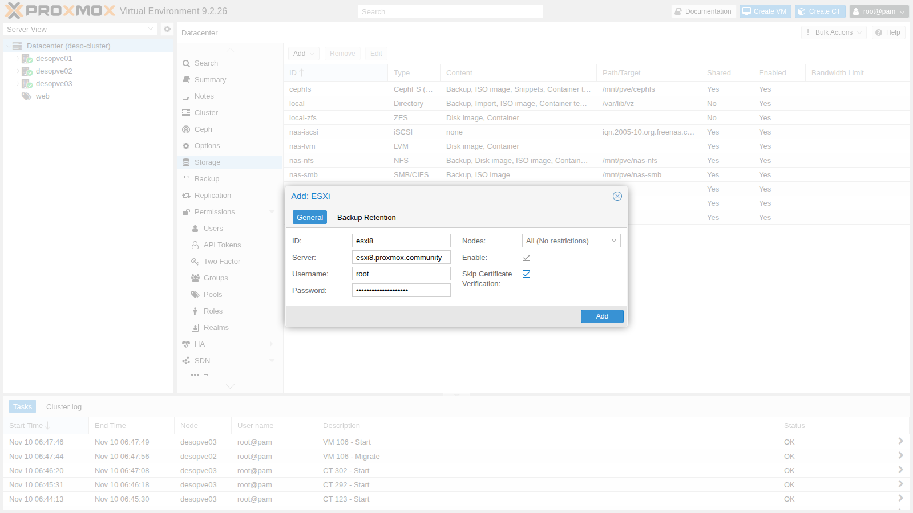
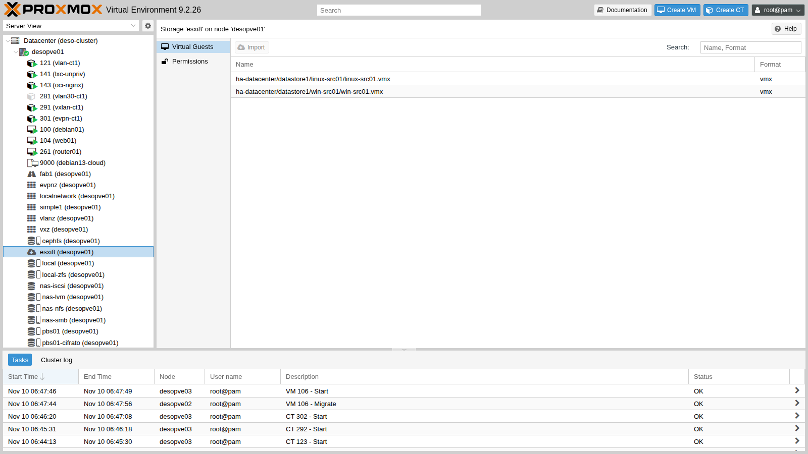
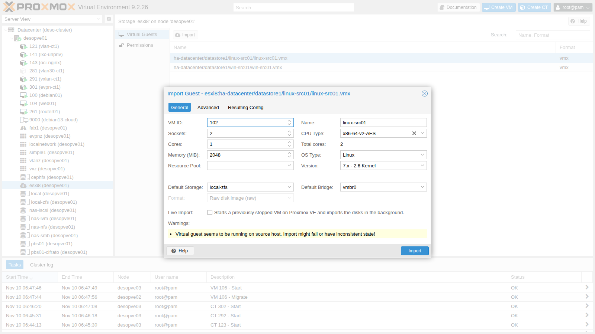
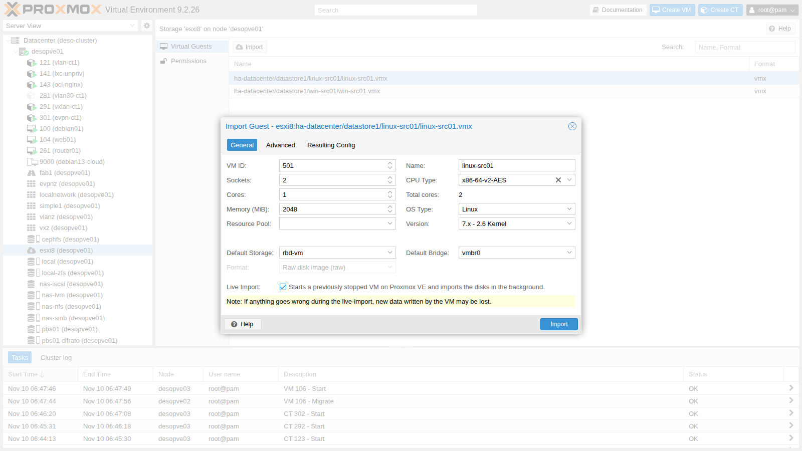
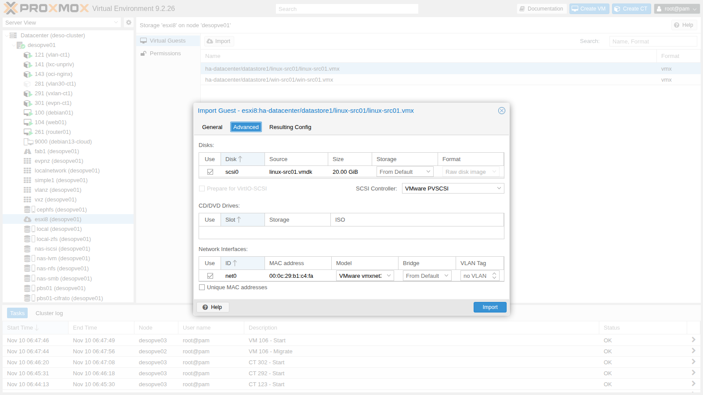
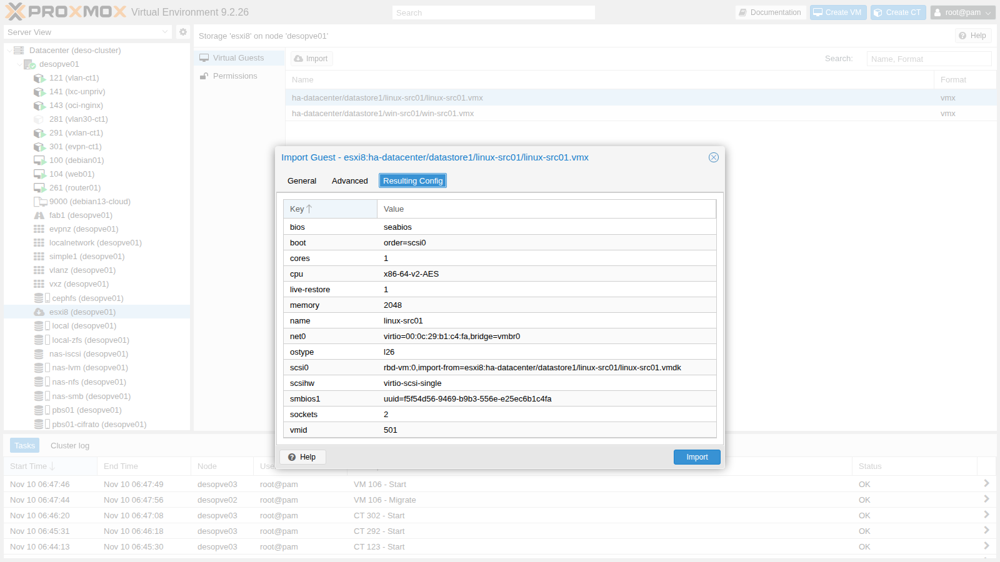
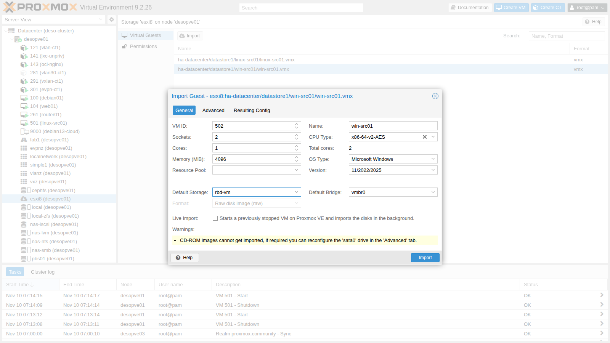
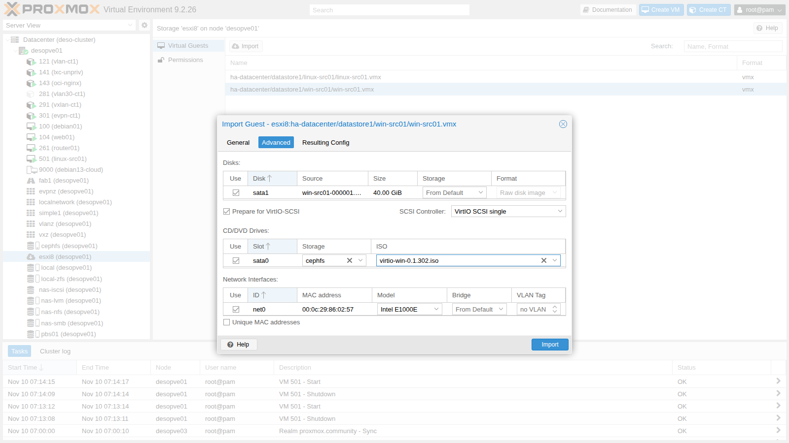
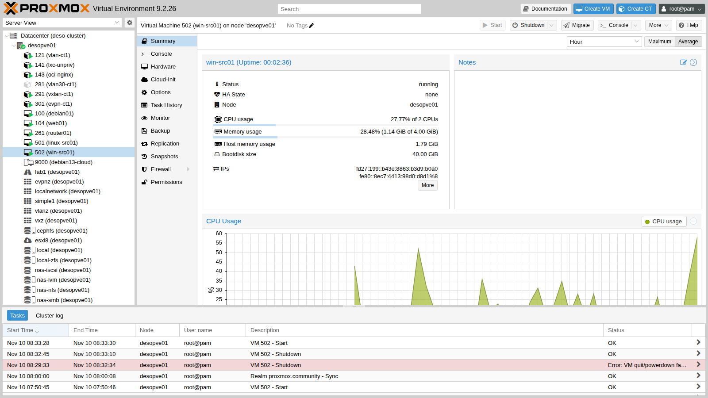
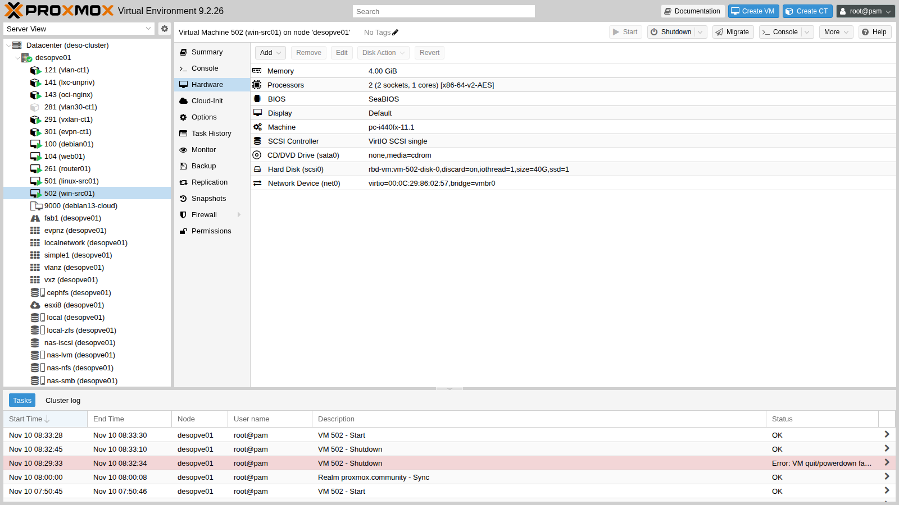

## Dependencies

- **Previous labs:**
  - [Lab 07](/07-first-vm-and-container/): creating VMs and using the console;
  - [Lab 17](/17-ceph-installation/): the `rbd-vm` storage, the destination of the imported disks;
  - [Lab 38](/38-linux-vm-guest-agent/): the QEMU Guest Agent;
  - [Lab 39](/39-windows-vm-virtio/): the VirtIO drivers for Windows and the `virtio-win-0.1.302.iso` ISO on `cephfs`.
- **Systems:**
  - a separate server with **VMware ESXi 8.0 U3**, `esxi8.proxmox.community` (172.27.199.30), with the `datastore1` datastore: its preparation is described in step 0;
  - on the ESXi host, the VM `linux-src01` (Ubuntu 24.04, 172.27.199.31, nginx, `open-vm-tools`);
  - on the ESXi host, the VM `win-src01` (Windows Server 2025, 172.27.199.32, BIOS, LSI SAS controller, e1000e network card, VMware Tools);
  - the `deso-cluster` cluster, with `desopve01` as the import node.
- **Credentials:** `root` on the ESXi host and `root@pam` → [Appendix B](/b-credentials-and-addresses/).

## Objectives

- Connect an ESXi host to Proxmox VE as an **ESXi-type storage**.
- Use the **import wizard**: disks, storage, controllers, network cards, advanced options.
- Import a Linux VM with **live-import** and measure it.
- Import a Windows VM prepared for **VirtIO** and complete the switch to the paravirtualized drivers.
- Recognize the typical problems: a VM still running on the source, snapshots, VMware hardware, MAC addresses and network card names.

## How it works

**ESXi storage.** Proxmox VE connects to the API of the ESXi host (or of a vCenter) with a user name and a password, and exposes the contents of the datastores through a FUSE file system. The storage does not contain any Proxmox disks: it serves only as a **source** for importing VMs, and it appears in the tree of each node with the list of the `.vmx` files.

**Import wizard.** It reads the `.vmx` file and proposes an equivalent configuration in Proxmox VE: CPU, RAM, firmware (BIOS or UEFI), OS type, disks, SCSI controller, network cards with their MAC addresses. You can change the controller and the network card model before the import. The disks are converted to raw (or qcow2) format on the chosen storage.

**Live-import.** The VM is created and **started immediately** on Proxmox VE, while the disks are copied in the background: reads of blocks that have not been copied yet are fetched from the ESXi host on the fly. The service is available again long before the copy ends, at the price of reduced performance during the import and of the risk of losing the writes made in the meantime if the copy fails halfway.

**Windows and VirtIO.** A Windows system installed on ESXi has no VirtIO drivers: if the boot disk is switched to VirtIO SCSI right away, the system does not boot. The **Prepare for VirtIO-SCSI** option attaches the disks on SATA (which Windows always recognizes) and already sets the VirtIO SCSI controller, so after the drivers are installed you only need to move the disk.

## Procedure

### 0. Preparing the source environment

The source is a separate server with **VMware ESXi 8.0 U3**, installed following the VMware documentation (*vSphere 8.0 – ESXi Installation and Setup*): static IP 172.27.199.30/24, gateway 172.27.199.1, DNS 172.27.199.20, name `esxi8.proxmox.community`, and a VMFS datastore called `datastore1`. The evaluation license is enough for the lab. From the host's web client (**Host → Actions → Services → Enable Secure Shell (SSH)**), enable SSH, which you need in the following steps.

**`linux-src01`: Ubuntu 24.04 from a cloud image.** On a Linux workstation with Internet access and the `qemu-utils` and `cloud-image-utils` packages, convert the cloud image to VMDK and prepare a small cloud-init configuration ISO with the files [`user-data`](/files/50/user-data), [`network-config`](/files/50/network-config) and [`meta-data`](/files/50/meta-data):

```bash
curl -O https://cloud-images.ubuntu.com/noble/current/noble-server-cloudimg-amd64.img
qemu-img convert -O vmdk -o adapter_type=lsilogic,subformat=monolithicSparse noble-server-cloudimg-amd64.img ubuntu-src.vmdk
cloud-localds -N network-config seed.iso user-data meta-data
ssh root@esxi8.proxmox.community 'mkdir -p /vmfs/volumes/datastore1/linux-src01 /vmfs/volumes/datastore1/iso'
scp ubuntu-src.vmdk root@esxi8.proxmox.community:/vmfs/volumes/datastore1/linux-src01/src.vmdk
scp seed.iso root@esxi8.proxmox.community:/vmfs/volumes/datastore1/iso/linux-src01-seed.iso
```

`network-config` selects the network card with a wildcard (`match: name: "e*"`) instead of its exact name: you will see why this helps after the import (step 4).

On the ESXi host, over SSH, convert the disk to the thin VMFS format, grow it to 20 GB and register the VM described by [`linux-src01.vmx`](/files/50/linux-src01.vmx) (PVSCSI controller, vmxnet3 network card, BIOS, cloud-init ISO in the CD drive):

```bash
cd /vmfs/volumes/datastore1/linux-src01
vmkfstools -i src.vmdk -d thin linux-src01.vmdk && rm src.vmdk && vmkfstools -X 20G linux-src01.vmdk
# copy linux-src01.vmx here, then:
vim-cmd solo/registervm /vmfs/volumes/datastore1/linux-src01/linux-src01.vmx
vim-cmd vmsvc/power.on <vmid restituito>
```

The `pciBridge` lines of the `.vmx` file are required: without them, the power-on fails with `No PCIe slot available for SCSI0`. At first boot, cloud-init creates the `labuser` user and configures the network. Then, inside the VM, install nginx and `open-vm-tools` through the lab proxy and write the test page:

```bash
echo 'Acquire::http::Proxy "http://proxy.proxmox.community:3128";' | sudo tee /etc/apt/apt.conf.d/80proxy
sudo apt-get update && sudo apt-get install -y nginx open-vm-tools
echo '<html><body><h1>linux-src01 - origine ESXi</h1></body></html>' | sudo tee /var/www/html/index.html
```

Finally, with the VM powered off, remove the CD drive with the cloud-init ISO (the `sata0` lines of the `.vmx`, then `vim-cmd vmsvc/reload <vmid>`) and delete the ISO from the datastore: it contains the initial password.

**`win-src01`: Windows Server 2025.** A VM created from the ESXi web client with **BIOS firmware**, an **LSI Logic SAS** controller, an **E1000e** network card, 2 vCPUs, 4 GB of RAM and a 40 GB thin disk, installed from the Windows Server 2025 evaluation ISO (Standard, Desktop Experience). In the lab the installation was automated with an answer file (`autounattend.xml`); by hand the result is the same. After the installation, in PowerShell as administrator:

```powershell
Rename-Computer -NewName WIN-SRC01
New-NetIPAddress -InterfaceAlias Ethernet0 -IPAddress 172.27.199.32 -PrefixLength 24 -DefaultGateway 172.27.199.1
Set-DnsClientServerAddress -InterfaceAlias Ethernet0 -ServerAddresses 172.27.199.20
Set-ItemProperty 'HKLM:\System\CurrentControlSet\Control\Terminal Server' -Name fDenyTSConnections -Value 0
Enable-NetFirewallRule -DisplayGroup 'Remote Desktop'
New-NetFirewallRule -DisplayName 'ICMPv4 in' -Protocol ICMPv4 -IcmpType 8 -Action Allow
Set-Content C:\marker-origine.txt "win-src01 - VM di origine ESXi - configurata il $(Get-Date -Format s)"
```

The `C:\marker-origine.txt` file will be used to verify that the data reach Proxmox VE. To have a realistic source VM, also install the **VMware Tools**: in the web client, **Actions → Guest OS → Install VMware Tools** mounts the Tools ISO (the host's `windows.iso`); then, in the VM, run `D:\setup64.exe /s /v"/qn REBOOT=R"` and reboot.

### 1. Connecting the ESXi host

**Datacenter → Storage → Add → ESXi**: ID `esxi8`, server `esxi8.proxmox.community`, user `root` and its password. The certificate of the ESXi host is self-signed, so in the lab you enable **Skip Certificate Verification**. In production, import the CA of the host or of vCenter instead.



```text
esxi: esxi8
	server esxi8.proxmox.community
	username root
	skip-cert-verification 1
```

```bash
pvesm status | grep esxi8
```

```text output
esxi8                esxi     active               0               0               0    0.00%
```

The storage is active but has no space: it does not contain Proxmox VE disks, only the list of the VMs on the ESXi host. In the tree, **desopve01 → esxi8** shows the `.vmx` files of the VMs, with the **Import** button.



### 2. First problem: the VM is running on the source

With `linux-src01` still running on the ESXi host, the wizard warns:

```text
Virtual guest seems to be running on source host. Import might fail or have inconsistent state!
```



A disk copied while the VM is writing is inconsistent: first shut down the VM on the source, with a clean shutdown of the operating system, over SSH on the ESXi host (enabled in step 0) or from its web client. You can read the VM ID with `vim-cmd vmsvc/getallvms`:

```text
Vmid      Name                         File                              Guest OS            Version   Annotation
3      linux-src01   [datastore1] linux-src01/linux-src01.vmx   ubuntu64Guest                vmx-21
4      win-src01     [datastore1] win-src01/win-src01.vmx       windows2022srvNext_64Guest   vmx-21
```

```bash
vim-cmd vmsvc/power.shutdown 3
vim-cmd vmsvc/power.getstate 3
```

```text output
Powered off
```

### 3. Importing `linux-src01` with live-import

1. **General**: VM ID `501`, target storage `rbd-vm` (shared, useful for migrations and HA), bridge `vmbr0`, **Live Import** enabled. CPU, RAM, name and OS type come from the `.vmx`.

   

2. **Advanced**: the wizard proposes the hardware of the source, that is, a **VMware PVSCSI** controller and a **VMware vmxnet3** network card. Linux ships with the VirtIO drivers, so choose **VirtIO SCSI single** and **VirtIO (paravirtualized)**. The source MAC address (`00:0c:29:…`) is kept; **Unique MAC addresses** would generate a new one.

   

3. **Resulting Config** shows the VM that will be created: the disk is imported from `esxi8:…/linux-src01.vmdk` and the SMBIOS UUID of the source is kept, so licenses and tools tied to the UUID do not change.

   

4. **Import**. The task creates the VM, starts it immediately and copies the disk in the background:

   ```text
   scsi0: successfully created disk 'rbd-vm:vm-501-disk-0,size=20G'
   restore-scsi0: transferred 96.0 MiB of 20.0 GiB (0.47%) in 1s
   ...
   restore-scsi0: transferred 20.0 GiB of 20.0 GiB (100.00%) in 6m 48s
   restore-scsi0: stream-job finished
   restore-drive jobs finished successfully, removing all tracking block devices
   ```

5. The measurements, with one HTTP request per second to 172.27.199.31:

   | Time | Event | Since the start of the import |
   |---|---|---|
   | 06:58:12 | import started, the VM boots on Proxmox VE | 0 s |
   | 07:01:00 | nginx responds | 2 min 48 s |
   | 07:05:04 | disk copy completed | 6 min 52 s |

   The service was back when only a fifth of the disk had been copied. During the live-import the VM is slow: every read of a block that has not been copied yet goes all the way to the ESXi host.

### 4. Linux after the import

```bash
ip -br a
lspci | grep -iE "ethernet|scsi"
```

```text output
ens18            UP             172.27.199.31/24 fd27:199::20c:29ff:feb1:c4fa/64 fe80::20c:29ff:feb1:c4fa/64
00:12.0 Ethernet controller: Red Hat, Inc. Virtio network device
01:01.0 SCSI storage controller: Red Hat, Inc. Virtio SCSI
```

- The network card is now called `ens18`: the name depends on the virtual PCI slot, and on the ESXi host it was different. The network works because the netplan configuration prepared in step 0 selects the network cards by name with a wildcard (`match: name: "e*"`). With the exact name of the card, as the Ubuntu installer usually writes it, or with a `match` on the MAC address and a different MAC (Unique MAC addresses), the VM would have started **without a network**: in that case, fix the file in `/etc/netplan/` from the console and run `netplan apply`.
- The VMware Tools for Linux (`open-vm-tools`) are no longer needed and are replaced with the QEMU Guest Agent:

  ```bash
  sudo apt-get purge -y open-vm-tools
  sudo apt-get install -y qemu-guest-agent
  ```

  In Proxmox VE, enable the **QEMU Guest Agent** option and **shut down and start** the VM again: the agent channel is added only when the VM starts, not with a reboot from inside the guest.

  ```bash
  qm set 501 --agent enabled=1,fstrim_cloned_disks=1
  qm shutdown 501 && qm start 501
  qm agent 501 ping && echo agent-ok
  qm guest cmd 501 get-osinfo | grep pretty-name
  ```

  ```text output
  agent-ok
     "pretty-name" : "Ubuntu 24.04.5 LTS",
  ```

- The disk is thin on Ceph too: of its 20 GiB, it uses 2.5.

  ```bash
  rbd du rbd-vm/vm-501-disk-0
  ```

  ```text output
  vm-501-disk-0       20 GiB  2.5 GiB
  ```

### 5. Snapshots on the source

Before importing `win-src01`, create a snapshot on the ESXi host, as is often the case with production VMs:

```bash
vim-cmd vmsvc/snapshot.create 4 prima-della-migrazione "snapshot di prova" 0 0
ls /vmfs/volumes/datastore1/win-src01/ | grep vmdk
```

```text output
win-src01-000001-sesparse.vmdk
win-src01-000001.vmdk
win-src01-flat.vmdk
win-src01.vmdk
```

The wizard shows no warnings and uses the **delta** disk `win-src01-000001.vmdk` as its source: the import reads the chain (base + delta) and brings the **current state** of the disk, consolidated, into Proxmox VE. VMware snapshots are **not** imported. It is still better to consolidate them first: the whole chain has to be read, and a problem in the delta would end up in the imported VM.

### 6. Importing `win-src01` prepared for VirtIO

1. **General**: VM ID `502`, storage `rbd-vm`, **without** live-import (at boot Windows reads many blocks, and with live-import each of them would have to be fetched from the ESXi host: a full copy is better). The wizard recognizes the OS (`win11`) and the BIOS firmware of the source. The only warning concerns the CD drive of the source, which is not imported.

   

2. **Advanced**:
   - **Prepare for VirtIO-SCSI**: the disk is attached on **SATA** (`sata1`), which Windows can always boot from, and the controller is already set to **VirtIO SCSI single**;
   - in the `sata0` drive, mount the `virtio-win-0.1.302.iso` ISO from `cephfs`;
   - the network card stays **Intel E1000E**, because Windows already has its driver: NetKVM comes later.

   

3. The import takes **31 min 44 s** for 40 GiB (about 21 MB/s, versus the 50 MB/s of the `linux-src01` disk, which had no snapshot):

   ```text
   transferred 40.0 GiB of 40.0 GiB (100.00%)
   sata1: successfully created disk 'rbd-vm:vm-502-disk-0,size=40G'
   pinning machine type to 'pc-i440fx-11.1' for Windows guest OS
   TASK OK
   ```

   The machine type is *pinned*: for Windows, a change in the version of the virtual machine can cause new hardware to be detected.

### 7. Windows after the import: network, VirtIO and VMware Tools

1. Before the first boot, add a small temporary **VirtIO SCSI** disk: without a VirtIO SCSI device present, Windows installs the driver but does not set it up for booting.

   ```bash
   qm set 502 --boot order=sata1 --scsi0 rbd-vm:1,discard=on
   qm start 502
   ```

2. **First trap: the static IP is gone.** Windows boots, but does not respond on 172.27.199.32. From the console:

   ```text
   Ethernet adapter Ethernet:
      Autoconfiguration IPv4 Address. . : 169.254.121.36
   ```

   The network card has the same model and the same MAC address, but for Windows it is a **new** device (`Intel(R) 82574L Gigabit Network Connection #2`), because its PCI location has changed. The IP configuration stayed on the old card, which is now hidden. Set it again from the console:

   ```text
   netsh interface ipv4 set address Ethernet static 172.27.199.32 255.255.255.0 172.27.199.1
   netsh interface ipv4 set dnsservers Ethernet static 172.27.199.20 primary
   ```

3. From the `virtio-win` ISO, install the drivers and the QEMU Guest Agent non-interactively:

   ```powershell
   $p = Start-Process D:\virtio-win-guest-tools.exe -ArgumentList "/install","/quiet","/norestart" -Wait -PassThru
   "virtio-win-guest-tools: exit code " + $p.ExitCode
   ```

   ```text output
   virtio-win-guest-tools: exit code 0

   Name           Status  StartType
   BalloonService Running Automatic
   QEMU-GA        Running Automatic

   FriendlyName                                Status
   VirtIO Balloon Driver                       OK
   Red Hat VirtIO SCSI pass-through controller OK
   ```

4. **Second trap: the VMware Tools cannot be uninstalled** outside VMware:

   ```powershell
   $t = Get-ItemProperty HKLM:\Software\Microsoft\Windows\CurrentVersion\Uninstall\* | ? DisplayName -like "VMware Tools*"
   Start-Process msiexec.exe -ArgumentList "/x",$t.PSChildName,"/qn","/norestart","/l*v","C:\vmt.log" -Wait
   ```

   ```text output
   VMware Tools 12.4.0.23259341
   msiexec /x: exit code 1603
   CustomAction VM_LogStart returned actual error code 1603
   Windows Installer removed the product. Product Name: VMware Tools. Product Version: 12.4.0.23259341. ... Removal success or error status: 1603.
   ```

   The package runs actions that only work on a VMware VM, and the removal fails. Remedies:

   - **the rule**: uninstall the VMware Tools on the source **before** the final shutdown and the import;
   - **after the import**: disable the services, as done here, and plan a manual cleanup or a clean reinstallation.

   ```powershell
   Stop-Service VMTools,VGAuthService -Force
   Set-Service VMTools -StartupType Disabled
   Set-Service VGAuthService -StartupType Disabled
   ```

   ```text output
   Name          Status  StartType
   VGAuthService Stopped Disabled
   VMTools       Stopped Disabled
   ```

5. **Switching to VirtIO.** With the VM powered off, remove the temporary disk, move the system disk from SATA to VirtIO SCSI, switch the network card to VirtIO (same MAC address), enable the agent and empty the CD drive:

   ```bash
   qm set 502 --delete scsi0                     # the temporary disk becomes unused0
   qm disk unlink 502 --idlist unused0 --force   # and is destroyed
   qm set 502 --delete sata1                     # the system disk becomes unused0
   qm set 502 --scsi0 rbd-vm:vm-502-disk-0,discard=on,iothread=1,ssd=1 --boot order=scsi0 \
     --net0 virtio=00:0C:29:86:02:57,bridge=vmbr0 --agent enabled=1 --sata0 none,media=cdrom
   qm start 502
   ```

   Windows boots from the VirtIO SCSI disk and the agent responds in less than a minute. The NetKVM card is once again a new device, so the IP has to be set again, this time from the host through the agent (`qm guest exec`):

   ```bash
   qm guest exec 502 -- powershell -NoProfile -Command "New-NetIPAddress -InterfaceAlias 'Ethernet 2' -IPAddress 172.27.199.32 -PrefixLength 24 -DefaultGateway 172.27.199.1; Set-DnsClientServerAddress -InterfaceAlias 'Ethernet 2' -ServerAddresses 172.27.199.20; Rename-NetAdapter -Name 'Ethernet 2' -NewName LAN"
   ```

6. Final check, again through the agent:

   ```text
   Name InterfaceDescription            Status
   LAN  Red Hat VirtIO Ethernet Adapter Up

   FriendlyName       BusType GB
   QEMU QEMU HARDDISK SAS     40

   FriendlyName                                Class       Status
   VirtIO Serial Driver                        System      OK
   VirtIO Balloon Driver                       System      OK
   Red Hat VirtIO SCSI pass-through controller SCSIAdapter OK
   Red Hat VirtIO Ethernet Adapter             Net         OK

   Name          Status  StartType
   QEMU-GA       Running Automatic
   VGAuthService Stopped Disabled
   VMTools       Stopped Disabled

   Test-Path C:\marker-origine.txt
   True
   ```

   The test file created on the source is there: the data arrived, including the state of the snapshot delta.

   

   

## Verification and tests

| Test | Result in the lab |
|---|---|
| ESXi storage | active, lists the VMs of the host |
| Wizard with the VM running on the source | warning "seems to be running on source host" |
| Live-import of `linux-src01` (20 GiB) | service reachable at 2 min 48 s, copy complete in 6 min 52 s |
| Network of `linux-src01` after the import | working (`ens18`, netplan with `e*`) |
| Import with a snapshot on the source | successful: current state imported, no snapshot carried over |
| Offline import of `win-src01` (40 GiB) | 31 min 44 s |
| Windows static IP | lost twice (e1000e "#2", then NetKVM): must be set again |
| Uninstalling the VMware Tools outside VMware | failed, error 1603 (`VM_LogStart`) |
| Windows boot from VirtIO SCSI | successful after the drivers and the temporary disk |

## Final lab state

- Storage `esxi8` (ESXi type) configured in the datacenter.
- **VM 501 `linux-src01`** on `desopve01`, running: `rbd-vm`, VirtIO SCSI single, VirtIO network card with the source MAC address, QEMU Guest Agent, 172.27.199.31, nginx running.
- **VM 502 `win-src01`** on `desopve01`, stopped: `rbd-vm`, VirtIO SCSI single, NetKVM with the source MAC address, QEMU Guest Agent, 172.27.199.32, VMware Tools disabled.
- On the ESXi host the two source VMs are **powered off**, and `win-src01` still has the `prima-della-migrazione` snapshot. They must not be powered on while the copies in Proxmox VE are running: they have the same IPs and the same MAC addresses.
- Cluster with quorum 3/3 and Ceph `HEALTH_OK`; HA unchanged from [Lab 49](/49-high-availability/).

## What you learned

- An ESXi host (or vCenter) becomes an **import storage**: Proxmox VE reads its VMs and converts them.
- Before the import, the VM must be **powered off** on the source, and it is best to consolidate the snapshots and **uninstall the VMware Tools** on the source.
- **Live-import** reduces downtime to a few minutes, with reduced performance until the copy finishes.
- Linux accepts VirtIO right away; for Windows, import onto SATA with **Prepare for VirtIO-SCSI**, install the drivers (`virtio-win-guest-tools`), then switch to VirtIO SCSI and NetKVM.
- In Windows, every change of network card creates a new card: the static IP must be set again, and the agent lets you do it from the host.

## References

- [Proxmox VE – Importing Virtual Machines](https://pve.proxmox.com/pve-docs/chapter-qm.html#qm_import_virtual_machines)
- [Proxmox VE wiki – Migrate to Proxmox VE](https://pve.proxmox.com/wiki/Migrate_to_Proxmox_VE)
- [Proxmox VE wiki – Windows VirtIO Drivers](https://pve.proxmox.com/wiki/Windows_VirtIO_Drivers)
- [virtio-win, drivers and guest tools](https://github.com/virtio-win/virtio-win-pkg-scripts)
