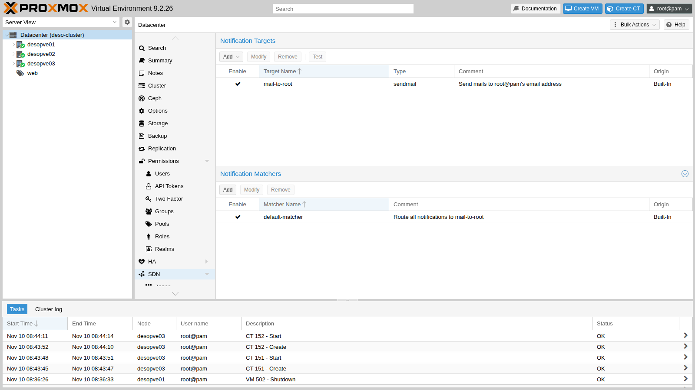
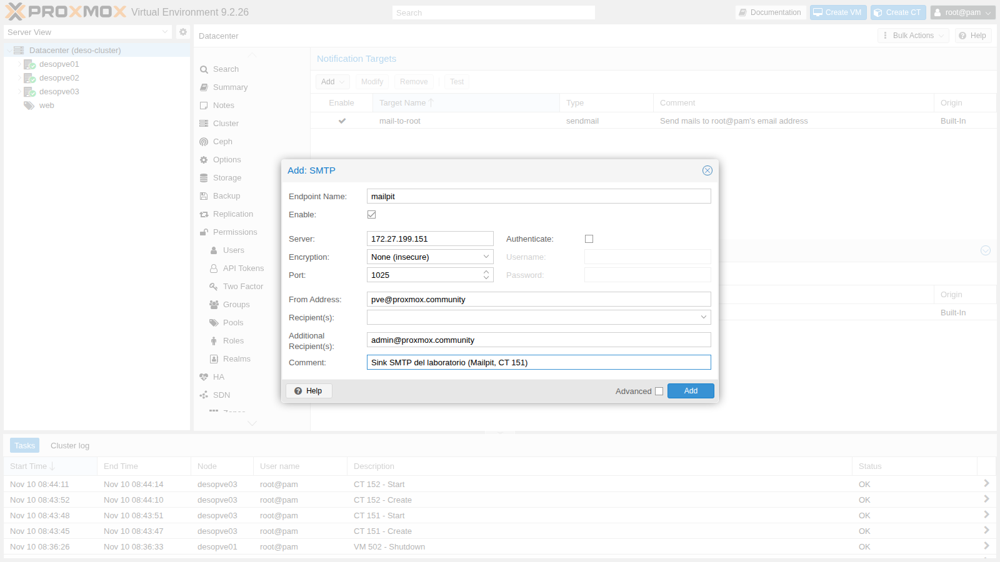
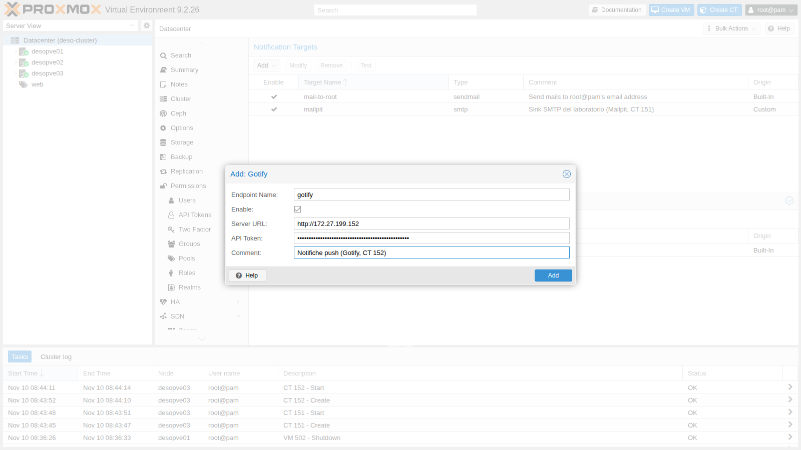
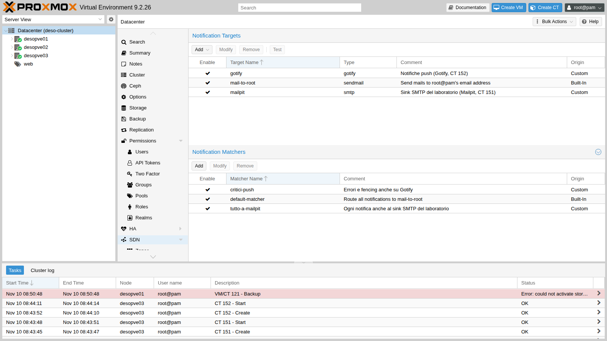
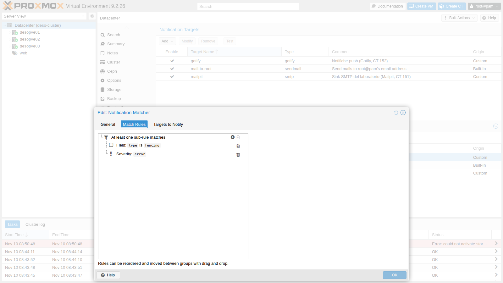
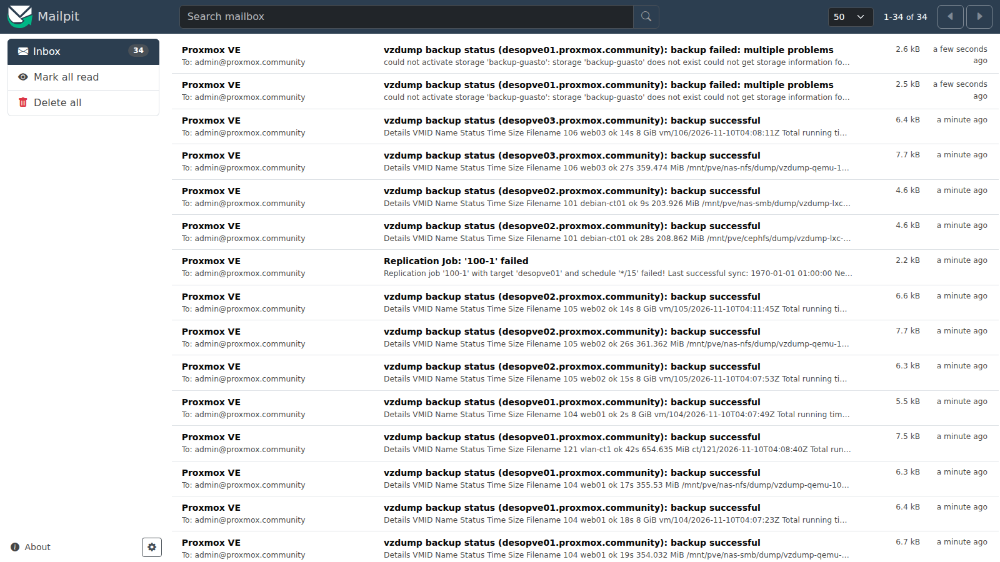
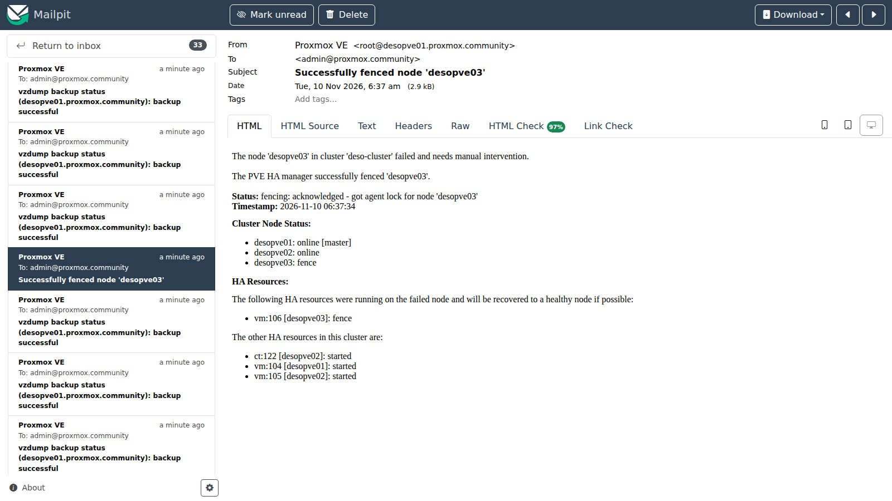
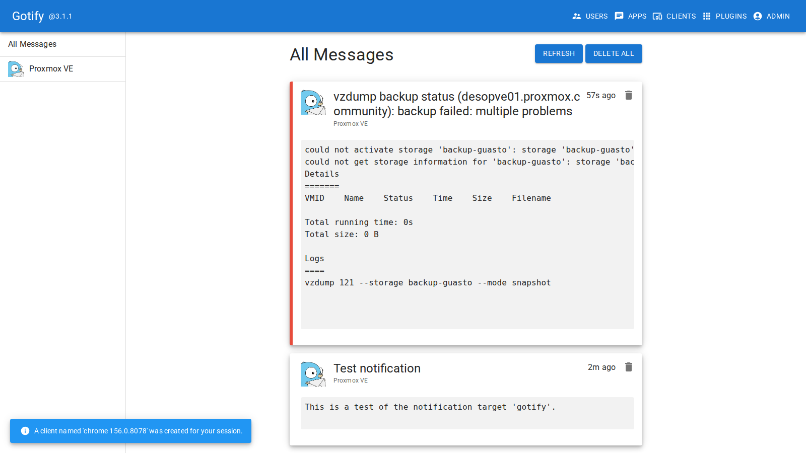
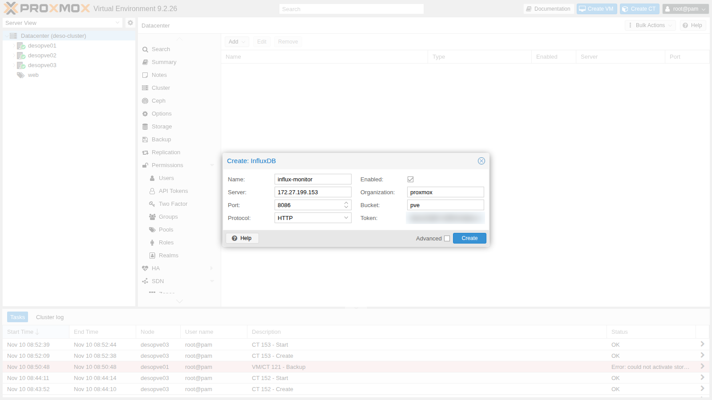
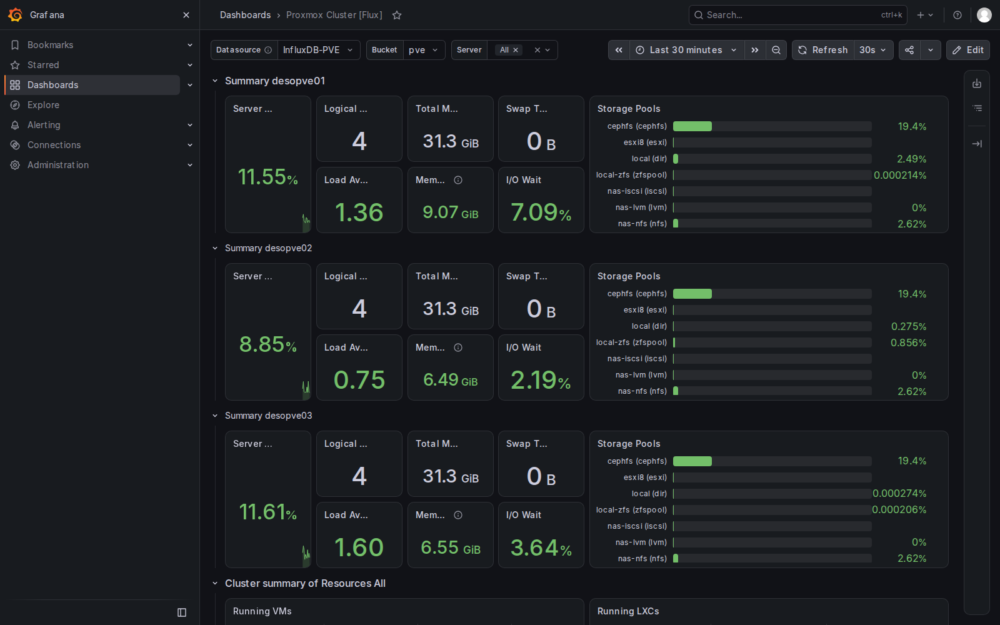

## Dependencies

- **Previous labs:**
  - [Lab 07](/07-first-vm-and-container/): containers from templates;
  - [Lab 04](/04-first-access-repositories-updates/): the lab proxy, configured in the Datacenter and for `apt`;
  - [Lab 41](/41-lxc-containers/): containers from OCI images and downloads with `skopeo` behind a proxy;
  - [Lab 32](/32-firewall-1/) and [Lab 33](/33-firewall-2/): the Datacenter firewall, the `management` IPSet;
  - [Lab 46](/46-vzdump-backup/) and [Lab 49](/49-high-availability/): the backup jobs and the fencing that generated notifications.
- **Systems:** the `deso-cluster` cluster (`desopve01`-`03`), the `cephfs` (templates) and `rbd-vm` (container disks) storages.
- **New addresses:** CT 151 `mailpit` 172.27.199.151, CT 152 `gotify` 172.27.199.152, CT 153 `monitor` 172.27.199.153.
- **Credentials:** `root@pam` and the lab password → [Appendix B](/b-credentials-and-addresses/).

## Objectives

- Understand where Proxmox VE notifications end up with the default configuration, and why they sometimes never arrive.
- Configure the **notification system**: SMTP, Gotify and sendmail targets, matchers by severity and event type.
- Send the cluster **metrics** to InfluxDB 2 and visualize them in Grafana.
- Read the **logs** of the Proxmox VE services and of the tasks, and centralize them with rsyslog.
- Protect the new services with the firewall without interrupting metrics and logs.

## How it works

**Notifications.** Since version 8.1, every event that Proxmox VE wants to report (backups, replication, fencing, available updates, system mail) goes through a single notification system, configured in **Datacenter → Notifications** and saved in `/etc/pve/notifications.cfg` (the secrets in `/etc/pve/priv/notifications.cfg`).

- A **target** is a destination: `sendmail` (uses the local MTA, that is, Postfix), `smtp` (talks directly to a mail server), `gotify` (push notifications) and `webhook` (an HTTP request with a customizable body).
- A **matcher** decides which notifications go to which targets. Its rules look at the **severity** (`info`, `notice`, `warning`, `error`), at the **fields** of the event (for example `type=vzdump`, `type=fencing`, `type=replication`, `type=package-updates`, `hostname`, `job-id`) and at the **calendar**. Mode `all` requires all rules to match, mode `any` requires just one.
- Every notification is evaluated by **all** matchers: if two matchers send it to the same recipient, it arrives twice.

The default configuration has a single target, `mail-to-root`, which uses `sendmail` to send to the email address of `root@pam`, and a matcher, `default-matcher`, that sends everything to it.

**Metrics.** Every node periodically sends the statistics of nodes, guests and storages to one or more **metric servers**: Graphite or InfluxDB. With InfluxDB 2 you use the HTTP(S) protocol with an organization, a bucket and a token. Proxmox VE keeps no history beyond its RRD graphs: for long-term history, alerts and dashboards you use an external database such as InfluxDB and a tool such as Grafana.

**Logs.** The Proxmox VE services write to the systemd journal: `pveproxy` (web interface and API), `pvedaemon` (privileged operations), `pve-cluster` (the `/etc/pve` file system), `corosync`, `pve-ha-crm` and `pve-ha-lrm` (high availability), `pvestatd` (statistics). Every operation started from the interface or the API is a **task** with an identifier (UPID) and its own log in `/var/log/pve/tasks/`. To have the logs of all nodes in one place, and to keep them even if a node fails, you forward them to a central server.

## Procedure

### 1. Where did the notifications go?

The default configuration, with only the `mail-to-root` target:



The address of `root@pam` is `admin@proxmox.community`, set during the installation in [Lab 03](/03-install-proxmox-ve/). Nobody, however, has ever read the notifications of the previous labs. The Postfix queue on `desopve01`:

```bash
postqueue -p | head -8
```

```text output
-Queue ID-  --Size-- ----Arrival Time---- -Sender/Recipient-------
4339E298E9*    9722 Tue Nov 10 04:37:39  root@desopve01.proxmox.community
                                         admin@proxmox.community

C321B2A7B8     7395 Tue Nov 10 05:09:22  root@desopve01.proxmox.community
         (connect to proxmox.community[fd27:199::20]:25: Connection timed out)
                                         admin@proxmox.community
```

Across the three nodes there are **31 stuck messages**, including the very fencing notifications of [Lab 49](/49-high-availability/):

```text
desopve01 7A1F02D550 | Subject: Trying to fence node 'desopve03'
desopve01 93AAE2D572 | Subject: Successfully fenced node 'desopve03'
desopve02 1EE3118167 | Subject: Replication Job: '100-1' failed
desopve01 4339E298E9 | Subject: vzdump backup status (desopve01.proxmox.community): backup successful
…
```

The reason: the `proxmox.community` domain has no MX record in the lab DNS, so Postfix tries to deliver directly to the address of the domain, that is, to the domain controller, on port 25. There is no mail server there, and the messages stay in the queue for days. **A notification that nobody receives is as good as no notification.** The first check after installing a cluster is to verify that the emails actually arrive.

### 2. A test mail server: Mailpit

In the lab you don't need a real mail server: an SMTP "sink" that accepts every message and shows it in a web page is enough. Mailpit is a 15 MB OCI image. As in [Lab 41](/41-lxc-containers/), `skopeo` does not use the Datacenter proxy, so you pass the proxy in the environment variable:

```bash
cd /mnt/pve/cephfs/template/cache
HTTPS_PROXY=http://proxy.proxmox.community:3128 skopeo copy \
  docker://docker.io/axllent/mailpit:latest oci-archive:axllent_mailpit_latest.tar
HTTPS_PROXY=http://proxy.proxmox.community:3128 skopeo copy \
  docker://docker.io/gotify/server:latest oci-archive:gotify_server_latest.tar

# on desopve03
pct create 151 cephfs:vztmpl/axllent_mailpit_latest.tar --hostname mailpit --unprivileged 1 \
  --memory 256 --rootfs rbd-vm:2 --net0 name=eth0,bridge=vmbr0,ip=172.27.199.151/24,gw=172.27.199.1
pct start 151
```

```text output
Detected OCI archive
Auto-Enabling host-managed network for network device net0.
Detected container architecture: amd64
```

Proxmox VE takes the process to start from the image (`entrypoint: /mailpit`). Mailpit receives mail on port 1025 and shows the messages at `http://172.27.199.151:8025`.

### 3. SMTP target

**Datacenter → Notifications → Add → SMTP**: Endpoint Name `mailpit`, server `172.27.199.151`, port `1025`, encryption **None (insecure)** because the sink has no TLS, no authentication, sender `pve@proxmox.community`, recipient `admin@proxmox.community`.



In production you use the company mail server or an external service with **STARTTLS** or **TLS** and a dedicated user. The password ends up in `/etc/pve/priv/notifications.cfg`, readable only by root.

Unlike `sendmail`, the SMTP target **does not go through Postfix**: Proxmox VE talks directly to the server, so a full local queue does not block it. The **Test** button sends a test message, which shows up in Mailpit immediately.

### 4. Gotify target and a trap: the Datacenter proxy

Gotify is a push notification server with a smartphone app. Container 152 is created from the image downloaded in step 2, like 151, on the same node `desopve03`:

```bash
pct create 152 cephfs:vztmpl/gotify_server_latest.tar --hostname gotify --unprivileged 1 --memory 256 \
  --rootfs rbd-vm:2 --net0 name=eth0,bridge=vmbr0,ip=172.27.199.152/24,gw=172.27.199.1
pct start 152
```

 At first start the user is `admin`/`admin`: you change the password and create an **application**, which provides the token for sending messages:

```bash
curl -s -u admin:admin -X POST http://172.27.199.152/current/user/password \
  -H 'Content-Type: application/json' -d '{"pass":"<lab-password>"}'
curl -s -u 'admin:<lab-password>' -X POST http://172.27.199.152/application \
  -H 'Content-Type: application/json' -d '{"name":"Proxmox VE","description":"Notifiche del cluster deso-cluster"}'
```

The token goes into the **Gotify** target (Endpoint Name `gotify`):



The test, however, fails:

```bash
pvesh create /cluster/notifications/targets/gotify/test
```

```text output
500 Could not test target: could not notify via endpoint(s): gotify: CONNECT proxy failed: proxy server responded 403/403
```

The **Gotify** and **Webhook** targets use the **Datacenter HTTP proxy** set in [Lab 04](/04-first-access-repositories-updates/), even toward an internal address. The proxy log confirms it:

```text
CONNECT   Nov 10 07:49:34.599 [91799]: Request (file descriptor 5): CONNECT 172.27.199.152:80 HTTP/1.1
NOTICE    Nov 10 07:49:34.603 [91799]: Proxying refused on filtered domain "172.27.199.152"
```

The lab proxy accepts only a list of external domains. The solution is to let the internal destinations of the management network (`172.27.199.0/24` and `*.proxmox.community`) through the proxy as well. In a company, you ask whoever manages the proxy for the same exception. After the change:

```text
Test notification  | 1 | ``` This is a test of the notification target 'gotify'.  ```
```

The SMTP target and the InfluxDB metric server of step 7, on the other hand, do **not** go through the proxy: no request to their ports appears in the proxy log.

### 5. Matchers: who receives what

Two new matchers, created from the command line:

```bash
pvesh create /cluster/notifications/matchers --name tutto-a-mailpit --mode all \
  --target mailpit --comment "Ogni notifica anche al sink SMTP del laboratorio"
pvesh create /cluster/notifications/matchers --name critici-push --mode any \
  --match-severity error --match-field exact:type=fencing \
  --target gotify --comment "Errori e fencing anche su Gotify"
```

The result in `/etc/pve/notifications.cfg`:

```text
matcher: tutto-a-mailpit
	comment Ogni notifica anche al sink SMTP del laboratorio
	mode all
	target mailpit

matcher: critici-push
	comment Errori e fencing anche su Gotify
	match-field exact:type=fencing
	match-severity error
	mode any
	target gotify
```



In the `critici-push` matcher, mode **any** fires the rule on an error **or** on a fencing event: the rule on the `type` field catches fencing notifications whatever their severity, including the one for a successful fencing.



### 6. Unblocking the Postfix queue and testing a real error

The `sendmail` target (`mail-to-root`) is still useful: other system programs use it too, for example cron and `smartd`. Have Postfix deliver to the lab mail server, on every node:

```bash
postconf -e 'relayhost = [172.27.199.151]:1025'
postfix reload
postqueue -f
postqueue -p | tail -1
```

```text output
Mail queue is empty
```

The square brackets tell Postfix not to look up the MX record and to use that address directly. All 31 stuck messages arrive in Mailpit:

```text
totale 32
28 vzdump backup status
1 Replication Job: '100-1' failed
1 Successfully fenced node 'desopve03'
1 Trying to fence node 'desopve03'
1 Test notification
```



The fencing notification of Lab 49 describes what happened and which HA resources were recovered:



To test the error path you need a real error. A backup to a storage that does not exist:

```bash
vzdump 121 --storage backup-guasto --mode snapshot
```

```text output
INFO: notified via target `mail-to-root`
INFO: notified via target `mailpit`
INFO: notified via target `gotify`
could not activate storage 'backup-guasto': storage 'backup-guasto' does not exist could not get storage information for 'backup-guasto': storage 'backup-guasto' does not exist
```

The same notification went through three targets. It arrives in Mailpit **twice**: once through `mail-to-root` (Postfix) and once through the SMTP target. In Gotify it arrives with priority 9, the highest, because the severity is `error`:



### 7. Metrics: InfluxDB 2 and Grafana

A dedicated Debian 13 container, CT 153 `monitor`, with InfluxDB 2, Grafana and rsyslog from the official repositories (through the proxy):

```bash
# on desopve03
pct create 153 cephfs:vztmpl/debian-13-standard_13.6-1_amd64.tar.zst --hostname monitor \
  --unprivileged 1 --features nesting=1 --cores 2 --memory 2048 --swap 512 --rootfs rbd-vm:10 \
  --net0 name=eth0,bridge=vmbr0,ip=172.27.199.153/24,gw=172.27.199.1 \
  --nameserver 172.27.199.20 --searchdomain proxmox.community --password '<lab-password>'
pct start 153
pct enter 153
```

Inside the container:

```bash
echo 'Acquire::http::Proxy "http://proxy.proxmox.community:3128";' > /etc/apt/apt.conf.d/80proxy
export https_proxy=http://proxy.proxmox.community:3128
apt-get update && apt-get install -y curl gpg
install -d -m 0755 /etc/apt/keyrings
curl -fsSL https://repos.influxdata.com/influxdata-archive.key | gpg --dearmor -o /etc/apt/keyrings/influxdata.gpg
curl -fsSL https://apt.grafana.com/gpg.key | gpg --dearmor -o /etc/apt/keyrings/grafana.gpg
echo "deb [signed-by=/etc/apt/keyrings/influxdata.gpg] https://repos.influxdata.com/debian stable main" > /etc/apt/sources.list.d/influxdata.list
echo "deb [signed-by=/etc/apt/keyrings/grafana.gpg] https://apt.grafana.com stable main" > /etc/apt/sources.list.d/grafana.list
apt-get update && apt-get install -y influxdb2 influxdb2-cli grafana rsyslog
systemctl enable --now influxdb grafana-server
```

```text output
grafana 13.3.0
influxdb2 2.9.1-1
rsyslog 8.2504.0-1+deb13u2
```

Initial InfluxDB setup: organization `proxmox`, bucket `pve` with 30 days of retention, and two separate tokens, one that can **only write** (for Proxmox VE) and one that can **only read** (for Grafana):

```bash
influx setup --org proxmox --bucket pve --username admin --password '<lab-password>' --retention 30d --force
BID=$(influx bucket list --org proxmox --name pve --hide-headers | cut -f1)
influx auth create --org proxmox --write-bucket $BID --description pve-scrittura
influx auth create --org proxmox --read-bucket $BID --description grafana-lettura
```

In Proxmox VE: **Datacenter → Metric Server → Add → InfluxDB**, ID `influx-monitor`, protocol **HTTP**, server `172.27.199.153`, port `8086`, organization `proxmox`, bucket `pve`, write token.



The configuration ends up in `/etc/pve/status.cfg`, valid for all nodes:

```text
influxdb: influx-monitor
	port 8086
	server 172.27.199.153
	bucket pve
	influxdbproto http
	organization proxmox
```

The data starts arriving after a few seconds. The measurements present in the bucket and the latest CPU value of two nodes:

```text
ballooninfo blockstat cpustat memory nics proxmox-support system
```

```text
           host:string                  _value:float
----------------------  ----------------------------
             desopve02             0.146134663341646
             desopve03                        0.2536
```

In Grafana (`http://172.27.199.153:3000`) you add a data source of type **InfluxDB** with the **Flux** query language, organization `proxmox`, bucket `pve` and the read-only token. The test answers `datasource is working. 1 buckets found`. Then you import the public dashboard "Proxmox Cluster [Flux]" (ID 15356 on grafana.com). Import by ID is done by the `grafana-server` service, which does not use the proxy: behind a proxy, download the JSON from the container (the proxy must allow the `grafana.com` domain) and upload it with **Dashboards → New → Import → Upload dashboard JSON file**, associating it with this data source:

```bash
curl -x http://proxy.proxmox.community:3128 -fsS -o /root/proxmox-flux.json \
  https://grafana.com/api/dashboards/15356/revisions/latest/download
```




If you completed [Lab 50](/50-import-from-esxi/), the list of storages also includes the import storage, which has no space of its own.

### 8. Logs: journal, tasks and centralized forwarding

The journal keeps the history of the services. The fencing of Lab 49, as seen by the HA manager on `desopve01`:

```bash
journalctl -u pve-ha-crm --since "2026-11-10 06:35" --until "2026-11-10 06:40" -o short-iso | grep -iE "fenc|recover|node .desopve03"
```

```text output
2026-11-10T06:35:54+01:00 desopve01 pve-ha-crm[1679]: node 'desopve03': state changed from 'online' => 'unknown'
2026-11-10T06:36:44+01:00 desopve01 pve-ha-crm[1679]: service 'vm:106': state changed from 'started' to 'fence'
2026-11-10T06:36:44+01:00 desopve01 pve-ha-crm[1679]: node 'desopve03': state changed from 'unknown' => 'fence'
2026-11-10T06:37:44+01:00 desopve01 pve-ha-crm[1679]: fencing: acknowledged - got agent lock for node 'desopve03'
2026-11-10T06:37:44+01:00 desopve01 pve-ha-crm[1679]: recover service 'vm:106' from fenced node 'desopve03' to node 'desopve02'
```

And Corosync, a few seconds earlier, when the node disappeared:

```text
2026-11-10T06:35:38+01:00 desopve01 corosync[120106]:   [KNET  ] link: host: 3 link: 0 is down
2026-11-10T06:35:38+01:00 desopve01 corosync[120106]:   [KNET  ] link: host: 3 link: 1 is down
2026-11-10T06:35:38+01:00 desopve01 corosync[120106]:   [KNET  ] host: host: 3 has no active links
```

The tasks of the node, with the failed backup of step 6:

```bash
pvenode task list --limit 4
tail -n 1 /var/log/pve/tasks/index
```

```text output
│ UPID:desopve01:000AED42:0064A85D:6AF2CCD8:vzdump:121:root@pam:     │ vzdump     │ 121 │ root@pam │ 2026-11-10 08:50:48 │ 2026-11-10 08:50:48 │ ERROR  │
UPID:desopve01:000AED42:0064A85D:6AF2CCD8:vzdump:121:root@pam: 6AF2CCD8 could not activate storage 'backup-guasto': storage 'backup-guasto' does not exist …
```

The **central server** is rsyslog in CT 153, which receives on TCP 514 and writes one file per node and per program:

```text
# /etc/rsyslog.d/10-ricezione.conf (CT 153)
module(load="imtcp")
input(type="imtcp" port="514" ruleset="remoti")
template(name="PerHost" type="string" string="/var/log/remote/%HOSTNAME%/%PROGRAMNAME%.log")
ruleset(name="remoti") {
    action(type="omfile" dynaFile="PerHost" createDirs="on")
}
```

Proxmox VE 9 nodes use only the journal: rsyslog has to be installed. On every node:

```bash
apt-get install -y rsyslog
cat > /etc/rsyslog.d/90-remoto.conf <<'EOF'
*.* action(type="omfwd" target="172.27.199.153" port="514" protocol="tcp"
           queue.type="LinkedList" queue.filename="inoltro-remoto"
           queue.saveOnShutdown="on" action.resumeRetryCount="-1")
EOF
systemctl restart rsyslog
logger -t lab51 "prova di inoltro da $(hostname)"
```

The disk queue (`queue.filename`) keeps the messages if the central server is unreachable and sends them when it comes back. The test messages arrive on CT 153 and, when you restart CT 101 on `desopve02`, so do the real tasks:

```text
2026-11-10T08:57:33+00:00 desopve01 lab51: prova di inoltro da desopve01
2026-11-10T08:57:40+00:00 desopve02 lab51: prova di inoltro da desopve02
2026-11-10T08:57:48+00:00 desopve03 lab51: prova di inoltro da desopve03
2026-11-10T08:58:03+00:00 desopve02 pct[632504]: <root@pam> end task UPID:desopve02:0009A6B9:0053EFD3:6AF2CE89:vzstop:101:root@pam: OK
2026-11-10T08:58:07+00:00 desopve02 pct[632503]: <root@pam> end task UPID:desopve02:0009A6D8:0053F113:6AF2CE8C:vzstart:101:root@pam: OK
```

The timestamps were in UTC because the container is created with that time zone: after `timedatectl set-timezone Europe/Rome` they match those of the nodes.

### 9. Firewall for the new services

The host firewall of the nodes ([Lab 33](/33-firewall-2/)) filters only **incoming** traffic to the nodes: metrics, logs and notifications are **outgoing** connections, and the outbound policy is `ACCEPT`. The `monitor` container, on the other hand, exposes three services and must be protected. An IPSet with the nodes, and the rules of the container:

```bash
pvesh create /cluster/firewall/ipset --name nodi-pve --comment "Nodi Proxmox VE del laboratorio"
for i in 21 22 23 24; do pvesh create /cluster/firewall/ipset/nodi-pve --cidr 172.27.199.$i; done
```

Create `/etc/pve/firewall/153.fw` with this content (or create the same rules from **CT 153 → Firewall**):

```text
# /etc/pve/firewall/153.fw
[OPTIONS]
enable: 1
policy_in: DROP

[RULES]
IN ACCEPT -source +nodi-pve -p tcp -dport 8086 -log nolog # metriche dai nodi verso InfluxDB
IN ACCEPT -source +nodi-pve -p tcp -dport 514 -log nolog # log dei nodi verso rsyslog
IN ACCEPT -source +management -p tcp -dport 3000 -log nolog # Grafana dalla rete di gestione
IN SSH(ACCEPT) -source +management -log nolog
IN Ping(ACCEPT) -log nolog
```

Finally, set `firewall=1` on the network device of the container (`pct set 153 --net0 …,firewall=1`).

## Verification and tests

| Test | Result |
|---|---|
| Postfix queue with the default target | 31 notifications stuck for days, fencing included |
| Test of the SMTP target | message in Mailpit |
| Test of the Gotify target with the filtering proxy | error `CONNECT proxy failed: 403` |
| Test of the Gotify target after the proxy exception | message in Gotify |
| `postqueue -f` with `relayhost` pointing to Mailpit | empty queue, 31 messages delivered |
| Failed backup (`vzdump` to a nonexistent storage) | three targets, two copies in Mailpit, priority 9 in Gotify |
| Metrics in InfluxDB | measurements `system`, `cpustat`, `memory`, `nics`, `blockstat`, `ballooninfo` |
| Grafana | dashboard with the data of the three nodes |
| `logger` on the nodes and restart of CT 101 | lines in `/var/log/remote/<nodo>/` on CT 153 |
| Port 8086 from CT 101 (not a node), with the CT 153 firewall | blocked |
| Port 8086 from `desopve01`, Grafana from the management network, logs after the firewall | allowed |

## Final lab state

- **Notifications** (`/etc/pve/notifications.cfg`):
  - targets `mail-to-root` (sendmail, default), `mailpit` (SMTP to 172.27.199.151:1025) and `gotify` (http://172.27.199.152, token in `/etc/pve/priv/notifications.cfg`);
  - matchers `default-matcher` (everything to `mail-to-root`), `tutto-a-mailpit` (everything to `mailpit`), `critici-push` (errors or fencing to `gotify`).
- **Postfix** on nodes 01-03: `relayhost = [172.27.199.151]:1025`, empty queue.
- **Lab proxy:** the internal destinations `172.27.199.0/24` and `*.proxmox.community` are allowed as well.
- **CT 151 `mailpit`** on `desopve03`, running (OCI image, 172.27.199.151, SMTP 1025, web 8025). The messages are kept in memory: they are lost when the container restarts.
- **CT 152 `gotify`** on `desopve03`, running (OCI image, 172.27.199.152, user `admin`, application "Proxmox VE").
- **CT 153 `monitor`** on `desopve03`, running (Debian 13, 172.27.199.153): InfluxDB 2.9 (organization `proxmox`, bucket `pve`, 30 days, tokens `pve-scrittura` and `grafana-lettura`), Grafana 13.3 (`admin`, dashboard "Proxmox Cluster [Flux]"), rsyslog listening on TCP 514; firewall enabled with the rules of step 9.
- **Metric server** `influx-monitor` in the Datacenter.
- **rsyslog** installed on nodes 01-03 with `/etc/rsyslog.d/90-remoto.conf`.
- **IPSet** `nodi-pve` (172.27.199.21-24) in the Datacenter firewall.
- The OCI templates `axllent_mailpit_latest.tar` and `gotify_server_latest.tar` remain on `cephfs`.

## What you learned

- With the default configuration, notifications leave via Postfix for the email address of `root@pam`: if the domain has no reachable mail server, they stay **in the queue** and nobody notices.
- An **SMTP** target talks directly to the mail server and does not depend on the local queue; `relayhost` fixes `sendmail` too.
- The **Gotify** and **Webhook** targets go through the **Datacenter proxy**, even toward internal addresses.
- **Matchers** add up: every notification is evaluated by all of them, and overlapping recipients receive duplicates.
- The InfluxDB **metric server** receives the statistics of all nodes; with separate tokens for writing and reading, Grafana cannot modify the data.
- Service logs live in the **journal**, operation logs in the **tasks**; rsyslog with a disk queue centralizes them without losing anything if the server is down.
- A monitoring service must be protected like any other: only the nodes write, only the management network reads.

## References

- [Proxmox VE – Notifications](https://pve.proxmox.com/pve-docs/chapter-notifications.html)
- [Proxmox VE – External Metric Server](https://pve.proxmox.com/pve-docs/chapter-sysadmin.html#external_metric_server)
- [InfluxDB 2 – Install on Linux](https://docs.influxdata.com/influxdb/v2/install/)
- [Grafana – Install on Debian or Ubuntu](https://grafana.com/docs/grafana/latest/setup-grafana/installation/debian/)
- [Grafana – dashboard "Proxmox Cluster [Flux]"](https://grafana.com/grafana/dashboards/15356)
- [Mailpit](https://mailpit.axllent.org/) and [Gotify](https://gotify.net/docs/)
- [rsyslog – omfwd](https://www.rsyslog.com/doc/configuration/modules/omfwd.html)
