## Dependencies

- **Previous labs:**
  - [Lab 25](/25-ipv6/): the IPv6 configuration of the hosts (file `90-ipv6-host.conf`);
  - [Lab 03](/03-install-proxmox-ve/) and [Lab 04](/04-first-access-repositories-updates/): installer, no-subscription repository and proxy, with the same procedure;
  - [Lab 40](/40-templates-cloud-init-clones/): template 9000 `debian13-cloud`, from which the migration test VM is cloned;
  - [Lab 44](/44-users-groups-roles-pools-tokens/): users, roles and API tokens;
  - [Lab 47](/47-proxmox-backup-server/): the Proxmox Backup Server `desopbs01`;
  - [Lab 48](/48-migrations/): `qm remote-migrate` and its limits, which PDM uses behind the scenes;
  - [Lab 30](/30-sdn-evpn/): the EVPN zone `evpnz`, which PDM displays.
- **Systems:**
  - the server `desopdm01.proxmox.community` (172.27.199.41) for PDM: 2 cores, 4 GB of RAM, a 32 GB disk;
  - the cluster `deso-cluster`, the standalone node `desopve04` and the PBS `desopbs01`.
- **ISO:** `proxmox-datacenter-manager_1.1-1.iso`.
- **Credentials:** `root@pam` and the lab password → [Appendix B](/b-credentials-and-addresses/).

## Objectives

- Proxmox Datacenter Manager (PDM) installed and up to date, with the no-subscription repository, the proxy and NTP in sync: the GUI shows the version.
- A PVE cluster, a standalone PVE node and a PBS connected as **remotes**, each with a dedicated token and a verified certificate fingerprint.
- Status, resources, search, updates and the EVPN view of every remote available from the PDM dashboard.
- A VM migrated **between two different datacenters** from the PDM GUI and brought back, knowing why the first attempt failed and why the second one worked.

## How it works

**One pane of glass over several datacenters.** A Proxmox VE cluster can be managed from any of its nodes, but each cluster (or standalone node) is a world of its own, with its own GUI and its own users. PDM is a separate application, with its own installation, that connects to several PVE clusters and several PBS instances through their APIs and shows everything in a single interface: status, resources, search, updates, tasks. It does not replace the GUI of the clusters: for detailed operations it sends you there with the **Open Web UI** button.

**Remotes and tokens.** Each connected system is a **remote**. PDM authenticates with an **API token** of the remote: it can create the token by itself from a user name and password, or use an existing one. It verifies the certificate by its fingerprint and, for a cluster, saves all the nodes as **endpoints**, so it keeps working if a node is down.

**Migration between remotes.** Between two different PVE remotes, PDM uses the same `remote-migrate` function as in [Lab 48](/48-migrations/): a websocket tunnel on port 8006 between the source node and the target node, with the token of the target remote. PDM adds the GUI, the choice of target storage and bridge, and a view of the tasks on both sides.

## Procedure

### 1. Installation

The installer is the same as the Proxmox VE one ([Lab 03](/03-install-proxmox-ve/)):

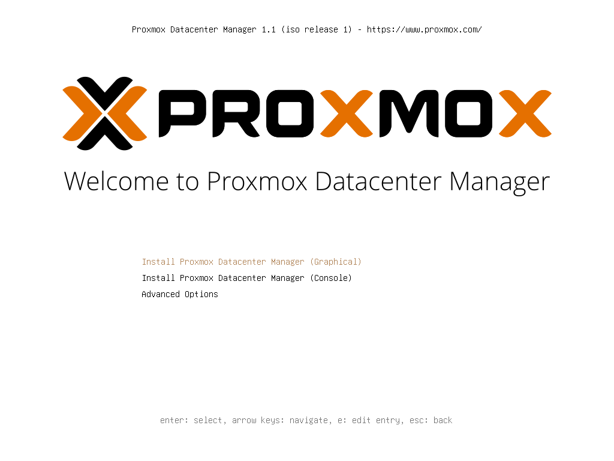

A 32 GB target disk with ext4: PDM hosts no VMs and a few GB are enough for it.

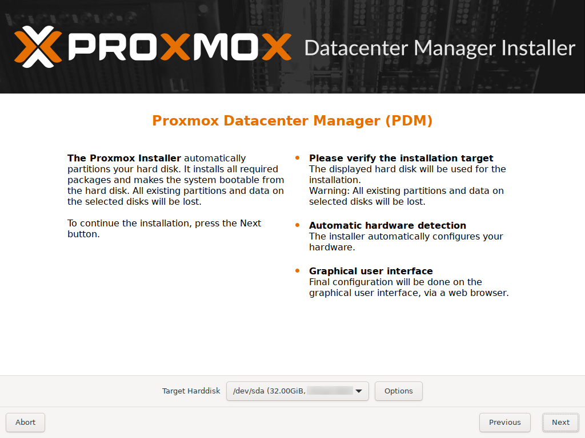

Static network with the final host name and pinned network card names (`nic0`), as for the nodes:

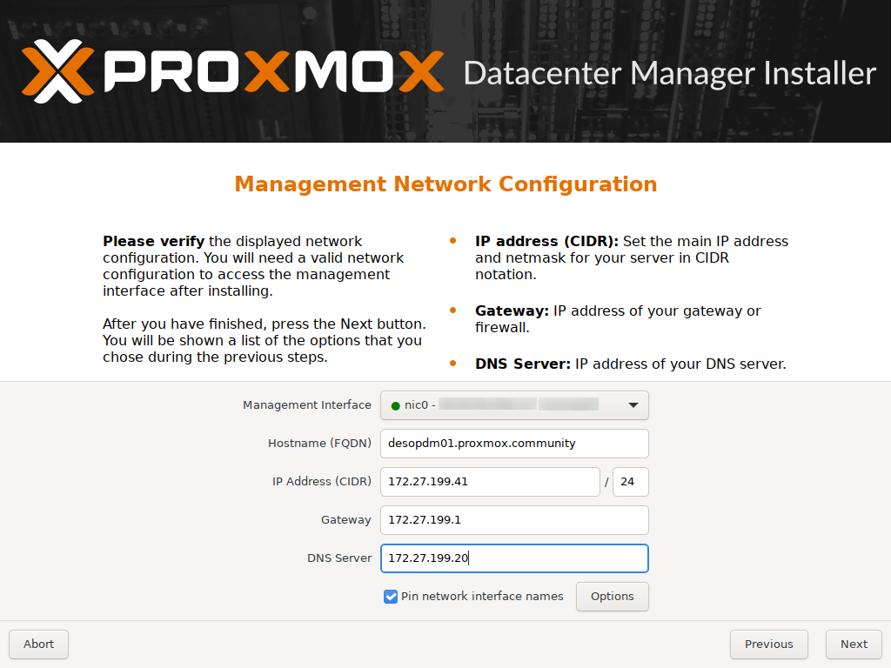

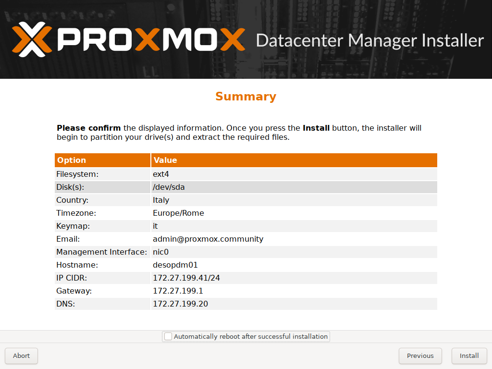

After the reboot, the console shows the address of the GUI, on port **8443** (not 8006):

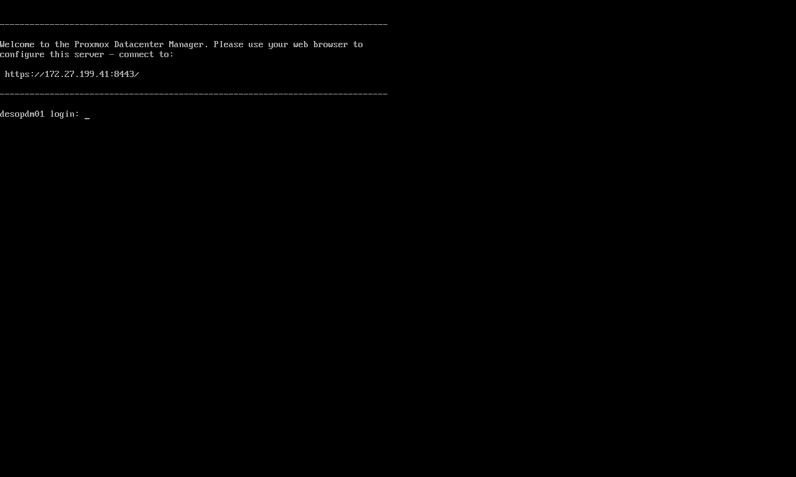

### 2. Repositories, proxy, NTP and update

As on a PVE node without a subscription, disable the enterprise repository and add `pdm-no-subscription`:

```bash
sed -i "s/^Components: pdm-enterprise/Components: pdm-enterprise\nEnabled: false/" /etc/apt/sources.list.d/pdm-enterprise.sources
cat > /etc/apt/sources.list.d/proxmox.sources <<'EOF'
Types: deb
URIs: http://download.proxmox.com/debian/pdm
Suites: trixie
Components: pdm-no-subscription
Signed-By: /usr/share/keyrings/proxmox-archive-keyring.gpg
EOF
echo 'Acquire::http::Proxy "http://proxy.proxmox.community:3128";' > /etc/apt/apt.conf.d/80proxy
sed -i "s/^pool 2.debian.pool.ntp.org iburst/server ntp.proxmox.community iburst/" /etc/chrony/chrony.conf
systemctl restart chrony
apt update && apt full-upgrade
```

The ISO installed version 1.1.1. After the update, with 111 new packages:

```text
proxmox-datacenter-manager 1.1.9 running version: 1.1.9
proxmox-datacenter-manager-ui 1.1.4
^* netsvc.proxmox.community      3   6    17    48  -9031ns[  -34us] +/-   23ms
System clock synchronized: yes
```

**IPv6 as on the nodes.** As for the nodes in [Lab 25](/25-ipv6/), here too there is no autoconfiguration from the router's RAs, and the link-local addresses are not derived from the MAC. Create the same `/etc/sysctl.d/90-ipv6-host.conf` file and apply it with `sysctl --system`; it takes full effect from the next reboot. On `desopdm01`:

```bash
cat /etc/sysctl.d/90-ipv6-host.conf
```

```text output
# Indirizzi IPv6 del nodo solo statici: nessuna interfaccia accetta gli RA o si autoconfigura (SLAAC).
# Il carattere * vale anche per le schede che compaiono dopo l'avvio (systemd le applica a ogni nuova interfaccia).
net.ipv6.conf.*.accept_ra = 0
net.ipv6.conf.*.autoconf = 0
# Link-local non derivati dal MAC (RFC 7217, "stable privacy" con segreto casuale)
net.ipv6.conf.all.addr_gen_mode = 3
net.ipv6.conf.default.addr_gen_mode = 3
```

The first login, at `https://desopdm01.proxmox.community:8443` with `root@pam`, shows an empty PDM, which already offers to add **PVE** and **PBS** remotes:

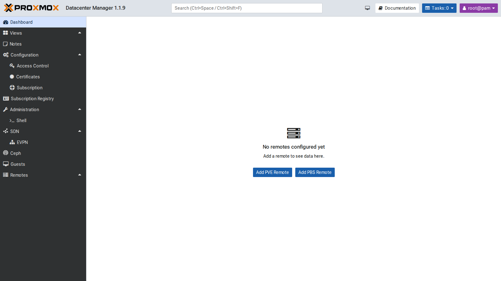

### 3. Tokens for PDM on the remotes

A dedicated user on each remote makes it clear, in the logs and in the tasks, what PDM did. On the cluster and on `desopve04` (which has its own user database):

```bash
pveum user add pdm@pve --comment "Proxmox Datacenter Manager (lab 53)"
pveum acl modify / --users pdm@pve --roles Administrator
pveum user token add pdm@pve pdm --privsep 0 --comment "PDM desopdm01"
```

The `Administrator` role is needed because PDM must be able to migrate, start and stop guests, and read the available updates. For a **read-only** PDM, `PVEAuditor` is enough. On the PBS, PDM only needs to read, hence the `Audit` role; on PBS, tokens always have their own ACLs:

```bash
proxmox-backup-manager user create pdm@pbs --comment "Proxmox Datacenter Manager (lab 53)"
proxmox-backup-manager acl update / Audit --auth-id pdm@pbs
proxmox-backup-manager user generate-token pdm@pbs pdm
proxmox-backup-manager acl update / Audit --auth-id 'pdm@pbs!pdm'
```

### 4. Adding the remotes

**Remotes → Add → Proxmox VE**. In the first step, enter any node of the cluster. PDM downloads the certificate and asks whether to trust it: compare the fingerprint with the node's one (`pvenode cert info`, `14:32:84:88:C7…` for `desopve01`):

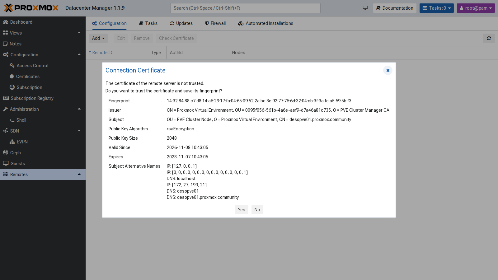

Then the remote ID and the authentication. With **Use existing Token** you use the token just created; with **Login and create Token**, PDM would create one by itself (`pdm-admin-desopdm01`) with the `root@pam` credentials:

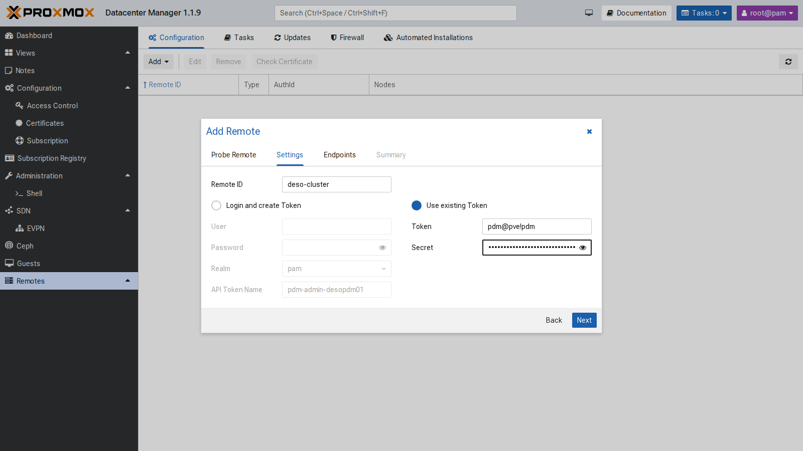

PDM reads the list of the cluster nodes and saves each one as an endpoint, with its fingerprint:

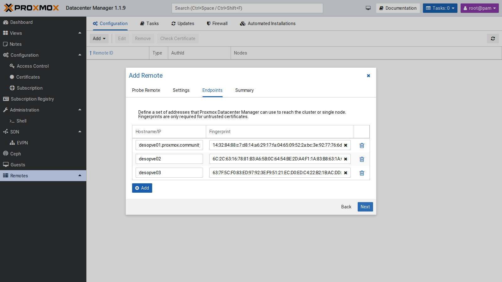

The same for `desopve04` (a single-node PVE remote) and, with **Add → Proxmox Backup Server**, for `desopbs01`. Version 1.1 also manages PBS remotes. The result:

```bash
proxmox-datacenter-manager-admin remote list
```

```text output
Proxmox VE node deso-cluster:
    auth id: pdm@pve!pdm
    nodes:
        desopve01.proxmox.community,fingerprint=14:32:84:88:c7:d8:…
        desopve02,fingerprint=6C:2C:63:16:78:81:…
        desopve03,fingerprint=63:7F:5C:F0:83:ED:…
Proxmox VE node desopve04:
    auth id: pdm@pve!pdm
    node: desopve04.proxmox.community,fingerprint=84:d3:f2:f5:d3:4b:…
Proxmox Backup Server node desopbs01:
    auth id: pdm@pbs!pdm
    node: desopbs01.proxmox.community,fingerprint=31:0b:24:ed:32:07:…
```

From now on, a **No valid subscriptions** warning appears at every login, because no remote has a subscription. Close it with **Continue**.

### 5. Dashboard, resources and search

The dashboard summarizes all the remotes: 4 PVE nodes and 1 PBS online, VMs and containers by status, the PBS datastores and the aggregated resources. CPU, for example, shows 1.33 used out of 16 physical cores, with 44 vCPUs assigned.

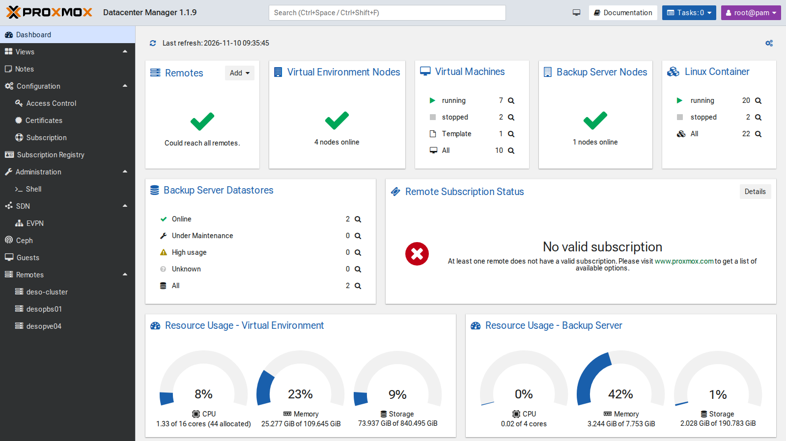

Each remote has its own view, with usage, allocation (assigned CPU and RAM versus physical) and the list of resources, with quick actions (shut down, start, **migrate**, open the remote's GUI). The **global search** at the top (`Ctrl+Space`) finds a VM in any remote and opens its view, with status, graphs, configuration and console:

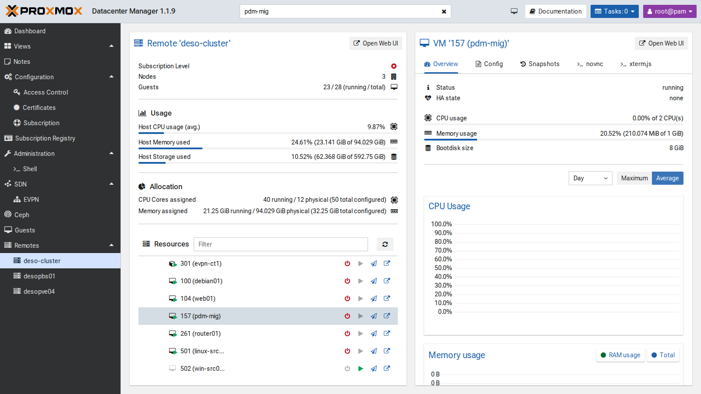

### 6. Updates of all remotes

**Remotes → Updates → Refresh all** queries all the remotes and shows, in a single table, the version, the available updates and the repository status. Selecting a node shows its packages and lets you start the update:

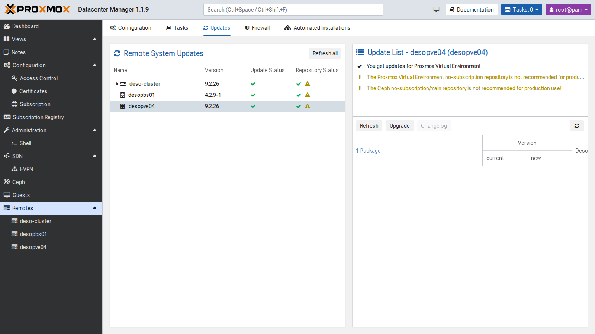

All the remotes are up to date (PVE 9.2.26, PBS 4.2.9). The yellow warnings flag the no-subscription and Ceph no-subscription repositories: fine for a lab, not recommended in production.

### 7. SDN: the EVPN view

**SDN → EVPN** collects the EVPN zones of all the remotes, with ASN, VRF (L3VNI) and VNets. Here is the `evpnz` zone from [Lab 30](/30-sdn-evpn/), with VRF VNI 10070:

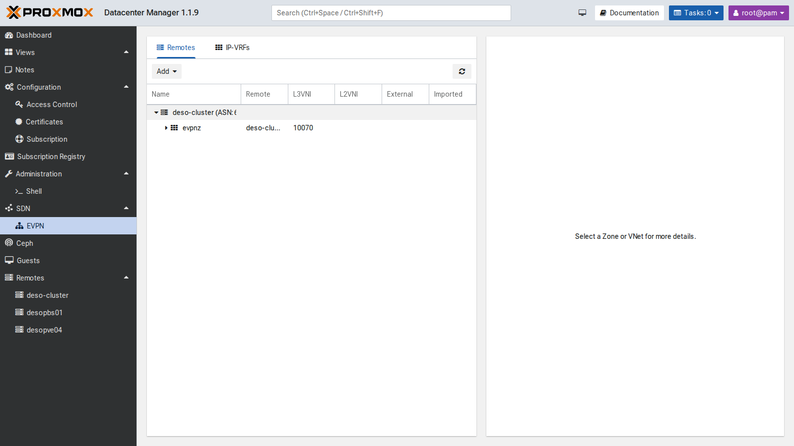

The **Add** button creates EVPN zones and VNets on several remotes at once. The lab has only one cluster with EVPN, so we did not use it.

### 8. Migrating a VM between two datacenters

The test VM `pdm-mig` (VMID 157) is a full clone of template 9000 on `local-zfs` of `desopve01`, running, with address 172.27.199.157:

```bash
qm clone 9000 157 --name pdm-mig --full 1 --storage local-zfs
qm set 157 --ipconfig0 ip=172.27.199.157/24,gw=172.27.199.1 --nameserver 172.27.199.20 --memory 1024
qm start 157
```

In the view of the `deso-cluster` remote, the VM's **Migrate** icon opens the migration dialog. Choosing `desopve04` as **Target Remote** reveals the remote-migration options: endpoint, target VMID, removal of the source, target storage and target network.

During each migration a `ping` runs from the management network to the VM every 0.2 seconds. It shows whether the service stays reachable, but it does not have the resolution to measure the VM's downtime: the task reports that.

#### First attempt: to `local-lvm`

**Configuration tried.** Source `local-zfs` on `desopve01`, target `local-lvm` on `desopve04`, the storage the dialog offers first.

**Error observed.** The task stops after 2 seconds:

```text
2026-11-10 09:38:43 found generated disk 'local-zfs:vm-157-cloudinit' (in current VM config)
2026-11-10 09:38:43 found local disk 'local-zfs:vm-157-disk-0' (attached)
2026-11-10 09:38:43 ERROR: error - tunnel command '{…"volname":"vm-157-cloudinit","cmd":"disk-import",…"export_formats":"zfs",…"storage":"local-lvm"…}' failed - failed to handle 'disk-import' command - no matching import/export format found for storage 'local-lvm'
TASK ERROR: migration aborted
```

The log tells the VM's two disks apart. The main disk (`vm-157-disk-0`) is attached to the running VM and is copied live by block mirroring. The cloud-init disk (`vm-157-cloudinit`) is instead transferred through a storage export and import. In this combination (PVE 9.2 with PDM 1.1.9, ZFS source, LVM-thin target), the source offered it only in the `zfs` format, which `local-lvm` cannot import. [Lab 48](/48-migrations/) hits the same error with `qm remote-migrate`. PDM's dialog did not flag the problem before starting the task, and the VM stayed running and untouched on the source.

This is not a general rule about cloud-init: it depends on which formats the source and target storages have in common. To check it on your own system:

- look for the `export_formats` field in the task log and compare it with the formats the target storage accepts;
- try a target storage of the same type as the source, as below;
- or remove the cloud-init drive before the migration and recreate it on the target in the same slot: for example, if it sits on `ide2`, run `qm set 157 --delete ide2` on the source and `qm set 157 --ide2 local-lvm:cloudinit` on the target. Proxmox regenerates the contents of the cloud-init disk from the VM configuration.

**Decision.** Repeat the migration to `tank`, the ZFS pool of `desopve04`: with ZFS on both sides, the `zfs` format is common to the two storages. The VM stays the same; only the target storage changes.

#### Second attempt: to `tank`

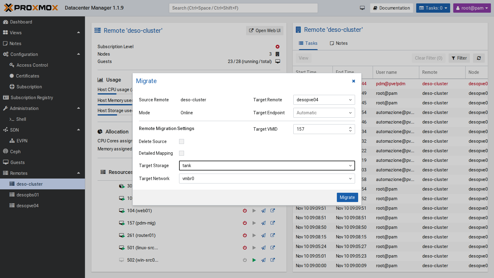

```text
2026-11-10 09:40:17 migration downtime limit: 100 ms
2026-11-10 09:40:19 average migration speed: 512.4 MiB/s - downtime 35 ms
2026-11-10 09:40:19 migration completed, transferred 290.0 MiB VM-state
mirror-scsi0: Completed successfully.
2026-11-10 09:40:23 migration finished successfully (duration 00:00:31)
```

**Result.** The task completes in 31 seconds and reports 35 ms of VM downtime, as measured by QEMU during the final phase of the migration. The `ping` every 0.2 seconds never paused for more than 0.21 seconds: this confirms the VM stayed reachable, but at that interval it cannot confirm a 35 ms interruption. The task carries the signature of PDM's token: `UPID:desopve01:…:qmigrate:157:pdm@pve!pdm:`.

**Delete Source** was off, so on the cluster VM 157 is left **stopped and locked** (`lock: migrate`), just as with `qm remote-migrate` without `--delete`. Once the copy has been checked, remove it:

```bash
qm unlock 157 && qm destroy 157 --purge
```

#### Back: from `desopve04` to `deso-cluster`

Again from the PDM GUI, this time to `local-zfs`:

```text
2026-11-10 09:42:04 average migration speed: 512.4 MiB/s - downtime 61 ms
2026-11-10 09:42:04 migration completed, transferred 289.9 MiB VM-state
mirror-scsi0: Completed successfully.
2026-11-10 09:42:07 migration finished successfully (duration 00:00:32)
```

**Result.** 32 seconds, with 61 ms of downtime according to the task. The `ping`, on the other hand, paused for up to 2.70 seconds: the two observations measure different things and should be kept apart. One possible explanation is the time the network takes to learn the VM's new location, that is, which node and port its MAC address is now behind. This test does not prove it, though. To check it you would need:

- a capture on the bridge of the target node during the migration (`tcpdump -eni vmbr0 arp or rarp`), to see when the VM announces its new location;
- a much denser `ping` (for example every 10 ms, `ping -i 0.01`), to measure the pause with a resolution comparable to the task's downtime;
- the bridge forwarding table on the nodes (`bridge fdb show br vmbr0 | grep <VM MAC>`) before and after the migration.

Here too the source on `desopve04` stays locked and is removed by hand; at the end, also remove the VM that came back to the cluster:

```bash
qm unlock 157 && qm destroy 157 --purge        # on desopve04
qm stop 157 && qm destroy 157 --purge          # on desopve01
```

**Limits seen in the lab:**

- migration between remotes relies on `remote-migrate`, so it inherits its limits, and PDM does not flag them before starting the task;
- without **Delete Source** the source stays locked and has to be cleaned up by hand;
- migrating, starting and stopping guests requires a token with broad privileges on the remote;
- detailed operations (storage, network, HA, permissions) remain in the GUI of each remote;
- without a subscription, PDM shows a warning at every login.

## Verification and tests

The lab has succeeded when PDM shows every remote online, and when the migration to `tank` and the one back both end with `migration finished successfully` and the VM answers on the target. The source then has to be removed or unlocked deliberately.

| Test | Result |
|---|---|
| PDM update | from 1.1.1 to 1.1.9 (UI 1.1.4) |
| NTP | in sync with `netsvc.proxmox.community` |
| PVE remote `deso-cluster` | 3 endpoints with fingerprints, token `pdm@pve!pdm` |
| PVE remote `desopve04` and PBS `desopbs01` | added; the PBS with a read-only token (`Audit`) |
| Dashboard | 4 PVE nodes and 1 PBS online, 2 datastores |
| Remote updates | versions and repositories of every remote in one table |
| Migration from `local-zfs` to `local-lvm` | refused: in this combination the cloud-init disk was offered only in the `zfs` format, which LVM-thin cannot import |
| Migration to `tank` | completed in 31 s; downtime reported by the task: 35 ms; longest `ping` pause (one every 0.2 s): 0.21 s |
| Back to `local-zfs` | completed in 32 s; downtime reported by the task: 61 ms; longest `ping` pause: 2.70 s |
| Source after a migration without "Delete Source" | stopped and locked (`lock: migrate`), removed by hand |

## Final lab state

- **PDM `desopdm01`** (172.27.199.41, GUI `:8443`), version 1.1.9:
  - `pdm-no-subscription` repository, proxy for `apt`, NTP to `ntp.proxmox.community`;
  - remotes `deso-cluster` (3 endpoints), `desopve04` and `desopbs01`.
- **On the cluster and on `desopve04`:** user `pdm@pve` with `Administrator` on `/` and token `pdm@pve!pdm` without privilege separation.
- **On the PBS:** user `pdm@pbs` and token `pdm@pbs!pdm`, both with `Audit` on `/`.
- **VM 157 `pdm-mig`:** deleted after the tests (neither on the cluster nor on `desopve04`).
- The token secrets are stored only in the PDM configuration. Good practice: paste the secret directly into the PDM wizard, without leaving it in files or in the shell history.

## What you learned

- **What to check before migrating between two remotes:**
  - **storage:** the target storage must accept the format in which the source exports the disks that are not copied live, such as the cloud-init disk or the disks of a stopped VM. The `export_formats` field in the task log shows it; a target storage of the same type as the source avoids the problem;
  - **network:** the bridge and VLAN chosen on the target must exist and carry the same network;
  - **resources the configuration refers to:** `cicustom` snippets, attached ISOs and any storage named in the configuration must exist on the target too ([Lab 48](/48-migrations/));
  - **permissions:** the token of the target remote must be able to create the VM, allocate storage and use the bridge;
  - **afterwards:** without **Delete Source** the source stays locked; remove or unlock it once the copy has been checked.
- **How to read the downtime of a migration:** the value in the task and the pause a client sees on the network are different measurements. Comparing them needs a tool with adequate resolution, and a gap such as the 2.70 s on the way back has to be checked before you attribute it to a cause.
- **What PDM is for:** it installs and updates like a PVE node, listens on port **8443** and does not replace the clusters' own GUI. The dashboard, global search and updates view are the most useful parts for day-to-day work across several datacenters. A dedicated user with its own token makes PDM's actions easy to spot in the task logs.

## References

- [Proxmox Datacenter Manager – documentation](https://pdm.proxmox.com/docs/)
- [Proxmox Datacenter Manager – roadmap and release notes](https://pve.proxmox.com/wiki/Proxmox_Datacenter_Manager_Roadmap)
- [Proxmox VE – qm remote-migrate](https://pve.proxmox.com/pve-docs/qm.1.html)
