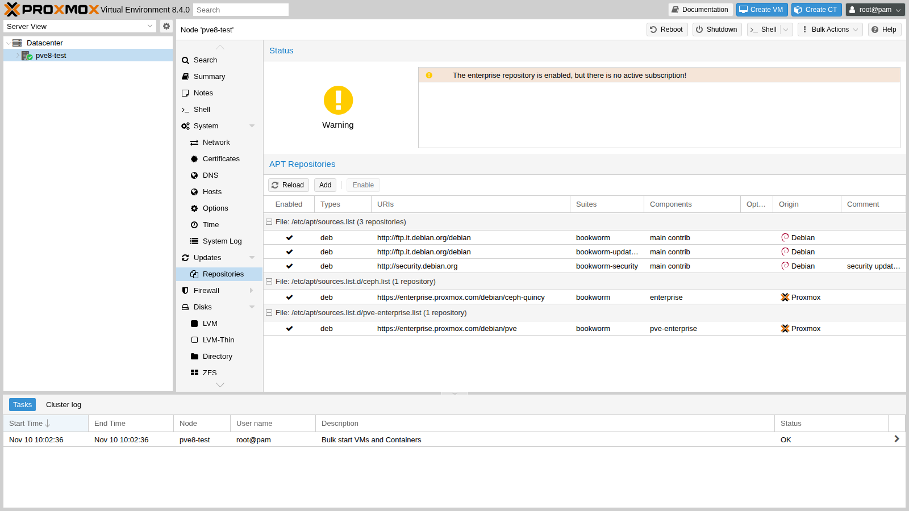
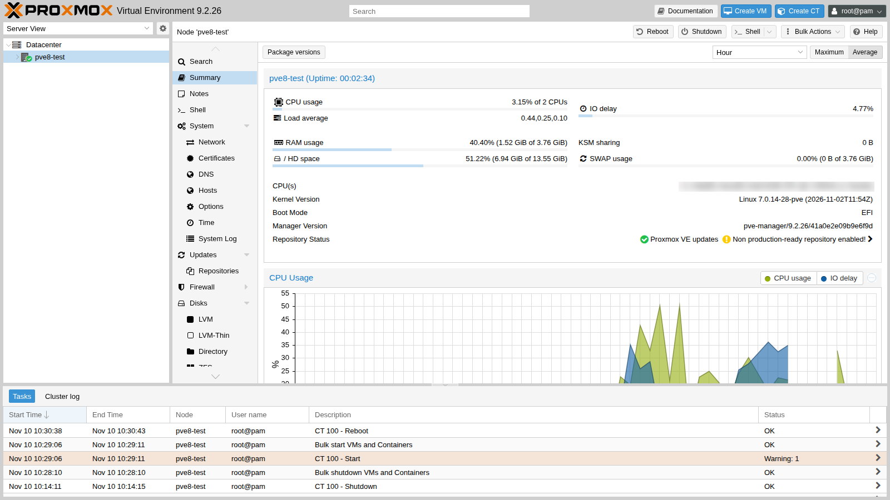
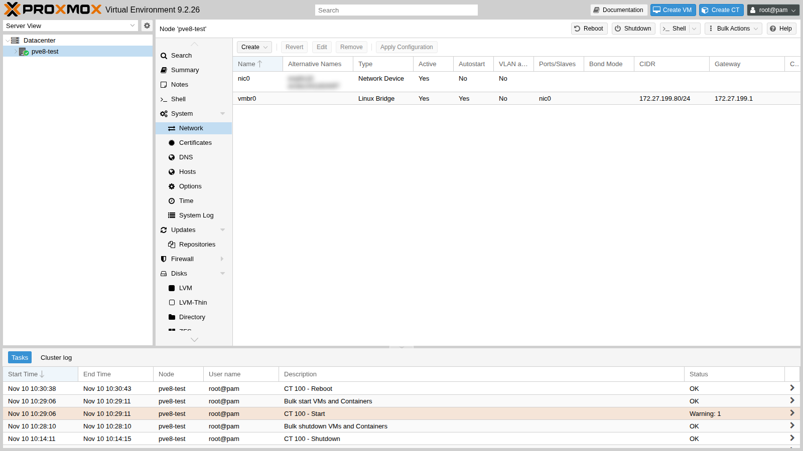
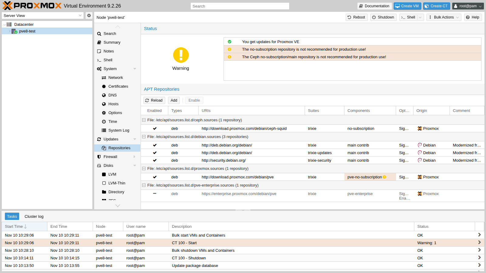

Proxmox VE 9 is based on Debian 13 *trixie*, Proxmox VE 8 on Debian 12 *bookworm*: the move is a **major version upgrade**, performed *in place*, one node at a time. In this appendix you actually carry it out, from start to finish, on a Proxmox VE 8.4 test node, following the official guide and resolving the warnings of the `pve8to9` checklist script one by one. At the end you will find the procedure for a cluster with Ceph.

## Dependencies

- **Previous labs:** [Lab 03](/03-install-proxmox-ve/) for the installation, [Lab 04](/04-first-access-repositories-updates/) for repositories, proxy and updates, [Lab 10](/10-zfs/) for the `tank` pool on `desopve04`.
- **Test node:** `pve8-test.proxmox.community` (172.27.199.80), a VM on `desopve04` (VMID 800, CPU type `host`, so Proxmox VE can use KVM inside the VM: 2 vCPUs, 4 GiB of RAM, a 32 GiB disk on the `tank` storage, UEFI firmware), installed from the official `proxmox-ve_8.4-1.iso` ISO. It is a disposable node: you delete it at the end of the appendix.
- **Lab services:** proxy `proxy.proxmox.community:3128`, NTP, DNS `172.27.199.20`, gateway `rtr-core`.
- **Credentials:** `root` / `<lab-password>` → [Appendix B](/b-credentials-and-addresses/).

## Objectives

- Prepare an 8.4 node for the upgrade and bring it to the latest 8.4.x version.
- Use `pve8to9 --full` before, during and after the upgrade, resolving the warnings.
- Switch the repositories to *trixie* in the **deb822** format.
- Run the upgrade, handle the changed configuration files and verify the node after the reboot.
- Know the correct order for a cluster with Ceph and high availability.

## How it works

**A major version upgrade** changes the Debian distribution, the kernel (from 6.8 in 8.4 to 7.0 in 9.2), QEMU, LXC, ZFS and many system services all at once. Nothing is reinstalled: `apt` replaces the packages and the guest configuration stays in `/etc/pve`.

**`pve8to9`** is a checklist script included in the latest 8.4 packages. It changes nothing: it checks versions, cluster, Ceph, storage, guests, bootloader and services, and classifies the results as `PASS`, `SKIP`, `NOTICE`, `WARN` and `FAIL`. You run it **several times**: before the upgrade, after each fix, before the reboot and after it.

**The deb822 format** replaces the `deb …` lines of the `.list` files with field-based `.sources` files (`Types`, `URIs`, `Suites`, `Components`, `Signed-By`). Proxmox VE 9 uses it for its own repositories.

**Trying it first on a test node** is the explicit advice of the official guide: an 8.4 node installed in a VM, with a configuration similar to production, lets you see the warnings, the prompts and the timing in advance.

## Procedure

### 1. The test node, installed automatically

To avoid repeating the guided installation of [Lab 03](/03-install-proxmox-ve/), the test node uses the **automated installation**: an `answer.toml` answer file embedded in the ISO.

1. On `desopve04`, download the 8.4 ISO through the proxy (the proxy must allow `enterprise.proxmox.com`) and verify its checksum: the one computed by `sha256sum` must match the line in the `SHA256SUMS` file from the same folder.

   ```bash
   cd /var/lib/vz/template/iso
   export https_proxy=http://proxy.proxmox.community:3128
   wget https://enterprise.proxmox.com/iso/proxmox-ve_8.4-1.iso https://enterprise.proxmox.com/iso/SHA256SUMS
   grep proxmox-ve_8.4-1.iso SHA256SUMS; sha256sum proxmox-ve_8.4-1.iso
   ```

   ```text output
   d237d70ca48a9f6eb47f95fd4fd337722c3f69f8106393844d027d28c26523d8  proxmox-ve_8.4-1.iso
   ```

2. Install the assistant and write the answer file. It contains the `root` password in clear text: keep it in an in-memory folder such as `/dev/shm` and delete it as soon as the ISO is created (`rm /dev/shm/answer.toml`).

   ```toml
   [global]
   keyboard = "it"
   country = "it"
   fqdn = "pve8-test.proxmox.community"
   mailto = "admin@proxmox.community"
   timezone = "Europe/Rome"
   root-password = "<lab-password>"

   [network]
   source = "from-answer"
   cidr = "172.27.199.80/24"
   dns = "172.27.199.20"
   gateway = "172.27.199.1"
   filter.ID_NET_DRIVER = "virtio_net"

   [disk-setup]
   filesystem = "ext4"
   disk-list = ["sda"]
   ```

   ```bash title="root@desopve04"
   apt install proxmox-auto-install-assistant
   proxmox-auto-install-assistant validate-answer /dev/shm/answer.toml
   ```

   ```text output
   The answer file was parsed successfully, no errors found!
   ```

   ```bash title="root@desopve04"
   proxmox-auto-install-assistant prepare-iso proxmox-ve_8.4-1.iso --fetch-from iso \
         --answer-file /dev/shm/answer.toml --output /var/lib/vz/template/iso/pve84-auto.iso
   ```

   ```text output
   Checking provided answer file...
   Copying source ISO to temporary location...
   Preparing ISO...
   Moving prepared ISO to target location...
   Final ISO is available at /var/lib/vz/template/iso/pve84-auto.iso.
   ```

   :::note[Hyphenated keys]
   Starting with the 8.4-1 ISO, the answer file keys are written in *kebab-case* (`root-password`, `disk-list`). With the old style (`root_password`, `disk_list`) the assistant reports `deprecated key` and the validation ends with `Error: Found issues in the answer file`.
   :::

3. Create the VM with its disk on `tank` and start it. The boot order puts the disk first: on the first boot the disk is empty and the ISO starts; after the installation the installed system starts, without repeating the installation.

   ```bash title="root@desopve04"
   qm create 800 --name pve8-test --memory 4096 --cores 2 --cpu host --machine q35 \
         --bios ovmf --efidisk0 tank:1,efitype=4m,pre-enrolled-keys=0 --scsihw virtio-scsi-single \
         --scsi0 tank:32,discard=on,iothread=1 --net0 virtio,bridge=vmbr0 \
         --ide2 local:iso/pve84-auto.iso,media=cdrom --boot "order=scsi0;ide2" --ostype l26
   qm start 800
   ```

4. A few minutes later the node answers over SSH:

   ```bash title="root@pve8-test"
   hostname -f; pveversion
   ```

   ```text output
   pve8-test.proxmox.community
   pve-manager/8.4.0/ec58e45e1bcdf2ac (running kernel: 6.8.12-9-pve)
   ```

### 2. Bringing the node to the latest 8.4 version

The official guide requires the **latest** 8.4 as the starting point. The freshly installed node has the *enterprise* repositories, without a subscription:



1. Set the proxy for `apt`, use the Debian mirror allowed by the proxy and switch to the bookworm *no-subscription* repositories, as in [Lab 04](/04-first-access-repositories-updates/):

   ```bash
   echo 'Acquire::http::Proxy "http://proxy.proxmox.community:3128";' > /etc/apt/apt.conf.d/76pveproxy
   sed -i 's#http://ftp.it.debian.org/debian#http://deb.debian.org/debian#' /etc/apt/sources.list
   sed -i 's/^deb/#deb/' /etc/apt/sources.list.d/pve-enterprise.list /etc/apt/sources.list.d/ceph.list
   echo "deb http://download.proxmox.com/debian/pve bookworm pve-no-subscription" > /etc/apt/sources.list.d/pve-no-subscription.list
   echo "deb http://download.proxmox.com/debian/ceph-squid bookworm no-subscription" > /etc/apt/sources.list.d/ceph-squid.list
   ```

2. Update and reboot into the new kernel:

   ```bash title="root@pve8-test"
   apt update && apt dist-upgrade
   ```

   ```text output
   232 upgraded, 8 newly installed, 0 to remove and 0 not upgraded.
   ```

   ```bash title="root@pve8-test"
   reboot
   ```

   ```text output
   …
   ```

   ```bash title="root@pve8-test"
   pveversion
   ```

   ```text output
   pve-manager/8.4.21/2606ac850d46da29 (running kernel: 6.8.12-43-pve)
   ```

3. To have a guest to "carry" through the upgrade, create a Debian 12 container. The first `pveam update` fails: `apt` uses the proxy from its own configuration file, while `pveam` uses the **datacenter** one.

   ```bash title="root@pve8-test"
   pveam update
   ```

   ```text output
   update failed - see /var/log/pveam.log for details
   ```

   ```bash title="root@pve8-test"
   pvesh set /cluster/options --http_proxy http://proxy.proxmox.community:3128
   pveam update
   ```

   ```text output
   update successful
   ```

   ```bash title="root@pve8-test"
   pveam download local debian-12-standard_12.12-1_amd64.tar.zst
   pct create 100 local:vztmpl/debian-12-standard_12.12-1_amd64.tar.zst --hostname ct-test \
         --unprivileged 1 --memory 512 --rootfs local-lvm:4 \
         --net0 name=eth0,bridge=vmbr0,ip=172.27.199.81/24,gw=172.27.199.1 --onboot 1
   pct start 100
   ```

### 3. The check with `pve8to9`

```bash
pve8to9 --full
```

Excerpt of the real output (the `PASS` lines are omitted):

```text
= CHECKING VERSION INFORMATION FOR PVE PACKAGES =
PASS: proxmox-ve package has version >= 8.4-0
PASS: running kernel '6.8.12-43-pve' is considered suitable for upgrade.

= CHECKING CLUSTER HEALTH/SETTINGS =
SKIP: standalone node.

= VIRTUAL GUEST CHECKS =
WARN: 1 running guest(s) detected - consider migrating or stopping them.

= MISCELLANEOUS CHECKS =
NOTICE: Less than 10 GB free space on root file system.
INFO: Checking bootloader configuration...
FAIL: systemd-boot meta-package installed. This will cause problems on upgrades of other boot-related packages.
      Remove 'systemd-boot' See https://pve.proxmox.com/wiki/Upgrade_from_8_to_9#sd-boot-warning for more information.
NOTICE: storage 'local-lvm' has guest volumes with autoactivation enabled
WARN: The matching CPU microcode package 'intel-microcode' could not be found!

= SUMMARY =
TOTAL:    42
PASSED:   31
SKIPPED:  5
WARNINGS: 2
FAILURES: 1
```

Here is how to handle each item:

1. **`FAIL: systemd-boot meta-package installed`.** First check which bootloader the node uses. Here it is UEFI with GRUB, and `proxmox-boot-tool` is not in use (it manages the ESP partitions of installations with root on ZFS, in both BIOS and UEFI mode; `systemd-boot` is only used with ZFS and UEFI without Secure Boot):

   ```bash title="root@pve8-test"
   proxmox-boot-tool status
   ```

   ```text output
   E: /etc/kernel/proxmox-boot-uuids does not exist.
   ```

   ```bash title="root@pve8-test"
   dpkg -l | grep -E "^ii  (grub-efi-amd64 |systemd-boot)"
   ```

   ```text output
   ii  grub-efi-amd64          2.06-13+pmx7
   ii  systemd-boot            252.39-1~deb12u2
   ii  systemd-boot-efi:amd64  252.39-1~deb12u2
   ```

   ```bash title="root@pve8-test"
   apt remove systemd-boot
   ```

   The meta-package can be removed safely: the node keeps booting with GRUB.

2. **`NOTICE … autoactivation enabled`.** Starting with Proxmox VE 9, guest LVM volumes are no longer activated automatically at boot: Proxmox VE activates them when they are needed. On **shared** LVM storages (iSCSI, FC) converting the existing volumes as well is strongly recommended; on local storages it is optional. Without options, the script asks for confirmation and, in a non-interactive context, answers no; with `--assume-yes` it runs:

   ```bash title="root@pve8-test"
   /usr/share/pve-manager/migrations/pve-lvm-disable-autoactivation --assume-yes
   ```

   ```text output
     Logical volume pve/vm-100-disk-0 changed.
   PASS: all guest volumes on storage 'local-lvm' now have autoactivation disabled
   ```

3. **Network interface names.** The new kernel can change the interface names derived from the PCI address: if `enp6s18` got another name, the `vmbr0` bridge would be left without a port and the node **without network**. The `pve-network-interface-pinning` tool, already available in the latest 8.4, pins the names to `nicN` by binding them to the MAC address:

   ```bash title="root@pve8-test"
   pve-network-interface-pinning generate
   ```

   ```text output
   Name for link 'enp6s18' will change to 'nic0'
   Generating link files
   Successfully generated .link files in '/usr/local/lib/systemd/network/'
   Updating /etc/network/interfaces.new
   Successfully updated Proxmox VE configuration files.

   Please reboot to apply the changes to your configuration
   ```

   A reboot happens anyway at the end of the upgrade: the new names are applied at that point.

4. **`WARN: 1 running guest(s)`.** In a cluster, migrate the guests to another node; on a single node, shut them down: `pct shutdown 100`.

5. **`WARN … intel-microcode`.** On a physical server, enable the `non-free-firmware` component and install `intel-microcode` (or `amd64-microcode`). The test node is a VM: the microcode is handled by the host, so the warning can be ignored.

6. **`NOTICE: Less than 10 GB free`.** The required minimum is 5 GB, with 10 GB recommended: here there are 8.7 GB free, which is enough.

Second run of the check:

```text
NOTICE: Less than 10 GB free space on root file system.
WARN: The matching CPU microcode package 'intel-microcode' could not be found!
TOTAL:    42
PASSED:   35
SKIPPED:  5
WARNINGS: 1
FAILURES: 0
```

### 4. The trixie repositories in deb822 format

1. Debian: replace *bookworm* with *trixie*.

   ```bash
   sed -i 's/bookworm/trixie/g' /etc/apt/sources.list
   ```

2. Proxmox VE and Ceph: remove the old `.list` files and create the new `.sources` files. The Ceph repository must be updated even if Ceph is not installed: some client packages come from there.

   ```bash
   rm /etc/apt/sources.list.d/{pve-no-subscription,ceph-squid,pve-enterprise,ceph}.list
   cat > /etc/apt/sources.list.d/proxmox.sources << EOF
   Types: deb
   URIs: http://download.proxmox.com/debian/pve
   Suites: trixie
   Components: pve-no-subscription
   Signed-By: /usr/share/keyrings/proxmox-archive-keyring.gpg
   EOF
   cat > /etc/apt/sources.list.d/ceph.sources << EOF
   Types: deb
   URIs: http://download.proxmox.com/debian/ceph-squid
   Suites: trixie
   Components: no-subscription
   Signed-By: /usr/share/keyrings/proxmox-archive-keyring.gpg
   EOF
   ```

3. Check that `apt` sees **only** the trixie repositories:

   ```bash title="root@pve8-test"
   apt update && apt policy
   ```

   ```text output
   …
    500 http://deb.debian.org/debian trixie/contrib amd64 Packages
    500 http://deb.debian.org/debian trixie/main amd64 Packages
    500 http://deb.debian.org/debian trixie-updates/main amd64 Packages
    500 http://download.proxmox.com/debian/ceph-squid trixie/no-subscription amd64 Packages
    500 http://download.proxmox.com/debian/pve trixie/pve-no-subscription amd64 Packages
    500 http://security.debian.org trixie-security/contrib amd64 Packages
    500 http://security.debian.org trixie-security/main amd64 Packages
   ```

### 5. The upgrade

```bash
apt dist-upgrade
```

The official guide recommends running it from the server console, or over SSH inside `tmux`/`screen`, **never** from the web console of the GUI, which gets interrupted during the upgrade. While it runs, `apt` asks what to do with the modified configuration files. The answers recommended by the guide:

| File | Recommended answer |
|---|---|
| `/etc/issue` | keep the installed version (Proxmox VE regenerates it at boot) |
| `/etc/lvm/lvm.conf` | the guide suggests the package version if you have not modified it yourself; but check the Proxmox VE `global_filter` (see below) |
| `/etc/ssh/sshd_config` | package version, if you have not modified it yourself |
| `/etc/default/grub` | keep the installed version, if it contains kernel options you added |
| `/etc/chrony/chrony.conf` | package version; customizations go into `conf.d` or `sources.d` |

In the lab the upgrade was launched non-interactively inside a systemd unit, so an SSH disconnection does not interrupt it. The installed version of every file was kept, and the differences are checked afterwards:

```bash title="root@pve8-test"
systemd-run --unit=pve-upgrade89 --setenv=DEBIAN_FRONTEND=noninteractive apt-get -y -o Dpkg::Options::=--force-confdef \
      -o Dpkg::Options::=--force-confold dist-upgrade
journalctl -fu pve-upgrade89
```

```text output
…
593 upgraded, 155 newly installed, 59 to remove and 0 not upgraded.
```

- **Duration:** 12 minutes 26 seconds (from 10:14:40 to 10:27:06), on the disk of the test VM. On a server with SSDs a few minutes are enough; on spinning disks it can take more than an hour.
- **Removed packages:** they are libraries renamed in Debian 13 (for example `libgnutls30` → `libgnutls30t64`): their replacement is normal.

At the end, `apt` left two new versions to evaluate:

```bash title="root@pve8-test"
find /etc -name "*.dpkg-dist"
```

```text output
/etc/issue.dpkg-dist
/etc/lvm/lvm.conf.dpkg-dist
```

```bash title="root@pve8-test"
diff <(grep -vE '^\s*#|^\s*$' /etc/lvm/lvm.conf) <(grep -vE '^\s*#|^\s*$' /etc/lvm/lvm.conf.dpkg-dist)
```

```text output
…
< devices {
<      global_filter=["r|/dev/zd.*|","r|/dev/rbd.*|"]
```

The installed `lvm.conf` contains the **Proxmox VE filter**, which prevents LVM from scanning the guests' ZFS and Ceph volumes: the package version does not have it. Here the right choice is to keep the installed version. If you choose the package version, you must add the filter back. For `/etc/issue` the rule in the table applies. After checking, delete the `.dpkg-dist` files.

The check **before the reboot**:

```text
WARN: a suitable kernel (proxmox-kernel-7.0) is installed, but an unsuitable (6.8.12-43-pve) is booted, missing reboot?!
WARN: No (active) time synchronisation daemon (NTP) detected, but synchronized systems are important, especially for cluster and/or ceph!
```

The first warning simply says that a reboot is needed. The second comes from `chrony`, which did not restart during the upgrade:

```text
chronyd[23845]: chronyd version 4.8 starting (+CMDMON +REFCLOCK +RTC +PRIVDROP +SCFILTER +SIGND +NTS +SECHASH +IPV6 -DEBUG)
chronyd[23845]: Fatal error : Could not send notification to $NOTIFY_SOCKET
systemd[1]: Failed to start chrony.service - chrony, an NTP client/server.
```

The new `chronyd` talks to the bookworm `systemd`, which keeps running until the reboot. It is a **transient** error: after the reboot the service starts normally.

### 6. The reboot and the checks

```bash title="root@pve8-test"
reboot
```

```text output
…
```

```bash title="root@pve8-test"
uname -r; pveversion
```

```text output
7.0.14-28-pve
pve-manager/9.2.26/41a0e2e09b9e6f9d (running kernel: 7.0.14-28-pve)
```

```bash title="root@pve8-test"
pveversion -v | grep -E "^(proxmox-ve|pve-qemu-kvm|qemu-server|lxc-pve|zfsutils-linux|corosync|ifupdown2)"
```

```text output
proxmox-ve: 9.2.0 (running kernel: 7.0.14-28-pve)
corosync: 3.2.0-pve1
ifupdown2: 3.3.0-1+pmx13
lxc-pve: 7.0.0-2
pve-qemu-kvm: 11.1.3-1
qemu-server: 9.2.15
zfsutils-linux: 2.4.4-pve1
```

```bash title="root@pve8-test"
systemctl is-active chrony pveproxy pvedaemon pvestatd pve-cluster pve-firewall
```

```text output
active
active
active
active
active
active
```

```bash title="root@pve8-test"
systemctl --failed --no-legend
ip -br link | grep -v lo
```

```text output
nic0             UP             …
vmbr0            UP             …
```

- All services are active and there are no failed units.
- The network card is now called `nic0` and `vmbr0` uses it as its port: the pinning from step 3 worked.





The container restarted on its own (`onboot`), but the start task reports a warning:

```bash title="root@pve8-test"
pvenode task log <UPID dell'avvio del CT 100>
```

```text output
WARN: Systemd 252 detected. You may need to enable nesting.
TASK WARNINGS: 1
```

```bash title="root@pve8-test"
pct set 100 --features nesting=1 && pct reboot 100
pct exec 100 -- systemctl is-system-running
```

```text output
running
```

The container had been created from the command line without the `nesting` feature, which the GUI enables by default in unprivileged containers. With Proxmox VE 9, systemd inside the containers requires it: enable it before upgrading, or right after.

In the end `pve8to9` is left with just the microcode warning, which has no effect on the test VM:

```text
TOTAL:    42
PASSED:   34
SKIPPED:  5
WARNINGS: 1
FAILURES: 1
```

The remaining `FAIL` is `unable to determine installed intel-microcode version`: on a physical node you solve it by installing the microcode package.

### 7. After the upgrade: modern repositories

1. Convert the Debian `sources.list` to the deb822 format as well:

   ```bash title="root@pve8-test"
   apt modernize-sources
   ```

   ```text output
   Rewrite 1 sources? [Y/n] Y
   Modernizing /etc/apt/sources.list...
   - Writing /etc/apt/sources.list.d/debian.sources
   ```

   The old file is kept as `sources.list.bak`: after checking, you can delete it.

2. **The enterprise repository comes back.** The Proxmox VE 9 `pve-manager` package installs the `pve-enterprise.sources` file, and without a subscription `apt update` fails:

   ```text output
   E: The repository 'https://enterprise.proxmox.com/debian/pve trixie InRelease' is not signed.
   ```

   ```bash title="root@pve8-test"
   dpkg -S /etc/apt/sources.list.d/pve-enterprise.sources
   ```

   ```text output
   pve-manager: /etc/apt/sources.list.d/pve-enterprise.sources
   ```

   The file belongs to the package, so do not delete it: **disable** it instead, from the GUI (**Repositories → Disable**) or with the `Enabled: false` field:

   ```bash
   echo "Enabled: false" >> /etc/apt/sources.list.d/pve-enterprise.sources
   ```



### 8. Cleanup

The test node has done its job. The prepared ISO contains the `root` password in clear text: here it is overwritten with `shred` before being deleted (on SSDs and on copy-on-write file systems such as ZFS, `shred` does not guarantee erasure, so the test node password must not be reused elsewhere):

```bash
qm stop 800; qm destroy 800 --purge 1 --destroy-unreferenced-disks 1
shred -u /var/lib/vz/template/iso/pve84-auto.iso
rm /var/lib/vz/template/iso/proxmox-ve_8.4-1.iso /var/lib/vz/template/iso/SHA256SUMS
apt remove proxmox-auto-install-assistant
```

## Upgrading a cluster with Ceph and high availability

:::note[About this procedure]
This part was **not** carried out in the lab, which is already on Proxmox VE 9.2: it summarizes the steps of the [official guide](https://pve.proxmox.com/wiki/Upgrade_from_8_to_9) for a cluster. Always follow the up-to-date guide before working on production systems.
:::

1. **Prerequisites on all nodes:**
   - latest 8.4 version installed;
   - healthy cluster (`pvecm status`) and Ceph in `HEALTH_OK`;
   - recent, verified backups of all guests;
   - access to the out-of-band console (IPMI/iKVM) of every node.
2. **Ceph first.** Proxmox VE 9 requires Ceph **19.2 Squid**. If the cluster uses Quincy or Reef, upgrade Ceph *before* upgrading Proxmox VE, with the [Ceph Quincy to Reef](https://pve.proxmox.com/wiki/Ceph_Quincy_to_Reef) and [Ceph Reef to Squid](https://pve.proxmox.com/wiki/Ceph_Reef_to_Squid) guides. Check with `ceph --version` on every node.
3. **One node at a time:**
   - free the node: migrate the guests elsewhere, or put the node in HA maintenance mode with `ha-manager crm-command node-maintenance enable <nodo>`;
   - run `ceph osd set noout`, to avoid rebalancing during the reboot;
   - run steps 3–6 of this appendix on the node and check `pvecm status`, `ceph -s` and the services;
   - disable maintenance mode and move on to the next node; at the end, `ceph osd unset noout`.
4. **Migrations in a mixed cluster:** moving a guest from a version 8 node to a version 9 node always works; the opposite may work but is not supported. So upgrade the nodes without moving the guests back. If a migration started from the GUI of an already upgraded node fails, repeat it from the GUI of the node still on version 8.
5. **HA:** HA groups are automatically converted to **HA rules** when **all** nodes are on version 9 (see [Lab 49](/49-high-availability/)). In case of problems, check `journalctl -eu pve-ha-crm` on the active CRM node.
6. **Bootloader:** with ZFS as root and UEFI without Secure Boot, the node boots with `systemd-boot`, managed by `proxmox-boot-tool`. Remove the `systemd-boot` meta-package when `pve8to9` asks for it, and keep `systemd-boot-efi` and `systemd-boot-tools` if the script says so. With LVM on UEFI, make sure that `grub-efi-amd64` is installed.
7. **Networks:** pin the network interface names with `pve-network-interface-pinning generate` on all nodes **before** the upgrade. A changed name on a Corosync or Ceph network card isolates the node.
8. **Other Debian 13 changes to know about:**
   - `/etc/sysctl.conf` is no longer read: move the settings to `/etc/sysctl.d/<NN>-<nome>.conf`;
   - `/tmp` becomes a `tmpfs` that uses up to 50% of the RAM, and the files in `/tmp` and `/var/tmp` are cleaned up periodically;
   - once all nodes are upgraded, Ceph may report service keys that are considered insecure: the guide explains how to migrate the keys.
9. **Ceph after Proxmox VE:** the cluster stays on Squid. New 9.2 installations use Ceph 20 Tentacle, as in [Lab 17](/17-ceph-installation/). When you want to move to Tentacle, follow the [Ceph Squid to Tentacle](https://pve.proxmox.com/wiki/Ceph_Squid_to_Tentacle) guide, again one node at a time.

## Verification and tests

- `pveversion` reports `pve-manager/9.2.26` with kernel `7.0.14-28-pve`.
- `pve8to9 --full` reports no blocking problems; only the microcode warnings remain, as expected in a VM.
- `apt policy` lists only trixie repositories; the enterprise one is disabled.
- The network card is called `nic0` and the network works.
- The container created on 8.4 restarts after the upgrade and reaches the gateway.

## Final lab state

- The test VM 800 `pve8-test` is **deleted**, along with its disks on `tank`.
- The ISOs and the answer file are destroyed, and the automated installation assistant is uninstalled from `desopve04`.
- The rest of the lab is unchanged.

## What you learned

- A major version upgrade is tried first on a test node: in one hour you discover warnings and prompts that would be costly in production.
- You run `pve8to9` at every step; every `FAIL` and `WARN` has a precise cause, to fix or to understand.
- Real problems came up in the lab:
  - the `systemd-boot` meta-package to remove;
  - the LVM volumes with autoactivation;
  - `chrony` not restarting before the reboot;
  - the container asking for `nesting`;
  - the enterprise repository coming back after the upgrade.
- Network interface names must be pinned before the upgrade: a node left without network after the reboot can only be recovered from the console.
- In a cluster the order matters: Ceph Squid first, then one node at a time, with `noout` and HA maintenance mode.

## References

- [Upgrade from 8 to 9](https://pve.proxmox.com/wiki/Upgrade_from_8_to_9)
- [Package Repositories](https://pve.proxmox.com/wiki/Package_Repositories)
- [Automated Installation](https://pve.proxmox.com/wiki/Automated_Installation)
- [Ceph Reef to Squid](https://pve.proxmox.com/wiki/Ceph_Reef_to_Squid) and [Ceph Squid to Tentacle](https://pve.proxmox.com/wiki/Ceph_Squid_to_Tentacle)
- [Proxmox VE Roadmap – 9.x release notes and known issues](https://pve.proxmox.com/wiki/Roadmap)
- [Debian 13 trixie – Release Notes](https://www.debian.org/releases/trixie/release-notes/)
