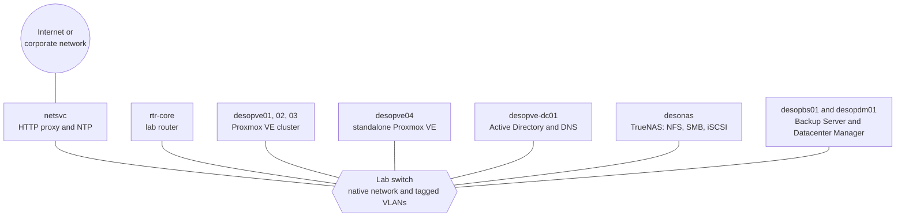

import { Aside, Steps } from '@astrojs/starlight/components';
import Section from '../../components/home/Section.astro';
import Diagram from '../../components/home/Diagram.astro';
import PathRail from '../../components/home/PathRail.astro';
import PathGrid from '../../components/home/PathGrid.astro';
import PathCard from '../../components/home/PathCard.astro';
import FeatureGrid from '../../components/home/FeatureGrid.astro';
import Feature from '../../components/home/Feature.astro';
import CtaBand from '../../components/home/CtaBand.astro';

<Section id="one-lab" eyebrow="The lab">

## One lab, built lab after lab

These are not isolated exercises. All the labs take place on the **same lab**, which grows as you go: each lab starts from what the previous ones left configured and documents it in its **Final state** section. By the end of the path you have built, and stress-tested, a complete Proxmox VE datacenter.

[Lab 01](/01-lab-architecture/) describes the hardware, the networks, the VLANs and the addressing plan, and explains how to prepare everything before you start.

<Diagram caption="The lab: one switch with tagged VLANs connects every machine used in the path.">

</Diagram>

</Section>

<Section id="the-path" eyebrow="The path">

## Part 0, then A → B → C → D

The four tracks are meant to be followed in this order. Before each lab, check its **Dependencies**: the [dependency graph](/the-lab/#dependencies-between-labs) summarizes them all.

<PathRail
  label="The path at a glance"
  parts={[
    { id: '0', name: 'Base lab', labs: 7, href: '/01-lab-architecture/' },
    { id: 'A', name: 'Storage', labs: 12, href: '/08-storage-model/' },
    { id: 'B', name: 'Network', labs: 15, href: '/20-bridges-stable-names-vlans/' },
    { id: 'C', name: 'Compute', labs: 8, href: '/35-kvm-qemu/' },
    { id: 'D', name: 'Integrated services', labs: 11, href: '/43-active-directory-realm-ldaps/' },
  ]}
/>

<PathGrid>
  <PathCard part="0" icon="server" title="Part 0 – The base lab" range="Labs 01–07" count="7 labs" href="/01-lab-architecture/" cta="Lab 01">
    Domain controller, Proxmox VE installation, repositories and updates, SSH and the command line, a three-node cluster, the first VM and container.
  </PathCard>
  <PathCard part="A" icon="storage" title="A – Storage" range="Labs 08–19" count="12 labs" href="/08-storage-model/" cta="Lab 08">
    LVM, ZFS and replication, a NAS with NFS, SMB and multipath iSCSI, snapshots, Ceph from installation to failures, benchmarking with fio.
  </PathCard>
  <PathCard part="B" icon="network" title="B – Network" range="Labs 20–34" count="15 labs" href="/20-bridges-stable-names-vlans/" cta="Lab 20">
    Bridges and VLANs, bonding, dedicated networks, Open vSwitch, routing and NAT, IPv6, a virtual router, SDN up to EVPN and Fabrics, the firewall.
  </PathCard>
  <PathCard part="C" icon="cpu" title="C – Compute" range="Labs 35–42" count="8 labs" href="/35-kvm-qemu/" cta="Lab 35">
    KVM and QEMU under the hood, memory, virtual disks and controllers, Linux and Windows VMs, templates and cloud-init, LXC containers, hotplug and limits.
  </PathCard>
  <PathCard part="D" icon="shield" title="D – Integrated services" range="Labs 43–53" count="11 labs" href="/43-active-directory-realm-ldaps/" cta="Lab 43">
    Active Directory, permissions and tokens, 2FA, backup with vzdump and Proxmox Backup Server, migrations, high availability, import from ESXi, metrics, API, Datacenter Manager.
  </PathCard>
  <PathCard part="+" icon="book" title="Appendices" range="Appendices A–D" href="/a-upgrade-8-to-9/" cta="Appendix A">
    Upgrading from Proxmox VE 8 to 9, credentials and addresses, troubleshooting, rebuilding the lab as virtual machines.
  </PathCard>
</PathGrid>

</Section>

<Section id="lab-structure" eyebrow="Every lab">

## How every lab is organized

Every lab has the same structure, so you always know where to look.

<FeatureGrid>
  <Feature icon="dependencies" title="Dependencies">The labs to complete first, the machines and services you need.</Feature>
  <Feature icon="objectives" title="Objectives and How it works">The essential theory to understand what happens.</Feature>
  <Feature icon="procedure" title="Procedure">Numbered steps: every action in the web interface with its screenshot, every command with its real output.</Feature>
  <Feature icon="verify" title="Verification and tests">Often with simulated and measured failures.</Feature>
  <Feature icon="state" title="Final state">What stays configured for the following labs.</Feature>
  <Feature icon="learned" title="What you learned">The key concepts, plus References to the official documentation.</Feature>
</FeatureGrid>

</Section>

<Section id="getting-started" eyebrow="Start here">

## Getting started

<Steps>

1. Read [Lab 01](/01-lab-architecture/): the hardware, the networks and how to prepare the switch, the router and the network-services server.

2. Choose the **lab password**: the manual shows it as `<lab-password>` ([Appendix B](/b-credentials-and-addresses/)).

3. Continue in order with Part 0, then with tracks A, B, C and D.

</Steps>

No servers at hand? [Appendix D](/d-rebuild-as-virtual/) explains how to rebuild the same lab as virtual machines on a single Proxmox VE server.

<Aside type="note" title="Obscured hardware data">
In the screenshots, the data that identify the lab hardware are obscured: disk serial numbers, MAC addresses of the server network cards, CPU and disk models. In the text output the same data are replaced by placeholders such as `<seriale-disco-1>`. On your hardware you will see different values.
</Aside>

</Section>

<CtaBand
  id="contribute"
  eyebrow="An open community"
  title="How to contribute"
  primary={{ text: 'Contribute', href: '/contributing/' }}
  secondary={{ text: 'Next-Guard/Proxmox', href: 'https://github.com/Next-Guard/Proxmox' }}
>
  Proxmox Community is meant to grow with the people who use Proxmox every day. Do you have a guide, a production story, a fix or a translation? Every proposal arrives as a pull request on GitHub and is reviewed before publication.
</CtaBand>
