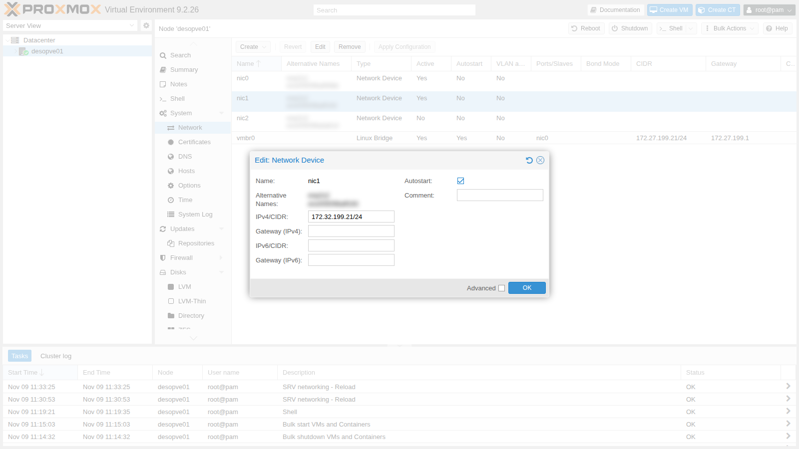
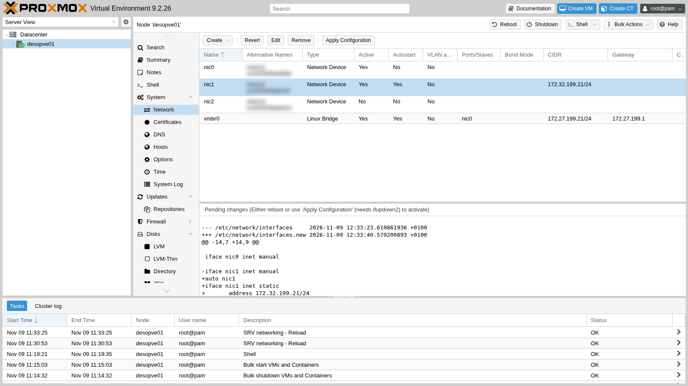
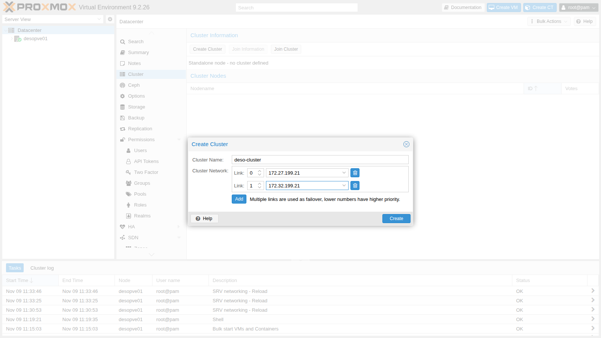
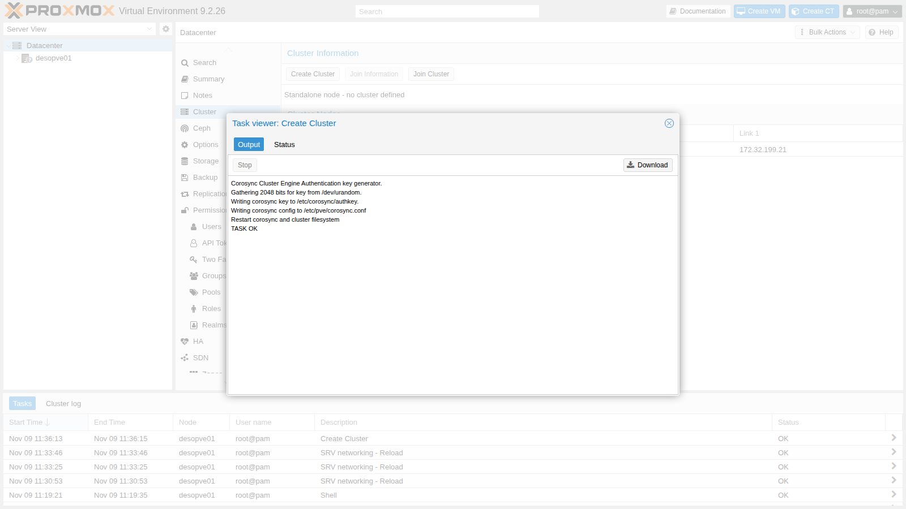
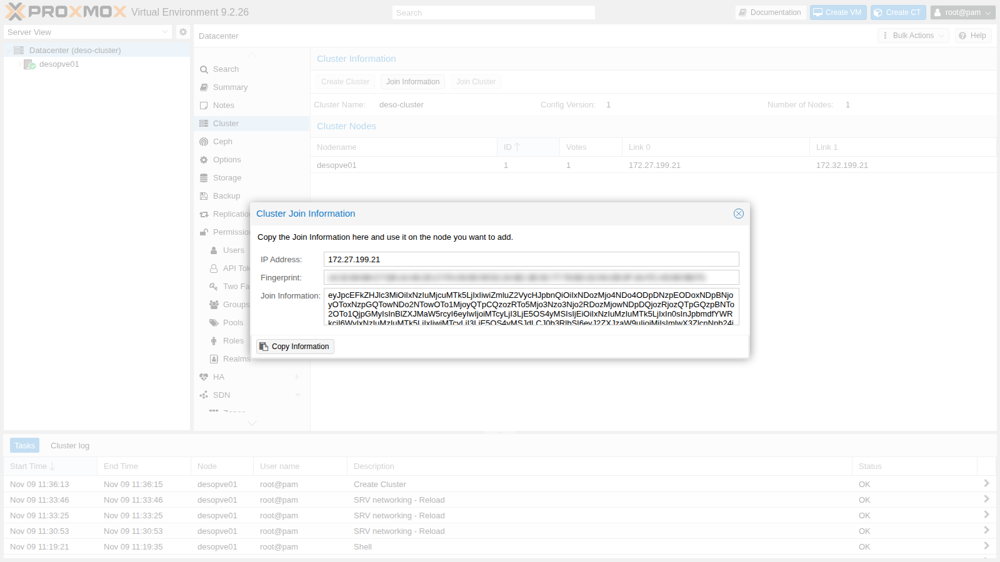
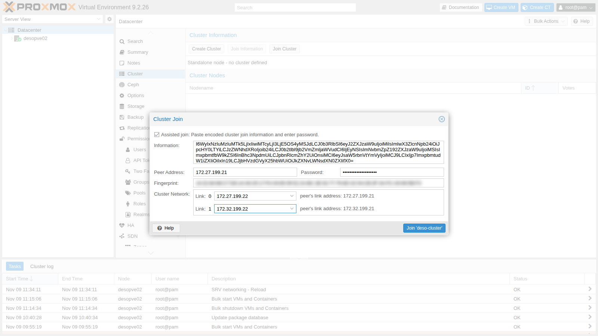
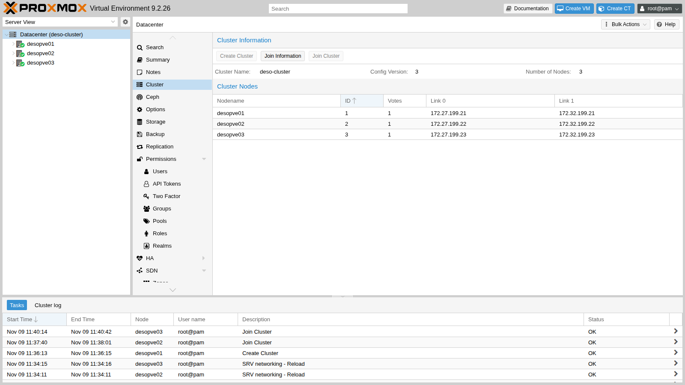
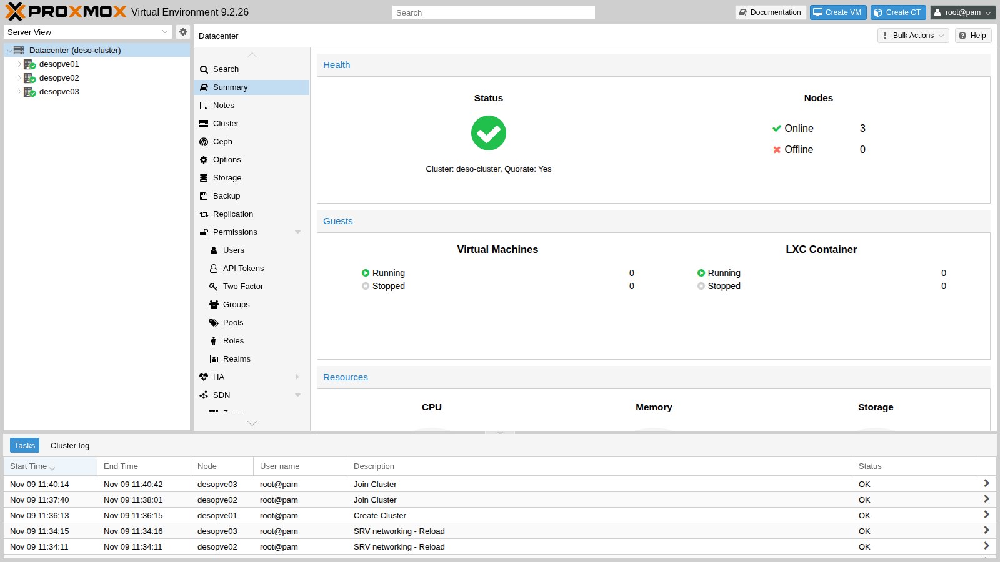

## Dipendenze

- **Lab precedenti:** [Lab 04](/it/04-first-access-repositories-updates/), con i nodi aggiornati alla stessa versione e l'ora sincronizzata, e [Lab 05](/it/05-ssh-shell-cli/), per l'accesso SSH con chiave dal DC.
- **Server:** `desopve01`, `desopve02` e `desopve03` accesi, senza VM né container; anche `desopve04` acceso, solo per configurare la sua `nic1` (resta fuori dal cluster). Un nodo che entra in un cluster non deve avere guest, perché i loro ID potrebbero entrare in conflitto con quelli del cluster.
- **Rete:** la seconda scheda di ogni nodo (`nic1`) collegata alla rete `172.32.199.0/24`.
- **Credenziali:** `root` / `<password-lab>` → [Appendice B](/it/b-credentials-and-addresses/).

## Obiettivi

- Capire cosa fanno **Corosync**, il **quorum** e il file system del cluster (**pmxcfs**).
- Preparare una seconda rete per Corosync.
- Creare il cluster `deso-cluster` dall'interfaccia web, con due link.
- Aggiungere un nodo dall'interfaccia web e uno da riga di comando.
- Diagnosticare lo stato del cluster e verificare cosa succede quando cade un link o un nodo.

## Come funziona

### I componenti del cluster

Un cluster Proxmox VE è un insieme di nodi che si gestiscono come uno solo: da qualunque nodo vedi e amministri tutti gli altri, e puoi spostare VM e container tra i nodi. Tre componenti lavorano insieme:

| Componente | Cosa fa |
|---|---|
| **Corosync** | trasporta i messaggi tra i nodi e sa in ogni istante quali nodi sono presenti (*membership*). Usa il protocollo **kronosnet** (knet) su UDP, porte 5405-5412 |
| **Quorum** (`votequorum`) | ogni nodo ha un voto; il cluster è operativo (*quorate*) solo se è presente la **maggioranza** dei voti |
| **pmxcfs** | il file system del cluster, montato in `/etc/pve`: configurazioni di VM, storage, utenti e permessi, replicate su tutti i nodi tramite Corosync |

Grazie a pmxcfs, una modifica fatta su un nodo è visibile all'istante su tutti gli altri. Un nodo che perde il quorum rende `/etc/pve` **di sola lettura**: così due gruppi di nodi isolati tra loro non possono modificare la stessa configurazione in modo diverso (*split brain*).

### Perché tre nodi e non quattro

Con tre nodi il quorum è 2: il cluster sopravvive alla perdita di un nodo qualsiasi. Con quattro nodi il quorum è 3: sopravvive comunque alla perdita di un solo nodo, ma se la rete si divide a metà (due nodi da una parte, due dall'altra) **nessuna** delle due metà ha la maggioranza e tutto il cluster si ferma. Per i cluster con un numero pari di nodi esiste il **QDevice**, un voto esterno che fa da arbitro.

Per questo `desopve04` resta **autonomo**: è un secondo "datacenter" che ti servirà per le migrazioni tra cluster ([Lab 48](/it/48-migrations/)) e per confrontare l'installazione su ext4/LVM con quella su ZFS.

### Due link per Corosync

Corosync è sensibile alla **latenza**, non alla banda: se la rete è congestionata (ad esempio da un backup o da una migrazione) i messaggi arrivano in ritardo e i nodi possono credersi isolati. Per questo le best practice prevedono:

- almeno **due link** su reti diverse, così la caduta di una rete non ferma il cluster;
- un link dedicato solo a Corosync, nei cluster di produzione: lo farai con le VLAN nel lab 22.

Con knet i link lavorano in modalità **passive**: Corosync ne usa uno alla volta, quello con priorità più alta (di default il numero più basso, quindi il link 0), e passa all'altro in pochi istanti se il primo cade.

| Link | Rete | Indirizzi |
|---|---|---|
| 0 | gestione `172.27.199.0/24` | `vmbr0` dei nodi, `.21`-`.23` |
| 1 | cluster/storage `172.32.199.0/24` | `nic1` dei nodi, `.21`-`.23` |

## Procedura

### 1. Configurare la seconda scheda di rete

Su ogni nodo `nic1` è collegata alla rete `172.32.199.0/24` ma non ha un indirizzo. Configurala dall'interfaccia web su `desopve01` e da riga di comando sugli altri nodi.

1. Accedi a `https://desopve01.proxmox.community:8006`, seleziona `desopve01` → **System** → **Network** e fai doppio clic su `nic1`.
2. Inserisci **IPv4/CIDR** `172.32.199.21/24`, lascia vuoto il gateway (la rete è raggiungibile direttamente) e spunta **Autostart**, così l'interfaccia si attiva all'avvio. Premi **OK**.

   

3. La modifica non è ancora attiva: Proxmox VE l'ha scritta in `/etc/network/interfaces.new` e mostra in basso le differenze rispetto al file in uso. Premi **Apply Configuration** e conferma con **Yes**: il task *SRV networking - Reload* applica la configurazione con `ifreload` senza riavviare il nodo.

   

4. Sugli altri tre nodi fai lo stesso con `pvesh`: il primo comando prepara la modifica, il secondo la applica.

   ```bash title="root@desopve02"
   pvesh set /nodes/desopve02/network/nic1 --type eth --cidr 172.32.199.22/24 --autostart 1
   pvesh set /nodes/desopve02/network
   ```

   ```text output
   UPID:desopve02:00001497:0001C658:6AF1AFB3:srvreload:networking:root@pam:
   ```

   ```bash title="root@desopve02"
   ip -br -4 addr show nic1
   ```

   ```text output
   nic1             UP             172.32.199.22/24
   ```

   Ripeti su `desopve03` (`172.32.199.23`) e `desopve04` (`172.32.199.24`).

5. Verifica che i nodi si vedano sulla seconda rete:

   ```bash title="root@desopve01"
   for n in 22 23 24; do ping -c1 -W1 172.32.199.$n | grep "bytes from"; done
   ```

   ```text output
   64 bytes from 172.32.199.22: icmp_seq=1 ttl=64 time=1.94 ms
   64 bytes from 172.32.199.23: icmp_seq=1 ttl=64 time=0.963 ms
   64 bytes from 172.32.199.24: icmp_seq=1 ttl=64 time=0.906 ms
   ```

### 2. Creare il cluster

1. Su `desopve01` vai su **Datacenter** → **Cluster** e premi **Create Cluster**.
2. Compila:
   - **Cluster Name:** `deso-cluster`. Massimo 15 caratteri, e non si può cambiare in seguito;
   - **Cluster Network – Link 0:** scegli `172.27.199.21` dall'elenco;
   - premi **Add** e, per il **Link 1**, scegli `172.32.199.21`.

   La finestra ricorda la regola dei link: a parità di condizioni vince il numero più basso.

   

3. Premi **Create**. Il task genera la chiave di autenticazione di Corosync (`/etc/corosync/authkey`), scrive `/etc/pve/corosync.conf` e riavvia Corosync e pmxcfs.

   

### 3. Aggiungere `desopve02` dall'interfaccia web

1. Su `desopve01`, in **Datacenter** → **Cluster**, premi **Join Information**. La finestra contiene, codificati in un'unica stringa, l'indirizzo del nodo, l'impronta del suo certificato e la configurazione dei link. Premi **Copy Information**.

   

2. Accedi all'interfaccia web di **`desopve02`** (`https://desopve02.proxmox.community:8006`) e vai su **Datacenter** → **Cluster** → **Join Cluster**.
3. Incolla la stringa in **Information**: indirizzo e impronta si compilano da soli. Inserisci la **password** di `root` di `desopve01` e scegli gli indirizzi **locali** di `desopve02` per i due link: `172.27.199.22` per il link 0 e `172.32.199.22` per il link 1.

   

4. Premi **Join 'deso-cluster'**. Durante l'adesione il nodo riceve un nuovo certificato e riavvia il servizio web, quindi la finestra del task smette di aggiornarsi dopo *Request addition of this node*. È normale: attendi qualche secondo, ricarica la pagina e accedi di nuovo. Il log completo del task, in `desopve02` → **Task History**, è questo:

   ```text
   Establishing API connection with host '172.27.199.21'
   Login succeeded.
   check cluster join API version
   Request addition of this node
   Join request OK, finishing setup locally
   stopping pve-cluster service
   backup old database to '/var/lib/pve-cluster/backup/config-1794224271.sql.gz'
   waiting for quorum...OK
   (re)generate node files
   generate new node certificate
   merge authorized SSH keys
   generated new node certificate, restart pveproxy and pvedaemon services
   successfully added node 'desopve02' to cluster.
   TASK OK
   ```

   Nota due passaggi. Il nodo **salva** la sua vecchia configurazione (`backup old database`) e la sostituisce con quella del cluster: per questo deve essere vuoto. Poi **unisce le chiavi SSH** autorizzate: la chiave del DC, che nel lab 05 avevi copiato su ogni nodo, ora sta in un unico file condiviso.

### 4. Aggiungere `desopve03` da riga di comando

Dal DC collegati in SSH a `desopve03` (con la chiave del lab 05 non serve la password) e usa `pvecm add`. Il primo argomento è un nodo che fa già parte del cluster; `--link0` e `--link1` sono gli indirizzi **locali** del nodo che entra. Il comando chiede la password di `root` del nodo indicato e, alla prima connessione, ne mostra l'impronta del certificato: confrontala con quella della **Join Information** e rispondi `yes`.

```powershell title="PowerShell — desopve-dc01"
ssh root@desopve03.proxmox.community
```

```bash title="root@desopve03"
pvecm add desopve01.proxmox.community --link0 172.27.199.23 --link1 172.32.199.23
```

```text output
Please enter superuser (root) password for 'desopve01.proxmox.community': ********************
Establishing API connection with host 'desopve01.proxmox.community'
The authenticity of host 'desopve01.proxmox.community' can't be established.
X509 SHA256 key fingerprint is 14:32:84:88:C7:D8:14:A6:29:17:FA:04:65:09:52:2A:BC:3E:92:77:76:6D:32:04:CB:3F:3A:FC:A5:69:5B:F3.
Are you sure you want to continue connecting (yes/no)? yes
Login succeeded.
check cluster join API version
Request addition of this node
Join request OK, finishing setup locally
stopping pve-cluster service
backup old database to '/var/lib/pve-cluster/backup/config-1794224432.sql.gz'
waiting for quorum...OK
(re)generate node files
generate new node certificate
merge authorized SSH keys
generated new node certificate, restart pveproxy and pvedaemon services
successfully added node 'desopve03' to cluster.
```

### 5. Il cluster nell'interfaccia web

1. Ricarica l'interfaccia di `desopve01`: nell'albero c'è **Datacenter (deso-cluster)** con tre nodi. In **Datacenter** → **Cluster** vedi nodi, ID, voti e indirizzi dei due link.

   

2. **Datacenter** → **Summary** riassume lo stato: *Cluster: deso-cluster, Quorate: Yes*, tre nodi online.

   

   Da questo momento puoi gestire tutti e tre i nodi accedendo all'interfaccia di uno qualsiasi.

### 6. Diagnostica da riga di comando

1. **`pvecm status`** è il primo comando da lanciare in caso di dubbi. Controlla `Quorate: Yes` e il rapporto tra **Total votes** e **Quorum**:

   ```bash title="root@desopve01"
   pvecm status
   ```

   ```text output
   Cluster information
   -------------------
   Name:             deso-cluster
   Config Version:   3
   Transport:        knet
   Secure auth:      on

   Quorum information
   ------------------
   Date:             Mon Nov  9 12:41:44 2026
   Quorum provider:  corosync_votequorum
   Nodes:            3
   Node ID:          0x00000001
   Ring ID:          1.d
   Quorate:          Yes

   Votequorum information
   ----------------------
   Expected votes:   3
   Highest expected: 3
   Total votes:      3
   Quorum:           2
   Flags:            Quorate

   Membership information
   ----------------------
       Nodeid      Votes Name
   0x00000001          1 172.27.199.21 (local)
   0x00000002          1 172.27.199.22
   0x00000003          1 172.27.199.23
   ```

2. **`pvecm nodes`** elenca i nodi per nome:

   ```bash title="root@desopve01"
   pvecm nodes
   ```

   ```text output

   Membership information
   ----------------------
       Nodeid      Votes Name
            1          1 desopve01 (local)
            2          1 desopve02
            3          1 desopve03
   ```

3. **`corosync-cfgtool -s`** mostra lo stato di ogni link verso ogni nodo:

   ```bash title="root@desopve01"
   corosync-cfgtool -s
   ```

   ```text output
   Local node ID 1, transport knet
   LINK ID 0 udp
   	addr	= 172.27.199.21
   	status:
   		nodeid:          1:	localhost
   		nodeid:          2:	connected
   		nodeid:          3:	connected
   LINK ID 1 udp
   	addr	= 172.32.199.21
   	status:
   		nodeid:          1:	localhost
   		nodeid:          2:	connected
   		nodeid:          3:	connected
   ```

4. La configurazione di Corosync sta in `/etc/pve/corosync.conf`: per ogni nodo un indirizzo per link (`ring0_addr`, `ring1_addr`), e in `totem` il nome del cluster, la modalità `passive` dei link e l'autenticazione cifrata (`secauth`). Si modifica solo con molta attenzione, incrementando `config_version`: un errore può fermare l'intero cluster.

   ```bash title="root@desopve01"
   cat /etc/pve/corosync.conf
   ```

   ```text output
   logging {
     debug: off
     to_syslog: yes
   }

   nodelist {
     node {
       name: desopve01
       nodeid: 1
       quorum_votes: 1
       ring0_addr: 172.27.199.21
       ring1_addr: 172.32.199.21
     }
     node {
       name: desopve02
       nodeid: 2
       quorum_votes: 1
       ring0_addr: 172.27.199.22
       ring1_addr: 172.32.199.22
     }
     node {
       name: desopve03
       nodeid: 3
       quorum_votes: 1
       ring0_addr: 172.27.199.23
       ring1_addr: 172.32.199.23
     }
   }

   quorum {
     provider: corosync_votequorum
   }

   totem {
     cluster_name: deso-cluster
     config_version: 3
     interface {
       linknumber: 0
     }
     interface {
       linknumber: 1
     }
     ip_version: ipv4-6
     link_mode: passive
     secauth: on
     token_coefficient: 125
     version: 2
   }
   ```

5. In `/etc/pve` ogni nodo ha la sua directory, e `.members` riporta la vista di pmxcfs. Anche le chiavi SSH autorizzate sono ormai un unico file condiviso, con la chiave di `root` di ogni nodo e quella del DC:

   ```bash title="root@desopve01"
   ls /etc/pve/nodes
   ```

   ```text output
   desopve01
   desopve02
   desopve03
   ```

   ```bash title="root@desopve01"
   cat /etc/pve/.members
   ```

   ```text output
   {
   "nodename": "desopve01",
   "version": 9,
   "cluster": { "name": "deso-cluster", "version": 3, "nodes": 3, "quorate": 1 },
   "nodelist": {
     "desopve01": { "id": 1, "online": 1, "ip": "172.27.199.21"},
     "desopve02": { "id": 2, "online": 1, "ip": "172.27.199.22"},
     "desopve03": { "id": 3, "online": 1, "ip": "172.27.199.23"}
     }
   }
   ```

   ```bash title="root@desopve01"
   cut -d" " -f1,3 /etc/pve/priv/authorized_keys
   ```

   ```text output

   ssh-rsa root@desopve01
   ssh-ed25519 administrator@proxmox.community
   ssh-rsa root@desopve02
   ssh-rsa root@desopve03
   ```

## Verifica e test

### Test 1 – Cade il link 1

Disattiva `nic1` su `desopve03`, che perde la rete `172.32.199.0/24`:

```bash title="root@desopve03"
ip link set nic1 down
```

Su `desopve01` il link 1 verso il nodo 3 risulta `disconnected`, ma il cluster resta **Quorate** con tre voti, perché il link 0 funziona ancora:

```bash title="root@desopve01"
corosync-cfgtool -s
```

```text output
Local node ID 1, transport knet
LINK ID 0 udp
	addr	= 172.27.199.21
	status:
		nodeid:          1:	localhost
		nodeid:          2:	connected
		nodeid:          3:	connected
LINK ID 1 udp
	addr	= 172.32.199.21
	status:
		nodeid:          1:	localhost
		nodeid:          2:	connected
		nodeid:          3:	disconnected
```

```bash title="root@desopve01"
pvecm status | grep -E "^Quorate|Total votes"
```

```text output
Quorate:          Yes
Total votes:      3
```

```bash title="root@desopve01"
journalctl -u corosync --since "-30 sec" --no-hostname | tail -2
```

```text output
Nov 09 12:41:51 corosync[6048]:   [KNET  ] link: host: 3 link: 1 is down
Nov 09 12:41:51 corosync[6048]:   [KNET  ] host: host: 3 (passive) best link: 0 (pri: 1)
```

Riattiva la scheda (`ip link set nic1 up`): dopo pochi secondi il link torna `connected`.

### Test 2 – Cade la rete di gestione

Ora fai cadere il **link 0**, la rete di gestione. Disattiva `nic0` su `desopve03`, la porta del bridge `vmbr0`. Una sessione SSH aperta su `172.27.199.23` si interromperebbe, quindi da `desopve01` esegui il comando **collegandoti all'indirizzo della seconda rete**. È la prima connessione SSH verso quell'indirizzo: `accept-new` ne salva la chiave senza chiedere conferma.

```bash title="root@desopve01"
ssh -o StrictHostKeyChecking=accept-new root@172.32.199.23 "ip link set nic0 down"
```

```text output
Warning: Permanently added '172.32.199.23' (ED25519) to the list of known hosts.
```

`desopve03` non risponde più sulla rete di gestione, ma resta nel cluster: Corosync è passato da solo al link 1.

```bash title="root@desopve01"
ping -c1 -W1 172.27.199.23 | grep loss
```

```text output
1 packets transmitted, 0 received, 100% packet loss, time 0ms
```

```bash title="root@desopve01"
pvecm status | grep -E "^Quorate|Total votes"
```

```text output
Quorate:          Yes
Total votes:      3
```

```bash title="root@desopve01"
journalctl -u corosync --since "-25 sec" --no-hostname | tail -2
```

```text output
Nov 09 12:44:52 corosync[6048]:   [KNET  ] link: host: 3 link: 0 is down
Nov 09 12:44:52 corosync[6048]:   [KNET  ] host: host: 3 (passive) best link: 1 (pri: 1)
```

Riattiva la scheda: Corosync torna al link preferito, il link 0.

```bash title="root@desopve01"
ssh root@172.32.199.23 "ip link set nic0 up"
journalctl -u corosync --since "-12 sec" --no-hostname | tail -2
```

```text output
Nov 09 12:45:05 corosync[6048]:   [KNET  ] host: host: 3 (passive) best link: 0 (pri: 1)
Nov 09 12:45:05 corosync[6048]:   [KNET  ] pmtud: Global data MTU changed to: 1397
```

### Test 3 – Un nodo perde il quorum

Ferma Corosync su `desopve03`, come se il nodo fosse isolato da entrambe le reti:

```bash title="root@desopve03"
systemctl stop corosync
```

Gli altri due nodi hanno 2 voti su 3, cioè il quorum: il cluster continua a funzionare.

```bash title="root@desopve01"
pvecm status | sed -n "/Votequorum/,\$p"
```

```text output
Votequorum information
----------------------
Expected votes:   3
Highest expected: 3
Total votes:      2
Quorum:           2
Flags:            Quorate

Membership information
----------------------
    Nodeid      Votes Name
0x00000001          1 172.27.199.21 (local)
0x00000002          1 172.27.199.22
```

Il nodo isolato, invece, non può più modificare la configurazione condivisa: `/etc/pve` è in sola lettura.

```bash title="root@desopve03"
touch /etc/pve/prova.txt
```

```text output
touch: cannot touch '/etc/pve/prova.txt': Permission denied
```

Riavvia Corosync (`systemctl start corosync`): il nodo rientra, ritrovi tre voti e `/etc/pve` torna scrivibile.

```bash title="root@desopve03"
systemctl start corosync
pvecm status | grep -E "^Quorate|Total votes"
```

```text output
Quorate:          Yes
Total votes:      3
```

```bash title="root@desopve03"
touch /etc/pve/prova.txt && echo scrittura-ok && rm /etc/pve/prova.txt
```

```text output
scrittura-ok
```

- [ ] `pvecm status` su qualsiasi nodo: `Quorate: Yes`, `Total votes: 3`.
- [ ] `corosync-cfgtool -s`: link 0 e link 1 `connected` verso tutti i nodi.
- [ ] L'interfaccia web di un nodo mostra tutti e tre i nodi con lo stato verde.

## Stato finale del lab

- Cluster **`deso-cluster`** con `desopve01` (ID 1), `desopve02` (ID 2) e `desopve03` (ID 3), un voto ciascuno, quorum 2.
- Corosync su due link: link 0 `172.27.199.0/24` (`vmbr0`), link 1 `172.32.199.0/24` (`nic1`).
- `nic1` configurata su tutti e quattro i nodi (`172.32.199.21`-`.24`).
- `desopve04` resta un nodo autonomo, fuori dal cluster.
- Chiavi SSH autorizzate condivise tra i nodi del cluster in `/etc/pve/priv/authorized_keys`.

## Cosa hai imparato

- Il ruolo di Corosync, del quorum e di pmxcfs, e perché un nodo senza quorum mette `/etc/pve` in sola lettura.
- Perché un cluster dovrebbe avere un numero dispari di voti, e quando serve un QDevice.
- Come creare un cluster e aggiungere nodi dall'interfaccia web e con `pvecm add`.
- Come leggere lo stato del cluster con `pvecm status` e `corosync-cfgtool -s`.
- Che un secondo link mantiene il cluster in piedi quando cade una rete.

## Riferimenti

- [Proxmox VE – Cluster Manager](https://pve.proxmox.com/pve-docs/pve-admin-guide.html#chapter_pvecm)
- [Proxmox VE – Cluster Network](https://pve.proxmox.com/pve-docs/pve-admin-guide.html#pvecm_cluster_network)
- [Proxmox VE – Proxmox Cluster File System (pmxcfs)](https://pve.proxmox.com/pve-docs/pve-admin-guide.html#chapter_pmxcfs)
- [Proxmox VE – Corosync External Vote Support (QDevice)](https://pve.proxmox.com/pve-docs/pve-admin-guide.html#_corosync_external_vote_support)
