## Dipendenze

- **Lab precedenti:** [Lab 06](/it/06-cluster-corosync/): cluster `deso-cluster` con tre nodi.
- **Servizi:** proxy `proxy.proxmox.community:3128` per scaricare ISO e template, DNS `172.27.199.20`.
- **Indirizzi:** `172.27.199.100` per la VM e `172.27.199.101` per il container, dalla fascia riservata ai guest dei lab (Appendice B).
- **Credenziali:** `root` / `<password-lab>` → [Appendice B](/it/b-credentials-and-addresses/).

## Obiettivi

- Scaricare una ISO direttamente sul nodo, verificandone l'impronta SHA-256.
- Creare una macchina virtuale con la procedura guidata e capire ogni scheda.
- Installare Debian 13 nella VM dalla console dell'interfaccia web.
- Scaricare un template e creare un container LXC.
- Verificare rete e accesso a Internet di VM e container.

## Come funziona

### VM e container

Proxmox VE esegue due tipi di guest:

| | **Macchina virtuale (VM)** | **Container (CT)** |
|---|---|---|
| Tecnologia | KVM e QEMU: hardware virtuale completo | LXC: processi isolati sul kernel del nodo |
| Sistema operativo | qualsiasi (Linux, Windows, BSD…) con il suo kernel | solo Linux, condivide il kernel del nodo |
| Avvio da | ISO o immagine disco, con un installer | template già pronto, in pochi secondi |
| Isolamento | massimo | buono, ma il kernel è condiviso |
| Risorse | più memoria e disco | molto leggeri |
| Comandi | `qm` | `pct` |

VM e container condividono gli **ID** (VMID) a livello di cluster: lo stesso numero non può essere usato due volte. Nel manuale usiamo una convenzione semplice: il guest con ID `1xx` ha indirizzo `172.27.199.1xx`.

### Gli storage del nodo

Un'installazione su ZFS crea due storage locali:

- **`local`**, una directory (`/var/lib/vz`) per i file: ISO in `template/iso`, template dei container in `template/cache`, backup;
- **`local-zfs`**, un pool ZFS per i dischi di VM e container: ogni disco è un *zvol* (VM) o un *dataset* (container).

Sono storage **locali**: una ISO scaricata su `desopve01` non si vede su `desopve02`. Gli storage condivisi arrivano nel percorso A.

### Download dal nodo

**Download from URL** fa scaricare il file direttamente al nodo, passando dal proxy del datacenter (lab 04), invece di caricarlo dal tuo browser. Se indichi l'impronta del file, il nodo la verifica e scarta il download se non corrisponde.

## Procedura

### 1. Scaricare la ISO di Debian

1. Leggi l'impronta della ISO *netinst* corrente dal file `SHA256SUMS` pubblicato da Debian. Dal domain controller il browser non esce su Internet, quindi scaricalo dal nodo tramite il proxy, nella **Shell** di `desopve01` o in SSH:

   ```bash title="root@desopve01"
   curl -s -x http://proxy.proxmox.community:3128 https://cdimage.debian.org/debian-cd/current/amd64/iso-cd/SHA256SUMS | grep netinst
   ```

   ```text output
   a7ef94ac2fb9a7fec454552abd629b7cc9d5155c886165a45649f5ce6167e355  debian-13.7.0-amd64-netinst.iso
   d33ed0c64bde5ff43445c0c530f9da599954d8585771c55345cb840d7997d4a7  debian-edu-13.7.0-amd64-netinst.iso
   d6d4e0d038936230229a66b7c1765452e73c72a962e79dbb99544882295271e8  debian-mac-13.7.0-amd64-netinst.iso
   ```

   Ti serve la prima riga, quella di `debian-13.7.0-amd64-netinst.iso`. Quando Debian pubblica una versione successiva, la cartella `current/` contiene la nuova ISO: usa il nome e l'impronta che leggi nel file (le versioni precedenti restano in `https://cdimage.debian.org/cdimage/archive/`).

2. Nell'interfaccia web seleziona lo storage `local (desopve01)` → **ISO Images** → **Download from URL**.
3. Incolla l'URL `https://cdimage.debian.org/debian-cd/current/amd64/iso-cd/debian-13.7.0-amd64-netinst.iso` e premi **Query URL**: compaiono nome, dimensione e tipo del file.
4. Spunta **Advanced**, scegli **Hash algorithm** `SHA-256` e incolla l'impronta in **Checksum**.

   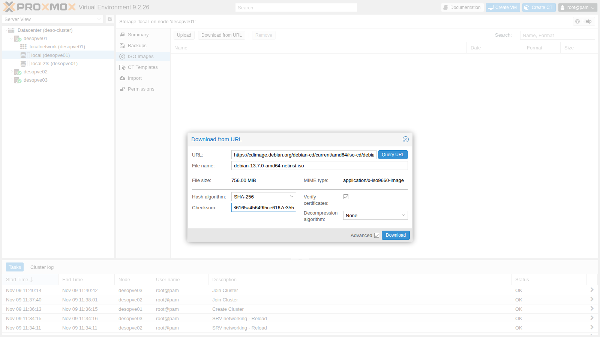

5. Premi **Download**. Il log del task termina con la verifica dell'impronta:

   ```text
   2026-11-09 12:48:27 (56.9 MB/s) - '/var/lib/vz/template/iso/debian-13.7.0-amd64-netinst.iso.tmp_dwnl.8549' saved [792723456/792723456]
   calculating checksum...OK, checksum verified
   download of 'https://cdimage.debian.org/debian-cd/current/amd64/iso-cd/debian-13.7.0-amd64-netinst.iso' to '/var/lib/vz/template/iso/debian-13.7.0-amd64-netinst.iso' finished
   TASK OK
   ```

### 2. Creare la VM

Premi **Create VM** in alto a destra. La procedura guidata ha otto schede.

1. **General.** Il **Node** è quello su cui creerai la VM (`desopve01`), il **VM ID** proposto è il primo libero (`100`). Come **Name** usa `debian01`.

   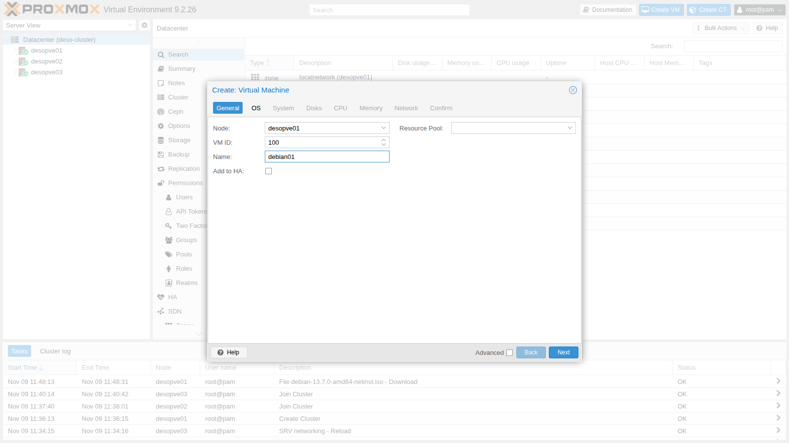

2. **OS.** Scegli **Use CD/DVD disc image file (iso)**, storage `local`, ISO `debian-13.7.0-amd64-netinst.iso`. Il **Guest OS** (`Linux`, kernel `7.x - 2.6`) serve a Proxmox VE per scegliere i valori predefiniti migliori.

   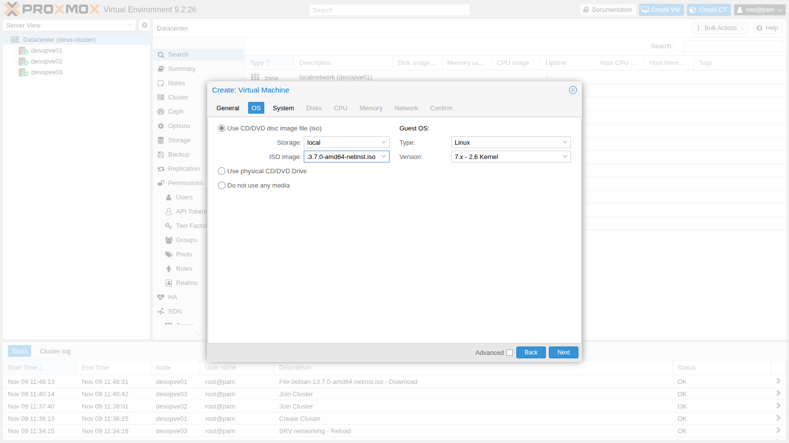

3. **System.** Lascia i valori predefiniti: scheda video `Default`, macchina `i440fx`, firmware `SeaBIOS`, controller dei dischi **VirtIO SCSI single**. L'opzione **Qemu Agent** la attiverai nel lab 38.
4. **Disks.** Disco `scsi0` sullo storage `local-zfs`, **Disk size** `16` GiB. **IO thread** è già attivo: il disco ha un suo thread di I/O (lab 37).

   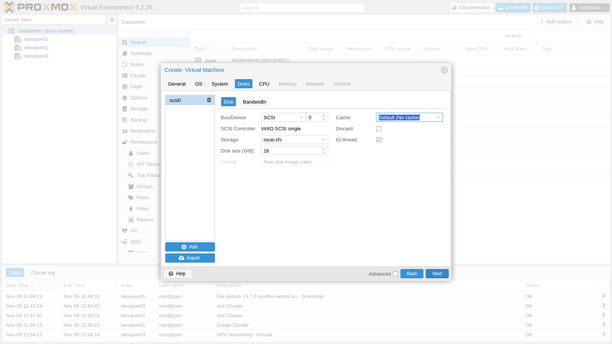

5. **CPU.** **Cores** `2`. Il **Type** predefinito, `x86-64-v2-AES`, è un modello di CPU generico che permette di migrare la VM tra nodi con processori diversi (lab 35).

   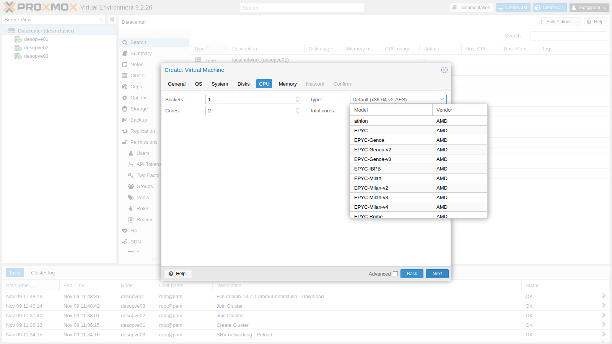

6. **Memory.** Lascia `2048` MiB.
7. **Network.** Bridge `vmbr0`, modello **VirtIO (paravirtualized)**, firewall attivo: la VM è collegata alla rete di gestione come un server fisico allo switch.

   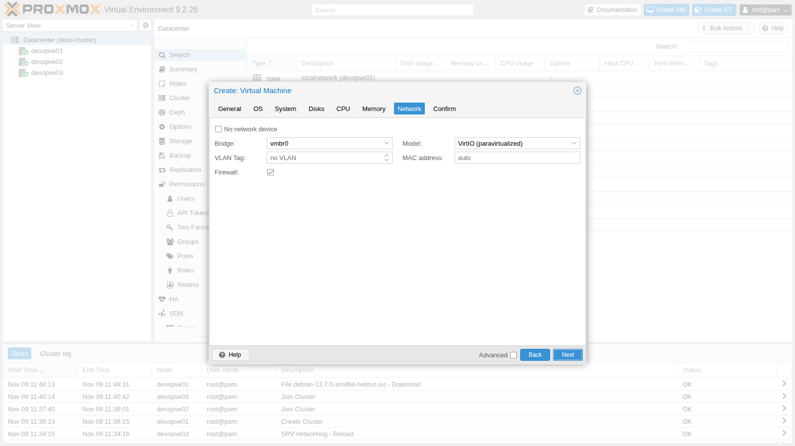

8. **Confirm.** Il riepilogo mostra i parametri che verranno passati all'API. Lascia spento **Start after created** e premi **Finish**.

   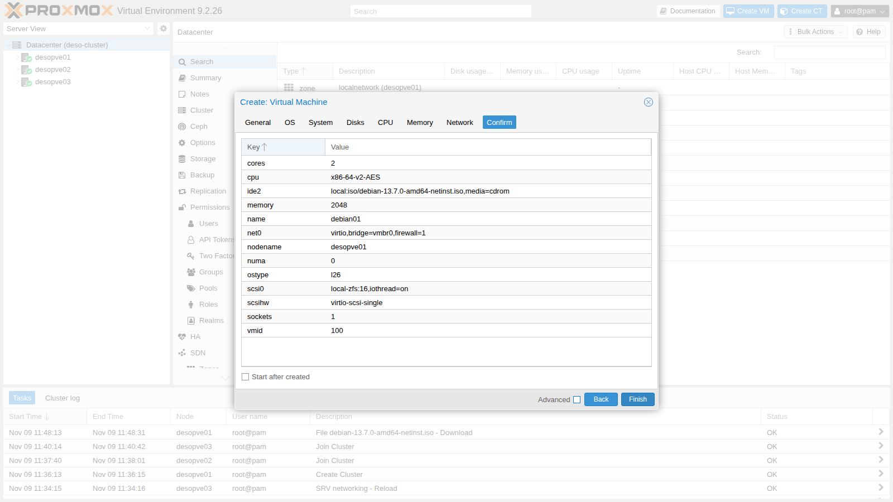

La VM `100 (debian01)` compare nell'albero sotto `desopve01`. La sua configurazione è un semplice file di testo, `/etc/pve/qemu-server/100.conf`, condiviso nel cluster:

```bash title="root@desopve01"
qm config 100
```

```text output
boot: order=scsi0;ide2;net0
cores: 2
cpu: x86-64-v2-AES
ide2: local:iso/debian-13.7.0-amd64-netinst.iso,media=cdrom,size=756M
memory: 2048
meta: creation-qemu=11.1.3,ctime=1794225060
name: debian01
net0: virtio=BC:24:11:2B:FF:8A,bridge=vmbr0,firewall=1
numa: 0
ostype: l26
scsi0: local-zfs:vm-100-disk-0,iothread=1,size=16G
scsihw: virtio-scsi-single
smbios1: uuid=ce65e842-1c38-47f2-9112-da688d1a8025
sockets: 1
vmgenid: f52461b5-dbdf-4245-83ba-9897b7d1eacd
```

L'ordine di avvio (`boot`) prova prima il disco e poi il CD: finché il disco è vuoto la VM parte dalla ISO, dopo l'installazione parte dal disco.

### 3. Installare Debian dalla console

1. Seleziona la VM, premi **Start** e apri **Console**: è la schermata della VM nel browser (noVNC). Nel menu scegli **Install** (l'installer in modalità testo) e premi **Invio**.

   :::note
   Il menu attende pochi secondi: se non premi niente, avvia l'installazione con sintesi vocale. Se succede, riavvia la VM con **Reset** e scegli subito la voce.
   :::

   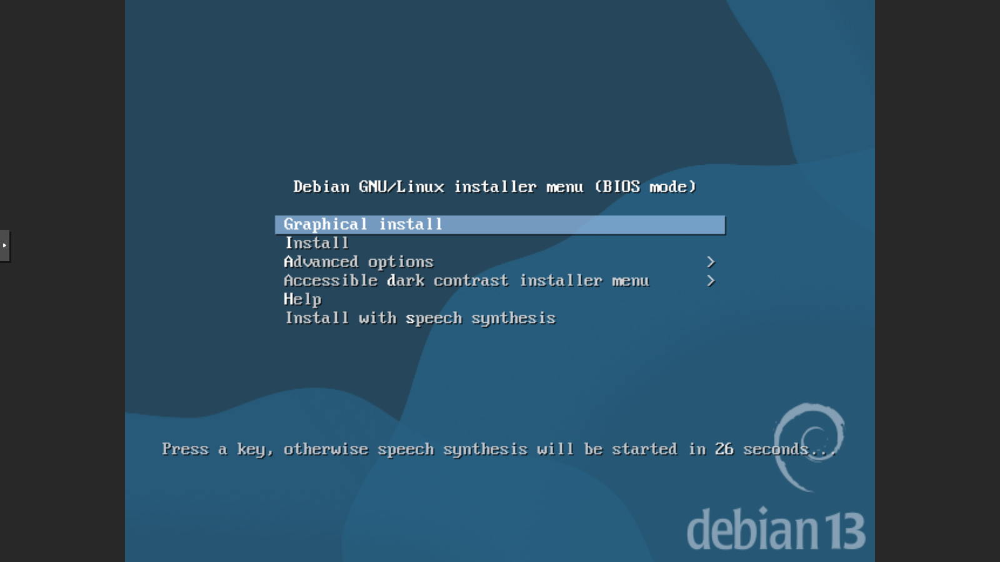

2. Rispondi alle domande dell'installer:

   | Domanda | Risposta |
   |---|---|
   | Language | `English` |
   | Location | `other` → `Europe` → `Italy` |
   | Locale | `United States – en_US.UTF-8` |
   | Keymap | `Italian` |
   | Configurazione della rete | il DHCP non risponde (nella rete del laboratorio non c'è): **Cancel**, poi **Configure network manually** |
   | IP address | `172.27.199.100/24` |
   | Gateway | `172.27.199.1` (proposto) |
   | Name server | `172.27.199.20` |
   | Hostname / Domain | `debian01` / `proxmox.community` |
   | Root password | `<password-lab>` |
   | Utente | nome completo `Lab User`, username `labuser`, password `<password-lab>` |
   | Ora da Internet | l'installer prova a contattare un server NTP pubblico: **Cancel** |
   | Partitioning | **Guided – use entire disk**, disco `QEMU HARDDISK` da 17.2 GB, **All files in one partition**, conferma con **Yes** |
   | Package manager | mirror in Italia, `deb.debian.org` |
   | HTTP proxy | `http://proxy.proxmox.community:3128` |
   | Popularity contest | **No** |
   | Software | solo **SSH server** e **standard system utilities** |
   | GRUB | **Yes**, sul disco `/dev/sda` |

   Il disco si presenta come `QEMU HARDDISK`: è il disco virtuale che Proxmox VE espone alla VM. Le schermate più importanti sono queste:

   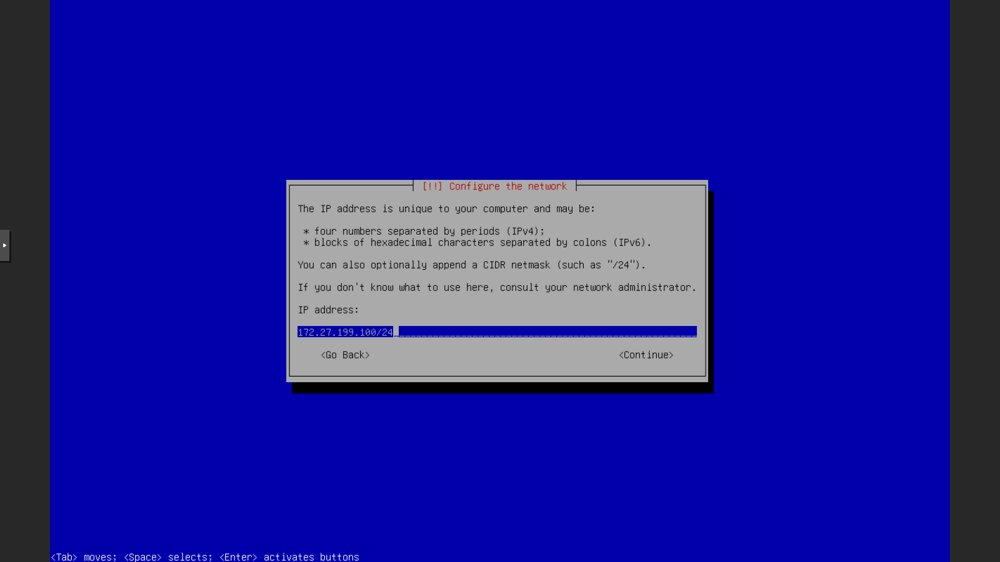

   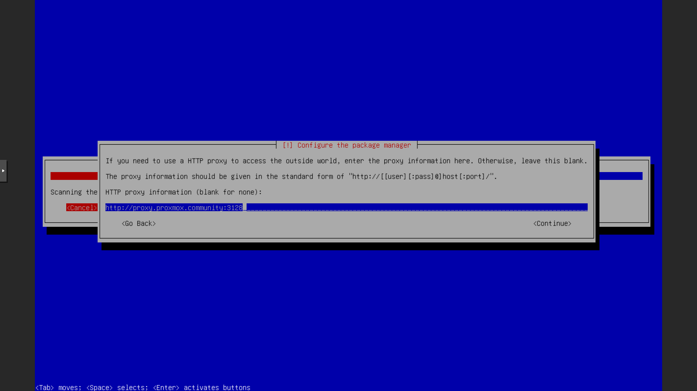

   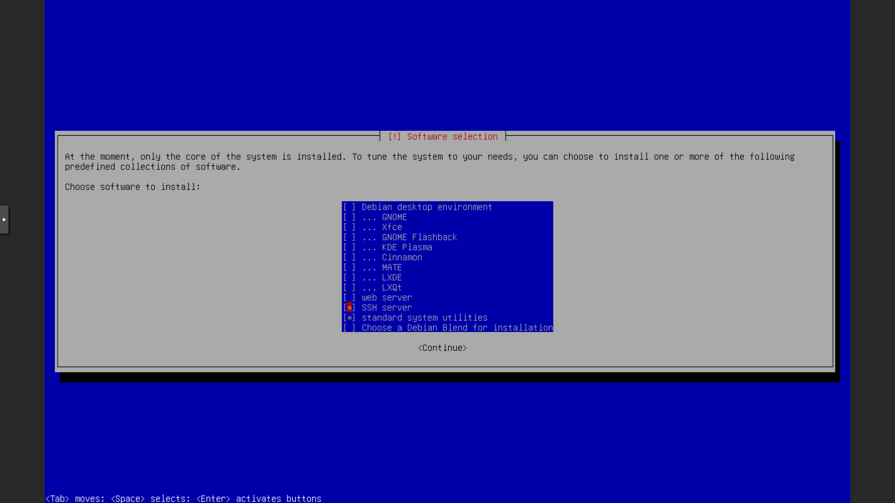

3. Quando l'installer chiede di riavviare, premi **Continue**. La VM riparte dal disco e mostra il login.

   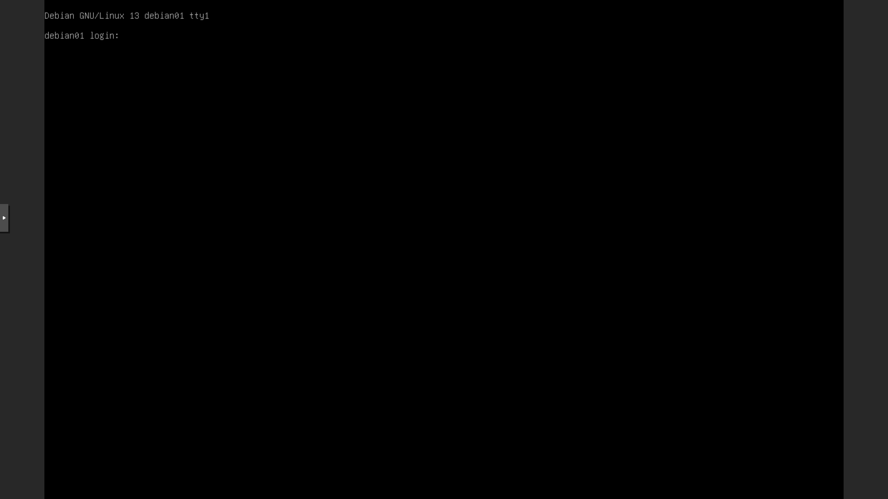

4. Scollega la ISO dalla VM. La stessa impostazione, nella GUI, è in **Hardware** → **CD/DVD Drive** → **Do not use any media**:

   ```bash title="root@desopve01"
   qm set 100 --ide2 none,media=cdrom
   ```

   ```text output
   update VM 100: -ide2 none,media=cdrom
   ```

5. Il **Summary** della VM mostra stato, nodo, utilizzo di CPU, memoria e disco.

   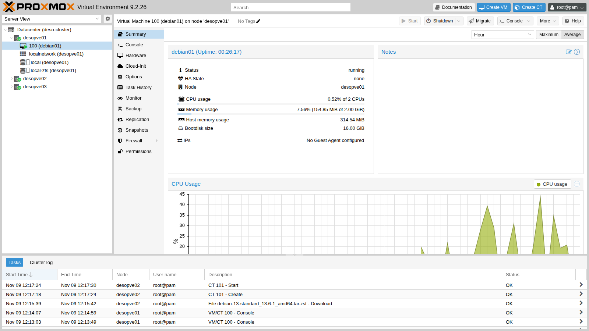

### 4. Scaricare il template di un container

1. Seleziona lo storage `local (desopve02)` → **CT Templates** → **Templates**. L'elenco contiene i template ufficiali di Proxmox: sistemi operativi (`system`) e applicazioni pronte (`turnkeylinux`).
2. Cerca `debian-13`, seleziona **debian-13-standard** e premi **Download**.

   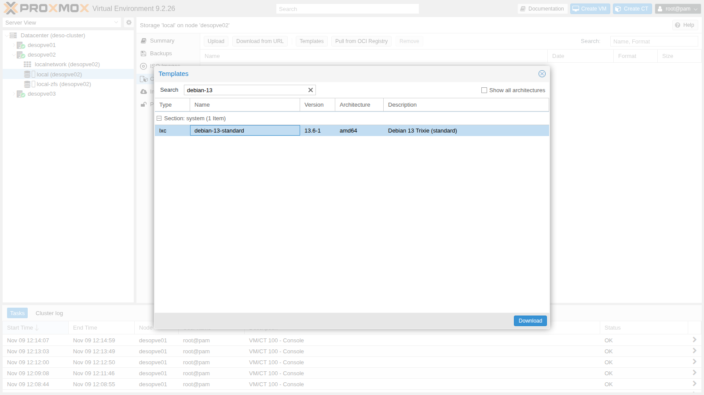

   Anche qui il nodo verifica l'impronta del file:

   ```text
   calculating checksum...OK, checksum verified
   download of 'http://download.proxmox.com/images/system/debian-13-standard_13.6-1_amd64.tar.zst' to '/var/lib/vz/template/cache/debian-13-standard_13.6-1_amd64.tar.zst' finished
   TASK OK
   ```

### 5. Creare il container

Premi **Create CT**.

1. **General.** **Node** `desopve02`: dall'interfaccia di un nodo puoi creare guest su qualsiasi nodo del cluster. Poi **CT ID** `101`, **Hostname** `debian-ct01` e la password di `root` del container. **Unprivileged container** è attivo: l'utente `root` del container corrisponde a un utente senza privilegi sul nodo, che è l'impostazione sicura (lab 41).

   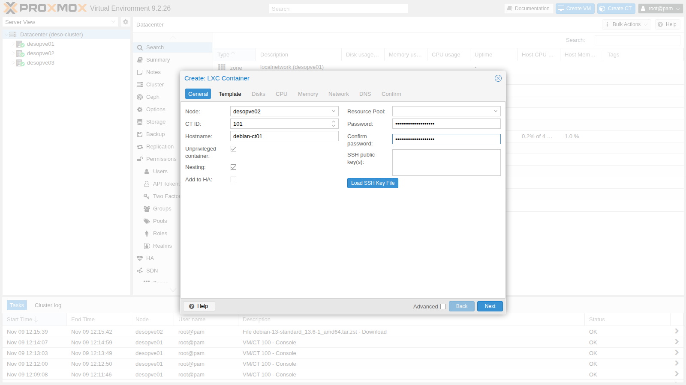

2. **Template.** Storage `local`, template `debian-13-standard_13.6-1_amd64.tar.zst`.
3. **Disks.** Root disk su `local-zfs`, `8` GiB.
4. **CPU** e **Memory.** `1` core, `1024` MiB di memoria e `512` MiB di swap.
5. **Network.** `eth0` sul bridge `vmbr0`, **IPv4** statico `172.27.199.101/24`, gateway `172.27.199.1`.

   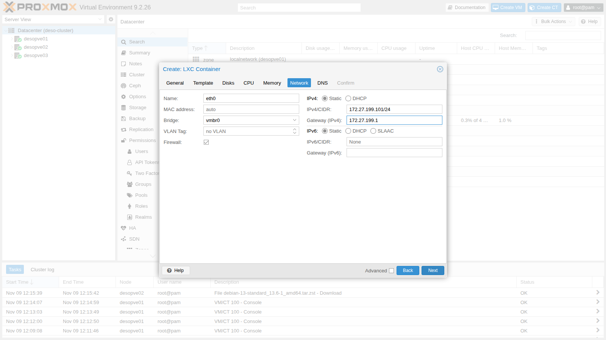

6. **DNS.** Lascia i campi vuoti: il container usa le impostazioni DNS del nodo.
7. **Confirm.** Spunta **Start after created** e premi **Finish**.

   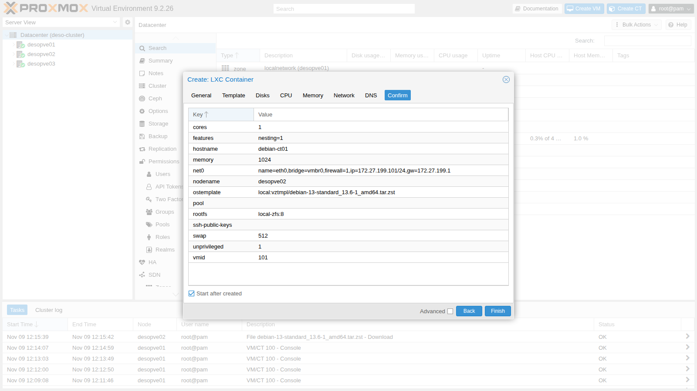

Il task estrae il template e genera le chiavi SSH del container. In pochi secondi il container è acceso:

```text
extracting archive '/var/lib/vz/template/cache/debian-13-standard_13.6-1_amd64.tar.zst'
Total bytes read: 553512960 (528MiB, 104MiB/s)
Detected container architecture: amd64
Creating SSH host key 'ssh_host_ecdsa_key' - this may take some time ...
done: SHA256:zekotr1oKXgAGnFNcwI/uCX1MRKZbSEfKtC+vRdWoMI root@debian-ct01
Creating SSH host key 'ssh_host_ed25519_key' - this may take some time ...
done: SHA256:PXwzhEQ7pwnOUkqgq+wMtoRDt/a9+nwCVSdX2l3EZMs root@debian-ct01
Creating SSH host key 'ssh_host_rsa_key' - this may take some time ...
done: SHA256:NJOZQVV8VkmI73UewHxOJdUD/uEWL4Pp3rElO8yJA1Y root@debian-ct01
TASK OK
```

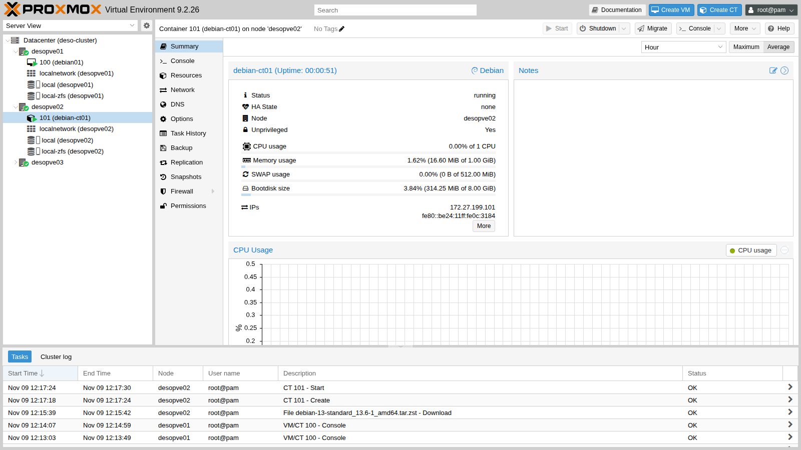

Il disco del container è un dataset ZFS (`subvol-101-disk-0`), non un disco virtuale: il container vede direttamente un file system.

```bash title="root@desopve02"
pct config 101
```

```text output
arch: amd64
cores: 1
features: nesting=1
hostname: debian-ct01
memory: 1024
net0: name=eth0,bridge=vmbr0,firewall=1,gw=172.27.199.1,hwaddr=BC:24:11:0C:31:84,ip=172.27.199.101/24,type=veth
ostype: debian
rootfs: local-zfs:subvol-101-disk-0,size=8G
swap: 512
unprivileged: 1
```

## Verifica e test

1. **La VM.** Dal DC collegati in SSH a `labuser@172.27.199.100` e controlla nome, rete, DNS, gateway e proxy configurato dall'installer:

   ```bash title="labuser@debian01"
   hostname -f
   ```

   ```text output
   debian01.proxmox.community
   ```

   ```bash title="labuser@debian01"
   ip -br -4 addr
   ```

   ```text output
   lo               UNKNOWN        127.0.0.1/8
   ens18            UP             172.27.199.100/24
   ```

   ```bash title="labuser@debian01"
   ip route
   ```

   ```text output
   default via 172.27.199.1 dev ens18 onlink
   172.27.199.0/24 dev ens18 proto kernel scope link src 172.27.199.100
   ```

   ```bash title="labuser@debian01"
   cat /etc/resolv.conf
   ```

   ```text output
   search proxmox.community
   nameserver 172.27.199.20
   ```

   ```bash title="labuser@debian01"
   ping -c2 172.27.199.1 | grep loss
   ```

   ```text output
   2 packets transmitted, 2 received, 0% packet loss, time 1001ms
   ```

   ```bash title="labuser@debian01"
   cat /etc/apt/apt.conf
   ```

   ```text output
   Acquire::http::Proxy "http://proxy.proxmox.community:3128";
   ```

   ```bash title="labuser@debian01"
   cat /etc/debian_version
   ```

   ```text output
   13.7
   ```

   ```bash title="labuser@debian01"
   timedatectl | grep "Time zone"
   ```

   ```text output
                   Time zone: Europe/Rome (CET, +0100)
   ```

   `ens18` è il nome che Linux dà alla scheda VirtIO della VM.

2. **Il container.** `pct exec` esegue un comando nel container dal nodo, senza password né rete. Il DNS è quello del nodo, scritto da Proxmox VE tra i marcatori `PVE`:

   ```bash title="root@desopve02"
   pct list
   ```

   ```text output
   VMID       Status     Lock         Name
   101        running                 debian-ct01
   ```

   ```bash title="root@desopve02"
   pct exec 101 -- ip -br -4 addr
   ```

   ```text output
   lo               UNKNOWN        127.0.0.1/8
   eth0@if6         UP             172.27.199.101/24
   ```

   ```bash title="root@desopve02"
   pct exec 101 -- cat /etc/resolv.conf
   ```

   ```text output
   # --- BEGIN PVE ---
   search proxmox.community
   nameserver 172.27.199.20
   # --- END PVE ---
   ```

   ```bash title="root@desopve02"
   pct exec 101 -- ping -c2 172.27.199.1 | grep loss
   ```

   ```text output
   2 packets transmitted, 2 received, 0% packet loss, time 1002ms
   ```

   Per una shell interattiva nel container usa `pct enter 101`.

3. **Il proxy nel container.** Il template non conosce il proxy del laboratorio: configuralo e aggiorna l'elenco dei pacchetti.

   ```bash title="root@desopve02"
   pct exec 101 -- sh -c "echo 'Acquire::http::Proxy \"http://proxy.proxmox.community:3128\";' > /etc/apt/apt.conf.d/80proxy; apt-get update" | tail -3
   ```

   ```text output
   Get:14 http://deb.debian.org/debian trixie-updates/main amd64 Packages T-2026-11-05-1401.10-F-2026-07-18-0800.33.pdiff [1038 B]
   Fetched 17.0 MB in 2s (7736 kB/s)
   Reading package lists...
   ```

4. **La vista del cluster.** Da qualsiasi nodo vedi tutti i guest del cluster:

   ```bash title="root@desopve01"
   pvesh get /cluster/resources --type vm --output-format yaml | grep -E "^- |id:|name:|node:|status:|type:"
   ```

   ```text output
   - cpu: 0.00447667643448901
     id: qemu/100
     name: debian01
     node: desopve01
     status: running
     type: qemu
     vmid: 100
   - cpu: 0.248149203798156
     id: lxc/101
     name: debian-ct01
     node: desopve02
     status: running
     type: lxc
     vmid: 101
   ```

- [ ] La VM `100` è accesa, raggiungibile in SSH su `172.27.199.100`, e scarica pacchetti tramite il proxy.
- [ ] Il container `101` è acceso su `desopve02`, risponde su `172.27.199.101` e scarica pacchetti tramite il proxy.

## Stato finale del lab

- Cluster `deso-cluster` invariato; `desopve04` autonomo.
- **VM `100` `debian01`** su `desopve01`, accesa: Debian 13.7 su `local-zfs` (16 GiB), 2 core, 2048 MiB, `172.27.199.100`, utenti `root` e `labuser`, server SSH, proxy per `apt`. ISO scollegata.
- **CT `101` `debian-ct01`** su `desopve02`, acceso: Debian 13 non privilegiato su `local-zfs` (8 GiB), 1 core, 1024 MiB, `172.27.199.101`, proxy per `apt`.
- ISO `debian-13.7.0-amd64-netinst.iso` in `local` su `desopve01`; template `debian-13-standard_13.6-1_amd64.tar.zst` in `local` su `desopve02`.

## Cosa hai imparato

- Le differenze tra macchine virtuali (KVM/QEMU) e container (LXC), e quando usare gli uni o gli altri.
- Come scaricare ISO e template direttamente sul nodo, con la verifica dell'impronta.
- Il significato delle schede della creazione di una VM e di un container.
- Che la configurazione di un guest è un file di testo in `/etc/pve`, leggibile con `qm config` e `pct config`.
- Come entrare in un container dal nodo con `pct exec` e `pct enter`.

## Riferimenti

- [Proxmox VE – QEMU/KVM Virtual Machines](https://pve.proxmox.com/pve-docs/pve-admin-guide.html#chapter_virtual_machines)
- [Proxmox VE – Proxmox Container Toolkit](https://pve.proxmox.com/pve-docs/pve-admin-guide.html#chapter_pct)
- [Proxmox VE – Storage](https://pve.proxmox.com/pve-docs/pve-admin-guide.html#chapter_storage)
- [Debian – Guida all'installazione per amd64](https://www.debian.org/releases/trixie/amd64/)
