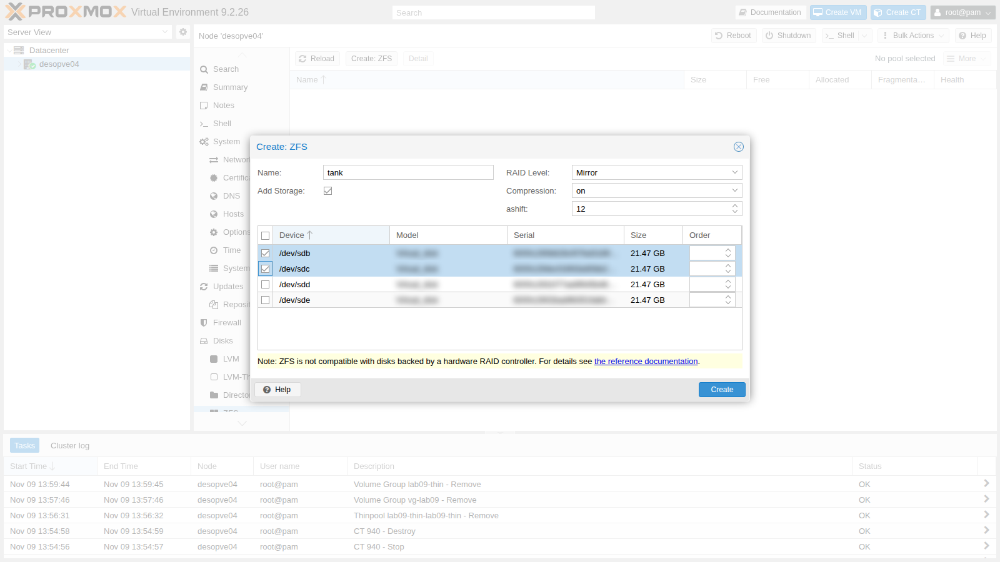
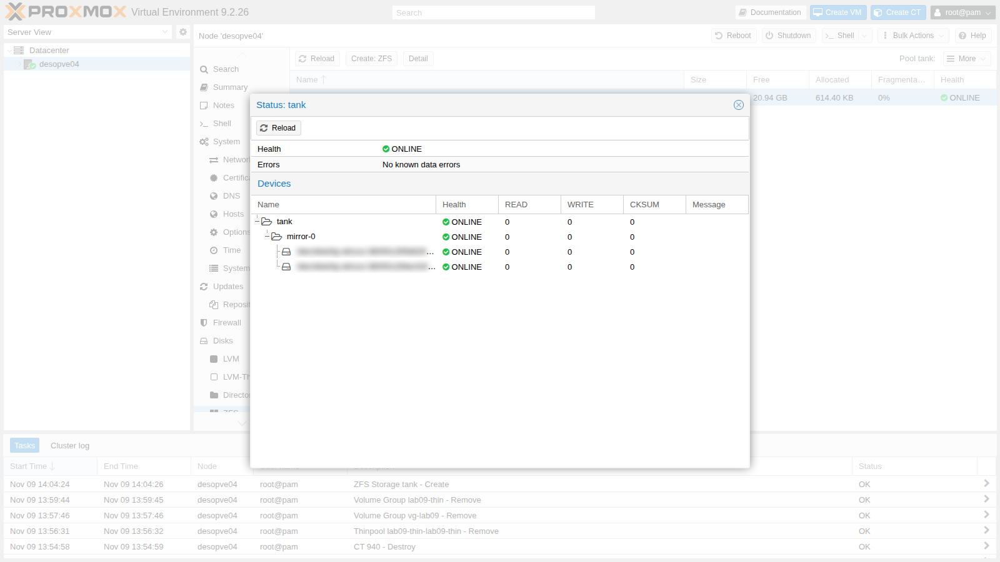
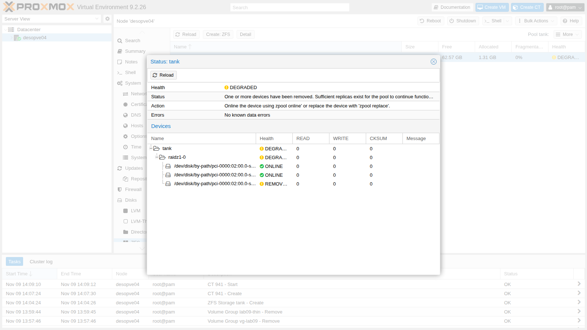
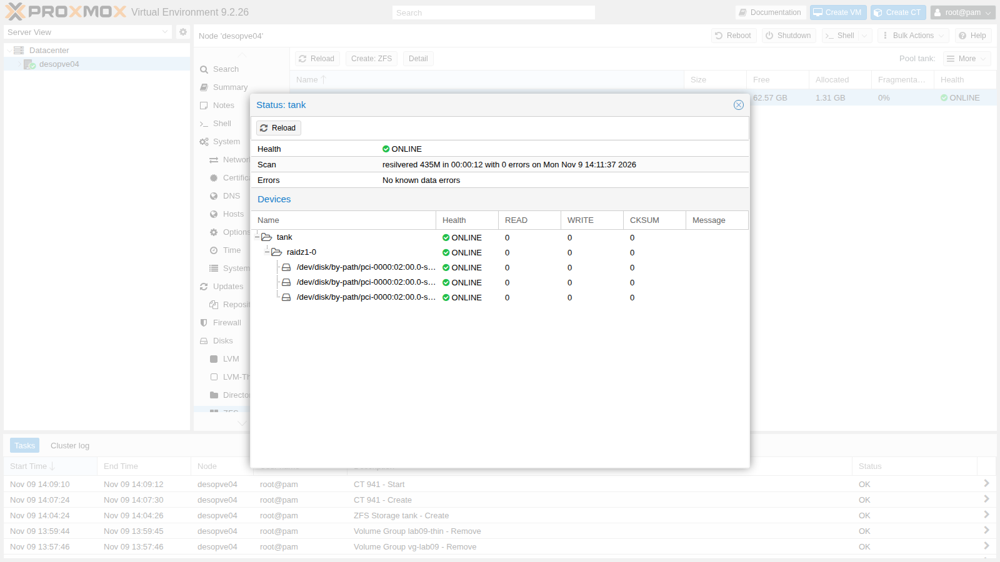

## Dipendenze

- **Lab precedenti:** [Lab 09](/it/09-lvm-and-lvm-thin/). Su `desopve04` i quattro dischi da 20 GB (`sdb`, `sdc`, `sdd`, `sde`) sono vuoti.
- **Nodi:** `desopve04` come banco di prova e `desopve01` (installato su ZFS, lab 03) per l'invio remoto degli snapshot.
- **Template:** `debian-13-standard_13.6-1_amd64.tar.zst` nello storage `local` di `desopve04` (lab 09).
- **Indirizzi:** `172.27.199.141` per il container di prova.
- **Hardware per i test di guasto:** i dischi di `desopve04` sono in vani hot-swap e si estraggono a nodo acceso. Tieni pronto un quinto disco da 20 GB, nuovo, da inserire nel Test 2 come disco di riserva (vedi l'[hardware del laboratorio](/it/01-lab-architecture/#hardware-del-laboratorio)).
- **Credenziali:** `root` / `<password-lab>` → [Appendice B](/it/b-credentials-and-addresses/).

## Obiettivi

- Capire come è fatto un pool ZFS: vdev, mirror, RAIDZ, dataset e zvol.
- Creare un pool dall'interfaccia web e da riga di comando, con i nomi stabili dei dischi.
- Vedere l'autoriparazione di ZFS: un disco del mirror corrotto e riparato da uno scrub.
- Confrontare gli algoritmi di compressione e capire lo spazio reale di un RAIDZ.
- Usare snapshot, rollback e `zfs send`/`receive`, anche verso un altro nodo.
- Dimensionare l'ARC, la cache di ZFS in RAM.
- Gestire il guasto reale di un disco: pool degradato, sostituzione e resilver.

## Come funziona

### Pool, vdev e dataset

ZFS fa insieme il lavoro di un RAID, di un volume manager e di un file system:

```text
 pool (zpool)           tank
                         │
 vdev               raidz1-0  (o mirror-0, o un disco singolo)
                    ┌────┼────┐
 dischi           sdb   sdc   sdd

 dataset e zvol     tank/dati            file system, montato in /tank/dati
                    tank/vm-990-disk-0   zvol: un block device, /dev/zvol/tank/vm-990-disk-0
```

- Un **pool** è fatto di uno o più **vdev**. La ridondanza sta *dentro* ogni vdev: se si perde un vdev intero, si perde il pool.
- Un vdev può essere un disco singolo, un **mirror** (2 o più copie identiche), un **RAIDZ1/2/3** (parità distribuita, sopporta la perdita di 1, 2 o 3 dischi) o un **dRAID**. Ci sono poi vdev speciali (`log`, `cache`, `special`) e i dischi di riserva (`spare`).
- Nel pool si creano **dataset** (file system) e **zvol** (block device). Le proprietà, come la compressione, si ereditano dal genitore e si possono cambiare per ciascuno.

In Proxmox VE uno storage `zfspool` mette i dischi delle VM in **zvol** e quelli dei container in **dataset** (`subvol`), con una quota pari alla dimensione del disco.

### Perché ZFS non perde i dati in silenzio

- **Copy-on-write:** ZFS non sovrascrive mai un blocco, ne scrive uno nuovo e poi aggiorna i puntatori. Una scrittura interrotta non lascia il file system a metà, e gli snapshot sono istantanei e gratuiti.
- **Checksum di ogni blocco**, conservati nel blocco padre: ZFS si accorge se un disco restituisce dati sbagliati, anche senza errori di I/O.
- **Autoriparazione:** se il vdev è ridondante, ZFS legge la copia buona e riscrive quella rovinata. Lo **scrub** rilegge tutto il pool per scovare e correggere gli errori latenti.

### Mirror o RAIDZ?

| | Mirror (2 dischi) | RAIDZ1 (3 dischi) | RAIDZ2 (4+ dischi) |
|---|---|---|---|
| Spazio utile | 50% | circa 66% | circa 50% con 4 dischi, di più con molti dischi |
| Dischi persi senza danni | 1 per mirror | 1 | 2 |
| Prestazioni casuali (IOPS) | alte, crescono con il numero di mirror | quelle di circa un disco per vdev | quelle di circa un disco per vdev |
| Ricostruzione (resilver) | copia da un solo disco | ricalcolo dalla parità su tutti i dischi | ricalcolo dalla parità |

Per i dischi delle VM la documentazione di Proxmox VE consiglia **mirror** o mirror in striping (RAID10): più IOPS e ricostruzioni più rapide. RAIDZ conviene per backup e archivi, dove conta lo spazio.

:::note
ZFS deve vedere i dischi direttamente: niente controller RAID hardware sotto, al massimo un HBA in modalità IT/passthrough.
:::

### ARC

L'**ARC** è la cache di lettura di ZFS in RAM. Più è grande, più letture evita ai dischi, ma la RAM che usa non va alle VM. Dalla versione 8.1 l'installazione di Proxmox VE limita l'ARC al **10% della RAM**, con un massimo di 16 GiB, scrivendo il limite in `/etc/modprobe.d/zfs.conf`.

## Procedura

### 1. Il pool di sistema di `desopve01`

L'installazione del lab 03 ha creato `rpool`, un mirror sulle partizioni 3 dei due dischi da 50 GB:

```bash title="root@desopve01"
zpool status rpool
```

```text output
  pool: rpool
 state: ONLINE
config:

	NAME                                   STATE     READ WRITE CKSUM
	rpool                                  ONLINE       0     0     0
	  mirror-0                             ONLINE       0     0     0
	    scsi-<seriale-disco-sda>-part3     ONLINE       0     0     0
	    scsi-<seriale-disco-sdb>-part3     ONLINE       0     0     0

errors: No known data errors
```

```bash title="root@desopve01"
zpool list
```

```text output
NAME    SIZE  ALLOC   FREE  CKPOINT  EXPANDSZ   FRAG    CAP  DEDUP    HEALTH  ALTROOT
rpool    49G  5.44G  43.6G        -         -     3%    11%  1.00x    ONLINE  -
```

L'installer usa i nomi in `/dev/disk/by-id`, che contengono modello e numero di serie del disco e non cambiano se cambia l'ordine `sda`, `sdb`… Nel manuale i seriali sono sostituiti da segnaposto, perché dipendono dall'hardware.

### 2. Creare un mirror dall'interfaccia web

1. Su `desopve04` apri **Disks** → **ZFS** → **Create: ZFS**.
2. **Name** `tank`, **RAID Level** `Mirror`, **Compression** `on` (cioè LZ4), **ashift** `12` (settori da 4 KiB), **Add Storage** attivo. Spunta `/dev/sdb` e `/dev/sdc`.

   

3. Premi **Create**. Il pool compare nell'elenco; **Detail** mostra lo stato dei dischi, come `zpool status`.

   

4. Da riga di comando:

   ```bash title="root@desopve04"
   zpool status tank
   ```

   ```text output
     pool: tank
    state: ONLINE
   config:

   	NAME                           STATE     READ WRITE CKSUM
   	tank                           ONLINE       0     0     0
   	  mirror-0                     ONLINE       0     0     0
   	    scsi-<seriale-disco-sdb>   ONLINE       0     0     0
   	    scsi-<seriale-disco-sdc>   ONLINE       0     0     0

   errors: No known data errors
   ```

   ```bash title="root@desopve04"
   grep -A4 "zfspool: tank" /etc/pve/storage.cfg
   ```

   ```text output
   zfspool: tank
   	pool tank
   	content rootdir,images
   	mountpoint /tank
   	nodes desopve04
   ```

### 3. Autoriparazione: corrompere un disco del mirror

Questo passo **distrugge di proposito** una parte dei dati di un disco. Fallo solo su un pool di prova.

1. Crea un dataset, scrivi 1,5 GB di dati casuali e annota l'impronta del file:

   ```bash title="root@desopve04"
   zfs create tank/dati
   dd if=/dev/urandom of=/tank/dati/archivio.bin bs=1M count=1500 status=none
   md5sum /tank/dati/archivio.bin
   ```

   ```text output
   15bd171a50378dae9c3153c9c48bdb00  /tank/dati/archivio.bin
   ```

2. Sovrascrivi con zeri 3 GB della partizione dati di `sdc`, partendo da 64 MiB per non toccare le etichette di ZFS all'inizio del disco:

   ```bash title="root@desopve04"
   dd if=/dev/zero of=/dev/sdc1 bs=1M seek=64 count=3000 oflag=direct status=none
   ```

3. Lancia uno scrub e attendi che finisca (`-w`):

   ```bash title="root@desopve04"
   zpool scrub -w tank
   zpool status tank
   ```

   ```text output
     pool: tank
    state: ONLINE
   status: One or more devices has experienced an unrecoverable error.  An
   	attempt was made to correct the error.  Applications are unaffected.
   action: Determine if the device needs to be replaced, and clear the errors
   	using 'zpool clear' or replace the device with 'zpool replace'.
      see: https://openzfs.github.io/openzfs-docs/msg/ZFS-8000-9P
     scan: scrub repaired 962M in 00:00:05 with 0 errors on Mon Nov  9 14:06:41 2026
   config:

   	NAME                           STATE     READ WRITE CKSUM
   	tank                           ONLINE       0     0     0
   	  mirror-0                     ONLINE       0     0     0
   	    scsi-<seriale-disco-sdb>   ONLINE       0     0     0
   	    scsi-<seriale-disco-sdc>   ONLINE       0     0 7.57K

   errors: No known data errors
   ```

   ZFS ha trovato 7570 blocchi con il checksum sbagliato sul secondo disco (`CKSUM`) e ha riscritto 962 MB copiandoli dal primo. Nessun errore di I/O: senza checksum, nessuno se ne sarebbe accorto.

4. Il file è intatto. Azzera i contatori:

   ```bash title="root@desopve04"
   md5sum /tank/dati/archivio.bin
   ```

   ```text output
   15bd171a50378dae9c3153c9c48bdb00  /tank/dati/archivio.bin
   ```

   ```bash title="root@desopve04"
   zpool clear tank
   zpool status -x tank
   ```

   ```text output
   pool 'tank' is healthy
   ```

   In produzione, un disco con errori di checksum va tenuto d'occhio: se gli errori si ripetono, va sostituito. Il pacchetto `zfsutils-linux` programma uno scrub mensile di tutti i pool (`/etc/cron.d/zfsutils-linux`), e `zfs-zed` manda una mail a `root` quando trova problemi (lab 51).

### 4. Creare un RAIDZ1 da riga di comando

Ora ricostruisci `tank` come RAIDZ1 su tre dischi. Prima elimini lo storage e il pool mirror:

```bash title="root@desopve04"
pvesm remove tank
zpool destroy tank
```

Per indicare i dischi, invece di `sdb`… (che possono cambiare a ogni avvio) usa `/dev/disk/by-path`, che identifica la porta del controller. È un'alternativa stabile a `by-id`, comoda quando si vuole sapere in quale slot sta un disco:

```bash title="root@desopve04"
ls -l /dev/disk/by-path/ | grep -v part | awk '{print $9, $11}' | grep scsi
```

```text output
pci-0000:02:00.0-scsi-0:0:0:0 ../../sda
pci-0000:02:00.0-scsi-0:0:1:0 ../../sdb
pci-0000:02:00.0-scsi-0:0:2:0 ../../sdc
pci-0000:02:00.0-scsi-0:0:3:0 ../../sdd
pci-0000:02:00.0-scsi-0:0:4:0 ../../sde
```

```bash title="root@desopve04"
cd /dev/disk/by-path
zpool create -o ashift=12 -O compression=lz4 -O atime=off tank raidz1 pci-0000:02:00.0-scsi-0:0:1:0 pci-0000:02:00.0-scsi-0:0:2:0 pci-0000:02:00.0-scsi-0:0:3:0
zpool status tank
```

```text output
  pool: tank
 state: ONLINE
config:

	NAME                               STATE     READ WRITE CKSUM
	tank                               ONLINE       0     0     0
	  raidz1-0                         ONLINE       0     0     0
	    pci-0000:02:00.0-scsi-0:0:1:0  ONLINE       0     0     0
	    pci-0000:02:00.0-scsi-0:0:2:0  ONLINE       0     0     0
	    pci-0000:02:00.0-scsi-0:0:3:0  ONLINE       0     0     0

errors: No known data errors
```

```bash title="root@desopve04:/dev/disk/by-path"
zpool list tank
```

```text output
NAME   SIZE  ALLOC   FREE  CKPOINT  EXPANDSZ   FRAG    CAP  DEDUP    HEALTH  ALTROOT
tank  59.5G   856K  59.5G        -         -     0%     0%  1.00x    ONLINE  -
```

```bash title="root@desopve04:/dev/disk/by-path"
zfs list tank
```

```text output
NAME   USED  AVAIL  REFER  MOUNTPOINT
tank   512K  38.4G   128K  /tank
```

- `-o ashift=12` è una proprietà del **pool**, fissata per sempre alla creazione; `-O` imposta le proprietà del **dataset** radice, che i figli ereditano.
- `atime=off` evita una scrittura a ogni lettura di file.
- `zpool list` mostra lo spazio **grezzo**, parità compresa (3 × 20 GB = 59,5 GiB); `zfs list` quello **utilizzabile** (38,4 GiB): un terzo va alla parità.

Aggiungi lo storage, con l'opzione `sparse` come `local-zfs`:

```bash title="root@desopve04"
pvesm add zfspool tank --pool tank --content images,rootdir --sparse 1 --nodes desopve04
pvesm status
```

```text output
Name             Type     Status     Total (KiB)      Used (KiB) Available (KiB)        %
local             dir     active        22203544         5768732        15281584   25.98%
local-lvm     lvmthin     active        14217216               0        14217216    0.00%
tank          zfspool     active        40265280             543        40264736    0.00%
```

### 5. Compressione a confronto

Crea tre dataset con compressione diversa e copia in ciascuno gli stessi file (documentazione e librerie Python, cioè testo e codice):

```bash title="root@desopve04"
for c in off lz4 zstd; do zfs create -o compression=$c tank/comp-$c; cp -a /usr/share/doc /usr/lib/python3 /tank/comp-$c/; done
zfs list -o name,compression,used,logicalused,compressratio -r tank | grep -E "NAME|comp-"
```

```text output
NAME            COMPRESS         USED  LUSED  RATIO
tank/comp-lz4   lz4              111M   112M  1.63x
tank/comp-off   off              157M   112M  1.00x
tank/comp-zstd  zstd             103M   112M  1.83x
```

- **RATIO** è il guadagno della compressione: zstd comprime più di LZ4 (1,83x contro 1,63x) e consuma un po' più di CPU. LZ4 resta il default più equilibrato, perché rinuncia subito ai dati che non si comprimono.
- **USED** è lo spazio occupato nel pool. Senza compressione è **più** dei dati logici (157 MB contro 112): su RAIDZ ogni blocco porta con sé la parità e il riempimento a multipli di settore, e con tanti file piccoli questo sovraccarico si vede. La compressione lo riassorbe in parte.

### 6. Zvol e subvol: i dischi dei guest

Alloca un disco per una VM (VMID di prova `990`) e crea un container sullo storage `tank`:

```bash title="root@desopve04"
pvesm alloc tank 990 vm-990-disk-0 4G
```

```text output
successfully created 'tank:vm-990-disk-0'
```

```bash title="root@desopve04"
pct create 941 local:vztmpl/debian-13-standard_13.6-1_amd64.tar.zst --hostname lab10-ct --rootfs tank:4 --memory 512 --unprivileged 1 --features nesting=1 --ostype debian --net0 name=eth0,bridge=vmbr0,ip=172.27.199.141/24,gw=172.27.199.1
pvesm list tank
```

```text output
Volid                  Format  Type            Size VMID
tank:subvol-941-disk-0 subvol  rootdir   4294967296 941
tank:vm-990-disk-0     raw     images    4294967296 990
```

```bash title="root@desopve04"
zfs list -t all -o name,type,volsize,refquota,used,mountpoint -r tank | grep -E "NAME|990|941"
```

```text output
NAME                    TYPE        VOLSIZE  REFQUOTA   USED  MOUNTPOINT
tank/subvol-941-disk-0  filesystem        -        4G   346M  /tank/subvol-941-disk-0
tank/vm-990-disk-0      volume           4G         -  74.6K  -
```

```bash title="root@desopve04"
pct start 941
pct exec 941 -- df -h /
```

```text output
Filesystem              Size  Used Avail Use% Mounted on
tank/subvol-941-disk-0  4.0G  351M  3.7G   9% /
```

- Il disco della VM è uno **zvol** (`volume`) da 4 GiB, thin: occupa 75 KiB.
- Il disco del container è un **dataset** (`filesystem`) con `refquota` di 4 GiB: il container vede un file system da 4 GiB, e il nodo vede i suoi file direttamente in `/tank/subvol-941-disk-0`.

### 7. Snapshot e rollback

1. Crea un dataset di prova, fai uno snapshot e cancella i file:

   ```bash title="root@desopve04"
   zfs create tank/snapdemo; cp -a /usr/share/doc /tank/snapdemo/
   zfs snapshot tank/snapdemo@a
   rm -rf /tank/snapdemo/doc; sync
   zfs list -t snapshot -o name,used,refer tank/snapdemo
   ```

   ```text output
   NAME              USED  REFER
   tank/snapdemo@a  64.6M  64.7M
   ```

   ```bash title="root@desopve04"
   zfs list -o space tank/snapdemo
   ```

   ```text output
   NAME           AVAIL   USED  USEDSNAP  USEDDS  USEDREFRESERV  USEDCHILD
   tank/snapdemo  37.5G  64.7M     64.6M    128K             0B         0B
   ```

   Appena creato, uno snapshot non occupa nulla. Quando i file vengono cancellati, i loro blocchi restano allo snapshot: ora il dataset occupa 128 KiB (`USEDDS`) e lo snapshot 64,6 MiB (`USEDSNAP`). La colonna `USED` di uno snapshot conta solo i blocchi che appartengono a **lui solo**: se più snapshot condividono gli stessi blocchi, ciascuno mostra `0B` e lo spazio compare solo in `USEDSNAP`.

2. I file dello snapshot si leggono, in sola lettura, nella cartella nascosta `.zfs/snapshot`. Con `zfs rollback` il dataset torna esattamente com'era. Lo provi su `tank/comp-zstd`:

   ```bash title="root@desopve04"
   zfs snapshot tank/comp-zstd@prima
   rm -rf /tank/comp-zstd/doc
   ls /tank/comp-zstd
   ```

   ```text output
   python3
   ```

   ```bash title="root@desopve04"
   ls /tank/comp-zstd/.zfs/snapshot/prima/
   ```

   ```text output
   doc
   python3
   ```

   ```bash title="root@desopve04"
   zfs rollback tank/comp-zstd@prima
   ls /tank/comp-zstd
   ```

   ```text output
   doc
   python3
   ```

   ```bash title="root@desopve04"
   zfs destroy -r tank/snapdemo
   ```

   `zfs rollback` torna solo all'**ultimo** snapshot: per tornare a uno precedente bisogna distruggere quelli successivi (`-r`). Gli snapshot dei dischi di VM e container si gestiscono dall'interfaccia web, che usa proprio gli snapshot ZFS (lab 16).

### 8. `zfs send` e `zfs receive`

`zfs send` trasforma uno snapshot in un flusso di dati, `zfs receive` lo ricrea altrove. È la base della replica di Proxmox VE (lab 11).

1. **Copia completa e incrementale nello stesso pool:**

   ```bash title="root@desopve04"
   zfs snapshot tank/comp-zstd@s1
   zfs send tank/comp-zstd@s1 | zfs receive tank/copia
   date > /tank/comp-zstd/nuovo.txt
   zfs snapshot tank/comp-zstd@s2
   zfs send -v -i @s1 tank/comp-zstd@s2 | zfs receive tank/copia
   ```

   ```text output
   send from tank/comp-zstd@s1 to tank/comp-zstd@s2 estimated size is 49.1K
   total estimated size is 49.1K
   TIME        SENT   SNAPSHOT tank/comp-zstd@s2
   ```

   ```bash title="root@desopve04"
   zfs list -t snapshot -o name,used,refer -r tank/comp-zstd tank/copia
   ```

   ```text output
   NAME                   USED  REFER
   tank/comp-zstd@prima     0B   103M
   tank/comp-zstd@s1        0B   103M
   tank/comp-zstd@s2        0B   103M
   tank/copia@s1         95.9K   111M
   tank/copia@s2            0B   111M
   ```

   ```bash title="root@desopve04"
   cat /tank/copia/nuovo.txt
   ```

   ```text output
   Mon Nov  9 02:07:58 PM CET 2026
   ```

   L'invio incrementale (`-i @s1`) trasferisce solo le differenze tra i due snapshot: 49 KB invece di 100 MB.

2. **Verso un altro nodo, attraverso SSH.** `desopve04` non fa parte del cluster, quindi prima gli serve una chiave autorizzata su `desopve01`. `ssh-copy-id` chiede una volta la password di `root` di `desopve01`:

   ```bash title="root@desopve04"
   ssh-copy-id -o StrictHostKeyChecking=accept-new root@desopve01.proxmox.community
   ```

   ```text output
   /usr/bin/ssh-copy-id: INFO: Source of key(s) to be installed: "/root/.ssh/id_rsa.pub"
   /usr/bin/ssh-copy-id: INFO: attempting to log in with the new key(s), to filter out any that are already installed
   /usr/bin/ssh-copy-id: INFO: 1 key(s) remain to be installed -- if you are prompted now it is to install the new keys

   Number of key(s) added: 1
   ...
   ```

   ```bash title="root@desopve04"
   zfs send tank/comp-zstd@s2 | ssh root@desopve01.proxmox.community zfs receive rpool/lab10-copia
   ssh root@desopve01.proxmox.community zfs list -t all -o name,used,refer -r rpool/lab10-copia
   ```

   ```text output
   NAME                   USED  REFER
   rpool/lab10-copia     93.5M  93.5M
   rpool/lab10-copia@s2     0B  93.5M
   ```

   Il dataset arriva su `desopve01` con il suo snapshot. Occupa meno spazio che su `tank` perché lì non c'è il sovraccarico del RAIDZ.

   :::note
   Sui nodi del cluster `/root/.ssh/authorized_keys` è un collegamento a `/etc/pve/priv/authorized_keys`, condiviso: la chiave di `desopve04` ora apre **tutti** i nodi del cluster. A fine lab va tolta (vedi *Pulizia*).
   :::

### 9. Dimensionare l'ARC

1. Il limite attuale è nel file creato dall'installazione e nel parametro del modulo:

   ```bash title="root@desopve04"
   cat /etc/modprobe.d/zfs.conf
   ```

   ```text output
   options zfs zfs_arc_max=1676673024
   ```

   ```bash title="root@desopve04"
   arc_summary -s arc | sed -n 7,12p
   ```

   ```text output
   ARC status:
           Total memory size:                                      15.6 GiB
           Min target size:                                3.1 %  499.7 MiB
           Max target size:                               10.0 %    1.6 GiB
           Target size (adaptive):                        44.1 %    1.6 GiB
           Current size:                                  44.1 %  705.3 MiB
   ```

   1.676.673.024 byte sono 1,6 GiB, il 10% dei 15,6 GiB del nodo. `desopve01`, con 32 GB di RAM, ha un limite di 3,1 GiB.

2. Porta il limite a 2 GiB a caldo, scrivendo nel parametro del modulo, e rendilo permanente in `zfs.conf`:

   ```bash title="root@desopve04"
   echo $((2*1024*1024*1024)) > /sys/module/zfs/parameters/zfs_arc_max
   sed -i "s/^options zfs zfs_arc_max=.*/options zfs zfs_arc_max=2147483648/" /etc/modprobe.d/zfs.conf
   arc_summary -s arc | sed -n 8,12p
   ```

   ```text output
           Total memory size:                                      15.6 GiB
           Min target size:                                3.1 %  499.7 MiB
           Max target size:                               12.8 %    2.0 GiB
           Target size (adaptive):                        33.2 %    1.6 GiB
           Current size:                                  33.2 %  679.9 MiB
   ```

   ```bash title="root@desopve04"
   arcstat 1 3
   ```

   ```text output
       time  read  ddread  ddh%  dmread  dmh%  pread  ph%   size      c  avail
   14:08:38     0       0     0       0     0      0    0   680M   1.6G  12.2G
   14:08:39     0       0     0       0     0      0    0   680M   1.6G  12.2G
   14:08:40     0       0     0       0     0      0    0   680M   1.6G  12.2G
   ```

   Sui nodi con il **sistema su ZFS** (come `desopve01-03`) il modulo si carica dall'initramfs: dopo aver cambiato `zfs.conf` va lanciato `update-initramfs -u -k all`, altrimenti al riavvio vale il limite vecchio. `desopve04` ha il sistema su ext4, quindi non serve.

## Verifica e test

### Test 1 – Si guasta un disco del RAIDZ

Il pool `tank` è un RAIDZ1 su tre dischi e sopporta la perdita di uno di essi. Il container `941` è acceso e ha il disco su `tank`.

1. **Estrai a caldo** il disco nel vano `scsi-0:0:3:0` (`sdd`). Il disco sparisce dal sistema e ZFS se ne accorge subito:

   ```bash title="root@desopve04"
   lsblk -d -o NAME,SIZE | grep sd
   ```

   ```text output
   sda    50G
   sdb    20G
   sdc    20G
   sde    20G
   ```

   ```bash title="root@desopve04"
   zpool status tank
   ```

   ```text output
     pool: tank
    state: DEGRADED
   status: One or more devices have been removed.
   	Sufficient replicas exist for the pool to continue functioning in a
   	degraded state.
   action: Online the device using zpool online' or replace the device with
   	'zpool replace'.
   config:

   	NAME                               STATE     READ WRITE CKSUM
   	tank                               DEGRADED     0     0     0
   	  raidz1-0                         DEGRADED     0     0     0
   	    pci-0000:02:00.0-scsi-0:0:1:0  ONLINE       0     0     0
   	    pci-0000:02:00.0-scsi-0:0:2:0  ONLINE       0     0     0
   	    pci-0000:02:00.0-scsi-0:0:3:0  REMOVED      0     0     0

   errors: No known data errors
   ```

   ```bash title="root@desopve04"
   journalctl -u zfs-zed --since "-15 min" --no-hostname | tail -2
   ```

   ```text output
   Nov 09 14:09:18 zed[24608]: eid=246 class=statechange pool='tank' vdev=pci-0000:02:00.0-scsi-0:0:3:0-part1 vdev_state=REMOVED
   Nov 09 14:09:19 zed[24927]: eid=247 class=removed pool='tank' vdev=pci-0000:02:00.0-scsi-0:0:3:0-part1 vdev_state=REMOVED
   ```

   `zfs-zed`, il demone degli eventi di ZFS, registra il guasto e lo notifica per mail a `root` (`ZED_EMAIL_ADDR` in `/etc/zfs/zed.d/zed.rc`).

2. Il pool è **DEGRADED** ma funziona: il container continua a leggere e scrivere.

   ```bash title="root@desopve04"
   pct exec 941 -- sh -c "date > /root/durante-il-guasto.txt; sync; cat /root/durante-il-guasto.txt"
   ```

   ```text output
   Mon Nov  9 13:10:55 UTC 2026
   ```

   In **Disks** → **ZFS** → **Detail** il pool e il vdev sono in giallo, con il disco `REMOVED`:

   

3. **Sostituisci** il disco perso con il disco libero `sde` (vano `scsi-0:0:4:0`). ZFS ricostruisce i dati mancanti dalla parità (**resilver**), copiando solo i blocchi in uso:

   ```bash title="root@desopve04"
   zpool replace tank pci-0000:02:00.0-scsi-0:0:3:0 /dev/disk/by-path/pci-0000:02:00.0-scsi-0:0:4:0
   zpool status tank
   ```

   ```text output
     pool: tank
    state: DEGRADED
   status: One or more devices is currently being resilvered.  The pool will
   	continue to function, possibly in a degraded state.
   action: Wait for the resilver to complete.
     scan: resilver in progress since Mon Nov  9 14:11:25 2026
   	1.22G / 1.22G scanned, 345M / 1.12G issued at 173M/s
   	100M resilvered, 30.18% done, 00:00:04 to go
   config:

   	NAME                                 STATE     READ WRITE CKSUM
   	tank                                 DEGRADED     0     0     0
   	  raidz1-0                           DEGRADED     0     0     0
   	    pci-0000:02:00.0-scsi-0:0:1:0    ONLINE       0     0     0
   	    pci-0000:02:00.0-scsi-0:0:2:0    ONLINE       0     0     0
   	    replacing-2                      DEGRADED     0     0     0
   	      pci-0000:02:00.0-scsi-0:0:3:0  REMOVED      0     0     0
   	      pci-0000:02:00.0-scsi-0:0:4:0  ONLINE       0     0     0  (resilvering)

   errors: No known data errors
   ```

   ```bash title="root@desopve04"
   zpool wait -t resilver tank
   ```

4. Pochi secondi dopo la fine del resilver, ZFS stacca da solo il disco vecchio e il pool torna **ONLINE**:

   ```bash title="root@desopve04"
   zpool status tank
   ```

   ```text output
     pool: tank
    state: ONLINE
     scan: resilvered 435M in 00:00:12 with 0 errors on Mon Nov  9 14:11:37 2026
   config:

   	NAME                               STATE     READ WRITE CKSUM
   	tank                               ONLINE       0     0     0
   	  raidz1-0                         ONLINE       0     0     0
   	    pci-0000:02:00.0-scsi-0:0:1:0  ONLINE       0     0     0
   	    pci-0000:02:00.0-scsi-0:0:2:0  ONLINE       0     0     0
   	    pci-0000:02:00.0-scsi-0:0:4:0  ONLINE       0     0     0

   errors: No known data errors
   ```

   ```bash title="root@desopve04"
   md5sum /tank/copia/nuovo.txt /tank/comp-zstd/nuovo.txt
   ```

   ```text output
   2b697b63aba1f00e8edd33f831903cf2  /tank/copia/nuovo.txt
   2b697b63aba1f00e8edd33f831903cf2  /tank/comp-zstd/nuovo.txt
   ```

   ```bash title="root@desopve04"
   pct exec 941 -- cat /root/durante-il-guasto.txt
   ```

   ```text output
   Mon Nov  9 13:10:55 UTC 2026
   ```

   

   Nessun dato perso, nemmeno quello scritto mentre il pool era degradato.

### Test 2 – Un disco di riserva

Inserisci il disco nuovo da 20 GB nel vano libero `scsi-0:0:5:0` (se il kernel non lo vede, ripeti la scansione dei bus del [Lab 09](/it/09-lvm-and-lvm-thin/#2-i-dischi-del-nodo)). Il kernel gli dà il primo nome libero, `sdd`: lo stesso del disco rimosso, ma è un altro disco. È il motivo per cui i pool si costruiscono con nomi stabili (`by-path` o `by-id`) e non con `sdX`.

```bash title="root@desopve04"
ls -l /dev/disk/by-path/ | grep -v part | awk '{print $9, $11}' | grep scsi
```

```text output
pci-0000:02:00.0-scsi-0:0:0:0 ../../sda
pci-0000:02:00.0-scsi-0:0:1:0 ../../sdb
pci-0000:02:00.0-scsi-0:0:2:0 ../../sdc
pci-0000:02:00.0-scsi-0:0:4:0 ../../sde
pci-0000:02:00.0-scsi-0:0:5:0 ../../sdd
```

```bash title="root@desopve04"
zpool add tank spare /dev/disk/by-path/pci-0000:02:00.0-scsi-0:0:5:0
zpool set autoreplace=on tank
zpool status tank
```

```text output
  pool: tank
 state: ONLINE
  scan: resilvered 435M in 00:00:12 with 0 errors on Mon Nov  9 14:11:37 2026
config:

	NAME                               STATE     READ WRITE CKSUM
	tank                               ONLINE       0     0     0
	  raidz1-0                         ONLINE       0     0     0
	    pci-0000:02:00.0-scsi-0:0:1:0  ONLINE       0     0     0
	    pci-0000:02:00.0-scsi-0:0:2:0  ONLINE       0     0     0
	    pci-0000:02:00.0-scsi-0:0:4:0  ONLINE       0     0     0
	spares
	  pci-0000:02:00.0-scsi-0:0:5:0    AVAIL

errors: No known data errors
```

- Lo **spare** (`AVAIL`) resta inattivo. Se un disco del pool si guasta, `zfs-zed` lo attiva da solo e avvia il resilver, senza aspettare un intervento umano. Il disco guasto va poi sostituito, e lo spare torna disponibile.
- **`autoreplace=on`** fa un'altra cosa: se nello **stesso vano** di un disco perso viene inserito un disco nuovo, ZFS lo usa subito per sostituirlo. Funziona bene proprio con i nomi `by-path`, che identificano lo slot.

### Pulizia

Elimina il container, il disco di prova e i dataset del lab, il dataset ricevuto su `desopve01` e la chiave di `desopve04` dal cluster. Il pool `tank` resta: servirà nel lab 19.

```bash title="root@desopve04"
pct stop 941 && pct destroy 941 --purge 1
```

```text output
purging CT 941 from related configurations..
```

```bash title="root@desopve04"
pvesm free tank:vm-990-disk-0
```

```text output
Removed volume 'tank:vm-990-disk-0'
```

```bash title="root@desopve04"
for d in comp-off comp-lz4 comp-zstd copia; do zfs destroy -r tank/$d; done
zfs list -r tank
```

```text output
NAME   USED  AVAIL  REFER  MOUNTPOINT
tank   794K  38.4G   139K  /tank
```

```bash title="root@desopve04"
ssh root@desopve01.proxmox.community 'zfs destroy -r rpool/lab10-copia; sed -i "/ root@desopve04$/d" /etc/pve/priv/authorized_keys'
ssh -o BatchMode=yes root@desopve01.proxmox.community true
```

```text output
root@desopve01.proxmox.community: Permission denied (publickey,password).
```

- [ ] Hai creato un mirror dall'interfaccia web e un RAIDZ1 da riga di comando con nomi `by-path`.
- [ ] Lo scrub ha trovato e riparato i blocchi corrotti di un disco del mirror, senza perdere dati.
- [ ] Sai leggere la differenza tra spazio grezzo e utilizzabile, e il rapporto di compressione.
- [ ] Hai usato snapshot, rollback e `zfs send`/`receive`, completo, incrementale e verso un altro nodo.
- [ ] Hai portato l'ARC di `desopve04` a 2 GiB, a caldo e in modo permanente.
- [ ] Con un disco rimosso il pool è rimasto in servizio, e `zpool replace` lo ha riportato ONLINE.

## Stato finale del lab

- Sul cluster nulla è cambiato: il dataset ricevuto è stato eliminato da `desopve01` e la chiave di `desopve04` tolta dagli `authorized_keys` del cluster.
- **`desopve04`:**
  - pool **`tank`**: RAIDZ1 sui dischi `pci-0000:02:00.0-scsi-0:0:1:0`, `0:2:0` e `0:4:0`, con lo spare `0:5:0`. Proprietà `compression=lz4`, `atime=off`, `autoreplace=on`; è vuoto, con 38,4 GiB utilizzabili;
  - storage **`tank`** (`zfspool`, contenuti `images,rootdir`, `sparse`, solo `desopve04`);
  - il vano `scsi-0:0:3:0` è vuoto: il disco estratto nel Test 1 non torna nel nodo;
  - ARC limitato a **2 GiB** in `/etc/modprobe.d/zfs.conf`;
  - template `debian-13-standard_13.6-1_amd64.tar.zst` nello storage `local`.

## Cosa hai imparato

- Un pool ZFS è fatto di vdev; la ridondanza (mirror, RAIDZ) è dentro ogni vdev. Per le VM si preferiscono i mirror, per l'archivio i RAIDZ.
- I checksum e la ridondanza permettono a ZFS di accorgersi dei dati corrotti e di ripararli; lo scrub lo fa su tutto il pool.
- `zpool list` mostra lo spazio grezzo, `zfs list` quello utilizzabile; su RAIDZ parità e riempimento pesano soprattutto sui file piccoli.
- La compressione (LZ4 o zstd) si sceglie per dataset; in Proxmox VE le VM usano zvol, i container dataset con quota.
- Gli snapshot sono istantanei e occupano solo le differenze; `zfs send`/`receive` copia dataset e snapshot, anche in modo incrementale e verso altri nodi.
- L'ARC si limita con `zfs_arc_max`, a caldo e in `/etc/modprobe.d/zfs.conf`.
- Con un disco guasto il pool resta in servizio (DEGRADED); `zpool replace` ricostruisce la ridondanza, e uno spare permette a `zfs-zed` di farlo in automatico.

## Riferimenti

- [Proxmox VE – ZFS on Linux](https://pve.proxmox.com/pve-docs/pve-admin-guide.html#chapter_zfs)
- [Proxmox VE – Limit ZFS Memory Usage](https://pve.proxmox.com/pve-docs/pve-admin-guide.html#sysadmin_zfs_limit_memory_usage)
- [Proxmox VE – Local ZFS Pool Backend](https://pve.proxmox.com/pve-docs/pve-admin-guide.html#storage_zfspool)
- [OpenZFS – documentazione di `zpool` e `zfs`](https://openzfs.github.io/openzfs-docs/man/master/index.html)
