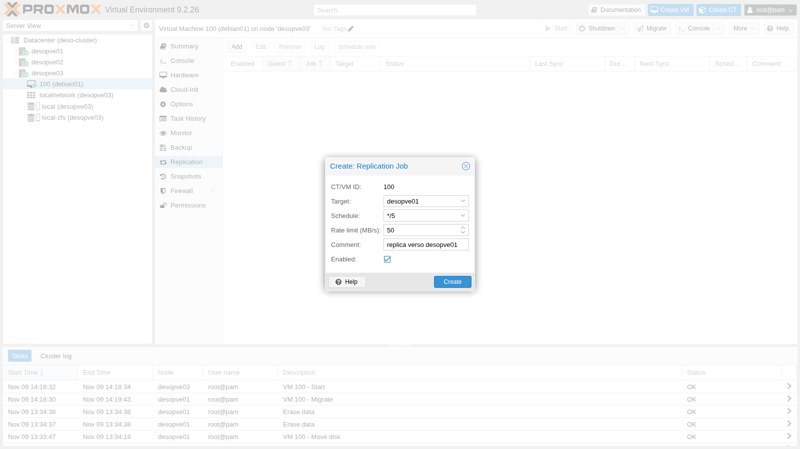
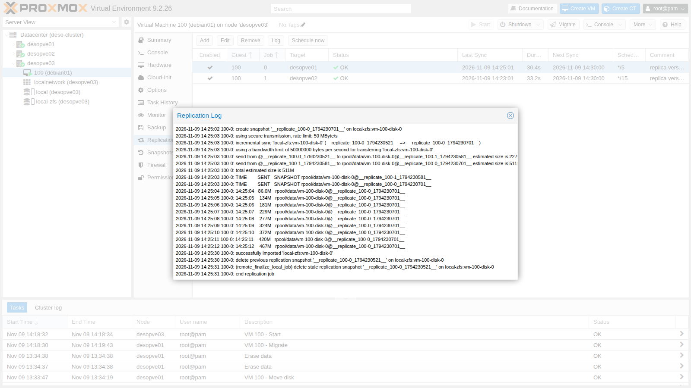
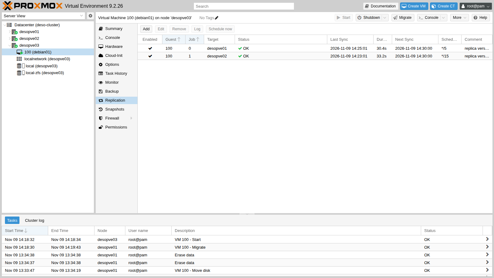
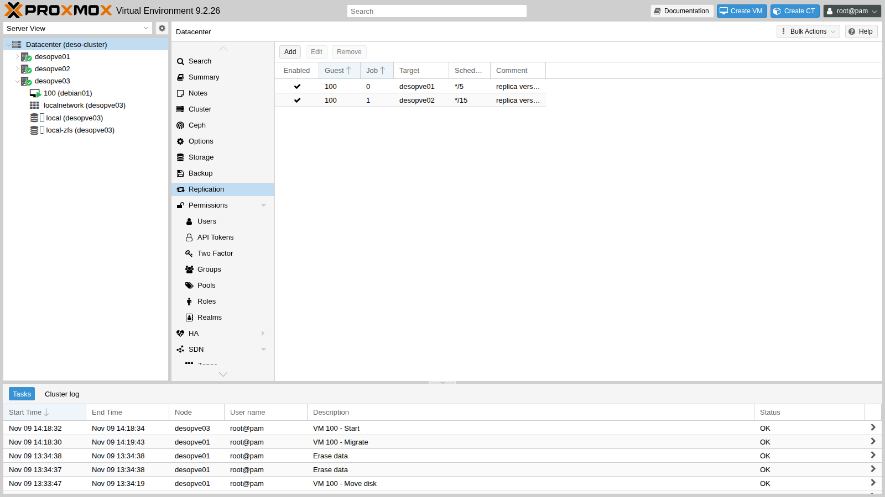
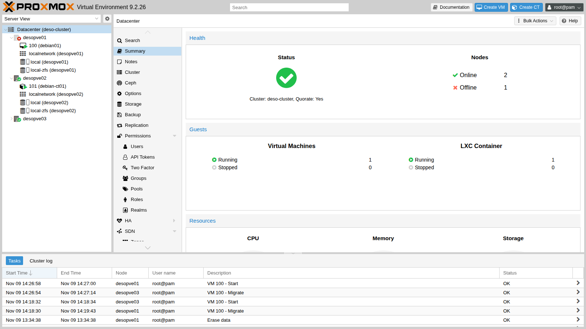
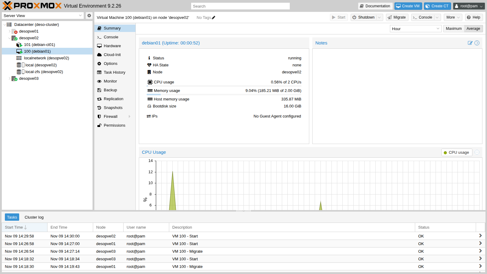

## Dipendenze

- **Lab precedenti:** [Lab 06](/it/06-cluster-corosync/) per il cluster `deso-cluster` a tre nodi, [Lab 07](/it/07-first-vm-and-container/) per la VM 100 `debian01` e [Lab 10](/it/10-zfs/) per i concetti di snapshot e `zfs send`.
- **Storage:** `local-zfs` (pool `rpool/data`) su **tutti** i nodi del cluster, con lo stesso nome. È lo storage creato dall'installazione su ZFS (lab 03).
- **VM:** 100 `debian01` accesa su `desopve01`, con il disco su `local-zfs`, raggiungibile in SSH a `172.27.199.100` come `labuser`.
- **Per il test di guasto:** la possibilità di spegnere di colpo un nodo e di riaccenderlo. Qui il nodo si spegne con un comando del kernel e si riaccende dalla scheda di gestione remota (IPMI, iDRAC, iLO) o con il pulsante di accensione.
- **Credenziali:** `root` / `<password-lab>` → [Appendice B](/it/b-credentials-and-addresses/).

## Obiettivi

- Due job di replica per la VM 100 verso due nodi diversi, uno dei quali ogni 5 minuti con un limite di 50 MB/s, di cui sai leggere stato, log e snapshot dalla GUI e con `pvesr`.
- La stessa VM migrata a caldo verso un nodo senza replica e verso uno con la replica, leggendo separatamente nei log la durata del task, il fermo riportato da QEMU e i dati copiati.
- La VM 100 fatta ripartire a mano su un altro nodo dopo lo spegnimento improvviso del suo, con i dati persi verificati rispetto all'ora dell'ultimo snapshot replicato.
- Il cluster e la replica di nuovo in ordine al rientro del nodo guasto, sapendo quale copia resta e quali scritture vengono scartate.

## Come funziona

### Replica, non storage condiviso

Con uno storage locale come `local-zfs`, il disco di una VM esiste su **un solo nodo**: se il nodo si ferma, la VM non può ripartire altrove. La **replica** (Storage Replication, comando `pvesr`) ne tiene una copia aggiornata su altri nodi:

```text
 desopve01 (sorgente)                      desopve02 (destinazione)
 rpool/data/vm-100-disk-0                  rpool/data/vm-100-disk-0
   @__replicate_100-1_<ora>__  ── zfs send ──▶  @__replicate_100-1_<ora>__
         (ogni 15 minuti invia solo i blocchi cambiati dall'ultimo snapshot)
```

- La replica è **asincrona** e si basa sugli snapshot ZFS: a ogni giro il job crea uno snapshot, invia via SSH la differenza rispetto al giro precedente (`zfs send` incrementale) e cancella lo snapshot vecchio. Il primo giro invia tutti i dati del disco.
- Funziona **solo con storage ZFS** (`zfspool`) e richiede che lo storage abbia lo stesso nome su sorgente e destinazione.
- Si configura per **guest e per nodo di destinazione**: un job ha un ID nella forma `<VMID>-<numero>` e una destinazione; per avere copie su due nodi servono due job.
- I job li esegue il servizio **`pvescheduler`**, secondo una pianificazione in formato *calendar event* (`*/15`, cioè ogni 15 minuti, è il valore predefinito; si possono usare anche forme come `mon..fri 22:30`).
- La copia **non è in tempo reale**. Sulla destinazione arriva lo stato del disco al momento dello snapshot con cui si apre ogni giro: se il nodo sorgente si guasta, si perde tutto ciò che è stato scritto dopo lo snapshot dell'ultimo giro riuscito. Finché i giri vanno a buon fine, questa finestra dura al massimo quanto la pianificazione più la durata di un giro; ogni giro fallito la allunga. È il valore da confrontare con il *Recovery Point Objective* (RPO), la perdita di dati massima che un servizio può accettare.

### Cosa ci si guadagna

- **Migrazioni più brevi:** se la destinazione ha già una replica, la migrazione invia solo le modifiche dall'ultimo giro invece di tutto il disco. Vale anche per la migrazione a caldo: Proxmox VE esegue un ultimo giro del job, fa registrare a QEMU i blocchi scritti da quel momento (una *dirty bitmap*) e poi copia solo quelli.
- **Ripartenza dopo un guasto:** la VM si può riavviare sul nodo che ha la replica, a mano (questo lab) oppure in automatico con l'alta disponibilità (lab 49), accettando la perdita dei dati più recenti.

La replica **non sostituisce i backup** (lab 46-47): un file cancellato o un ransomware vengono replicati come qualsiasi altra modifica.

### Chi possiede la VM

La configurazione di una VM sta nel file system del cluster, in `/etc/pve/nodes/<nodo>/qemu-server/<VMID>.conf`: la **cartella** in cui si trova il file decide a quale nodo appartiene la VM. Per far ripartire una VM su un altro nodo dopo un guasto si sposta quel file, ma solo se il nodo guasto è **sicuramente spento**. Se fosse ancora acceso, solo isolato dagli altri, la VM finirebbe per girare due volte, su due copie del disco che divergono e con gli stessi indirizzi in rete.

### Ambiente e versioni della prova

Tempi e dimensioni di questo lab vengono da una sola prova, eseguita il 9 novembre 2026 nella configurazione descritta qui sotto. Descrivono questa configurazione: con altre versioni, altri dischi, altre reti o altre VM cambiano.

| Componente | Configurazione della prova |
|---|---|
| Proxmox VE | 9.2.26, kernel `7.0.14-28-pve` su `desopve01-03` ([Lab 04](/it/04-first-access-repositories-updates/)); QEMU 11.1.3 (il `creation-qemu` della VM 100, [Lab 07](/it/07-first-vm-and-container/)) |
| `local-zfs` | `rpool/data` sul mirror ZFS (RAID1) dei due dischi di sistema di ogni nodo ([Lab 03](/it/03-install-proxmox-ve/)), `sparse 1`; ZFS nella versione distribuita con Proxmox VE 9.2.26, che il lab non registra (la mostra `zfs version`) |
| VM 100 `debian01` | Debian 13.7, 2 vCPU, 2 GiB di RAM, senza guest agent, disco `scsi0` da 16 GiB con circa 1,9 GiB di dati; a riposo, a parte le scritture di prova ([Lab 07](/it/07-first-vm-and-container/)) |
| Rete | replica (via SSH) e migrazioni passano dalla rete di gestione `172.27.199.0/24`, perché la rete di migrazione non è ancora impostata ([Lab 22](/it/22-dedicated-networks/)); migrazione di tipo `secure`, il predefinito; la velocità del collegamento non è registrata (la mostra `ethtool`) |
| Job | `100-0`: `*/5`, limite 50 MB/s (50.000.000 byte/s); `100-1`: `*/15`, senza limite |

**Cosa misurano i log.** Il lab confronta valori che misurano cose diverse:

- **durata del task** (`migration finished successfully (duration …)`): tutto il task di migrazione, dall'avvio ai passi finali;
- **fermo** (`downtime … ms`): la pausa che QEMU misura nell'ultima fase del trasferimento della memoria. Proxmox VE riprende la VM sulla destinazione solo dopo, nei passi finali del task: questo valore non è l'interruzione vista da un client;
- **`average migration speed`**: la memoria della VM divisa per la durata, in secondi interi, del trasferimento della memoria; non è la velocità della rete né quella della copia del disco;
- **durata del giro** (`Duration` di `pvesr status`): un giro completo di un job di replica, di cui l'invio è solo una parte;
- **dati da inviare** (`estimated size`): la stima che ZFS fa prima dell'invio, in unità binarie (`154K`, `511M` e `1.91G` sono KiB, MiB e GiB); non è un contatore di rete.

**Cosa la prova non misura.** Non misura la pausa vista da un client durante le migrazioni, né il tempo dallo spegnimento del nodo al momento in cui la VM torna raggiungibile. Ogni migrazione e ogni test sono stati eseguiti una volta: i valori sono osservazioni singole, non statistiche.

## Procedura

### 1. Verificare lo storage

Lo storage `local-zfs` è definito una sola volta per tutto il cluster, senza la riga `nodes`, quindi esiste su tutti i nodi con lo stesso nome:

```bash title="root@desopve01"
grep -A4 "zfspool: local-zfs" /etc/pve/storage.cfg
```

```text output
zfspool: local-zfs
	pool rpool/data
	content rootdir,images
	sparse 1
```

### 2. Una migrazione di riferimento, senza replica

Per avere un termine di paragone, migra a caldo la VM 100 verso `desopve03`, che non ha ancora nessuna copia del disco. Con `--with-local-disks` Proxmox VE copia in mirror il disco da 16 GiB sulla destinazione mentre la VM continua a girare:

```bash title="root@desopve01"
qm migrate 100 desopve03 --online --with-local-disks
```

```text output
…
mirror-scsi0: transferred 16.0 GiB of 16.0 GiB (100.00%) in 57s, ready
2026-11-09 14:19:36 average migration speed: 1.0 GiB/s - downtime 10 ms
2026-11-09 14:19:36 migration completed, transferred 333.6 MiB VM-state
2026-11-09 14:19:43 migration finished successfully (duration 00:01:13)
```

- **Misura:** il mirror del disco (`mirror-scsi0`) riporta 16,0 GiB su 16,0 GiB in 57 secondi; tutto il task dura 1 minuto e 13 secondi; QEMU riporta un fermo di 10 ms e 333,6 MiB di stato della VM (la memoria) trasferiti.
- **Interpretazione:** il mirror ha percorso tutti i 16 GiB della dimensione virtuale del disco, anche se il volume contiene solo circa 1,9 GiB di dati (la stima dell'invio completo al passo 4). La durata è compatibile con una copia che dipende dalla dimensione del disco più che dal suo contenuto, come descrive la documentazione per una destinazione senza replica. Il log però non mostra quanti byte abbiano davvero attraversato la rete, né cosa abbia limitato la velocità della copia: la rete, il pool di origine o quello di destinazione.
- **Verifica:** confronta i byte trasmessi dal nodo di origine sulla rete di gestione prima e dopo la migrazione (`ip -s link show vmbr0`) e osserva `zpool iostat 1` sui due nodi durante la copia.

La VM ora gira su `desopve03`.

### 3. Creare i job di replica

1. Seleziona la VM **100 (debian01)** → **Replication** → **Add**.
2. Compila il job verso `desopve01`:
   - **Target** `desopve01`;
   - **Schedule** `*/5`, ogni 5 minuti (nel laboratorio, per vedere i giri senza aspettare troppo);
   - **Rate limit (MB/s)** `50`, per non saturare la rete durante il primo invio completo;
   - **Comment** `replica verso desopve01`.

   

3. Premi **Create**, poi aggiungi un secondo job: **Target** `desopve02`, **Schedule** `*/15` (il predefinito), nessun limite di banda.

La configurazione è nel file system del cluster:

```bash title="root@desopve03"
cat /etc/pve/replication.cfg
```

```text output
local: 100-0
	comment replica verso desopve01
	target desopve01
	rate 50
	schedule */5
	source desopve03

local: 100-1
	comment replica verso desopve02
	target desopve02
	source desopve03
```

Il secondo job non ha la riga `schedule` perché usa il valore predefinito.

### 4. Il primo giro: una copia completa

I primi giri partono pochi secondi dopo la creazione dei job. **Log** mostra i passi di un giro: snapshot, invio completo (`full sync`), importazione sulla destinazione. Questo è il primo giro del job verso `desopve01`, con il limite di 50 MB/s:

```text
2026-11-09 14:22:02 100-0: create snapshot '__replicate_100-0_1794230521__' on local-zfs:vm-100-disk-0
2026-11-09 14:22:02 100-0: using secure transmission, rate limit: 50 MByte/s
2026-11-09 14:22:02 100-0: full sync 'local-zfs:vm-100-disk-0' (__replicate_100-0_1794230521__)
2026-11-09 14:22:03 100-0: full send of rpool/data/vm-100-disk-0@__replicate_100-0_1794230521__ estimated size is 1.91G
…
2026-11-09 14:22:43 100-0: 14:22:43   1.90G   rpool/data/vm-100-disk-0@__replicate_100-0_1794230521__
2026-11-09 14:23:00 100-0: successfully imported 'local-zfs:vm-100-disk-0'
2026-11-09 14:23:01 100-0: end replication job
```

ZFS stima `1.91G` da inviare (in unità binarie, 1,91 GiB). Il volume da 16 GiB contiene solo i blocchi scritti finora, e `zfs send` invia quelli, non lo spazio vuoto. L'invio dura circa 40 secondi, in linea con il limite (1,91 GiB a 50 MB/s richiedono circa 41 secondi). Il job verso `desopve02`, senza limite, invia gli stessi dati in 7 secondi. Al passo 5 questi tempi si confrontano con la durata dei giri completi.

### 5. I giri successivi: solo le differenze

1. Nella VM scrivi 500 MiB di dati nuovi:

   ```bash title="labuser@debian01"
   dd if=/dev/urandom of=$HOME/dati-1.bin bs=1M count=500 status=none; sync
   ```

2. Seleziona il job verso `desopve01`, premi **Schedule now**, poi apri **Log**. Questa volta il giro è **incrementale** (`incremental sync`): ZFS stima `511M` da inviare, vicino ai 500 MiB appena scritti, invece dell'intero volume:

   

3. L'elenco dei job mostra per ognuno l'ultima sincronizzazione, la durata dell'ultimo giro, la prossima esecuzione e lo stato:

   

   Da riga di comando:

   ```bash title="root@desopve03"
   pvesr status
   ```

   ```text output
   JobID      Enabled    Target                           LastSync             NextSync   Duration  FailCount State
   100-0      Yes        local/desopve01       2026-11-09_14:25:01  2026-11-09_14:30:00  30.423273          0 OK
   100-1      Yes        local/desopve02       2026-11-09_14:23:01  2026-11-09_14:30:00  33.221129          0 OK
   ```

4. **Datacenter** → **Replication** elenca i job di tutti i guest del cluster: è il punto da cui controllarli tutti insieme.

   

5. Gli snapshot di replica si vedono con `zfs list`. Ogni volume conserva l'ultimo snapshot di ciascun job, che fa da base per il giro successivo:

   ```bash title="root@desopve03"
   zfs list -t snapshot -o name,used,creation -r rpool/data
   ```

   ```text output
   NAME                                                      USED  CREATION
   rpool/data/vm-100-disk-0@__replicate_100-1_1794230581__  1.12M  Mon Nov  9 14:23 2026
   rpool/data/vm-100-disk-0@__replicate_100-0_1794230701__   188K  Mon Nov  9 14:25 2026
   ```

   ```bash title="root@desopve03"
   ssh desopve01 zfs list -t snapshot -o name,used,creation -r rpool/data
   ```

   ```text output
   NAME                                                      USED  CREATION
   rpool/data/vm-100-disk-0@__replicate_100-1_1794230581__  1.12M  Mon Nov  9 14:23 2026
   rpool/data/vm-100-disk-0@__replicate_100-0_1794230701__     0B  Mon Nov  9 14:25 2026
   ```

   Non cancellare a mano gli snapshot `__replicate_…`: senza la base comune, il giro successivo dovrebbe ricominciare da capo con una copia completa.

**Invio e giro: due durate diverse.** La colonna `Duration` è la durata di un giro completo. L'invio ne è solo una parte, come mostrano i log:

| Giro | Dati da inviare (stima di ZFS) | Invio (righe di avanzamento nel log) | Giro completo |
|---|---|---|---|
| Primo giro verso `desopve01`, limite 50 MB/s (passo 4) | `1.91G` | circa 40 s (14:22:03 → 14:22:43) | circa 1 minuto (14:22:02 → 14:23:01) |
| Primo giro verso `desopve02`, senza limite (passo 4) | gli stessi | 7 s | 33,2 s (`Duration`) |
| Giro incrementale verso `desopve01`, limite 50 MB/s (questo passo) | `511M` | circa 10 s (14:25:03 → 14:25:12) | 30,4 s (`Duration`) |

- **Misura:** con il limite, l'invio procede a circa 50 MB/s, il valore impostato (nel log: `50000000 bytes per second`). Nei due giri verso `desopve01` passano 17-18 secondi tra l'ultima riga di avanzamento e `successfully imported`; il giro verso `desopve02` dura 33,2 secondi per un invio di 7.
- **Interpretazione:** la durata dell'invio si spiega con i dati da inviare e il limite. Il log non scompone il resto del giro: può servire a completare la ricezione sulla destinazione o agli altri passi del job, e questa prova non li distingue.
- **Verifica:** durante un giro, `zpool iostat 1` sulla destinazione mostra se il pool sta ancora scrivendo dopo l'ultima riga di avanzamento, e il log completo del job dà l'ora di ogni passo.

### 6. Migrare una VM replicata

Migra la VM 100 da `desopve03` a `desopve01`, che ha già una replica:

```bash title="root@desopve03"
qm migrate 100 desopve01 --online --with-local-disks
```

```text output
…
2026-11-09 14:26:55 incremental sync 'local-zfs:vm-100-disk-0' (__replicate_100-0_1794230701__ => __replicate_100-0_1794230814__)
2026-11-09 14:26:56 send from @__replicate_100-0_1794230701__ to rpool/data/vm-100-disk-0@__replicate_100-0_1794230814__ estimated size is 154K
…
drive mirror re-using dirty bitmap 'repl_scsi0'
…
2026-11-09 14:27:07 average migration speed: 688.3 MiB/s - downtime 20 ms
2026-11-09 14:27:14 migration finished successfully (duration 00:00:20)
```

| Migrazione a caldo della VM 100 | Copia del disco, dal log del task | Fermo riportato da QEMU | Durata del task |
|---|---|---|---|
| Verso `desopve03`, senza replica (passo 2) | mirror di tutto il disco: 16,0 GiB su 16,0 GiB in 57 s | 10 ms | 1 minuto e 13 secondi |
| Verso `desopve01`, con la replica | un ultimo giro di replica (stima `154K`), poi il mirror dei soli blocchi registrati nella bitmap `repl_scsi0` | 20 ms | 20 secondi |

- **Misura:** con la replica il task dura 20 secondi invece di 1 minuto e 13 secondi. Il giro di replica che avvia dura 3,2 secondi: è quello del job `100-0` con `LastSync` 14:26:54 nel `pvesr status` all'inizio del test di guasto.
- **Interpretazione:** il task più breve è compatibile con la copia del disco più piccola. Gli estratti non mostrano come si divide il resto del tempo, ma due valori lo delimitano. Dall'`average migration speed` (vedi [Ambiente e versioni della prova](#ambiente-e-versioni-della-prova)) il trasferimento della memoria è durato circa 3 secondi qui e circa 2 al passo 2. E in entrambe le migrazioni passano 7 secondi tra la fine del trasferimento della memoria e la fine del task (qui 14:27:07 → 14:27:14, al passo 2 14:19:36 → 14:19:43). I fermi, 10 e 20 ms, sono valori di QEMU misurati in una sola prova ciascuno: non dicono per quanto un client abbia perso il contatto con la VM.
- **Verifica:** il log completo del task (doppio clic sul task in **Tasks**) dà l'ora di ogni fase. Per misurare cosa vede un client, fai un ping verso la VM da un altro host durante la migrazione, con un intervallo più breve della pausa da osservare, per esempio ogni 10 ms (`ping -D -i 0.01 172.27.199.100`). Con un ping ogni 0,2 secondi, come nel [Lab 48](/it/48-migrations/), una pausa più breve dell'intervallo può passare inosservata.

Dopo la migrazione Proxmox VE **inverte da solo** i job: quello che puntava a `desopve01` ora replica verso il vecchio nodo, `desopve03`. Il commento, invece, resta quello scritto a mano:

```bash title="root@desopve01"
cat /etc/pve/replication.cfg
```

```text output
local: 100-0
	comment replica verso desopve01
	target desopve03
	rate 50
	schedule */5
	source desopve01

local: 100-1
	comment replica verso desopve02
	target desopve02
	source desopve01
```

## Verifica e test

Il lab è riuscito se ogni controllo qui sotto dà il risultato atteso. L'ultima colonna riporta cosa ha osservato questa prova, il 9 novembre 2026.

| Controllo | Risultato atteso | Osservato nel laboratorio |
|---|---|---|
| Job di replica (`pvesr status`, **Datacenter** → **Replication**) | entrambi i job `OK`, `FailCount` 0 | `100-0` ogni 5 minuti e `100-1` ogni 15, entrambi `OK` |
| Log dei giri | `full sync` al primo giro, `incremental sync` ai successivi | `1.91G` al primo giro; `511M` dopo aver scritto 500 MiB |
| Migrazione verso un nodo con la replica (passo 6) | nel log `incremental sync` e `drive mirror re-using dirty bitmap`; task più breve che senza replica | 20 s invece di 1 minuto e 13 s |
| VM ripartita dalla replica (primo test) | la VM parte su `desopve02`; ci sono i file scritti prima dell'ultimo snapshot, mancano quelli successivi | `A` e `dati-1.bin` presenti; `B` e `dati-2.bin`, scritti dopo le 14:28:01, persi |
| Rientro del nodo guasto (secondo test) | il nodo rientra con il quorum, non avvia la VM 100, e il giro successivo lo riallinea con un `incremental sync` | `Quorate`, 3 voti; `12.5M` inviati alle 14:36:02 |
| Pulizia | nessun job rimasto, nessun volume della VM 100 su `desopve02` e `desopve03` | come atteso |

### Test – Il nodo si spegne di colpo

**Configurazione provata.** La VM 100 gira su `desopve01` ed è replicata su `desopve03` (job `100-0`, ogni 5 minuti) e su `desopve02` (job `100-1`). Togli l'alimentazione a `desopve01` e fai ripartire la VM dalla replica su `desopve02`.

1. Nella VM scrivi un file, avvia un giro di replica verso `desopve02` e attendi che finisca. Poi scrivi altri dati, **dopo** lo snapshot di quel giro (`LastSync`):

   ```bash title="labuser@debian01"
   date "+%F %T" > $HOME/A-prima-della-replica.txt; sync
   ```

   ```bash title="root@desopve01"
   pvesr schedule-now 100-1
   pvesr status
   ```

   ```text output
   JobID      Enabled    Target                           LastSync             NextSync   Duration  FailCount State
   100-0      Yes        local/desopve03       2026-11-09_14:26:54  2026-11-09_14:30:00   3.183833          0 OK
   100-1      Yes        local/desopve02       2026-11-09_14:28:01  2026-11-09_14:30:00  13.542599          0 OK
   ```

   ```bash title="labuser@debian01"
   date "+%F %T" > $HOME/B-dopo-la-replica.txt
   dd if=/dev/urandom of=$HOME/dati-2.bin bs=1M count=200 status=none; sync
   ls -l --time-style=+%T $HOME
   ```

   ```text output
   -rw-rw-r-- 1 labuser labuser        20 14:27:34 A-prima-della-replica.txt
   -rw-rw-r-- 1 labuser labuser        20 14:28:11 B-dopo-la-replica.txt
   -rw-rw-r-- 1 labuser labuser 524288000 14:24:00 dati-1.bin
   -rw-rw-r-- 1 labuser labuser 209715200 14:28:12 dati-2.bin
   ```

2. Alle 14:28:28, prima del giro successivo, spegni `desopve01` di colpo. Con il carattere `o` di *SysRq* il kernel spegne la macchina all'istante, senza uno spegnimento ordinato: i servizi non vengono fermati e i file system non vengono smontati:

   ```bash title="root@desopve01"
   echo o > /proc/sysrq-trigger
   ```

3. Gli altri due nodi hanno ancora il quorum (2 voti su 3), quindi il cluster resta operativo:

   ```bash title="root@desopve02"
   pvecm status | grep -E "Total votes|Quorum:|Flags"
   ```

   ```text output
   Total votes:      2
   Quorum:           2
   Flags:            Quorate
   ```

   **Comportamento osservato.** L'interfaccia web segna `desopve01` come offline. La VM 100 compare ancora sotto `desopve01`, con l'ultimo stato noto, e nessuno la fa ripartire: non c'è l'alta disponibilità.

   

4. Su `desopve02` controlla l'ultimo snapshot di replica ricevuto: è quello creato alle 14:28:01 (`__replicate_100-1_1794230881__`; il numero nel nome è l'ora dello snapshot in secondi dal 1970).

   ```bash title="root@desopve02"
   zfs list -t snapshot -o name,creation -r rpool/data/vm-100-disk-0
   ```

   ```text output
   NAME                                                     CREATION
   rpool/data/vm-100-disk-0@__replicate_100-0_1794230814__  Mon Nov  9 14:26 2026
   rpool/data/vm-100-disk-0@__replicate_100-1_1794230881__  Mon Nov  9 14:28 2026
   ```

5. **Decisione.** Far ripartire la VM dalla replica su `desopve02`. È sicuro solo perché sai con certezza che `desopve01` è spento: l'hai spento tu. Sposta la configurazione della VM nella cartella di `desopve02` e avviala, come indica la documentazione per un nodo guasto:

   ```bash title="root@desopve02"
   mv /etc/pve/nodes/desopve01/qemu-server/100.conf /etc/pve/nodes/desopve02/qemu-server/100.conf
   qm start 100
   ```

   

6. Nella VM controlla i file:

   ```bash title="labuser@debian01"
   ls -l --time-style=+%T $HOME
   ```

   ```text output
   -rw-rw-r-- 1 labuser labuser        20 14:27:34 A-prima-della-replica.txt
   -rw-rw-r-- 1 labuser labuser 524288000 14:24:00 dati-1.bin
   ```

   ```bash title="labuser@debian01"
   cat $HOME/B-dopo-la-replica.txt
   ```

   ```text output
   cat: /home/labuser/B-dopo-la-replica.txt: No such file or directory
   ```

   **Risultato.** La VM è ripartita con il disco com'era alle **14:28:01**, il momento dell'ultimo snapshot replicato.

   - **Misura:** il file scritto prima dello snapshot (`A`, 14:27:34) e `dati-1.bin` ci sono; il file `B` (14:28:11) e i 200 MiB di `dati-2.bin` (14:28:12), scritti dopo, sono **persi**. Tra lo snapshot e lo spegnimento (14:28:28) sono passati 27 secondi: è la finestra di perdita di questa prova. La VM si avvia e i suoi file si leggono.
   - **Interpretazione:** si perde ciò che è stato scritto nella finestra, e la finestra dipende da dove cade il guasto tra due giri. Con il job `100-1` sulla pianificazione predefinita `*/15` e senza giri forzati, avrebbe potuto arrivare a 15 minuti più la durata di un giro, e oltre dopo giri falliti. La VM 100 non ha il guest agent, quindi lo snapshot viene preso senza congelare i file system del guest: la copia è come un disco dopo un'interruzione di corrente (*crash-consistent*), ed ext4 la riporta coerente rileggendo il suo journal al montaggio.
   - **Verifica:** nella VM, come root, il log del kernel dell'avvio mostra se ext4 ha recuperato il journal (`journalctl -k -b | grep EXT4-fs`); nel log del job, la riga `freeze guest filesystem` compare solo quando i file system del guest vengono congelati prima dello snapshot. Le applicazioni richiedono controlli propri: un database, per esempio, deve recuperare il suo log.

   La prova non ha misurato per quanto il servizio è rimasto fermo, dallo spegnimento a quando la VM ha risposto di nuovo: qui quel tempo comprende la verifica che il nodo fosse spento e i passi manuali. Per misurarlo, tieni un ping verso la VM da un altro host per tutto il test (`ping -D 172.27.199.100`): l'ora dell'ultima risposta prima dello spegnimento e quella della prima dopo la ripartenza danno l'interruzione.

7. Intanto i job hanno seguito la VM. Il job `100-1`, che aveva come destinazione `desopve02`, ora replica da `desopve02` verso il nodo guasto, `desopve01`: fallisce (`FailCount` 1, `ssh` con codice di uscita 255) e non ha un `NextSync` finché quel nodo è spento. Il job `100-0` continua dal nuovo nodo verso `desopve03`:

   ```bash title="root@desopve02"
   pvesr status
   ```

   ```text output
   JobID      Enabled    Target                           LastSync             NextSync   Duration  FailCount State
   100-0      Yes        local/desopve03       2026-11-09_14:30:01  2026-11-09_14:35:00   6.464296          0 OK
   100-1      Yes        local/desopve01                         -                    -   3.111215          1 command '/usr/bin/ssh -e none … root@172.27.199.21 -- pvesr prepare-local-job 100-1 --last_sync 0 -- local-zfs:vm-100-disk-0' failed: exit code 255
   ```

### Test – Il nodo guasto torna in servizio

1. Riaccendi `desopve01` dalla scheda di gestione remota. Al riavvio rientra nel cluster e riceve la configurazione aggiornata: la VM 100 non è più sua, quindi non parte.

   ```bash title="root@desopve01"
   pvecm status | grep -E "Total votes|Quorate"
   ```

   ```text output
   Quorate:          Yes
   Total votes:      3
   ```

   ```bash title="root@desopve01"
   qm list
   zfs list -t all -o name,creation -r rpool/data | grep vm-100
   ```

   ```text output
   rpool/data/vm-100-disk-0                                 Mon Nov  9 14:22 2026
   rpool/data/vm-100-disk-0@__replicate_100-0_1794230814__  Mon Nov  9 14:26 2026
   rpool/data/vm-100-disk-0@__replicate_100-1_1794230881__  Mon Nov  9 14:28 2026
   ```

   Il disco rimasto su `desopve01` è **vecchio**: la VM ora vive su `desopve02`, e questa copia si è fermata allo spegnimento. Può contenere anche le scritture fatte dopo le 14:28:01 e mai arrivate alla replica; il lab non lo verifica. Per vederlo, prima che il job riparta, esegui `zfs get written rpool/data/vm-100-disk-0` su `desopve01`: mostra quanto è stato scritto dopo l'ultimo snapshot, e un valore vicino ai 200 MiB di `dati-2.bin` lo confermerebbe.

2. Il job riparte da solo, in questa prova alle 14:36:02. Parte dallo snapshot che i due nodi hanno in comune, quello creato alle 14:28:01 (`__replicate_100-1_1794230881__`), e invia solo ciò che la VM ha scritto su `desopve02` dopo di esso: una stima di `12.5M`. All'importazione Proxmox VE usa `zfs receive -F`, che prima riporta il volume di `desopve01` a quello snapshot:

   ```text
   2026-11-09 14:36:02 100-1: incremental sync 'local-zfs:vm-100-disk-0' (__replicate_100-1_1794230881__ => __replicate_100-1_1794231361__)
   2026-11-09 14:36:03 100-1: total estimated size is 12.5M
   2026-11-09 14:36:10 100-1: successfully imported 'local-zfs:vm-100-disk-0'
   2026-11-09 14:36:11 100-1: end replication job
   ```

   Le scritture rimaste solo su `desopve01` vengono scartate: la copia buona è quella su cui la VM ha continuato a lavorare. Il momento del nuovo tentativo non è fisso: la documentazione parla di tentativi ogni 30 minuti, mentre qui il job è ripartito nel giro di pochi minuti. **Decisione:** se ti servono le scritture rimaste sul nodo guasto, disattiva il job (`pvesr disable 100-1`) **prima** di riaccendere il nodo, e recuperale per prime.

3. Riporta la VM sul suo nodo. Il log mostra gli stessi passi del passo 6 della procedura, un giro incrementale e il riuso della bitmap `repl_scsi0`, e il task dura di nuovo 20 secondi:

   ```bash title="root@desopve02"
   qm migrate 100 desopve01 --online --with-local-disks
   ```

   ```text output
   …
   2026-11-09 14:36:43 incremental sync 'local-zfs:vm-100-disk-0' (__replicate_100-1_1794231361__ => __replicate_100-1_1794231402__)
   drive mirror re-using dirty bitmap 'repl_scsi0'
   2026-11-09 14:37:01 migration finished successfully (duration 00:00:20)
   ```

### Pulizia

Elimina i job di replica e i file di prova nella VM. Rimuovere un job è un'operazione in background: il job viene marcato con `remove_job full` e al giro successivo `pvescheduler` cancella i volumi replicati sulla destinazione e gli snapshot sulla sorgente.

```bash title="labuser@debian01"
rm -f $HOME/dati-*.bin $HOME/A-*.txt $HOME/B-*.txt
```

```bash title="root@desopve01"
pvesr delete 100-0
```

```text output
Replication job removal is a background task and will take some time.
```

```bash title="root@desopve01"
pvesr delete 100-1
```

```text output
Replication job removal is a background task and will take some time.
```

```bash title="root@desopve01"
grep -E "^local|remove_job" /etc/pve/replication.cfg
```

```text output
local: 100-0
	remove_job full
local: 100-1
	remove_job full
```

Un minuto dopo i job sono spariti, insieme alle copie sugli altri nodi:

```bash title="root@desopve01"
cat /etc/pve/replication.cfg
zfs list -t all -o name -r rpool/data | grep vm-100
```

```text output
rpool/data/vm-100-disk-0
```

```bash title="root@desopve01"
ssh desopve02 'zfs list -t all -o name -r rpool/data | grep vm-100 || echo "nessun volume della VM 100"'
```

```text output
nessun volume della VM 100
```

```bash title="root@desopve01"
ssh desopve03 'zfs list -t all -o name -r rpool/data | grep vm-100 || echo "nessun volume della VM 100"'
```

```text output
nessun volume della VM 100
```

## Stato finale del lab

- Cluster `deso-cluster` con i tre nodi online; `desopve04` invariato.
- VM 100 `debian01` accesa su `desopve01`, disco `local-zfs:vm-100-disk-0`, senza file di prova.
- Nessun job di replica: `/etc/pve/replication.cfg` è vuoto e non ci sono copie della VM 100 su `desopve02` e `desopve03`.
- CT 101 `debian-ct01` acceso su `desopve02`, invariato.

## Cosa hai imparato

- **Scegliere la pianificazione in base ai dati che puoi perdere.** Dopo un guasto si perde tutto ciò che è stato scritto dopo lo snapshot dell'ultimo giro riuscito: fino all'intervallo della pianificazione più la durata di un giro, di più se i giri falliscono. Confronti questa finestra con l'RPO del servizio e tieni d'occhio `LastSync` e `FailCount` in `pvesr status` o in **Datacenter** → **Replication**.
- **Pianificare copie e banda.** Un job vale per un guest e una destinazione, quindi due copie richiedono due job; il limite di banda evita che il primo invio completo saturi la rete, al prezzo di un giro più lungo.
- **Usare la replica per accorciare le migrazioni.** Con una replica sulla destinazione, la migrazione di una VM con dischi locali invia solo le modifiche dall'ultimo giro. Qui ha richiesto 20 secondi invece di 1 minuto e 13, misurati una volta su una VM: sulle tue VM misura prima di contare su un numero.
- **Leggere il log di una migrazione.** Durata del task, fermo riportato da QEMU e pausa vista da un client sono misure diverse, e l'`average migration speed` non è la velocità della rete. Per sapere cosa vedono i client lo misuri da fuori, con un ping a un intervallo adatto alla pausa che ti aspetti.
- **Far ripartire a mano una VM dopo un guasto.** Solo quando il nodo guasto è sicuramente spento: sposti il file di configurazione nella cartella di un nodo con la replica, poi avvii la VM.
- **Gestire il rientro del nodo guasto.** La replica riparte da sola e riporta la copia vecchia allo snapshot comune, scartando le scritture rimaste lì: se ti servono, disattivi il job prima di riaccendere il nodo.
- **Sapere cosa la replica non fa.** Non è un backup e non fa ripartire le VM: per l'avvio automatico serve l'alta disponibilità (lab 49), con la stessa finestra di perdita dei dati.

## Riferimenti

- [Proxmox VE – Storage Replication](https://pve.proxmox.com/pve-docs/pve-admin-guide.html#chapter_pvesr)
- [Proxmox VE – Storage Replication: gestione degli errori e nuovi tentativi](https://pve.proxmox.com/pve-docs/pve-admin-guide.html#_error_handling)
- [Proxmox VE – Spostare un guest in caso di guasto (il file di configurazione)](https://pve.proxmox.com/pve-docs/pve-admin-guide.html#_migrating_a_guest_in_case_of_error)
- [Proxmox VE – Schedule Format (calendar events)](https://pve.proxmox.com/pve-docs/pve-admin-guide.html#chapter_calendar_events)
- [Proxmox VE – pagina di manuale di `pvesr`](https://pve.proxmox.com/pve-docs/pvesr.1.html)
- [Proxmox VE – Migration](https://pve.proxmox.com/pve-docs/pve-admin-guide.html#qm_migration)
- [Proxmox VE – sorgente di qemu-server, `QemuMigrate.pm` (`average migration speed`, ripresa della VM sulla destinazione)](https://git.proxmox.com/?p=qemu-server.git;a=blob;f=src/PVE/QemuMigrate.pm;hb=HEAD)
- [OpenZFS 2.4 – `zfs receive -F` (rollback prima della ricezione)](https://openzfs.github.io/openzfs-docs/man/v2.4/8/zfs-receive.8.html#F)
- [OpenZFS 2.4 – la proprietà `written`](https://openzfs.github.io/openzfs-docs/man/v2.4/7/zfsprops.7.html#written)
- [Linux kernel – Magic SysRq (`o`: spegnimento)](https://docs.kernel.org/admin-guide/sysrq.html)
