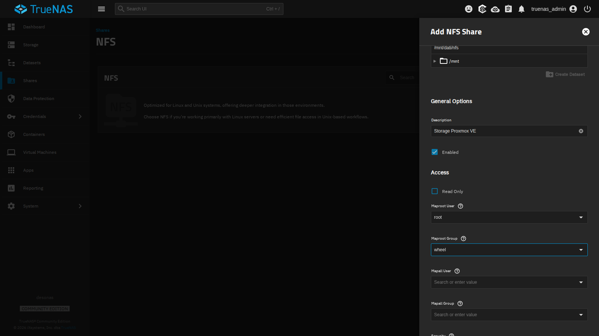
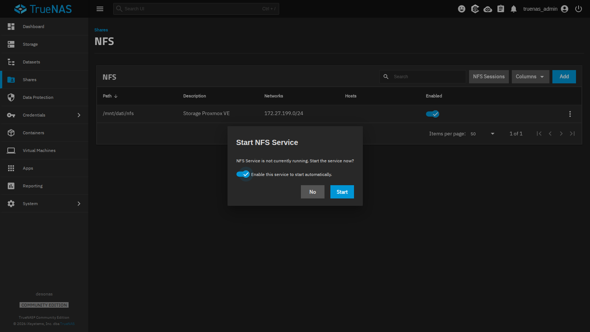
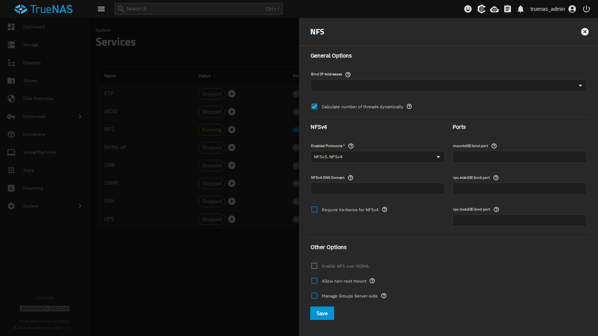
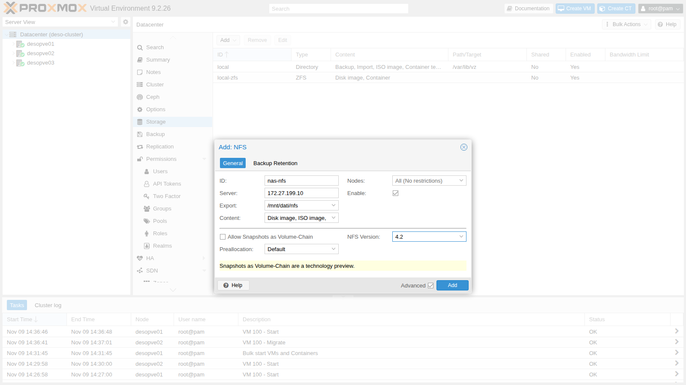
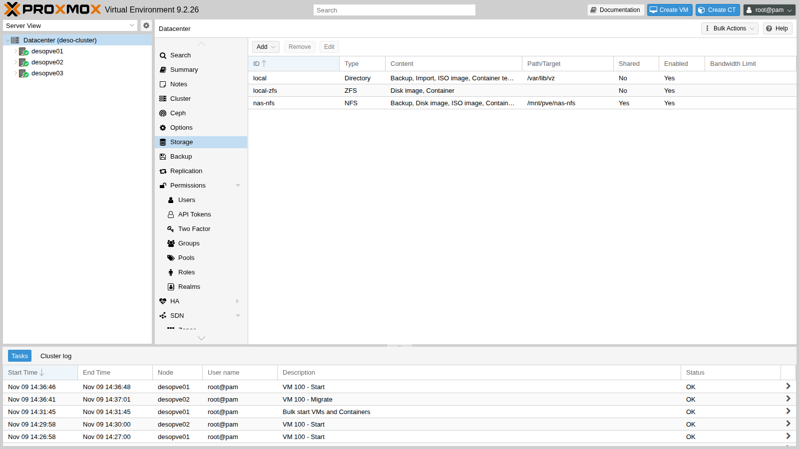
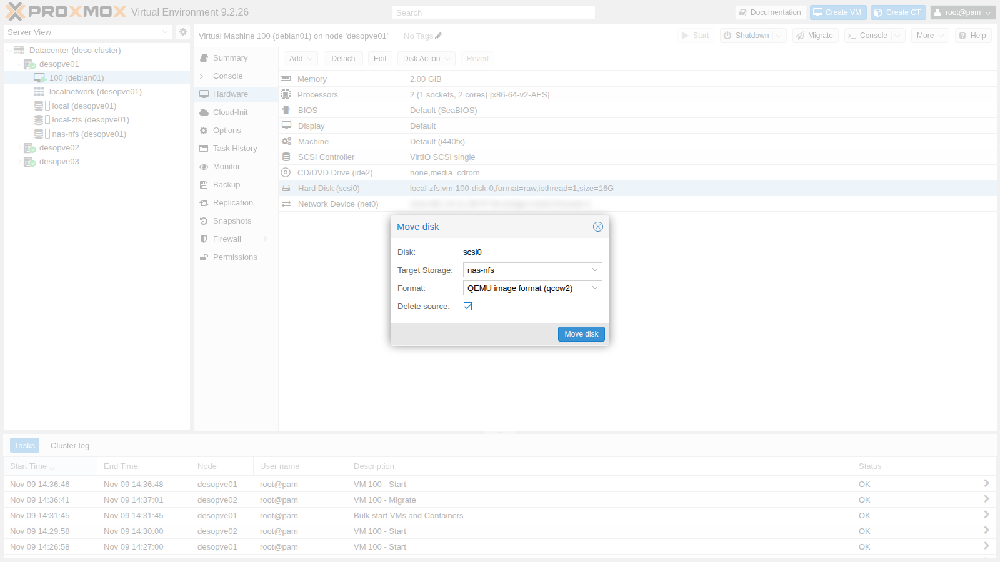
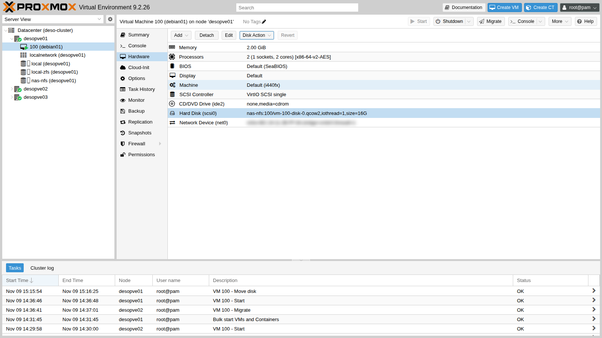
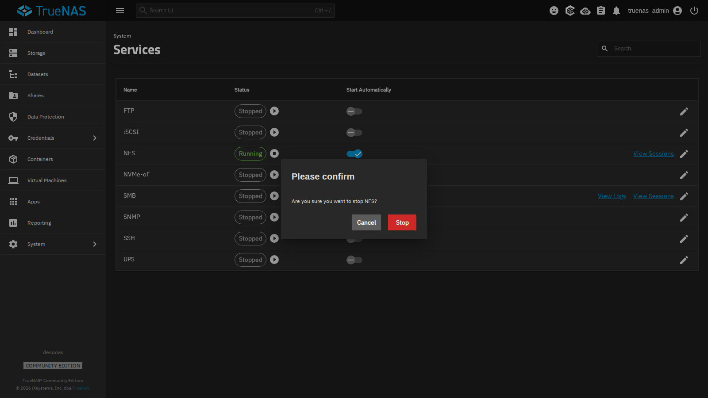
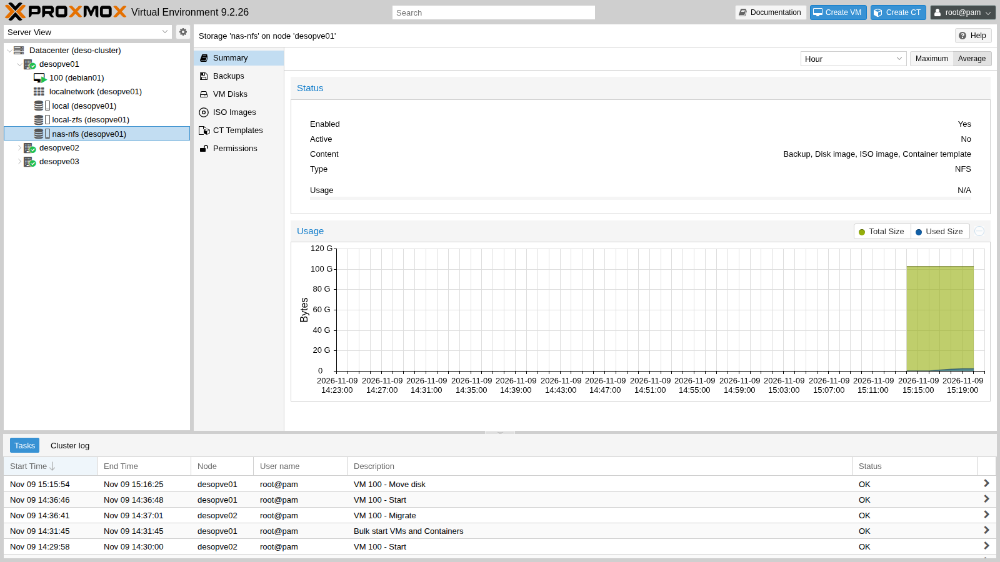
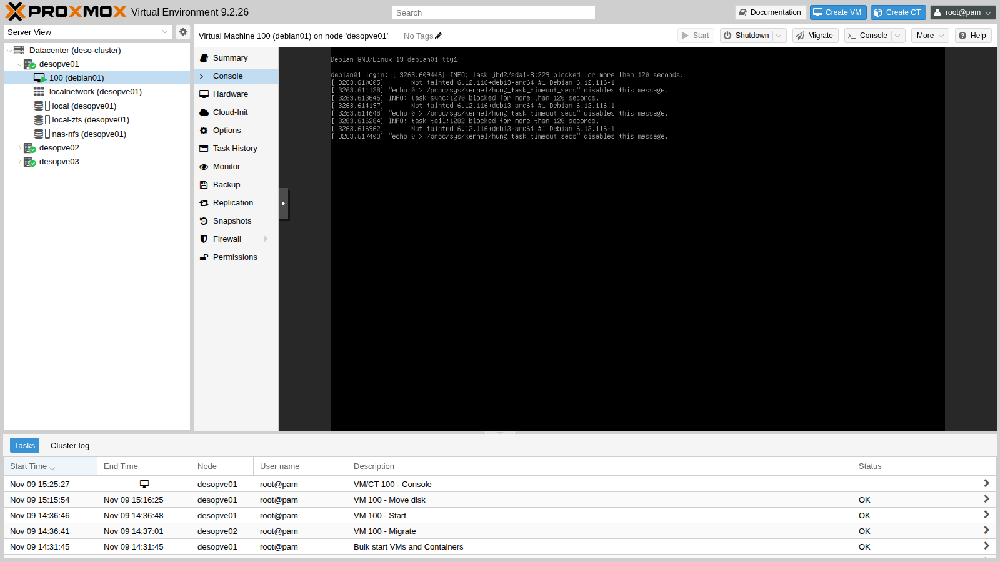

## Dipendenze

- **Lab precedenti:** [Lab 12](/it/12-truenas-nas/) per il NAS `desonas` con il dataset `dati/nfs`, e [Lab 08](/it/08-storage-model/) per i tipi di storage e di contenuto.
- **Cluster:** `deso-cluster` con i tre nodi (lab 06). La VM 100 `debian01` è accesa su `desopve01` con il disco su `local-zfs` (lab 07, stato del lab 11).
- **Rete:** i nodi raggiungono `172.27.199.10` sulla LAN del laboratorio.
- **Credenziali:** `root` / `<password-lab>` sui nodi, `truenas_admin` / `<password-lab>` sul NAS → [Appendice B](/it/b-credentials-and-addresses/).

## Obiettivi

- Condividere un dataset in NFS da TrueNAS, limitando l'accesso alla rete del laboratorio.
- Aggiungere lo storage NFS al cluster e capire che cosa fa Proxmox VE quando lo monta.
- Spostare a caldo il disco di una VM su NFS.
- Misurare le prestazioni rispetto allo storage locale, evitando i test che ingannano.
- Vedere cosa succede a nodi e VM quando il NAS smette di rispondere, e come si riprendono.

## Come funziona

### NFS in Proxmox VE

NFS (*Network File System*) condivide una cartella del server via rete. Proxmox VE la **monta su ogni nodo** in `/mnt/pve/<ID>` e la tratta come uno storage di tipo directory, ma **condiviso**: tutti i nodi vedono gli stessi file.

```text
 desonas (TrueNAS)                         desopve01 / 02 / 03
 /mnt/dati/nfs  ── NFS 4.2 su TCP ──▶  /mnt/pve/nas-nfs
                                         ├── images/100/vm-100-disk-0.qcow2   dischi delle VM
                                         ├── template/iso/                     ISO
                                         ├── template/cache/                   template dei container
                                         └── dump/                             backup
```

- Su uno storage di tipo file i dischi delle VM sono file **`raw`** o **`qcow2`**. Con `qcow2` gli snapshot si fanno anche su NFS.
- Lo storage è **condiviso** (`shared`): una VM con il disco su NFS si migra copiando solo la memoria, e con l'alta disponibilità (lab 49) può ripartire su un altro nodo.
- Proxmox VE accede ai file come **root**. Sul server l'export non deve quindi «schiacciare» root sull'utente `nobody` (*root squash*), altrimenti la creazione dei dischi fallisce per permessi. In TrueNAS si imposta con **Maproot User** `root`.
- Il mount è **`hard`** (il predefinito): se il server non risponde, le operazioni restano in attesa e riprendono quando torna, senza errori verso le applicazioni. Con `soft` il client restituirebbe un errore dopo i tentativi, e per un disco di VM vorrebbe dire dati corrotti: non si usa mai.

### Versioni

| Versione | Caratteristiche |
|---|---|
| NFSv3 | senza stato sul server, porte aggiuntive (`mountd`, `lockd`, `statd`) |
| NFSv4.x | una sola porta TCP (2049), lock integrati, sessioni |
| NFSv4.2 | in più: copia lato server, file sparsi (*hole punching*), allocazione dello spazio |

Nel laboratorio usiamo **NFS 4.2**, impostato nelle opzioni di mount dello storage.

## Procedura

### 1. La condivisione su TrueNAS

1. Sul NAS: **Shares** → **NFS** → **Add**.
2. **Path** `/mnt/dati/nfs`, **Description** `Storage Proxmox VE`. In **Networks** premi **Add** e scrivi `172.27.199.0` / `24`: solo la rete del laboratorio potrà montare la condivisione.
3. Apri **Advanced Options** e imposta **Maproot User** `root` e **Maproot Group** `wheel`.

   

4. **Save**. TrueNAS propone di avviare il servizio NFS: lascia attivo **Enable this service to start automatically** e premi **Start**.

   

5. In **System** → **Services** → **NFS** (icona della matita) le impostazioni del servizio confermano che sono attivi **NFSv3** e **NFSv4**. Non serve cambiare altro.

   

### 2. Verificare l'export dai nodi

Prima di aggiungere lo storage, controlla dal nodo che il server esporti la cartella e risponda in NFSv4:

```bash title="root@desopve01"
pvesm scan nfs 172.27.199.10
```

```text output
/mnt/dati/nfs 172.27.199.0/24
```

```bash title="root@desopve01"
rpcinfo -T tcp 172.27.199.10 nfs 4
```

```text output
program 100003 version 4 ready and waiting
```

### 3. Aggiungere lo storage al cluster

1. **Datacenter** → **Storage** → **Add** → **NFS**.
2. Compila:
   - **ID** `nas-nfs`;
   - **Server** `172.27.199.10`. L'indirizzo IP evita che lo storage dipenda dal DNS: se il DNS si ferma, lo storage continua a funzionare;
   - **Export** `/mnt/dati/nfs`, che il menu propone dopo aver interrogato il server;
   - **Content**: `Disk image`, `ISO image`, `Container template`, `Backup`;
   - **Nodes**: tutti.
3. Spunta **Advanced** in basso e scegli **NFS Version** `4.2`. Lascia disattivato **Allow Snapshots as Volume-Chain**, un'anteprima tecnologica che vedrai nel lab 16.

   

4. **Add**. Lo storage compare nell'elenco, condiviso (**Shared** `Yes`) e attivo:

   

Da riga di comando:

```bash title="root@desopve01"
grep -A6 "nfs: nas-nfs" /etc/pve/storage.cfg
```

```text output
nfs: nas-nfs
	export /mnt/dati/nfs
	path /mnt/pve/nas-nfs
	server 172.27.199.10
	content images,iso,backup,vztmpl
	options vers=4.2
	prune-backups keep-all=1
```

```bash title="root@desopve01"
pvesm status | grep nas-nfs
```

```text output
nas-nfs           nfs     active       100070400               0       100070400    0.00%
```

```bash title="root@desopve01"
mount | grep nas-nfs
```

```text output
172.27.199.10:/mnt/dati/nfs on /mnt/pve/nas-nfs type nfs4 (rw,relatime,vers=4.2,rsize=1048576,wsize=1048576,namlen=255,hard,fatal_neterrors=none,proto=tcp,timeo=600,retrans=2,sec=sys,clientaddr=172.27.199.21,local_lock=none,addr=172.27.199.10)
```

```bash title="root@desopve01"
ssh desopve03 ls /mnt/pve/nas-nfs
```

```text output
dump
images
template
```

- `pvestatd` monta lo storage da solo su ogni nodo, nella cartella `/mnt/pve/nas-nfs`, e crea le sottocartelle per i contenuti scelti.
- Le opzioni di mount mostrano `hard`, `timeo=600` (60 secondi prima di ritentare una richiesta) e `retrans=2`.
- La capacità è quella del pool `dati` del NAS: circa 95 GiB.

### 4. Misurare le prestazioni con il disco locale

Prima di spostare il disco, misura come va con lo storage locale: sono i valori di confronto per NFS. Il disco della VM 100 è su `local-zfs`.

**Un test che inganna.** Nella VM scrivi 1 GiB di zeri con `dd`:

```bash title="labuser@debian01"
dd if=/dev/zero of=$HOME/test.bin bs=1M count=1024 oflag=direct
```

```text output
1073741824 bytes (1.1 GB, 1.0 GiB) copied, 1.40965 s, 762 MB/s
```

Lo ripeterai su NFS al passo 6, e lì vedrai perché gli zeri non servono a misurare.

**Scritture e letture sequenziali con dati casuali.** Genera 512 MiB casuali in RAM (`/dev/shm`), scrivili sul disco in modo diretto aspettando che arrivino davvero allo storage (`oflag=direct conv=fsync`), poi rileggili. Ripeti la scrittura tre volte e la lettura due, perché un solo valore non basta:

```bash title="labuser@debian01"
head -c 512M /dev/urandom > /dev/shm/rnd.bin
for i in 1 2 3; do dd if=/dev/shm/rnd.bin of=$HOME/test.bin bs=1M oflag=direct conv=fsync 2>&1 | tail -1; done
```

```text output
536870912 bytes (537 MB, 512 MiB) copied, 15.0205 s, 35.7 MB/s
536870912 bytes (537 MB, 512 MiB) copied, 5.48904 s, 97.8 MB/s
536870912 bytes (537 MB, 512 MiB) copied, 16.7323 s, 32.1 MB/s
```

```bash title="labuser@debian01"
for i in 1 2; do dd if=$HOME/test.bin of=/dev/null bs=1M iflag=direct 2>&1 | tail -1; done
```

```text output
536870912 bytes (537 MB, 512 MiB) copied, 0.737017 s, 728 MB/s
536870912 bytes (537 MB, 512 MiB) copied, 0.620782 s, 865 MB/s
```

```bash title="labuser@debian01"
rm -f $HOME/test.bin /dev/shm/rnd.bin
```

**Scritture casuali a blocchi da 4 KiB**, il carico tipico di database e sistemi operativi, misurate con `fio` direttamente dal nodo sullo storage locale. L'opzione `--unlink=1` cancella il file di prova alla fine:

```bash title="root@desopve01"
apt install fio
fio --name=rw4k --directory=/var/lib/vz --rw=randwrite --bs=4k --size=1G \
      --iodepth=16 --ioengine=libaio --direct=1 --runtime=30 --time_based --group_reporting --unlink=1
```

```text output
  write: IOPS=2118, BW=8476KiB/s (8679kB/s)(275MiB/33273msec); 0 zone resets
```

```bash title="root@desopve01"
fio --name=rw4k --directory=/var/lib/vz --rw=randwrite --bs=4k --size=1G \
      --iodepth=16 --ioengine=libaio --direct=1 --runtime=30 --time_based --group_reporting --unlink=1
```

```text output
  write: IOPS=11.2k, BW=43.7MiB/s (45.8MB/s)(1310MiB/30001msec); 0 zone resets
```

### 5. Spostare il disco della VM su NFS

1. VM **100** → **Hardware** → seleziona **Hard Disk (scsi0)** → **Disk Action** → **Move Storage**.
2. **Target Storage** `nas-nfs`, **Format** `QEMU image format (qcow2)`, **Delete source** spuntato, poi **Move disk**.

   

   La VM resta accesa: QEMU copia il disco in background (*drive mirror*) e alla fine passa sul nuovo file. Il disco da 16 GiB è stato copiato in 3 minuti e 35 secondi:

   ```text
   mirror-scsi0: transferred 16.0 GiB of 16.0 GiB (100.00%) in 3m 35s, ready
   mirror-scsi0: Completed successfully.
   removing source volume 'local-zfs:vm-100-disk-0' after successful copy
   TASK OK
   ```

3. Il disco ora è un file `qcow2` sul NAS:

   

   ```bash title="root@desopve01"
   qm config 100 | grep scsi0
   ```

   ```text output
   scsi0: nas-nfs:100/vm-100-disk-0.qcow2,iothread=1,size=16G
   ```

   ```bash title="root@desopve01"
   qemu-img info /mnt/pve/nas-nfs/images/100/vm-100-disk-0.qcow2 | head -4
   ```

   ```text output
   image: /mnt/pve/nas-nfs/images/100/vm-100-disk-0.qcow2
   file format: qcow2
   virtual size: 16 GiB (17179869184 bytes)
   disk size: 6.5 GiB
   ```

   Il file da 16 GiB occupa 6,5 GiB: `qcow2` alloca lo spazio solo per i blocchi che contengono dati.

### 6. Ripetere le misure su NFS e confrontare

Nella VM ripeti gli stessi comandi del passo 4, ora con il disco su NFS:

```bash title="labuser@debian01"
dd if=/dev/zero of=$HOME/test.bin bs=1M count=1024 oflag=direct
```

```text output
1073741824 bytes (1.1 GB, 1.0 GiB) copied, 0.403307 s, 2.7 GB/s
```

```bash title="labuser@debian01"
head -c 512M /dev/urandom > /dev/shm/rnd.bin
for i in 1 2 3; do dd if=/dev/shm/rnd.bin of=$HOME/test.bin bs=1M oflag=direct conv=fsync 2>&1 | tail -1; done
```

```text output
536870912 bytes (537 MB, 512 MiB) copied, 6.69699 s, 80.2 MB/s
536870912 bytes (537 MB, 512 MiB) copied, 20.2377 s, 26.5 MB/s
536870912 bytes (537 MB, 512 MiB) copied, 26.9102 s, 20.0 MB/s
```

```bash title="labuser@debian01"
for i in 1 2; do dd if=$HOME/test.bin of=/dev/null bs=1M iflag=direct 2>&1 | tail -1; done
```

```text output
536870912 bytes (537 MB, 512 MiB) copied, 1.44691 s, 371 MB/s
536870912 bytes (537 MB, 512 MiB) copied, 1.7027 s, 315 MB/s
```

```bash title="labuser@debian01"
rm -f $HOME/test.bin /dev/shm/rnd.bin
```

Gli zeri su NFS vanno a 2,7 GB/s, più veloci del disco locale? No: QEMU riconosce i blocchi pieni di zeri e su `qcow2` li registra come «zero» senza scriverli. Per misurare davvero servono **dati casuali**.

E dal nodo, le scritture casuali da 4 KiB sulla condivisione NFS:

```bash title="root@desopve01"
fio --name=rw4k --directory=/mnt/pve/nas-nfs --rw=randwrite --bs=4k --size=1G \
      --iodepth=16 --ioengine=libaio --direct=1 --runtime=30 --time_based --group_reporting --unlink=1
```

```text output
  write: IOPS=865, BW=3463KiB/s (3546kB/s)(101MiB/30007msec); 0 zone resets
```

```bash title="root@desopve01"
fio --name=rw4k --directory=/mnt/pve/nas-nfs --rw=randwrite --bs=4k --size=1G \
      --iodepth=16 --ioengine=libaio --direct=1 --runtime=30 --time_based --group_reporting --unlink=1
```

```text output
  write: IOPS=966, BW=3867KiB/s (3959kB/s)(114MiB/30151msec); 0 zone resets
```

| Test | Storage locale (ZFS del nodo) | NFS |
|---|---|---|
| Scrittura sequenziale, dati casuali (nella VM) | 32-98 MB/s | 20-80 MB/s |
| Lettura sequenziale (nella VM) | 728-865 MB/s | 315-371 MB/s |
| Scrittura casuale 4 KiB (dal nodo, `fio`) | 2 118-11 200 IOPS | 865-966 IOPS |

- Le **scritture casuali piccole** sono il punto debole di NFS: con `cache=none` (il predefinito dei dischi) ogni scrittura viene confermata solo quando il NAS l'ha salvata in modo sicuro. Su ZFS è una scrittura **sincrona**, che passa per lo ZIL. Nei NAS di produzione si mette lo ZIL su un SSD veloce dedicato (SLOG) e si usano reti da 10 Gbit/s o più.
- Le **letture** su NFS reggono meglio, ma restano sotto il disco locale: ogni blocco attraversa la rete.
- Le scritture sequenziali cambiano molto da una ripetizione all'altra, su entrambi gli storage, perché dipendono da quanto è carico in quel momento il resto del laboratorio. Per questo i confronti si fanno con più ripetizioni, nello stesso momento, e si guardano gli intervalli e non un valore singolo. Nel lab 19 ripeterai i test su tutti gli storage, con un metodo più rigoroso.

## Verifica e test

### Test – Il NAS smette di rispondere

Lasci il disco della VM su NFS e fermi il servizio NFS sul NAS, come succederebbe con un guasto del NAS o della rete.

1. Nella VM avvia un «battito» che scrive l'ora ogni secondo e la forza sul disco:

   ```bash title="labuser@debian01"
   nohup sh -c 'while true; do date +%T >> $HOME/battito.log; sync; sleep 1; done' >/dev/null 2>&1 &
   ```

2. Sul NAS: **System** → **Services** → **NFS** → **Stop Service** e conferma con **Stop**.

   

3. Un minuto dopo, sul nodo, il server non risponde più in NFS e `pvestatd` segna lo storage come non attivo. La VM, invece, risulta ancora accesa:

   ```bash title="root@desopve01"
   rpcinfo -T tcp 172.27.199.10 nfs 4
   ```

   ```text output
   rpcinfo: RPC: Program not registered
   ```

   ```bash title="root@desopve01"
   pvesm status
   ```

   ```text output
   storage 'nas-nfs' is not online
   Name             Type     Status     Total (KiB)      Used (KiB) Available (KiB)        %
   local             dir     active        46255488          768000        45487488    1.66%
   local-zfs     zfspool     active        45487664              96        45487568    0.00%
   nas-nfs           nfs   inactive               0               0               0    0.00%
   ```

   ```bash title="root@desopve01"
   journalctl -u pvestatd --since "-3 min" | tail -2
   ```

   ```text output
   Nov 09 15:21:57 desopve01 pvestatd[1611]: storage 'nas-nfs' is not online
   Nov 09 15:22:07 desopve01 pvestatd[1611]: storage 'nas-nfs' is not online
   ```

   ```bash title="root@desopve01"
   qm status 100
   ```

   ```text output
   status: running
   ```

   Nell'interfaccia web lo storage risulta **Active: No**, senza dati di utilizzo:

   

   `pvestatd` controlla il server con una richiesta RPC prima di toccare il mount, così non resta bloccato. Chi invece accede ai file del mount resta in attesa.

4. Prova ad accedere al mount: il processo resta bloccato nello stato **`D`** (attesa non interrompibile di I/O), in attesa del server. Il kernel lo segnala nel log:

   ```bash title="root@desopve01"
   timeout 20 ls -la /mnt/pve/nas-nfs/images/100/ &
   ps -eo stat,pid,etime,comm,wchan:28 | awk 'NR==1 || $1 ~ /^D/'
   ```

   ```text output
   STAT     PID     ELAPSED COMMAND         WCHAN
   D      12326       00:20 172.27.199.10-m rpc_wait_bit_killable
   D      12419       00:03 ls              rpc_wait_bit_killable
   ```

   ```bash title="root@desopve01"
   dmesg -T | grep "nfs: server"
   ```

   ```text output
   [Mon Nov  9 15:24:04 2026] nfs: server 172.27.199.10 not responding, still trying
   ```

   Il primo processo è il thread del kernel che gestisce lo stato NFSv4 verso il server. Lo stato `D` è anche il motivo per cui un NAS fermo fa salire il *load average* dei nodi.

5. Nella VM l'I/O verso il disco è fermo. Il battito si è interrotto alle 15:20:58, e dopo due minuti il kernel della VM segnala sulla console i processi bloccati sul disco, a partire dal journal del file system (`jbd2`):

   

   La VM non va in errore e non si spegne: aspetta, come i processi del nodo.

6. Riavvia il servizio sul NAS (**Start Service**). Pochi secondi dopo il client NFS si riconnette, lo storage torna attivo e non resta nessun processo in stato `D`:

   ```bash title="root@desopve01"
   dmesg -T | grep "nfs: server" | tail -1
   ```

   ```text output
   [Mon Nov  9 15:37:36 2026] nfs: server 172.27.199.10 OK
   ```

   ```bash title="root@desopve01"
   pvesm status | grep nas-nfs
   ```

   ```text output
   nas-nfs           nfs     active       100069376         2021376        98048000    2.02%
   ```

   ```bash title="root@desopve01"
   ps -eo stat,comm | awk '$1 ~ /^D/' | wc -l
   ```

   ```text output
   0
   ```

   Nel laboratorio il servizio è rimasto fermo circa 16 minuti. Alla ripresa la VM ha completato le scritture in sospeso e ha continuato a funzionare senza riavvio: è l'effetto del mount `hard`.

### Pulizia

Ferma il battito e riporta il disco della VM sullo storage locale. Lo storage `nas-nfs` resta configurato per i lab successivi.

```bash title="labuser@debian01"
pkill -f battito.log; rm -f $HOME/battito.log
```

```bash title="root@desopve01"
qm disk move 100 scsi0 local-zfs --delete 1
```

```text output
…
mirror-scsi0: transferred 16.0 GiB of 16.0 GiB (100.00%) in 38s, ready
removing source volume 'nas-nfs:100/vm-100-disk-0.qcow2' after successful copy
```

```bash title="root@desopve01"
qm config 100 | grep scsi0
```

```text output
scsi0: local-zfs:vm-100-disk-0,iothread=1,size=16G
```

- [ ] Il NAS esporta `/mnt/dati/nfs` alla sola rete `172.27.199.0/24`, con root mappato su `root`.
- [ ] Lo storage `nas-nfs` è montato in NFS 4.2 su tutti e tre i nodi.
- [ ] Hai spostato a caldo il disco della VM su NFS e di nuovo in locale.
- [ ] Sai perché `dd` con gli zeri non misura le prestazioni, e hai confrontato NFS e storage locale con dati casuali.
- [ ] Con il NAS fermo hai visto lo storage inattivo, i processi in stato `D` e la VM in attesa; alla ripresa tutto è ripartito da solo.

## Stato finale del lab

- **NAS:** condivisione NFS `/mnt/dati/nfs` per `172.27.199.0/24`, **Maproot** `root:wheel`; servizio NFS attivo e con avvio automatico.
- **Cluster:** storage **`nas-nfs`** (NFS 4.2, `172.27.199.10:/mnt/dati/nfs`, contenuti `images,iso,backup,vztmpl`, condiviso, su tutti i nodi), montato in `/mnt/pve/nas-nfs` e vuoto.
- VM 100 `debian01` accesa su `desopve01`, con il disco su `local-zfs`.
- `fio` installato su `desopve01`.

## Cosa hai imparato

- Proxmox VE monta lo storage NFS su ogni nodo in `/mnt/pve/<ID>`: è uno storage di tipo file, condiviso tra tutti i nodi.
- L'export va limitato alla rete dei nodi e non deve schiacciare l'utente root.
- I dischi delle VM su NFS sono file `raw` o `qcow2`, e si spostano a caldo da uno storage all'altro.
- Le scritture su NFS sono sincrone e risentono di rete e NAS; per misurarle servono dati casuali, non zeri.
- Con il mount `hard`, un NAS che non risponde ferma l'I/O senza corrompere i dati: storage inattivo, processi in stato `D`, VM in attesa. Al ritorno del server tutto riprende da solo.

## Riferimenti

- [Proxmox VE – NFS Backend](https://pve.proxmox.com/pve-docs/pve-admin-guide.html#storage_nfs)
- [Proxmox VE – Storage](https://pve.proxmox.com/pve-docs/pve-admin-guide.html#chapter_storage)
- [Proxmox VE – Move disk (`qm disk move`)](https://pve.proxmox.com/pve-docs/qm.1.html)
- [TrueNAS – Adding NFS Shares](https://www.truenas.com/docs/scale/scaletutorials/shares/addingnfsshares/)
- [`nfs(5)` – opzioni di mount `hard`, `timeo`, `retrans`](https://man7.org/linux/man-pages/man5/nfs.5.html)
