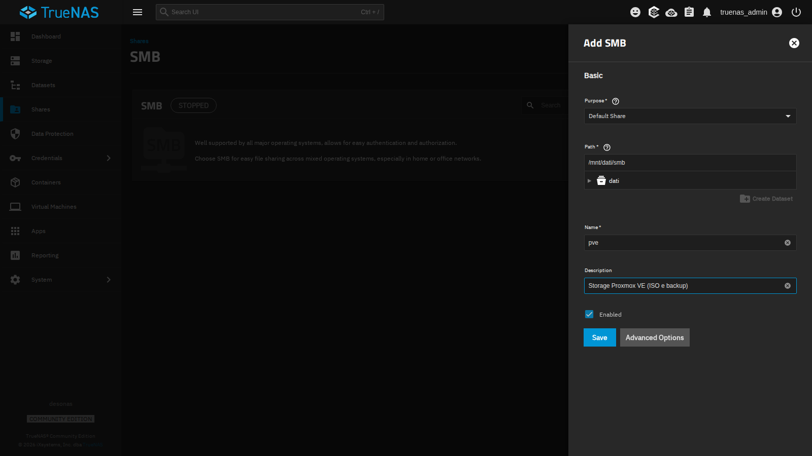
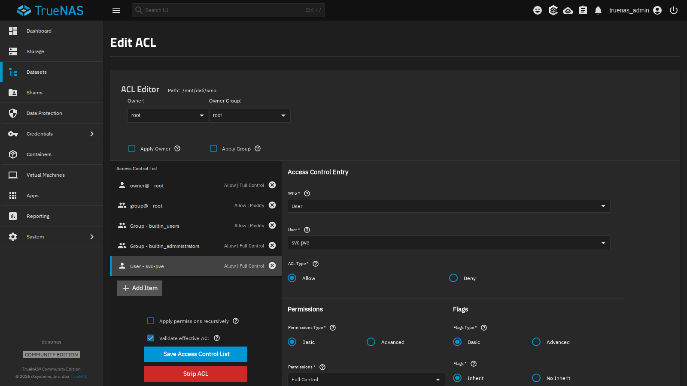
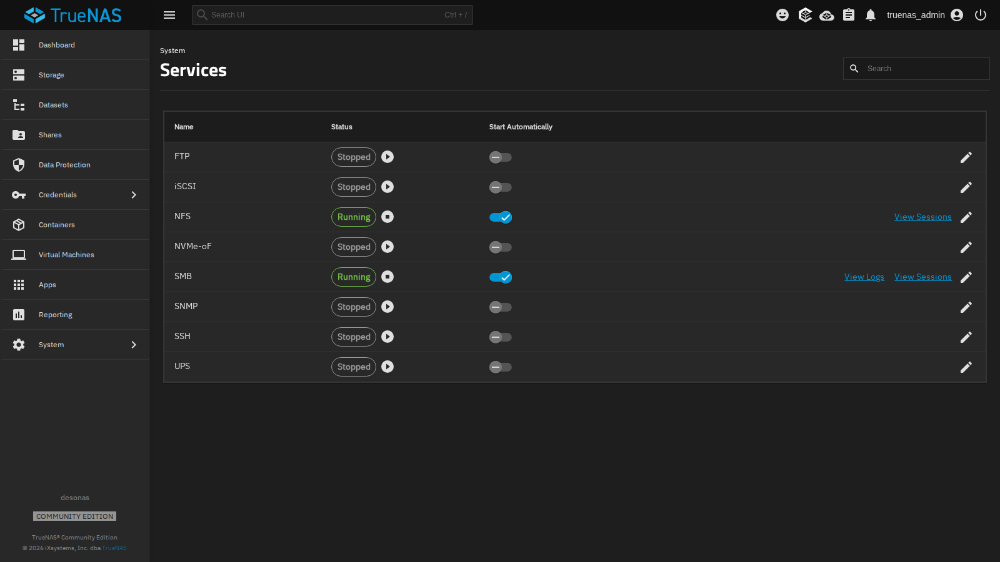
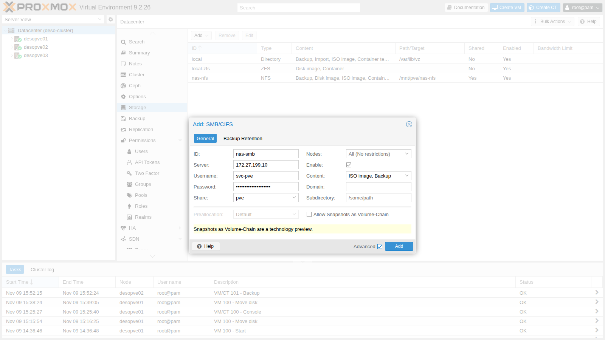
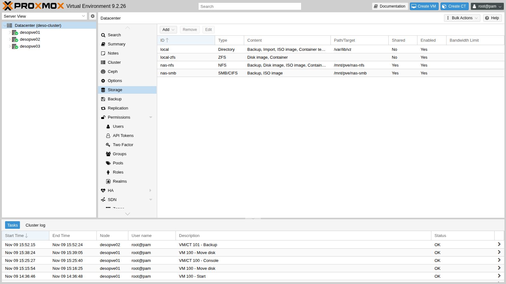
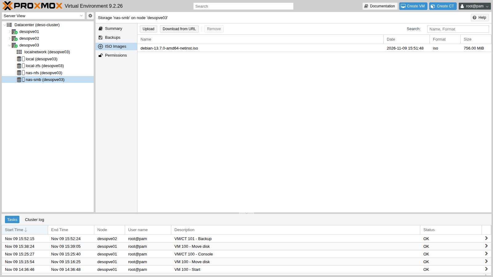
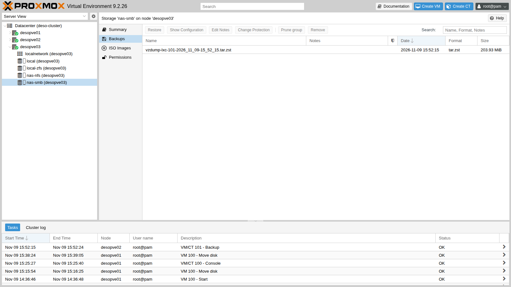

## Dipendenze

- **Lab precedenti:** [Lab 12](/it/12-truenas-nas/) per il NAS `desonas` con il dataset `dati/smb` (preset SMB) e l'utente `svc-pve`, e [Lab 13](/it/13-nfs/) per lo storage `nas-nfs`, che userai nel confronto.
- **Cluster:** `deso-cluster` con i tre nodi (lab 06). Sul nodo `desopve01` c'è la ISO di Debian 13 scaricata nel lab 07; sul nodo `desopve02` gira il container 101.
- **Rete:** i nodi raggiungono `172.27.199.10` sulla LAN del laboratorio (porta TCP 445).
- **Credenziali:** `root` / `<password-lab>` sui nodi, `truenas_admin` / `<password-lab>` sul NAS, `svc-pve` / `<password-lab>` per l'accesso SMB → [Appendice B](/it/b-credentials-and-addresses/).

## Obiettivi

- Una condivisione SMB `pve` sul dataset `dati/smb`, con l'utente di servizio `svc-pve` in controllo completo, che il nodo vede con `pvesm scan cifs`.
- Lo storage `nas-smb` montato su tutti i nodi, con la versione del protocollo fissata a 3.11, la password in `/etc/pve/priv/storage/` e le opzioni effettive del mount lette da `mount`.
- La ISO di Debian e un backup del container 101 sulla condivisione, visibili da ogni nodo.
- I tre problemi tipici riprodotti e riconosciuti dal loro messaggio: password errata, permessi Unix ignorati, NAS fermo con il mount `soft`.
- Un confronto con NFS in cui, per ogni numero, è chiaro se le scritture venivano rese stabili con un `fsync` oppure no.

## Come funziona

### SMB in Proxmox VE

SMB (*Server Message Block*), chiamato anche CIFS, è il protocollo di condivisione file di Windows. Come per NFS, Proxmox VE **monta la condivisione su ogni nodo** in `/mnt/pve/<ID>` e la usa come storage di tipo file condiviso. A differenza di NFS, l'accesso è **autenticato**: ogni nodo si presenta al server con un utente e una password.

```text
 desonas (TrueNAS)                              desopve01 / 02 / 03
 /mnt/dati/smb  ── share "pve" ── SMB 3.1.1 ──▶  /mnt/pve/nas-smb
                   utente svc-pve                 ├── template/iso/   ISO
                                                  └── dump/           backup
```

- La password dell'utente sta in `/etc/pve/priv/storage/<ID>.pw`. È nel file system del cluster, quindi tutti i nodi la conoscono, ma la cartella `priv` è leggibile solo da root.
- Il server decide i permessi con le sue ACL: per TrueNAS, l'utente `svc-pve` deve avere il controllo completo del dataset.
- Il client Linux monta la condivisione con opzioni diverse da NFS: i permessi Unix non esistono (`nounix`), e il mount è **`soft`**, un'opzione che Proxmox VE imposta sempre per gli storage CIFS. Se il server non risponde, le operazioni falliscono con un errore invece di restare in attesa.

### Quando usare SMB

| | NFS | SMB/CIFS |
|---|---|---|
| Autenticazione | per indirizzo IP del client | utente e password (o dominio AD) |
| Permessi Unix (proprietario, `chmod`) | sì | no, con le opzioni usate qui (`nounix`): li decide il server |
| Mount in Proxmox VE | `hard` per default | sempre `soft` |
| Con il NAS fermo, nei lab 13 e 14 | processi in attesa, senza errori | errore dopo circa 10 secondi |
| Uso tipico in Proxmox VE | dischi delle VM, ISO, backup | ISO, template e backup; NAS già in uso con Windows |

In questo manuale i dischi delle VM stanno su NFS, iSCSI (lab 15) o Ceph, e SMB serve per **ISO e backup**. Il lab non mette dischi di VM su SMB: quello che succederebbe si deduce dal Test 3, dove con il NAS fermo le scritture falliscono dopo circa dieci secondi; per un disco virtuale vorrebbe dire errori di I/O nel guest.

### Alternativa: autenticazione con Active Directory

Nel laboratorio il NAS usa un utente locale. In un'azienda con Active Directory si può unire TrueNAS al dominio (**Credentials** → **Directory Services** → **Configure Active Directory**: dominio `proxmox.community`, account con il diritto di unire computer al dominio). Così:

- l'utente di servizio diventa un account del dominio (per esempio `PROXMOX\svc-pve`), gestito e scaduto con le regole del dominio;
- in Proxmox VE lo storage si configura con **Username** `svc-pve` e **Domain** `PROXMOX`;
- le ACL della condivisione usano utenti e gruppi del dominio.

Prima dell'unione al dominio servono DNS e orario corretti sul NAS (lab 12): Kerberos rifiuta differenze di orario superiori a 5 minuti.

### Ambiente e versioni della prova

I test di questo lab sono stati eseguiti a novembre 2026 (il 9 novembre, come mostrano i nomi dei file e i log), nella configurazione descritta qui sotto. Con versioni, opzioni o hardware diversi, gli stessi comandi danno numeri e tempi diversi.

| Componente | Configurazione della prova |
|---|---|
| Proxmox VE | 9.2.26, kernel `7.0.14-28-pve` ([Lab 04](/it/04-first-access-repositories-updates/)); le prove partono dal nodo `desopve01` |
| NAS | TrueNAS Community Edition 25.10.8 ([Lab 12](/it/12-truenas-nas/)), dataset `dati/smb` (preset SMB) e `dati/nfs` sullo stesso pool `dati` in mirror; una sola scheda di rete ([Lab 01](/it/01-lab-architecture/)) |
| Mount SMB | SMB 3.1.1 (`vers=3.1.1`), `cache=strict`, `soft`, `nounix`, `rsize` e `wsize` da 4 MiB (output di `mount` al passo 3) |
| Mount NFS | NFS 4.2, `hard`, `rsize` e `wsize` da 1 MiB ([Lab 13](/it/13-nfs/)) |
| Rete | LAN di gestione `172.27.199.0/24`, MTU 1500 ([Lab 21](/it/21-bonding/)) |
| Non registrato | la versione di Samba sul NAS e la proprietà `sync` dei due dataset: si leggono sul NAS con `smbd --version` e `zfs get sync dati/smb dati/nfs` |
| Prove | `fio` dal nodo, una sola esecuzione da 20 secondi per caso; battito ogni 2 secondi |

**Cosa misura e cosa non misura.** `fio` sul nodo misura il client del kernel (CIFS o NFS), la rete e il NAS, senza VM. Ogni caso è stato misurato una volta sola, per 20 secondi: il risultato dà un ordine di grandezza, non una statistica. Le tre prove del Test 4 cambiano più parametri insieme (coda, motore di I/O, `fsync`, dimensione dei blocchi), quindi NFS e SMB si confrontano dentro la stessa riga, non tra righe diverse.

## Procedura

### 1. La condivisione su TrueNAS

1. Sul NAS: **Shares** → **SMB** → **Add**.
2. **Purpose** `Default Share`, **Path** `/mnt/dati/smb`, **Name** `pve`, **Description** `Storage Proxmox VE (ISO e backup)`.

   

3. **Save**. TrueNAS chiede **Configure ACL**: rispondi **Configure** per aprire l'editor dei permessi del dataset.
4. Nell'editor ACL premi **Add Item** e crea la voce:
   - **Who** `User`, **User** `svc-pve`;
   - **ACL Type** `Allow`, **Permissions** `Full Control`, **Flags** `Inherit`, così vale anche per le cartelle e i file che Proxmox VE creerà.

   

5. **Save Access Control List**.
6. **System** → **Services**: attiva **Start Automatically** per **SMB** e avvia il servizio.

   

Da un nodo controlla che l'utente veda la condivisione:

```bash title="root@desopve01"
pvesm scan cifs 172.27.199.10 --username svc-pve --password '<password-lab>'
```

```text output
pve Storage
```

### 2. Aggiungere lo storage al cluster

1. **Datacenter** → **Storage** → **Add** → **SMB/CIFS**.
2. Compila:
   - **ID** `nas-smb`, **Server** `172.27.199.10`;
   - **Username** `svc-pve` e **Password**: il menu **Share** si popola con le condivisioni a cui l'utente ha accesso; scegli `pve`;
   - **Content**: `ISO image` e `Backup` (togli `Disk image`);
   - **Nodes**: tutti.
3. Spunta **Advanced**: lascia **Preallocation** `Default` e **Allow Snapshots as Volume-Chain** disattivato.

   

4. **Add**. Lo storage compare condiviso e attivo:

   

### 3. Fissare la versione di SMB

Il dialogo non ha un campo per la versione del protocollo: senza indicazioni il client negozia la versione più alta, da SMB2 in su, supportata da entrambi (SMB1 non è supportato). Fissarla fa fallire il mount, invece di accettare in silenzio una versione più vecchia, se il server non offre quella richiesta. Si imposta da riga di comando, e vale dal mount successivo:

```bash title="root@desopve01"
pvesm set nas-smb --smbversion 3.11
umount /mnt/pve/nas-smb        # su ogni nodo: pvestatd lo rimonta da solo
grep -A8 "cifs: nas-smb" /etc/pve/storage.cfg
```

```text output
cifs: nas-smb
	path /mnt/pve/nas-smb
	server 172.27.199.10
	share pve
	content iso,backup
	prune-backups keep-all=1
	smbversion 3.11
	username svc-pve
```

```bash title="root@desopve01"
ls -l /etc/pve/priv/storage/
```

```text output
-rw------- 1 root www-data 30 Nov  9 15:49 nas-smb.pw
```

```bash title="root@desopve01"
mount | grep nas-smb
```

```text output
//172.27.199.10/pve on /mnt/pve/nas-smb type cifs (rw,relatime,vers=3.1.1,cache=strict,upcall_target=app,username=svc-pve,uid=0,noforceuid,gid=0,noforcegid,addr=172.27.199.10,file_mode=0755,dir_mode=0755,soft,nounix,serverino,mapposix,reparse=nfs,nativesocket,symlink=native,rsize=4194304,wsize=4194304,bsize=1048576,echo_interval=60,actimeo=1,closetimeo=1)
```

- `vers=3.1.1`: è la versione SMB 3.11, la più recente.
- `uid=0`, `gid=0`, `file_mode=0755`: tutti i file appaiono di root con permessi fissi, qualunque sia il proprietario sul server.
- `soft`: le operazioni falliscono se il server non risponde (lo vedrai nei test).

### 4. ISO e backup condivisi

Copia sulla condivisione la ISO di Debian scaricata nel lab 07 e guardala da un altro nodo:

```bash title="root@desopve01"
cp /var/lib/vz/template/iso/debian-13.7.0-amd64-netinst.iso /mnt/pve/nas-smb/template/iso/
```

```bash title="root@desopve03"
pvesm list nas-smb
```

```text output
Volid                                       Format  Type           Size VMID
nas-smb:iso/debian-13.7.0-amd64-netinst.iso iso     iso       792723456
```



Fai un backup del container 101 sulla condivisione (i backup sono l'argomento del lab 46):

```bash title="root@desopve02"
vzdump 101 --storage nas-smb --mode snapshot --compress zstd
```

```text output
INFO: Starting Backup of VM 101 (lxc)
INFO: creating vzdump archive '/mnt/pve/nas-smb/dump/vzdump-lxc-101-2026_11_09-15_52_15.tar.zst'
INFO: Total bytes written: 706631680 (674MiB, 87MiB/s)
INFO: archive file size: 203MB
INFO: Finished Backup of VM 101 (00:00:09)
```



## Verifica e test

### Test 1 – Credenziali sbagliate

Con una password errata il server rifiuta l'accesso. È lo stesso errore che vedresti se la password di `svc-pve` cambiasse sul NAS senza aggiornare lo storage:

```bash title="root@desopve01"
pvesm scan cifs 172.27.199.10 --username svc-pve --password sbagliata
```

```text output
unexpected status: NT_STATUS_ACCESS_DENIED
```

Per aggiornare la password: **Datacenter** → **Storage** → `nas-smb` → **Edit**, oppure `pvesm set nas-smb --password`.

### Test 2 – I permessi Unix non esistono

```bash title="root@desopve01:/mnt/pve/nas-smb"
touch prova.txt; chmod 600 prova.txt; chown 1000:1000 prova.txt; echo $?
```

```text output
0
```

```bash title="root@desopve01:/mnt/pve/nas-smb"
ls -l prova.txt
```

```text output
-rwxr-xr-x 1 root root 0 Nov  9 15:51 prova.txt
```

`chmod` e `chown` non danno errore ma non cambiano nulla: con `nounix` i permessi li decide il server con le ACL, e il client mostra per tutti i file i valori fissati dal mount (`uid=0`, `gid=0`, `file_mode=0755`). Per questo la condivisione non va usata per file i cui proprietari e permessi Unix contano, per esempio una cartella montata direttamente in un container.

### Test 3 – Il NAS smette di rispondere

Sul nodo `desopve01` avvia un «battito» che ogni 2 secondi scrive l'ora sulla condivisione e registra l'esito:

```bash title="root@desopve01"
nohup sh -c 'while true; do if date +%T > /mnt/pve/nas-smb/battito.txt; then echo "$(date +%T) ok"; else echo "$(date +%T) ERRORE"; fi >> /root/smb-battito.log; sleep 2; done' >/dev/null 2>&1 &
```

Sul NAS ferma il servizio SMB (**System** → **Services** → **SMB** → **Stop Service**). Il battito registra l'ora alla fine di ogni tentativo:

```bash title="root@desopve01"
tail -4 /root/smb-battito.log
```

```text output
15:55:33 ok
15:55:35 ok
15:55:47 ERRORE
15:55:59 ERRORE
```

Tra l'ultimo `ok` (15:55:35) e il primo `ERRORE` (15:55:47) passano 12 secondi, 2 dei quali sono la pausa del ciclo: la scrittura è rimasta bloccata per circa 10 secondi prima di fallire, e lo stesso è successo al tentativo seguente (15:55:59). Una scrittura a mano riceve l'errore, e `pvestatd` segna lo storage come inattivo:

```bash title="root@desopve01"
bash -c 'echo x > /mnt/pve/nas-smb/prova.txt'
```

```text output
bash: line 1: /mnt/pve/nas-smb/prova.txt: Host is down
```

```bash title="root@desopve01"
pvesm status | grep nas-smb
```

```text output
nas-smb          cifs   inactive               0               0               0    0.00%
```

**Il confronto con il lab 13.** Con NFS, montato `hard`, i processi restavano in attesa senza errori finché il server tornava. Qui, con il mount `soft` che Proxmox VE usa sempre per CIFS, l'applicazione riceve un errore (`Host is down`). I circa 10 secondi di attesa sono quelli osservati in questa combinazione (kernel `7.0.14-28-pve`, TrueNAS 25.10.8); quali timeout del client CIFS li determinino, questa prova non l'ha indagato. Per un file ISO o un backup in corso vuol dire un'operazione fallita, da ripetere; per il disco di una VM vorrebbe dire errori di I/O nel sistema operativo ospite.

Riavvia il servizio SMB: il client si riconnette da solo, senza interventi sul nodo, e le scritture riprendono (l'ora esatta del riavvio non è stata registrata):

```bash title="root@desopve01"
tail -3 /root/smb-battito.log
```

```text output
15:57:38 ok
15:57:40 ok
15:57:42 ok
```

```bash title="root@desopve01"
pvesm status | grep nas-smb
```

```text output
nas-smb          cifs     active       100069248          977024        99092224    0.98%
```

Ferma il battito e cancella i file di prova:

```bash title="root@desopve01"
pkill -f "^sh -c while true"; rm -f /mnt/pve/nas-smb/battito.txt /mnt/pve/nas-smb/prova.txt /root/smb-battito.log
```

### Test 4 – SMB contro NFS

Dal nodo `desopve01` misura con `fio` le stesse scritture sui due storage del NAS (stesso pool, stessa rete). Ogni prova dura 20 secondi ed è eseguita una volta:

```bash title="root@desopve01"
fio --name=t --directory=/mnt/pve/nas-smb --rw=randwrite --bs=4k --size=1G \
      --iodepth=16 --ioengine=libaio --direct=1 --runtime=20 --time_based --group_reporting
```

```text output
  write: IOPS=5430, BW=21.2MiB/s (22.2MB/s)(425MiB/20017msec); 0 zone resets
```

```bash title="root@desopve01"
fio --name=t --directory=/mnt/pve/nas-nfs --rw=randwrite --bs=4k --size=1G \
      --iodepth=16 --ioengine=libaio --direct=1 --runtime=20 --time_based --group_reporting
```

```text output
  write: IOPS=962, BW=3851KiB/s (3943kB/s)(75.9MiB/20179msec); 0 zone resets
```

Con queste opzioni SMB fa 5,6 volte gli IOPS di NFS. Ripeti la prova chiedendo che ogni scrittura sia resa stabile prima della successiva (`--fsync=1`, come fa un database):

```bash title="root@desopve01"
fio --name=t --directory=/mnt/pve/nas-smb --rw=randwrite --bs=4k --size=1G \
      --iodepth=1 --ioengine=psync --direct=1 --fsync=1 --runtime=20 --time_based
```

```text output
  write: IOPS=185, BW=741KiB/s (759kB/s)(14.9MiB/20557msec); 0 zone resets
```

```bash title="root@desopve01"
fio --name=t --directory=/mnt/pve/nas-nfs --rw=randwrite --bs=4k --size=1G \
      --iodepth=1 --ioengine=psync --direct=1 --fsync=1 --runtime=20 --time_based
```

```text output
  write: IOPS=339, BW=1358KiB/s (1391kB/s)(26.5MiB/20001msec); 0 zone resets
```

Infine la scrittura sequenziale a blocchi da 1 MiB, quella tipica di ISO e backup:

```bash title="root@desopve01"
fio --name=t --directory=/mnt/pve/nas-smb --rw=write --bs=1M --size=1G \
      --iodepth=4 --ioengine=libaio --direct=1 --runtime=20 --time_based --group_reporting
```

```text output
  write: IOPS=688, BW=688MiB/s (722MB/s)(13.6GiB/20292msec); 0 zone resets
```

```bash title="root@desopve01"
fio --name=t --directory=/mnt/pve/nas-nfs --rw=write --bs=1M --size=1G \
      --iodepth=4 --ioengine=libaio --direct=1 --runtime=20 --time_based --group_reporting
```

```text output
  write: IOPS=33, BW=33.3MiB/s (34.9MB/s)(673MiB/20201msec); 0 zone resets
```

Cancella i file di prova creati da `fio`:

```bash title="root@desopve01"
rm -f /mnt/pve/nas-smb/t.0.0 /mnt/pve/nas-nfs/t.0.0
```

| Prova (dal nodo, `fio`, 20 s, una esecuzione) | NFS | SMB |
|---|---|---|
| Scrittura casuale 4 KiB, coda 16, `libaio`, senza `fsync` | 962 IOPS | 5 430 IOPS |
| Scrittura sequenziale 1 MiB, coda 4, `libaio`, senza `fsync` | 33 MiB/s | 688 MiB/s |
| Scrittura casuale 4 KiB, coda 1, `psync`, `fsync` dopo ogni scrittura | 339 IOPS | 185 IOPS |

Ogni punto qui sotto separa ciò che la prova ha misurato da come lo interpretiamo, e indica la verifica che servirebbe.

1. **Scritture senza `fsync`.**
   - **Misura:** in scrittura casuale 4 KiB SMB fa 5 430 IOPS contro i 962 di NFS (5,6 volte); in scrittura sequenziale 1 MiB, 688 MiB/s contro 33,3 (circa 20 volte).
   - **Interpretazione:** la differenza è compatibile con un diverso momento della conferma. Via NFS, le scritture dirette verrebbero confermate dal NAS solo dopo essere state rese stabili, attraverso lo ZIL di ZFS. Via SMB, il NAS potrebbe confermarle appena ricevute in RAM e scriverle su disco più tardi, a meno che il client non chieda esplicitamente lo svuotamento (`fsync`). La prova non lo dimostra, perché non osserva il NAS.
   - **Verifica:** sul NAS, leggi i contatori dello ZIL (`cat /proc/spl/kstat/zfs/zil`) prima e dopo ogni prova: se l'interpretazione è giusta, `zil_commit_count` cresce molto durante la prova NFS e poco durante quella SMB senza `fsync`. `zfs get sync dati/smb dati/nfs` mostra come i due dataset trattano le scritture sincrone.
2. **Scritture con un `fsync` dopo ognuna.**
   - **Misura:** SMB 185 IOPS, NFS 339.
   - **Interpretazione:** quando ogni scrittura deve diventare stabile prima della successiva, SMB non è più veloce di NFS, e in questa prova è più lento. È coerente con il punto 1: senza `fsync`, il vantaggio di SMB verrebbe dal non aspettare la scrittura stabile.
   - **Verifica:** gli stessi contatori dello ZIL, che in questa prova dovrebbero crescere in modo simile per i due protocolli.
3. **La conseguenza, se l'interpretazione è confermata.** Se il NAS si spegnesse di colpo, le ultime scritture SMB già confermate e non ancora rese stabili andrebbero perse; con NFS no.

Per ISO e backup la velocità di SMB è un vantaggio, a patto di poter ripetere un'operazione fallita (Test 3) e di controllare i backup con un ripristino di prova (lab 46). Per i dischi delle VM, che contano su scritture confermate, il mount `soft` e la conferma prima della scrittura stabile, se la verifica la conferma, sono due rischi in più.

### Riepilogo dei controlli

| Controllo | Risultato atteso | Osservato in questa prova |
|---|---|---|
| Condivisione e ACL | `svc-pve` vede la condivisione `pve` | `pvesm scan cifs`: `pve Storage` |
| Mount | SMB 3.1.1 su tutti i nodi, password in `/etc/pve/priv/storage/` | `vers=3.1.1`, `soft`, `nounix`; `nas-smb.pw` leggibile solo da root |
| Contenuti condivisi | ISO e backup visibili da ogni nodo | ISO elencata da `desopve03`; backup del CT 101 scritto da `desopve02` |
| Password errata | accesso rifiutato | `NT_STATUS_ACCESS_DENIED` |
| Permessi Unix | `chmod` e `chown` senza effetto e senza errori | `-rwxr-xr-x 1 root root` dopo `chmod 600` e `chown 1000:1000` |
| NAS fermo | errori invece di attesa; ripresa da sola al ritorno del servizio | `ERRORE` dopo circa 10 s, `Host is down`, storage `inactive`; di nuovo `ok` e `active` dopo il riavvio |
| Confronto con NFS | NFS e SMB confrontati a parità di `fsync` | senza `fsync` SMB 5,6 e 20 volte NFS; con `fsync` SMB 185 IOPS, NFS 339 |

## Stato finale del lab

- **NAS:** condivisione SMB **`pve`** su `/mnt/dati/smb`; ACL con `svc-pve` in `Full Control` (ereditata); servizio SMB attivo con avvio automatico. NFS invariato.
- **Cluster:** storage **`nas-smb`** (CIFS, `//172.27.199.10/pve`, utente `svc-pve`, `smbversion 3.11`, contenuti `iso,backup`, condiviso, su tutti i nodi), montato in `/mnt/pve/nas-smb`. Contiene:
  - la ISO `debian-13.7.0-amd64-netinst.iso`;
  - il backup `vzdump-lxc-101-2026_11_09-15_52_15.tar.zst` del container 101.
- Storage `nas-nfs` invariato e vuoto. VM 100 accesa su `desopve01` (disco su `local-zfs`), CT 101 acceso su `desopve02`.

## Cosa hai imparato

- **Dove usare uno storage SMB:** per ISO, template e backup, soprattutto se il NAS serve già client Windows. Non per i dischi delle VM: Proxmox VE lo monta sempre `soft` (Test 3), e senza `fsync` le scritture potrebbero essere confermate prima di essere stabili (Test 4, da verificare).
- **Come configurarlo in modo controllato:** un utente di servizio dedicato con le ACL sul dataset, la versione del protocollo fissata con `pvesm set <ID> --smbversion`, la password in `/etc/pve/priv/storage/`, da aggiornare lì se cambia sul NAS.
- **Come riconoscere i guasti tipici dal messaggio:** `NT_STATUS_ACCESS_DENIED` per le credenziali, `chmod` e `chown` senza effetto per i permessi decisi dal server, `Host is down` per il server irraggiungibile con il mount `soft`.
- **Come confrontare due storage:** a parità di garanzie sulla scrittura (con e senza `fsync`), dichiarando coda, motore di I/O e durata delle prove, e ripetendole prima di trarre conclusioni.

## Riferimenti

- [Proxmox VE – CIFS Backend (l'opzione `soft` impostata sempre)](https://pve.proxmox.com/pve-docs/pve-admin-guide.html#storage_cifs)
- [Proxmox VE – `pvesm` (opzione `smbversion`)](https://pve.proxmox.com/pve-docs/pvesm.1.html)
- [TrueNAS 25.10 – Windows Shares (SMB)](https://www.truenas.com/docs/scale/25.10/scaletutorials/shares/smb/)
- [TrueNAS 25.10 – Configuring Active Directory](https://www.truenas.com/docs/scale/25.10/scaletutorials/credentials/directoryservices/configadscale/)
- [`mount.cifs(8)` – opzioni `soft`, `hard`, `vers`, `nounix`](https://man7.org/linux/man-pages/man8/mount.cifs.8.html)
