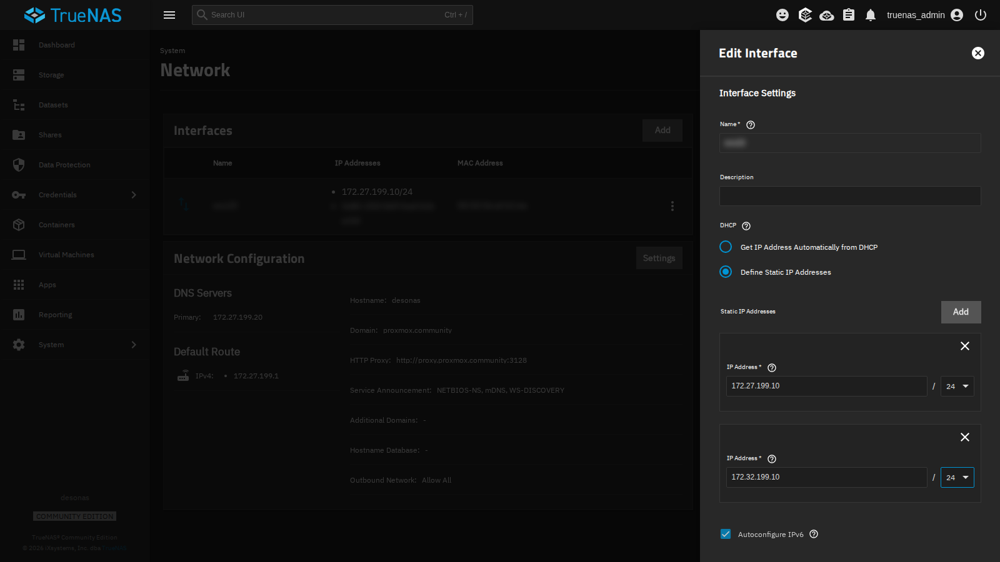
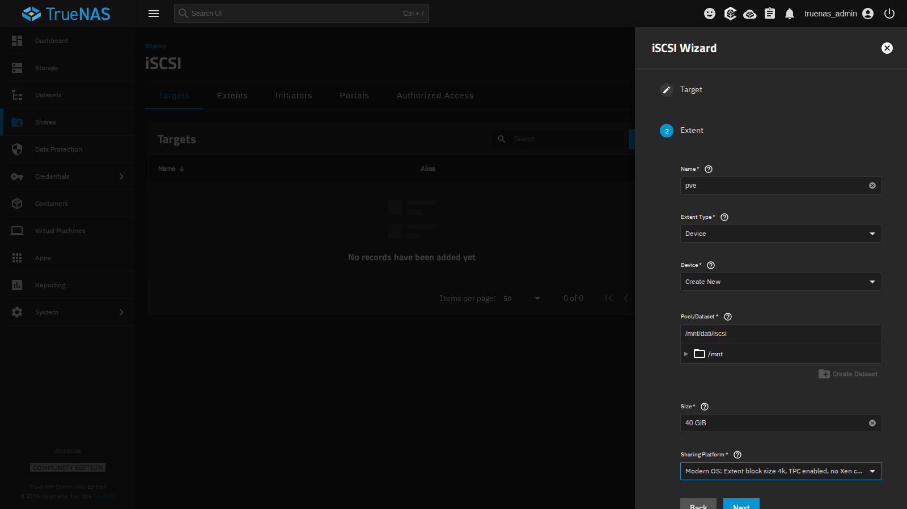
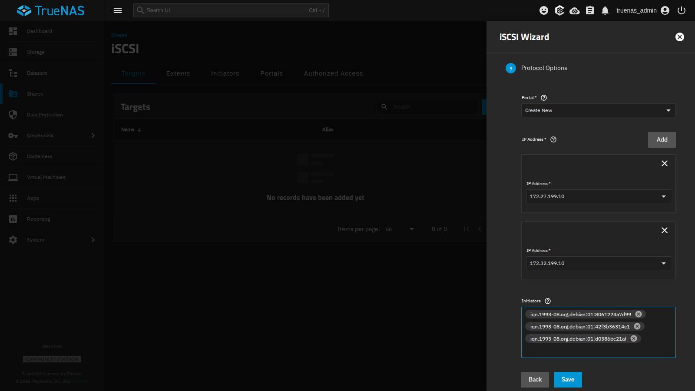
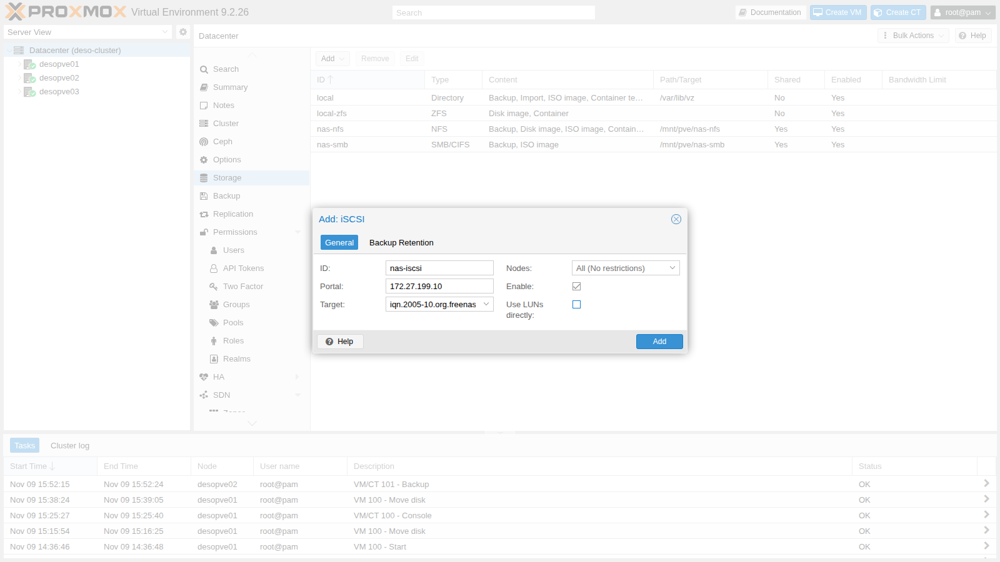
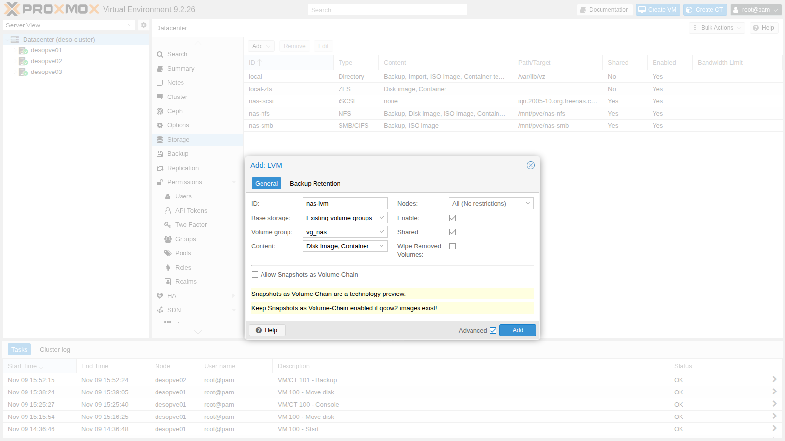
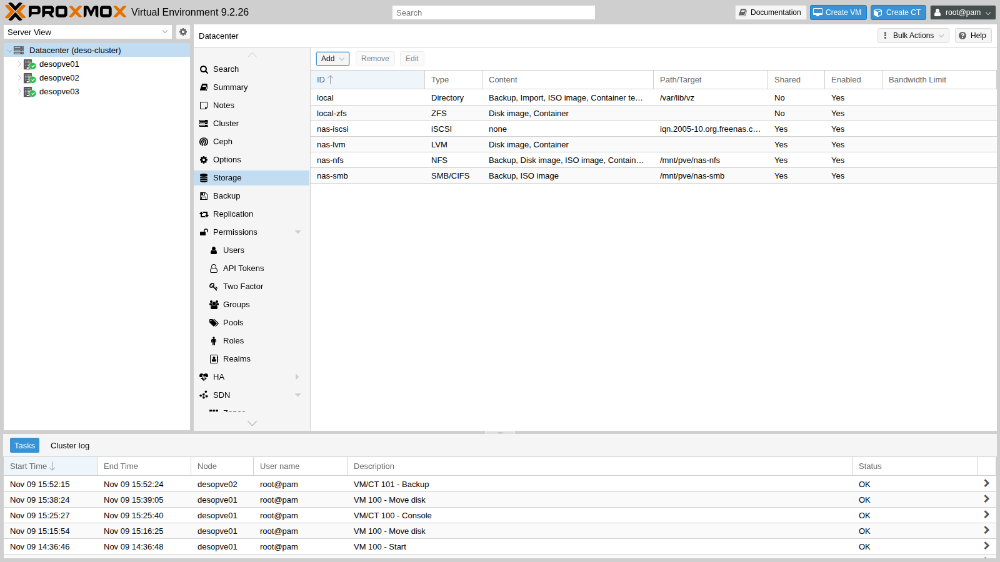

## Dipendenze

- **Lab precedenti:** [Lab 12](/it/12-truenas-nas/) per il NAS `desonas` con il dataset `dati/iscsi`, [Lab 09](/it/09-lvm-and-lvm-thin/) per i concetti di LVM, [Lab 06](/it/06-cluster-corosync/) per i nodi con la seconda scheda `nic1` (`172.32.199.21-23`), [Lab 11](/it/11-zfs-replication/) per i tempi di migrazione da confrontare.
- **Cluster:** `deso-cluster` con i tre nodi; VM 100 `debian01` accesa su `desopve01`, con il disco su `local-zfs`.
- **Rete:** i nodi raggiungono il NAS su `172.27.199.10` (scheda `vmbr0`) e, dopo il primo passo, su `172.32.199.10` (scheda `nic1`).
- **Software:** `open-iscsi` è già installato in Proxmox VE; installerai `multipath-tools` tramite il proxy del laboratorio (lab 04).
- **Credenziali:** `root` / `<password-lab>` sui nodi, `truenas_admin` / `<password-lab>` sul NAS, `labuser` / `<password-lab>` nella VM 100 → [Appendice B](/it/b-credentials-and-addresses/).

## Obiettivi

- Uno zvol da 40 GiB esportato dal NAS in iSCSI su due portal, `172.27.199.10` e `172.32.199.10`, accessibile solo agli IQN dei tre nodi.
- Su ogni nodo, due sessioni iSCSI unite da **multipath** in un solo dispositivo, `nas-lun0`, con entrambi i percorsi `active ready running`, e sopra lo storage **LVM condiviso** `nas-lvm`.
- La VM 100 migrata a caldo tra due nodi con il disco su `nas-lvm`, senza copiare il disco.
- Un percorso interrotto mentre la VM scrive, con tre osservazioni tenute distinte: lo stato dei percorsi sul nodo, gli orari del kernel per il guasto e per il ripristino, la pausa vista dall'interno della VM.
- Nodi con due schede sullo stesso segmento Ethernet che rispondono all'ARP solo dalla scheda giusta, e i sintomi del caso contrario riconosciuti nei log.

## Come funziona

### iSCSI

iSCSI trasporta comandi SCSI su TCP: il nodo vede un **disco** del NAS come se fosse collegato in locale (`/dev/sdX`). A differenza di NFS e SMB non condivide file, ma blocchi.

| Termine | Nel laboratorio |
|---|---|
| **Target**: il «server» che espone i dischi, identificato da un IQN | `iqn.2005-10.org.freenas.ctl:pve` su `desonas` |
| **LUN** / **extent**: il disco esportato | lo zvol `dati/iscsi/pve` da 40 GiB, LUN 0 |
| **Portal**: indirizzo IP e porta TCP (3260) su cui il target risponde | `172.27.199.10:3260` e `172.32.199.10:3260` |
| **Initiator**: il client, con il suo IQN | i tre nodi, `iqn.1993-08.org.debian:01:…` |
| **Initiator group**: chi può collegarsi al target | solo gli IQN dei tre nodi |

### LVM condiviso

Lo stesso disco iSCSI è visto da tutti i nodi. Sopra si crea **un solo** gruppo di volumi LVM (`vg_nas`), e ogni disco di VM è un volume logico (LV):

```text
                 desonas: zvol dati/iscsi/pve (40 GiB)
                   │ 172.27.199.10            │ 172.32.199.10
             percorso 1 (vmbr0)          percorso 2 (nic1)
                   │                          │
  ogni nodo:    /dev/sde                   /dev/sdf      ← lo stesso LUN, due volte
                   └──────── multipath ───────┘
                      /dev/mapper/nas-lun0
                               │
                       VG vg_nas (condiviso)
                       └── vm-100-disk-0 (LV)
```

- LVM non è un file system di cluster: Proxmox VE coordina le modifiche (creare, ingrandire, cancellare LV) con un lock del cluster, e un LV è attivo su un solo nodo alla volta, quello dove gira la VM.
- Lo storage è **thick**: ogni LV occupa subito tutto il suo spazio. Il thin provisioning (LVM-thin) non si può condividere tra nodi.
- Gli snapshot su LVM condiviso esistono solo con la funzione *volume chain* di Proxmox VE 9, che vedrai nel lab 16.

### Multipath

Con due portal ogni nodo apre **due sessioni** iSCSI e vede il LUN due volte (`sde`, `sdf`). Usarli direttamente sarebbe pericoloso: LVM troverebbe due copie dello stesso disco. Il demone **multipathd** riconosce che hanno lo stesso identificativo (WWID) e li unisce in un solo dispositivo, `/dev/mapper/nas-lun0`:

- con `path_grouping_policy multibus` e `round-robin` i due percorsi stanno nello stesso gruppo e l'I/O si distribuisce su **entrambi**;
- se un percorso cade, multipath lo segna `failed` e manda l'I/O sull'altro; quando il percorso torna, multipathd lo riattiva da solo. Il controllo dei percorsi gira ogni `polling_interval` secondi, un intervallo che cresce fino a `max_polling_interval` (per impostazione predefinita quattro volte tanto) finché i percorsi sono sani;
- con `no_path_retry queue`, se cadono **tutti** i percorsi l'I/O resta in coda (come con il mount `hard` di NFS del lab 13) invece di restituire errori al disco della VM. La VM resta allora in attesa per tutta la durata dell'interruzione, e la pagina di manuale `multipath.conf(5)` avverte che i processi in attesa di quell'I/O possono bloccarsi senza poter essere terminati. Questo lab interrompe un solo percorso: il caso con tutti i percorsi giù non è provato.

### Come si rileva un percorso perso

Quanto aspetta l'I/O quando cade un percorso dipende da due livelli:

1. **Rilevazione, in open-iscsi.** Ogni sessione viene controllata con un ping iSCSI (*NOP-Out*). Con i valori dell'`iscsid.conf` distribuito con open-iscsi, il ping parte ogni 5 secondi e la risposta si attende per 5 secondi; questo lab non li modifica. Un ping senza risposta segna la connessione come guasta.
2. **Tempo di recupero.** Da quel momento open-iscsi prova a ripristinare la sessione, e l'I/O resta in attesa. Quando scade il tempo di recupero della sessione, l'I/O in sospeso torna a multipath, che lo ripete su un altro percorso. In `iscsid.conf` questo tempo è `node.session.timeo.replacement_timeout`: 120 secondi per impostazione predefinita, ridotti a 15 al passo 3. Per le sessioni dei percorsi che gestisce, però, multipathd scrive un valore suo nel `recovery_tmo` della sessione: il suo `fast_io_fail_tmo`, 5 secondi per impostazione predefinita. La prova di guasto mostra quale valore era in vigore nel laboratorio.

### Ambiente e versioni della prova

I tempi riportati in questo lab vengono da una prova del 9 novembre 2026, nella configurazione descritta qui sotto. Con versioni, timer o hardware diversi, gli stessi passi possono dare tempi diversi.

| Componente | Configurazione della prova |
|---|---|
| Proxmox VE | 9.2.26, kernel `7.0.14-28-pve` ([Lab 04](/it/04-first-access-repositories-updates/)); `open-iscsi` e `multipath-tools` come installati sui nodi, versioni non registrate in questo lab (le mostra `dpkg -l open-iscsi multipath-tools`) |
| Initiator iSCSI | `node.session.timeo.replacement_timeout = 15` (passo 3); tutti gli altri parametri come nell'`iscsid.conf` del pacchetto; senza CHAP |
| Multipath | il `/etc/multipath.conf` del passo 5: `multibus`, `round-robin 0`, `polling_interval 2`, `failback immediate`, `no_path_retry queue`; `fast_io_fail_tmo` non impostato, quindi vale il valore predefinito di multipath-tools |
| NAS | TrueNAS SCALE 25.10 ([Lab 12](/it/12-truenas-nas/)), una sola scheda con due indirizzi (`172.27.199.10` e l'alias `172.32.199.10`); zvol thick da 40 GiB `dati/iscsi/pve`, piattaforma *Modern OS* (blocchi da 4 KiB), sul pool `dati`, un mirror di due dischi |
| Rete | `vmbr0` (su `nic0`) e `nic1` di ogni nodo sullo stesso switch e nella stessa VLAN, MTU 1500 |
| VM di prova | VM 100 `debian01` ([Lab 07](/it/07-first-vm-and-container/)): Debian 13, 2 core, 2 GiB di RAM, disco `scsi0` da 16 GiB con `iothread=1`, spostato su `nas-lvm` come LV raw |

**Cosa misurano le prove e cosa no.** La prova di guasto interrompe un percorso, su un nodo (`desopve02`), spegnendo la scheda con `ip link set nic1 down`: simula il guasto dal lato del nodo. Un cavo staccato, una porta dello switch guasta o un problema dal lato del NAS non sono stati provati, e potrebbero essere rilevati in tempi diversi. La prova è stata eseguita una volta, con un carico leggero: una breve scrittura seguita da `sync` ogni secondo. Il log del kernel (`dmesg -T`) ha una risoluzione di un secondo, e così, più o meno, il battito nella VM, il cui orologio non era sincronizzato con quello del nodo. I tempi di migrazione sono durate di task da singole esecuzioni, non misure ripetute.

## Procedura

### 1. Un secondo indirizzo sul NAS

Il NAS ha una sola scheda: aggiungi il secondo indirizzo come alias, sulla rete `172.32.199.0/24` che i nodi raggiungono con `nic1`.

1. **System** → **Network** → riga dell'interfaccia → **⋮** → **Edit**.
2. In **Static IP Addresses** premi **Add** e inserisci `172.32.199.10` / `24`.

   

3. **Save**, poi **Test Changes** e, entro il tempo indicato, **Save Changes**: se la rete smettesse di funzionare, TrueNAS tornerebbe da solo alla configurazione precedente.

### 2. Il target iSCSI

1. **Shares** → **iSCSI** → **Wizard**.
2. **Target**: `Create New`, **Next**.
3. **Extent**:
   - **Name** `pve` (diventa il nome del target e dell'extent);
   - **Extent Type** `Device`, **Device** `Create New`: TrueNAS crea uno **zvol**, un volume a blocchi ZFS. Un *dataset* non va bene: è un file system, non un disco;
   - **Pool/Dataset** `/mnt/dati/iscsi`, **Size** `40 GiB`;
   - **Sharing Platform** `Modern OS` (blocchi da 4 KiB).

   

4. **Protocol Options**:
   - **Portal** `Create New`, con due **IP Address**: `172.27.199.10` e `172.32.199.10`;
   - **Initiators**: gli IQN dei tre nodi, letti su ciascuno con `cat /etc/iscsi/initiatorname.iscsi`. Solo questi potranno collegarsi.

   

5. **Save**, e accetta di avviare il servizio iSCSI con l'avvio automatico.

:::note[Autenticazione CHAP]
Il gruppo di initiator limita l'accesso agli IQN dei nodi, ma un IQN si può falsificare. Su reti non dedicate si aggiunge CHAP (**Authorized Access** sul NAS, e utente e password nel file `/etc/iscsi/iscsid.conf` dei nodi). Nel laboratorio la rete è isolata e non lo usiamo.
:::

Lo zvol è **thick**: riserva subito i suoi 40 GiB, e nel laboratorio lo spazio libero visto dagli storage NFS e SMB è sceso da circa 95 a 56 GiB. Sul NAS, `zfs get volsize,refreservation dati/iscsi/pve` mostra la riserva.

### 3. Collegare i nodi al target

Su **tutti e tre i nodi**, prima del primo collegamento, riduci il tempo di recupero della sessione dai 120 secondi predefiniti ai 15 raccomandati dalla guida di Proxmox VE su multipath. Quando multipath gestisce i percorsi, multipathd può applicare un valore suo: vedi [Come si rileva un percorso perso](#come-si-rileva-un-percorso-perso).

```bash title="root@desopve01"
sed -i 's/^node.session.timeo.replacement_timeout = 120/node.session.timeo.replacement_timeout = 15/' /etc/iscsi/iscsid.conf
pvesm scan iscsi 172.27.199.10
```

```text output
iqn.2005-10.org.freenas.ctl:pve 172.27.199.10:3260,172.32.199.10:3260
```

Il target annuncia entrambi i portal. Aggiungi lo storage iSCSI:

1. **Datacenter** → **Storage** → **Add** → **iSCSI**.
2. **ID** `nas-iscsi`, **Portal** `172.27.199.10`, **Target** dal menu.
3. **Togli** la spunta a **Use LUNs directly**: il LUN non ospiterà direttamente i dischi delle VM, ma il gruppo LVM.

   

4. **Add**. Proxmox VE si collega al target da ogni nodo, su **tutti** i portal annunciati:

```bash title="root@desopve01"
iscsiadm -m session
```

```text output
tcp: [1] 172.27.199.10:3260,1 iqn.2005-10.org.freenas.ctl:pve (non-flash)
tcp: [2] 172.32.199.10:3260,1 iqn.2005-10.org.freenas.ctl:pve (non-flash)
```

```bash title="root@desopve01"
lsblk -o NAME,SIZE,TRAN,VENDOR,MODEL | grep iscsi
```

```text output
sde      40G iscsi  TrueNAS  iSCSI Disk
sdf      40G iscsi  TrueNAS  iSCSI Disk
```

```bash title="root@desopve01"
iscsiadm -m session -P3 | grep -E 'Current Portal|Attached scsi disk'
```

```text output
	Current Portal: 172.27.199.10:3260,1
			Attached scsi disk sde		State: running
	Current Portal: 172.32.199.10:3260,1
			Attached scsi disk sdf		State: running
```

`sde` e `sdf` sono lo **stesso** disco visto dai due percorsi.

### 4. Due schede sulla stessa rete: ARP

In questo laboratorio `vmbr0` e `nic1` sono collegate allo stesso switch, nella stessa VLAN: le subnet `172.27.199.0/24` e `172.32.199.0/24` condividono lo stesso segmento Ethernet. Linux, per impostazione predefinita, risponde a una richiesta ARP per **qualsiasi** suo indirizzo da **qualsiasi** scheda (`arp_ignore=0`, il comportamento detto *ARP flux*). Il NAS può quindi associare `172.32.199.22` al MAC di `vmbr0` e mandare lì il traffico del secondo percorso. Succede più facilmente dopo che una delle due schede è rimasta giù: mentre `nic1` è spenta risponde solo `vmbr0`, e il NAS può conservare quell'associazione anche quando `nic1` torna.

**Configurazione provata.** `vmbr0` e `nic1` di ogni nodo sullo stesso switch e nella stessa VLAN, con le impostazioni ARP predefinite.

**Comportamento osservato.** Su `desopve02` la sessione del secondo percorso cadeva di continuo, ogni 10 secondi, e l'I/O della VM si fermava, con pause fino a 85 secondi (il lab non riporta l'output di quella misura). Il log del kernel mostra gli errori di connessione ripetuti (codice 1022, un NOP-Out senza risposta), e una cattura su `vmbr0` mostra traffico del portal `172.32.199.10`, che dovrebbe arrivare solo su `nic1`:

```bash title="root@desopve02"
dmesg -T | grep "conn error" | tail -2
```

```text output
[Mon Nov  9 16:28:15 2026]  connection2:0: detected conn error (1022)
[Mon Nov  9 16:28:25 2026]  connection2:0: detected conn error (1022)
```

```bash title="root@desopve02"
tcpdump -ni vmbr0 -c 2 host 172.32.199.10
```

```text output
16:28:46.780034 IP 172.32.199.10.3260 > 172.32.199.22.36180: Flags [S.], seq 2256764707, ack 4002835344, win 65160, options [mss 1460,sackOK,TS val 675916009 ecr 343433178,nop,wscale 7], length 0
16:28:46.781033 IP 172.32.199.10.3260 > 172.32.199.22.36180: Flags [.], ack 49, win 509, options [nop,nop,TS val 675916010 ecr 343433179], length 0
```

**Interpretazione.** I sintomi sono compatibili con l'ARP flux, cioè con un NAS che manda il traffico del secondo percorso al MAC di `vmbr0`. La cattura però mostra solo che quei pacchetti arrivano su `vmbr0`, non a quale MAC li ha indirizzati il NAS: da sola non dimostra la causa.

**Verifica.** Sul NAS (shell di TrueNAS), `ip neigh show 172.32.199.22` mostra il MAC associato al secondo indirizzo del nodo: confrontalo con l'output di `ip link show nic1` e `ip link show vmbr0` sul nodo. `tcpdump -eni vmbr0 host 172.32.199.10` aggiunge i MAC alla cattura.

**Decisione.** Su **tutti** i nodi con più schede sullo stesso segmento, limita l'ARP alla scheda giusta, prima di configurare multipath: ogni scheda risponde solo per i propri indirizzi (`arp_ignore=1`), e le richieste ARP usano come mittente un indirizzo della subnet di destinazione presente sulla scheda di uscita (`arp_announce=2`):

```bash title="root@desopve01"
printf 'net.ipv4.conf.all.arp_ignore = 1\nnet.ipv4.conf.all.arp_announce = 2\n' > /etc/sysctl.d/90-arp-multihomed.conf
sysctl -p /etc/sysctl.d/90-arp-multihomed.conf
```

```text output
net.ipv4.conf.all.arp_ignore = 1
net.ipv4.conf.all.arp_announce = 2
```

Se il NAS ha già imparato l'associazione sbagliata, aggiornala con un annuncio ARP spontaneo dalla scheda giusta:

```bash title="root@desopve02"
apt install iputils-arping
arping -c 3 -U -I nic1 -s 172.32.199.22 172.32.199.22
```

**Risultato.** La prova di guasto alla fine di questo lab, eseguita più tardi sullo stesso nodo, mostra un solo errore di connessione e il percorso che torna da solo (vedi [Verifica e test](#verifica-e-test)). È compatibile con la correzione, ma il lab non ha registrato la tabella ARP del NAS prima e dopo la modifica: la verifica descritta sopra la confermerebbe.

Una rete dello storage su un segmento proprio (switch o VLAN dedicati) evita del tutto la situazione, perché ogni nodo ha allora una sola scheda su quella rete.

### 5. Multipath

Su **tutti e tre i nodi**:

1. Installa il pacchetto e leggi il WWID del LUN:

   ```bash title="root@desopve01"
   apt install multipath-tools
   /lib/udev/scsi_id -g -u -d /dev/sde
   ```

   ```text output
   36589cfc000000580bcccfa017f51b957
   ```

2. Crea `/etc/multipath.conf`: si escludono tutti i dischi (`blacklist`) tranne il LUN del NAS, a cui si dà un nome leggibile.

   ```text
   defaults {
       polling_interval        2
       path_selector           "round-robin 0"
       path_grouping_policy    multibus
       uid_attribute           ID_SERIAL
       failback                immediate
       no_path_retry           queue
       user_friendly_names     yes
   }
   blacklist {
       wwid .*
   }
   blacklist_exceptions {
       wwid "36589cfc000000580bcccfa017f51b957"
   }
   multipaths {
       multipath {
           wwid  "36589cfc000000580bcccfa017f51b957"
           alias nas-lun0
       }
   }
   ```

3. Registra il WWID: con il valore predefinito `find_multipaths strict`, multipath-tools crea il dispositivo solo per i WWID che già conosce. Poi ricarica:

   ```bash title="root@desopve01"
   multipath -a 36589cfc000000580bcccfa017f51b957
   systemctl restart multipathd; multipath -r
   multipath -ll
   ```

   ```text output
   nas-lun0 (36589cfc000000580bcccfa017f51b957) dm-0 TrueNAS,iSCSI Disk
   size=40G features='1 queue_if_no_path' hwhandler='0' wp=rw
   `-+- policy='round-robin 0' prio=1 status=active
     |- 33:0:0:0 sde 8:64 active ready running
     `- 34:0:0:0 sdf 8:80 active ready running
   ```

   Un solo dispositivo, due percorsi attivi; `queue_if_no_path` è l'effetto di `no_path_retry queue`.

### 6. Il gruppo LVM condiviso

Crea il gruppo di volumi **una sola volta**, da un nodo, sul dispositivo multipath (mai su `sde` o `sdf`):

```bash title="root@desopve01"
pvcreate /dev/mapper/nas-lun0
```

```text output
  Physical volume "/dev/mapper/nas-lun0" successfully created.
```

```bash title="root@desopve01"
vgcreate vg_nas /dev/mapper/nas-lun0
```

```text output
  Volume group "vg_nas" successfully created
```

```bash title="root@desopve02"
pvs
```

```text output
  PV                   VG     Fmt  Attr PSize  PFree
  /dev/mapper/nas-lun0 vg_nas lvm2 a--  39.99g 39.99g
```

Gli altri nodi vedono subito il gruppo, sempre attraverso il dispositivo multipath: LVM ignora da solo i singoli percorsi (`multipath_component_detection=1`).

1. **Datacenter** → **Storage** → **Add** → **LVM**.
2. **ID** `nas-lvm`, **Base storage** `Existing volume groups`, **Volume group** `vg_nas`, **Content** `Disk image, Container`.
3. Spunta **Shared**: senza, Proxmox VE tratterebbe il gruppo come locale a ogni nodo.

   

4. **Add**.



```bash title="root@desopve01"
grep -A5 "lvm: nas-lvm" /etc/pve/storage.cfg
```

```text output
lvm: nas-lvm
	vgname vg_nas
	content images,rootdir
	saferemove 0
	shared 1
```

### 7. Una VM su storage condiviso

Sposta a caldo il disco della VM 100 su `nas-lvm` (diventa un LV `raw`) e migra la VM:

```bash title="root@desopve01"
qm disk move 100 scsi0 nas-lvm --delete 1
```

```text output
mirror-scsi0: transferred 16.0 GiB of 16.0 GiB (100.00%) in 1m 20s, ready
mirror-scsi0: Completed successfully.
removing source volume 'local-zfs:vm-100-disk-0' after successful copy
```

```bash title="root@desopve01"
lvs vg_nas
```

```text output
  LV            VG     Attr       LSize  Pool Origin Data%  Meta%  Move Log Cpy%Sync Convert
  vm-100-disk-0 vg_nas -wi-ao---- 16.00g
```

```bash title="root@desopve01"
qm migrate 100 desopve02 --online
```

```text output
2026-11-09 16:22:48 starting migration of VM 100 to node 'desopve02' (172.27.199.22)
2026-11-09 16:22:54 migration completed, transferred 274.2 MiB VM-state
2026-11-09 16:22:58 migration finished successfully (duration 00:00:10)
```

Il disco non viene copiato: il nodo di arrivo attiva lo stesso LV. Il task ha trasferito 274,2 MiB di stato della VM (le pagine di memoria e lo stato dei dispositivi virtuali) e in tutto è durato 10 secondi; anche il ritorno, nella pulizia, ha richiesto 10 secondi.

| Migrazione a caldo della VM 100 | Durata del task (`duration` nel log) |
|---|---|
| Disco locale, senza replica (lab 11) | 1 min 13 s |
| Disco locale con replica ZFS (lab 11) | 20 s |
| Disco su storage condiviso (LVM su iSCSI) | 10 s |

I valori sono quelli delle singole migrazioni riportate nel lab 11 e in questo lab, eseguite lo stesso giorno con la stessa VM. Le differenze sono compatibili con la quantità di dati del disco che ogni migrazione deve copiare: tutto il disco senza replica, solo le modifiche successive all'ultima replica con la replica, niente con lo storage condiviso. La tabella confronta la durata complessiva del task, non il fermo della VM, che è un'altra misura: i log del lab 11 riportano 10 e 20 ms, mentre per la migrazione su storage condiviso questo lab non lo ha registrato (il log completo del task lo riporta nella riga `average migration speed … downtime … ms`).

## Verifica e test

Il lab è riuscito se passano i controlli alla fine di questa sezione. Il cuore è la prova di guasto, che guarda la perdita di un percorso da due lati: il nodo, con lo stato dei percorsi e il log del kernel, e la VM, con la pausa che vedono le sue scritture. I due lati misurano cose diverse e restano separati.

### Test – Cade un percorso con l'I/O in corso

1. Nella VM 100, ora su `desopve02`, avvia un «battito»: un ciclo che aggiunge a un file l'ora al millisecondo, la porta su disco con `sync` e aspetta un secondo. Una scrittura che si blocca si vede come un buco tra due righe consecutive.

   ```bash title="labuser@debian01"
   nohup sh -c 'while true; do date +%T.%N | cut -c1-12 >> $HOME/battito.log; sync; sleep 1; done' >/dev/null 2>&1 &
   ```

2. Su `desopve02` spegni la scheda del secondo percorso, annotando l'ora (orologio del nodo). Così si simula il guasto dal lato del nodo:

   ```bash title="root@desopve02"
   date +%T.%N | cut -c1-12; ip link set nic1 down
   ```

   ```text output
   16:32:14.282
   ```

3. Circa 15 secondi dopo, guarda i percorsi e il log del kernel sul nodo:

   ```bash title="root@desopve02"
   multipath -ll nas-lun0 | tail -2
   ```

   ```text output
     |- 33:0:0:0 sde 8:64 active ready  running
     `- 35:0:0:0 sdg 8:96 failed faulty offline
   ```

   ```bash title="root@desopve02"
   dmesg -T | grep -E 'conn error|recovery timed|Failing path'
   ```

   ```text output
   [Mon Nov  9 16:32:24 2026]  connection3:0: detected conn error (1022)
   [Mon Nov  9 16:32:29 2026]  session3: session recovery timed out after 5 secs
   [Mon Nov  9 16:32:29 2026] device-mapper: multipath: 252:0: Failing path 8:96.
   ```

   - **Misura** (orologio del nodo, log del kernel con risoluzione di un secondo): `nic1` si spegne alle 16:32:14.282. Il primo errore di connessione sulla sessione del secondo percorso (`connection3`) arriva alle 16:32:24, circa 10 secondi dopo, con il codice 1022, quello che il kernel usa per un NOP-Out senza risposta (`ISCSI_ERR_NOP_TIMEDOUT`); `session recovery timed out after 5 secs` e `Failing path 8:96` arrivano alle 16:32:29, circa 15 secondi dopo il distacco. `multipath -ll` mostra poi `sdg` come `failed faulty offline` e `sde` ancora `active ready running`.
   - **Interpretazione:** i due intervalli si accordano con i due livelli descritti in [Come si rileva un percorso perso](#come-si-rileva-un-percorso-perso): circa 10 secondi di rilevazione, compatibili con i valori di NOP-Out dell'`iscsid.conf` distribuito (un ping ogni 5 secondi, 5 secondi per rispondere), poi 5 secondi di tempo di recupero. Quel tempo però non corrisponde ai 15 secondi impostati al passo 3: il valore è compatibile con un `fast_io_fail_tmo` applicato da multipathd alla sessione. Il lab non ha stampato i valori in vigore.
   - **Verifica:** `iscsiadm -m node -T iqn.2005-10.org.freenas.ctl:pve -p 172.32.199.10 | grep -E 'noop_out|replacement_timeout'` mostra i valori del record del nodo; `cat /sys/class/iscsi_session/session*/recovery_tmo` mostra il tempo davvero in vigore per ogni sessione; `multipathd show config | grep fast_io_fail_tmo` mostra il valore di multipath.

4. Riattiva la scheda: il percorso torna da solo.

   ```bash title="root@desopve02"
   date +%T.%N | cut -c1-12; ip link set nic1 up
   ```

   ```text output
   16:32:49.332
   ```

   ```bash title="root@desopve02"
   dmesg -T | grep Reinstating
   ```

   ```text output
   [Mon Nov  9 16:32:58 2026] device-mapper: multipath: 252:0: Reinstating path 8:96.
   ```

   ```bash title="root@desopve02"
   multipath -ll nas-lun0 | tail -2
   ```

   ```text output
     |- 33:0:0:0 sde 8:64 active ready running
     `- 35:0:0:0 sdg 8:96 active ready running
   ```

   - **Misura:** `nic1` torna alle 16:32:49.332 e il percorso viene riattivato alle 16:32:58, circa 9 secondi dopo, con lo stesso dispositivo (`sdg`, 8:96). Entrambi i percorsi sono di nuovo `active ready running`.
   - **Interpretazione:** la sessione è stata ripristinata e multipathd ha rimesso il percorso nella mappa esistente: per LVM e per la VM, che vedono solo `nas-lun0`, non cambia nulla. I 9 secondi comprendono il nuovo login iSCSI e il tempo che il controllo dei percorsi impiega ad accorgersene; la prova non separa le due parti.
   - **Verifica:** `journalctl -u iscsid` mostra quando la sessione è tornata operativa; confrontalo con l'ora di `Reinstating path`.

   In questo output il secondo percorso si chiama `sdg` e non `sdf` perché su `desopve02` la sua sessione era già stata ricreata una volta, durante il problema ARP descritto al passo 4, e il kernel aveva dato al disco un nome nuovo. Il log del kernel lo conferma: alle 16:28 il secondo percorso era `connection2`, in questa prova è `connection3`. Sui tuoi nodi sarà probabilmente `sdf`.

5. Nella VM cerca le pause del battito più lunghe di 1,5 secondi:

   ```bash title="labuser@debian01"
   awk -F: '{s=$1*3600+$2*60+$3; if (NR>1 && s-p>1.5) printf "pausa di %.1f s, da %s a %s\n", s-p, q, $0; p=s; q=$0}' $HOME/battito.log
   ```

   ```text output
   pausa di 15.3 s, da 16:32:09.700 a 16:32:25.034
   pausa di 1.8 s, da 16:32:40.597 a 16:32:42.416
   pausa di 1.6 s, da 16:32:44.484 a 16:32:46.123
   pausa di 1.6 s, da 16:32:46.123 a 16:32:47.678
   ```

   - **Misura** (orologio della VM; una riga circa ogni secondo; il comando `awk` stampa solo i buchi più lunghi di 1,5 secondi): un buco di 15,3 secondi, dalle 16:32:09.700 alle 16:32:25.034, e tre buchi da 1,6-1,8 secondi tra le 16:32:40 e le 16:32:48. Nessun buco oltre 1,5 secondi intorno al ritorno del percorso.
   - **Interpretazione:**
     - Il buco di 15,3 secondi è la pausa vista dal guest, ed è un'osservazione diversa dai timer del nodo (10 + 5 secondi nel log del kernel). Le due coincidono nella durata e, con uno scarto di qualche secondo tra gli orologi, coinciderebbero anche nel tempo. L'orologio della VM era in effetti indietro di qualche secondo rispetto al nodo, ma di una quantità non misurata: l'allineamento dei due log non si può verificare.
     - Le scritture hanno aspettato invece di fallire: il battito è ripartito da solo, sul percorso rimasto.
     - I tre buchi da 1,6-1,8 secondi cadono mentre era attivo un solo percorso, ma questa prova non li spiega: riguardano solo tre delle oltre venti iterazioni di quell'intervallo, e le altre sono rimaste sotto la soglia di 1,5 secondi.
     - Il ritorno del percorso non ha causato buchi oltre 1,5 secondi; una pausa più breve non si vedrebbe con questo metodo.
   - **Verifica:** sincronizza la VM con `ntp.proxmox.community` prima della prova, così i suoi orari si possono confrontare con il `dmesg` del nodo; stampa tutti gli intervalli, senza la soglia di 1,5 secondi, per confrontare prima, durante e dopo il guasto; `journalctl -k -p err` nella VM mostra se il kernel del guest ha registrato errori di I/O.

Spegnere `nic1` ha interrotto anche il link 1 di Corosync (lab 06) su `desopve02`, che usa la stessa scheda: il cluster è rimasto in quorum sul link 0. `corosync-cfgtool -s` mostra lo stato di ogni link.

Ferma il battito:

```bash title="labuser@debian01"
pkill -f "^sh -c while true"; rm -f $HOME/battito.log
```

### Pulizia

Riporta la VM su `desopve01` e il disco sullo storage locale. Gli storage `nas-iscsi` e `nas-lvm` restano configurati per i lab successivi.

```bash title="root@desopve02"
qm migrate 100 desopve01 --online
```

```text output
2026-11-09 16:34:07 migration finished successfully (duration 00:00:10)
```

```bash title="root@desopve01"
qm disk move 100 scsi0 local-zfs --delete 1
```

```text output
mirror-scsi0: transferred 16.0 GiB of 16.0 GiB (100.00%) in 2m 30s, ready
removing source volume 'nas-lvm:vm-100-disk-0' after successful copy
```

- [ ] Il NAS risponde su `172.27.199.10` e `172.32.199.10` (`pvesm scan iscsi` elenca entrambi i portal) ed esporta lo zvol `dati/iscsi/pve` ai soli IQN dei nodi.
- [ ] Ogni nodo ha due sessioni iSCSI (`iscsiadm -m session`) e un solo dispositivo multipath, `nas-lun0`, con entrambi i percorsi `active ready running` (`multipath -ll`).
- [ ] Lo storage `nas-lvm` è condiviso (`shared 1` in `storage.cfg`), sul gruppo `vg_nas` creato su `/dev/mapper/nas-lun0`, e tutti i nodi lo vedono (`pvs`).
- [ ] La migrazione a caldo con il disco su `nas-lvm` copia solo lo stato della VM: il log riporta `transferred … VM-state` e nessun mirror del disco.
- [ ] Con un percorso giù le scritture della VM si fermano per circa il tempo di rilevazione più il tempo di recupero in vigore (15,3 secondi nel laboratorio) e poi riprendono da sole; il percorso passa a `failed` e, quando la scheda torna, di nuovo `active ready running`.
- [ ] Sui nodi sono attivi `arp_ignore=1` e `arp_announce=2` (`sysctl net.ipv4.conf.all.arp_ignore net.ipv4.conf.all.arp_announce`).

## Stato finale del lab

- **NAS:** alias `172.32.199.10/24` sulla scheda; zvol **`dati/iscsi/pve`** (40 GiB, thick); target **`iqn.2005-10.org.freenas.ctl:pve`** con LUN 0, portal `172.27.199.10:3260` e `172.32.199.10:3260`, initiator group con i tre nodi, senza CHAP; servizio iSCSI attivo con avvio automatico.
- **Nodi `desopve01-03`:**
  - `node.session.timeo.replacement_timeout = 15` in `/etc/iscsi/iscsid.conf`;
  - `multipath-tools` con `/etc/multipath.conf` (alias `nas-lun0`) e il WWID registrato;
  - `/etc/sysctl.d/90-arp-multihomed.conf` con `arp_ignore=1` e `arp_announce=2`;
  - su `desopve02` anche `iputils-arping`.
- **Cluster:** storage **`nas-iscsi`** (iSCSI, nessun contenuto diretto) e **`nas-lvm`** (LVM condiviso sul VG `vg_nas`, contenuti `images,rootdir`, vuoto).
- Storage `nas-nfs` e `nas-smb` invariati. VM 100 accesa su `desopve01`, disco su `local-zfs`; CT 101 acceso su `desopve02`.

## Cosa hai imparato

- **Come esportare storage a blocchi da TrueNAS:** con uno zvol, non con un dataset. Uno zvol thick riserva subito tutta la sua dimensione, quindi va tolto dallo spazio libero del pool quando dimensioni le altre condivisioni.
- **Dove creare LVM:** sul dispositivo multipath, mai sui singoli percorsi, con un solo gruppo di volumi marcato **Shared**. Ogni disco di VM è così un LV attivo su un nodo alla volta, e la migrazione a caldo copia solo lo stato della VM.
- **Quanto aspetta una VM quando cade un percorso:** circa il tempo di rilevazione (intervallo più attesa del NOP-Out) più il tempo di recupero della sessione in vigore, che con multipath può essere il `fast_io_fail_tmo` di multipathd invece del `replacement_timeout` di `iscsid.conf`. Leggi i valori in vigore (`/sys/class/iscsi_session/*/recovery_tmo`) prima di farci affidamento, e misura la pausa dall'interno del guest, separata dai log del nodo.
- **Cosa scegliere per il caso con tutti i percorsi giù:** `no_path_retry queue` tiene l'I/O in attesa per tutta la durata dell'interruzione, quindi l'I/O della VM resta fermo senza errori, anche con processi che non si possono terminare; un numero finito di tentativi restituisce errori dopo un tempo limitato. Questo lab ha provato solo la perdita di un percorso.
- **Come disegnare la rete per due percorsi:** due schede sullo stesso segmento Ethernet richiedono `arp_ignore=1` e `arp_announce=2`; un segmento separato per ogni percorso evita il problema. Se un percorso continua a cadere ogni pochi secondi, controlla quale MAC il NAS associa all'indirizzo del nodo prima di dare la colpa allo storage.

## Riferimenti

- [Proxmox VE – Open-iSCSI initiator](https://pve.proxmox.com/pve-docs/pve-admin-guide.html#storage_open_iscsi)
- [Proxmox VE – LVM Backend](https://pve.proxmox.com/pve-docs/pve-admin-guide.html#storage_lvm)
- [Proxmox VE wiki – Multipath: percorsi iSCSI, `multipath -a`, LVM sopra, `replacement_timeout`](https://pve.proxmox.com/wiki/Multipath)
- [TrueNAS 25.10 – Adding iSCSI Block Shares (la procedura guidata iSCSI)](https://www.truenas.com/docs/scale/25.10/scaletutorials/shares/iscsi/addingiscsishares/)
- [`multipath.conf(5)` per Debian 13 (multipath-tools 0.11): `no_path_retry`, `fast_io_fail_tmo`, `polling_interval`, `find_multipaths`](https://manpages.debian.org/trixie/multipath-tools/multipath.conf.5.en.html)
- [multipath-tools 0.11.1 – `sysfs_set_session_tmo()`: il `fast_io_fail_tmo` applicato come `recovery_tmo` delle sessioni iSCSI](https://github.com/opensvc/multipath-tools/blob/0.11.1/libmultipath/discovery.c#L778)
- [open-iscsi – `iscsid.conf`: valori di NOP-Out e `replacement_timeout`](https://github.com/open-iscsi/open-iscsi/blob/master/etc/iscsid.conf)
- [Kernel Linux 7.0 – codici di errore iSCSI in `include/scsi/iscsi_if.h` (1022 è `ISCSI_ERR_NOP_TIMEDOUT`)](https://github.com/torvalds/linux/blob/v7.0/include/scsi/iscsi_if.h)
- [Linux kernel – `arp_ignore` e `arp_announce`](https://docs.kernel.org/networking/ip-sysctl.html)
