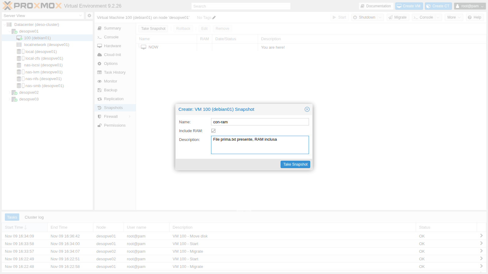
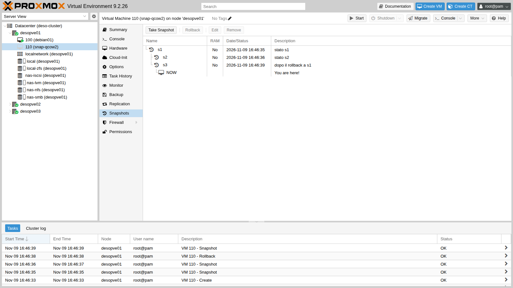
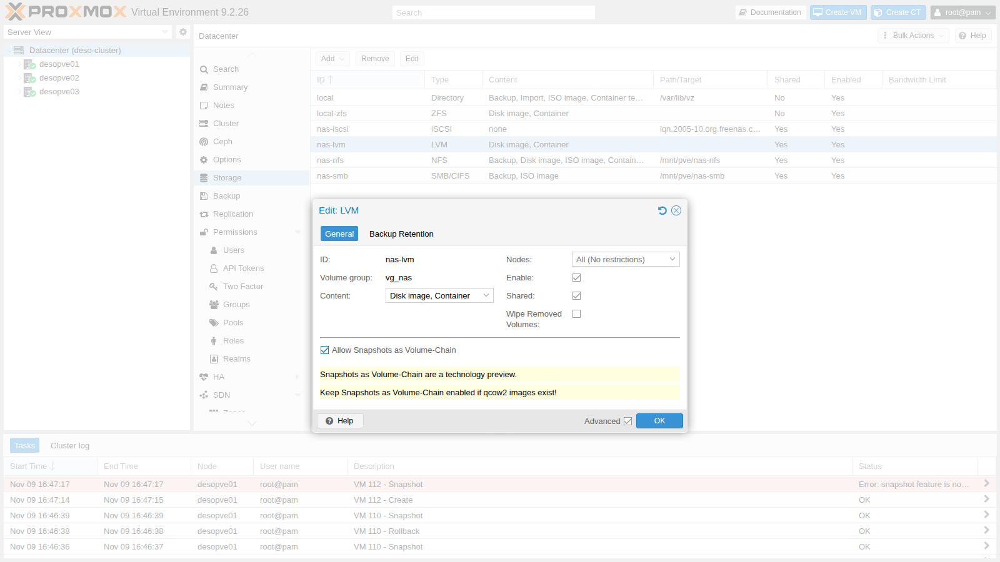
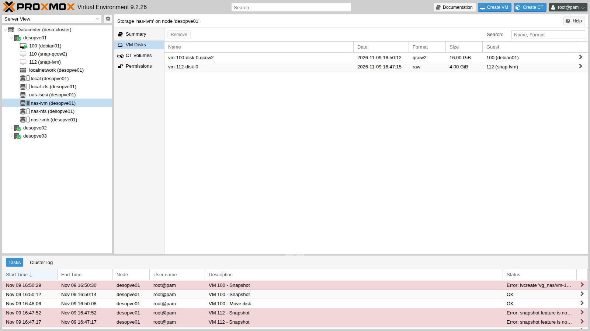
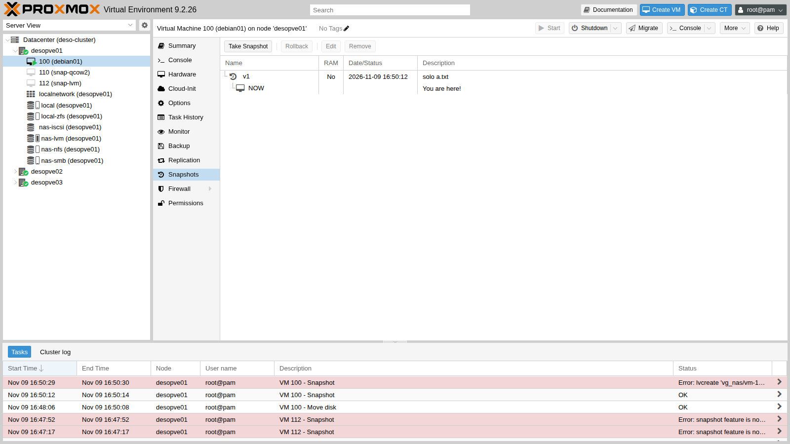

## Dipendenze

- **Lab precedenti:** [Lab 10](/it/10-zfs/) (snapshot ZFS), [Lab 09](/it/09-lvm-and-lvm-thin/) (LVM-thin su `desopve04`), [Lab 13](/it/13-nfs/) (storage `nas-nfs`), [Lab 15](/it/15-iscsi-lvm-multipath/) (storage `nas-lvm` su iSCSI).
- **Cluster:** VM 100 `debian01` accesa su `desopve01` con il disco su `local-zfs`; `desopve04` standalone con lo storage `local-lvm` (LVM-thin).
- **Spazio:** il gruppo `vg_nas` ha 40 GiB liberi; il disco della VM 100 è di 16 GiB.
- **Credenziali:** `root` / `<password-lab>` sui nodi, `labuser` / `<password-lab>` nella VM 100 → [Appendice B](/it/b-credentials-and-addresses/).

## Obiettivi

- Fare snapshot di una VM con e senza la RAM, e capire cosa succede al rollback.
- Riconoscere come ogni tipo di storage realizza gli snapshot e quali limiti ha.
- Costruire un albero di snapshot con rami.
- Attivare gli snapshot come *volume chain* su LVM condiviso, guardare la catena di volumi e misurarne il costo in spazio.

## Come funziona

### Che cos'è uno snapshot in Proxmox VE

Uno snapshot congela lo stato della VM in un istante:

- lo stato dei **dischi**, realizzato dallo storage (ZFS, qcow2, LVM-thin, Ceph…);
- la **configurazione** della VM, salvata nel file `/etc/pve/qemu-server/<VMID>.conf` in una sezione `[nome-snapshot]`;
- facoltativamente la **RAM** (*vmstate*), cioè lo stato della VM accesa: processi, connessioni, contenuto della memoria. Viene salvata in un volume a parte sullo stesso storage.

Il **rollback** riporta la VM esattamente a quel punto. Con la RAM la VM riparte accesa, come se nulla fosse successo; senza RAM riparte spenta, come dopo un'interruzione di corrente.

Uno snapshot **non è un backup**: sta sullo stesso storage della VM, e se lo storage si guasta si perdono VM e snapshot insieme. I backup sono l'argomento dei lab 46 e 47.

### Snapshot per tipo di storage

| Storage | Come funziona | Rollback a uno snapshot non recente |
|---|---|---|
| ZFS | snapshot nativo del volume ZFS, istantaneo | no: vanno prima cancellati i più recenti |
| qcow2 su NFS, SMB o directory | snapshot interni al file qcow2 | sì, con rami (albero) |
| LVM-thin | volume thin che condivide i blocchi con l'originale | sì, con rami |
| LVM (thick, anche condiviso) | **nessuno** | – |
| LVM con *volume chain* (PVE 9) | catena di volumi qcow2, ognuno su un LV | no: solo il più recente |
| Ceph RBD | snapshot nativo RBD (lab 17) | sì, anche a uno snapshot non recente: i successivi restano |

### Snapshot come volume chain

LVM thick non ha snapshot utilizzabili: gli snapshot classici di LVM (*copy-on-write*) rallentano le scritture del volume d'origine e, su un gruppo di volumi condiviso tra nodi, non si possono usare. Proxmox VE 9 introduce un'alternativa, ancora in anteprima tecnologica (*technology preview*), valida per qualsiasi storage a blocchi (iSCSI, Fibre Channel):

```text
 prima dello snapshot         dopo lo snapshot "v1"
 ┌──────────────────────┐     ┌──────────────────────────────┐   ┌──────────────────────┐
 │ vm-100-disk-0.qcow2  │ ──▶ │ snap_vm-100-disk-0_v1.qcow2  │ ◀─│ vm-100-disk-0.qcow2  │
 │ (LV da 16 GiB)       │     │ stato congelato (16 GiB)     │   │ nuovo, solo le       │
 └──────────────────────┘     └──────────────────────────────┘   │ differenze (16 GiB)  │
                                         backing file            └──────────────────────┘
```

- Il disco della VM è in formato **qcow2**, scritto direttamente dentro un LV.
- Lo snapshot **rinomina** il volume corrente (che diventa lo stato congelato) e crea un nuovo volume che contiene solo le differenze, con il precedente come *backing file*.
- Ogni volume è un LV **thick della dimensione dell'intero disco**: uno snapshot di un disco da 16 GiB occupa altri 16 GiB nel gruppo di volumi.

## Procedura

### 1. Snapshot con la RAM su ZFS

1. Nella VM 100 crea un file che servirà da riferimento:

   ```bash title="labuser@debian01"
   echo "creato prima dello snapshot" > $HOME/prima.txt; sync; uptime -s
   ```

   ```text output
   2026-11-09 14:30:12
   ```

   `uptime -s` mostra quando la VM è stata avviata.

2. VM **100** → **Snapshots** → **Take Snapshot**: **Name** `con-ram`, una descrizione, e **Include RAM** spuntato (è il predefinito con la VM accesa).

   

3. Sul nodo guarda che cosa ha creato ZFS:

   ```bash title="root@desopve01"
   qm listsnapshot 100
   ```

   ```text output
   `-> con-ram                     2026-11-09 16:41:06     File prima.txt presente, RAM inclusa
    `-> current                                            You are here!
   ```

   ```bash title="root@desopve01"
   zfs list -t all -o name,used,refer -r rpool/data | grep -E 'NAME|vm-100'
   ```

   ```text output
   NAME                               USED  REFER
   rpool/data/vm-100-disk-0          5.86G  5.86G
   rpool/data/vm-100-disk-0@con-ram   804K  5.86G
   rpool/data/vm-100-state-con-ram    154M   154M
   ```

   - `vm-100-disk-0@con-ram` è lo snapshot del disco: subito dopo la creazione occupa quasi niente (804K), perché condivide tutti i blocchi con il disco.
   - `vm-100-state-con-ram` è un volume a parte con il contenuto della RAM (154 MiB in uso su 2 GiB).

4. Nella VM cancella il file e creane un altro, poi fai il rollback:

   ```bash title="labuser@debian01"
   rm $HOME/prima.txt; echo "creato dopo lo snapshot" > $HOME/dopo.txt; sync
   ```

   ```bash title="root@desopve01"
   time qm rollback 100 con-ram
   ```

   ```text output
   real	0m4.404s
   ```

   ```bash title="root@desopve01"
   qm status 100
   ```

   ```text output
   status: running
   ```

   ```bash title="labuser@debian01"
   ls $HOME; uptime -s
   ```

   ```text output
   prima.txt
   2026-11-09 14:30:12
   ```

   In 4 secondi la VM è tornata al momento dello snapshot, **accesa**: `prima.txt` c'è, `dopo.txt` non è mai esistito, e l'orario di avvio non è cambiato perché la VM non si è riavviata. Anche la sessione SSH aperta prima dello snapshot riprende, se non è scaduta nel frattempo.

### 2. Snapshot senza RAM e il limite di ZFS

1. Fai uno snapshot senza la RAM:

   ```bash title="root@desopve01"
   qm snapshot 100 senza-ram --vmstate 0
   qm listsnapshot 100
   ```

   ```text output
   `-> con-ram                     2026-11-09 16:41:06     File prima.txt presente, RAM inclusa
    `-> senza-ram                  2026-11-09 16:45:34     no-description
     `-> current                                           You are here!
   ```

2. Prova a tornare al primo snapshot, che non è il più recente:

   ```bash title="root@desopve01"
   qm rollback 100 con-ram
   ```

   ```text output
   can't rollback, 'con-ram' is not most recent snapshot on 'local-zfs:vm-100-disk-0'
   ```

   ZFS può tornare solo all'ultimo snapshot: per tornare a uno precedente bisogna prima cancellare quelli più recenti.

3. Fai il rollback a `senza-ram`: senza la RAM la VM si ritrova **spenta** e va riavviata.

   ```bash title="root@desopve01"
   qm rollback 100 senza-ram; qm status 100
   ```

   ```text output
   status: stopped
   ```

   ```bash title="root@desopve01"
   qm start 100
   ```

4. Cancella `senza-ram`: ora `con-ram` è il più recente e il rollback è permesso. Poi cancella anche `con-ram`.

   ```bash title="root@desopve01"
   qm delsnapshot 100 senza-ram
   qm rollback 100 con-ram; qm status 100
   ```

   ```text output
   status: running
   ```

   ```bash title="root@desopve01"
   qm delsnapshot 100 con-ram
   ```

   Se `qm delsnapshot` risponde `can't lock file '/var/lock/qemu-server/lock-100.conf' - got timeout`, il rollback precedente sta ancora terminando: riprova dopo qualche secondo.

### 3. Un albero di snapshot con qcow2 su NFS

Su uno storage di file con dischi qcow2 gli snapshot sono **interni** al file e si può tornare a uno qualsiasi. Usa una VM di prova senza sistema operativo:

```bash title="root@desopve01"
qm create 110 --name snap-qcow2 --memory 512 --scsihw virtio-scsi-single --scsi0 nas-nfs:4,format=qcow2
qm snapshot 110 s1 --description "stato s1"
qm snapshot 110 s2 --description "stato s2"
qm rollback 110 s1
qm snapshot 110 s3 --description "dopo il rollback a s1"
qm listsnapshot 110
```

```text output
`-> s1                          2026-11-09 16:46:35     stato s1
 `-> s2                         2026-11-09 16:46:36     stato s2
 `-> s3                         2026-11-09 16:46:39     dopo il rollback a s1
  `-> current                                           You are here!
```

```bash title="root@desopve01"
qemu-img snapshot -l /mnt/pve/nas-nfs/images/110/vm-110-disk-0.qcow2
```

```text output
Snapshot list:
ID      TAG               VM_SIZE                DATE        VM_CLOCK     ICOUNT
1       s1                    0 B 2026-11-09 16:46:35  0000:00:00.000          0
2       s2                    0 B 2026-11-09 16:46:36  0000:00:00.000          0
3       s3                    0 B 2026-11-09 16:46:39  0000:00:00.000          0
```

Il rollback a `s1` è riuscito anche se esisteva `s2`. Lo snapshot `s3`, creato dopo, nasce da `s1`: l'albero ha due rami, `s2` e `s3`. Nell'interfaccia web si vede così:



Creare o cancellare uno snapshot interno qcow2 **blocca la VM** per la durata dell'operazione, e su storage di rete con dischi grandi può richiedere minuti. Con dischi grandi su NFS conviene fare queste operazioni a VM spenta, oppure usare la volume chain.

### 4. LVM-thin

Su `desopve04` lo storage `local-lvm` è LVM-thin (lab 09):

```bash title="root@desopve04"
qm create 940 --name snap-thin --memory 512 --scsihw virtio-scsi-single --scsi0 local-lvm:4
qm snapshot 940 prima
lvs -o lv_name,lv_attr,lv_size,pool_lv,origin,data_percent pve | grep -E 'LV|940'
```

```text output
  LV                       Attr       LSize   Pool Origin        Data%
  snap_vm-940-disk-0_prima Vri---tz-k   4.00g data vm-940-disk-0
  vm-940-disk-0            Vwi-a-tz--   4.00g data               0.00
```

Lo snapshot è un volume thin (`snap_vm-940-disk-0_prima`) che ha come origine il disco: condivide i blocchi e occupa spazio solo per i blocchi che poi cambiano. Come con qcow2 si può tornare a uno snapshot qualsiasi: con due snapshot `uno` e `due`, `qm rollback` a `uno` riesce.

### 5. LVM thick: niente snapshot

Sullo storage `nas-lvm` del lab 15, così come è stato creato, i dischi sono LV `raw`:

```bash title="root@desopve01"
qm create 112 --name snap-lvm --memory 512 --scsihw virtio-scsi-single --scsi0 nas-lvm:4
qm snapshot 112 prova
```

```text output
snapshot feature is not available
```

### 6. Attivare gli snapshot come volume chain

1. **Datacenter** → **Storage** → `nas-lvm` → **Edit**, spunta **Advanced** e poi **Allow Snapshots as Volume-Chain**. L'interfaccia ricorda che è un'anteprima tecnologica.

   

2. L'opzione vale solo per i dischi **creati da quel momento**:

   ```bash title="root@desopve01"
   grep -A6 "lvm: nas-lvm" /etc/pve/storage.cfg
   ```

   ```text output
   lvm: nas-lvm
   	vgname vg_nas
   	content rootdir,images
   	saferemove 0
   	shared 1
   	snapshot-as-volume-chain 1
   ```

   ```bash title="root@desopve01"
   qm snapshot 112 prova
   ```

   ```text output
   snapshot feature is not available
   ```

   Il disco `raw` della VM 112 resta senza snapshot.

3. Sposta a caldo il disco della VM 100 su `nas-lvm` in formato **qcow2**:

   ```bash title="root@desopve01"
   qm disk move 100 scsi0 nas-lvm --format qcow2 --delete 1
   ```

   ```text output
   mirror-scsi0: transferred 16.0 GiB of 16.0 GiB (100.00%) in 1m 57s, ready
   removing source volume 'local-zfs:vm-100-disk-0' after successful copy
   ```

   ```bash title="root@desopve01"
   qm config 100 | grep scsi0
   ```

   ```text output
   scsi0: nas-lvm:vm-100-disk-0.qcow2,iothread=1,size=16G
   ```

4. Nella VM crea `a.txt`, fai lo snapshot `v1`, poi scrivi 300 MiB di dati e prova un secondo snapshot `v2`:

   ```bash title="labuser@debian01"
   echo uno > $HOME/a.txt; sync
   ```

   ```bash title="root@desopve01"
   qm snapshot 100 v1 --vmstate 0 --description 'solo a.txt'
   ```

   ```text output
   blockdev replace current by v1
   blockdev-snapshot: reopen current with v1 backing image
   ```

   ```bash title="labuser@debian01"
   head -c 300M /dev/urandom > $HOME/b.bin; sync
   ```

   ```bash title="root@desopve01"
   qm snapshot 100 v2 --vmstate 0 --description 'a.txt e b.bin (300 MiB)'
   ```

   ```text output
   snapshot create failed: starting cleanup
   lvcreate 'vg_nas/vm-100-disk-0.qcow2' error:   Volume group "vg_nas" has insufficient free space (1020 extents): 4097 required.
   ```

   ```bash title="labuser@debian01"
   echo tre > $HOME/c.txt; sync
   ```

   Il secondo snapshot non entra: nel gruppo da 40 GiB ci sono già il disco (16 GiB), lo snapshot `v1` (altri 16 GiB) e il disco della VM 112 (4 GiB). Ogni snapshot chiede un nuovo LV della **dimensione intera** del disco, anche se le differenze sono solo 300 MiB.

5. Guarda la catena:

   ```bash title="root@desopve01"
   lvs -o lv_name,lv_size,lv_attr vg_nas
   ```

   ```text output
     LV                          LSize  Attr
     snap_vm-100-disk-0_v1.qcow2 16.00g -wi-ao----
     vm-100-disk-0.qcow2         16.00g -wi-ao----
     vm-112-disk-0                4.00g -wi-a-----
   ```

   ```bash title="root@desopve01"
   qemu-img info --backing-chain /dev/vg_nas/vm-100-disk-0.qcow2 | grep -E '^image|backing file:'
   ```

   ```text output
   image: /dev/vg_nas/vm-100-disk-0.qcow2
   backing file: snap_vm-100-disk-0_v1.qcow2 (actual path: /dev/vg_nas/snap_vm-100-disk-0_v1.qcow2)
   image: /dev/vg_nas/snap_vm-100-disk-0_v1.qcow2
   ```

   Nell'interfaccia web lo storage mostra solo il disco della VM: i volumi degli snapshot si vedono con `lvs`. Nei task in basso ci sono i due errori dei passi 2 e 4.

   

   

6. Rollback a `v1` (senza RAM, quindi la VM si ferma):

   ```bash title="root@desopve01"
   time qm rollback 100 v1
   ```

   ```text output
     Logical volume "vm-100-disk-0.qcow2" successfully removed.
     Rounding up size to full physical extent 16.00 GiB
     Logical volume "vm-100-disk-0.qcow2" created.
   Formatting '/dev/vg_nas/vm-100-disk-0.qcow2', fmt=qcow2 cluster_size=131072 extended_l2=on preallocation=metadata compression_type=zlib size=17179869184 backing_file=snap_vm-100-disk-0_v1.qcow2 backing_fmt=qcow2 lazy_refcounts=off refcount_bits=16
   real	0m3.610s
   ```

   ```bash title="root@desopve01"
   qm start 100
   ```

   ```bash title="labuser@debian01"
   ls -s $HOME
   ```

   ```text output
   total 4
   4 a.txt
   ```

   Il rollback cancella il volume corrente e ne crea uno nuovo e vuoto sopra `v1`: `b.bin` e `c.txt`, scritti dopo lo snapshot, sono spariti.

7. Cancellare uno snapshot vuol dire **fondere** le differenze nel volume sottostante:

   ```bash title="root@desopve01"
   time qm delsnapshot 100 v1
   ```

   ```text output
   commit-drive-scsi0: Completed successfully.
   commit-drive-scsi0: commit-job finished
   delete old /dev/vg_nas/vm-100-disk-0.qcow2
     Logical volume "vm-100-disk-0.qcow2" successfully removed.
     Renamed "snap_vm-100-disk-0_v1.qcow2" to "vm-100-disk-0.qcow2" in volume group "vg_nas"
   blockdev replace v1 by current
   real	0m3.570s
   ```

   QEMU copia (*commit*) le differenze dentro `v1`, poi il vecchio volume viene cancellato e `v1` prende il nome del disco.

### 7. Più snapshot in catena

Con un disco piccolo lo spazio basta per più snapshot. Cancella la VM 112 e crea una VM di prova da 4 GiB:

```bash title="root@desopve01"
qm destroy 112 --purge
qm create 113 --name snap-chain --memory 512 --scsihw virtio-scsi-single --scsi0 nas-lvm:4
qm config 113 | grep scsi0
```

```text output
scsi0: nas-lvm:vm-113-disk-0.qcow2,size=4G
```

```bash title="root@desopve01"
qm snapshot 113 s1; qm snapshot 113 s2
lvs -o lv_name,lv_size vg_nas | grep 113
```

```text output
  snap_vm-113-disk-0_s1.qcow2  4.00g
  snap_vm-113-disk-0_s2.qcow2  4.00g
  vm-113-disk-0.qcow2          4.00g
```

```bash title="root@desopve01"
qm rollback 113 s1
```

```text output
can't rollback, 's1' is not most recent snapshot on 'vm-113-disk-0.qcow2'
```

```bash title="root@desopve01"
qm delsnapshot 113 s1
```

```text output
vm-113-disk-0.qcow2: deleting snapshot 's1' by commiting snapshot 's2'
running 'qemu-img commit /dev/vg_nas/snap_vm-113-disk-0_s2.qcow2'
Image committed.
delete snap_vm-113-disk-0_s2.qcow2
  Logical volume "snap_vm-113-disk-0_s2.qcow2" successfully removed.
rename snap_vm-113-disk-0_s1.qcow2 to snap_vm-113-disk-0_s2.qcow2
  Renamed "snap_vm-113-disk-0_s1.qcow2" to "snap_vm-113-disk-0_s2.qcow2" in volume group "vg_nas"
```

- Due snapshot di un disco da 4 GiB occupano, insieme al volume corrente, 12 GiB nel gruppo di volumi.
- Come con ZFS, il rollback è possibile solo verso lo snapshot più recente.
- Cancellare uno snapshot intermedio fonde il successivo dentro di esso.

## Verifica e test

- [ ] Hai fatto il rollback a uno snapshot con la RAM e la VM è ripartita accesa, senza riavvio.
- [ ] Sai perché su ZFS e con la volume chain non si torna a uno snapshot vecchio senza cancellare i più recenti.
- [ ] Hai creato un albero con due rami su qcow2.
- [ ] Hai visto che uno snapshot LVM-thin è un volume thin con il disco come origine.
- [ ] Hai visto che LVM thick non ha snapshot, e che la volume chain vale solo per i dischi nuovi.
- [ ] Hai misurato il costo in spazio della volume chain: un LV della dimensione intera del disco per ogni snapshot.

### Pulizia

Cancella le VM di prova, riporta il disco della VM 100 su `local-zfs` (con la volume chain non si sposta un disco che ha snapshot: vanno cancellati prima) e disattiva la volume chain, in anteprima tecnologica, sullo storage condiviso usato dai lab successivi:

```bash title="root@desopve01"
qm destroy 113 --purge; qm destroy 110 --purge
```

```bash title="root@desopve04"
qm destroy 940 --purge
```

```bash title="root@desopve01"
qm disk move 100 scsi0 local-zfs --delete 1
```

```text output
mirror-scsi0: transferred 16.0 GiB of 16.0 GiB (100.00%) in 2m 2s, ready
removing source volume 'nas-lvm:vm-100-disk-0.qcow2' after successful copy
```

```bash title="root@desopve01"
pvesm set nas-lvm --delete snapshot-as-volume-chain
```

```bash title="labuser@debian01"
rm -f $HOME/a.txt
```

## Stato finale del lab

- **Cluster:** VM 100 `debian01` accesa su `desopve01`, disco `local-zfs:vm-100-disk-0` (raw), senza snapshot; CT 101 acceso su `desopve02`.
- **Storage:** `nas-lvm` di nuovo senza volume chain e vuoto; `nas-nfs` vuoto; `nas-smb` con la ISO e il backup del lab 14; `nas-iscsi` invariato.
- **`desopve04`:** nessuna VM; `local-lvm` vuoto.
- Nessuna VM di prova residua (110, 112, 113, 940 cancellate).

## Cosa hai imparato

- Uno snapshot salva dischi, configurazione e, se richiesto, la RAM; con la RAM il rollback riporta la VM accesa allo stesso istante.
- Ogni storage realizza gli snapshot a modo suo: ZFS e volume chain permettono il rollback solo all'ultimo snapshot; qcow2 e LVM-thin permettono alberi con rami.
- LVM thick non ha snapshot; Proxmox VE 9 li aggiunge con la volume chain, attivabile per storage e valida per i dischi nuovi in formato qcow2.
- Con la volume chain ogni snapshot occupa un LV della dimensione intera del disco: va pianificato lo spazio nel gruppo di volumi.
- Gli snapshot interni qcow2 su storage di rete bloccano la VM durante creazione e cancellazione.
- Uno snapshot non sostituisce un backup.

## Riferimenti

- [Proxmox VE – Snapshots delle VM](https://pve.proxmox.com/pve-docs/pve-admin-guide.html#qm_snapshots)
- [Proxmox VE – Storage, tabella delle funzioni](https://pve.proxmox.com/pve-docs/pve-admin-guide.html#chapter_storage)
- [Proxmox VE – LVM Backend e `snapshot-as-volume-chain`](https://pve.proxmox.com/pve-docs/pve-admin-guide.html#storage_lvm)
- [Proxmox VE – `qm`](https://pve.proxmox.com/pve-docs/qm.1.html)
- [QEMU – `qemu-img`](https://www.qemu.org/docs/master/tools/qemu-img.html)
