## Dipendenze

- **Lab precedenti:** [Lab 06](/it/06-cluster-corosync/) (cluster `deso-cluster` a tre nodi), [Lab 08](/it/08-storage-model/) (spostamento dei dischi tra storage), [Lab 14](/it/14-smb-cifs/) (la ISO Debian sullo storage `nas-smb`).
- **Nodi:** `desopve01`, `desopve02` e `desopve03` in cluster, ciascuno con:
  - due dischi liberi da 60 GB (`/dev/sdc` e `/dev/sdd`), mai usati;
  - una terza scheda di rete libera (`nic2`) collegata a uno switch che trasporta le VLAN 50 e 51.
- **VM:** la VM 100 `debian01` accesa su `desopve01`, con il disco su `local-zfs`.
- **Internet:** il proxy del laboratorio (`proxy.proxmox.community:3128`) deve consentire `download.proxmox.com`, da cui arrivano i pacchetti Ceph.
- **Credenziali:** `root` / `<password-lab>` sui nodi → [Appendice B](/it/b-credentials-and-addresses/).

## Obiettivi

- Capire i componenti di Ceph (MON, MGR, OSD, MDS) e come Ceph decide dove mettere i dati (pool, placement group, CRUSH).
- Preparare una rete dedicata a Ceph con due VLAN separate dalla gestione.
- Installare Ceph Tentacle con il wizard di Proxmox VE e completare il cluster Ceph sui tre nodi.
- Creare gli OSD, un pool RBD replicato 3/2 e lo storage RBD del cluster.
- Spostare una VM su Ceph e migrarla a caldo senza copiare il disco.
- Creare un file system CephFS per ISO, template e backup.

## Come funziona

### I componenti

Ceph è uno storage distribuito: unisce i dischi di più server in un unico sistema, replica i dati tra i server e si ripara da solo quando un disco o un nodo si guastano. In Proxmox VE è integrato nell'interfaccia: si installa, si configura e si controlla dalla GUI, senza strumenti esterni.

| Componente | Cosa fa | Quanti nel lab |
|---|---|---|
| **MON** (monitor) | Mantiene la *mappa* del cluster: quali OSD esistono, dove stanno i dati, chi è vivo. Decide a maggioranza (quorum). | 3, uno per nodo |
| **MGR** (manager) | Raccoglie statistiche e ospita i moduli (autoscaler dei PG, dashboard, metriche). Uno attivo, gli altri in standby. | 3 (1 attivo, 2 standby) |
| **OSD** (object storage daemon) | Un processo per disco: scrive i dati sul disco, li replica verso gli altri OSD e partecipa al recupero. | 6, due per nodo |
| **MDS** (metadata server) | Gestisce i metadati (cartelle, nomi, permessi) del file system CephFS. Serve solo per CephFS. | 2 (1 attivo, 1 standby) |

I monitor sono **tre** per la stessa ragione dei voti di Corosync (lab 06): con tre monitor il cluster resta operativo se uno si ferma, perché gli altri due sono la maggioranza. Con due monitor, la caduta di uno blocca tutto.

### Dai dati ai dischi: pool, PG e CRUSH

```text
 VM 100  ──▶  immagine RBD vm-100-disk-0 (16 GiB)
                 │  divisa in oggetti da 4 MiB
                 ▼
            pool rbd-vm  (size 3, min_size 2)
                 │  ogni oggetto finisce in un placement group (PG)
                 ▼
            PG 2.1a ──CRUSH──▶ osd.1 (desopve01) + osd.2 (desopve02) + osd.4 (desopve03)
```

- **Pool:** contenitore logico con le sue regole di protezione. `size 3` = ogni oggetto esiste in tre copie; `min_size 2` = il pool accetta scritture finché ci sono almeno due copie disponibili.
- **Placement group (PG):** gruppi di oggetti. Ceph non sposta i singoli oggetti ma interi PG: è molto più leggero da gestire. L'**autoscaler** sceglie il numero di PG per ogni pool in base allo spazio usato.
- **CRUSH:** l'algoritmo che, dato un PG, calcola su quali OSD vanno le copie, senza consultare una tabella. La regola predefinita `replicated_rule` mette ogni copia su un **host diverso**: perdere un intero nodo non fa perdere dati.

### Due reti per Ceph

| Rete | VLAN | Subnet | Traffico |
|---|---|---|---|
| *Public network* | 50 | 10.50.10.0/24 | client (i nodi che leggono e scrivono i dischi delle VM) e monitor |
| *Cluster network* | 51 | 10.51.10.0/24 | replica e recupero tra gli OSD |

Separare il traffico di Ceph dalla gestione (172.27.199.0/24) evita che una replica pesante rallenti la GUI, Corosync o le migrazioni. Nel laboratorio le due reti passano sulla stessa scheda `nic2` come **VLAN taggate**: è il modo più comune di separare il traffico quando le schede sono poche. Le VLAN e le reti dedicate sono l'argomento del percorso B (lab 20-22).

:::note
**In produzione** Ceph vuole almeno 10 Gbit/s dedicati (meglio 25), dischi SSD o NVMe, almeno tre nodi e, per la replica a 3 con auto-riparazione completa, quattro nodi o più. Nel laboratorio tutto è ridotto: i numeri di prestazione non sono indicativi di un cluster di produzione (vedi lab 19).
:::

## Procedura

### 1. Rete dedicata: due VLAN su `nic2`

1. Nodo **desopve01** → **System** → **Network** → **Create** → **Linux VLAN**. Nome `nic2.50`, indirizzo `10.50.10.21/24`, nessun gateway, **Autostart** spuntato. Proxmox ricava da solo la scheda di base (`nic2`) e il tag (50) dal nome.

   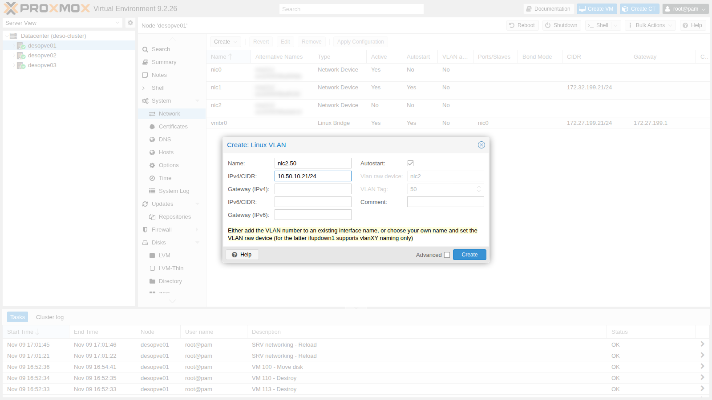

2. Ripeti per `nic2.51` con `10.51.10.21/24`, poi **Apply Configuration**.

   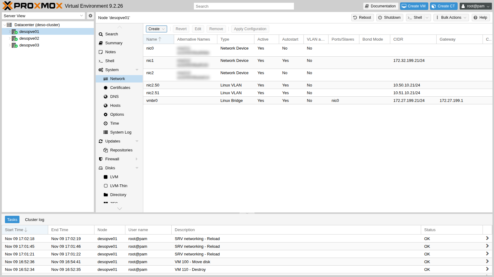

3. Sugli altri due nodi fai lo stesso da riga di comando, con l'API di Proxmox: il risultato è identico a quello della GUI.

   ```bash title="root@desopve02"
   pvesh create /nodes/desopve02/network --iface nic2.50 --type vlan --cidr 10.50.10.22/24 --autostart 1
   pvesh create /nodes/desopve02/network --iface nic2.51 --type vlan --cidr 10.51.10.22/24 --autostart 1
   pvesh set /nodes/desopve02/network
   ip -br a | grep nic2
   ```

   ```text output
   nic2             UP
   nic2.50@nic2     UP             10.50.10.22/24
   nic2.51@nic2     UP             10.51.10.22/24
   ```

   Su `desopve03` gli indirizzi sono `10.50.10.23/24` e `10.51.10.23/24`.

4. Verifica che i pacchetti con tag passino tra i nodi e che le VLAN siano isolate dal resto della rete:

   ```bash title="root@desopve01"
   ping -c2 -W1 10.50.10.22 | tail -2
   ```

   ```text output
   2 packets transmitted, 2 received, 0% packet loss, time 1002ms
   rtt min/avg/max/mdev = 0.658/0.992/1.326/0.334 ms
   ```

   ```bash title="root@desopve01"
   ping -c2 -W1 10.51.10.23 | tail -2
   ```

   ```text output
   2 packets transmitted, 2 received, 0% packet loss, time 1001ms
   rtt min/avg/max/mdev = 0.269/0.560/0.852/0.291 ms
   ```

   Le due VLAN non hanno gateway: il traffico di Ceph non esce mai dalla rete dedicata. Lo conferma una prova dal DC, che sta sulla rete di gestione e non raggiunge la VLAN 50, perché nessun router la instrada:

   ```powershell title="PowerShell — desopve-dc01"
   (Test-NetConnection 10.50.10.21 -WarningAction SilentlyContinue).PingSucceeded
   ```

   ```text output
   False
   ```

### 2. Installazione di Ceph con il wizard

1. Nodo **desopve01** → **Ceph**. Ceph non è installato e Proxmox propone **Install Ceph**.
2. Il wizard propone **tentacle (20.2)**, la versione predefinita in Proxmox VE 9.2. Come **Repository** scegli **No-Subscription**: il repository *Enterprise* richiede un abbonamento.

   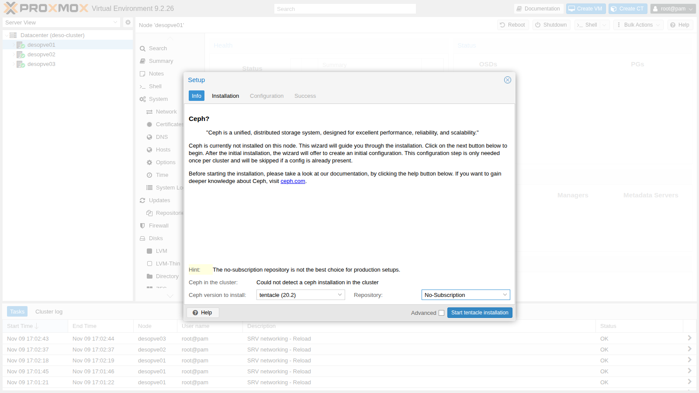

3. **Start tentacle installation**: si apre un terminale con `apt`. Controlla l'elenco dei pacchetti e conferma con **Y**.

   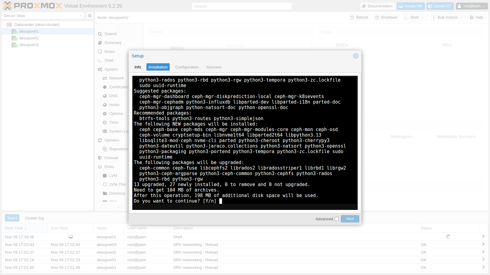

   L'installazione dura circa un minuto: i pacchetti arrivano da `download.proxmox.com` attraverso il proxy del laboratorio.

4. **Next** → **Configuration**: qui si crea la configurazione del cluster Ceph, una sola volta per tutto il cluster.
   - **Public Network IP/CIDR:** `10.50.10.21/24` (VLAN 50);
   - **Cluster Network IP/CIDR:** `10.51.10.21/24` (VLAN 51).
   - Repliche e repliche minime restano ai valori predefiniti 3 e 2 (sono nelle opzioni **Advanced**).

   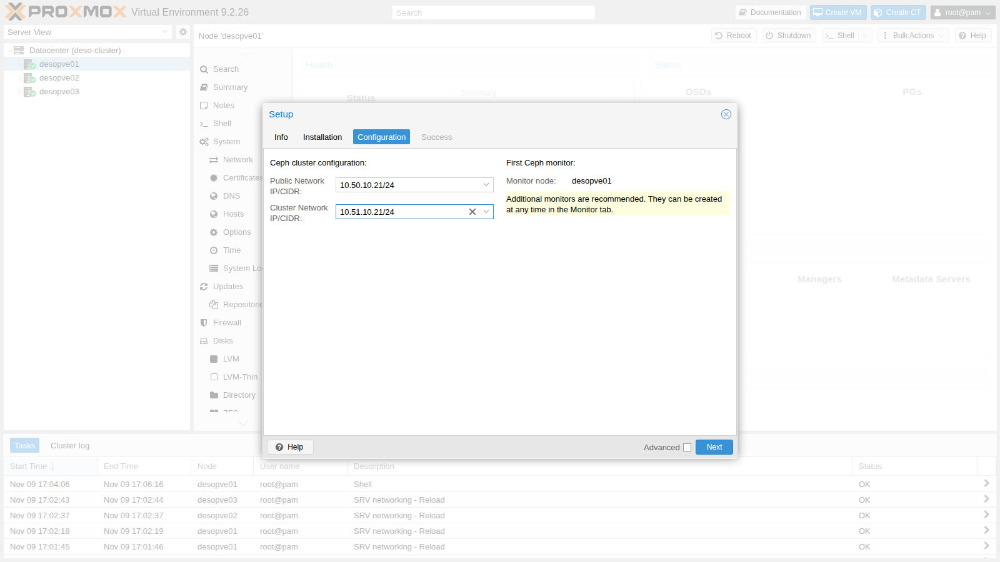

5. **Next**: Proxmox scrive `/etc/pve/ceph.conf`, crea il primo monitor e il primo manager su `desopve01`.

   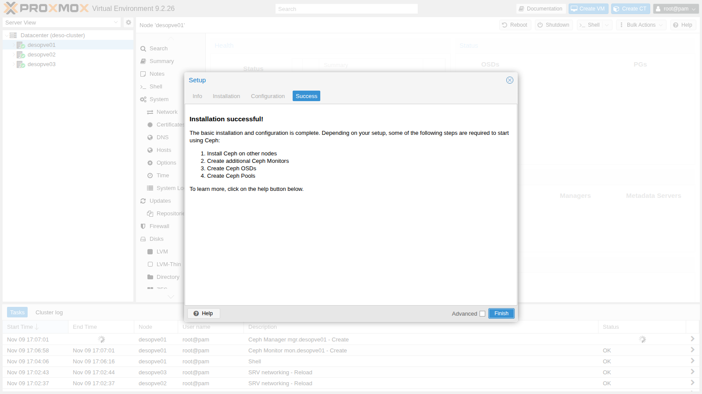

   ```bash title="root@desopve01"
   cat /etc/pve/ceph.conf
   ```

   ```text output
   [global]
   	auth_client_required = cephx
   	auth_cluster_required = cephx
   	auth_service_required = cephx
   	cluster_network = 10.51.10.21/24
   	fsid = cfd9bc4d-a092-487e-9c25-2a042c84bbbf
   	mon_allow_pool_delete = true
   	mon_host =  10.50.10.21
   	ms_bind_ipv4 = true
   	ms_bind_ipv6 = false
   	osd_pool_default_min_size = 2
   	osd_pool_default_size = 3
   	public_network = 10.50.10.21/24
   ...
   ```

   - Il file sta in `/etc/pve`, quindi è già uguale su tutti i nodi del cluster Proxmox.
   - Le reti sono scritte con l'indirizzo del nodo (`10.50.10.21/24`): Ceph usa solo la parte di rete, cioè 10.50.10.0/24, quindi funziona per tutti i nodi.

6. Sugli altri due nodi installa i pacchetti da riga di comando, confermando con **Y**:

   ```bash title="root@desopve02"
   pveceph install --repository no-subscription --version tentacle
   ```

   ```text output
   ...
   reloading API to load new Ceph RADOS library...
   ```

   ```bash title="root@desopve02"
   ceph --version
   ```

   ```text output
   ceph version 20.2.5 (18a25ea6153a998538b0b02f656cd62b4cadaca4) tentacle (stable)
   ```

   La configurazione non va ripetuta: i nodi leggono `ceph.conf` da `/etc/pve`.

### 3. Monitor e manager su tutti i nodi

1. **Ceph** → **Monitor** → **Create** (riquadro *Monitor*), **Host** `desopve02`. Poi **Create** nel riquadro *Manager*, sempre per `desopve02`.

   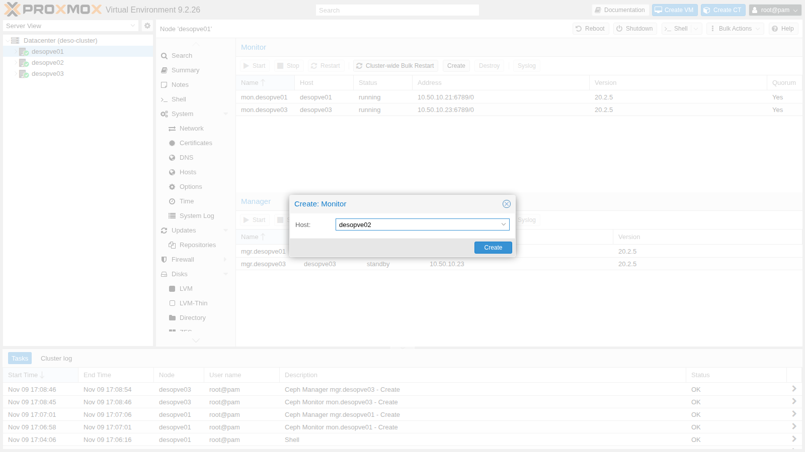

2. Per `desopve03` usa la riga di comando:

   ```bash title="root@desopve03"
   pveceph mon create
   ```

   ```text output
   monmaptool: writing epoch 1 to /tmp/monmap (2 monitors)
   ...
   ```

   ```bash title="root@desopve03"
   pveceph mgr create
   ```

   ```text output
   starting service 'ceph-mgr@desopve03.service'
   ```

3. Il risultato: tre monitor in quorum e tre manager, uno attivo e due in attesa.

   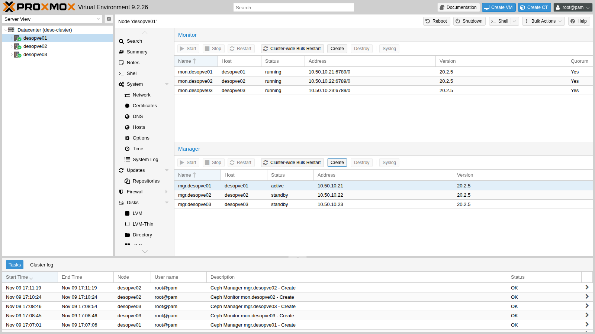

   ```bash title="root@desopve01"
   ceph mon stat
   ```

   ```text output
   e3: 3 mons at {desopve01=[v2:10.50.10.21:3300/0,v1:10.50.10.21:6789/0],desopve02=[v2:10.50.10.22:3300/0,v1:10.50.10.22:6789/0],desopve03=[v2:10.50.10.23:3300/0,v1:10.50.10.23:6789/0]} removed_ranks: {} disallowed_leaders: {}, election epoch 12, leader 0 desopve01, quorum 0,1,2 desopve01,desopve03,desopve02
   ```

   I monitor ascoltano sulla rete pubblica di Ceph (10.50.10.x), non sulla rete di gestione.

### 4. Gli OSD

1. Nodo **desopve01** → **Ceph** → **OSD** → **Create: OSD**. **Disk** `/dev/sdc`, **DB Disk** *use OSD disk*: database e journal di BlueStore stanno sullo stesso disco.

   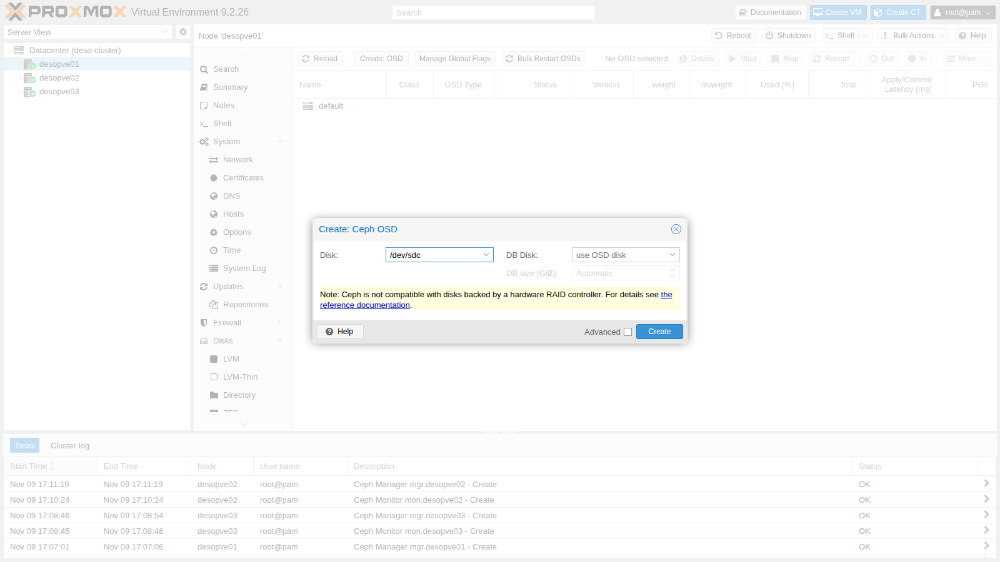

   In produzione, con dischi rotativi, si mette il DB su un SSD veloce (**DB Disk**); con dischi tutti SSD o NVMe non serve. La nota ricorda che Ceph vuole vedere i dischi direttamente: niente controller RAID hardware.

2. Gli altri cinque OSD da riga di comando, due per nodo:

   ```bash title="root@desopve01"
   pveceph osd create /dev/sdd
   ```

   ```text output
   ...
   --> ceph-volume lvm create successful for: /dev/sdd
   ```

   ```bash title="root@desopve02"
   pveceph osd create /dev/sdc
   pveceph osd create /dev/sdd
   ```

   ```bash title="root@desopve03"
   pveceph osd create /dev/sdc
   pveceph osd create /dev/sdd
   ```

   Ogni comando termina con la stessa riga `ceph-volume lvm create successful`.

   Ogni OSD è un volume LVM creato da `ceph-volume` sull'intero disco, con BlueStore come formato:

   ```bash title="root@desopve01"
   ceph-volume lvm list /dev/sdc | grep -E "osd id|objectstore|block device"
   ```

   ```text output
         block device              /dev/ceph-92836807-f4fd-4193-a256-dc9f557c2df7/osd-block-eff89a0e-fa94-462d-ad23-49e431295708
         objectstore               bluestore
         osd id                    0
   ```

3. L'albero degli OSD mostra la gerarchia che CRUSH usa: `root default` → tre host → due OSD ciascuno.

   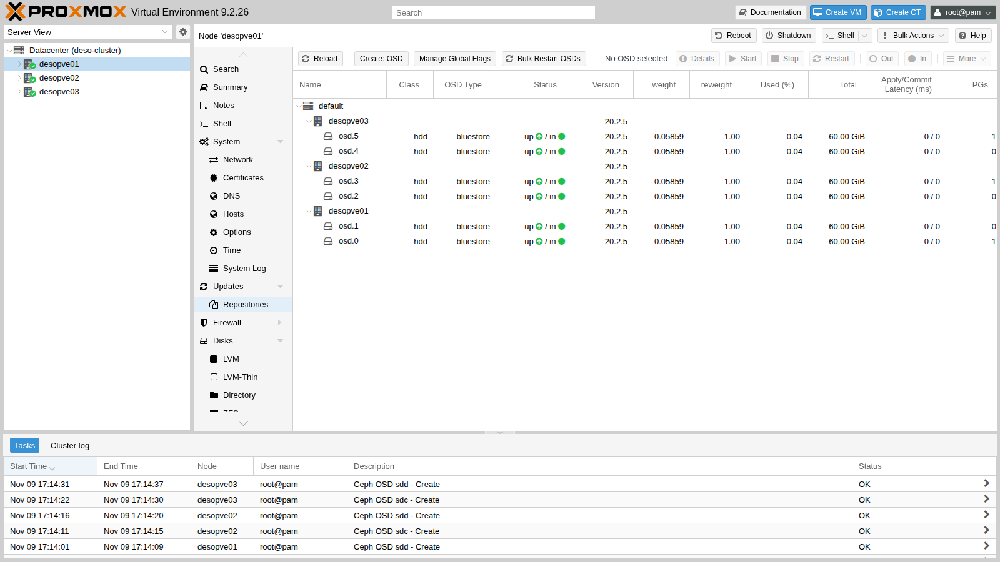

   ```bash title="root@desopve01"
   ceph osd tree
   ```

   ```text output
   ID  CLASS  WEIGHT   TYPE NAME           STATUS  REWEIGHT  PRI-AFF
   -1         0.35156  root default
   -3         0.11719      host desopve01
    0    hdd  0.05859          osd.0           up   1.00000  1.00000
    1    hdd  0.05859          osd.1           up   1.00000  1.00000
   -5         0.11719      host desopve02
    2    hdd  0.05859          osd.2           up   1.00000  1.00000
    3    hdd  0.05859          osd.3           up   1.00000  1.00000
   -7         0.11719      host desopve03
    4    hdd  0.05859          osd.4           up   1.00000  1.00000
    5    hdd  0.05859          osd.5           up   1.00000  1.00000
   ```

   - **WEIGHT** è la capacità in TiB (60 GiB = 0,0586 TiB): CRUSH distribuisce i dati in proporzione.
   - **CLASS** `hdd` è la *device class* rilevata in automatico. Nel lab 18 la usiamo per costruire regole CRUSH diverse.

### 5. Pool RBD e storage del cluster

1. **Ceph** → **Pools** → **Create**: **Name** `rbd-vm`, **Size** 3, **Min. Size** 2, **PG Autoscale Mode** `on`, **Add as Storage** spuntato.

   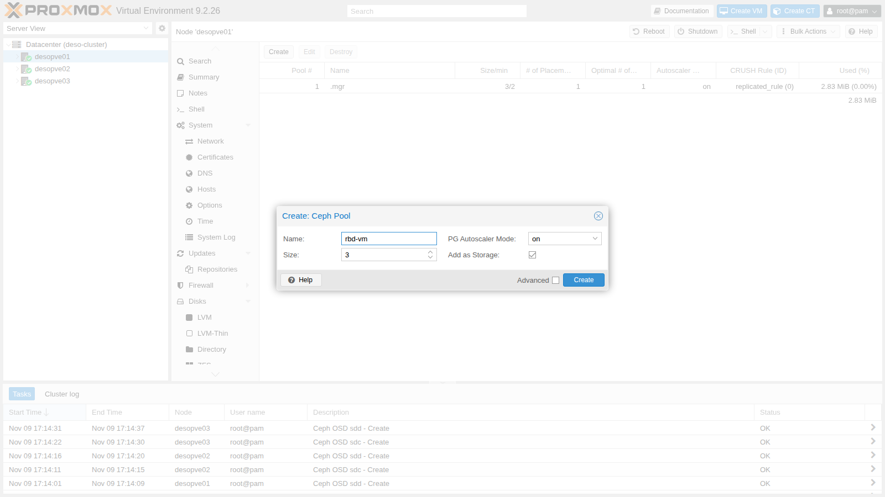

   **Add as Storage** crea anche lo storage `rbd-vm` di Proxmox, disponibile su tutti i nodi per dischi di VM e container:

   ```bash title="root@desopve01"
   grep -A3 "rbd: rbd-vm" /etc/pve/storage.cfg
   ```

   ```text output
   rbd: rbd-vm
   	content rootdir,images
   	krbd 0
   	pool rbd-vm
   ```

   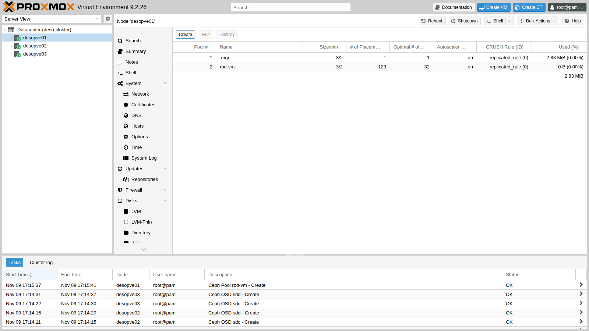

2. Il pool nasce con 128 PG; l'autoscaler, che vede un pool vuoto, li riduce subito a 32. Lo stato dell'autoscaler qui sotto è stato ripreso dopo il passo 6, quando il pool contiene già il disco della VM 100:

   ```bash title="root@desopve01"
   ceph osd pool autoscale-status
   ```

   ```text output
   POOL               SIZE  TARGET SIZE  RATE  RAW CAPACITY   RATIO  FINAL RATIO  TARGET RATIO  EFFECTIVE RATIO  BIAS  PG_NUM  NEW PG_NUM  AUTOSCALE  BULK
   .mgr             966.6k                3.0        359.9G  0.0000       0.0050                                  1.0       1              on         False
   rbd-vm            6561M                3.0        359.9G  0.0534       0.1600                                  1.0      32              on         False
   ...
   ```

   Il pool `.mgr` lo crea Ceph per i moduli del manager: non va toccato.

3. **Ceph** → **Configuration** mostra `ceph.conf` e la **CRUSH map**: la regola `replicated_rule` sceglie un OSD da ciascun host diverso (`chooseleaf_firstn` di tipo `host`).

   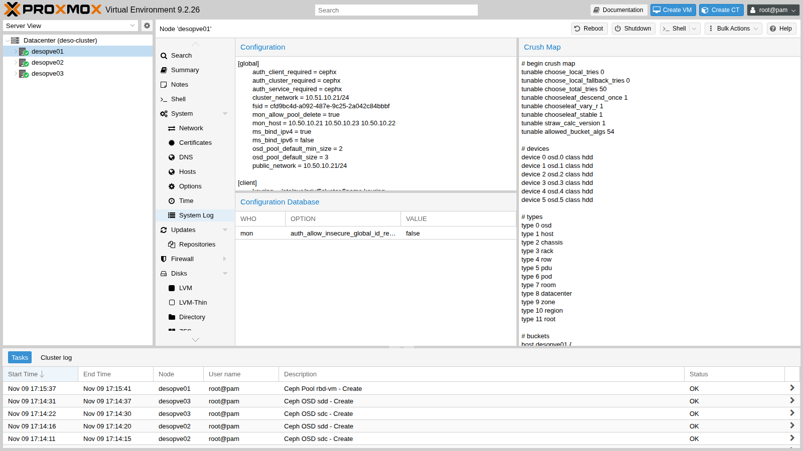

   ```bash title="root@desopve01"
   ceph osd crush rule dump replicated_rule | grep -A2 chooseleaf
   ```

   ```text output
               "op": "chooseleaf_firstn",
               "num": 0,
               "type": "host"
   ```

4. La pagina **Ceph** del nodo riassume lo stato: `HEALTH_OK`, 6 OSD *up* e *in*, tutti i PG `active+clean`, tre monitor e tre manager.

   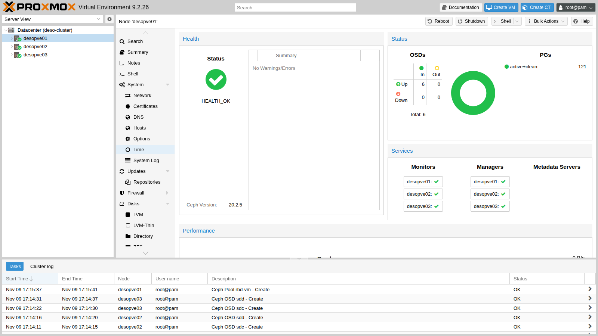

### 6. Una VM su Ceph e la migrazione senza copia del disco

1. Sposta a caldo il disco della VM 100 da `local-zfs` al pool RBD (come nel lab 08):

   ```bash title="root@desopve01"
   time qm disk move 100 scsi0 rbd-vm --delete 1
   ```

   ```text output
   mirror-scsi0: Completed successfully.
   mirror-scsi0: mirror-job finished
   removing source volume 'local-zfs:vm-100-disk-0' after successful copy

   real	3m55.737s
   ```

   ```bash title="root@desopve01"
   rbd -p rbd-vm ls -l
   ```

   ```text output
   NAME           SIZE    PARENT  FMT  PROT  LOCK
   vm-100-disk-0  16 GiB            2        excl
   ```

   ```bash title="root@desopve01"
   rbd info rbd-vm/vm-100-disk-0 | grep -E "size|order|features"
   ```

   ```text output
   	size 16 GiB in 4096 objects
   	order 22 (4 MiB objects)
   	features: layering, exclusive-lock, object-map, fast-diff, deep-flatten
   ```

   - Il disco è diventato un'immagine RBD di 4096 oggetti da 4 MiB, ognuno replicato tre volte.
   - `excl` indica il *lock esclusivo*: solo il nodo che fa girare la VM può scriverci.

2. Migra la VM a caldo su `desopve02`: **Migrate** → **Target node** `desopve02`. Il dialogo non chiede uno storage di destinazione: il disco è già condiviso.

   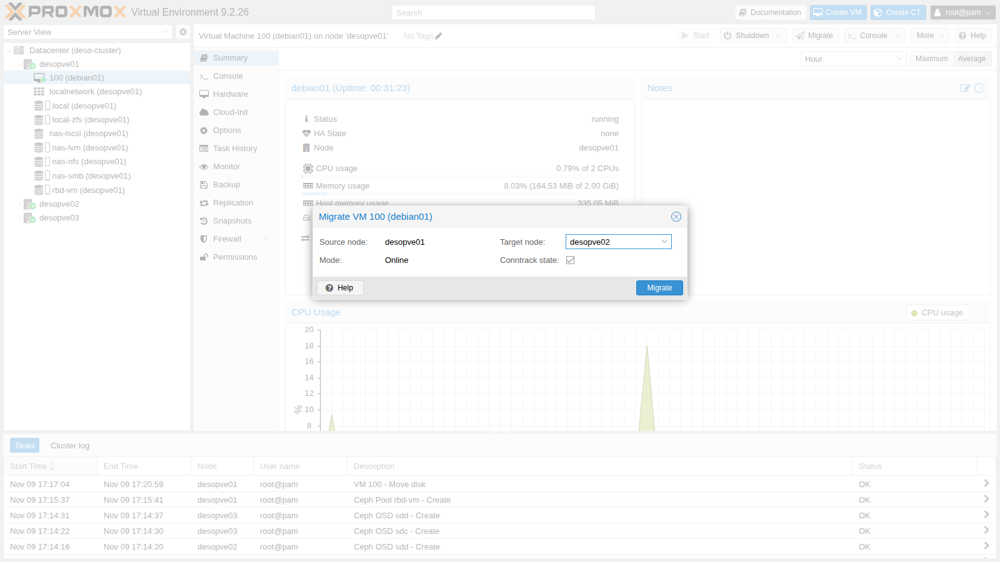

   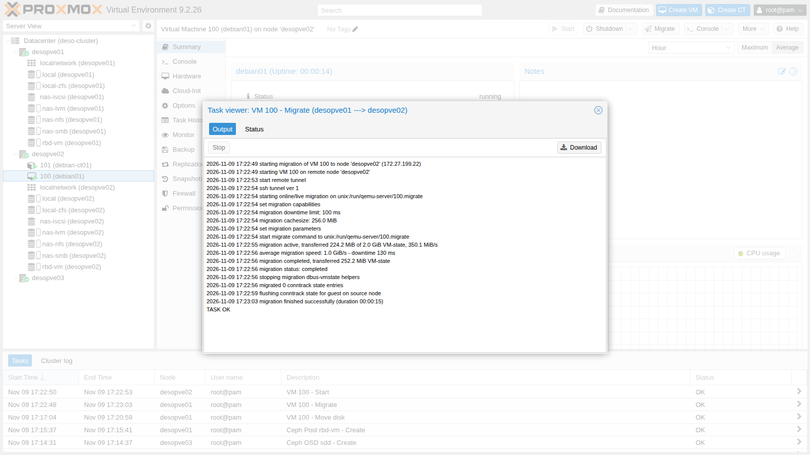

   ```text
   2026-11-09 17:22:54 migration downtime limit: 100 ms
   2026-11-09 17:22:56 average migration speed: 1.0 GiB/s - downtime 130 ms
   2026-11-09 17:23:03 migration finished successfully (duration 00:00:15)
   ```

   In 15 secondi passa solo la RAM della VM. Lo stesso disco da 16 GiB su storage locale richiederebbe minuti (lab 11).

3. Riporta la VM su `desopve01`:

   ```bash title="root@desopve02"
   qm migrate 100 desopve01 --online
   ```

   ```text output
   ...
   2026-11-09 17:25:55 migration finished successfully (duration 00:00:14)
   ```

### 7. CephFS per ISO, template e backup

RBD offre dischi a blocchi per VM e container. Per i **file** (ISO, template, backup) Ceph offre **CephFS**, un file system condiviso montato su tutti i nodi. CephFS ha bisogno di almeno un MDS.

1. Crea due metadata server, uno attivo e uno di riserva:

   ```bash title="root@desopve01"
   pveceph mds create
   ```

   ```text output
   starting service 'ceph-mds@desopve01.service'
   ```

   ```bash title="root@desopve02"
   pveceph mds create
   ```

   ```text output
   starting service 'ceph-mds@desopve02.service'
   ```

2. **Ceph** → **CephFS** → **Create CephFS**: **Name** `cephfs`, **Placement Groups** 128, **Add as Storage** spuntato.

   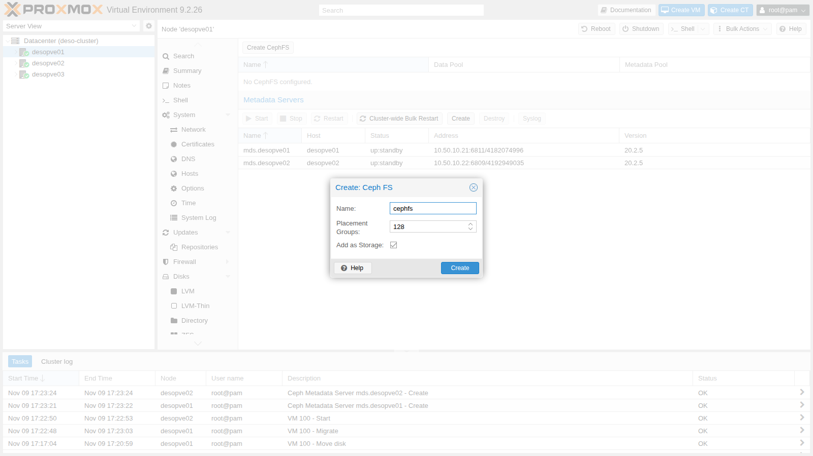

   Proxmox crea due pool, `cephfs_data` per i contenuti e `cephfs_metadata` per i metadati, e lo storage `cephfs` montato in `/mnt/pve/cephfs` su ogni nodo.

   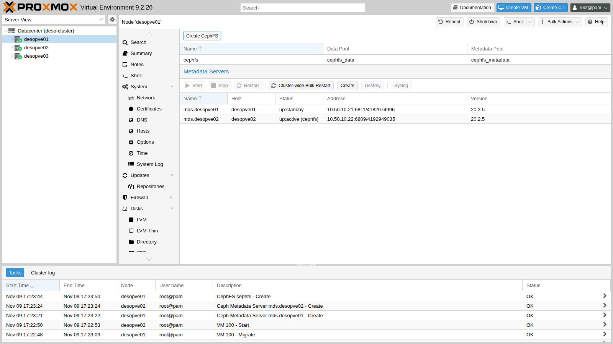

3. Verifica e prova a copiarci la ISO Debian:

   ```bash title="root@desopve01"
   ceph fs status
   ```

   ```text output
   cephfs - 3 clients
   ======
   RANK  STATE      MDS        ACTIVITY     DNS    INOS   DIRS   CAPS
    0    active  desopve02  Reqs:    0 /s    14     17     16     15
         POOL         TYPE     USED  AVAIL
   cephfs_metadata  metadata   174k   105G
     cephfs_data      data       0    105G
   STANDBY MDS
    desopve01
   ```

   ```bash title="root@desopve01"
   grep -A4 "cephfs: cephfs" /etc/pve/storage.cfg
   ```

   ```text output
   cephfs: cephfs
   	path /mnt/pve/cephfs
   	content iso,vztmpl,backup
   	fs-name cephfs
   ```

   ```bash title="root@desopve01"
   cp /mnt/pve/nas-smb/template/iso/debian-13.7.0-amd64-netinst.iso /mnt/pve/cephfs/template/iso/
   pvesm list cephfs
   ```

   ```text output
   Volid                                      Format  Type           Size VMID
   cephfs:iso/debian-13.7.0-amd64-netinst.iso iso     iso       792723456
   ```

   Ora la ISO è visibile da tutti e tre i nodi senza dipendere dal NAS.

## Verifica e test

1. **Stato generale:**

   ```bash title="root@desopve01"
   ceph -s
   ```

   ```text output
     cluster:
       id:     cfd9bc4d-a092-487e-9c25-2a042c84bbbf
       health: HEALTH_OK

     services:
       mon: 3 daemons, quorum desopve01,desopve03,desopve02 (age 15m) [leader: desopve01]
       mgr: desopve01(active, since 18m), standbys: desopve03, desopve02
       mds: 1/1 daemons up, 1 standby
       osd: 6 osds: 6 up (since 11m), 6 in (since 11m); 1 remapped pgs

     data:
       volumes: 1/1 healthy
       pools:   4 pools, 183 pgs
       objects: 1.71k objects, 6.5 GiB
       usage:   20 GiB used, 340 GiB / 360 GiB avail
       pgs:     183 active+clean
   ```

   La riga `1 remapped pgs`, come lo stato `active+remapped+backfilling` che può comparire per qualche minuto durante la creazione dei pool, indica che l'autoscaler sta cambiando il numero di PG e spostando i dati. È normale e si risolve da solo.

2. **Quanto spazio c'è davvero:**

   ```bash title="root@desopve01"
   ceph df
   ```

   ```text output
   --- RAW STORAGE ---
   CLASS     SIZE    AVAIL    USED  RAW USED  %RAW USED
   hdd    360 GiB  340 GiB  20 GiB    20 GiB       5.48
   TOTAL  360 GiB  340 GiB  20 GiB    20 GiB       5.48

   --- POOLS ---
   POOL             ID  PGS   STORED  OBJECTS     USED  %USED  MAX AVAIL
   .mgr              1    1  961 KiB        2  2.8 MiB      0    106 GiB
   rbd-vm            2   41  6.4 GiB    1.69k   19 GiB   5.71    106 GiB
   cephfs_data       3  108      0 B        1      0 B      0    106 GiB
   cephfs_metadata   4   32   52 KiB       22  243 KiB      0    106 GiB
   ```

   - **Raw:** 6 dischi × 60 GiB = 360 GiB.
   - **STORED** contro **USED:** il disco della VM contiene 6,4 GiB di dati, che con tre copie occupano 19 GiB.
   - **MAX AVAIL** 106 GiB: circa un terzo dello spazio libero (340 / 3 = 113 GiB), meno il margine che Ceph tiene per non riempire gli OSD (*full ratio*). Con la replica a 3 si usa un terzo della capacità grezza.

3. **Distribuzione sugli OSD:**

   ```bash title="root@desopve01"
   ceph osd df
   ```

   ```text output
   ID  CLASS  WEIGHT   REWEIGHT  SIZE     RAW USE  DATA     OMAP     META     AVAIL    %USE  VAR   PGS  STATUS
    0    hdd  0.05859   1.00000   60 GiB  2.5 GiB  2.5 GiB  289 KiB   61 MiB   57 GiB  4.19  0.77   94      up
    1    hdd  0.05859   1.00000   60 GiB  4.1 GiB  4.0 GiB  287 KiB   96 MiB   56 GiB  6.76  1.23   88      up
    2    hdd  0.05859   1.00000   60 GiB  2.6 GiB  2.5 GiB  184 KiB   61 MiB   57 GiB  4.30  0.79  100      up
    3    hdd  0.05859   1.00000   60 GiB  4.0 GiB  3.9 GiB  281 KiB   96 MiB   56 GiB  6.65  1.21   82      up
    4    hdd  0.05859   1.00000   60 GiB  3.4 GiB  3.3 GiB  280 KiB   96 MiB   57 GiB  5.61  1.02   86      up
    5    hdd  0.05859   1.00000   60 GiB  3.2 GiB  3.1 GiB  280 KiB   61 MiB   57 GiB  5.35  0.98   96      up
                          TOTAL  360 GiB   20 GiB   19 GiB  1.6 MiB  473 MiB  340 GiB  5.48
   ```

   Ogni host ha circa un terzo dei dati: è l'effetto della regola CRUSH per host.

4. **Migrazione:** la VM 100 si sposta tra i nodi in circa 15 secondi con 130 ms di interruzione, senza copiare il disco.

## Stato finale del lab

- **Rete:** su `desopve01-03` la scheda `nic2` porta due VLAN senza gateway: `nic2.50` (10.50.10.21-23/24, public network di Ceph) e `nic2.51` (10.51.10.21-23/24, cluster network).
- **Ceph Tentacle 20.2.5** su `desopve01-03`, `HEALTH_OK`:
  - 3 MON e 3 MGR (attivo su `desopve01`), 2 MDS (attivo su `desopve02`, standby su `desopve01`);
  - 6 OSD BlueStore su `/dev/sdc` e `/dev/sdd` di ogni nodo (`osd.0`-`osd.5`), classe `hdd`;
  - pool `rbd-vm` (replica 3/2, autoscaler attivo) e pool `cephfs_data`/`cephfs_metadata`.
- **Storage del cluster:** si aggiungono `rbd-vm` (RBD, dischi di VM e container) e `cephfs` (ISO, template, backup), che contiene la ISO Debian 13.7.
- **VM 100 `debian01`:** accesa su `desopve01`, con il disco su `rbd-vm:vm-100-disk-0`. Non è più su `local-zfs`.
- **CT 101:** invariato, acceso su `desopve02`.
- **`desopve04`:** invariato, fuori dal cluster.

## Cosa hai imparato

- Ceph unisce i dischi di più nodi: i MON tengono la mappa e il quorum, gli OSD scrivono e replicano i dati, i MGR raccolgono statistiche, gli MDS servono solo per CephFS.
- I dati di un pool sono divisi in PG e CRUSH li distribuisce tra gli host secondo una regola. Con la replica 3/2 si usa un terzo della capacità grezza.
- Il wizard di Proxmox installa Ceph e scrive `ceph.conf` in `/etc/pve`, così tutto il cluster lo condivide. Gli altri nodi ricevono solo i pacchetti.
- Le reti di Ceph vanno separate dalla gestione: con le VLAN basta una scheda.
- Con il disco su RBD, una VM migra in pochi secondi perché si sposta solo la RAM.
- CephFS offre a tutti i nodi uno spazio condiviso per ISO, template e backup, senza un NAS esterno.

## Riferimenti

- [Proxmox VE – Deploy Hyper-Converged Ceph Cluster](https://pve.proxmox.com/pve-docs/pve-admin-guide.html#chapter_pveceph)
- [Proxmox VE – `pveceph`](https://pve.proxmox.com/pve-docs/pveceph.1.html)
- [Proxmox VE – Storage RBD](https://pve.proxmox.com/pve-docs/pve-admin-guide.html#ceph_rados_block_devices) e [CephFS](https://pve.proxmox.com/pve-docs/pve-admin-guide.html#storage_cephfs)
- [Ceph – Architecture](https://docs.ceph.com/en/latest/architecture/)
- [Ceph – Placement groups e autoscaler](https://docs.ceph.com/en/latest/rados/operations/placement-groups/)
- [Ceph – CRUSH maps](https://docs.ceph.com/en/latest/rados/operations/crush-map/)
