## Dipendenze

- **Lab precedenti:** [Lab 17](/it/17-ceph-installation/) (Ceph su `desopve01-03`, pool `rbd-vm`, CephFS), [Lab 06](/it/06-cluster-corosync/) (cluster e Corosync con due link), [Lab 09](/it/09-lvm-and-lvm-thin/) (`local-lvm` e template su `desopve04`), [Lab 10](/it/10-zfs/) (pool `tank` su `desopve04`), [Lab 13](/it/13-nfs/) e [Lab 14](/it/14-smb-cifs/) (storage `nas-nfs` e `nas-smb`), [Lab 15](/it/15-iscsi-lvm-multipath/) (storage `nas-iscsi`/`nas-lvm` e i LUN `sde`/`sdf` sui nodi).
- **Hardware da aggiungere durante il lab:**
  - un disco nuovo da 60 GB per `desopve03`, da inserire a caldo in un vano hot-swap libero;
  - per `desopve04`, due dischi nuovi da 40 GB (vani hot-swap liberi) e una scheda di rete a una porta per la VLAN di Ceph, da montare a server spento (passo 4.2).
- **VM:** la VM 100 `debian01` su `rbd-vm`, accesa su `desopve01`. Durante i test scrive di continuo per misurare le pause di I/O.
- **`desopve04`:** nodo autonomo, **senza VM né container**, con gli storage `local-lvm` e `tank`.
- **Credenziali:** `root` / `<password-lab>` sui nodi, `labuser` / `<password-lab>` nella VM 100 → [Appendice B](/it/b-credentials-and-addresses/).

## Obiettivi

- Ceph cresciuto di un disco e poi di un nodo intero, con la nuova distribuzione dei dati letta in `ceph osd df tree` e lo spazio utile in `ceph df`.
- Un nodo riavviato per manutenzione con il flag `noout`, senza che Ceph ricostruisca copie altrove, sapendo in che ordine aggiornare i demoni.
- La protezione di un pool cambiata e ripristinata (replica 3 → 2 → 3), e un pool su una sola *device class* e uno in *erasure coding* creati, confrontati e rimossi.
- Le pause di I/O viste da una VM durante il guasto di un OSD, un riavvio programmato e uno spegnimento improvviso misurate e confrontate con i momenti in cui Ceph ha marcato gli OSD *down* o *out* nel suo log.
- Un nodo tolto da Ceph e dal cluster Proxmox **senza reinstallarlo**, con i suoi storage di nuovo funzionanti.

## Come funziona

### Stati degli OSD: *up/down* e *in/out*

Ogni OSD ha due stati indipendenti:

| Stato | Significato | Chi lo decide |
|---|---|---|
| **up / down** | il processo dell'OSD è vivo e risponde | gli altri OSD e i monitor, con gli *heartbeat* |
| **in / out** | l'OSD fa parte della distribuzione dei dati | l'amministratore, oppure i monitor dopo 600 s di *down* |

- Un OSD **down ma in** non riceve I/O. I PG che aveva diventano *degraded*: hanno una copia in meno, ma il pool resta scrivibile finché restano almeno `min_size` copie. Ceph **aspetta**: potrebbe essere solo un riavvio.
- Un OSD **out** non conta più: CRUSH ricalcola dove mettere i suoi PG e Ceph ricrea altrove le copie mancanti (*recovery* e *backfill*).
- Dopo `mon_osd_down_out_interval` (600 secondi) i monitor marcano *out* da soli un OSD *down*. Il flag **`noout`** lo impedisce: si usa in manutenzione, quando si sa che il nodo torna.

### Gli stati dei PG che vedrai

| Stato | Significato |
|---|---|
| `active+clean` | tutto a posto: tutte le copie, nei posti giusti |
| `peering` | gli OSD del PG si stanno mettendo d'accordo sullo stato. Per qualche secondo l'I/O su quel PG si ferma. |
| `undersized` / `degraded` | mancano copie: i dati ci sono, ma meno protetti |
| `remapped` + `backfill_wait` / `backfilling` | il PG deve spostarsi su altri OSD; la copia è in coda o in corso |

### Replica ed erasure coding

| Schema | Copie | Spazio utile | Guasti tollerati | Note |
|---|---|---|---|---|
| Replica `size 3`, `min_size 2` | 3 | 1/3 | 1 senza interruzioni, 2 senza perdita di dati | predefinito, il più usato per i dischi delle VM |
| Replica `size 2`, `min_size 2` | 2 | 1/2 | 0 senza interruzioni: un guasto blocca le scritture | da evitare |
| Replica `size 2`, `min_size 1` | 2 | 1/2 | 1, ma con rischio concreto di perdere dati | **mai** in produzione |
| Erasure coding `k=2`, `m=2` | 2 blocchi dati + 2 di parità | 1/2 | 1 senza interruzioni (`min_size` 3), 2 senza perdita di dati | serve almeno `k+m` = 4 host; più CPU e latenza in scrittura |

L'*erasure coding* è il "RAID 6 distribuito" di Ceph: divide ogni oggetto in `k` pezzi di dati e calcola `m` pezzi di parità, ognuno su un host diverso.

### Ambiente e versioni della prova

Gli output e le pause di questo lab vengono da una prova eseguita il 9 novembre 2026 (ultima verifica: novembre 2026), in questa configurazione:

| Componente | Configurazione della prova |
|---|---|
| Proxmox VE | 9.2.26, kernel `7.0.14-28-pve` ([Lab 04](/it/04-first-access-repositories-updates/)) |
| Ceph | 20.2.5 (tentacle), tre monitor su `desopve01-03`, reti public e cluster sulle VLAN 50 e 51, MTU 1500 ([Lab 17](/it/17-ceph-installation/)) |
| OSD | i sei del Lab 17 più `osd.6` del passo 1, sui dischi da 60 GB di `desopve01-03`; altri due sui dischi da 40 GB di `desopve04` tra il passo 4 e il passo 7; tutti di classe `hdd` |
| Pool `rbd-vm` | replicato, `size 3` / `min_size 2`, 32 PG, una copia per host |
| Timer di Ceph | valori predefiniti: `osd_heartbeat_grace` 20 s, `mon_osd_down_out_interval` 600 s (letto nel passo 2) |
| VM della prova | VM 100 `debian01`: Debian 13, 2 GiB di RAM, disco da 16 GiB su `rbd-vm`, accesa su `desopve01` |

**Cosa misura la sonda e cosa non misura.** Lo script della nota qui sotto misura quanto aspetta una scrittura della VM, `fsync` compreso. Ogni scrittura tocca solo una piccola parte del disco, quindi solo pochi dei 32 PG di `rbd-vm`: una pausa compare solo se sono coinvolti quei PG, e una serie senza pause non dimostra che tutto il disco abbia continuato a funzionare. Una pausa che inizia durante il secondo di attesa tra due scritture viene misurata più corta, fino a circa un secondo. Lo script scarta i messaggi di `dd`: eventuali errori di I/O comparirebbero nel log del kernel della VM (`journalctl -k`), non in `io.log`. Ogni evento è stato osservato una sola volta, su un laboratorio ridimensionato rispetto a un cluster di produzione ([Lab 17](/it/17-ceph-installation/)): i valori descrivono questa configurazione, non Ceph in generale.

## Procedura

:::note
Per tutto il lab, nella VM 100 gira uno script che ogni secondo scrive 16 MiB con `O_DIRECT` e `fsync` e registra quanto ci mette, accanto all'ora in cui la scrittura è finita. Una scrittura normale dura 25-45 ms: un valore molto più alto vuol dire che la scrittura ha dovuto aspettare, ed è quella che in questo lab chiamiamo una pausa di I/O vista dalla VM.

```bash title="labuser@debian01"
nohup bash -c 'while true; do s=$(date +%s%N)
  dd if=/dev/zero of=$HOME/io.bin bs=4M count=4 oflag=direct conv=fsync 2>/dev/null
  e=$(date +%s%N); echo "$(date +%T) $(( (e - s) / 1000000 )) ms"; sleep 1
done' > $HOME/io.log 2>&1 &
```

Lo script gira in background anche se chiudi la sessione SSH; alla fine del lab lo fermi e cancelli i suoi file (sezione *Pulizia*).
:::

### 1. Crescita: un disco nuovo in un nodo

1. Inserisci il disco da 60 GB in un vano hot-swap libero di `desopve03`. Se Linux non lo vede subito, forza una nuova scansione del bus:

   ```bash title="root@desopve03"
   for h in /sys/class/scsi_host/host*/scan; do echo "- - -" > $h; done
   lsblk -dno NAME,SIZE,TYPE,TRAN
   ```

   ```text output
   sda   50G disk
   sdb   50G disk
   sdc   60G disk
   sdd   60G disk
   sde   40G disk iscsi
   sdf   40G disk iscsi
   sdg   60G disk
   ```

   Attenzione ai nomi: `sde` e `sdf` sono i LUN iSCSI del lab 15, quindi il disco nuovo è `sdg`. Controlla sempre la taglia e il tipo prima di creare un OSD.

2. Nodo **desopve03** → **Ceph** → **OSD** → **Create: OSD**, **Disk** `/dev/sdg`. L'elenco propone solo i dischi liberi.

   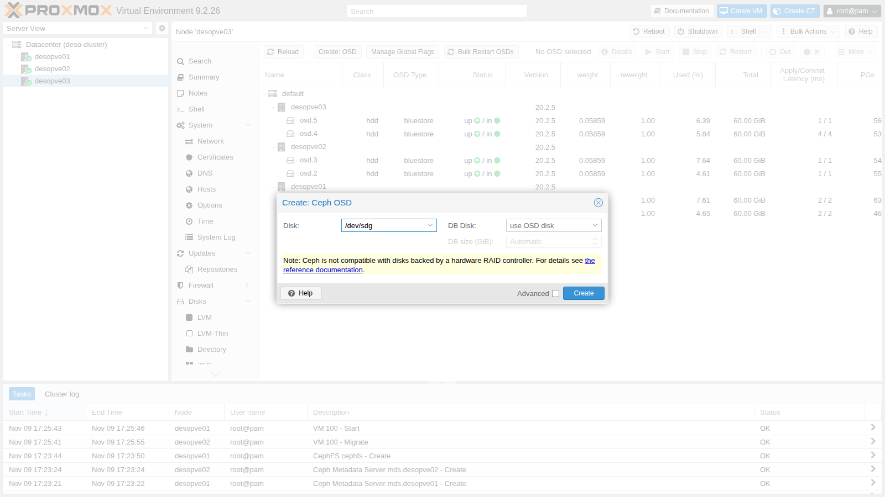

3. Osserva il ribilanciamento:

   ```bash title="root@desopve01"
   ceph -s
   ```

   ```text output
   ...
       osd: 7 osds: 7 up (since 104s), 7 in (since 109s)
   ...
     io:
       client:   3.4 MiB/s wr, 0 op/s rd, 0 op/s wr
       recovery: 8.2 MiB/s, 2 objects/s
   ```

   Questo stato è stato letto 109 secondi dopo l'ingresso del nuovo OSD (`7 in (since 109s)`), mentre Ceph stava ancora copiando dati verso di lui; la durata complessiva del ribilanciamento non è stata registrata (per misurarla, ripeti `ceph -s` finché nessun PG è più in spostamento). Alla fine una parte dei PG di `desopve03` sta sul nuovo `osd.6`:

   ```bash title="root@desopve01"
   ceph osd df tree
   ```

   ```text output
   ID  CLASS  WEIGHT   REWEIGHT  SIZE     RAW USE  DATA     ...  %USE  VAR   PGS  STATUS  TYPE NAME
   -1         0.41016         -  420 GiB   22 GiB   22 GiB  ...  5.27  1.00    -          root default
   -3         0.11719         -  120 GiB  7.4 GiB  7.2 GiB  ...  6.13  1.16    -              host desopve01
   ...
   -7         0.17578         -  180 GiB  7.4 GiB  7.2 GiB  ...  4.13  0.78    -              host desopve03
    4    hdd  0.05859   1.00000   60 GiB  2.4 GiB  2.3 GiB  ...  4.00  0.76   33      up          osd.4
    5    hdd  0.05859   1.00000   60 GiB  2.3 GiB  2.3 GiB  ...  3.90  0.74   32      up          osd.5
    6    hdd  0.05859   1.00000   60 GiB  2.7 GiB  2.6 GiB  ...  4.48  0.85   32      up          osd.6
   ```

   **Ogni host ha ancora 7,4 GiB**, cioè una copia completa: con tre host e replica 3, la regola CRUSH mette una copia per host, sempre. Il disco nuovo ha solo distribuito meglio i dati **dentro** `desopve03`. Per far crescere davvero lo spazio utile servono dischi su tutti gli host, oppure un quarto host (passo 4).

### 2. Guasto di un OSD

1. Ferma un OSD come se il disco si fosse rotto:

   ```bash title="root@desopve02"
   systemctl stop ceph-osd@2
   ```

   ```bash title="root@desopve01"
   ceph health detail | head -5
   ```

   ```text output
   HEALTH_WARN 1 osds down; Degraded data redundancy: 866/5694 objects degraded (15.209%), 38 pgs degraded
   [WRN] OSD_DOWN: 1 osds down
       osd.2 (root=default,host=desopve02) is down
   [WRN] PG_DEGRADED: Degraded data redundancy: 866/5694 objects degraded (15.209%), 38 pgs degraded
       pg 2.4 is active+undersized+degraded, acting [1,4]
   ```

   `acting [1,4]`: il PG 2.4 ora vive su due soli OSD invece di tre. È ancora **active**: con `min_size 2` le scritture continuano.

   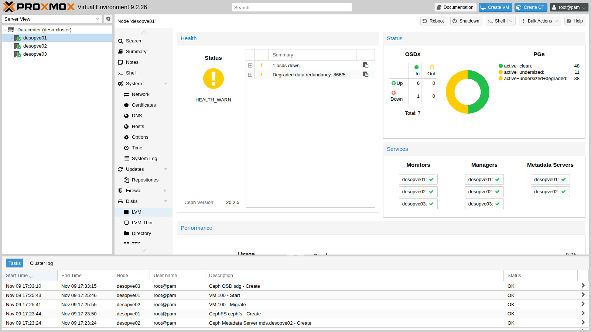

   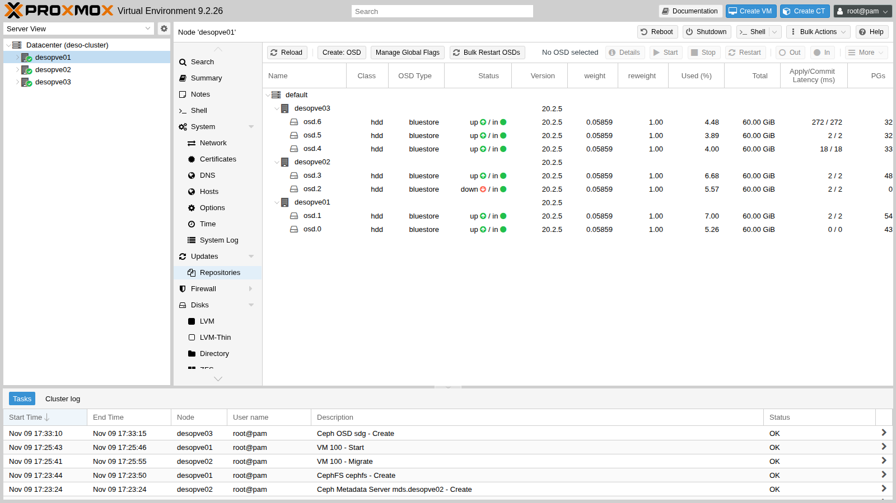

2. Ceph aspetta 600 secondi prima di ricostruire le copie:

   ```bash title="root@desopve01"
   ceph config get mon mon_osd_down_out_interval
   ```

   ```text output
   600
   ```

   Per non aspettare, marca tu l'OSD *out*. Ceph ricrea le copie mancanti: poiché la regola tiene una copia per host, quelle di `desopve02` possono andare solo su `osd.3`, l'altro OSD di quel nodo. 41 secondi dopo l'`out` (`6 in (since 41s)`) lo stato è già `HEALTH_OK`, con tutti i 97 PG `active+clean`: il recupero si è quindi concluso entro quel tempo:

   ```bash title="root@desopve01"
   ceph osd out 2
   ```

   ```text output
   marked out osd.2.
   ```

   ```bash title="root@desopve01"
   ceph -s
   ```

   ```text output
   ...
       health: HEALTH_OK
       osd: 7 osds: 6 up (since 89s), 6 in (since 41s)
       pgs:     97 active+clean
   ```

3. Il disco è stato "sostituito": riavvia l'OSD e rimettilo *in*. Ceph riporta i dati su `osd.2`:

   ```bash title="root@desopve02"
   systemctl start ceph-osd@2
   ```

   ```bash title="root@desopve01"
   ceph osd in 2
   ```

   ```text output
   marked in osd.2.
   ```

   ```bash title="root@desopve01"
   ceph -s
   ```

   ```text output
   ...
       pgs:     12.371% pgs not active
                330/5694 objects misplaced (5.796%)
                59 active+clean
                26 active+clean+remapped
                8  peering
                4  remapped+peering
   ```

   Il rientro dell'OSD cambia di nuovo la mappa: in questo momento 12 dei 97 PG (8 + 4, il 12,371% `not active`) sono in peering, e un PG non accetta scritture finché non torna attivo.

4. Cosa ha visto la VM:

   ```bash title="labuser@debian01"
   awk '$1>="17:36:30" && $1<="17:39:30"' io.log | sort -k2 -n | tail -4
   ```

   ```text output
   17:38:26 1715 ms
   17:38:18 1943 ms
   17:38:22 2051 ms
   17:37:56 4261 ms
   ```

   - **Misura:** nessun errore osservato; nei tre minuti della prova (17:36:30-17:39:30) la scrittura più lunga ha richiesto 4.261 ms e altre tre 1,7-2,1 s, contro i 25-45 ms abituali.
   - **Interpretazione:** ogni passo della prova (arresto, `out`, avvio, `in`) cambia la mappa degli OSD e fa rifare il peering ad alcuni PG, e durante il peering un PG non accetta scritture: le pause sono compatibili con il **peering**. La prova però non ha registrato l'ora di ogni comando, quindi non dice quale passo ha causato quale pausa, né se anche il traffico di recupero abbia rallentato le scritture. Quanto dura il peering dipende da hardware, rete e carico: questo lab non l'ha misurato su hardware più veloce.
   - **Verifica:** annota l'ora di ogni comando (`date; ceph osd out 2`), segui il log del cluster con `ceph -w` (o leggi `/var/log/ceph/ceph.log` su un nodo con un monitor) e confronta entrambi con `io.log`, i cui orari segnano la fine di ogni scrittura.

### 3. Manutenzione: flag `noout`, riavvio ordinato e aggiornamenti

Prima di riavviare un nodo, ad esempio per un aggiornamento del kernel, imposta `noout`: Ceph non ricostruirà le copie mancanti, perché il nodo sta per tornare.

1. **Ceph** → **OSD** → **Manage Global Flags** → spunta **noout** → **Apply**.

   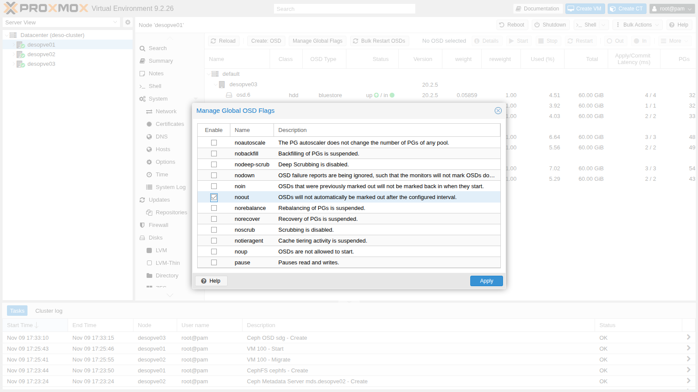

   ```bash title="root@desopve01"
   ceph osd dump | grep ^flags
   ```

   ```text output
   flags noout,sortbitwise,recovery_deletes,purged_snapdirs,pglog_hardlimit
   ```

2. Controlla se ci sono aggiornamenti di Ceph da installare insieme al riavvio:

   ```bash title="root@desopve02"
   apt update && apt list --upgradable 2>/dev/null | grep -ciE "ceph|rados|rbd"
   ```

   ```text output
   0
   ```

   Oggi non ce ne sono. Quando ci sono, la regola è aggiornare **un nodo alla volta**: `apt full-upgrade`, poi si riavviano i servizi in quest'ordine:

   1. monitor;
   2. manager;
   3. OSD;
   4. MDS.

   Si passa al nodo successivo solo con `HEALTH_OK`, a parte il flag `noout`. `ceph versions` mostra quale versione gira su ogni demone.

3. Riavvia `desopve02`. Il CT 101 sta su `local-zfs` di quel nodo: va spento prima, e riparte dopo (nel [Lab 48](/it/48-migrations/) vedrai come spostarlo). Durante il riavvio:

   ```bash title="root@desopve02"
   pct shutdown 101; reboot
   ```

   ```bash title="root@desopve01"
   ceph -s
   ```

   ```text output
     cluster:
       health: HEALTH_WARN
               1 filesystem is degraded
               insufficient standby MDS daemons available
               1/3 mons down, quorum desopve01,desopve03
               noout flag(s) set
               2 osds down
               1 host (2 osds) down
               Reduced data availability: 7 pgs inactive, 11 pgs peering
               Degraded data redundancy: 961/5694 objects degraded (16.877%), 45 pgs degraded
   ```

   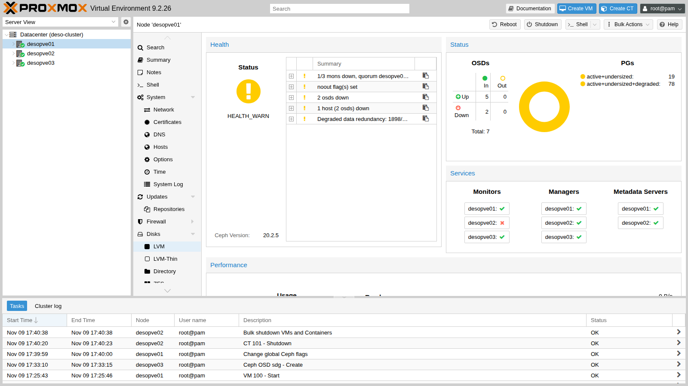

   - Il monitor di `desopve02` è fuori quorum: gli altri due bastano.
   - L'MDS attivo stava su `desopve02`: CephFS passa all'MDS di riserva su `desopve01`.
   - Gli OSD sono *down* ma restano *in*: nessuna copia viene spostata.

4. Il nodo torna in linea. In questo laboratorio ci ha messo circa 70 secondi, un'osservazione approssimativa che gli output non registrano; un server con un POST lungo può richiedere qualche minuto. Ceph recupera solo le scritture fatte nel frattempo, poi togli il flag:

   ```bash title="root@desopve01"
   ceph -s | grep -E "health|noout|pgs:"
   ```

   ```text output
       health: HEALTH_WARN
               noout flag(s) set
       pgs:     97 active+clean
   ```

   ```bash title="root@desopve01"
   ceph osd unset noout
   ```

   ```text output
   noout is unset
   ```

   ```bash title="root@desopve01"
   ceph fs status | grep -E "active|STANDBY" -A1 | head -4
   ```

   ```text output
    0    active  desopve01  Reqs:    0 /s    15     18     16     15
   --
   STANDBY MDS
    desopve02
   ```

   ```bash title="root@desopve02"
   pct start 101
   ```

   - **Misura:** nella VM la pausa più lunga è stata di **13,5 secondi**.
   - **Interpretazione:** durante un riavvio succedono più cose in sequenza, e ognuna può trattenere le scritture per un po': gli OSD di `desopve02` vanno *down* e poi tornano, i loro PG rifanno il peering entrambe le volte, il monitor di `desopve02` esce dal quorum e poi rientra. La prova non dice quale di questi eventi abbia prodotto i 13,5 secondi.
   - **Verifica:** confronta `io.log` con il log del cluster negli stessi minuti (`/var/log/ceph/ceph.log` su `desopve01`), che registra quando gli OSD sono andati *down* e sono tornati (`boot`), le elezioni dei monitor e, ogni pochi secondi, lo stato dei PG.

### 4. Crescita: un nuovo nodo nel cluster e in Ceph

`desopve04` è un nodo autonomo con il pool ZFS `tank` (lab 10). Entra nel cluster Proxmox e poi in Ceph.

1. **Prima di unirlo**, controlla che non abbia VM né container e salva la sua configurazione degli storage: il join la sostituisce con quella del cluster.

   ```bash title="root@desopve04"
   qm list; pct list
   cp /etc/pve/storage.cfg /root/storage.cfg.standalone
   ```

2. **Hardware.** Spegni `desopve04` (non ha guest), monta la scheda di rete a una porta, collega la porta allo switch (porta in trunk con le VLAN di Ceph) e inserisci i due dischi da 40 GB nei vani liberi; poi riaccendi il nodo. La nuova porta ha un nome "di sistema" (`ens<N>`, dove il numero dipende dallo slot PCI). Fissala come `nic2`, come sugli altri nodi (il pinning dei nomi è l'argomento del lab 20):

   ```bash title="root@desopve04"
   pve-network-interface-pinning generate --interface ens<N> --target-name nic2
   ```

   ```text output
   ...
   Successfully updated Proxmox VE configuration files.

   Please reboot to apply the changes to your configuration
   ```

   ```bash title="root@desopve04"
   reboot
   ```

3. Su `desopve01`: **Datacenter** → **Cluster** → **Join Information** → **Copy Information**.

   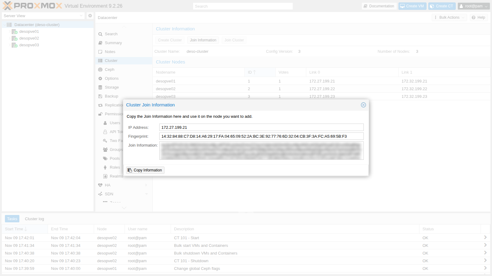

4. Su `desopve04`: **Datacenter** → **Cluster** → **Join Cluster**.
   - Incolla le informazioni e inserisci la password di `root` di `desopve01`.
   - Scegli i due link Corosync: **Link 0** `172.27.199.24`, **Link 1** `172.32.199.24`.

   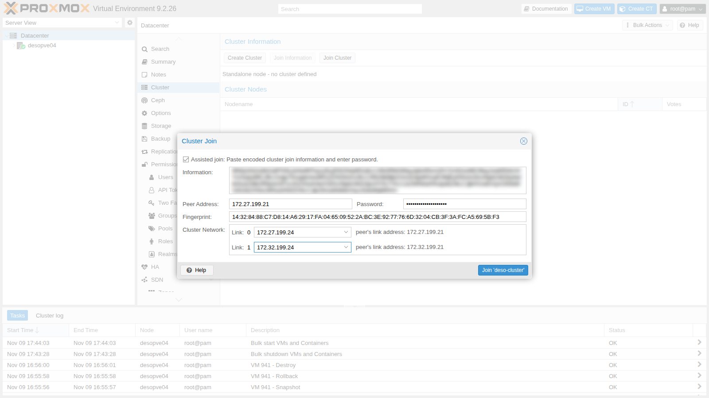

   ```bash title="root@desopve01"
   pvecm nodes
   ```

   ```text output
       Nodeid      Votes Name
            1          1 desopve01 (local)
            2          1 desopve02
            3          1 desopve03
            4          1 desopve04
   ```

   Con quattro voti il quorum è 3: il cluster tollera ancora un solo nodo spento, come con tre. Con un numero pari di nodi si aggiunge di solito un *QDevice* ([Lab 06](/it/06-cluster-corosync/)).

5. **Sistema gli storage.** Dopo il join, `desopve04` usa lo `storage.cfg` del cluster: vede storage che non ha e ha perso i suoi.

   ```bash title="root@desopve04"
   pvesm status
   ```

   ```text output
   could not activate storage 'local-zfs', zfs error: cannot import 'rpool': no such pool available
   command '/usr/bin/iscsiadm --mode node --targetname iqn.2005-10.org.freenas.ctl:pve --login' failed: exit code 21
   ...
   Name             Type     Status     Total (KiB)      Used (KiB) Available (KiB)        %
   cephfs         cephfs   inactive               0               0               0    0.00%
   local             dir     active        22203544         5789716        15260600   26.08%
   local-zfs     zfspool   inactive               0               0               0    0.00%
   nas-iscsi       iscsi   inactive               0               0               0    0.00%
   nas-lvm           lvm   inactive               0               0               0    0.00%
   nas-nfs           nfs     active        56489984               0        56489984    0.00%
   nas-smb          cifs     active        57466112          977024        56489088    1.70%
   rbd-vm            rbd   inactive               0               0               0    0.00%
   ```

   Limita ai nodi giusti gli storage locali e quelli iSCSI (l'initiator di `desopve04` non è autorizzato sul NAS), poi riaggiungi `local-lvm` e `tank` solo per `desopve04`. I dati di `tank` sono intatti: è cambiata solo la configurazione.

   ```bash title="root@desopve01"
   pvesm set local-zfs --nodes desopve01,desopve02,desopve03
   pvesm set nas-iscsi --nodes desopve01,desopve02,desopve03
   pvesm set nas-lvm --nodes desopve01,desopve02,desopve03
   pvesm add lvmthin local-lvm --vgname pve --thinpool data --content images,rootdir --nodes desopve04
   pvesm add zfspool tank --pool tank --mountpoint /tank --content images,rootdir --sparse 1 --nodes desopve04
   ```

6. **Ceph sul nuovo nodo:** pacchetti, VLAN 50/51 su `nic2` (come nel lab 17) e i due OSD.

   ```bash title="root@desopve04"
   pveceph install --repository no-subscription --version tentacle
   pvesh create /nodes/desopve04/network --iface nic2.50 --type vlan --cidr 10.50.10.24/24 --autostart 1
   pvesh create /nodes/desopve04/network --iface nic2.51 --type vlan --cidr 10.51.10.24/24 --autostart 1
   pvesh set /nodes/desopve04/network
   ceph -s
   ```

   ```text output
   Error initializing cluster client: ObjectNotFound('RADOS object not found (error calling conf_read_file)')
   ```

   Il client `ceph` cerca `/etc/ceph/ceph.conf`. In questo lab, dopo l'installazione dei pacchetti da riga di comando, il nuovo nodo non aveva ancora il collegamento alla configurazione comune; crearlo a mano ha risolto il problema:

   ```bash title="root@desopve04"
   ln -s /etc/pve/ceph.conf /etc/ceph/ceph.conf
   pveceph osd create /dev/sdf
   ```

   ```text output
   --> ceph-volume lvm create successful for: /dev/sdf
   ```

   ```bash title="root@desopve04"
   pveceph osd create /dev/sdg
   ```

   ```text output
   --> ceph-volume lvm create successful for: /dev/sdg
   ```

7. **Un monitor anche qui?** No. I monitor decidono a maggioranza:
   - con 3 monitor ne servono 2, quindi se ne perde 1;
   - con 4 ne servono 3, quindi se ne perde sempre 1, ma con più traffico;
   - si passa a 5 monitor solo in cluster più grandi.

   Il nuovo nodo porta solo dischi.

8. Ceph ribilancia i dati verso il quarto host. Quando il ribilanciamento sia finito gli output non lo registrano: in questo lab è stato circa un minuto e mezzo dopo l'ingresso degli OSD, un'osservazione approssimativa. Per misurarlo, segui `ceph -w` o ripeti `ceph pg stat` finché tutti i PG sono `active+clean`. Due istantanee dello stato, 3 e 64 secondi dopo l'ingresso dei nuovi OSD, lo mostrano in corso, con 32 PG rimappati all'inizio e 7 dopo 64 secondi:

   ```bash title="root@desopve04"
   ceph -s
   ```

   ```text output
       osd: 9 osds: 8 up (since 2s), 9 in (since 3s); 32 remapped pgs
       pgs:     ...
                10 active+remapped+backfill_wait
                9  remapped+peering
   ...
   ```

   ```bash title="root@desopve01"
   ceph -s
   ```

   ```text output
       osd: 9 osds: 9 up (since 57s), 9 in (since 64s); 7 remapped pgs
       recovery: 87 MiB/s, 22 objects/s
   ...
   ```

   ```bash title="root@desopve01"
   ceph osd df tree | grep host
   ```

   ```text output
   -3         0.11719         -  120 GiB  5.7 GiB  5.4 GiB  ...  4.75  1.06    -              host desopve01
   -5         0.11719         -  120 GiB  5.3 GiB  5.2 GiB  ...  4.45  0.99    -              host desopve02
   -7         0.17578         -  180 GiB  6.8 GiB  6.5 GiB  ...  3.77  0.84    -              host desopve03
   -9         0.07819         -   80 GiB  4.5 GiB  4.4 GiB  ...  5.68  1.27    -              host desopve04
   ```

   Ora le tre copie si distribuiscono su quattro host, e nessun host deve più contenere tutto. Lo spazio utile stimato del pool sale:

   ```bash title="root@desopve01"
   ceph df | grep -E "POOL|rbd-vm"
   ```

   ```text output
   POOL             ID  PGS   STORED  OBJECTS     USED  %USED  MAX AVAIL
   rbd-vm            2   32  6.4 GiB    1.69k   19 GiB   4.15    148 GiB
   ```

   Nel lab 17, con sei OSD su tre nodi, era 106 GiB. MAX AVAIL è una stima calcolata sull'OSD che si riempirebbe per primo: va letta come tendenza, non come garanzia.

### 5. Configurazione dei pool

#### Replica 3 → 2 e ritorno

1. **Ceph** → **Pools** → doppio clic su `rbd-vm`: **Size** 2, **Min. Size** 2.

   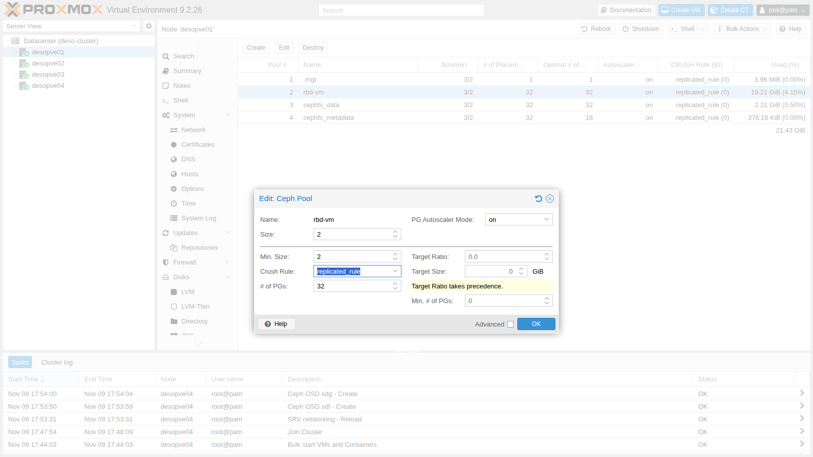

   Ceph cancella subito la terza copia: lo spazio usato scende e quello disponibile sale.

   ```bash title="root@desopve01"
   ceph df | grep -E "POOL|rbd-vm"
   ```

   ```text output
   POOL             ID  PGS   STORED  OBJECTS     USED  %USED  MAX AVAIL
   rbd-vm            2   32  6.4 GiB    1.69k   13 GiB   2.75    226 GiB
   ```

   Il prezzo è alto. Con `size 2` e `min_size 2`, un solo OSD guasto blocca le scritture sui suoi PG. Con `min_size 1` le scritture continuano su una copia sola, e se si perde anche quella i dati sono persi. Per questo in Proxmox VE si resta a **3/2**.

2. Torna alla replica 3:

   ```bash title="root@desopve01"
   pveceph pool set rbd-vm --size 3
   ```

   ```text output
   pool rbd-vm: applying size = 3
   ```

#### Device class e regole CRUSH

Ogni OSD ha una *classe* (`hdd`, `ssd`, `nvme`), rilevata in automatico. Le regole CRUSH possono usare solo una classe: è così che, in un cluster con dischi misti, si crea un pool "veloce" solo sugli SSD.

1. Nel laboratorio i dischi sono tutti uguali: simula un SSD per host cambiando la classe di un OSD per nodo, poi crea una regola che usa solo la classe `ssd`, sempre una copia per host:

   ```bash title="root@desopve01"
   for o in 1 3 5 7; do ceph osd crush rm-device-class osd.$o; ceph osd crush set-device-class ssd osd.$o; done
   ceph osd crush rule create-replicated fast default host ssd
   ceph osd crush rule ls
   ```

   ```text output
   replicated_rule
   fast
   ```

   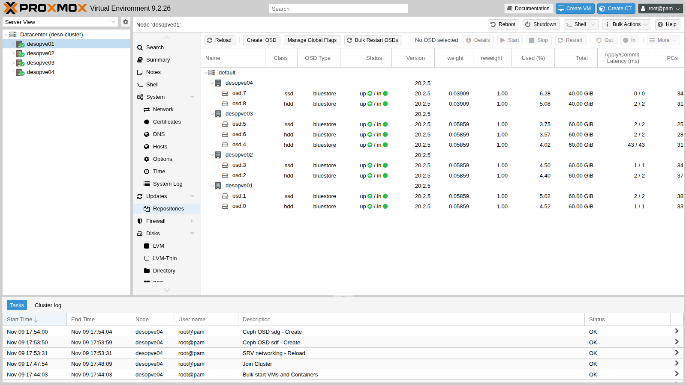

2. Crea un pool che usa la regola `fast`: si sceglie in **Create** → **Crush Rule**, oppure da riga di comando.

   ```bash title="root@desopve01"
   pveceph pool create rbd-fast --crush_rule fast --pg_autoscale_mode on
   ceph pg ls-by-pool rbd-fast -f json | python3 -c 'import sys,json; d=json.load(sys.stdin); d=d.get("pg_stats", d) if isinstance(d, dict) else d; s=set(); [s.update(p["acting"]) for p in d]; print("OSD usati da rbd-fast:", sorted(s))'
   ```

   ```text output
   OSD usati da rbd-fast: [1, 3, 5, 7]
   ```

   ```bash title="root@desopve01"
   ceph osd crush rule dump fast | grep -E 'item_name|type"'
   ```

   ```text output
       "type": 1,
               "item_name": "default~ssd"
               "type": "host"
   ```

   `default~ssd` è l'albero "ombra" che CRUSH costruisce per ogni classe. Il pool `rbd-vm` usa ancora `replicated_rule`, senza classe: cambiare la classe degli OSD non ha spostato i suoi dati.

#### Erasure coding

1. Con quattro host si può creare un pool EC `k=2,m=2`. Proxmox crea due pool:
   - `ec22-data`, in erasure coding, per i dati;
   - `ec22-metadata`, replicato, per i metadati RBD che non possono stare in EC.

   Crea anche lo storage `ec22`:

   ```bash title="root@desopve01"
   pveceph pool create ec22 --erasure-coding k=2,m=2 --add_storages 1
   ceph osd erasure-code-profile get pve_ec_ec22
   ```

   ```text output
   crush-device-class=
   crush-failure-domain=host
   ...
   k=2
   m=2
   plugin=isa
   technique=reed_sol_van
   ```

   ```bash title="root@desopve01"
   grep -A5 "rbd: ec22" /etc/pve/storage.cfg
   ```

   ```text output
   rbd: ec22
   	content images,rootdir
   	data-pool ec22-data
   	krbd 0
   	pool ec22-metadata
   ```

2. Scrivi 1 GiB nel pool EC e 1 GiB nel pool replicato `rbd-fast`, e confronta lo spazio occupato:

   ```bash title="root@desopve01"
   rbd create ec22-metadata/bench --size 2G --data-pool ec22-data
   rbd create rbd-fast/bench --size 2G
   rbd bench --io-type write --io-size 4M --io-total 1G --io-pattern seq ec22-metadata/bench
   ```

   ```text output
   elapsed: 3   ops: 256   ops/sec: 76.5535   bytes/sec: 306 MiB/s
   ```

   ```bash title="root@desopve01"
   rbd bench --io-type write --io-size 4M --io-total 1G --io-pattern seq rbd-fast/bench
   ```

   ```text output
   elapsed: 4   ops: 256   ops/sec: 63.8073   bytes/sec: 255 MiB/s
   ```

   ```bash title="root@desopve01"
   ceph df | sed -n "/POOLS/,\$p"
   ```

   ```text output
   --- POOLS ---
   POOL             ID  PGS    STORED  OBJECTS     USED  %USED  MAX AVAIL
   .mgr              1    1   1.3 MiB        2  4.0 MiB      0    144 GiB
   rbd-vm            2   32   6.4 GiB    1.69k   19 GiB   4.25    144 GiB
   cephfs_data       3   32   756 MiB      189  2.2 GiB   0.51    144 GiB
   cephfs_metadata   4   32    98 KiB       22  379 KiB      0    144 GiB
   rbd-fast          5  127  1007 MiB      259  2.9 GiB   1.53     63 GiB
   ec22-data         6  128   1.0 GiB      257  2.0 GiB   0.46    216 GiB
   ec22-metadata     7   32     969 B        4   26 KiB      0    144 GiB
   ```

   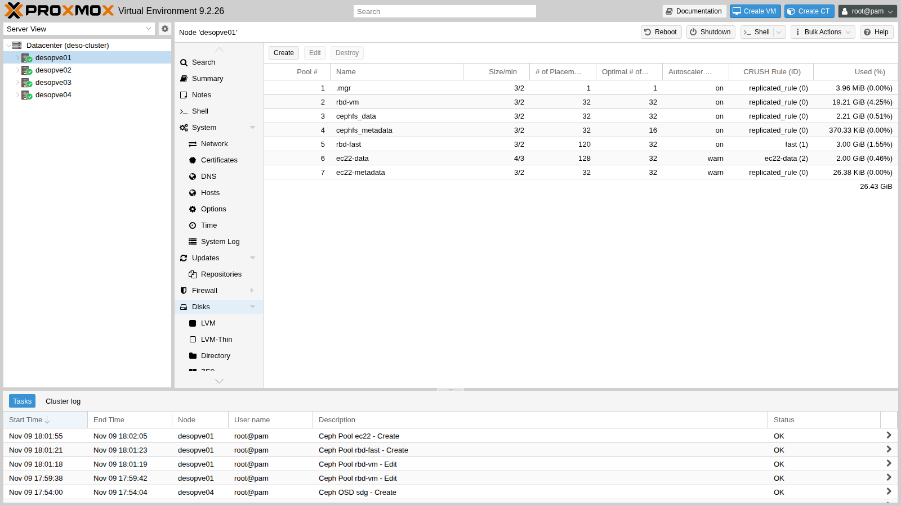

   - **EC 2+2:** 1 GiB scritto ne occupa 2: l'efficienza è del 50%, e tollera due guasti.
   - **Replica 3:** 1 GiB ne occupa 3 (2,9 nell'output): l'efficienza è del 33%.
   - **`rbd-fast`** ha solo 63 GiB disponibili: usa soltanto i quattro OSD di classe `ssd`.

   I due `rbd bench` servono a riempire i pool: una sola esecuzione da 1 GiB per pool non è un confronto di prestazioni tra replica ed erasure coding. Il metodo per farlo è descritto nel [Lab 19](/it/19-fio-benchmark/).

#### L'autoscaler dei PG

```bash title="root@desopve01"
ceph osd pool autoscale-status
```

```text output
POOL               SIZE  TARGET SIZE  RATE  RAW CAPACITY   RATIO  FINAL RATIO  TARGET RATIO  EFFECTIVE RATIO  BIAS  PG_NUM  NEW PG_NUM  AUTOSCALE  BULK
...
ec22-data         1024M                2.0        499.9G  0.0040       0.1829                                  1.0     128          32  warn       False
rbd-fast          1026M                3.0        219.9G  0.0137       0.4800                                  1.0      32              on         False
```

- **RATE** è il moltiplicatore dello spazio: 3,0 per la replica 3, 2,0 per EC 2+2.
- Proxmox crea i pool EC con l'autoscaler in modalità **`warn`**: suggerisce 32 PG (**NEW PG_NUM**) ma non li cambia, e lo segnala con l'avviso `POOL_TOO_MANY_PGS`. Con **`on`** l'autoscaler agisce da solo, come per `rbd-vm`.
- Se sai già che un pool crescerà, impostane la dimensione prevista (`target_size_ratio` o `target_size`, nelle opzioni avanzate del pool): l'autoscaler prepara subito il numero di PG giusto e si evitano ribilanciamenti più avanti.

Alla fine, rimuovi i pool e la regola di prova e riporta gli OSD alla classe `hdd`:

```bash title="root@desopve01"
rbd rm rbd-fast/bench; rbd rm ec22-metadata/bench
pveceph pool destroy rbd-fast
pveceph pool destroy ec22-data --remove_storages 1
pveceph pool destroy ec22-metadata
ceph osd crush rule rm fast
for o in 1 3 5 7; do ceph osd crush rm-device-class osd.$o; ceph osd crush set-device-class hdd osd.$o; done
```

### 6. Guasto: un nodo si spegne di colpo

1. Simula un'interruzione di corrente su `desopve03` (monitor, manager di riserva, tre OSD) con la VM 100 che scrive su `desopve01`:

   ```bash title="root@desopve03"
   echo 1 > /proc/sys/kernel/sysrq; echo o > /proc/sysrq-trigger
   ```

2. All'inizio Ceph non si accorge di nulla. Secondo la documentazione, gli altri OSD segnalano un OSD come guasto dopo 20 secondi senza risposta ai loro *heartbeat* (`osd_heartbeat_grace`), e i monitor lo marcano *down* quando lo hanno segnalato OSD di due host diversi.

   ```bash title="root@desopve01"
   ceph -s          # 13 secondi dopo
   ```

   ```text output
       health: HEALTH_WARN
               1/3 mons down, quorum desopve01,desopve02
       osd: 9 osds: 9 up (since 10m), 9 in (since 10m)
   ```

   ```bash title="root@desopve01"
   ceph -s          # 38 secondi dopo
   ```

   ```text output
       health: HEALTH_WARN
               1/3 mons down, quorum desopve01,desopve02
               3 osds down
               1 host (3 osds) down
               Degraded data redundancy: 1710/5694 objects degraded (30.032%), 70 pgs degraded
       osd: 9 osds: 6 up (since 12s), 9 in (since 10m)
   ```

   ```bash title="root@desopve01"
   pvecm status | grep -E "Quorate|Total votes"
   ```

   ```text output
   Quorate:          Yes
   Total votes:      3
   ```

   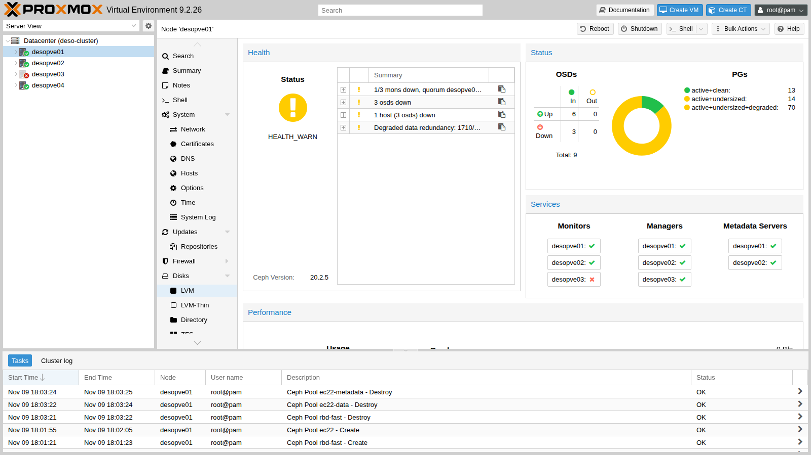

   Nella VM, la scrittura più lunga:

   ```bash title="labuser@debian01"
   sort -k2 -n io.log | tail -1
   ```

   ```text output
   18:04:48 26833 ms
   ```

   - **Misura:** 13 secondi dopo lo spegnimento tutti e nove gli OSD erano ancora `up`; 38 secondi dopo, tre erano `down` da 12 secondi, quindi i monitor li avevano marcati *down* circa 26 secondi dopo lo spegnimento. Nella VM una scrittura ha aspettato **26,8 secondi**, ed è terminata alle 18:04:48.
   - **Interpretazione:** una scrittura su un PG che ha l'OSD primario sul nodo perso aspetta che quell'OSD venga marcato *down* e che il PG rifaccia il peering con un nuovo primario; poi l'I/O riprende sulle copie rimaste. Due registrazioni sono coerenti con questa spiegazione: la scrittura lunga è terminata alle 18:04:48, e il log dei monitor riportato nel passo successivo dice che alle 18:14:52 gli OSD erano *down* da 604 secondi, cioè dalle 18:04:48 circa. La coincidenza presuppone che gli orologi della VM e dei nodi siano allineati, come dovrebbe garantire l'NTP. I secondi oltre il periodo di grazia di 20 secondi sono compatibili con l'intervallo degli heartbeat (meno di 6 secondi secondo la documentazione) e con la raccolta delle segnalazioni di guasto; la prova non li scompone.
   - **Verifica:** il log del cluster registra quando ogni OSD è stato segnalato come guasto, dopo quanti secondi e con quale periodo di grazia (`grep -E "osd\.[4-6] failed" /var/log/ceph/ceph.log` su un nodo con un monitor); `ceph config get osd osd_heartbeat_grace` mostra il valore in uso.

3. Dopo 600 secondi i monitor marcano *out* gli OSD e Ceph ricostruisce le copie sugli altri tre host: con quattro host c'è dove metterle.

   ```bash title="root@desopve01"
   grep "Marking osd" /var/log/ceph/ceph.log
   ```

   ```text output
   2026-11-09T18:14:52.615748+0100 mon.desopve01 (mon.0) 4032 : cluster [INF] Marking osd.4 out (has been down for 604 seconds)
   2026-11-09T18:14:52.615827+0100 mon.desopve01 (mon.0) 4033 : cluster [INF] Marking osd.5 out (has been down for 604 seconds)
   2026-11-09T18:14:52.615849+0100 mon.desopve01 (mon.0) 4034 : cluster [INF] Marking osd.6 out (has been down for 604 seconds)
   ```

   ```bash title="root@desopve01"
   ceph -s          # 11 secondi dopo
   ```

   ```text output
   ...
       recovery: 181 MiB/s, 0 keys/s, 48 objects/s
   ...
   ```

   ```bash title="root@desopve01"
   ceph -s          # 52 secondi dopo
   ```

   ```text output
       osd: 9 osds: 6 up (since 10m), 6 in (since 52s); 2 remapped pgs
       pgs:     1.031% pgs not active
                82/5694 objects degraded (1.440%)
                94 active+clean
   ```

   52 secondi dopo l'`out` il recupero non era ancora finito: l'1,44% degli oggetti era ancora degradato e un PG su 97 (1,031%) non era attivo. Il lab non ha registrato quanto sia durato il recupero completo, né come si siano comportate nel frattempo le scritture della VM. Per vederlo leggi `io.log` nei minuti dopo le 18:14:52 e segui `ceph -s` fino a `HEALTH_OK`.

4. Riaccendi il nodo. Gli OSD tornano *up* e i monitor li rimettono *in* da soli, perché erano stati marcati *out* in automatico:

   ```bash title="root@desopve01"
   ceph -s
   ```

   ```text output
       health: HEALTH_WARN
               clock skew detected on mon.desopve03
       osd: 9 osds: 9 up (since 13s), 9 in (since 13s)
   ...
   ```

   ```bash title="root@desopve01"
   ceph -s          # 20 secondi dopo
   ```

   ```text output
       health: HEALTH_OK
   ```

   - L'avviso `clock skew` dura qualche secondo: dopo un'accensione l'orologio del nodo si allinea all'NTP. Ceph è molto sensibile all'ora, e per questo NTP è tra i prerequisiti (lab 04).
   - Nel log compaiono anche avvisi `OSD bench result ... is not within the threshold`. All'avvio ogni OSD misura il proprio disco. Se la misura è fuori dalle soglie previste per la classe del disco (per esempio un disco classificato `hdd` che risponde come un SSD perché sta dietro la cache di un controller), Ceph la scarta e usa il valore predefinito. L'avviso stesso riporta il valore misurato e la soglia; questo lab non ha indagato quale caso valesse per i suoi dischi. In produzione si misura la capacità con fio e la si imposta con `osd_mclock_max_capacity_iops_hdd`/`_ssd`.
   - Con dischi lenti sotto carico può comparire anche l'avviso `BLUESTORE_SLOW_OP_ALERT`, che di default resta visibile 24 ore dopo l'ultimo episodio. Se vuoi che sparisca prima, riduci il tempo a 10 minuti:

     ```bash title="root@desopve01"
     ceph config set osd bluestore_slow_ops_warn_lifetime 600
     ```

### 7. Dismettere un nodo senza reinstallarlo

Ora `desopve04` esce da Ceph e dal cluster, e torna un nodo autonomo con i suoi storage. Servirà così nel [Lab 48](/it/48-migrations/), per la migrazione tra cluster.

1. **Svuota gli OSD.** Marcali *out* e aspetta che Ceph abbia spostato tutto:

   ```bash title="root@desopve01"
   ceph osd out 7 8
   ```

   ```text output
   marked out osd.7. marked out osd.8.
   ```

   ```bash title="root@desopve01"
   ceph osd safe-to-destroy 7 8
   ```

   ```text output
   OSD(s) 7,8 are safe to destroy without reducing data durability.
   ```

   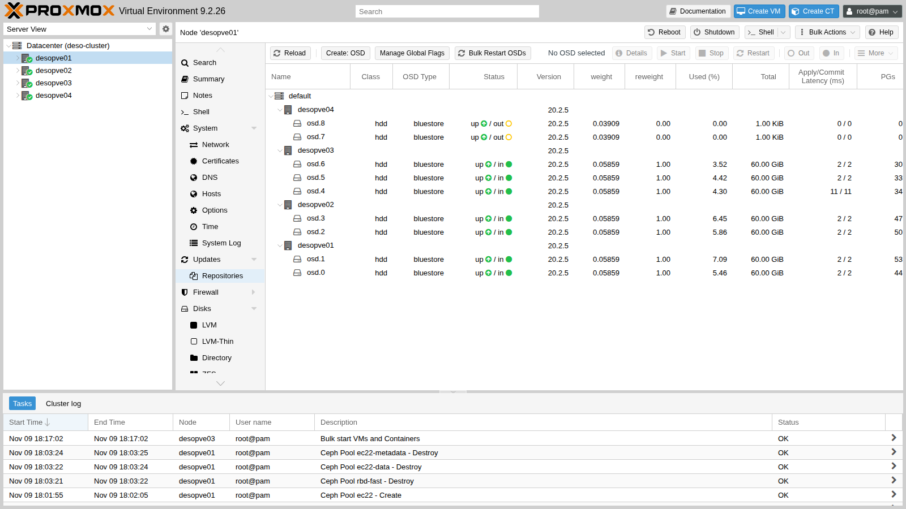

   Non usare mai `destroy` su un OSD che contiene ancora dati: `safe-to-destroy` lo verifica.

2. **Distruggi gli OSD** e togli l'host dalla mappa CRUSH:

   ```bash title="root@desopve04"
   systemctl stop ceph-osd@7 ceph-osd@8
   pveceph osd destroy 7 --cleanup 1
   ```

   ```text output
    stdout: Labels on physical volume "/dev/sdf" successfully wiped.
   ```

   ```bash title="root@desopve04"
   pveceph osd destroy 8 --cleanup 1
   ```

   ```text output
    stdout: Labels on physical volume "/dev/sdg" successfully wiped.
   ```

   ```bash title="root@desopve01"
   ceph osd crush remove desopve04
   ```

   ```text output
   removed item id -9 name 'desopve04' from crush map
   ```

   Il nodo non aveva monitor, manager o MDS. Se li avesse, andrebbero rimossi prima (**Ceph** → **Monitor** → **Destroy**), lasciando sempre un numero dispari di monitor.

3. **Togli le VLAN di Ceph** da `desopve04`:

   ```bash title="root@desopve04"
   pvesh delete /nodes/desopve04/network/nic2.50
   pvesh delete /nodes/desopve04/network/nic2.51
   pvesh set /nodes/desopve04/network
   ```

4. **Separa il nodo dal cluster**, con la procedura ufficiale *Separate a Node Without Reinstalling*. Su `desopve04`:

   ```bash title="root@desopve04"
   systemctl stop pve-cluster corosync
   pmxcfs -l
   ```

   ```text output
   [main] notice: forcing local mode (although corosync.conf exists)
   ```

   ```bash title="root@desopve04"
   rm /etc/pve/corosync.conf
   rm -r /etc/corosync/*
   killall pmxcfs
   systemctl start pve-cluster
   pvecm status
   ```

   ```text output
   Error: Corosync config '/etc/pve/corosync.conf' does not exist - is this node part of a cluster?
   ```

   - `pmxcfs -l` avvia il file system di Proxmox in **modalità locale**, senza quorum: così si può modificare `/etc/pve` anche fuori dal cluster.
   - Senza `corosync.conf` il nodo riparte come autonomo.

5. Sul cluster, rimuovi il nodo e i suoi residui:

   ```bash title="root@desopve01"
   pvecm delnode desopve04
   ```

   ```text output
   Killing node 4
   Could not kill node (error = CS_ERR_NOT_EXIST)
   ```

   ```bash title="root@desopve01"
   pvecm status | grep -E "Quorate|Expected|Total"
   ```

   ```text output
   Quorate:          Yes
   Expected votes:   3
   Total votes:      3
   ```

   ```bash title="root@desopve01"
   rm -r /etc/pve/nodes/desopve04
   sed -i "/root@desopve04$/d" /etc/pve/priv/authorized_keys
   ssh-keygen -f /etc/pve/priv/known_hosts -R desopve04
   pvesm remove local-lvm; pvesm remove tank
   ```

   - `CS_ERR_NOT_EXIST` è normale: il nodo era già uscito da Corosync, quindi non c'era nulla da "uccidere". La rimozione dalla configurazione è avvenuta lo stesso.
   - Prima di cancellare `/etc/pve/nodes/desopve04` controlla che non contenga configurazioni di VM o container.
   - `pvesm remove` toglie solo le definizioni dal cluster: i dati di `tank` restano su `desopve04`.

   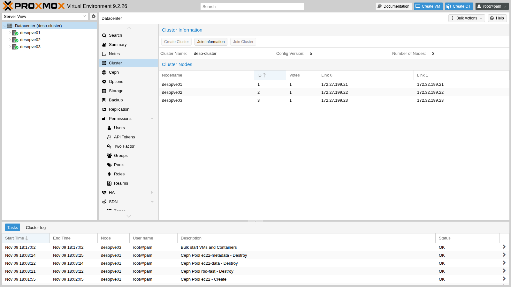

6. Su `desopve04`, ripristina la configurazione degli storage salvata al passo 4 e cancella le copie della configurazione del cluster che non servono più: altri nodi e Ceph.

   ```bash title="root@desopve04"
   cp /root/storage.cfg.standalone /etc/pve/storage.cfg
   rm -rf /etc/pve/nodes/desopve01 /etc/pve/nodes/desopve02 /etc/pve/nodes/desopve03
   pveceph purge
   ```

   ```text output
   Foreign MON address in ceph.conf. Keeping config & keyrings
   ```

   ```bash title="root@desopve04"
   rm -f /etc/pve/ceph.conf /etc/ceph/ceph.conf /etc/pve/priv/ceph.client.admin.keyring /etc/pve/priv/ceph.mon.keyring
   rm -rf /etc/pve/priv/ceph
   systemctl disable --now ceph-crash.service
   pvesm status
   ```

   ```text output
   Name             Type     Status     Total (KiB)      Used (KiB) Available (KiB)        %
   local             dir     active        22203544         6107924        14942392   27.51%
   local-lvm     lvmthin     active        14217216               0        14217216    0.00%
   tank          zfspool     active        40265280             751        40264528    0.00%
   ```

   ```bash title="root@desopve04"
   zpool status -x tank
   ```

   ```text output
   pool 'tank' is healthy
   ```

   - `pveceph purge` si rifiuta di cancellare una configurazione che punta a monitor di altri nodi: è una protezione. Qui il nodo è ormai separato, quindi quei file si cancellano a mano: sono copie locali e non toccano il cluster.
   - I pacchetti di Ceph restano installati: non danno fastidio, e servirebbero se il nodo rientrasse.

   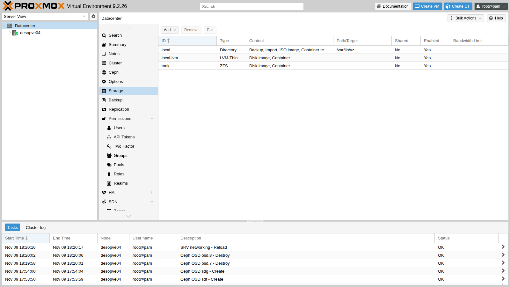

## Verifica e test

Il lab è riuscito se Ceph è di nuovo `HEALTH_OK` con 7 OSD e tutti i PG `active+clean`, il cluster ha di nuovo tre nodi e `desopve04` funziona da solo con i suoi storage:

```bash title="root@desopve01"
ceph -s | sed -n "/health:/p;/mon:/p;/mgr:/p;/mds:/p;/osd:/p;/pgs:/p"
```

```text output
    health: HEALTH_OK
    mon: 3 daemons, quorum desopve01,desopve03,desopve02 (age 4m) [leader: desopve01]
    mgr: desopve01(active, since 74m), standbys: desopve02, desopve03
    mds: 1/1 daemons up, 1 standby
    osd: 7 osds: 7 up (since 100s), 7 in (since 3m)
    pgs:     97 active+clean
```

```bash title="root@desopve01"
pvecm nodes
```

```text output
    Nodeid      Votes Name
         1          1 desopve01 (local)
         2          1 desopve02
         3          1 desopve03
```

Le pause misurate dalla sonda nella VM (normalmente 25-45 ms per scrittura):

| Evento | Scrittura più lunga nella VM | Lettura | Dati persi |
|---|---|---|---|
| OSD fermato, poi *out* e *in* | 4,3 s | compatibile con il peering; quale passo l'abbia causata non è stato registrato | nessuno: `HEALTH_OK` alla fine |
| Riavvio di un nodo con `noout` | 13,5 s | causa non stabilita: OSD *down* e poi di nuovo *up*, peering, elezione dei monitor | nessuno |
| Nodo spento di colpo | 26,8 s | terminata quando i monitor hanno marcato *down* gli OSD (18:04:48) | nessuno |

### Pulizia

Nella VM 100 ferma lo script di misura e cancella i suoi file:

```bash title="labuser@debian01"
pkill -f io.bin; rm -f $HOME/io.bin $HOME/io.log
```

## Stato finale del lab

- **Cluster Proxmox `deso-cluster`:** di nuovo `desopve01-03`, 3 voti su 3.
- **Ceph Tentacle 20.2.5, `HEALTH_OK`:**
  - 3 MON, 3 MGR (attivo su `desopve01`), 2 MDS (attivo su `desopve01`, standby su `desopve02`);
  - **7 OSD** di classe `hdd`: `osd.0`-`osd.5` come nel lab 17 più `osd.6` sul disco nuovo `/dev/sdg` di `desopve03`;
  - pool `rbd-vm` (3/2), `cephfs_data`, `cephfs_metadata` e `.mgr`, nessun pool o regola di prova.
- **Storage del cluster:** `local`, `local-zfs`, `nas-iscsi` e `nas-lvm` (questi tre limitati a `desopve01-03`), `nas-nfs`, `nas-smb`, `rbd-vm`, `cephfs`.
- **VM 100** accesa su `desopve01`, disco su `rbd-vm`, home di `labuser` pulita. **CT 101** acceso su `desopve02`.
- **`desopve04`:** di nuovo autonomo, senza Ceph né Corosync.
  - Storage `local`, `local-lvm` (vuoto) e `tank` (RAIDZ1 con spare, vuoto).
  - Ha la terza scheda `nic2` (senza indirizzi) e due dischi liberi da 40 GB (`sdf`, `sdg`).
  - Conserva in `/root/storage.cfg.standalone` la copia della sua configurazione degli storage.

## Cosa hai imparato

- **Scegliere tra attendere, `out` e `noout`.** Un OSD *down* non fa spostare dati per 10 minuti, un OSD *out* sì. Per un riavvio programmato imposta `noout`; per un disco guasto marca l'OSD *out* (o lascia che lo facciano i monitor dopo 600 secondi) e sostituiscilo.
- **Far crescere il cluster in modo che lo spazio aumenti davvero.** Se gli host sono quanti le copie, un disco in più su un solo nodo non aumenta lo spazio utile: fai crescere tutti gli host in modo uniforme, oppure aggiungi un host. Un nuovo nodo entra nel cluster con il join e in Ceph con i suoi OSD, e gli storage locali vanno limitati ai nodi che li hanno davvero.
- **Scegliere la protezione di un pool.** La replica 3/2 è il compromesso sicuro; la 2/2 blocca le scritture al primo guasto e la 2/1 mette a rischio i dati; l'erasure coding risparmia spazio ma richiede almeno `k+m` host. Le *device class* e le regole CRUSH separano dischi veloci e lenti in pool diversi.
- **Sapere quanto costa un guasto alle VM.** In questo lab Ceph non ha perso dati, ma dopo uno spegnimento improvviso le scritture della VM hanno aspettato 26,8 secondi, finché i monitor non hanno marcato *down* gli OSD, e fino a 13,5 secondi durante un riavvio programmato. Confronta questi valori, misurati sul tuo hardware, con i timeout dei tuoi guest e delle tue applicazioni (per un guest Linux con disco SCSI, `/sys/block/sda/device/timeout`) prima di decidere se cambiare qualcosa.
- **Dismettere un nodo senza reinstallarlo.** Si svuota, si distruggono gli OSD, si separa con `pmxcfs -l` e si pulisce la configurazione da entrambe le parti.

## Riferimenti

- [Proxmox VE – Manutenzione di Ceph: sostituzione degli OSD](https://pve.proxmox.com/pve-docs/chapter-pveceph.html#_ceph_maintenance)
- [Proxmox VE – Pool di Ceph e autoscaler dei PG](https://pve.proxmox.com/pve-docs/chapter-pveceph.html#pve_ceph_pools)
- [Proxmox VE – Erasure coded pools](https://pve.proxmox.com/pve-docs/chapter-pveceph.html#pve_ceph_ec_pools)
- [Proxmox VE – Spegnere un cluster Proxmox VE + Ceph: il flag `noout`](https://pve.proxmox.com/pve-docs/chapter-pveceph.html#pveceph_shutdown)
- [Proxmox VE – Aggiungere un nodo al cluster](https://pve.proxmox.com/pve-docs/chapter-pvecm.html#pvecm_join_node_to_cluster)
- [Proxmox VE – *Separate a Node Without Reinstalling*](https://pve.proxmox.com/pve-docs/chapter-pvecm.html#pvecm_separate_node_without_reinstall)
- [Ceph Tentacle – Monitoring OSDs and PGs: peering e stati dei PG](https://docs.ceph.com/en/tentacle/rados/operations/monitoring-osd-pg/)
- [Ceph Tentacle – Interazione tra monitor e OSD: heartbeat, periodo di grazia, *down* e *out*](https://docs.ceph.com/en/tentacle/rados/configuration/mon-osd-interaction/)
- [Ceph Tentacle – Erasure code](https://docs.ceph.com/en/tentacle/rados/operations/erasure-code/)
- [Ceph Tentacle – CRUSH device classes](https://docs.ceph.com/en/tentacle/rados/operations/crush-map/#device-classes)
- [Ceph Tentacle – mClock: capacità degli OSD e soglia del bench](https://docs.ceph.com/en/tentacle/rados/configuration/mclock-config-ref/#mitigation-of-unrealistic-osd-capacity-from-automated-test)
