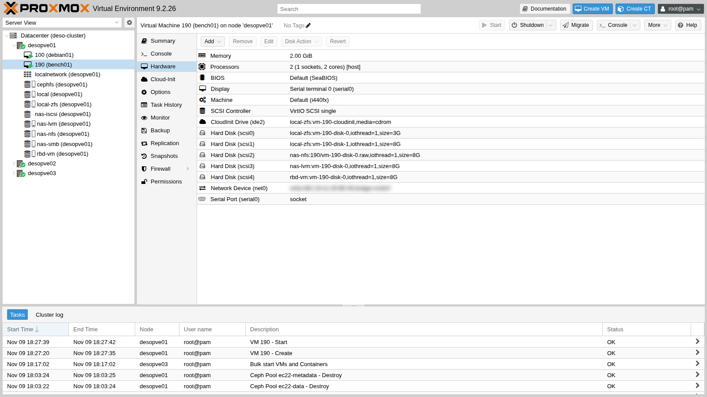
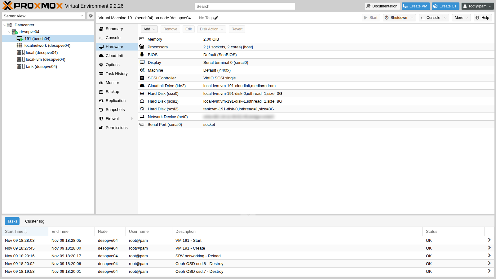

## Dipendenze

- **Lab precedenti:** gli storage da confrontare devono esistere:
  - `local-zfs` sul cluster ([Lab 03](/it/03-install-proxmox-ve/));
  - `local-lvm` e `tank` su `desopve04` ([Lab 09](/it/09-lvm-and-lvm-thin/), [Lab 10](/it/10-zfs/));
  - `nas-nfs` ([Lab 13](/it/13-nfs/));
  - `nas-lvm` su iSCSI ([Lab 15](/it/15-iscsi-lvm-multipath/));
  - `rbd-vm` su Ceph ([Lab 17](/it/17-ceph-installation/)).
- **Spazio libero:** 8 GiB su ciascuno di questi storage; 3 GiB su `local-zfs` e `local-lvm` per il sistema delle due VM di test.
- **Internet:** il proxy del laboratorio deve consentire `cloud.debian.org` (con il suo mirror `*.acc.umu.se`) e `deb.debian.org`.
- **Credenziali:** `root` / `<password-lab>` sui nodi → [Appendice B](/it/b-credentials-and-addresses/). Per entrare nelle VM di test si usa una chiave SSH creata per l'occasione (passo 1).

## Obiettivi

- Ottenere per sei storage diversi una tabella confrontabile di IOPS, banda e latenza, misurata con lo stesso carico, la stessa VM e lo stesso metodo.
- Per ogni numero, saper indicare quale parte del percorso di I/O può averlo influenzato (cache, blocchi mai scritti, conferma delle scritture) e quale verifica servirebbe per esserne certi.
- Avere due script ripetibili, [`bench.sh`](/files/19/bench.sh) e [`riassunto.py`](/files/19/riassunto.py), per rifare la stessa misura su un altro sistema.

## Come funziona

### Le tre misure

| Misura | Cosa dice | Test tipico |
|---|---|---|
| **IOPS** | quante operazioni al secondo | blocchi piccoli (4 KiB) in posizioni casuali: database, sistemi operativi |
| **Banda** (MB/s) | quanti dati al secondo | blocchi grandi (1 MiB) in sequenza: backup, copie, video |
| **Latenza** (ms) | quanto aspetta una singola operazione | una sola operazione alla volta (*QD1*) |

La **queue depth** (QD) è il numero di operazioni "in volo" nello stesso momento. Con QD32 lo storage può lavorarne molte in parallelo e gli IOPS salgono. Con QD1 ogni operazione aspetta la precedente: si misura il tempo di risposta della singola operazione, cioè quello che percepisce un'applicazione che scrive e aspetta la conferma.

fio riporta tre latenze diverse. La **slat** è il tempo di sottomissione dell'operazione. La **clat** (*completion latency*) è il tempo tra l'invio dell'operazione e il suo completamento. La **lat** è la latenza totale e comprende entrambe. Le tabelle di questo lab dichiarano sempre quale delle tre riportano.

### I tre tranelli dei benchmark

1. **Le cache.** Tra la VM e il disco ci sono più livelli di cache:
   - la cache del sistema operativo della VM, che `fio --direct=1` salta;
   - la cache di QEMU, assente con il disco in `cache=none`, il predefinito di Proxmox;
   - l'**ARC di ZFS** sul nodo o sul NAS. A seconda della versione di ZFS e delle proprietà del dataset o dello zvol (`primarycache`, `direct`), può servire le letture dalla RAM anche quando la VM usa `--direct=1`.

   Una lettura servita dalla RAM vale decine di migliaia di IOPS anche se il disco sotto è lento.

2. **I blocchi mai scritti.** Su uno storage *thin* (ZFS, LVM-thin, Ceph), la lettura di un blocco mai scritto in genere non arriva al disco: lo storage risponde con degli zeri. Prima di misurare le letture bisogna quindi **riempire** l'area di test (*precondizionamento*).
3. **Le scritture confermate dalla RAM.** Molti storage confermano una scrittura appena è in memoria e la portano su disco più tardi, a meno che il sistema non chieda esplicitamente un `fsync`. Le scritture "normali" e quelle con `fsync` hanno costi diversi e vanno misurate entrambe.

### Il metodo usato

- **Stessa VM, stessi job:** una VM Debian 13 con un disco da 8 GiB per ogni storage, tutti `VirtIO SCSI single` con `iothread=1` e `cache=none`. Sul cluster serve una VM (`bench01`); per `local-lvm` e `tank`, che stanno su `desopve04`, una seconda VM identica (`bench04`).
- **Dispositivo grezzo:** fio scrive direttamente su `/dev/disk/by-id/...`, senza file system, con `--direct=1` e `libaio`.
- **Precondizionamento:** prima dei test ogni disco viene scritto per intero nell'area di prova (2 GiB).
- **Cinque job da 20 secondi** (più 3 di riscaldamento), ripetuti **due volte**. La tabella riporta la media e, tra parentesi, quanto si discostano le due ripetizioni.
- **Un job in più con `fsync` dopo ogni scrittura**, per misurare il costo di una scrittura che deve arrivare su un supporto stabile.
- I test girano **uno storage alla volta**, mai in parallelo.

### Ambiente e versioni della prova

I risultati riportati più avanti vengono da una prova eseguita a novembre 2026 nella configurazione descritta qui sotto. Servono per leggerli correttamente: con versioni, opzioni o hardware diversi, gli stessi job danno numeri diversi.

| Componente | Configurazione della prova |
|---|---|
| Proxmox VE | 9.2.26, kernel `7.0.14-28-pve` ([Lab 04](/it/04-first-access-repositories-updates/)) |
| VM di test | Debian 13 da immagine cloud, 2 vCPU di tipo `host`, 2 GiB di RAM, fio 3.39 |
| Dischi della VM | VirtIO SCSI single, `iothread=1`, `cache=none`, `aio` lasciato al predefinito, che dipende dallo storage (vedi sotto), senza `discard`; dispositivi grezzi da 8 GiB con un'area di prova di 2 GiB |
| `local-zfs` | ZFS mirror sui due dischi di sistema di `desopve01` ([Lab 03](/it/03-install-proxmox-ve/)), ARC con il limite impostato dall'installer |
| `local-lvm` | LVM-thin sul disco di sistema di `desopve04` ([Lab 03](/it/03-install-proxmox-ve/), [Lab 09](/it/09-lvm-and-lvm-thin/)) |
| `tank` | ZFS RAIDZ1 sui quattro dischi da 20 GB di `desopve04`, più un disco di riserva; ARC limitato a 2 GiB ([Lab 10](/it/10-zfs/)) |
| `nas-nfs` | NFS 4.2 verso il dataset `dati/nfs` del NAS TrueNAS SCALE 25.10, pool ZFS in mirror ([Lab 12](/it/12-truenas-nas/), [Lab 13](/it/13-nfs/)); disco della VM in formato raw |
| `nas-lvm` | LVM condiviso su uno zvol iSCSI da 40 GiB dello stesso NAS, con due percorsi multipath ([Lab 15](/it/15-iscsi-lvm-multipath/)) |
| `rbd-vm` | Ceph 20.2 (tentacle), pool replicato `size 3` / `min_size 2` su sette OSD dei nodi 01-03, reti public e cluster su VLAN dedicate ([Lab 17](/it/17-ceph-installation/), [Lab 18](/it/18-ceph-growth-maintenance-failures/)) |
| Rete | MTU 1500 su tutti i collegamenti ([Lab 21](/it/21-bonding/)) |

I modelli di dischi e controller sono oscurati, come indicato nelle [convenzioni del manuale](/it/the-lab/#convenzioni): i numeri vanno letti come proprietà di questa configurazione, non di un modello di disco.

**La modalità `aio` non è la stessa su tutti i dischi.** I dischi sono stati creati senza l'opzione `aio`, quindi vale il predefinito di qemu-server, che lo sceglie in base al tipo di storage (funzioni `storage_allows_io_uring_default` e `aio_cmdline_option` del sorgente, vedi i riferimenti):

- `io_uring` su `local-zfs`, `local-lvm`, `tank` e `nas-nfs`;
- `native` su `nas-lvm`: sugli storage LVM semplici (tipo `lvm`) Proxmox VE non usa `io_uring` come predefinito, e con `cache=none` ripiega su `native`;
- nessuna modalità `aio` su `rbd-vm`: con `krbd 0` ([Lab 17](/it/17-ceph-installation/)) QEMU accede all'immagine tramite librbd, e qemu-server imposta `aio` solo per file e dispositivi a blocchi.

Questo elenco viene dal codice sorgente, non dalla prova, che non ha registrato la riga di comando delle VM. `qm showcmd 190 --pretty` mostra la modalità effettiva di ogni disco, come `"aio":…` nella sua riga `-blockdev`.

**Cosa misura e cosa non misura.** La prova misura il percorso completo visto da una VM: il kernel del guest, il controller virtuale, QEMU, lo storage di Proxmox e, per gli storage di rete, anche la rete e il NAS o gli OSD. Non isola i singoli livelli: un valore alto o basso non dice da solo quale livello lo ha prodotto. Non misura il comportamento con molte VM in parallelo. Con un'area di prova di 2 GiB, più piccola della RAM dei nodi e del NAS, le cache possono incidere sulle letture. Due ripetizioni da 20 secondi danno un'indicazione della variabilità, non una statistica.

## Procedura

### 1. Le VM di test da un'immagine cloud

Invece di installare Debian da ISO, usa l'immagine *cloud* ufficiale: un disco già pronto che si configura al primo avvio con cloud-init (cloud-init e i template sono l'argomento del lab 40).

1. Su `desopve01` e su `desopve04` crea una chiave SSH senza passphrase, usata solo per entrare nelle due VM di test (la cancellerai alla fine):

   ```bash title="root@desopve01"
   ssh-keygen -q -t ed25519 -N '' -f /root/bench
   ```

   ```bash title="root@desopve04"
   ssh-keygen -q -t ed25519 -N '' -f /root/bench
   ```

   Poi scarica l'immagine nello storage `local` (contenuto **import**) di `desopve01` e di `desopve04`. Il sito di Debian rimanda a un mirror, quindi serve `-L`:

   ```bash title="root@desopve01"
   curl -sL -x http://proxy.proxmox.community:3128 \
       -o /var/lib/vz/import/debian-13-genericcloud-amd64.qcow2 \
       https://cloud.debian.org/images/cloud/trixie/latest/debian-13-genericcloud-amd64.qcow2
   qemu-img info /var/lib/vz/import/debian-13-genericcloud-amd64.qcow2 | grep -E "format|virtual"
   ```

   ```text output
   file format: qcow2
   virtual size: 3 GiB (3221225472 bytes)
   ```

   ```bash title="root@desopve04"
   curl -sL -x http://proxy.proxmox.community:3128 \
       -o /var/lib/vz/import/debian-13-genericcloud-amd64.qcow2 \
       https://cloud.debian.org/images/cloud/trixie/latest/debian-13-genericcloud-amd64.qcow2
   ```

2. Crea `bench01` su `desopve01`. Il disco di sistema viene importato dall'immagine (`import-from`); utente, chiave SSH e rete li imposta cloud-init. Poi aggiungi un disco da 8 GiB per ogni storage da misurare:

   ```bash title="root@desopve01"
   qm create 190 --name bench01 --memory 2048 --cores 2 --cpu host \
       --scsihw virtio-scsi-single --net0 virtio,bridge=vmbr0 --boot order=scsi0 \
       --serial0 socket --vga serial0 \
       --scsi0 local-zfs:0,import-from=local:import/debian-13-genericcloud-amd64.qcow2,iothread=1 \
       --ide2 local-zfs:cloudinit --ciuser labuser --sshkeys /root/bench.pub \
       --ipconfig0 ip=172.27.199.190/24,gw=172.27.199.1 \
       --nameserver 172.27.199.20 --searchdomain proxmox.community
   qm set 190 --scsi1 local-zfs:8,iothread=1 --scsi2 nas-nfs:8,format=raw,iothread=1 \
       --scsi3 nas-lvm:8,iothread=1 --scsi4 rbd-vm:8,iothread=1
   qm start 190
   ```

   

   `bench04` (VMID 191, 172.27.199.191) è identica, su `desopve04`, con il sistema su `local-lvm` e i dischi di prova su `local-lvm` e `tank`:

   ```bash title="root@desopve04"
   qm create 191 --name bench04 --memory 2048 --cores 2 --cpu host \
       --scsihw virtio-scsi-single --net0 virtio,bridge=vmbr0 --boot order=scsi0 \
       --serial0 socket --vga serial0 \
       --scsi0 local-lvm:0,import-from=local:import/debian-13-genericcloud-amd64.qcow2,iothread=1 \
       --ide2 local-lvm:cloudinit --ciuser labuser --sshkeys /root/bench.pub \
       --ipconfig0 ip=172.27.199.191/24,gw=172.27.199.1 \
       --nameserver 172.27.199.20 --searchdomain proxmox.community
   qm set 191 --scsi1 local-lvm:8,iothread=1 --scsi2 tank:8,iothread=1
   qm start 191
   ```

   

   Lo storage SMB (`nas-smb`) non è nel confronto: Proxmox lo può usare per i dischi delle VM, ma nel lab 14 lo abbiamo configurato solo per ISO e backup, che è l'uso consigliato.

3. Entra nelle VM con la chiave creata al passo 1 (`bench04` allo stesso modo, da `desopve04` verso `.191`):

   ```bash title="root@desopve01"
   ssh -i /root/bench labuser@172.27.199.190
   ```

   Installa fio. L'immagine cloud usa i repository Debian in **HTTPS**, quindi il proxy va dichiarato anche per `https`:

   ```bash title="labuser@bench01"
   printf 'Acquire::http::Proxy "http://proxy.proxmox.community:3128";\nAcquire::https::Proxy "http://proxy.proxmox.community:3128";\n' | sudo tee /etc/apt/apt.conf.d/80proxy
   sudo apt-get update && sudo apt-get install -y fio
   fio --version
   ```

   ```text output
   fio-3.39
   ```

   ```bash title="labuser@bench01"
   ls -l /dev/disk/by-id/ | grep drive-scsi | awk '{print $9, $11}'
   ```

   ```text output
   scsi-0QEMU_QEMU_HARDDISK_drive-scsi0 ../../sdb
   ...
   scsi-0QEMU_QEMU_HARDDISK_drive-scsi1 ../../sda
   scsi-0QEMU_QEMU_HARDDISK_drive-scsi2 ../../sdc
   scsi-0QEMU_QEMU_HARDDISK_drive-scsi3 ../../sdd
   scsi-0QEMU_QEMU_HARDDISK_drive-scsi4 ../../sde
   ```

   I nomi `sdX` **non** seguono l'ordine dei dischi: qui `scsi1` è `sda` e il sistema è `sdb`. Per non scrivere sul disco sbagliato, lo script usa i nomi stabili `drive-scsiN` in `/dev/disk/by-id`.

### 2. Lo script dei test

Lo script è pubblicato in [`files/19/bench.sh`](/files/19/bench.sh). Crealo in entrambe le VM, per esempio incollandolo con un *here document*, e rendilo eseguibile:

```bash title="labuser@bench01"
cat > ~/bench.sh <<'FINE'
(incolla qui il contenuto di bench.sh)
FINE
chmod +x ~/bench.sh
```

Il contenuto:

```bash
#!/bin/bash
# bench.sh etichetta:scsiN ... : stessi job fio su ogni disco, 2 ripetizioni, risultati JSON in ~/res
set -u
mkdir -p ~/res
for pair in "$@"; do
  lab=${pair%%:*}; dev=/dev/disk/by-id/scsi-0QEMU_QEMU_HARDDISK_drive-${pair##*:}
  # precondizionamento: scrive tutta l'area di test, cosi' le letture non leggono blocchi mai allocati
  sudo fio --name=fill --filename=$dev --rw=write --bs=1M --size=2G --direct=1 --ioengine=libaio --iodepth=16 --output-format=json --output=$HOME/res/$lab-fill.json >/dev/null
  for run in 1 2; do
    for job in "rr4k randread 4k 32" "rw4k randwrite 4k 32" "rw4kqd1 randwrite 4k 1" "sr1m read 1M 16" "sw1m write 1M 16"; do
      set -- $job
      sudo fio --name=$1 --filename=$dev --rw=$2 --bs=$3 --iodepth=$4 --size=2G --direct=1 --ioengine=libaio \
        --time_based --runtime=20 --ramp_time=3 --output-format=json --output=$HOME/res/$lab-$1-$run.json >/dev/null
    done
  done
  echo "$(date +%T) $lab finito"
done
touch ~/res/DONE
```

Avvialo in background su `bench01` e, solo quando ha finito, su `bench04`:

```bash title="labuser@bench01"
nohup ./bench.sh local-zfs:scsi1 nas-nfs:scsi2 nas-lvm:scsi3 rbd-vm:scsi4 > bench.log 2>&1 &
cat bench.log
```

```text output
17:36:30 local-zfs finito
17:41:39 nas-nfs finito
17:46:13 nas-lvm finito
17:51:30 rbd-vm finito
```

```bash title="labuser@bench04"
nohup ./bench.sh local-lvm:scsi1 tank:scsi2 > bench.log 2>&1 &
```

Poi un ultimo job per ogni disco, con un `fsync` dopo **ogni** scrittura:

```bash title="labuser@bench01"
sudo fio --name=sync --filename=/dev/disk/by-id/scsi-0QEMU_QEMU_HARDDISK_drive-scsi1 \
    --rw=randwrite --bs=4k --iodepth=1 --fsync=1 --size=2G --direct=1 --ioengine=libaio \
    --time_based --runtime=15 --ramp_time=2 --output-format=json
```

I file JSON di fio contengono tutto (IOPS, banda, latenze medie e percentili). La tabella del carico normale si ricava con lo script [`files/19/riassunto.py`](/files/19/riassunto.py), che legge `jobs[0].read` e `jobs[0].write` di ogni file e calcola media e scarto delle due ripetizioni. Per la latenza usa `clat_ns.mean`, la latenza di completamento media:

```bash title="labuser@bench01"
python3 riassunto.py ~/res
```

Per la tabella con l'`fsync` basta leggere, nel JSON dell'ultimo job, `jobs[0].write.iops`, `jobs[0].write.lat_ns.mean` (latenza totale) e `jobs[0].sync.lat_ns.mean` (latenza dell'`fsync`). Il 99° percentile della scrittura QD1 senza `fsync` si trova in `jobs[0].write.clat_ns.percentile` dei file `rw4kqd1`: fio calcola i percentili sulla latenza di completamento, se non si chiede altrimenti.

## Verifica e test: i risultati

La prova è riuscita se:

- per ogni storage ci sono i file JSON di tutti i job, nelle due ripetizioni, e il file `~/res/DONE`;
- `riassunto.py` produce una tabella senza celle vuote;
- sai spiegare, o almeno verificare, gli scarti tra le due ripetizioni.

I valori assoluti invece dipendono dall'infrastruttura: quelli che seguono sono i risultati della prova descritta in [Ambiente e versioni della prova](#ambiente-e-versioni-della-prova).

### Carico normale (senza fsync)

| Storage | Lettura casuale 4k QD32 (IOPS) | Scrittura casuale 4k QD32 (IOPS) | Scrittura 4k QD1, latenza di completamento media (clat, ms) | Lettura sequenziale 1M (MB/s) | Scrittura sequenziale 1M (MB/s) |
|---|---|---|---|---|---|
| `local-zfs` (ZFS mirror, locale) | 44.289 (±3%) | 2.336 (±50%) | 0,21 (±6%) | 3.289 (±0%) | 42 (±19%) |
| `local-lvm` (LVM-thin, locale) | 29.414 (±2%) | 9.347 (±20%) | 1,70 (±4%) | 291 (±3%) | 540 (±9%) |
| `tank` (ZFS RAIDZ1, locale) | 27.866 (±3%) | 3.398 (±15%) | 0,79 (±30%) | 1.036 (±3%) | 44 (±35%) |
| `nas-nfs` (NFS 4.2) | 25.069 (±9%) | 181 (±6%) | 4,47 (±3%) | 1.208 (±1%) | 21 (±23%) |
| `nas-lvm` (iSCSI + LVM, multipath) | 20.424 (±5%) | 4.182 (±15%) | 0,74 (±17%) | 1.082 (±2%) | 15 (±36%) |
| `rbd-vm` (Ceph, replica 3) | 10.357 (±17%) | 306 (±11%) | 8,31 (±25%) | 983 (±1%) | 20 (±27%) |

### Scritture con fsync (fsync dopo ogni scrittura, QD1)

| Storage | IOPS | Latenza totale media della scrittura (lat, ms) | Latenza media dell'fsync (ms) | Scrittura QD1 senza fsync: latenza di completamento al 99° percentile (clat, ms) |
|---|---|---|---|---|
| `local-zfs` | 288 | 0,52 | 3,39 | 1,06 |
| `local-lvm` | 534 | 1,46 | 1,80 | 3,95 |
| `tank` | 145 | 0,48 | 6,79 | 3,06 |
| `nas-nfs` | 194 | 4,82 | 4,63 | 55,31 |
| `nas-lvm` | 138 | 0,83 | 7,12 | 2,54 |
| `rbd-vm` | 26 | 38,21 | 38,53 | 42,21 |

### Come leggere questi numeri

Ogni punto distingue ciò che la prova ha misurato da come lo interpretiamo, e indica la verifica che servirebbe per confermare l'interpretazione.

1. **Le letture sequenziali.**
   - **Misura:** in lettura sequenziale `local-zfs` raggiunge 3.289 MB/s, `tank` 1.036 MB/s e `local-lvm` 291 MB/s.
   - **Interpretazione:** il dato di `local-zfs` è compatibile con un contributo importante della cache, perché l'area di test è stata appena scritta dal precondizionamento. Questa misura però non separa l'effetto dell'ARC da quello del resto del percorso di I/O. Lo stesso vale per `tank`, che ha un ARC più piccolo (2 GiB). Anche i 291 MB/s di `local-lvm` descrivono il comportamento della configurazione provata: attribuirli alla sola prestazione del disco richiede una verifica aggiuntiva. Le letture di `nas-nfs` (1.208 MB/s) e `nas-lvm` (1.082 MB/s) potrebbero arrivare in parte dalla cache del NAS, che usa anch'esso ZFS, ma la prova non lo dimostra.
   - **Verifica:**
     - durante la prova, osserva sul nodo (e sul NAS) le statistiche dell'ARC con `arcstat 1`: una percentuale di *hit* vicina al 100% indica letture servite dalla RAM;
     - ripeti la lettura con un'area di prova più grande della RAM disponibile per l'ARC, oppure con `primarycache=metadata` impostato temporaneamente sullo zvol di prova;
     - per `local-lvm`, misura il disco fisico direttamente dal nodo, con fio in sola lettura (`--readonly --direct=1`), così il confronto con la VM mostra quanto pesa il resto del percorso.
2. **Ceph e la singola operazione.**
   - **Misura:** la scrittura QD1 su `rbd-vm` ha una latenza di completamento media di 8,31 ms (±25%), contro 0,21-1,70 ms degli storage locali. Con un `fsync` dopo ogni scrittura si scende a 26 IOPS, con 38,53 ms per ogni `fsync`.
   - **Interpretazione:** il risultato è coerente con il modo in cui Ceph conferma una scrittura: l'OSD primario la inoltra alle altre due copie e risponde solo dopo le loro conferme, quindi ogni operazione attraversa più volte la rete. La prova però non separa il contributo della rete da quello dei dischi degli OSD, né dal percorso di accesso, anch'esso diverso: QEMU raggiunge `rbd-vm` tramite librbd, mentre gli altri dischi sono file o dispositivi a blocchi sul nodo.
   - **Verifica:** durante la prova, `ceph osd perf` mostra la latenza di commit di ogni OSD; `rados bench -p rbd-vm 30 write -b 4096 -t 1` misura le scritture 4k a coda singola senza la VM in mezzo; un `ping` tra i nodi sulla VLAN di Ceph dà la latenza della sola rete. Con code profonde e più client, Ceph distribuisce il lavoro su più OSD: per questo va misurato anche in parallelo (vedi più sotto).
3. **NFS e iSCSI sullo stesso NAS.**
   - **Misura:** in scrittura casuale QD32 `nas-nfs` fa 181 IOPS e `nas-lvm` 4.182. Con un `fsync` dopo ogni scrittura i due valori si avvicinano: 194 e 138 IOPS.
   - **Interpretazione:** la differenza è compatibile con il modo in cui i due protocolli confermano le scritture. Le scritture `O_DIRECT` del client NFS verrebbero confermate dal server solo dopo essere state rese stabili; via iSCSI, invece, il NAS può confermarle dalla RAM e scriverle più tardi, a meno che il client non chieda un flush. Il riavvicinamento dei valori con `fsync` va nella stessa direzione, ma questa prova non lo dimostra. I due dischi differiscono anche per la modalità `aio`, `io_uring` su `nas-nfs` e `native` su `nas-lvm` (vedi [Ambiente e versioni della prova](#ambiente-e-versioni-della-prova)), e la prova non separa questo effetto da quello del protocollo.
   - **Verifica:** sul NAS, `zfs get sync dati/nfs dati/iscsi/pve` mostra come ZFS tratta le scritture sincrone dei due volumi; sul nodo, `nfsstat -m` mostra le opzioni effettive del montaggio NFS. Ripetendo la prova con `sync=always` sullo zvol iSCSI, il valore di `nas-lvm` dovrebbe avvicinarsi a quello di NFS, se l'interpretazione è giusta. Impostando `aio=native` anche sul disco di `nas-nfs`, la differenza di modalità `aio` esce dal confronto.
4. **La variabilità.**
   - **Misura:** le scritture casuali QD32 e quelle sequenziali hanno scarti fino al ±50% tra le due ripetizioni (`local-zfs`), e del ±35-36% su `tank` e `nas-lvm`.
   - **Interpretazione:** le cause possibili sono più d'una: l'attività del resto del laboratorio (Ceph, NAS, rete condivisa) e le scritture periodiche con cui ZFS porta i dati su disco a intervalli di pochi secondi, che cadono in modo diverso nelle due finestre da 20 secondi. La prova non permette di distinguerle.
   - **Verifica:** più ripetizioni, più lunghe, con il resto del laboratorio fermo, registrando l'attività dei dischi sul nodo con `iostat -x 1` o `zpool iostat 1`.
5. **La scrittura sequenziale di `local-lvm`.**
   - **Misura:** `local-lvm` scrive in sequenza a 540 MB/s e legge a 291 MB/s. Con `fsync` fa 534 scritture al secondo, con 1,80 ms per ogni `fsync`.
   - **Interpretazione:** una scrittura più veloce della lettura, e flush confermati in meno di 2 ms, fanno pensare a una cache in scrittura sotto LVM, nel controller o nel disco. La prova però non dice quale livello la fornisca, né se è protetta da una perdita di alimentazione.
   - **Verifica:** lo stato della cache in scrittura del disco (`hdparm -W` o `sdparm --get=WCE`) e del controller, e una scrittura sequenziale più lunga, che superi la capacità della cache.

**In sintesi:** i rapporti tra gli storage valgono per questa infrastruttura. Con hardware, rete e versioni diversi cambiano, anche molto. Il metodo, invece, si riusa così com'è.

### Cosa misurare in produzione

- Un'area **precondizionata** e più grande della RAM dei nodi (e del NAS), così le cache non falsano le letture.
- Più ripetizioni, più lunghe (almeno 60 s) e in orari diversi. Riporta mediana e percentili (p99), non solo la media, e scrivi sempre quale latenza riporti (clat o lat).
- Sia il carico "normale" sia quello con `fsync`: un database vive di `fsync`.
- Per Ceph: più VM o più job in parallelo (`--numjobs`), perché Ceph distribuisce il carico su molti OSD. `rados bench` e `rbd bench` misurano il cluster senza la VM in mezzo.
- Annota tutto, come nella sezione [Ambiente e versioni della prova](#ambiente-e-versioni-della-prova): versioni, opzioni del disco (`cache`, `iothread`, `discard` e la modalità `aio` effettiva, letta con `qm showcmd`, perché il suo predefinito dipende dallo storage), dimensione dei blocchi e della coda, dimensione dell'area di prova, data.

### Pulizia

Distruggi le VM di test con i loro dischi e cancella la chiave SSH di prova:

```bash title="root@desopve01"
qm stop 190 && qm destroy 190 --purge && rm -f /root/bench /root/bench.pub
```

```bash title="root@desopve04"
qm stop 191 && qm destroy 191 --purge && rm -f /root/bench /root/bench.pub
```

## Stato finale del lab

- Lo stato del cluster, di Ceph e di `desopve04` è quello del [Lab 18](/it/18-ceph-growth-maintenance-failures/): nessuna VM di test, storage vuoti come prima.
- Resta l'immagine `debian-13-genericcloud-amd64.qcow2` nello storage `local` (contenuto **import**) di `desopve01` e `desopve04`: servirà per i template del lab 40.

## Cosa hai imparato

- **Capire se un benchmark misura il carico che ti interessa.** Prima di fidarti di un numero controlli cinque cose: se le letture possono arrivare da una cache (area appena scritta, più piccola della RAM, ARC attivo); se fio usa `--direct=1`; quanto è grande l'area di prova rispetto alla RAM di nodi e NAS; quanto dura ogni prova; quante ripetizioni hai e quanto differiscono.
- **Scegliere la metrica giusta per la domanda.** Gli IOPS con code profonde descrivono il carico parallelo di molte VM. La latenza QD1 descrive l'applicazione che aspetta ogni scrittura, e va dichiarata (clat o lat). La banda serve per backup e copie.
- **Decidere quando serve la prova con `fsync`.** Se il carico reale fa `fsync` (database, log), un risultato senza `fsync` non lo rappresenta.
- **Separare una misura da una spiegazione.** Accanto a ogni interpretazione sai indicare la verifica che la confermerebbe: `arcstat`, `ceph osd perf`, `rados bench`, una prova sul disco del nodo.
- **Usare il confronto per quello che è.** Un confronto tra storage vale per l'infrastruttura su cui l'hai fatto: per una decisione in produzione ripeti lo stesso metodo sull'hardware di produzione.

## Riferimenti

- [fio – documentazione](https://fio.readthedocs.io/en/latest/fio_doc.html)
- [fio – lettura dell'output: slat, clat e lat](https://fio.readthedocs.io/en/latest/fio_doc.html#interpreting-the-output)
- [Proxmox VE – Opzioni dei dischi virtuali (cache, iothread, aio)](https://pve.proxmox.com/pve-docs/pve-admin-guide.html#qm_hard_disk)
- [Proxmox VE – sorgente di qemu-server, `Drive.pm`: la modalità `aio` predefinita per ogni tipo di storage (`storage_allows_io_uring_default`, `aio_cmdline_option`)](https://git.proxmox.com/?p=qemu-server.git;a=blob;f=src/PVE/QemuServer/Drive.pm;hb=HEAD)
- [Proxmox VE – Cloud-init support](https://pve.proxmox.com/pve-docs/pve-admin-guide.html#qm_cloud_init)
- [Proxmox VE – `qm` e l'import di immagini disco (`import-from`)](https://pve.proxmox.com/pve-docs/qm.1.html)
- [OpenZFS – proprietà `primarycache`](https://openzfs.github.io/openzfs-docs/man/master/7/zfsprops.7.html#primarycache)
- [Ceph – `rados bench` (pagina di manuale di `rados`)](https://docs.ceph.com/en/latest/man/8/rados/)
- [Proxmox – Proxmox VE Ceph Benchmark 2023/12](https://www.proxmox.com/en/downloads/proxmox-virtual-environment/documentation/proxmox-ve-ceph-benchmark-2023-12)
- [Ceph – Raccomandazioni hardware](https://docs.ceph.com/en/latest/start/hardware-recommendations/)
