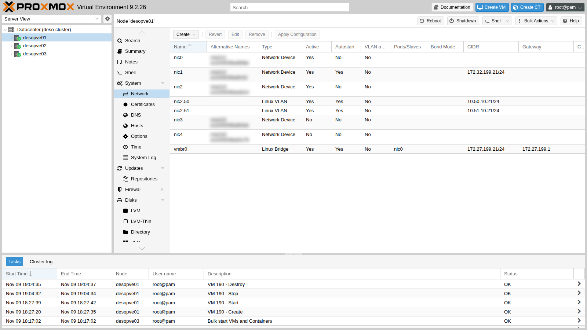
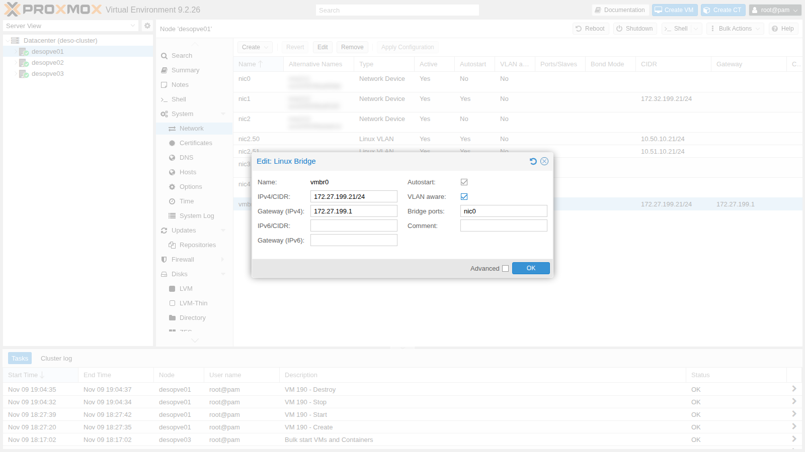
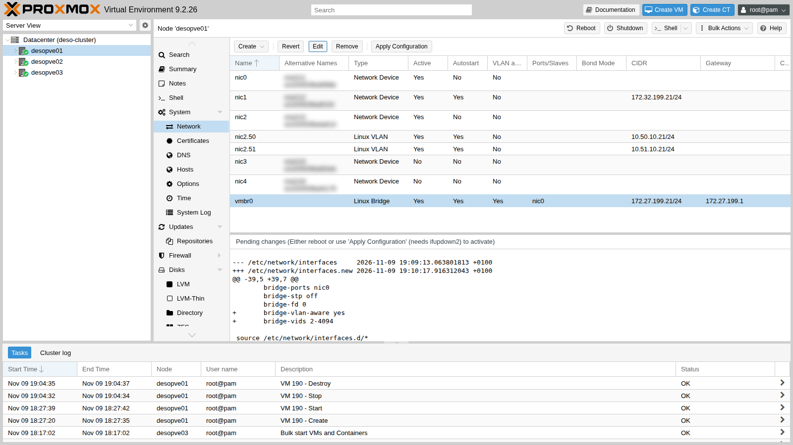
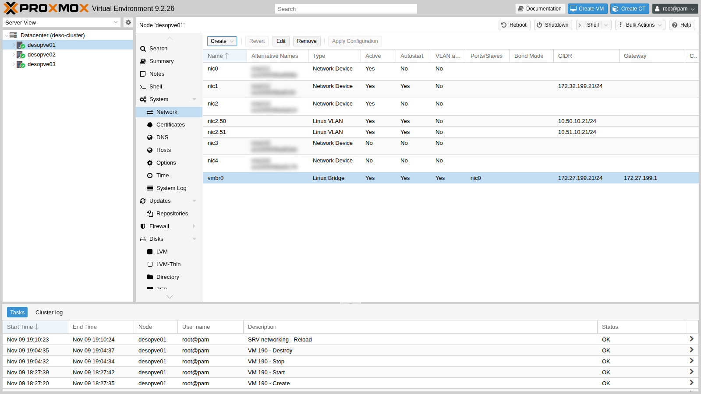
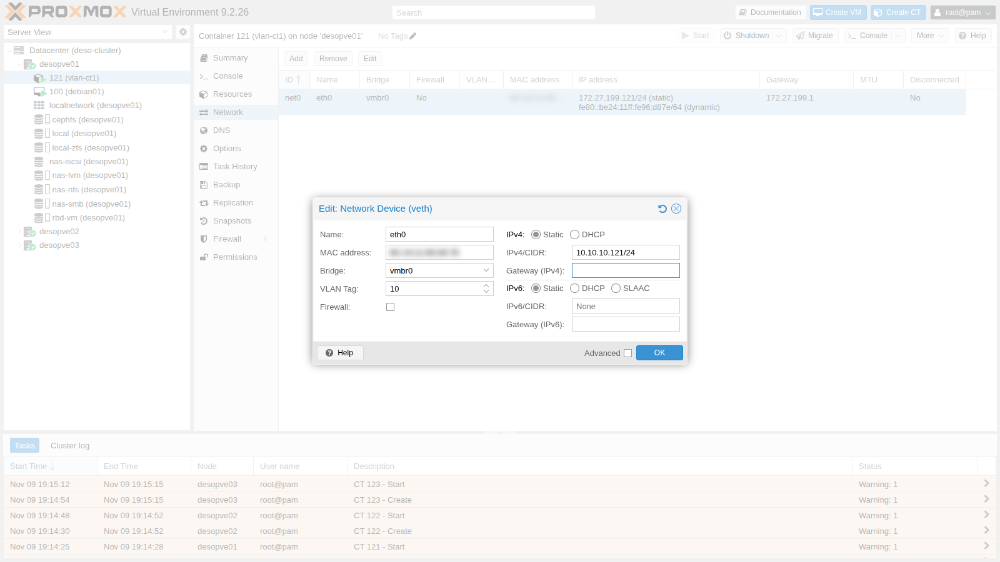
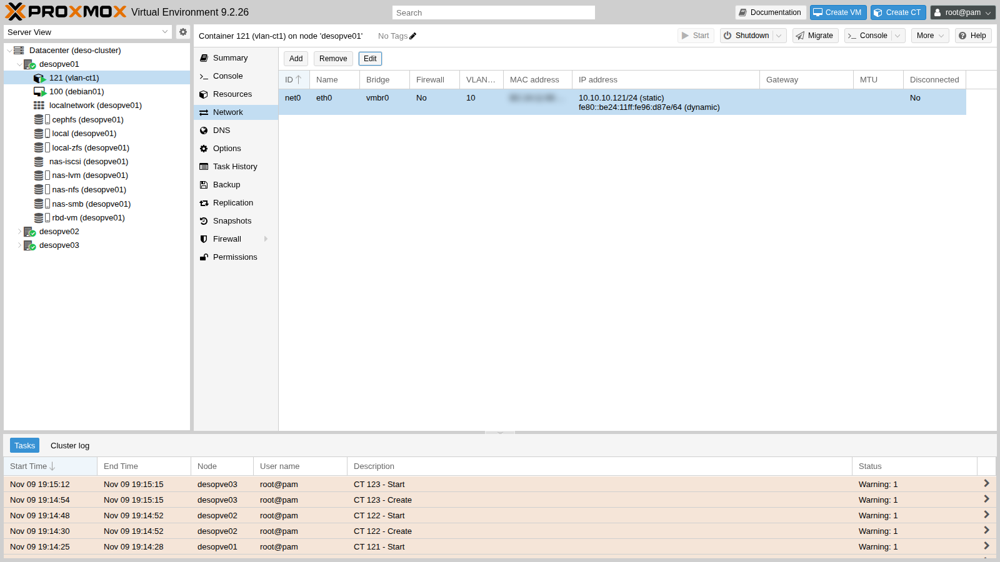
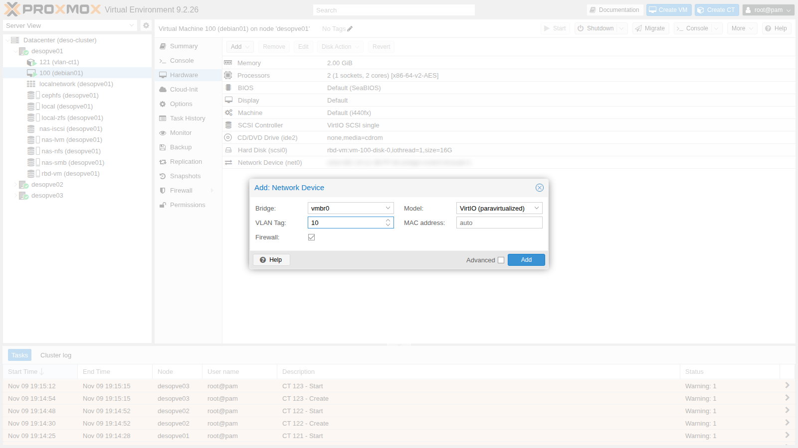
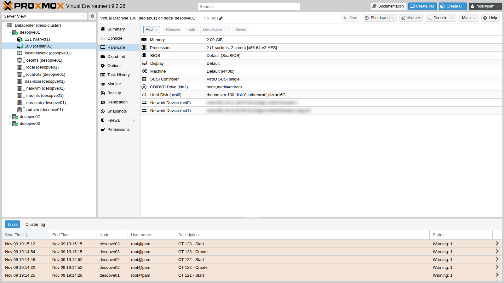

## Dipendenze

- **Lab precedenti:** [Lab 06](/it/06-cluster-corosync/) (cluster `deso-cluster`), [Lab 07](/it/07-first-vm-and-container/) (VM 100 e primi container), [Lab 17](/it/17-ceph-installation/) (CephFS per i template e `rbd-vm` per i dischi dei container di prova), [Lab 18](/it/18-ceph-growth-maintenance-failures/) (flag `noout` per spegnere un nodo con gli OSD).
- **Hardware:** una scheda di rete a due porte per ciascun nodo `desopve01-03`, da montare a server spento (passo 1) e da cablare verso lo switch, sulla stessa rete delle altre schede. In questo lab ne fissi il nome; nel [Lab 21](/it/21-bonding/) le due porte diventano un bond.
- **Rete:** lo switch a cui sono collegate le schede dei nodi deve trasportare frame con tag VLAN (porte *trunk*), come indicato nel [Lab 01](/it/01-lab-architecture/).
- **Template:** `debian-13-standard` (lo scarichi in CephFS durante il lab).
- **Credenziali:** `root` / `<password-lab>` sui nodi e nei container → [Appendice B](/it/b-credentials-and-addresses/).

## Obiettivi

- Capire come Proxmox VE collega le VM alla rete: schede fisiche, Linux bridge, porte virtuali.
- Dare un nome stabile alle schede di rete nuove, con il *pinning* introdotto in Proxmox VE 9.
- Leggere e modificare `/etc/network/interfaces`, dalla GUI e dalla riga di comando, e applicare le modifiche senza riavviare.
- Rendere `vmbr0` *VLAN-aware* e mettere VM e container su VLAN diverse con un semplice numero (*tag*).
- Verificare con prove reali che la stessa VLAN comunica tra nodi diversi e che VLAN diverse restano isolate.

## Come funziona

### Il Linux bridge è uno switch dentro il nodo

Un **Linux bridge** (`vmbr0`, `vmbr1`, …) è uno switch Ethernet software. Le sue porte sono:

- una o più **schede fisiche** (`bridge-ports nic0`): il collegamento verso lo switch del datacenter;
- le **porte virtuali** delle VM (`tap100i0` = VM 100, scheda `net0`) e dei container (`veth121i0` = CT 121, `net0`), create e collegate da Proxmox VE all'avvio del guest.

L'indirizzo IP del nodo sta sul bridge (`vmbr0`), non sulla scheda fisica: il nodo è a sua volta una "porta" dello switch.

Un bridge **senza** schede fisiche è uno switch isolato: le VM collegate comunicano solo tra loro, sullo stesso nodo. Le reti isolate tra più nodi si costruiscono con l'SDN (lab 27-31).

### Nomi stabili delle schede di rete

Linux dà alle schede un nome che dipende da dove sono collegate (slot PCI, posizione sul bus: `ens…`, `enp…s…`). Se cambia l'hardware, oppure l'aggiornamento del kernel o di systemd cambia le regole di denominazione, il nome cambia. A quel punto `/etc/network/interfaces` punta a una scheda che non esiste più e il nodo resta senza rete.

Proxmox VE 9 risolve il problema con il **pinning**: un file `systemd.link` per ogni scheda associa il **MAC address** a un nome fisso, `nic0`, `nic1`, …

- L'installer lo fa per le schede presenti all'installazione: è l'opzione *Pin network interface names*, attiva di default (vedi [Lab 03](/it/03-install-proxmox-ve/)).
- Per le schede aggiunte dopo si usa `pve-network-interface-pinning generate`. Lo strumento crea i file `.link` in `/usr/local/lib/systemd/network/` e aggiorna anche le configurazioni che citano il vecchio nome: rete, firewall del nodo, SDN.

I vecchi nomi restano disponibili come **nomi alternativi** (*altname*): nella GUI li vedi nella colonna **Alternative Names**.

### `/etc/network/interfaces` e ifupdown2

La configurazione di rete del nodo sta in `/etc/network/interfaces`, nel formato di **ifupdown2**:

- `iface <nome> inet manual` – interfaccia senza indirizzo (una scheda usata come porta di un bridge o di un bond);
- `iface <nome> inet static` + `address` / `gateway` – interfaccia con indirizzo;
- `auto <nome>` – da attivare all'avvio;
- `bridge-ports`, `bridge-stp`, `bridge-fd`, `bridge-vlan-aware`, `bridge-vids` – opzioni del bridge.

La GUI non modifica il file direttamente: scrive `/etc/network/interfaces.new` e mostra la differenza come **Pending changes**. **Apply Configuration** sposta il file al suo posto ed esegue `ifreload -a`, che applica solo le differenze, senza riavviare il nodo e senza interrompere le interfacce che non cambiano.

### Bridge VLAN-aware

Una VLAN (802.1Q) divide uno switch in più reti logiche: ogni frame porta un **tag** con il numero della VLAN (1-4094). Su un bridge **VLAN-aware**:

| Elemento | Comportamento |
|---|---|
| Scheda fisica (`nic0`) | porta *trunk*: trasporta le VLAN di `bridge-vids` (qui `2-4094`) con il tag, più la VLAN 1 senza tag |
| Scheda virtuale **senza** tag | sta nella VLAN 1 senza tag (PVID), come la rete di gestione; ma Proxmox VE la aggiunge anche, **con** il tag, a tutte le VLAN di `bridge-vids` (2-4094). Di fatto è un *trunk*: il guest può ricevere e inviare frame di qualunque VLAN. Per limitarla si usa `tag=` (una sola VLAN) oppure `trunks=` (solo le VLAN elencate) |
| Scheda virtuale con **VLAN Tag** `10` | porta *access* della VLAN 10: il guest vede frame normali, il bridge aggiunge e toglie il tag |

Con un solo bridge VLAN-aware si servono quindi tutte le VLAN: per spostare una VM da una rete all'altra basta cambiare il tag, anche a caldo. Lo switch del laboratorio deve avere le porte dei nodi in *trunk* con le stesse VLAN.

Il **firewall** di Proxmox VE, quando è attivo sulla scheda del guest, inserisce un piccolo bridge in più (`fwbr100i0`) tra la VM e `vmbr0`: in quel caso il tag VLAN viene applicato sulla porta `fwpr…` collegata a `vmbr0`, non su `tap…`.

## Procedura

### 1. Una scheda nuova: dal nome di sistema a `nic3` e `nic4`

1. Monta la scheda a due porte su `desopve01-03`, **un nodo alla volta e a server spento**:
   - imposta il flag `noout` di Ceph (`ceph osd set noout`, come nel [Lab 18](/it/18-ceph-growth-maintenance-failures/)), così gli OSD del nodo spento non vengono ricostruiti altrove;
   - migra i guest del nodo su un altro nodo (o spegnili), poi spegni il nodo;
   - monta la scheda, cabla le due porte verso lo switch e riaccendi;
   - quando il nodo è di nuovo nel cluster e Ceph è in salute, togli il flag con `ceph osd unset noout` e passa al nodo successivo.

   All'avvio Linux vede le due porte nuove con il nome che deriva dalla posizione sul bus PCI, e le lascia spente:

   ```bash title="root@desopve01"
   ip -br link | grep -E "ens|nic"
   ```

   ```text output
   nic0             UP             <MAC> <BROADCAST,MULTICAST,UP,LOWER_UP>
   nic1             UP             <MAC> <BROADCAST,MULTICAST,UP,LOWER_UP>
   nic2             UP             <MAC> <BROADCAST,MULTICAST,UP,LOWER_UP>
   nic2.50@nic2     UP             <MAC> <BROADCAST,MULTICAST,UP,LOWER_UP>
   nic2.51@nic2     UP             <MAC> <BROADCAST,MULTICAST,UP,LOWER_UP>
   ens<N1>          DOWN           <MAC> <BROADCAST,MULTICAST>
   ens<N2>          DOWN           <MAC> <BROADCAST,MULTICAST>
   ```

   :::note
   `ens<N1>` e `ens<N2>` sono i nomi che assegna udev (i nomi "prevedibili" di systemd): il numero dipende dallo slot della scheda e cambia da hardware a hardware.
   :::

2. Fissa i nomi `nic3` e `nic4` (stesso comando sui tre nodi, con i nomi che vedi sul tuo):

   ```bash title="root@desopve01"
   pve-network-interface-pinning generate --interface ens<N1> --target-name nic3
   ```

   ```text output
   Name for link 'ens<N1>' (enp<B>s<S>f<F>, enx<MAC>) will change to 'nic3'
   Generating link files
   Successfully generated .link files in '/usr/local/lib/systemd/network/'
   Updating /etc/pve/nodes/desopve01/host.fw.new
   Updating /etc/network/interfaces.new
   Updating /etc/pve/sdn/controllers.cfg
   Updating /etc/pve/sdn/fabrics.cfg
   Successfully updated Proxmox VE configuration files.

   Please reboot to apply the changes to your configuration
   ```

   ```bash title="root@desopve01"
   pve-network-interface-pinning generate --interface ens<N2> --target-name nic4
   ```

   ```text output
   ...
   ```

   ```bash title="root@desopve01"
   cat /usr/local/lib/systemd/network/50-pmx-nic3.link
   ```

   ```text output
   [Match]
   MACAddress=<MAC della scheda>
   Type=ether

   [Link]
   Name=nic3
   ```

   Senza `--target-name` lo strumento sceglie da solo il primo nome libero (`nic3`, `nic4`, …); senza `--interface` fissa tutte le schede che non hanno ancora un nome stabile.

3. Il nuovo nome si applica al prossimo riavvio. Le due porte però non sono ancora usate (sono spente), quindi puoi applicarlo subito, senza un altro riavvio: udev rilegge i file `.link` e rinomina le schede.

   ```bash title="root@desopve01"
   udevadm trigger -c add /sys/class/net/ens<N1> /sys/class/net/ens<N2>
   udevadm settle
   ip -br link | grep -E "nic3|nic4"
   ```

   ```text output
   nic3             DOWN           <MAC> <BROADCAST,MULTICAST>
   nic4             DOWN           <MAC> <BROADCAST,MULTICAST>
   ```

   :::note
   Una scheda già in uso (con un indirizzo, in un bridge o in un bond) non si rinomina a caldo: in quel caso riavvia il nodo, con il flag `noout` di Ceph se il nodo ospita OSD ([Lab 18](/it/18-ceph-growth-maintenance-failures/)).
   :::

4. Lo strumento ha preparato in `/etc/network/interfaces.new` le righe per le schede nuove. Applicale (è ciò che fa il pulsante **Apply Configuration**):

   ```bash title="root@desopve01"
   diff -u /etc/network/interfaces /etc/network/interfaces.new | grep "^[+-]"
   ```

   ```text output
   --- /etc/network/interfaces	2026-11-09 17:02:13.533049346 +0100
   +++ /etc/network/interfaces.new	2026-11-09 19:09:13.063801813 +0100
   +iface nic4 inet manual
   +
   +iface nic3 inet manual
   +
   ```

   ```bash title="root@desopve01"
   mv /etc/network/interfaces.new /etc/network/interfaces && ifreload -a
   ```

   Ripeti i passi 2-4 su `desopve02` e `desopve03`.

### 2. vmbr0 VLAN-aware dalla GUI (desopve01)

1. Nodo **desopve01** → **System** → **Network**. Le schede `nic3` e `nic4` sono *Network Device* non attive; `vmbr0` ha **VLAN aware** `No`. La colonna **Alternative Names** mostra i vecchi nomi delle schede.

   

   Prima della modifica il bridge non filtra le VLAN:

   ```bash title="root@desopve01"
   cat /sys/class/net/vmbr0/bridge/vlan_filtering
   ```

   ```text output
   0
   ```

   ```bash title="root@desopve01"
   bridge vlan show dev nic0
   ```

   ```text output
   port              vlan-id
   nic0              1 PVID Egress Untagged
   ```

2. Seleziona `vmbr0` → **Edit** e spunta **VLAN aware**. Gli altri campi restano invariati.

   

3. **OK**. Nella parte bassa compaiono le **Pending changes**: le due righe che verranno aggiunte al file. `bridge-vids 2-4094` è il valore predefinito, cioè tutte le VLAN.

   

4. **Apply Configuration** → **Yes**. Dopo pochi secondi `vmbr0` risulta VLAN-aware, senza interruzioni per la GUI, per il cluster e per le VM.

   

   ```bash title="root@desopve01"
   cat /sys/class/net/vmbr0/bridge/vlan_filtering
   ```

   ```text output
   1
   ```

   ```bash title="root@desopve01"
   bridge vlan show dev nic0 | head -4
   ```

   ```text output
   port              vlan-id
   nic0              1 PVID Egress Untagged
                     2
                     3
   ```

   ```bash title="root@desopve01"
   ifquery --check vmbr0
   ```

   ```text output
   auto vmbr0
   iface vmbr0 inet static                                             [pass]
   	bridge-ports nic0 (veth121i0) (fwpr100p0)                   [pass]
   	bridge-fd 0                                                 [pass]
   	bridge-stp no                                               [pass]
   	bridge-vlan-aware yes                                       [pass]
   	bridge-vids 2-4094                                              []
   	address 172.27.199.21/24                                    [pass]
   ```

   `ifquery --check` confronta il file con lo stato reale delle interfacce: `[pass]` vuol dire che coincidono. Tra parentesi compaiono le porte virtuali dei guest, collegate da Proxmox VE e non dal file. Questo output è stato ripreso a fine lab: c'è già anche la porta del CT 121, che crei al passo 4.

### 3. La stessa modifica dalla riga di comando (desopve02 e desopve03)

La GUI è comoda; su molti nodi, o da uno script, si modifica il file. Dopo la modifica, ecco il file di `desopve01`: è lo stesso schema per tutti i nodi.

```text
auto lo
iface lo inet loopback

iface nic0 inet manual

auto nic1
iface nic1 inet static
	address 172.32.199.21/24

iface nic2 inet manual

auto nic2.50
iface nic2.50 inet static
	address 10.50.10.21/24

auto nic2.51
iface nic2.51 inet static
	address 10.51.10.21/24

iface nic4 inet manual

iface nic3 inet manual

auto vmbr0
iface vmbr0 inet static
	address 172.27.199.21/24
	gateway 172.27.199.1
	bridge-ports nic0
	bridge-stp off
	bridge-fd 0
	bridge-vlan-aware yes
	bridge-vids 2-4094

source /etc/network/interfaces.d/*
```

1. Su `desopve02` fai una copia del file e aggiungi le due righe nel blocco di `vmbr0` (con un editor, oppure con `sed` come qui):

   ```bash title="root@desopve02"
   cp /etc/network/interfaces /root/interfaces.bak-lab20
   sed -i "/^iface vmbr0 /,/^$/ s/^\tbridge-fd 0$/\tbridge-fd 0\n\tbridge-vlan-aware yes\n\tbridge-vids 2-4094/" /etc/network/interfaces
   sed -n "/auto vmbr0/,/^$/p" /etc/network/interfaces
   ```

   ```text output
   auto vmbr0
   iface vmbr0 inet static
   	address 172.27.199.22/24
   	gateway 172.27.199.1
   	bridge-ports nic0
   	bridge-stp off
   	bridge-fd 0
   	bridge-vlan-aware yes
   	bridge-vids 2-4094
   ```

2. Applica e verifica subito che il nodo raggiunga ancora il gateway. Se qualcosa va storto, il piano di ritorno è rimettere la copia e rieseguire `ifreload -a` dalla console del nodo.

   ```bash title="root@desopve02"
   ifreload -a && cat /sys/class/net/vmbr0/bridge/vlan_filtering
   ```

   ```text output
   1
   ```

   ```bash title="root@desopve02"
   ping -c2 -W1 172.27.199.1 | tail -1
   ```

   ```text output
   rtt min/avg/max/mdev = 0.460/1.174/1.889/0.714 ms
   ```

3. Ripeti su `desopve03`. Alla fine controlla che cluster e Ceph non si siano accorti di nulla:

   ```bash title="root@desopve01"
   pvecm status | grep Quorate
   ```

   ```text output
   Quorate:          Yes
   ```

   ```bash title="root@desopve01"
   ceph -s | grep health
   ```

   ```text output
       health: HEALTH_OK
   ```

:::note[Perché un nodo alla volta?]
Una modifica sbagliata alla rete di gestione può isolare il nodo. Se succede su un nodo solo, il cluster resta in quorum e lo sistemi dalla console; se succede su tutti contemporaneamente, il cluster perde il quorum.
:::

### 4. Tre container di prova su VLAN diverse

1. Scarica il template Debian 13 su CephFS, così è disponibile su tutti i nodi:

   ```bash title="root@desopve01"
   pveam update
   pveam download cephfs debian-13-standard_13.6-1_amd64.tar.zst
   ```

   ```text output
   ...
   download of 'http://download.proxmox.com/images/system/debian-13-standard_13.6-1_amd64.tar.zst' to '/mnt/pve/cephfs/template/cache/debian-13-standard_13.6-1_amd64.tar.zst' finished
   ```

   :::note
   Il comando `pveam available` elenca i template per tutte le architetture: scegli quello `amd64`.
   :::

2. Crea un container per nodo: CT 121 su `desopve01`, 122 su `desopve02`, 123 su `desopve03`. Per ora sono sulla rete di gestione, così installano dal proxy gli strumenti per i test (`ping`, `tcpdump`, `iperf3`):

   ```bash title="root@desopve01"
   pct create 121 cephfs:vztmpl/debian-13-standard_13.6-1_amd64.tar.zst \
       --hostname vlan-ct1 --unprivileged 1 --cores 1 --memory 512 --swap 0 \
       --rootfs rbd-vm:4 --net0 name=eth0,bridge=vmbr0,ip=172.27.199.121/24,gw=172.27.199.1 \
       --nameserver 172.27.199.20 --searchdomain proxmox.community --features nesting=1 \
       --password '<password-lab>' --start 1
   pct exec 121 -- bash -c 'echo "Acquire::http::Proxy \"http://proxy.proxmox.community:3128\";" > /etc/apt/apt.conf.d/90proxy
       apt-get -qq update && DEBIAN_FRONTEND=noninteractive apt-get -qq install -y iperf3 tcpdump iputils-ping'
   ```

   Stessi comandi per 122 (`vlan-ct2`, `.122`) su `desopve02` e 123 (`vlan-ct3`, `.123`) su `desopve03`.

   :::note
   L'opzione `--features nesting=1` serve ai container Debian 13 non privilegiati: senza, all'avvio il task segnala `WARN: Systemd 257 detected. You may need to enable nesting.`. I container sono l'argomento del lab 41.
   :::

3. Sposta il CT 121 sulla VLAN 10: **121** → **Network** → `net0` → **Edit**. **VLAN Tag** `10`, **IPv4/CIDR** `10.10.10.121/24`, **Gateway** vuoto: la rete di prova non ha router.

   

   **OK**: il container resta acceso, Proxmox VE sposta la sua porta `veth121i0` nella VLAN 10.

   

4. Gli altri due dalla riga di comando, sempre a caldo. Il CT 123 va sulla **VLAN 20**, ma con un indirizzo della **stessa subnet** degli altri due:

   ```bash title="root@desopve02"
   pct set 122 -net0 name=eth0,bridge=vmbr0,tag=10,ip=10.10.10.122/24
   ```

   ```bash title="root@desopve03"
   pct set 123 -net0 name=eth0,bridge=vmbr0,tag=20,ip=10.10.10.123/24
   ```

### 5. Prove: stessa VLAN, VLAN diverse

1. **Stessa VLAN, nodi diversi.** Il CT 121 (su `desopve01`) raggiunge il CT 122 (su `desopve02`): il frame esce da `nic0` con il tag 10, attraversa la rete e rientra in `vmbr0` dell'altro nodo.

   ```bash title="root@desopve01"
   pct exec 121 -- ping -c3 -W1 10.10.10.122
   ```

   ```text output
   PING 10.10.10.122 (10.10.10.122) 56(84) bytes of data.
   64 bytes from 10.10.10.122: icmp_seq=1 ttl=64 time=1.53 ms
   64 bytes from 10.10.10.122: icmp_seq=2 ttl=64 time=0.631 ms
   64 bytes from 10.10.10.122: icmp_seq=3 ttl=64 time=0.402 ms

   --- 10.10.10.122 ping statistics ---
   3 packets transmitted, 3 received, 0% packet loss, time 2018ms
   ```

2. **Il tag sul filo.** Catturando su `nic0` del nodo mentre il ping è in corso, si vede l'intestazione 802.1Q con la VLAN 10:

   ```bash title="root@desopve01"
   tcpdump -i nic0 -e -nn -c 4 "vlan 10 and icmp"
   ```

   ```text output
   19:18:43.123268 <MAC> > <MAC>, ethertype 802.1Q (0x8100), length 102: vlan 10, p 0, ethertype IPv4 (0x0800), 10.10.10.121 > 10.10.10.122: ICMP echo request, id 538, seq 1, length 64
   19:18:43.123781 <MAC> > <MAC>, ethertype 802.1Q (0x8100), length 102: vlan 10, p 0, ethertype IPv4 (0x0800), 10.10.10.122 > 10.10.10.121: ICMP echo reply, id 538, seq 1, length 64
   ...
   4 packets captured
   ```

   Dentro il container, invece, i frame non hanno tag: è il bridge che lo aggiunge e lo toglie. Lo conferma la tabella delle VLAN del bridge: la porta del CT 121 è *access* della VLAN 10 (PVID, senza tag in uscita), mentre la porta della VM 100, che non ha un tag, è nella VLAN 1 senza tag **e** in tutte le VLAN 2-4094 con il tag:

   ```bash title="root@desopve01"
   bridge -compressvlans vlan show dev veth121i0
   ```

   ```text output
   port              vlan-id
   veth121i0         10 PVID Egress Untagged
   ```

   ```bash title="root@desopve01"
   bridge -compressvlans vlan show dev tap100i0
   ```

   ```text output
   port              vlan-id
   tap100i0          1 PVID Egress Untagged
                     2-4094
   ```

   Con il firewall attivo sulla scheda e il motore `iptables` predefinito, la porta della VM 100 collegata a `vmbr0` è `fwpr100p0` invece di `tap100i0` (vedi *Come funziona*): la tabella è la stessa. Una scheda senza tag riceve quindi anche il traffico taggato di tutte le VLAN: se un guest deve stare in una sola rete, dagli sempre un tag (o limita le VLAN con `trunks=`).

3. **VLAN diverse, stessa subnet.** Il CT 123 è nella VLAN 20 con un indirizzo della stessa subnet: non risponde, perché le richieste ARP della VLAN 10 non arrivano nella VLAN 20.

   ```bash title="root@desopve01"
   pct exec 121 -- ping -c3 -W1 10.10.10.123
   ```

   ```text output
   PING 10.10.10.123 (10.10.10.123) 56(84) bytes of data.

   --- 10.10.10.123 ping statistics ---
   3 packets transmitted, 0 received, 100% packet loss, time 2065ms
   ```

4. **Cambio di VLAN a caldo.** Porta il CT 123 nella VLAN 10: comunica subito, senza riavvii.

   ```bash title="root@desopve03"
   pct set 123 -net0 name=eth0,bridge=vmbr0,tag=10,ip=10.10.10.123/24
   pct exec 123 -- ping -c2 -W1 10.10.10.121 | tail -2
   ```

   ```text output
   2 packets transmitted, 2 received, 0% packet loss, time 1002ms
   rtt min/avg/max/mdev = 0.431/1.181/1.931/0.750 ms
   ```

5. **Ogni VLAN la sua subnet.** Rimetti il CT 123 nella VLAN 20 con una subnet propria, `10.20.20.0/24`. Ora il CT 121 non sa nemmeno come raggiungerlo: non ha una rotta verso quella rete.

   ```bash title="root@desopve03"
   pct set 123 -net0 name=eth0,bridge=vmbr0,tag=20,ip=10.20.20.123/24
   ```

   ```bash title="root@desopve01"
   pct exec 121 -- ping -c1 -W1 10.20.20.123
   ```

   ```text output
   ping: connect: Network is unreachable
   ```

   ```bash title="root@desopve01"
   pct exec 121 -- ip route
   ```

   ```text output
   10.10.10.0/24 dev eth0 proto kernel scope link src 10.10.10.121
   ```

   È lo schema normale: una VLAN per subnet, e tra le VLAN un router che decide cosa può passare. Lo costruirai nel lab 26.

### 6. Una scheda in più su una VM

Le VM funzionano allo stesso modo. Aggiungi alla VM 100 una seconda scheda nella VLAN 10:

1. **100 (debian01)** → **Hardware** → **Add** → **Network Device**. **Bridge** `vmbr0`, **VLAN Tag** `10`, **Model** `VirtIO (paravirtualized)`, **Firewall** attivo.

   

2. **Add**: la scheda `net1` compare nell'hardware con `tag=10` e il guest la vede subito (hotplug).

   

   Con il firewall attivo, la porta `tap100i1` è collegata al bridge del firewall: per questo nella VLAN 1 compare `tap100i1`, mentre il tag 10 sta sulla porta `fwpr100p1` di `vmbr0`.

   ```bash title="root@desopve01"
   qm config 100 | grep ^net
   ```

   ```text output
   net0: virtio=<MAC>,bridge=vmbr0,firewall=1
   net1: virtio=<MAC>,bridge=vmbr0,firewall=1,tag=10
   ```

   ```bash title="root@desopve01"
   bridge vlan show | grep -E "100i1|100p1"
   ```

   ```text output
   tap100i1          1 PVID Egress Untagged
   fwbr100i1         1 PVID Egress Untagged
   fwpr100p1         10 PVID Egress Untagged
   fwln100i1         1 PVID Egress Untagged
   ```

3. Toglila: dalla GUI **Remove** sulla riga `net1`, oppure da CLI.

   ```bash title="root@desopve01"
   qm set 100 --delete net1
   ```

   ```text output
   update VM 100: -delete net1
   ```

## Verifica e test

| Prova | Risultato atteso | Risultato ottenuto |
|---|---|---|
| Schede nuove con nome stabile | `nic3` e `nic4` su `desopve01-03`, file `50-pmx-nic3/4.link` | ✔ |
| `vmbr0` VLAN-aware su tutti i nodi | `vlan_filtering` = 1, gestione e cluster senza interruzioni | ✔ (`Quorate: Yes`, `HEALTH_OK`) |
| Stessa VLAN, nodi diversi (121 → 122) | risponde | 0% di perdita, ~0,5 ms |
| VLAN diverse, stessa subnet (121 → 123) | nessuna risposta | 100% di perdita |
| Cambio di VLAN a caldo (123 → VLAN 10) | risponde subito | 0% di perdita |
| VLAN diverse, subnet diverse | serve un router | `Network is unreachable` |

## Stato finale del lab

- **`desopve01-03`:**
  - `vmbr0` VLAN-aware (`bridge-vids 2-4094`), sempre con la gestione `172.27.199.2x/24` sulla VLAN 1 senza tag;
  - schede nuove `nic3` e `nic4` con nome stabile, non ancora configurate (`inet manual`), pronte per il bond del lab 21;
  - invariati `nic1` (172.32.199.2x, secondo link di Corosync e secondo percorso iSCSI) e `nic2.50`/`nic2.51` (Ceph).
- **Container di prova**, accesi, con `ping`, `tcpdump` e `iperf3`:
  - CT 121 `vlan-ct1` su `desopve01`, VLAN 10, `10.10.10.121/24`;
  - CT 122 `vlan-ct2` su `desopve02`, VLAN 10, `10.10.10.122/24`;
  - CT 123 `vlan-ct3` su `desopve03`, VLAN 20, `10.20.20.123/24`.

  Tutti con il disco su `rbd-vm` e senza gateway: servono anche ai lab 21 e 22.

- **CephFS:** template `debian-13-standard_13.6-1_amd64`.
- **VM 100** invariata (solo `net0`). `desopve04` non è stato toccato.

## Cosa hai imparato

- Un Linux bridge è uno switch software: le schede fisiche ne sono le porte verso l'esterno, le schede delle VM e dei container le porte interne.
- I nomi stabili (`nic0`, `nic1`, …) proteggono la configurazione da cambi di hardware o di regole di denominazione; per le schede aggiunte dopo l'installazione si usa `pve-network-interface-pinning`.
- La GUI prepara `interfaces.new` e mostra le differenze; **Apply Configuration** (o `ifreload -a`) applica solo ciò che cambia, senza riavviare.
- Con un bridge VLAN-aware basta un numero sulla scheda virtuale per scegliere la VLAN, anche a caldo.
- La VLAN separa a livello 2: due guest nella stessa subnet ma in VLAN diverse non si vedono. Tra VLAN diverse serve un router.

## Riferimenti

- [Proxmox VE – Network Configuration](https://pve.proxmox.com/pve-docs/pve-admin-guide.html#sysadmin_network_configuration)
- [Proxmox VE – Overriding network device names](https://pve.proxmox.com/pve-docs/pve-admin-guide.html#network_override_device_names) e [lo strumento pve-network-interface-pinning](https://pve.proxmox.com/pve-docs/pve-admin-guide.html#_using_the_pve_network_interface_pinning_tool)
- [Proxmox VE – VLAN 802.1Q](https://pve.proxmox.com/pve-docs/pve-admin-guide.html#sysadmin_network_vlan)
- [systemd.link – configurazione dei nomi delle schede](https://www.freedesktop.org/software/systemd/man/latest/systemd.link.html)
- [ifupdown2 – documentazione](https://github.com/CumulusNetworks/ifupdown2)
