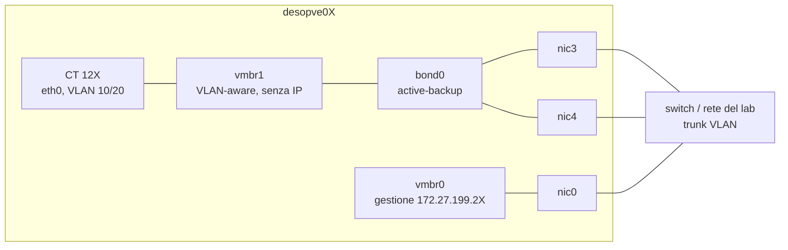
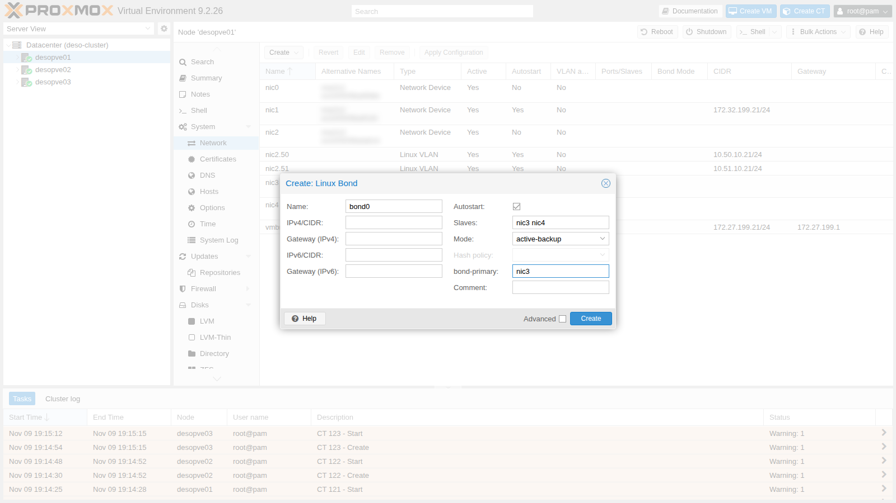
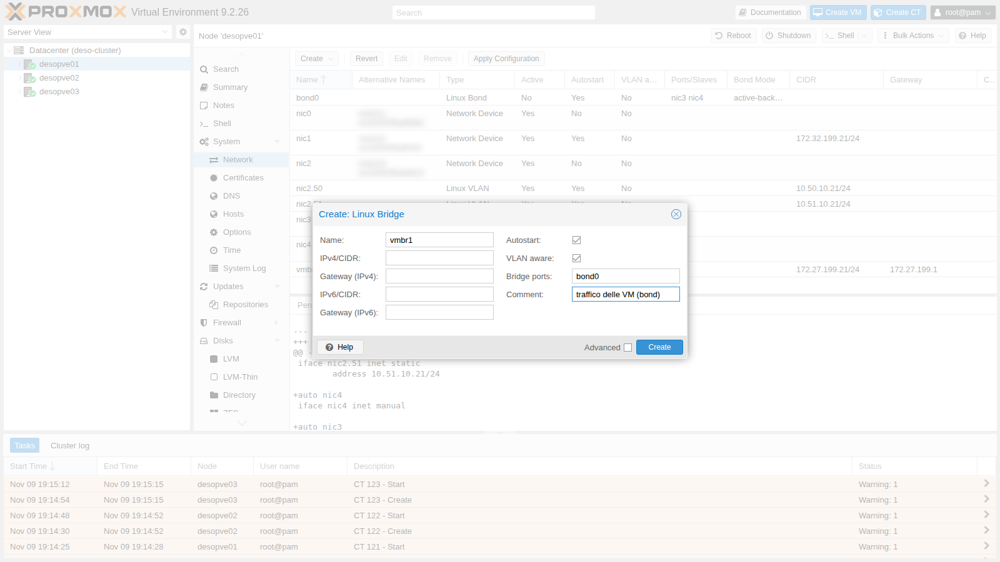
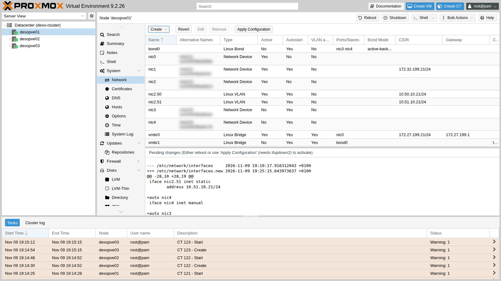
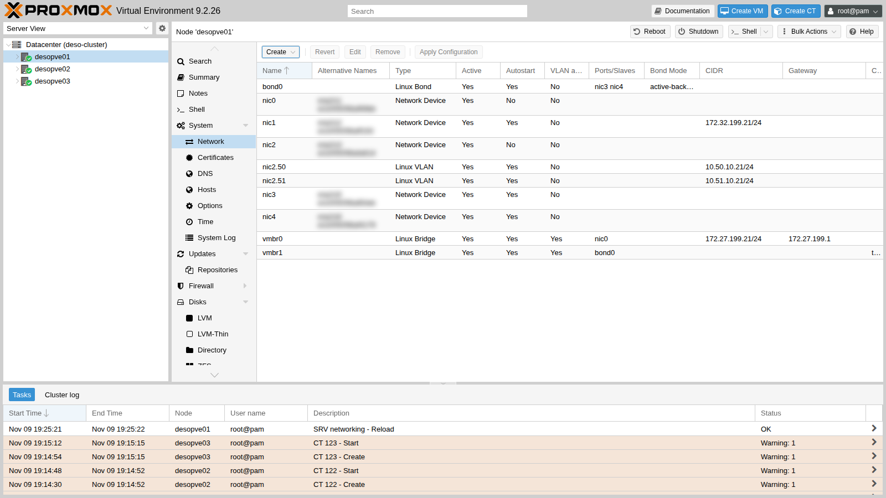

## Dipendenze

- **Lab precedenti:** [Lab 20](/it/20-bridges-stable-names-vlans/): schede `nic3` e `nic4` con nome stabile su `desopve01-03`, bridge VLAN-aware, container di prova 121-123 con `ping`, `tcpdump` e `iperf3`.
- **Rete:** le due schede di ogni nodo sono collegate alla stessa rete (allo stesso switch). Per la modalità LACP (802.3ad) servirebbe uno switch con un *port-channel* LACP configurato sulle due porte: nel laboratorio non c'è, e il lab mostra cosa succede in quel caso.
- **Credenziali:** `root` / `<password-lab>` sui nodi → [Appendice B](/it/b-credentials-and-addresses/).

## Obiettivi

- `bond0` (`nic3` + `nic4`, *active-backup*, link preferito `nic3`) sotto un bridge `vmbr1` VLAN-aware senza indirizzo IP su `desopve01-03`, creato dalla GUI su un nodo e dalla riga di comando sugli altri, con i container di prova spostati sul nuovo bridge e raggiungibili.
- Il guasto e il ritorno del link attivo con un ping in corso, con il cambio di link visibile nel log del kernel e i ping persi contati a un intervallo noto.
- *active-backup*, *balance-alb* e *802.3ad* confrontati con `iperf3` e con i contatori delle schede, sapendo quali modalità richiedono una configurazione dello switch e quale è adatta a un bond che porta un bridge con dei guest.
- Il pacchetto più grande che la rete delle VM trasporta da un capo all'altro, misurato con `ping -M do` prima di decidere sui jumbo frame.

## Come funziona

### Che cos'è un bond

Un **bond** (Linux bonding) unisce più schede fisiche in un'unica interfaccia logica, `bond0`. Serve a due cose:

- **ridondanza:** se un cavo, una porta o uno switch si guastano, il traffico prosegue sulle schede rimaste;
- **più banda complessiva**, solo in alcune modalità e solo con molti flussi: nelle modalità che bilanciano per flusso o per destinazione, **un singolo flusso usa un solo link**. Fa eccezione *balance-rr*, che distribuisce i pacchetti di un singolo flusso su tutti i link, a costo di consegnarli fuori ordine.

Il driver controlla lo stato dei link ogni `bond-miimon` millisecondi (qui 100) e smette di usare quelli giù.

### Le modalità

| Modalità | Nome | Switch | Uso di più link | Note |
|---|---|---|---|---|
| 0 | `balance-rr` | port-channel statico | sì, a turno pacchetto per pacchetto | riordina i pacchetti: sconsigliato per TCP |
| 1 | `active-backup` | **nessuna configurazione** | no: un link attivo, gli altri di riserva | la più semplice e robusta; con `bond-primary` scegli il link preferito |
| 2 | `balance-xor` | port-channel statico | sì, per flusso (hash) | |
| 3 | `broadcast` | – | ogni pacchetto su tutti i link | casi molto particolari |
| 4 | **`802.3ad`** (LACP) | **port-channel LACP** | sì, per flusso (hash) | lo standard dei datacenter; con due switch serve MLAG/vPC |
| 5 | `balance-tlb` | nessuna | solo in trasmissione | non adatta a un bond sotto un bridge con guest (vedi sotto) |
| 6 | `balance-alb` | nessuna | trasmissione e ricezione, **per destinazione** | bilancia la ricezione riscrivendo le risposte ARP del nodo; non adatta a un bond sotto un bridge con guest |

Nelle modalità che bilanciano "per flusso" il link si sceglie con una funzione di *hash* (`bond-xmit-hash-policy`): `layer2` (MAC), `layer2+3` (MAC + IP) o `layer3+4` (IP + porte). Con `layer3+4` due connessioni TCP tra gli stessi due host possono usare link diversi; un trasferimento singolo resta comunque su un link.

**Quali modalità usare con Proxmox VE.** La documentazione di Proxmox VE consiglia *802.3ad* quando lo switch supporta LACP e *active-backup* negli altri casi. Sconsiglia invece *balance-alb* e *balance-tlb* quando il bond porta un bridge Linux con dei guest: queste modalità presuppongono che l'host conosca gli indirizzi locali, mentre gli indirizzi dei guest appartengono alle VM e ai container dietro il bridge. Questo lab usa *balance-alb* al passo 6 solo per osservarne il comportamento, poi torna ad *active-backup*.

### Il disegno di questo lab



- `bond0` (`nic3` + `nic4`) è la porta di **`vmbr1`**, un secondo bridge VLAN-aware dedicato al **traffico delle VM**. Gestione, Corosync, storage e Ceph restano sulle loro schede.
- `vmbr1` **non ha un indirizzo IP**: il nodo non comunica su quella rete, la offre solo ai guest. In questo modo il bond non interferisce con il traffico del nodo.

### Ambiente e versioni della prova

I risultati della procedura vengono da prove eseguite a novembre 2026 (il log del kernel del passo 4 è del 9 novembre) nella configurazione descritta qui sotto. Con schede, switch o versioni diversi, gli stessi comandi possono dare numeri diversi.

| Componente | Configurazione della prova |
|---|---|
| Proxmox VE | 9.2.26, kernel `7.0.14-28-pve`, che fornisce anche il driver di bonding ([Lab 04](/it/04-first-access-repositories-updates/)) |
| Bond | `nic3` + `nic4` su ogni nodo, `miimon 100`, nessun ritardo in salita o in discesa; su `desopve01` entrambi i link a 10000 Mbps full duplex, come riportato da `/proc/net/bonding/bond0` |
| Switch | le due porte di ogni nodo sullo stesso switch, come trunk VLAN, senza port-channel né LACP su quelle porte ([Lab 01](/it/01-lab-architecture/)) |
| Bridge | `vmbr1`, VLAN-aware, senza indirizzo IP, MTU 1500 |
| Container di prova | CT 121 su `desopve01` e CT 122 su `desopve02`, nella VLAN 10: container Debian 13 non privilegiati (`debian-13-standard_13.6-1`), 1 core e 512 MiB di RAM ciascuno, `iperf3` e `iputils-ping` dai pacchetti Debian ([Lab 20](/it/20-bridges-stable-names-vlans/)) |
| Guasto | simulato su `desopve01` con `ip link set nic3 down` e `up`, non staccando il cavo |
| Strumenti | `ping` con una sonda ogni 0,2 s (`-i 0.2`), timeout di 1 secondo (`-W 1`) e marca temporale (`-D`); `iperf3` per 10 s con 1 o 4 flussi TCP, server sul CT 122; contatori di trasmissione in `/sys/class/net/<scheda>/statistics/tx_bytes` |

**Cosa misurano le prove e cosa no.** Misurano quello che vede un container su `desopve01` quando parla con un container su `desopve02` attraverso `vmbr1`, i due bond e lo switch. Un ping con una sonda ogni 0,2 secondi non può vedere un'interruzione più breve di quell'intervallo: "0% packet loss" significa che nessuna sonda è rimasta senza risposta, non che l'interruzione è durata zero secondi. Ogni valore di `iperf3` viene da una sola prova di 10 secondi in una direzione (CT 121 → CT 122), senza misurare la CPU: non dice nulla sulla variabilità né su cosa abbia limitato la banda. I contatori sono stati letti solo in trasmissione, e solo su `desopve01`. Il guasto è stato simulato sul nodo: lo stacco del cavo, il guasto di una porta dello switch o la perdita dello switch (nel laboratorio ce n'è uno solo) non sono stati provati, e LACP è stato provato solo senza un partner sullo switch.

## Procedura

### 1. bond0 e vmbr1 dalla GUI (desopve01)

1. Nodo **desopve01** → **System** → **Network** → **Create** → **Linux Bond**.
   - **Name** `bond0`;
   - **Slaves** `nic3 nic4`;
   - **Mode** `active-backup` (la GUI propone `balance-rr`);
   - **bond-primary** `nic3`: quando è disponibile, il link attivo è sempre questo;
   - nessun indirizzo IP.

   **Hash policy** resta disattivato: serve solo per `balance-xor` e `802.3ad`.

   

2. **Create** → **Linux Bridge**. **Name** `vmbr1`, **Bridge ports** `bond0`, **VLAN aware** attivo, nessun indirizzo IP, un commento che ricordi a cosa serve.

   

3. Le modifiche in attesa mostrano i due blocchi nuovi:

   

4. **Apply Configuration** → **Yes**.

   

   Il file risultante:

   ```text
   auto bond0
   iface bond0 inet manual
   	bond-slaves nic3 nic4
   	bond-miimon 100
   	bond-mode active-backup
   	bond-primary nic3

   auto vmbr1
   iface vmbr1 inet manual
   	bridge-ports bond0
   	bridge-stp off
   	bridge-fd 0
   	bridge-vlan-aware yes
   	bridge-vids 2-4094
   #traffico delle VM (bond)
   ```

   Lo stato del bond si legge in `/proc/net/bonding/bond0`:

   ```bash title="root@desopve01"
   cat /proc/net/bonding/bond0
   ```

   ```text output
   Ethernet Channel Bonding Driver: v7.0.14-28-pve

   Bonding Mode: fault-tolerance (active-backup)
   Primary Slave: nic3 (primary_reselect always)
   Currently Active Slave: nic3
   MII Status: up
   MII Polling Interval (ms): 100
   Up Delay (ms): 0
   Down Delay (ms): 0
   Peer Notification Delay (ms): 0

   Slave Interface: nic3
   MII Status: up
   Speed: 10000 Mbps
   Duplex: full
   Link Failure Count: 0
   Permanent HW addr: <MAC>
   Slave queue ID: 0

   Slave Interface: nic4
   MII Status: up
   Speed: 10000 Mbps
   Duplex: full
   Link Failure Count: 0
   Permanent HW addr: <MAC>
   Slave queue ID: 0
   ```

### 2. La stessa configurazione sugli altri nodi (CLI)

Su `desopve02` e `desopve03` aggiungi gli stessi due blocchi a `/etc/network/interfaces`, prima della riga `source /etc/network/interfaces.d/*`, dopo averne fatto una copia (`cp /etc/network/interfaces /root/interfaces.bak-lab21`). Poi applica e controlla:

```bash title="root@desopve02"
ifreload -a
grep -E "Currently Active|MII Status" /proc/net/bonding/bond0 | head -2
```

```text output
Currently Active Slave: nic3
MII Status: up
```

```bash title="root@desopve02"
cat /sys/class/net/vmbr1/bridge/vlan_filtering
```

```text output
1
```

Ripeti su `desopve03` e verifica che cluster e Ceph non abbiano subito interruzioni (`pvecm status`, `ceph -s`).

### 3. I container sulla rete delle VM

Sposta i tre container su `vmbr1`, con le stesse VLAN e gli stessi indirizzi. Si fa a caldo:

```bash title="root@desopve01"
pct set 121 -net0 name=eth0,bridge=vmbr1,tag=10,ip=10.10.10.121/24
```

```bash title="root@desopve02"
pct set 122 -net0 name=eth0,bridge=vmbr1,tag=10,ip=10.10.10.122/24
```

```bash title="root@desopve03"
pct set 123 -net0 name=eth0,bridge=vmbr1,tag=20,ip=10.20.20.123/24
```

```bash title="root@desopve01"
pct exec 121 -- ping -c2 -W1 10.10.10.122 | tail -2
```

```text output
2 packets transmitted, 2 received, 0% packet loss, time 1001ms
rtt min/avg/max/mdev = 0.927/1.380/1.834/0.453 ms
```

```bash title="root@desopve01"
bridge vlan show dev veth121i0
```

```text output
port              vlan-id
veth121i0         10 PVID Egress Untagged
```

Dalla GUI è lo stesso campo **Bridge** della scheda di rete del container (o della VM) che hai usato nel lab 20 per il tag.

### 4. Guasto del link attivo (active-backup)

Il CT 121 manda cinque ping al secondo al CT 122 (`-i 0.2`). Nel frattempo, su `desopve01`, il link attivo `nic3` cade e torna dopo 13 secondi. Nella prova riportata qui il guasto è stato simulato con `ip link set nic3 down`. Staccare il cavo di `nic3` è una prova più realistica, perché anche lo switch vede cadere la sua porta; con `ip link` questo dipende dalla scheda e dal suo driver.

```bash title="root@desopve01"
pct exec 121 -- bash -c "ping -D -i 0.2 -c 150 -W 1 10.10.10.122 > /root/ab.log" &
ip link set nic3 down
grep -E "Currently Active|Link Failure" /proc/net/bonding/bond0
```

```text output
Currently Active Slave: nic4
Link Failure Count: 1
Link Failure Count: 0
```

```bash title="root@desopve01"
ip link set nic3 up
grep "Currently Active" /proc/net/bonding/bond0
```

```text output
Currently Active Slave: nic3
```

```bash title="root@desopve01"
pct exec 121 -- tail -2 /root/ab.log
```

```text output
150 packets transmitted, 150 received, 0% packet loss, time 31030ms
rtt min/avg/max/mdev = 0.395/0.868/10.409/0.806 ms
```

Il kernel registra ogni passaggio:

```bash title="root@desopve01"
journalctl -k | grep bond0 | tail -4
```

```text output
Nov 09 19:26:44 desopve01 kernel: bond0: (slave nic3): link status definitely down, disabling slave
Nov 09 19:26:44 desopve01 kernel: bond0: (slave nic4): making interface the new active one
Nov 09 19:26:57 desopve01 kernel: bond0: (slave nic3): link status definitely up, 10000 Mbps full duplex
Nov 09 19:26:57 desopve01 kernel: bond0: (slave nic3): making interface the new active one
```

- **Misura:** 150 sonde inviate e 150 risposte (`0% packet loss`), con un tempo di andata e ritorno massimo di 10,4 ms (`rtt max`). Il log del kernel mostra `nic4` che subentra alle 19:26:44 e `nic3` (il *primary*) che torna link attivo alle 19:26:57.
- **Interpretazione:** nessuno dei due cambi di link è costato una sonda. Un'eventuale interruzione è stata abbastanza breve da cadere tra due sonde, o da ritardarne una di non più di 10,4 ms. La prova non dice quanto sia durata, né se i 10,4 ms, il tempo più alto della serie, coincidano con uno dei due passaggi.
- **Verifica:** in `/root/ab.log`, dentro il CT 121, cerca la riga con il `time=` più alto e confronta la sua marca temporale (`-D`) con il log del kernel; per una risoluzione migliore, ripeti la prova con un ping più fitto, per esempio `-i 0.01`.

**Cosa deve reimparare lo switch.** Dopo un cambio di link, lo switch deve imparare dietro quale porta si trovano ora i MAC dei guest. Secondo la documentazione del kernel, in *active-backup* il bond manda ARP gratuiti sul nuovo link solo per sé stesso e per le interfacce VLAN sopra di lui, e solo se hanno un indirizzo IP. Qui `bond0` non ne ha e i guest stanno dietro il bridge, quindi nessuno annuncia i loro indirizzi. In questa prova il ping continuo ha fatto trasmettere subito il CT 121 sul nuovo link, e tanto basta perché lo switch ne impari l'indirizzo. Il caso di un guest che non trasmette non è stato provato, e l'esito dipende dallo switch. Se lo switch vede cadere la vecchia porta, di norma dimentica gli indirizzi imparati su di essa e inoltra i frame destinati a loro su tutte le porte della VLAN. Se la vecchia porta resta su (un guasto più avanti sul percorso, o un `ip link` che lascia attivo il collegamento fisico), lo switch continua a mandare sulla vecchia porta finché il guest non trasmette o la voce non scade nella sua tabella MAC. Per verificarlo: ferma il traffico del CT 121, porta giù `nic3`, poi fai un ping al CT 121 dal CT 122 e guarda quando arrivano le risposte; sullo switch, confronta la porta associata al MAC del container prima e dopo il cambio.

### 5. Banda: un flusso, un link

Con `iperf3` misuri la banda tra il CT 121 e il CT 122 (server sul 122 con `iperf3 -s -D`):

```bash title="root@desopve01"
pct exec 121 -- iperf3 -c 10.10.10.122 -t 10 -f g | tail -4
```

```text output
[  5]   0.00-10.00  sec  6.54 GBytes  5.62 Gbits/sec  191            sender
[  5]   0.00-10.00  sec  6.54 GBytes  5.61 Gbits/sec                  receiver
```

- **Misura:** un flusso TCP di 10 secondi dal CT 121 al CT 122: 5,62 Gbit/s al mittente e 5,61 Gbit/s al ricevente, con 191 ritrasmissioni (colonna `Retr`). I link di `desopve01` vanno a 10 Gbit/s.
- **Interpretazione:** in *active-backup* il traffico passa da un solo link, quindi un flusso non può superare i 10 Gbit/s. Si è fermato a 5,62: la velocità del link, da sola, non spiega il risultato. Il limite può venire dal core unico di ciascun container, dal percorso attraverso `veth`, bridge e bond, dallo switch, o da perdite lungo la strada, a cui fanno pensare le ritrasmissioni: la prova non distingue queste cause. Al passo 6 quattro flussi, tutti su `nic3`, arrivano in totale a 5,72 Gbit/s, più o meno come uno solo. È compatibile con un limite comune a tutti i flussi più che con un limite per flusso, ma la modalità del bond è diversa e ogni valore viene da una sola prova.
- **Verifica:** durante la prova, osserva l'uso della CPU nei container e sui nodi (`top`): un core fisso al 100% fa pensare a un limite di CPU; leggi i contatori `tx_bytes` di `nic3` e `nic4` per confermare che il flusso passa da un solo link; ripeti la prova con container con più core e confronta.

### 6. balance-alb: bilanciamento senza configurare lo switch

:::caution[Una prova, non una configurazione da tenere]
La documentazione di Proxmox VE sconsiglia *balance-alb* e *balance-tlb* quando il bond porta un bridge con dei guest, come fa qui `bond0`. Questo passo usa *balance-alb* solo per vedere come distribuisce il traffico; alla fine del passo 7 il bond torna ad *active-backup*.
:::

1. Su `desopve01` e `desopve02` cambia la modalità: in `bond0` sostituisci `bond-mode active-backup` con `bond-mode balance-alb` e togli la riga `bond-primary`, così nessuna scheda è preferita. `ifreload -a` applica il cambio a caldo.

   ```bash title="root@desopve01"
   ifreload -a; grep "Bonding Mode" /proc/net/bonding/bond0
   ```

   ```text output
   Bonding Mode: adaptive load balancing
   ```

2. Quattro flussi paralleli verso lo stesso container, misurando i byte trasmessi da ciascuna scheda. Leggi i contatori prima e dopo il test, e fai la differenza:

   ```bash title="root@desopve01"
   cat /sys/class/net/nic3/statistics/tx_bytes /sys/class/net/nic4/statistics/tx_bytes
   pct exec 121 -- iperf3 -c 10.10.10.122 -t 10 -P 4 -f g | grep "SUM.*receiver"
   ```

   ```text output
   [SUM]   0.00-10.00  sec  6.66 GBytes  5.72 Gbits/sec                  receiver
   ```

   ```bash title="root@desopve01"
   cat /sys/class/net/nic3/statistics/tx_bytes /sys/class/net/nic4/statistics/tx_bytes
   ```

   | Scheda | Byte trasmessi durante il test |
   |---|---|
   | `nic3` | 7,17 GB |
   | `nic4` | 0,00 GB |

   - **Misura:** quattro flussi TCP paralleli dal CT 121 al CT 122 per 10 secondi, 5,72 Gbit/s in totale al ricevente (riga `SUM`). Durante la prova `nic3` ha trasmesso 7,17 GB e `nic4` niente.
   - **Interpretazione:** compatibile con *balance-alb* che sceglie il link di trasmissione **per destinazione**: i quattro flussi vanno allo stesso indirizzo IP, quindi condividono una scheda. Con molti guest che parlano con host diversi, il carico in trasmissione si distribuirebbe sui due link. In ricezione, la documentazione del kernel descrive il bilanciamento (*rlb*) come una riscrittura delle risposte ARP inviate dal sistema locale, e il codice del driver salta il traffico ARP che non viene dal bond stesso o da una VLAN direttamente sopra di lui: i guest dietro il bridge restano esclusi, e il loro traffico entrerebbe da una scheda sola. La prova ha letto solo i contatori di trasmissione, quindi non mostra il lato della ricezione.
   - **Verifica:** ripeti con flussi verso più host diversi e confronta i contatori delle due schede; per la ricezione, leggi i contatori `rx_bytes` di `nic3` e `nic4` durante una prova nella direzione opposta (`iperf3 -R`).

3. Guasto di `nic3` con il ping in corso:

   ```bash title="root@desopve01"
   pct exec 121 -- bash -c "ping -D -i 0.2 -c 100 -W 1 10.10.10.122 > /root/alb.log" &
   ip link set nic3 down
   grep -E "Slave Interface|MII Status" /proc/net/bonding/bond0 | tail -4
   ```

   ```text output
   Slave Interface: nic3
   MII Status: down
   Slave Interface: nic4
   MII Status: up
   ```

   ```bash title="root@desopve01"
   ip link set nic3 up
   pct exec 121 -- tail -2 /root/alb.log
   ```

   ```text output
   100 packets transmitted, 99 received, 1% packet loss, time 20559ms
   ```

   - **Misura:** 100 sonde, una ogni 0,2 secondi, e 99 risposte: una sonda persa (`1% packet loss`).
   - **Interpretazione:** compatibile con una breve interruzione mentre il bond sposta il traffico da `nic3` a `nic4` e lo switch impara la nuova porta, ma la prova non lo dimostra. Non dice quando la sonda è andata persa (alla caduta del link, al suo ritorno o in un altro momento), né quanto è durata l'interruzione: se la perdita viene davvero da un cambio di link, una sola sonda persa, con risposta a quella prima e a quella dopo, indica che è durata meno di circa 0,4 secondi.
   - **Verifica:** in `/root/alb.log` cerca l'`icmp_seq` mancante e confronta le marche temporali (`-D`) delle sonde vicine con il log del kernel (`journalctl -k | grep bond0`); ripeti con un ping più fitto.

### 7. LACP (802.3ad) senza uno switch che lo negozia

LACP è la modalità standard nei datacenter: le schede del nodo e le porte dello switch formano un unico canale, e il protocollo LACP verifica continuamente che i due lati siano d'accordo. **Richiede la configurazione dello switch.** Questo passo mostra cosa succede se lo switch non la ha.

1. **Configurazione provata.** Solo su `desopve01` (`desopve02` resta in *balance-alb* dal passo 6) imposta:

   ```text
   auto bond0
   iface bond0 inet manual
   	bond-slaves nic3 nic4
   	bond-miimon 100
   	bond-mode 802.3ad
   	bond-xmit-hash-policy layer3+4
   	bond-lacp-rate fast
   ```

2. Applica (`ifreload -a`) e osserva lo stato:

   ```bash title="root@desopve01"
   grep -E "Mode|Hash|LACP|Aggregator ID|Number of ports|Partner Mac|Slave Interface" /proc/net/bonding/bond0
   ```

   ```text output
   Bonding Mode: IEEE 802.3ad Dynamic link aggregation
   Transmit Hash Policy: layer3+4 (1)
   LACP active: on
   LACP rate: fast
   	Aggregator ID: 1
   	Number of ports: 1
   	Partner Mac Address: 00:00:00:00:00:00
   Slave Interface: nic3
   Aggregator ID: 1
   Slave Interface: nic4
   Aggregator ID: 2
   ```

   **Comportamento osservato:**

   - **`Partner Mac Address: 00:00:00:00:00:00`**: dall'altra parte nessuno risponde a LACP;
   - ogni scheda finisce in un **aggregatore diverso** (1 e 2), e l'aggregatore attivo ha **una sola porta**.

   **Interpretazione.** Senza partner, ogni scheda forma un aggregatore a sé e il bond ne usa uno solo: funziona, ma su un link alla volta, come un *active-backup* travestito che non aggiunge banda. Questa lettura viene dallo stato degli aggregatori; la banda in questa modalità non è stata misurata.

3. Il traffico passa, anche mentre `nic3` resta giù per 3 secondi:

   ```bash title="root@desopve01"
   pct exec 121 -- ping -c4 -W1 10.10.10.122 | tail -2
   ```

   ```text output
   4 packets transmitted, 4 received, 0% packet loss, time 3064ms
   rtt min/avg/max/mdev = 0.475/0.594/0.718/0.091 ms
   ```

   ```bash title="root@desopve01"
   pct exec 121 -- bash -c "ping -D -i 0.2 -c 75 -W 1 10.10.10.122 > /root/lacp.log" &
   ip link set nic3 down; sleep 3; ip link set nic3 up
   pct exec 121 -- tail -2 /root/lacp.log
   ```

   ```text output
   75 packets transmitted, 75 received, 0% packet loss, time 15335ms
   ```

   - **Misura:** 4 ping su 4 con risposta prima del guasto; poi 75 sonde a intervalli di 0,2 secondi, in circa 15 secondi che comprendono i 3 con `nic3` giù, tutte con risposta.
   - **Interpretazione:** compatibile con il passaggio del bond all'altro aggregatore quando cade l'unica porta di quello attivo, come fa la politica di selezione predefinita (`ad_select stable`) secondo la documentazione del kernel. L'output non mostra il cambio di aggregatore.
   - **Verifica:** leggi la sezione `Active Aggregator Info` di `/proc/net/bonding/bond0` mentre `nic3` è giù; confronta i contatori `tx_bytes` delle due schede durante un `iperf3 -P 4`: in questo stato dovrebbe crescere solo uno dei due.

   **Con LACP configurato sullo switch** (non verificabile in questo laboratorio), `Partner Mac Address` mostra il MAC dello switch e le due schede stanno nello **stesso** aggregatore (`Number of ports: 2`). Con due switch per la ridondanza, questi devono supportare MLAG/vPC (o stack), perché LACP vede i due switch come uno solo.

4. **Decisione.** Torna ad *active-backup* su `desopve01` e `desopve02` (stesso blocco del passo 1, con `bond-primary nic3`) e applica con `ifreload -a`. Se non controlli la configurazione dello switch, è la modalità che non gli chiede niente, ed è quella che la documentazione di Proxmox VE consiglia quando LACP non è disponibile. **Risultato:** `bond0` torna in *active-backup*, con `nic3` preferito, su entrambi i nodi: è la configurazione che resta per i lab successivi.

### 8. MTU e jumbo frame: verificare prima di usarli

I *jumbo frame* (MTU 9000) trasportano gli stessi dati in meno pacchetti, e riducono così il lavoro per pacchetto del traffico storage e di migrazione. Funzionano solo se **tutto il percorso** li accetta: schede, bond, switch, porte dei guest e guest. Basta un elemento rimasto a 1500 per scartare i frame più grandi, e il sintomo sembra un generico problema di rete.

**Configurazione provata.** Prova temporanea (con `ip link`, quindi non persistente) tra il CT 121 su `desopve01` e il CT 122 su `desopve02`. Su ogni nodo alza l'MTU del bond (che la applica anche a `nic3` e `nic4`), del lato nodo della scheda del container (`veth121i0`, `veth122i0`) e della scheda nel container. Il bridge `vmbr1` non va toccato: per i frame che lo attraversano conta l'MTU delle porte.

```bash title="root@desopve01"
ip link set bond0 mtu 9000; ip link set veth121i0 mtu 9000
pct exec 121 -- ip link set eth0 mtu 9000
```

```bash title="root@desopve02"
ip link set bond0 mtu 9000; ip link set veth122i0 mtu 9000
pct exec 122 -- ip link set eth0 mtu 9000
```

```bash title="root@desopve01"
pct exec 121 -- ping -M do -s 1472 -c 3 -W 1 10.10.10.122 | tail -2
```

```text output
3 packets transmitted, 3 received, 0% packet loss, time 2036ms
rtt min/avg/max/mdev = 0.480/0.799/1.392/0.419 ms
```

```bash title="root@desopve01"
pct exec 121 -- ping -M do -s 8972 -c 3 -W 1 10.10.10.122 | tail -2
```

```text output
3 packets transmitted, 0 received, 100% packet loss, time 2081ms
```

`-M do` vieta la frammentazione, e `-s 8972` più 28 byte di intestazioni fa un pacchetto da 9000 byte: non passa, mentre quello da 1500 sì. Per capire dove sta il limite, prova dimensioni crescenti:

```bash title="root@desopve01"
for s in 4000 8000 8910 8912; do r=$(pct exec 121 -- ping -M do -s $s -c 2 -W 1 10.10.10.122 | grep -o "[0-9]* received"); echo "$s: $r"; done
```

```text output
4000: 2 received
8000: 2 received
8910: 2 received
8912: 0 received
```

**Comportamento osservato.** Con la frammentazione vietata, i pacchetti da 1500 byte (`-s 1472`) passano e quelli da 9000 byte (`-s 8972`) no: 3 inviati, nessuna risposta, e la riga di riepilogo non riporta errori. Con dimensioni crescenti, 8910 byte di dati ICMP (un pacchetto da 8938 byte) passano ancora e 8912 (8940 byte) no; 8911 non è stato provato.

**Interpretazione.** Qualcosa sul percorso tra i due nodi lascia passare i pacchetti IP da 8938 byte e scarta quelli da 8940. Visto che i pacchetti da 8938 byte sono passati, le interfacce dei due nodi erano davvero state portate ben oltre 1500: il limite è compatibile con un elemento esterno ai nodi, come la dimensione massima dei frame dello switch, ma la prova non mostra dove vengono scartati i frame più grandi. Mostra però perché il problema è difficile da individuare: nessuno segnala un errore, i pacchetti più grandi semplicemente spariscono.

**Verifica.** Cattura il traffico su entrambi i nodi (`tcpdump -eni bond0 'icmp and greater 8000'`) mentre il CT 121 manda un pacchetto da 8940 byte (`ping -M do -s 8912`): se il frame esce da `desopve01` e non compare mai su `desopve02`, viene scartato in rete. Controlla anche l'MTU effettiva di ogni interfaccia (`ip link show`), gli errori in ricezione delle schede di `desopve02` (`ip -s link show nic3`) e la dimensione massima dei frame configurata sulle porte dello switch.

**Decisione.** In questo laboratorio restiamo a 1500. Per i jumbo frame servirebbe un'MTU comune che passi su tutto il percorso, qui al massimo 8938, e uno switch configurato di conseguenza. Riporta tutto com'era:

```bash title="root@desopve01"
pct exec 121 -- ip link set eth0 mtu 1500; ip link set veth121i0 mtu 1500; ip link set bond0 mtu 1500
```

```bash title="root@desopve02"
pct exec 122 -- ip link set eth0 mtu 1500; ip link set veth122i0 mtu 1500; ip link set bond0 mtu 1500
```

**Risultato.** MTU di nuovo a 1500 su tutte le interfacce, come nel resto del manuale. In produzione l'MTU si imposta nel file di rete (`mtu 9000` sulle schede, sul bond e sul bridge) solo dopo aver verificato lo switch, e si controlla sempre con `ping -M do` alla dimensione piena, in entrambe le direzioni.

## Verifica e test

Il lab è riuscito se `bond0` è attivo in *active-backup* sui tre nodi con i container raggiungibili su `vmbr1`, se il guasto del link attivo compare nel log del kernel con i ping persi contati, e se per ogni risultato qui sotto sai dire che cosa è stato misurato e con quale strumento.

| Prova | Criterio di successo | Osservato nel laboratorio |
|---|---|---|
| `bond0` + `vmbr1` VLAN-aware su `desopve01-03` | `Currently Active Slave: nic3` e `MII Status: up`; `vlan_filtering` a 1; quorum e stato di Ceph invariati (`pvecm status`, `ceph -s`) | attivi sui tre nodi, senza interruzioni viste da `pvecm status` e `ceph -s` |
| Container su `vmbr1` | il CT 121 raggiunge il CT 122; `veth121i0` con PVID 10 | 2 ping su 2 con risposta; VLAN 10 senza tag sulla porta |
| *active-backup*, guasto e ritorno del link attivo | passaggio a `nic4` e ritorno a `nic3` nel log del kernel; ping persi contati a un intervallo noto | 0 sonde perse su 150 (una ogni 0,2 s); tempo di andata e ritorno massimo 10,4 ms |
| Un flusso TCP (*active-backup*) | un valore di riferimento, con strumento e parametri annotati | 5,62 Gbit/s al mittente, 191 ritrasmissioni, su link a 10 Gbit/s |
| *balance-alb*, 4 flussi verso un solo host | contatori che mostrano quale scheda ha trasmesso | 5,72 Gbit/s in totale; 7,17 GB su `nic3`, niente su `nic4` |
| *balance-alb*, guasto di un link | ping persi contati a un intervallo noto | 1 sonda persa su 100 (una ogni 0,2 s) |
| *802.3ad* senza switch LACP | riconoscere i segni di un partner assente | partner `00:00:00:00:00:00`, aggregatori separati, una porta in quello attivo; 0 sonde perse su 75, a cavallo di un guasto di 3 secondi |
| MTU sul percorso | `ping -M do -s 8972` con risposta prima di adottare l'MTU 9000 | 100% di perdita a 9000 byte; pacchetto più grande che passa: 8938 byte. L'MTU resta a 1500 |

## Stato finale del lab

- **`desopve01-03`:** `bond0` (`nic3` + `nic4`, *active-backup*, `bond-primary nic3`, `miimon 100`) e **`vmbr1`** VLAN-aware (`2-4094`) senza indirizzo IP, per il traffico delle VM. MTU 1500 ovunque.
- **Rete di gestione, Corosync, iSCSI e Ceph:** invariati (`vmbr0` su `nic0`, `nic1`, `nic2.50`/`nic2.51`).
- **Container di prova, ora su `vmbr1`:** CT 121 (`desopve01`, VLAN 10, `10.10.10.121`), CT 122 (`desopve02`, VLAN 10, `10.10.10.122`, server `iperf3` attivo), CT 123 (`desopve03`, VLAN 20, `10.20.20.123`).
- Copie della configurazione precedente in `/root/interfaces.bak-lab21` su `desopve02` e `desopve03`.

## Cosa hai imparato

- **Scegliere la modalità del bond in base a quello che offre lo switch.** Se non puoi configurare lo switch, usa *active-backup*, con `bond-primary` quando un link è preferito. Se lo switch ha un port-channel LACP su quelle porte, usa *802.3ad*; con due switch, verifica che supportino MLAG/vPC o lo stack. Tieni *balance-alb* e *balance-tlb* lontane dai bond che portano un bridge con dei guest, come consiglia la documentazione di Proxmox VE.
- **Avere le aspettative giuste sulla banda.** A parte *balance-rr*, un flusso non usa mai più di un link, e *balance-alb* sceglie la scheda per destinazione, quindi tutto il traffico verso un host passa da una scheda. Prima di dare la colpa ai link per un valore basso, confrontalo con la loro velocità: qui un flusso ha raggiunto 5,62 Gbit/s su link da 10 Gbit/s, quindi la velocità del link da sola non lo spiega.
- **Riconoscere un bond LACP senza partner:** `Partner Mac Address: 00:00:00:00:00:00`, un aggregatore per scheda e `Number of ports: 1`. Il bond continua a funzionare, ma su un link solo.
- **Leggere una prova di failover per quello che misura.** L'intervallo del ping fissa la risoluzione: 0% di perdita con una sonda ogni 0,2 secondi significa che nessuna sonda è andata persa, non che l'interruzione è durata zero secondi. Confronta le marche temporali del ping con il log del kernel, e ricorda che la sorte di un guest silenzioso dipende da come lo switch reimpara il suo MAC.
- **Decidere sui jumbo frame.** Solo dopo che `ping -M do` alla dimensione piena passa da un capo all'altro, in entrambe le direzioni: altrimenti i pacchetti più grandi spariscono senza errori, come a 9000 byte in questo laboratorio.
- **Tenere il nodo fuori dalla rete dei guest.** Un bridge senza indirizzo IP offre la rete ai guest senza esporre il nodo su quella rete.

## Riferimenti

- [Proxmox VE – Linux Bond: le modalità, quelle consigliate e *balance-alb*/*balance-tlb* con un bridge](https://pve.proxmox.com/pve-docs/pve-admin-guide.html#sysadmin_network_bond)
- [Kernel Linux 7.0 – Opzioni del driver di bonding (`mode`, `miimon`, `primary`, `ad_select`, `num_grat_arp`)](https://www.kernel.org/doc/html/v7.0/networking/bonding.html#bonding-driver-options)
- [Kernel Linux 7.0 – Bonding: la configurazione dello switch richiesta da ogni modalità](https://www.kernel.org/doc/html/v7.0/networking/bonding.html#switch-configuration)
- [Linux 7.0 – `bond_alb.c`: bilanciamento in trasmissione per destinazione e risposte ARP escluse da *rlb* (`rlb_arp_xmit`)](https://github.com/torvalds/linux/blob/v7.0/drivers/net/bonding/bond_alb.c)
- [Debian 13 – `iperf3(1)`: flussi paralleli (`-P`), durata (`-t`), direzione inversa (`-R`)](https://manpages.debian.org/trixie/iperf3/iperf3.1.en.html)
- [Debian 13 – `ping(8)`: intervallo (`-i`), timeout (`-W`), marca temporale (`-D`), niente frammentazione (`-M do`)](https://manpages.debian.org/trixie/iputils-ping/ping.8.en.html)
