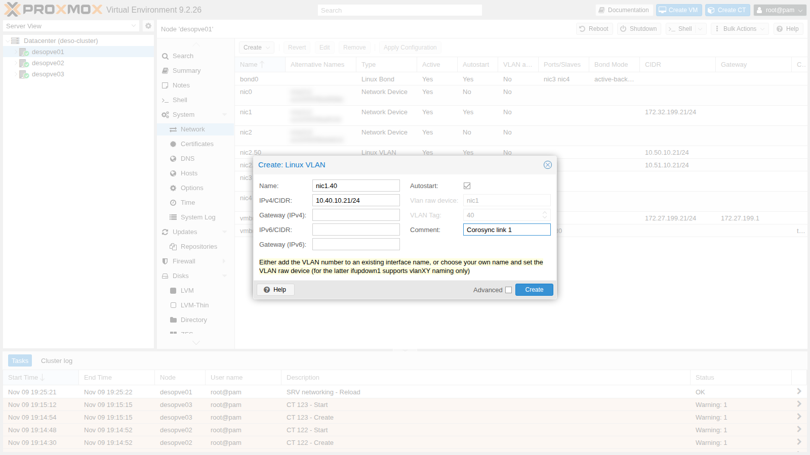
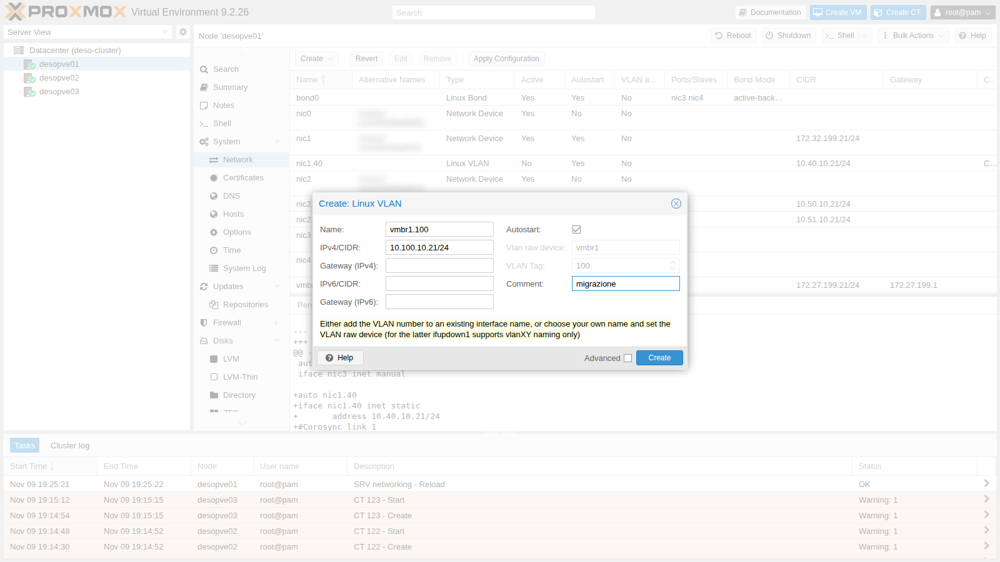
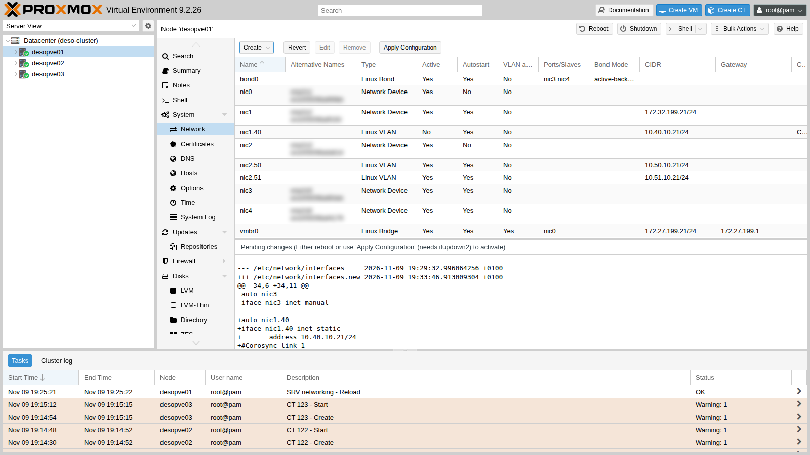
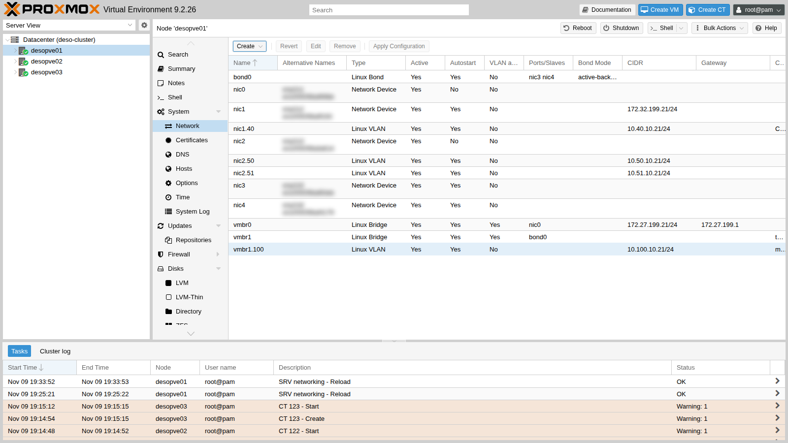
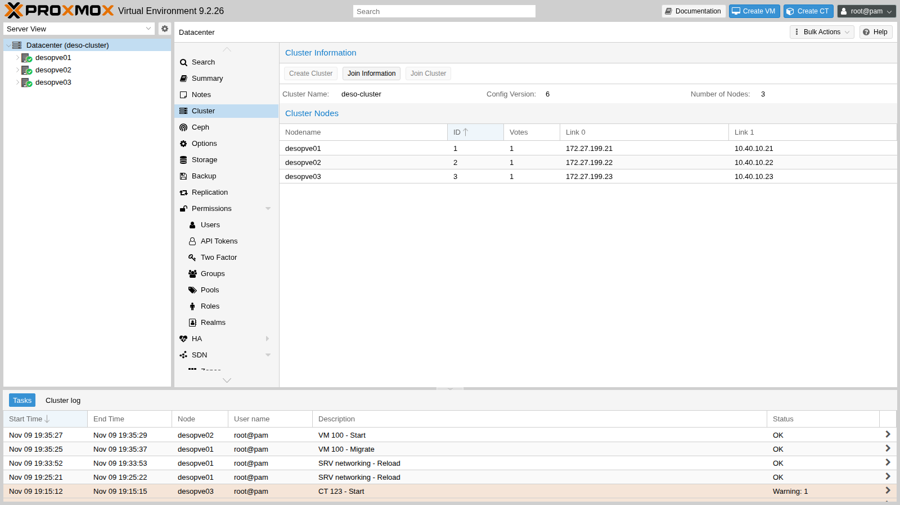
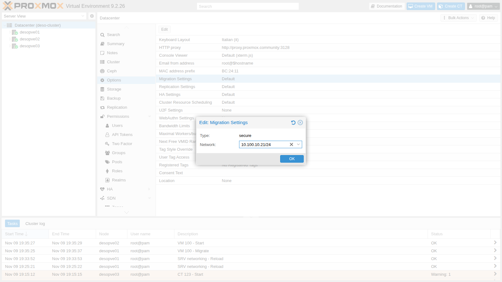
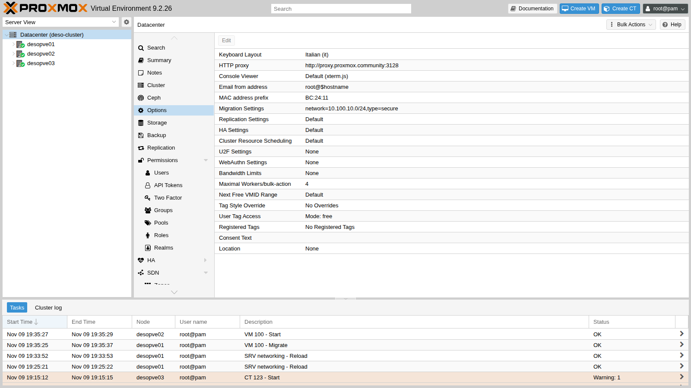
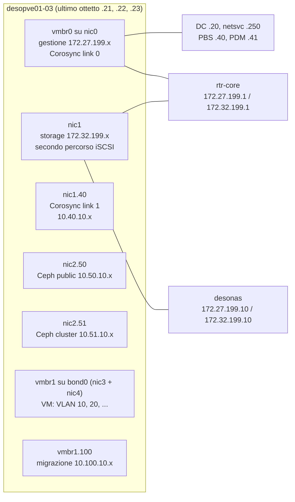

## Dipendenze

- **Lab precedenti:**
  - [Lab 06](/it/06-cluster-corosync/): cluster con due link di Corosync;
  - [Lab 15](/it/15-iscsi-lvm-multipath/): secondo percorso iSCSI su `nic1`;
  - [Lab 17](/it/17-ceph-installation/): reti di Ceph sulle VLAN 50 e 51;
  - [Lab 20](/it/20-bridges-stable-names-vlans/) e [Lab 21](/it/21-bonding/): bridge VLAN-aware, `bond0` e `vmbr1`.
- **VM:** la VM 100 `debian01` con il disco su `rbd-vm`, accesa su `desopve01`: serve per misurare la migrazione.
- **Rete:** lo switch del laboratorio trasporta le VLAN sulle porte dei nodi (trunk). Le nuove VLAN 40 e 100 **non** hanno un router.
- **Credenziali:** `root` / `<password-lab>` sui nodi → [Appendice B](/it/b-credentials-and-addresses/).

## Obiettivi

- Capire perché in un cluster si separano i tipi di traffico, e perché Corosync è il più delicato.
- Spostare il secondo link di Corosync su una VLAN dedicata e non instradata, senza mai perdere il quorum.
- Dedicare una rete alle migrazioni e verificare con i contatori che il traffico passi davvero da lì.
- Simulare la caduta del link dedicato di Corosync.
- Avere il quadro completo delle reti del laboratorio.

## Come funziona

### Tipi di traffico, esigenze diverse

| Traffico | Cosa conta | Cosa succede se soffre |
|---|---|---|
| **Corosync** (cluster) | latenza bassa e costante, poca banda | se i pacchetti arrivano in ritardo il nodo perde il quorum; con l'alta disponibilità attiva viene isolato e riavviato (*fencing*) |
| **Storage** (NFS, iSCSI) | banda e latenza | VM lente, I/O in attesa |
| **Ceph** public e cluster | banda e latenza; la *cluster network* porta la replica tra gli OSD | scritture lente, *slow ops* |
| **Migrazione** | molta banda, a raffiche | migrazioni lente; se condivide il link con Corosync, può disturbarlo |
| **VM** | dipende dai servizi | |
| **Gestione** | poca banda | GUI e SSH irraggiungibili |

Il rischio tipico è una migrazione o un backup che satura il link condiviso con Corosync: i pacchetti del cluster arrivano in ritardo e un nodo sano viene escluso. Per questo la documentazione di Proxmox VE raccomanda **almeno un link di Corosync su una rete fisica separata**, più un secondo link di riserva.

### Corosync con due link

Corosync (trasporto *knet*) tiene sotto controllo tutti i link, ma in modalità `passive` trasmette su uno solo, quello con la priorità più alta tra quelli funzionanti, e passa all'altro appena il primo cade. Nel laboratorio:

- **link 0**: rete di gestione (`vmbr0`);
- **link 1**: finora sulla `172.32.199.0/24` di `nic1`, la stessa rete del secondo percorso iSCSI e instradata da `rtr-core`. In questo lab va su una **VLAN dedicata, la 40**, senza gateway.

### Interfacce VLAN su una scheda e su un bridge

| Interfaccia | Cosa è | Uso nel lab |
|---|---|---|
| `nic1.40` | VLAN 40 sopra la scheda `nic1`: frame con tag 40 sullo stesso cavo del traffico senza tag | link 1 di Corosync |
| `vmbr1.100` | indirizzo del **nodo** nella VLAN 100 del bridge VLAN-aware `vmbr1` (sopra il bond) | rete di migrazione |

Le due reti non hanno router: il traffico non può passare da `rtr-core` e restare "in piedi" per vie traverse quando il link dedicato cade. E non si ripete il problema ARP del lab 15, perché ogni VLAN è un dominio di broadcast separato.

### La rete di migrazione

In **Datacenter** → **Options** → **Migration Settings** si sceglie:

- **Network**: la rete (CIDR) su cui i nodi si scambiano la memoria e i dischi durante le migrazioni;
- **Type**: `secure` (predefinito: il traffico passa in un tunnel SSH cifrato) oppure `insecure` (TCP in chiaro, più veloce, accettabile solo su una rete dedicata e isolata).

## Procedura

### 1. Le interfacce VLAN dalla GUI (desopve01)

1. Nodo **desopve01** → **System** → **Network** → **Create** → **Linux VLAN**. **Name** `nic1.40` (la GUI ricava da sé scheda e VLAN dal nome), **IPv4/CIDR** `10.40.10.21/24`, nessun gateway, **Autostart** attivo, commento `Corosync link 1`.

   

2. **Create** → **Linux VLAN**. **Name** `vmbr1.100`, **IPv4/CIDR** `10.100.10.21/24`, commento `migrazione`.

   

3. Controlla le modifiche in attesa e applicale con **Apply Configuration**.

   

   

   ```text
   auto nic1.40
   iface nic1.40 inet static
   	address 10.40.10.21/24
   #Corosync link 1

   auto vmbr1.100
   iface vmbr1.100 inet static
   	address 10.100.10.21/24
   #migrazione
   ```

### 2. Le stesse interfacce sugli altri nodi (CLI)

Su `desopve02` e `desopve03` aggiungi gli stessi due blocchi (con `.22` e `.23`) prima della riga `source`, dopo una copia del file (`/root/interfaces.bak-lab22`), poi `ifreload -a`. Verifica da `desopve01`:

```bash title="root@desopve01"
for ip in 10.40.10.22 10.40.10.23 10.100.10.22 10.100.10.23; do printf "%s " $ip; ping -c2 -W1 $ip >/dev/null && echo ok || echo NO; done
```

```text output
10.40.10.22 ok
10.40.10.23 ok
10.100.10.22 ok
10.100.10.23 ok
```

```bash title="root@desopve01"
ip route get 10.40.10.22
```

```text output
10.40.10.22 dev nic1.40 src 10.40.10.21 uid 0
    cache
```

```bash title="root@desopve01"
ping -c1 -W1 10.40.10.1 >/dev/null 2>&1 || echo "nessun router su 10.40.10.0/24"
```

```text output
nessun router su 10.40.10.0/24
```

### 3. Spostare il link 1 di Corosync sulla VLAN 40

1. La situazione di partenza:

   ```bash title="root@desopve01"
   corosync-cfgtool -n
   ```

   ```text output
   Local node ID 1, transport knet
   nodeid: 2 reachable
      LINK: 0 udp (172.27.199.21->172.27.199.22) enabled connected mtu: 1397
      LINK: 1 udp (172.32.199.21->172.32.199.22) enabled connected mtu: 1397

   nodeid: 3 reachable
      LINK: 0 udp (172.27.199.21->172.27.199.23) enabled connected mtu: 1397
      LINK: 1 udp (172.32.199.21->172.32.199.23) enabled connected mtu: 1397
   ```

2. Si modifica **sempre una copia** di `/etc/pve/corosync.conf`, la si controlla e poi la si mette al suo posto con un solo `mv`. Un file a metà o sbagliato verrebbe distribuito subito a tutti i nodi. Oltre agli indirizzi va incrementato **`config_version`**, altrimenti i nodi ignorano la modifica. Il valore dipende dalla storia del cluster (qui è 5, dopo l'ingresso e l'uscita di `desopve04` nel lab 18): il comando `perl` lo legge e lo aumenta di uno, qualunque sia.

   ```bash title="root@desopve01"
   cp /etc/pve/corosync.conf /root/corosync.conf.bak-lab22
   cp /etc/pve/corosync.conf /etc/pve/corosync.conf.new
   grep config_version /etc/pve/corosync.conf.new
   ```

   ```text output
     config_version: 5
   ```

   ```bash title="root@desopve01"
   sed -i "s/ring1_addr: 172.32.199.2/ring1_addr: 10.40.10.2/" /etc/pve/corosync.conf.new
   perl -pi -e 's/(config_version: )(\d+)/$1.($2+1)/e' /etc/pve/corosync.conf.new
   diff -u /etc/pve/corosync.conf /etc/pve/corosync.conf.new
   ```

   ```text output
   @@ -9,21 +9,21 @@
        nodeid: 1
        quorum_votes: 1
        ring0_addr: 172.27.199.21
   -    ring1_addr: 172.32.199.21
   +    ring1_addr: 10.40.10.21
      }
   ...
   -    ring1_addr: 172.32.199.23
   +    ring1_addr: 10.40.10.23
      }
    }
   @@ -33,7 +33,7 @@
    totem {
      cluster_name: deso-cluster
   -  config_version: 5
   +  config_version: 6
      interface {
        linknumber: 0
      }
   ```

   ```bash title="root@desopve01"
   mv /etc/pve/corosync.conf.new /etc/pve/corosync.conf
   ```

3. Corosync rilegge il file, ma **non cambia l'indirizzo di un link già attivo**, e lo dice chiaramente nel log:

   ```bash title="root@desopve01"
   journalctl -u corosync --since "-1min" --no-pager
   ```

   ```text output
   ... [CFG   ] Config reload requested by node 1
   ... [TOTEM ] new config has different address for link 1 (addr changed from 172.32.199.21 to 10.40.10.21). Internal value was NOT changed.
   ...
   ... [CFG   ] Cannot configure new interface definitions: To reconfigure an interface it must be deleted and recreated. A working interface needs to be available to corosync at all times
   ```

   Il nuovo indirizzo si applica riavviando Corosync, **un nodo alla volta**: mentre un nodo si riavvia, il link 0 tiene uniti gli altri due e il quorum resta.

   ```bash title="root@desopve03"
   systemctl restart corosync; sleep 6; pvecm status | grep ^Quorate
   ```

   ```text output
   Quorate:          Yes
   ```

   ```bash title="root@desopve02"
   systemctl restart corosync; sleep 6; pvecm status | grep ^Quorate
   ```

   ```text output
   Quorate:          Yes
   ```

   ```bash title="root@desopve01"
   systemctl restart corosync; sleep 6; pvecm status | grep ^Quorate
   ```

   ```text output
   Quorate:          Yes
   ```

   :::note
   Riavviare Corosync è sicuro solo se il cluster ha quorum anche senza quel nodo e se non ci sono risorse in alta disponibilità in situazioni critiche. Con l'HA attiva (lab 49) si mette prima il cluster in manutenzione.
   :::

4. Ora il link 1 usa la VLAN 40:

   ```bash title="root@desopve01"
   corosync-cfgtool -n
   ```

   ```text output
   Local node ID 1, transport knet
   nodeid: 2 reachable
      LINK: 0 udp (172.27.199.21->172.27.199.22) enabled connected mtu: 1397
      LINK: 1 udp (10.40.10.21->10.40.10.22) enabled connected mtu: 1397

   nodeid: 3 reachable
      LINK: 0 udp (172.27.199.21->172.27.199.23) enabled connected mtu: 1397
      LINK: 1 udp (10.40.10.21->10.40.10.23) enabled connected mtu: 1397
   ```

   Anche la GUI lo mostra in **Datacenter** → **Cluster**, con **Config Version** `6`:

   

### 4. La rete di migrazione

1. **Prima:** la VM 100 (disco su Ceph, 2 GiB di RAM) migra da `desopve01` a `desopve02` con le impostazioni predefinite, quindi sulla rete di gestione:

   ```bash title="root@desopve01"
   qm migrate 100 desopve02 --online
   ```

   ```text output
   ...
   2026-11-09 19:35:29 start remote tunnel
   2026-11-09 19:35:30 ssh tunnel ver 1
   2026-11-09 19:35:30 migration downtime limit: 100 ms
   2026-11-09 19:35:30 start migrate command to unix:/run/qemu-server/100.migrate
   2026-11-09 19:35:31 migration active, transferred 221.0 MiB of 2.0 GiB VM-state, 9.8 GiB/s
   2026-11-09 19:35:32 average migration speed: 1.0 GiB/s - downtime 53 ms
   2026-11-09 19:35:32 migration completed, transferred 289.1 MiB VM-state
   2026-11-09 19:35:37 migration finished successfully (duration 00:00:12)
   ```

2. **Datacenter** → **Options** → **Migration Settings** → **Edit**. Il campo **Network** propone gli indirizzi del nodo: scegli quello di `vmbr1.100`. **Type** resta `secure`.

   

   La GUI salva l'indirizzo del nodo (`10.100.10.21/24`): funziona, perché vale per tutta la rete che lo contiene. Per chiarezza conviene scrivere l'indirizzo della rete:

   ```bash title="root@desopve01"
   pvesh set /cluster/options --migration network=10.100.10.0/24,type=secure
   grep migration /etc/pve/datacenter.cfg
   ```

   ```text output
   migration: network=10.100.10.0/24,type=secure
   ```

   

3. **Dopo:** la VM torna su `desopve01`. Contando i byte ricevuti dalle interfacce di `desopve01` prima e dopo la migrazione, si vede da dove è passata:

   ```bash title="root@desopve01"
   cat /sys/class/net/vmbr1.100/statistics/rx_bytes /sys/class/net/vmbr0/statistics/rx_bytes
   ```

   ```bash title="root@desopve02"
   qm migrate 100 desopve01 --online
   ```

   ```text output
   ...
   2026-11-09 19:38:19 average migration speed: 1.0 GiB/s - downtime 9 ms
   2026-11-09 19:38:19 migration completed, transferred 290.4 MiB VM-state
   2026-11-09 19:38:24 migration finished successfully (duration 00:00:11)
   ```

   ```bash title="root@desopve01"
   cat /sys/class/net/vmbr1.100/statistics/rx_bytes /sys/class/net/vmbr0/statistics/rx_bytes
   ```

   La differenza tra le due letture:

   | Interfaccia di `desopve01` | Byte ricevuti durante la migrazione |
   |---|---|
   | `vmbr1.100` (migrazione) | 291 MiB |
   | `vmbr0` (gestione) | 0 MiB |

   La memoria della VM è passata tutta dalla VLAN 100.

   I tempi sono quasi uguali (12 s contro 11 s): entrambe le reti hanno schede da 10 Gbit/s e la VM ha poca memoria occupata (290 MiB su 2 GiB). Il vantaggio della rete dedicata, qui, è che la migrazione **non passa più dalla rete di gestione e di Corosync**. In produzione, su una rete dedicata da 10 o 25 Gbit/s, una VM con molta RAM migra anche molto più in fretta.

### 5. Caduta del link dedicato di Corosync

Su `desopve03` spegni solo la VLAN 40 (la scheda `nic1` resta attiva, con il percorso iSCSI):

```bash title="root@desopve03"
ip link set nic1.40 down
```

```bash title="root@desopve01"
corosync-cfgtool -n | sed -n "/nodeid: 3/,\$p"
```

```text output
nodeid: 3 reachable
   LINK: 0 udp (172.27.199.21->172.27.199.23) enabled connected mtu: 1397
   LINK: 1 udp (10.40.10.21->10.40.10.23) enabled mtu: 1397
```

```bash title="root@desopve01"
pvecm status | grep -E "^Quorate|Total votes"
```

```text output
Quorate:          Yes
Total votes:      3
```

```bash title="root@desopve03"
multipath -ll | grep -c "active ready"
```

```text output
2
```

Il link 1 verso `desopve03` non è più `connected`, ma il nodo resta raggiungibile sul link 0 e il cluster ha tutti e tre i voti. Lo storage non se ne accorge: i due percorsi iSCSI sono attivi. Riaccendi la VLAN e Corosync la riprende da solo:

```bash title="root@desopve03"
ip link set nic1.40 up
```

```bash title="root@desopve01"
journalctl -u corosync --since "-2min" --no-pager | grep "host: 3 link: 1"
```

```text output
Nov 09 19:38:34 desopve01 corosync[120106]:   [KNET  ] link: host: 3 link: 1 is down
Nov 09 19:38:44 desopve01 corosync[120106]:   [KNET  ] rx: host: 3 link: 1 is up
```

### 6. Il quadro delle reti del laboratorio



| Rete | VLAN | Subnet | Interfaccia sui nodi | Gateway | Uso |
|---|---|---|---|---|---|
| Gestione | senza tag | 172.27.199.0/24 | `vmbr0` (`nic0`) | `rtr-core` .1 | GUI, SSH, DNS, NTP, proxy, Corosync link 0 |
| Storage | senza tag | 172.32.199.0/24 | `nic1` | `rtr-core` .1 | secondo percorso iSCSI verso il NAS |
| Corosync link 1 | 40 | 10.40.10.0/24 | `nic1.40` | nessuno | cluster |
| Ceph public | 50 | 10.50.10.0/24 | `nic2.50` | nessuno | client, MON |
| Ceph cluster | 51 | 10.51.10.0/24 | `nic2.51` | nessuno | replica tra gli OSD |
| Migrazione | 100 | 10.100.10.0/24 | `vmbr1.100` (`bond0`) | nessuno | migrazioni |
| VM (prova) | 10, 20 | 10.10.10.0/24, 10.20.20.0/24 | `vmbr1` (`bond0`) | nessuno (fino al lab 26) | container 121-123 |

In produzione le reti più critiche avrebbero schede fisiche proprie: Corosync almeno su una porta dedicata, Ceph e storage su schede veloci separate dal traffico delle VM. Nel laboratorio sono separate con le VLAN, e il principio è lo stesso.

## Verifica e test

| Prova | Risultato |
|---|---|
| Interfacce VLAN 40 e 100 su `desopve01-03` | raggiungibili tra i nodi, nessun router sulle due reti |
| Ricarica di `corosync.conf` con indirizzi nuovi | rifiutata per il link attivo: serve il riavvio di Corosync |
| Riavvio di Corosync un nodo alla volta | quorum sempre presente, link 1 su 10.40.10.0/24 |
| Migrazione prima e dopo | 12 s / downtime 53 ms sulla gestione, 11 s / downtime 9 ms sulla VLAN 100 |
| Dove passa la migrazione | 291 MiB su `vmbr1.100`, 0 su `vmbr0` |
| Caduta del link 1 su `desopve03` | link 1 non connesso, quorum 3/3, iSCSI con 2 percorsi attivi, ripresa automatica |

## Stato finale del lab

- **Corosync:** link 0 su 172.27.199.21-23, **link 1 su 10.40.10.21-23 (VLAN 40, `nic1.40`)**, `config_version` 6. Copia del file precedente in `/root/corosync.conf.bak-lab22` su `desopve01`.
- **Migrazione:** `migration: network=10.100.10.0/24,type=secure` in `datacenter.cfg`, con interfacce `vmbr1.100` 10.100.10.21-23.
- **`nic1`:** con la 172.32.199.0/24 resta la rete dello storage (secondo percorso iSCSI).
- **Ceph:** invariato su `nic2.50`/`nic2.51`, `HEALTH_OK`.
- **VM 100** accesa su `desopve01`. **CT 121-123** invariati su `vmbr1` (VLAN 10 e 20).
- Copie della rete precedente in `/root/interfaces.bak-lab22` su `desopve02` e `desopve03`.

## Cosa hai imparato

- Corosync vuole latenza bassa e costante: va protetto dal traffico intenso con un link dedicato e un secondo link di riserva.
- `corosync.conf` si modifica su una copia, incrementando `config_version`. Un indirizzo di un link attivo cambia solo riavviando Corosync, un nodo alla volta.
- Una VLAN su una scheda (`nic1.40`) o su un bridge VLAN-aware (`vmbr1.100`) dà al nodo una rete in più senza cavi in più.
- Le reti senza router restano davvero isolate: se cadono, il traffico non trova strade alternative.
- La rete di migrazione si sceglie per il datacenter, e i contatori delle interfacce dicono da dove passa davvero il traffico.

## Riferimenti

- [Proxmox VE – Cluster Network](https://pve.proxmox.com/pve-docs/pve-admin-guide.html#pvecm_cluster_network)
- [Proxmox VE – Corosync Redundancy](https://pve.proxmox.com/pve-docs/pve-admin-guide.html#pvecm_redundancy)
- [Proxmox VE – Edit corosync.conf](https://pve.proxmox.com/pve-docs/pve-admin-guide.html#pvecm_edit_corosync_conf)
- [Proxmox VE – Migration Network](https://pve.proxmox.com/pve-docs/pve-admin-guide.html#pvecm_migration_network)
