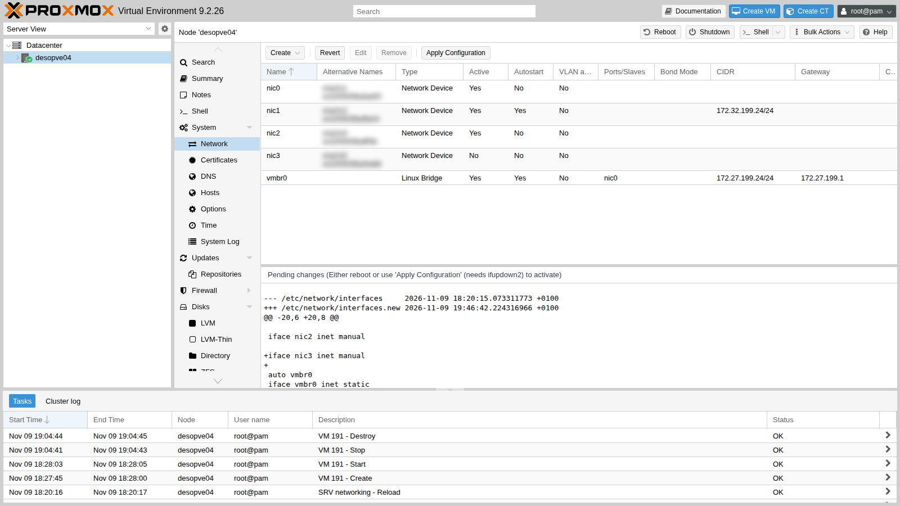
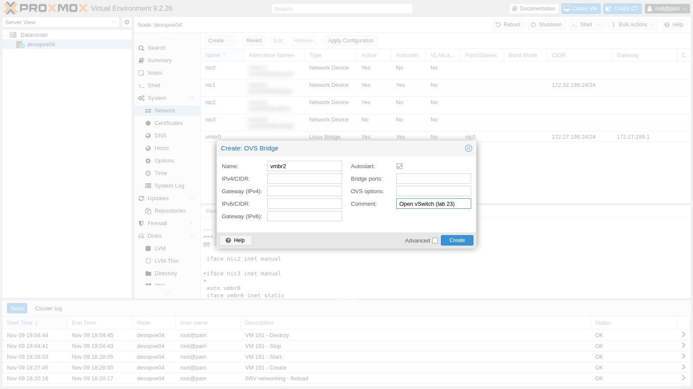
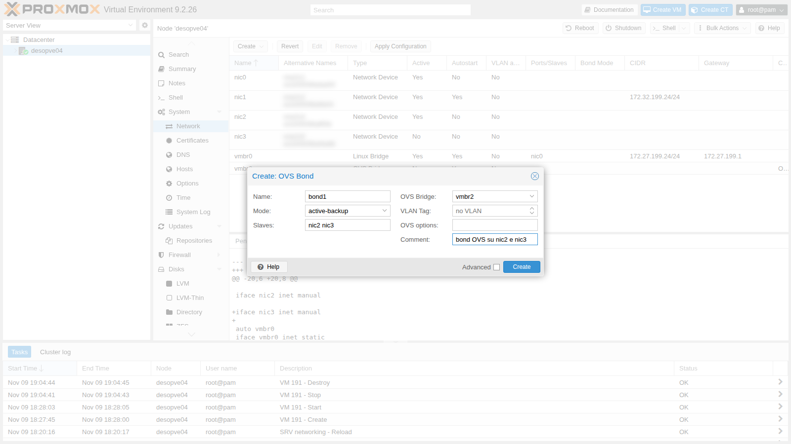
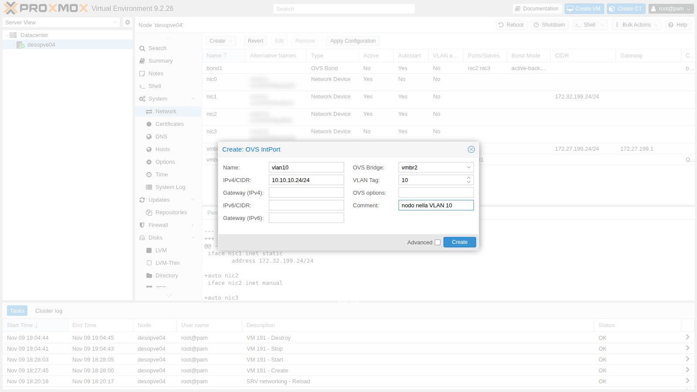
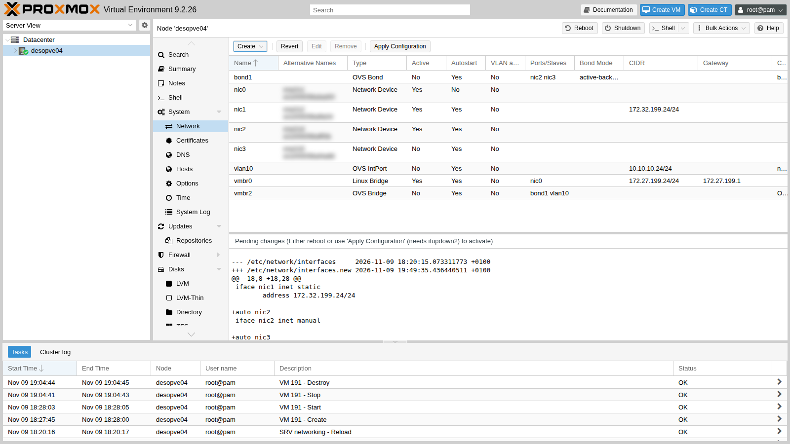
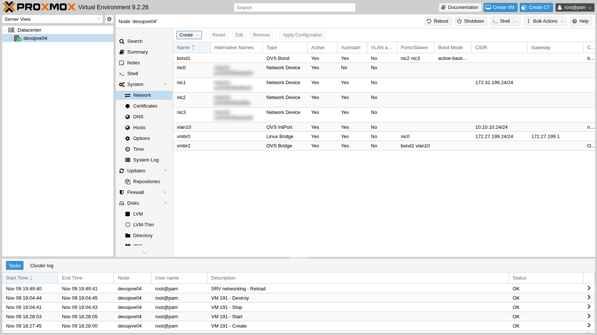
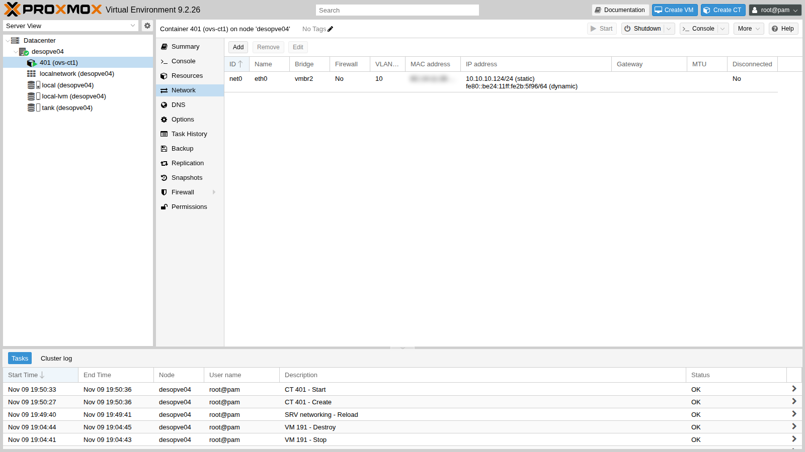

## Dipendenze

- **Lab precedenti:**
  - [Lab 20](/it/20-bridges-stable-names-vlans/): nomi stabili delle schede (`pve-network-interface-pinning`) e VLAN con il Linux bridge;
  - [Lab 21](/it/21-bonding/): modalità dei bond e prova con LACP senza partner;
  - [Lab 18](/it/18-ceph-growth-maintenance-failures/): la porta `nic2` di `desopve04`, montata in quel lab;
  - [Lab 09](/it/09-lvm-and-lvm-thin/): il template Debian su `desopve04`.
- **Nodo:** `desopve04`, il nodo autonomo. Le prove con OVS non toccano la rete del cluster.
- **Schede:** su `desopve04` due porte libere collegate al trunk dello switch: `nic2` (lab 18) e la porta di una seconda scheda a una porta, da montare a server spento al passo 1, che diventa `nic3`.
- **Guest di prova:** il CT 122 `vlan-ct2` (VLAN 10, 10.10.10.122) su `desopve02`, creato nel lab 20 su un Linux bridge.
- **Template:** `debian-13-standard_13.6-1_amd64.tar.zst` nello storage `local` di `desopve04` (lab 09, oppure `pveam download local debian-13-standard_13.6-1_amd64.tar.zst`).
- **Proxy:** per scaricare i pacchetti, `proxy.proxmox.community:3128` (lab 04).
- **Credenziali:** `root` / `<password-lab>` → [Appendice B](/it/b-credentials-and-addresses/).

## Obiettivi

- Su `desopve04`, un bridge OVS `vmbr2` costruito dalla GUI, con il bond `bond1` (`nic2` + `nic3`) e la porta interna `vlan10` (10.10.10.24/24): `ovs-vsctl show` elenca le porte e i loro tag.
- Un container sulla VLAN 10 del bridge OVS che raggiunge il CT 122, che sta su un Linux bridge di un altro nodo.
- Per ogni modalità del bond OVS provata (active-backup, balance-slb, balance-tcp con LACP), sapere che cosa deve offrire lo switch e che cosa succede quando manca un membro o il partner LACP, leggendolo con `ovs-appctl bond/show` e `lacp/show`.
- Sapere dove deve stare un'impostazione di OVS perché resti: in `/etc/network/interfaces`, non solo nel database di OVS.

## Come funziona

### Due switch software per lo stesso compito

Proxmox VE collega le VM alla rete con uno switch software dentro il nodo. Ce ne sono due tipi:

| | Linux bridge | Open vSwitch (OVS) |
|---|---|---|
| Dove sta | nel kernel, da sempre | modulo del kernel (*datapath*) più due servizi in spazio utente: `ovsdb-server` (la configurazione) e `ovs-vswitchd` (la logica) |
| Installazione | già presente | pacchetto `openvswitch-switch` |
| VLAN | bridge VLAN-aware, tag sulla scheda virtuale | tag sulla porta (`tag`), *trunk* per le porte che portano più VLAN |
| Bond | bond del kernel (`bond0`) sotto il bridge | bond **dentro** OVS (`OVSBond`): active-backup, balance-slb, LACP (`balance-tcp`) |
| Indirizzo del nodo su una VLAN | interfaccia VLAN (`vmbr1.100`) | porta interna (`OVSIntPort`) con un tag |
| Funzioni in più | — | flussi OpenFlow, mirroring di porte, tunnel, statistiche per porta |
| Strumenti | `ip`, `bridge`, `/proc/net/bonding` | `ovs-vsctl`, `ovs-appctl`, `ovs-ofctl` |

Per la maggior parte dei cluster Proxmox il Linux bridge basta ed è la scelta predefinita. OVS serve quando servono le sue funzioni in più, oppure quando la rete è già gestita con OVS. Le VM, i container e l'SDN di Proxmox funzionano con tutti e due.

### Gli oggetti OVS nella GUI di Proxmox

In **System** → **Network** → **Create** compaiono, dopo l'installazione del pacchetto, tre voci:

- **OVS Bridge**: lo switch (`vmbr2`). Le sue porte sono bond, schede e porte interne.
- **OVS Bond**: il bond di due o più schede, creato **dentro** un bridge OVS.
- **OVS IntPort**: una porta interna, cioè un'interfaccia del nodo collegata allo switch. Con un tag VLAN dà al nodo un indirizzo su quella VLAN.

Le schede che entrano in un bond OVS restano configurate come `inet manual`, senza altre opzioni: è OVS a gestirle.

### Il bond OVS

| Modalità | Come lavora | Serve lo switch? |
|---|---|---|
| `active-backup` | un solo membro trasmette, l'altro subentra se il primo cade | no |
| `balance-slb` | assegna ogni coppia MAC sorgente e VLAN a un membro e, ogni 10 s in modo predefinito, ne sposta alcune per bilanciare il carico | no |
| `balance-tcp` | distribuisce per flusso (L3/L4) | sì: richiede LACP |

Con `lacp=active` OVS negozia LACP (802.3ad) con lo switch. Secondo la documentazione di OVS, se nessun partner risponde il bond viene disabilitato, a meno che l'opzione `lacp-fallback-ab` non lo faccia ripiegare in active-backup. Lo switch del laboratorio non ha LACP configurato verso i nodi ([Lab 01](/it/01-lab-architecture/)), quindi il passo 5 mostra proprio questo caso.

OVS si accorge che un membro è guasto dal segnale di portante (*carrier*) della sua interfaccia (`bond-detect-mode=carrier`, il predefinito). Un guasto che lascia la portante attiva, per esempio oltre la porta dello switch, il bond non lo rileva.

### Ambiente e versioni della prova

Gli output di questo lab vengono da prove eseguite a novembre 2026 in questa configurazione:

| Componente | Configurazione della prova |
|---|---|
| Proxmox VE | 9.2.26, kernel `7.0.14-28-pve`, sul nodo autonomo `desopve04` ([Lab 04](/it/04-first-access-repositories-updates/)) |
| Open vSwitch | 3.5.0 (`openvswitch-switch` 3.5.0-1+b1) |
| Bond | `bond1` su `nic2` e `nic3`, due schede a una porta con porte 10 GbE ([Lab 01](/it/01-lab-architecture/)); valori predefiniti di OVS: rilevamento dei guasti dalla portante, nessun membro primario, `lacp-fallback-ab` disattivato |
| Switch | porte dei nodi in trunk 802.1Q, senza LACP né port-channel ([Lab 01](/it/01-lab-architecture/)) |
| Destinazione dei ping | CT 122 su `desopve02`, dietro il Linux bridge `vmbr1` e `bond0` ([Lab 20](/it/20-bridges-stable-names-vlans/), [Lab 21](/it/21-bonding/)) |
| Traffico | `ping` dal CT 401 (template Debian 13): 5 richieste al secondo durante il guasto di un membro, 2 o 3 richieste negli altri controlli |

**Cosa misurano le prove e cosa no.** Il guasto di un membro è simulato con `ip link set nic3 down`, che OVS vede come una perdita della portante. Il traffico viene da un solo container, cioè da un solo MAC sorgente: basta per vedere il passaggio da un membro all'altro, non per giudicare come balance-slb distribuisce il carico. Gli output mostrano una sola esecuzione di ogni prova.

## Procedura

### 1. Una scheda in più e il pacchetto OVS

1. Spegni `desopve04` (i suoi guest sono spenti o non ci sono), monta la seconda scheda a una porta, cablala verso lo switch e riaccendi il nodo. La porta nuova compare con il nome di sistema (`ens<N>`, assegnato da udev). Si fissa il nome come nel lab 20:

   ```bash title="root@desopve04"
   cp /etc/network/interfaces /root/interfaces.bak-lab23
   pve-network-interface-pinning generate --interface ens<N> --target-name nic3
   ```

   ```text output
   Name for link 'ens<N>' (enp<B>s<S>f<F>, enx<MAC>) will change to 'nic3'
   Generating link files
   Successfully generated .link files in '/usr/local/lib/systemd/network/'
   ...
   ```

   ```bash title="root@desopve04"
   udevadm trigger -c add /sys/class/net/ens<N>; udevadm settle
   ip -br link | grep -E "^nic"
   ```

   ```text output
   nic0             UP             <MAC> <BROADCAST,MULTICAST,UP,LOWER_UP>
   nic1             UP             <MAC> <BROADCAST,MULTICAST,UP,LOWER_UP>
   nic2             UP             <MAC> <BROADCAST,MULTICAST,UP,LOWER_UP>
   nic3             DOWN           <MAC> <BROADCAST,MULTICAST>
   ```

2. Installa Open vSwitch (scaricato tramite il proxy):

   ```bash title="root@desopve04"
   apt install openvswitch-switch
   ```

   ```text output
   ...
   Setting up openvswitch-switch (3.5.0-1+b1) ...
   ```

   ```bash title="root@desopve04"
   systemctl is-active openvswitch-switch
   ```

   ```text output
   active
   ```

   ```bash title="root@desopve04"
   ovs-vsctl show
   ```

   ```text output
   6704ca2b-e02a-493d-a7bc-582606dafa2e
       ovs_version: "3.5.0"
   ```

   La rete del nodo prima del lab: `vmbr0` per la gestione, `nic1` per lo storage, `nic2` e `nic3` libere.

   

### 2. Bridge, bond e porta interna dalla GUI

1. Nodo **desopve04** → **System** → **Network** → **Create** → **OVS Bridge**. **Name** `vmbr2`, nessuna porta per ora (il bond si aggiunge dopo), commento `Open vSwitch (lab 23)`.

   

2. **Create** → **OVS Bond**. **Name** `bond1` (il `bond0` sugli altri nodi è un bond Linux), **Mode** `active-backup`, **Slaves** `nic2 nic3`, **OVS Bridge** `vmbr2`.

   

3. **Create** → **OVS IntPort**. **Name** `vlan10`, **OVS Bridge** `vmbr2`, **VLAN Tag** `10`, **IPv4/CIDR** `10.10.10.24/24`, nessun gateway. Il nodo avrà un indirizzo nella VLAN 10, la stessa dei container di prova del lab 20.

   

4. Le modifiche sono in attesa: la GUI mostra le differenze con il file in uso.

   

5. **Apply Configuration** → **Yes**.

   

   In `/etc/network/interfaces` gli oggetti OVS hanno le righe `ovs_type`, `ovs_bridge`, `ovs_ports`, `ovs_bonds` e `ovs_options`:

   ```text
   auto nic3
   iface nic3 inet manual

   auto vlan10
   iface vlan10 inet static
   	address 10.10.10.24/24
   	ovs_type OVSIntPort
   	ovs_bridge vmbr2
   	ovs_options tag=10
   #nodo nella VLAN 10

   auto bond1
   iface bond1 inet manual
   	ovs_bonds nic2 nic3
   	ovs_type OVSBond
   	ovs_bridge vmbr2
   	ovs_options bond_mode=active-backup
   #bond OVS su nic2 e nic3

   auto vmbr2
   iface vmbr2 inet manual
   	ovs_type OVSBridge
   	ovs_ports bond1 vlan10
   #Open vSwitch (lab 23)
   ```

### 3. Un container sulla VLAN 10 del bridge OVS

1. Crea il CT 401 con la scheda su `vmbr2` e il tag 10. Dalla GUI si sceglie **Bridge** `vmbr2` e **VLAN Tag** `10`, come con un Linux bridge; da riga di comando:

   ```bash title="root@desopve04"
   pct create 401 local:vztmpl/debian-13-standard_13.6-1_amd64.tar.zst \
       --hostname ovs-ct1 --memory 512 --cores 1 --rootfs local-lvm:4 \
       --net0 name=eth0,bridge=vmbr2,tag=10,ip=10.10.10.124/24 \
       --unprivileged 1 --features nesting=1 --password '<password-lab>' --start 1
   pct config 401 | grep net0
   ```

   ```text output
   net0: name=eth0,bridge=vmbr2,hwaddr=BC:24:11:2B:5F:96,ip=10.10.10.124/24,tag=10,type=veth
   ```

   

2. Il container raggiunge il CT 122, che sta su un **Linux bridge** di `desopve02`, e la porta interna del nodo. Il tag 802.1Q è lo stesso standard: per la rete non importa che tipo di switch software lo abbia messo.

   ```bash title="root@desopve04"
   pct exec 401 -- ping -c3 -W1 10.10.10.122
   ```

   ```text output
   64 bytes from 10.10.10.122: icmp_seq=1 ttl=64 time=2.21 ms
   64 bytes from 10.10.10.122: icmp_seq=2 ttl=64 time=0.606 ms
   64 bytes from 10.10.10.122: icmp_seq=3 ttl=64 time=0.572 ms
   3 packets transmitted, 3 received, 0% packet loss, time 2061ms
   ```

   ```bash title="root@desopve04"
   pct exec 401 -- ping -c3 -W1 10.10.10.24 | tail -2
   ```

   ```text output
   3 packets transmitted, 3 received, 0% packet loss, time 2015ms
   rtt min/avg/max/mdev = 0.164/0.454/1.029/0.406 ms
   ```

   ```bash title="root@desopve04"
   pct exec 401 -- ping -c2 -W1 10.20.20.123
   ```

   ```text output
   ping: connect: Network is unreachable
   ```

   La VLAN 20 resta irraggiungibile: tra VLAN diverse serve un router (lab 26).

### 4. Leggere lo stato di OVS

1. **La struttura dello switch:** porte, membri del bond, tag.

   ```bash title="root@desopve04"
   ovs-vsctl show
   ```

   ```text output
   6704ca2b-e02a-493d-a7bc-582606dafa2e
       Bridge vmbr2
           Port bond1
               Interface nic2
               Interface nic3
           Port veth401i0
               tag: 10
               Interface veth401i0
           Port vlan10
               tag: 10
               Interface vlan10
                   type: internal
           Port vmbr2
               Interface vmbr2
                   type: internal
       ovs_version: "3.5.0"
   ```

   La porta del container (`veth401i0`) ha `tag: 10`: Proxmox l'ha aggiunta allo switch all'avvio del CT. La porta `bond1` non ha tag, quindi è un trunk e porta tutte le VLAN.

2. **La tabella dei MAC appresi**, con la VLAN di ciascuno:

   ```bash title="root@desopve04"
   ovs-appctl fdb/show vmbr2
   ```

   ```text output
    port  VLAN  MAC                Age
   LOCAL     0  de:b1:d7:6e:4e:4f   71
       2    10  bc:24:11:af:bc:fc   47
       2     0  <MAC>               42
       2     0  <MAC>               30
       1    10  86:93:65:12:34:7e    2
       2    10  bc:24:11:10:9a:74    2
       5    10  bc:24:11:2b:5f:96    1
   ```

   I MAC `bc:24:11:…` sono le schede dei container: quelli remoti (CT 121 e 122) arrivano dalla porta 2, cioè dal bond. Sulla VLAN 0 (senza tag) OVS vede anche il traffico della rete di gestione, che passa sullo stesso trunk.

3. **I flussi OpenFlow:** senza un controller c'è una sola regola, `NORMAL`, cioè "comportati da switch che impara i MAC".

   ```bash title="root@desopve04"
   ovs-ofctl dump-flows vmbr2
   ```

   ```text output
   NXST_FLOW reply (xid=0x4):
    cookie=0x0, duration=71.116s, table=0, n_packets=16563, n_bytes=1310428, idle_age=0, priority=0 actions=NORMAL
   ```

### 5. Il bond OVS alla prova

1. **active-backup, guasto del membro attivo.** Il membro attivo è `nic3`. Mentre il container manda 5 ping al secondo verso il CT 122, si spegne `nic3`:

   ```bash title="root@desopve04"
   ovs-appctl bond/show bond1 | grep -E "active member|^member"
   ```

   ```text output
   active member mac: <MAC>(nic3)
   member nic2: enabled
   member nic3: enabled
   ```

   ```bash title="root@desopve04"
   pct exec 401 -- ping -i 0.2 -c 75 -W1 10.10.10.122 > /tmp/p1.txt &
   ip link set nic3 down
   tail -2 /tmp/p1.txt
   ```

   ```text output
   75 packets transmitted, 75 received, 0% packet loss, time 15335ms
   rtt min/avg/max/mdev = 0.436/0.658/1.016/0.118 ms
   ```

   ```bash title="root@desopve04"
   ovs-appctl bond/show bond1 | sed -n "/active-backup primary/,\$p"
   ```

   ```text output
   active-backup primary: <none>
   active member mac: <MAC>(nic2)

   member nic2: enabled
     active member
     may_enable: true

   member nic3: disabled
     may_enable: false
   ```

   - **Misura:** 75 richieste a 200 ms di distanza, 75 risposte, tempo di andata e ritorno massimo 1,016 ms; dopo il guasto `bond/show` indica `nic2` come membro attivo e `nic3` disabilitato.
   - **Interpretazione:** OVS ha spostato il traffico su `nic2` senza perdere nessuna richiesta. Se c'è stata un'interruzione, è durata meno dei 200 ms tra due richieste.
   - **Verifica più fine:** un ping più fitto dal container, per esempio ogni 10 ms (`ping -i 0.01 -D -O`), oppure una cattura con l'orario sul membro rimasto (`tcpdump -ttt -ni nic2 vlan 10 and icmp`), per vedere quando la prima richiesta esce da lì.

   Quando `nic3` torna (`ip link set nic3 up`), il membro attivo **resta** `nic2` (si controlla con `ovs-appctl bond/show bond1 | grep "active member"`): senza un membro primario (`active-backup primary: <none>`), OVS non ha motivo di tornare indietro. Con `other_config:bond-primary=nic3` il traffico tornerebbe su `nic3` appena è di nuovo attivo, al prezzo di un secondo spostamento.

2. **balance-slb.** La modalità si cambia anche a caldo:

   ```bash title="root@desopve04"
   ovs-vsctl set port bond1 bond_mode=balance-slb
   ovs-appctl bond/show bond1
   ```

   ```text output
   ---- bond1 ----
   bond_mode: balance-slb
   ...
   next rebalance: 522 ms
   lacp_status: off
   ...
   member nic2: enabled
     active member
     may_enable: true

   member nic3: enabled
     may_enable: true
     hash 122: 1 kB load
   ```

   Entrambi i membri sono abilitati; l'output mostra l'hash di MAC 122 assegnato a `nic3` con 1 kB di carico, e il prossimo ribilanciamento tra 522 ms. SLB associa ogni MAC sorgente e VLAN a un hash, assegna gli hash ai membri e li sposta periodicamente secondo il carico, quindi il carico si distribuisce solo se le sorgenti sono più d'una. Con un solo container che genera traffico, questo output non mostra il carico diviso tra i due membri. Per vederlo serve traffico da più guest, confrontando prima e dopo i contatori di trasmissione dei membri (`ovs-vsctl get interface nic2 statistics:tx_bytes`, e lo stesso per `nic3`). Come `balance-alb` del bond Linux ([Lab 21](/it/21-bonding/)), SLB non richiede configurazione sullo switch, ma divide il traffico con un criterio diverso: qui il MAC sorgente, lì la destinazione.

3. **LACP senza partner.** `balance-tcp` richiede LACP:

   ```bash title="root@desopve04"
   ovs-vsctl set port bond1 lacp=active bond_mode=balance-tcp
   ovs-appctl bond/show bond1 | grep -E "bond_mode|lacp_status|lacp_fallback|^member|may_enable"
   ```

   ```text output
   bond_mode: balance-tcp
   lacp_status: configured
   lacp_fallback_ab: false
   member nic2: disabled
     may_enable: false
   member nic3: disabled
     may_enable: false
   ```

   ```bash title="root@desopve04"
   ovs-appctl lacp/show bond1 | grep -E "actor sys_id|partner sys_id" | head -2
   ```

   ```text output
     actor sys_id: <MAC>
     partner sys_id: 00:00:00:00:00:00
   ```

   ```bash title="root@desopve04"
   pct exec 401 -- ping -c3 -W1 10.10.10.122 | tail -1
   ```

   ```text output
   3 packets transmitted, 0 received, 100% packet loss, time 2083ms
   ```

   Lo switch del laboratorio non risponde a LACP (`partner sys_id` tutto a zero): OVS **disabilita entrambi i membri** (`may_enable: false`) e il container perde la rete: 3 richieste, nessuna risposta. È quanto la documentazione di OVS descrive per `lacp-fallback-ab` impostato a `false`, il predefinito: senza partner il bond viene disabilitato. Sullo stesso switch il bond Linux in `802.3ad` teneva attivo un membro in un aggregatore tutto suo ([Lab 21](/it/21-bonding/)): le due implementazioni gestiscono in modo diverso l'assenza del partner, e con OVS cade l'intero bond.

4. **Il ripiego in active-backup.** Con `lacp-fallback-ab` il bond torna a funzionare anche senza partner:

   ```bash title="root@desopve04"
   ovs-vsctl set port bond1 other_config:lacp-fallback-ab=true
   ovs-appctl bond/show bond1 | grep -E "lacp_status|lacp_fallback|active member$"
   ```

   ```text output
   lacp_status: configured
   lacp_fallback_ab: true
     active member
   ```

   ```bash title="root@desopve04"
   pct exec 401 -- ping -c3 -W1 10.10.10.122 | tail -2
   ```

   ```text output
   3 packets transmitted, 3 received, 0% packet loss, time 2065ms
   rtt min/avg/max/mdev = 0.639/0.684/0.753/0.049 ms
   ```

   Il ripiego tiene in piedi il bond finché lo switch non è configurato, ma nasconde anche il problema: il bond funziona, senza aggregare nulla, e niente si guasta. Se lo usi, controlla che `lacp_status` diventi `negotiated` una volta configurato lo switch; qui resta `configured`, segno che nessun partner ha risposto.

5. **Ritorno alla configurazione del file.** Le modifiche fatte con `ovs-vsctl` stanno nel database di OVS e non in `/etc/network/interfaces`, il file che Proxmox VE mostra nella GUI e applica: il bond in funzione e il file possono non coincidere senza che la GUI lo mostri. Le modifiche vanno annullate a mano, oppure scritte nel file con `ovs_options` (ad esempio `ovs_options bond_mode=balance-tcp lacp=active other_config:lacp-fallback-ab=true`).

   ```bash title="root@desopve04"
   ovs-vsctl set port bond1 lacp=off bond_mode=active-backup -- remove port bond1 other_config lacp-fallback-ab
   ovs-vsctl get port bond1 bond_mode lacp other_config
   ```

   ```text output
   active-backup
   off
   {}
   ```

### 6. Linux bridge e OVS, comando per comando

| Cosa vuoi vedere | Linux bridge | Open vSwitch |
|---|---|---|
| Struttura dello switch e porte | `bridge link`, `ip -d link` | `ovs-vsctl show` |
| VLAN delle porte | `bridge vlan show` | `ovs-vsctl show` (campo `tag`), `ovs-vsctl list port` |
| MAC appresi | `bridge fdb show br vmbr1` | `ovs-appctl fdb/show vmbr2` |
| Stato del bond | `cat /proc/net/bonding/bond0` | `ovs-appctl bond/show bond1` |
| LACP | `/proc/net/bonding/bond0` (sezione 802.3ad) | `ovs-appctl lacp/show bond1` |
| Regole di inoltro | (nessuna: il bridge impara e inoltra) | `ovs-ofctl dump-flows vmbr2` |

## Verifica e test

Il lab è riuscito se il CT 401 raggiunge il CT 122 sulla VLAN 10, se ogni prova del bond nella tabella dà il risultato atteso e se alla fine `bond1` è di nuovo in active-backup senza LACP.

| Controllo | Risultato atteso | Osservato nella prova |
|---|---|---|
| Bridge, bond e porta interna OVS creati dalla GUI | `vmbr2` con `bond1` e `vlan10` | `bond1` su `nic2` + `nic3`, `vlan10` 10.10.10.24/24 |
| CT su `vmbr2` con tag 10 verso un CT su un Linux bridge di un altro nodo | risponde | 3 su 3, 0% di perdita |
| VLAN 20 dal CT nella VLAN 10 | nessuna route senza un router | `Network is unreachable` |
| Guasto del membro attivo in active-backup | traffico spostato sull'altro membro | 75 risposte su 75 a 200 ms di distanza; `nic2` attivo |
| Ritorno di `nic3` | membro attivo invariato, senza membro primario | `nic2` ancora attivo |
| balance-slb | entrambi i membri abilitati, hash assegnati | hash 122 su `nic3`; la ripartizione del carico non è stata misurata |
| balance-tcp con LACP, senza partner | bond disabilitato | entrambi i membri disabilitati, partner `00:00:00:00:00:00`, 100% di perdita |
| LACP con `lacp-fallback-ab` | ripiego in active-backup | un membro attivo, 0% di perdita |
| Ritorno alla configurazione del file | active-backup, LACP spento | `active-backup`, `off`, `{}` |

## Stato finale del lab

- **`desopve04`:** Open vSwitch 3.5 installato.
  - `vmbr2` (OVS) con `bond1` (OVS, active-backup, `nic2` + `nic3`);
  - porta interna `vlan10` 10.10.10.24/24 (VLAN 10);
  - `vmbr0` e `nic1` invariati;
  - copia della rete precedente in `/root/interfaces.bak-lab23`.
- **CT 401 `ovs-ct1`** su `desopve04`, acceso: `vmbr2` VLAN 10, 10.10.10.124/24, disco su `local-lvm`.
- Il cluster (`desopve01-03`) non è stato toccato.

## Cosa hai imparato

- **Linux bridge o OVS:** il Linux bridge come scelta predefinita; OVS quando servono le sue funzioni in più (flussi OpenFlow, mirroring delle porte, porte e bond gestiti dentro lo switch) o quando la rete è già gestita con OVS. Il tag 802.1Q è lo stesso con tutti e due, quindi possono stare sulla stessa rete.
- **Quale modalità del bond OVS, a seconda dello switch:** senza LACP sullo switch, active-backup, che la documentazione di OVS preferisce in questo caso, mentre balance-slb aiuta solo quando trasmettono molti guest; con LACP configurato sullo switch, balance-tcp con `lacp=active`.
- **Se attivare `lacp-fallback-ab`:** tiene in piedi il bond finché lo switch non è pronto, al prezzo di nascondere un errore di configurazione; se lo attivi, controlla che `lacp_status` sia `negotiated`.
- **Se impostare un membro primario:** senza, dopo un guasto OVS resta sul membro sopravvissuto, con un solo spostamento; con `bond-primary` il traffico torna sul membro preferito, con un secondo spostamento.
- **Dove va un'impostazione di OVS:** una modifica fatta con `ovs-vsctl` vale subito ma vive fuori dal file di rete; quello che deve restare va in `ovs_options` dentro `/etc/network/interfaces`.

## Riferimenti

- [Proxmox VE wiki – Open vSwitch](https://pve.proxmox.com/wiki/Open_vSwitch)
- [Proxmox VE – Network Configuration](https://pve.proxmox.com/pve-docs/pve-admin-guide.html#sysadmin_network_configuration)
- [Open vSwitch – Bonding: active-backup, SLB e ripiego di LACP (documentazione corrente)](https://docs.openvswitch.org/en/latest/topics/bonding/)
- [ovs-vswitchd.conf.db(5), Open vSwitch 3.5 – opzioni dei bond, del rilevamento dei guasti e di LACP](https://manpages.debian.org/trixie/openvswitch-switch/ovs-vswitchd.conf.db.5.en.html)
- [ovs-vswitchd(8), Open vSwitch 3.5 – i comandi `bond/show` e `lacp/show`](https://manpages.debian.org/trixie/openvswitch-switch/ovs-vswitchd.8.en.html)
