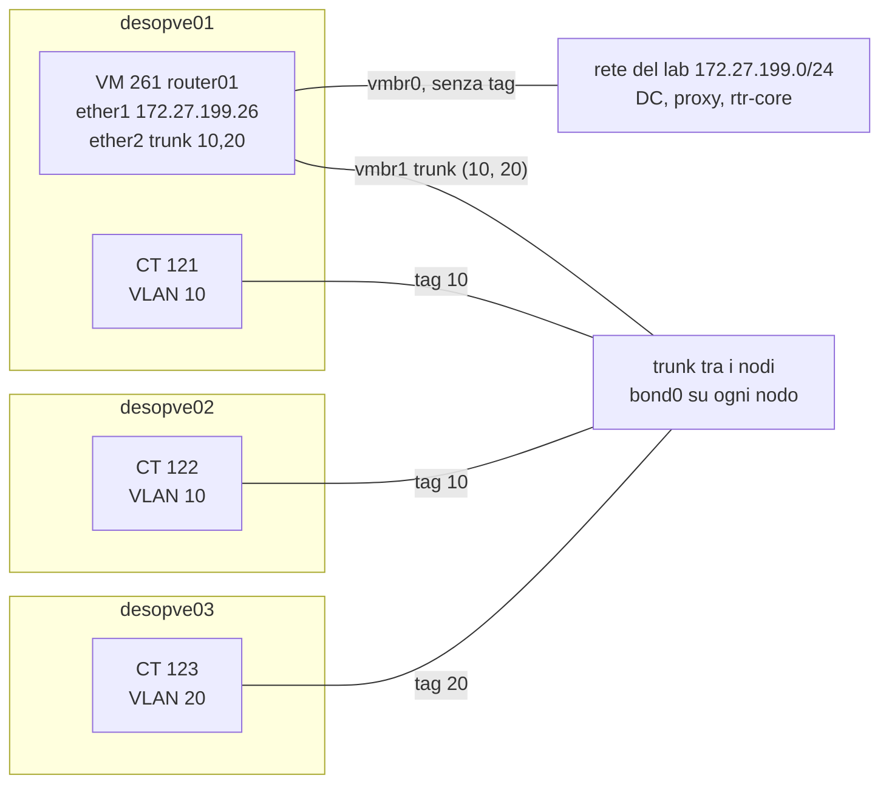
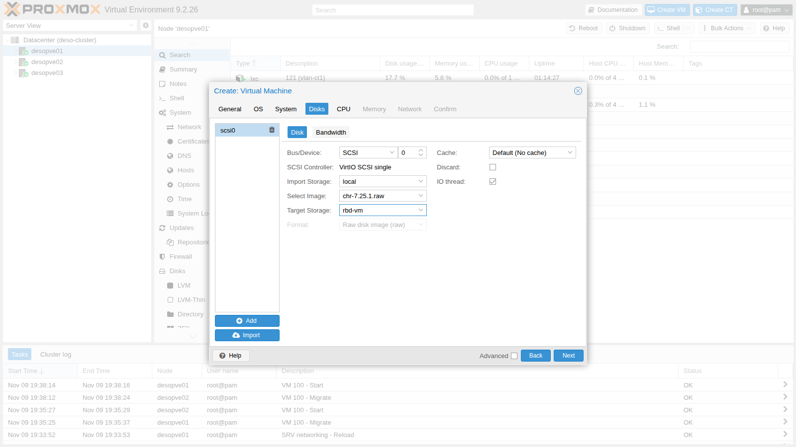
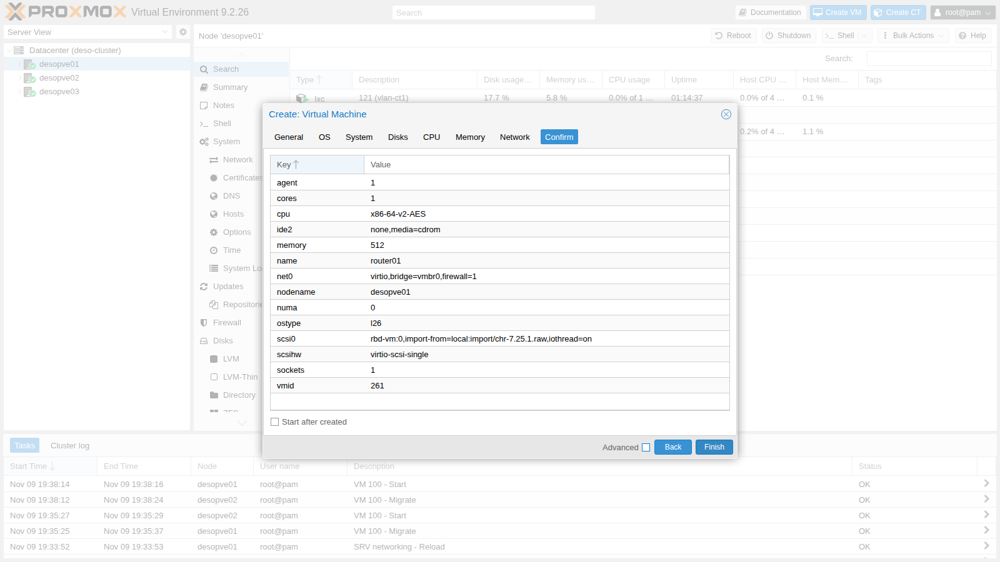
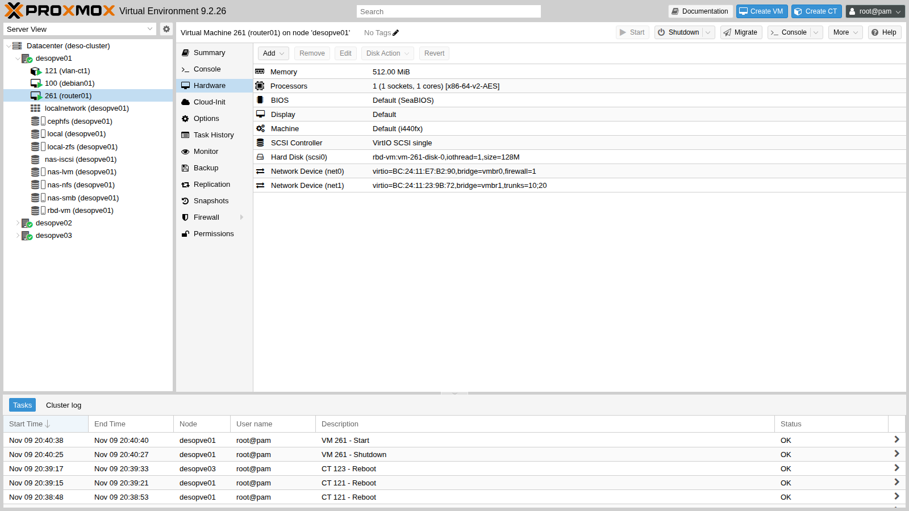
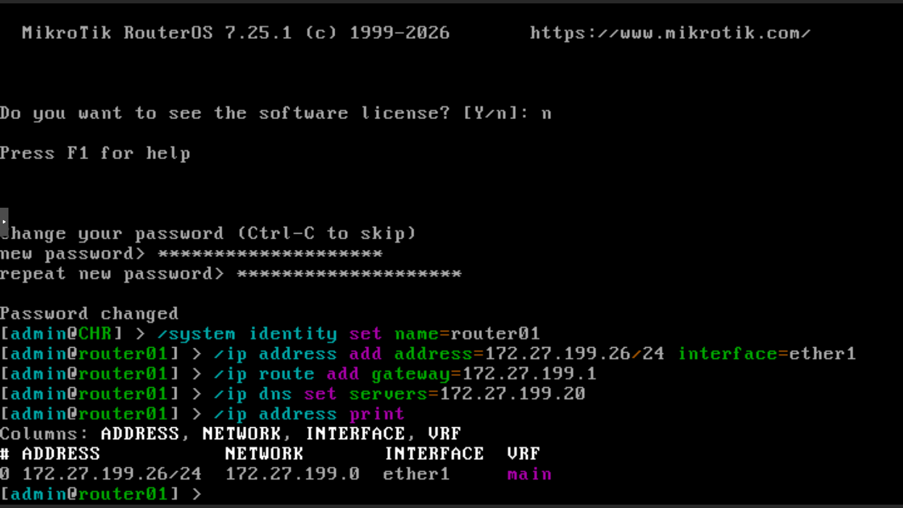
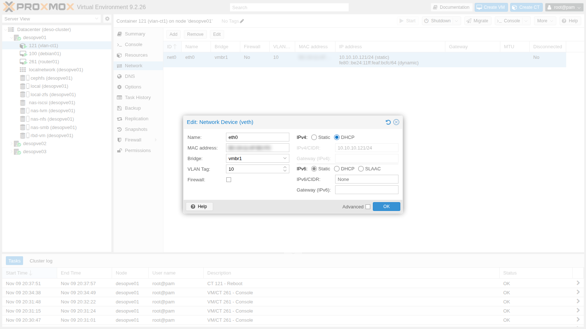
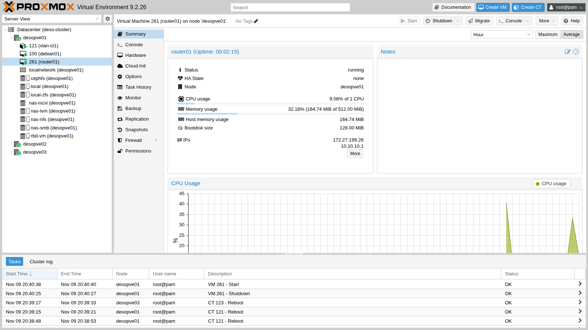

## Dipendenze

- **Lab precedenti:**
  - [Lab 20](/it/20-bridges-stable-names-vlans/) e [Lab 21](/it/21-bonding/): `vmbr1` VLAN-aware su `bond0` e i container di prova nelle VLAN 10 e 20;
  - [Lab 17](/it/17-ceph-installation/): storage `rbd-vm` per il disco del router.
- **Nodi:** `desopve01` (dove gira il router), `desopve02` e `desopve03` (dove girano i container di prova).
- **Container di prova:**
  - CT 121 `vlan-ct1` su `desopve01` e CT 122 `vlan-ct2` su `desopve02`, VLAN 10;
  - CT 123 `vlan-ct3` su `desopve03`, VLAN 20;
  - tutti su `vmbr1`, con `iperf3` e `tcpdump`.
- **Software:** immagine raw di MikroTik **Cloud Hosted Router (CHR) 7.25.1**, scaricata dal sito MikroTik tramite il proxy: il proxy del laboratorio deve consentire `download.mikrotik.com`.
- **Servizi:** DNS del DC (172.27.199.20), proxy `proxy.proxmox.community:3128`.
- **Indirizzo del router sulla rete di gestione:** 172.27.199.26 (`router01.proxmox.community`).
- **Credenziali:** `root` / `<password-lab>` sui nodi, `admin` / `<password-lab>` sul router → [Appendice B](/it/b-credentials-and-addresses/).

## Obiettivi

- Una VM router, `router01` (MikroTik CHR), creata da un'immagine disco già pronta, con una sola scheda in trunk che riceve solo le VLAN 10 e 20: `bridge vlan show` lo conferma.
- Il routing tra la VLAN 10 e la VLAN 20 attraverso il router, con DHCP, NAT verso la rete del laboratorio e un firewall che blocca VLAN 20 → VLAN 10, verificato con `ping`, `tcpdump` e i contatori delle regole.
- Sapere cosa smette di funzionare quando il router è fermo, e quanto ci è voluto in questo laboratorio per tornare a instradare dopo un avvio.
- Sapere quanto traffico instradato lascia passare la licenza gratuita di CHR, come misurarlo e quando conviene OPNsense.

## Come funziona

### Router-on-a-stick

Nel lab 20 i guest della VLAN 10 e della VLAN 20 erano isolati: il bridge non instrada, separa. Per farli parlare serve un **router** con un piede in ogni VLAN. Invece di dargli una scheda per VLAN, gli si dà **una sola scheda in trunk**: i frame arrivano con il tag 802.1Q e il router crea un'interfaccia logica per ogni VLAN. È la configurazione classica *router-on-a-stick*.



### `trunks` e il filtro VLAN del bridge

Una scheda di VM su un bridge VLAN-aware **senza** `tag` e senza `trunks` sta nella VLAN 1 senza tag (PVID), ma Proxmox VE la aggiunge anche, con il tag, a tutte le VLAN di `bridge-vids` (2-4094, vedi il [Lab 20](/it/20-bridges-stable-names-vlans/)). Con l'opzione `trunks=10;20` la porta resta nella VLAN 1 senza tag e riceve, con il tag, **solo** le VLAN 10 e 20: il router le riceve tutte e due, e nessun'altra. L'opzione si imposta da riga di comando (`qm set`): la finestra della GUI ha solo il campo *VLAN Tag*.

### NAT e firewall sul router

- **NAT:** il router esce verso la rete del laboratorio con il proprio indirizzo (masquerading). Il DC, il proxy e `rtr-core` non devono conoscere le reti 10.10.10.0/24 e 10.20.20.0/24.
- **Firewall stateful:** RouterOS ha due catene principali. `input` protegge il router stesso, `forward` decide cosa passa *attraverso* il router. La regola `established,related` lascia passare le risposte alle connessioni già permesse: basta autorizzare chi *apre* la connessione.

In questo lab la politica è:

| Da → a | Permesso |
|---|---|
| VLAN 10 → ovunque | sì |
| VLAN 20 → rete del lab (DC, proxy) | sì |
| VLAN 20 → VLAN 10 | **no**, salvo le risposte alle connessioni aperte dalla VLAN 10 |
| Rete del lab → router (SSH) | sì, solo da 172.27.199.0/24 |

### Licenza di CHR

CHR si scarica e si usa gratis. Secondo la documentazione di MikroTik, la licenza **free** limita ogni interfaccia a **1 Mbit/s** in uscita (upload) e lascia tutte le altre funzioni senza restrizioni. Con un account su mikrotik.com si può chiedere una prova di 60 giorni dei livelli a pagamento (P1 a 1 Gbit/s, P10 a 10 Gbit/s, P-Unlimited senza limite); in produzione si acquista una licenza perpetua. Per imparare la configurazione basta la licenza free; il test di banda nella verifica mostra che cosa significa per il traffico instradato.

### OPNsense come alternativa

Lo stesso schema (router-on-a-stick, DHCP, NAT, firewall) si realizza con **OPNsense**, un firewall open source basato su FreeBSD. In questo laboratorio non è stato installato; il confronto riassume le differenze che contano su Proxmox VE.

| Aspetto | MikroTik CHR | OPNsense |
|---|---|---|
| Installazione | immagine disco pronta da importare (128 MiB) | ISO con installer |
| Risorse | nel lab: 1 vCPU, 512 MiB di RAM | almeno 3 GB di RAM e una CPU dual-core, secondo la documentazione di OPNsense |
| Gestione | CLI, WinBox, interfaccia web | interfaccia web completa |
| Licenza | free limitata a 1 Mbit/s per interfaccia; trial di 60 giorni; licenze a pagamento | open source, nessun limite |
| Funzioni di sicurezza | firewall, VPN, routing dinamico | firewall, VPN, IDS/IPS (Suricata), proxy, plugin |
| Schede VirtIO | supportate | supportate (`vtnet`); sulle macchine virtuali la documentazione consiglia di disattivare tutti gli offload hardware in **Interfaces → Settings** |
| Guest agent | integrato | plugin `os-qemu-guest-agent` |

Per imparare il routing e le VLAN CHR è più leggero e veloce da preparare; per un firewall perimetrale con interfaccia grafica e funzioni di sicurezza avanzate OPNsense è la scelta più comune.

### Ambiente e versioni della prova

Gli output e le misure di questo lab vengono da prove eseguite a novembre 2026 in questa configurazione:

| Componente | Configurazione della prova |
|---|---|
| Proxmox VE | 9.2.26, kernel `7.0.14-28-pve` ([Lab 04](/it/04-first-access-repositories-updates/)) |
| Router | RouterOS CHR 7.25.1, livello di licenza `free`; VM 261 su `desopve01` con 1 vCPU, 512 MiB di RAM, due schede VirtIO e disco su `rbd-vm` (Ceph 20.2, [Lab 17](/it/17-ceph-installation/)) |
| Rete | `vmbr1` VLAN-aware su `bond0`, active-backup su porte 10 GbE, MTU 1500 ([Lab 21](/it/21-bonding/)); scheda in trunk con `trunks=10;20` |
| Guest di prova | CT 121 (`desopve01`) e CT 122 (`desopve02`) nella VLAN 10, CT 123 (`desopve03`) nella VLAN 20, dal template Debian 13, con `iperf3` ([Lab 20](/it/20-bridges-stable-names-vlans/)) |
| Test di banda | `iperf3` con un solo flusso TCP e opzioni predefinite: 8 s attraverso il router (CT 121 → CT 123), 5 s dentro la VLAN 10 (CT 121 → CT 122) |

**Cosa misurano le prove e cosa no.** Gli output mostrano una sola esecuzione di ogni prova. Il router è stato fermato con uno spegnimento ordinato (`qm shutdown`), non da un crash o dal guasto di un nodo. Durante il test di banda non sono stati registrati né il carico della CPU del router né i contatori delle sue interfacce.

## Procedura

### 1. Scaricare l'immagine nello storage di import

1. Sul nodo `desopve01` scarica l'immagine raw di CHR nella cartella `import` dello storage `local` e decomprimila:

   ```bash title="root@desopve01"
   cd /var/lib/vz/import
   export https_proxy=http://proxy.proxmox.community:3128
   curl -s https://download.mikrotik.com/routeros/NEWESTa7.stable
   ```

   ```text output
   7.25.1 1793623193
   ```

   ```bash title="root@desopve01:/var/lib/vz/import"
   curl -s -O https://download.mikrotik.com/routeros/7.25.1/chr-7.25.1.img.zip
   unzip chr-7.25.1.img.zip
   ```

   ```text output
   Archive:  chr-7.25.1.img.zip
     inflating: chr-7.25.1.img
   ```

2. Nello storage di import Proxmox VE elenca solo i file con un'estensione che riconosce, come `.raw`, `.qcow2`, `.vmdk` o `.ova`. Un file `.img` non compare: va rinominato in `.raw`, che è lo stesso formato:

   ```bash title="root@desopve01:/var/lib/vz/import"
   pvesm list local --content import
   ```

   ```text output
   Volid                                           Format  Type           Size VMID
   local:import/debian-13-genericcloud-amd64.qcow2 qcow2   import    341180416
   ```

   ```bash title="root@desopve01:/var/lib/vz/import"
   mv chr-7.25.1.img chr-7.25.1.raw && rm chr-7.25.1.img.zip
   pvesm list local --content import
   ```

   ```text output
   Volid                                           Format  Type           Size VMID
   local:import/debian-13-genericcloud-amd64.qcow2 qcow2   import    341180416
   local:import/chr-7.25.1.raw                     raw     import    134217728
   ```

### 2. Creare la VM con il disco importato

1. **Create VM** su `desopve01`:
   - **General:** VM ID `261`, nome `router01`;
   - **OS:** *Do not use any media*;
   - **System:** valori predefiniti, con **Qemu Agent** attivo: RouterOS CHR include il guest agent.
2. **Disks:** elimina il disco proposto (`scsi0`, icona del cestino) e premi **Import**. Nel nuovo disco imposta **Bus/Device** `SCSI 0`, **Import Storage** `local`, **Select Image** `chr-7.25.1.raw`, **Target Storage** `rbd-vm`. Il disco del router su Ceph permette di migrarlo tra i nodi.

   

3. **CPU** 1 core, **Memory** 512 MiB, **Network** `vmbr0` con modello VirtIO: sarà `ether1`, l'uscita verso la rete del laboratorio. Nel riepilogo il disco compare come `rbd-vm:0,import-from=local:import/chr-7.25.1.raw`:

   

   Premi **Finish** senza avviare la VM.

### 3. La scheda in trunk

1. Aggiungi la seconda scheda su `vmbr1` con le sole VLAN 10 e 20, togli il lettore CD inutile e fai partire il router con il nodo:

   ```bash title="root@desopve01"
   qm set 261 --net1 virtio,bridge=vmbr1,trunks='10;20' --boot order=scsi0 --delete ide2 --onboot 1
   ```

   ```text output
   update VM 261: -boot order=scsi0 -delete ide2 -net1 virtio,bridge=vmbr1,trunks=10;20 -onboot 1
   ```

   ```bash title="root@desopve01"
   qm start 261
   ```

   

2. Con la VM accesa, il filtro VLAN del bridge mostra cosa entra nella porta della seconda scheda (`tap261i1`): le VLAN 10 e 20 con il tag, più la PVID 1 senza tag che il bridge assegna di default:

   ```bash title="root@desopve01"
   bridge vlan show dev tap261i1
   ```

   ```text output
   port              vlan-id  
   tap261i1          1 PVID Egress Untagged
                     10
                     20
   ```

### 4. Primo accesso dalla console

1. Apri **Console** sulla VM. Al prompt `CHR Login:` entra come `admin` con password vuota, rispondi `n` alla domanda sulla licenza e imposta la nuova password (`<password-lab>`). Poi dai al router il nome, l'indirizzo di gestione su `ether1`, il gateway e il DNS:

   ```text
   /system identity set name=router01
   /ip address add address=172.27.199.26/24 interface=ether1
   /ip route add gateway=172.27.199.1
   /ip dns set servers=172.27.199.20
   ```

   

   :::caution[Attenzione alla tastiera]
   La console della VM usa il layout di tastiera del guest, che in RouterOS è quello americano: se la password contiene simboli, controlla cosa digiti. Se il primo accesso SSH con la password giusta viene rifiutato, rientra dalla console e reimposta la password con `/user set admin password=...`.
   :::

2. Dal DC registra il nome del router nel DNS (record A e PTR):

   ```powershell title="PowerShell — desopve-dc01"
   Add-DnsServerResourceRecordA -ZoneName proxmox.community -Name router01 -IPv4Address 172.27.199.26 -CreatePtr
   ```

3. Da qui in poi si lavora via SSH (`ssh admin@router01.proxmox.community`). Le schede compaiono nell'ordine delle schede della VM: `ether1` è `net0` (`vmbr0`), `ether2` è `net1` (il trunk). I MAC coincidono con quelli di Proxmox:

   ```text title="RouterOS — router01" frame="terminal"
   /interface ethernet print
   ```

   ```text output
   Flags: R - RUNNING
   Columns: NAME, MTU, MAC-ADDRESS, ARP
   #   NAME     MTU  MAC-ADDRESS        ARP    
   0 R ether1  1500  BC:24:11:E7:B2:90  enabled
   1 R ether2  1500  BC:24:11:23:9B:72  enabled
   ```

   :::note
   Negli script conviene una sola sessione SSH con più comandi separati da `;`: molti login di fila in pochi secondi possono far rifiutare per qualche decina di secondi anche la password giusta.
   :::

### 5. Le VLAN e gli indirizzi

1. Crea un'interfaccia VLAN per ogni rete sul trunk e raggruppa le interfacce in due liste, `LAN` e `WAN`, che il firewall userà:

   ```text
   /interface vlan add name=vlan10 vlan-id=10 interface=ether2 comment="VLAN 10 sul trunk"
   /interface vlan add name=vlan20 vlan-id=20 interface=ether2 comment="VLAN 20 sul trunk"
   /interface list add name=LAN
   /interface list add name=WAN
   /interface list member add list=WAN interface=ether1
   /interface list member add list=LAN interface=vlan10
   /interface list member add list=LAN interface=vlan20
   /ip address add address=10.10.10.1/24 interface=vlan10
   /ip address add address=10.20.20.1/24 interface=vlan20
   ```

2. Verifica:

   ```text title="RouterOS — router01" frame="terminal"
   /interface print where type~"ether|vlan"
   ```

   ```text output
   Flags: R - RUNNING
   Columns: NAME, TYPE, ACTUAL-MTU, MAC-ADDRESS
   #   NAME    TYPE   ACTUAL-MTU  MAC-ADDRESS      
   0 R ether1  ether        1500  BC:24:11:E7:B2:90
   1 R ether2  ether        1500  BC:24:11:23:9B:72
   ;;; VLAN 10 sul trunk
   2 R vlan10  vlan         1500  BC:24:11:23:9B:72
   ;;; VLAN 20 sul trunk
   3 R vlan20  vlan         1500  BC:24:11:23:9B:72
   ```

   ```text title="RouterOS — router01" frame="terminal"
   /ip address print
   ```

   ```text output
   Columns: ADDRESS, NETWORK, INTERFACE, VRF
   # ADDRESS           NETWORK       INTERFACE  VRF 
   0 172.27.199.26/24  172.27.199.0  ether1     main
   1 10.10.10.1/24     10.10.10.0    vlan10     main
   2 10.20.20.1/24     10.20.20.0    vlan20     main
   ```

### 6. DHCP per ogni VLAN

1. Un pool di indirizzi e un server DHCP per VLAN; nella rete DHCP il gateway è il router, il DNS è il DC:

   ```text
   /ip pool add name=pool-vlan10 ranges=10.10.10.150-10.10.10.199
   /ip pool add name=pool-vlan20 ranges=10.20.20.150-10.20.20.199
   /ip dhcp-server add name=dhcp-vlan10 interface=vlan10 address-pool=pool-vlan10 lease-time=1h
   /ip dhcp-server add name=dhcp-vlan20 interface=vlan20 address-pool=pool-vlan20 lease-time=1h
   /ip dhcp-server network add address=10.10.10.0/24 gateway=10.10.10.1 dns-server=172.27.199.20 domain=proxmox.community
   /ip dhcp-server network add address=10.20.20.0/24 gateway=10.20.20.1 dns-server=172.27.199.20 domain=proxmox.community
   ```

2. Verifica:

   ```text title="RouterOS — router01" frame="terminal"
   /ip dhcp-server print
   ```

   ```text output
   Columns: NAME, INTERFACE, ADDRESS-POOL, LEASE-TIME
   # NAME         INTERFACE  ADDRESS-POOL  LEASE-TIME
   0 dhcp-vlan10  vlan10     pool-vlan10   1h        
   1 dhcp-vlan20  vlan20     pool-vlan20   1h        
   ```

   ```text title="RouterOS — router01" frame="terminal"
   /ip dhcp-server network print
   ```

   ```text output
   Columns: ADDRESS, GATEWAY, DNS-SERVER, DOMAIN
   # ADDRESS        GATEWAY     DNS-SERVER     DOMAIN           
   0 10.10.10.0/24  10.10.10.1  172.27.199.20  proxmox.community
   1 10.20.20.0/24  10.20.20.1  172.27.199.20  proxmox.community
   ```

### 7. NAT e firewall

1. Il NAT verso la rete del laboratorio:

   ```text
   /ip firewall nat add chain=srcnat out-interface-list=WAN action=masquerade comment="NAT verso la rete del lab"
   ```

2. Le regole del firewall, nell'ordine in cui vengono valutate. La regola che permette SSH dalla rete del lab viene prima del `drop` finale della catena `input`: la sessione SSH in corso resta aperta grazie alla prima regola (`established,related`).

   ```text
   /ip firewall filter add chain=input action=accept connection-state=established,related comment="input: risposte"
   /ip firewall filter add chain=input action=drop connection-state=invalid comment="input: pacchetti non validi"
   /ip firewall filter add chain=input action=accept protocol=icmp comment="input: ping"
   /ip firewall filter add chain=input action=accept in-interface-list=LAN protocol=udp dst-port=67 comment="input: DHCP dalle VLAN"
   /ip firewall filter add chain=input action=accept in-interface=ether1 src-address=172.27.199.0/24 protocol=tcp dst-port=22 comment="input: SSH solo dalla rete del lab"
   /ip firewall filter add chain=input action=drop comment="input: tutto il resto"
   /ip firewall filter add chain=forward action=accept connection-state=established,related comment="forward: risposte"
   /ip firewall filter add chain=forward action=drop connection-state=invalid comment="forward: pacchetti non validi"
   /ip firewall filter add chain=forward action=accept in-interface=vlan10 comment="forward: VLAN 10 verso tutti"
   /ip firewall filter add chain=forward action=accept in-interface=vlan20 out-interface-list=WAN comment="forward: VLAN 20 solo verso la rete del lab"
   /ip firewall filter add chain=forward action=drop comment="forward: tutto il resto"
   ```

### 8. I container usano il router

1. **CT 121, dalla GUI:** container **121** → **Network** → `net0` → **Edit** → **IPv4: DHCP**. Il tag VLAN 10 resta com'è.

   

2. Dopo il riavvio del container, il router gli assegna il primo indirizzo libero del pool, partendo dall'alto, insieme al gateway e al DNS:

   ```bash title="root@desopve01"
   pct reboot 121
   pct exec 121 -- ip route
   ```

   ```text output
   default via 10.10.10.1 dev eth0 
   10.10.10.0/24 dev eth0 proto kernel scope link src 10.10.10.199 
   ```

   ```bash title="root@desopve01"
   pct exec 121 -- cat /etc/resolv.conf
   ```

   ```text output
   domain proxmox.community
   search proxmox.community
   nameserver 172.27.199.20
   ```

   ```text title="RouterOS — router01" frame="terminal"
   /ip dhcp-server lease print
   ```

   ```text output
   Flags: D - DYNAMIC
   Columns: ADDRESS, MAC-ADDRESS, HOST-NAME, SERVER, STATUS, LAST-SEEN
   #   ADDRESS       MAC-ADDRESS        HOST-NAME  SERVER       STATUS  LAST-SEEN
   0 D 10.10.10.199  BC:24:11:AF:BC:FC  vlan-ct1   dhcp-vlan10  bound   5s
   ```

3. Per i server conviene un indirizzo fisso anche con il DHCP: si rende statico il lease e gli si assegna l'indirizzo voluto. Per il CT 123 il lease statico si crea in anticipo, dal MAC del container. I MAC dei tuoi container sono diversi da quelli degli esempi: leggili con `pct config 121 | grep hwaddr` (e lo stesso per 122 e 123) e mettili al posto dei segnaposto:

   ```text
   /ip dhcp-server lease make-static [find mac-address=<MAC del CT 121>]
   /ip dhcp-server lease set [find mac-address=<MAC del CT 121>] address=10.10.10.121 comment="vlan-ct1 (CT 121)"
   /ip dhcp-server lease add server=dhcp-vlan20 mac-address=<MAC del CT 123> address=10.20.20.123 comment="vlan-ct3 (CT 123)"
   ```

4. **CT 123** passa al DHCP da riga di comando; **CT 122** resta con l'indirizzo statico, ma con il gateway del router. Nel `pct set` ripeti il MAC attuale (`hwaddr`), altrimenti Proxmox ne genera uno nuovo:

   ```bash title="root@desopve03"
   pct set 123 -net0 name=eth0,bridge=vmbr1,hwaddr=<MAC del CT 123>,ip=dhcp,tag=20,type=veth
   pct reboot 123
   ```

   ```bash title="root@desopve02"
   pct set 122 -net0 name=eth0,bridge=vmbr1,hwaddr=<MAC del CT 122>,ip=10.10.10.122/24,gw=10.10.10.1,tag=10,type=veth
   ```

   Dopo il riavvio di CT 121 e CT 123:

   ```text title="RouterOS — router01" frame="terminal"
   /ip dhcp-server lease print
   ```

   ```text output
   Columns: ADDRESS, MAC-ADDRESS, HOST-NAME, SERVER, STATUS, LAST-SEEN
   # ADDRESS       MAC-ADDRESS        HOST-NAME  SERVER       STATUS  LAST-SEEN
   ;;; vlan-ct1 (CT 121)
   0 10.10.10.121  BC:24:11:AF:BC:FC  vlan-ct1   dhcp-vlan10  bound   17s      
   ;;; vlan-ct3 (CT 123)
   1 10.20.20.123  BC:24:11:F4:8A:80  vlan-ct3   dhcp-vlan20  bound   5s
   ```

### 9. Il guest agent di RouterOS

Il guest agent di CHR comunica a Proxmox VE gli indirizzi del router, che compaiono nel **Summary** della VM e sono leggibili da riga di comando:



```bash title="root@desopve01"
qm guest cmd 261 network-get-interfaces | python3 -c "import sys,json; [print(i['name'], [a['ip-address'] for a in i.get('ip-addresses',[]) if a['ip-address-type']=='ipv4']) for i in json.load(sys.stdin)]"
```

```text output
ether1 ['172.27.199.26']
ether2 []
vlan10 ['10.10.10.1']
vlan20 ['10.20.20.1']
```

## Verifica e test

Il lab è riuscito se il routing tra le VLAN funziona, se il firewall blocca VLAN 20 → VLAN 10 mentre la VLAN 20 raggiunge ancora la rete del laboratorio, e se la rete del laboratorio vede l'indirizzo del router (NAT). La banda e il tempo di ripartenza descrivono questo laboratorio: si registrano, non sono criteri di riuscita.

1. **Routing tra VLAN:** CT 121 (VLAN 10) raggiunge CT 123 (VLAN 20). Con TTL 1 il primo salto risponde: è il router.

   ```bash title="root@desopve01"
   pct exec 121 -- ping -c3 -W1 10.20.20.123
   ```

   ```text output
   3 packets transmitted, 3 received, 0% packet loss, time 2002ms
   rtt min/avg/max/mdev = 0.897/1.231/1.568/0.273 ms
   ```

   ```bash title="root@desopve01"
   pct exec 121 -- ping -c1 -t1 -W1 10.20.20.123
   ```

   ```text output
   From 10.10.10.1 icmp_seq=1 Time to live exceeded
   ```

2. **Firewall:** dalla VLAN 20 la VLAN 10 non si raggiunge, mentre la rete del laboratorio sì:

   ```bash title="root@desopve03"
   pct exec 123 -- ping -c3 -W1 10.10.10.121
   ```

   ```text output
   3 packets transmitted, 0 received, 100% packet loss, time 2030ms
   ```

   ```bash title="root@desopve03"
   pct exec 123 -- ping -c3 -W1 172.27.199.20
   ```

   ```text output
   3 packets transmitted, 3 received, 0% packet loss, time 2003ms
   ```

   I contatori delle regole mostrano dove è finito il traffico: i 3 ping verso la VLAN 10 sono stati scartati dall'ultima regola.

   ```text title="RouterOS — router01" frame="terminal"
   /ip firewall filter print stats where chain=forward
   ```

   ```text output
   Columns: CHAIN, ACTION, BYTES, PACKETS
    # CHAIN    ACTION   BYTES  PACKETS
   ;;; forward: risposte
    6 forward  accept  50 319       79
   ;;; forward: pacchetti non validi
    7 forward  drop         0        0
   ;;; forward: VLAN 10 verso tutti
    8 forward  accept      84        1
   ;;; forward: VLAN 20 solo verso la rete del lab
    9 forward  accept     784       11
   ;;; forward: tutto il resto
   10 forward  drop       252        3
   ```

3. **NAT:** sulla rete del laboratorio il traffico del container arriva con l'indirizzo del router:

   ```bash title="root@desopve01"
   tcpdump -lni vmbr0 -c4 icmp and host 172.27.199.20
   ```

   ```text output
   20:40:10.925277 IP 172.27.199.26 > 172.27.199.20: ICMP echo request, id 301, seq 1, length 64
   20:40:10.925907 IP 172.27.199.20 > 172.27.199.26: ICMP echo reply, id 301, seq 1, length 64
   ```

4. **Proxy:** dal CT 123 `apt` arriva al proxy passando dal router:

   ```bash title="root@desopve03"
   pct exec 123 -- apt-get update
   ```

   ```text output
   ...
   Fetched 43.4 kB in 0s (158 kB/s)
   Reading package lists...
   ```

   La velocità stampata da `apt` si riferisce a un trasferimento di 43,4 kB e non dice nulla sulla banda.

5. **La banda attraverso il router.** `iperf3` dalla VLAN 10 alla VLAN 20, attraverso il router, contro lo stesso test dentro la VLAN 10, senza router. Prima il livello della licenza:

   ```text title="RouterOS — router01" frame="terminal"
   /system license print
   ```

   ```text output
     system-id: <id-del-router>
         level: free
   ```

   ```bash title="root@desopve03"
   pct exec 123 -- iperf3 -s -D
   ```

   ```bash title="root@desopve01"
   pct exec 121 -- iperf3 -c 10.20.20.123 -t 8 -f m
   ```

   ```text output
   [  5]   0.00-8.00   sec  4.50 MBytes  4.72 Mbits/sec    3            sender
   [  5]   0.00-15.61  sec  2.00 MBytes  1.07 Mbits/sec                  receiver
   ```

   ```bash title="root@desopve01"
   pct exec 121 -- iperf3 -c 10.10.10.122 -t 5 -f m
   ```

   ```text output
   [  5]   0.00-5.00   sec  3.13 GBytes  5371 Mbits/sec  221            sender
   [  5]   0.00-5.00   sec  3.13 GBytes  5367 Mbits/sec                  receiver
   ```

   - **Misura:** attraverso il router, con un solo flusso TCP dal CT 121 al CT 123, il ricevente ha avuto 2,00 MByte in 15,61 s, cioè **1,07 Mbit/s**. La riga del mittente (4,50 MByte in 8 s, 4,72 Mbit/s) conta i dati che il client ha consegnato a TCP, non quelli recapitati: il ricevente ne ha avuti meno della metà, in quasi il doppio del tempo. Dentro la VLAN 10, senza router, dal CT 121 al CT 122: 5.367 Mbit/s al ricevente, in 5 s.
   - **Interpretazione:** la banda instradata è compatibile con il limite di 1 Mbit/s per interfaccia che MikroTik documenta per la licenza free, e il livello di licenza risulta `free`. La prova però non separa la licenza dagli altri limiti di questo router (1 vCPU, 512 MiB di RAM), né mostra su quale interfaccia il limite venga applicato.
   - **Verifica:** durante il test, sul router `/interface monitor-traffic ether2` mostra la velocità in trasmissione dell'interfaccia in trunk e `/system resource print` il carico della CPU; ripetere il test con una licenza di prova (P1 o superiore) mostra quanto del limite dipenda dalla licenza.

6. **Router spento:** con il router fermo, la stessa VLAN funziona ancora (è un bridge), il routing no:

   ```bash title="root@desopve01"
   qm shutdown 261 --timeout 60 && qm status 261
   ```

   ```text output
   status: stopped
   ```

   ```bash title="root@desopve01"
   pct exec 121 -- ping -c3 -W1 10.10.10.122
   ```

   ```text output
   64 bytes from 10.10.10.122: icmp_seq=3 ttl=64 time=0.714 ms
   ```

   ```bash title="root@desopve01"
   pct exec 121 -- ping -c3 -W1 10.20.20.123
   ```

   ```text output
   3 packets transmitted, 0 received, 100% packet loss, time 2039ms
   ```

   ```bash title="root@desopve01"
   qm start 261
   ```

   - **Misura:** circa 28 secondi tra il comando di avvio e il primo ping riuscito tra le VLAN. La prova registra solo questo totale: non dice ogni quanto venisse ripetuto il ping, né come il tempo si divida tra l'avvio della VM, il boot di RouterOS e l'attivazione delle sue interfacce.
   - **Interpretazione:** il valore è compatibile con il tempo di avvio del router; con un altro hardware, un'altra versione di RouterOS o una configurazione diversa può cambiare.
   - **Verifica:** un ping con l'orario dal CT 121 verso il CT 123 (`ping -D -O`), lanciato insieme a `qm start`, e il log del router (`/log print`), che mostra quando il sistema è partito.

   Per tutto quel tempo il routing tra le VLAN manca: un router virtuale è un *single point of failure*. I due rimedi abituali non sono stati provati in questo laboratorio. Con due router e VRRP il secondo è già acceso e prende l'indirizzo del gateway. Con l'alta disponibilità di Proxmox VE ([Lab 49](/it/49-high-availability/)) la stessa VM viene riavviata su un altro nodo: dopo il guasto di un nodo, all'avvio misurato qui si somma il tempo del fencing, circa due minuti nel lab 49.

| Controllo | Risultato atteso | Osservato nella prova |
|---|---|---|
| VLAN 10 → VLAN 20 attraverso il router | risponde, primo salto il router | 0% di perdita, primo salto 10.10.10.1 |
| VLAN 20 → VLAN 10 | nessuna risposta: bloccato dal firewall | 100% di perdita, 3 pacchetti contati dall'ultima regola `forward` |
| VLAN 20 → DC e proxy | risponde, con l'indirizzo del router (NAT) | 0% di perdita, origine 172.27.199.26 |
| Lease DHCP dinamico e poi statico | un indirizzo del pool, poi quello fisso | .199 dinamico, poi .121 fisso |
| `iperf3` attraverso il router (licenza free), un flusso TCP, lato ricevente | circa 1 Mbit/s | 1,07 Mbit/s |
| `iperf3` dentro la VLAN 10, senza router, un flusso TCP, lato ricevente | non limitato dal router | 5.367 Mbit/s (5,4 Gbit/s) |
| Router fermato con uno spegnimento ordinato | la stessa VLAN funziona, nessun routing tra le VLAN | come atteso |
| Da `qm start` al primo ping tra le VLAN | misurato, senza soglia | circa 28 s |

## Stato finale del lab

- **VM 261 `router01`** su `desopve01`, accesa con avvio automatico (`onboot=1`):
  - RouterOS CHR 7.25.1, licenza free, disco `rbd-vm:vm-261-disk-0` (128 MiB), 512 MiB di RAM, guest agent attivo;
  - `net0` su `vmbr0`: `ether1` 172.27.199.26/24, gateway `rtr-core`, DNS 172.27.199.20;
  - `net1` su `vmbr1` con `trunks=10;20`: `vlan10` 10.10.10.1/24 e `vlan20` 10.20.20.1/24;
  - DHCP sulle due VLAN (pool .150-.199), lease statici per CT 121 e CT 123;
  - NAT verso la rete del laboratorio, firewall come da tabella;
  - record DNS `router01.proxmox.community` (A e PTR) sul DC.
- **Container:**
  - CT 121 `vlan-ct1`: DHCP, 10.10.10.121 (lease statico), gateway 10.10.10.1;
  - CT 122 `vlan-ct2`: statico 10.10.10.122, gateway 10.10.10.1;
  - CT 123 `vlan-ct3`: DHCP, 10.20.20.123 (lease statico), gateway 10.20.20.1.
- **Storage:** l'immagine `local:import/chr-7.25.1.raw` resta su `desopve01`.
- `rtr-core` e le reti dei nodi non sono cambiati.

## Cosa hai imparato

- **Come portare in Proxmox VE l'appliance di un produttore:** si copia l'immagine nella cartella `import` di uno storage con il contenuto *Import*, con un'estensione che Proxmox VE riconosce (un `.img` diventa `.raw`), e la si importa su uno storage condiviso se la VM deve potersi spostare tra i nodi.
- **Quante VLAN dare a un'appliance:** una sola scheda in trunk con `trunks=` porta esattamente le VLAN che servono, invece di tutte quelle di `bridge-vids`; `bridge vlan show` lo conferma.
- **Dove sta la politica tra le VLAN:** con un firewall stateful si decide solo chi può aprire una connessione, le risposte passano con `established,related` e i contatori delle regole mostrano quale regola ha gestito il traffico. Per i server, un lease DHCP statico tiene gli indirizzi in un solo posto.
- **Se basta un solo router virtuale:** quando si ferma, con lui si ferma il routing tra le VLAN, mentre il traffico dentro una VLAN continua; qui dal comando di avvio al ritorno del routing sono passati circa 28 s. Se è troppo, si sceglie tra due router con VRRP e il riavvio con l'HA, che dopo il guasto di un nodo aggiunge il tempo del fencing.
- **Come leggere un test di banda attraverso un router:** prima si controlla il livello della licenza, poi si usa la riga del ricevente di `iperf3` e si conferma la velocità sulle interfacce del router. Con la licenza free di CHR il traffico instradato resta intorno a 1 Mbit/s. Per un firewall perimetrale con interfaccia web e IDS/IPS la scelta più comune è OPNsense, con almeno 3 GB di RAM.

## Riferimenti

- [Proxmox VE – Tipi di contenuto degli storage, compreso `import`](https://pve.proxmox.com/pve-docs/pve-admin-guide.html#_common_storage_properties)
- [Proxmox VE – Storage di tipo directory e la sua cartella `import/`](https://pve.proxmox.com/pve-docs/pve-admin-guide.html#storage_directory)
- [Proxmox VE – qm, opzioni di rete (`trunks`)](https://pve.proxmox.com/pve-docs/qm.1.html)
- [MikroTik – Cloud Hosted Router (CHR) e i livelli di licenza](https://help.mikrotik.com/docs/spaces/ROS/pages/18350234/Cloud+Hosted+Router+CHR)
- [MikroTik – DHCP server](https://help.mikrotik.com/docs/spaces/ROS/pages/24805500/DHCP)
- [MikroTik – Filter rules](https://help.mikrotik.com/docs/spaces/ROS/pages/48660574/Filter)
- [iperf3(1) – righe del mittente e del ricevente nel riepilogo](https://manpages.debian.org/trixie/iperf3/iperf3.1.en.html)
- [OPNsense – Virtual & Cloud-Based Installation: RAM, offload, guest agent](https://docs.opnsense.org/manual/virtuals.html)
- [OPNsense – Hardware sizing & setup](https://docs.opnsense.org/manual/hardware.html)
