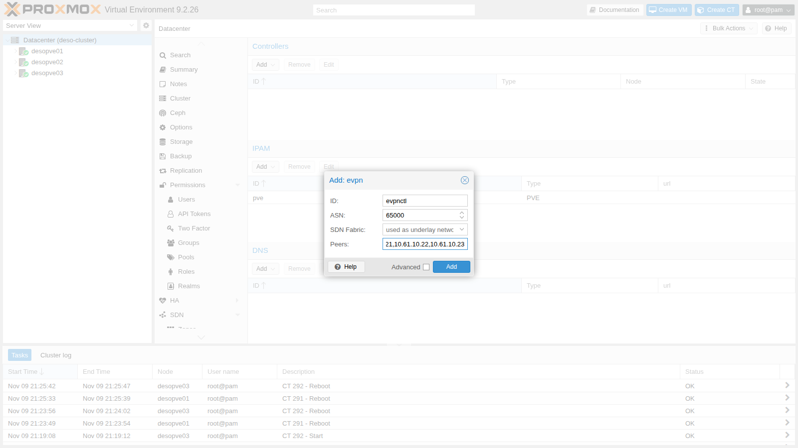
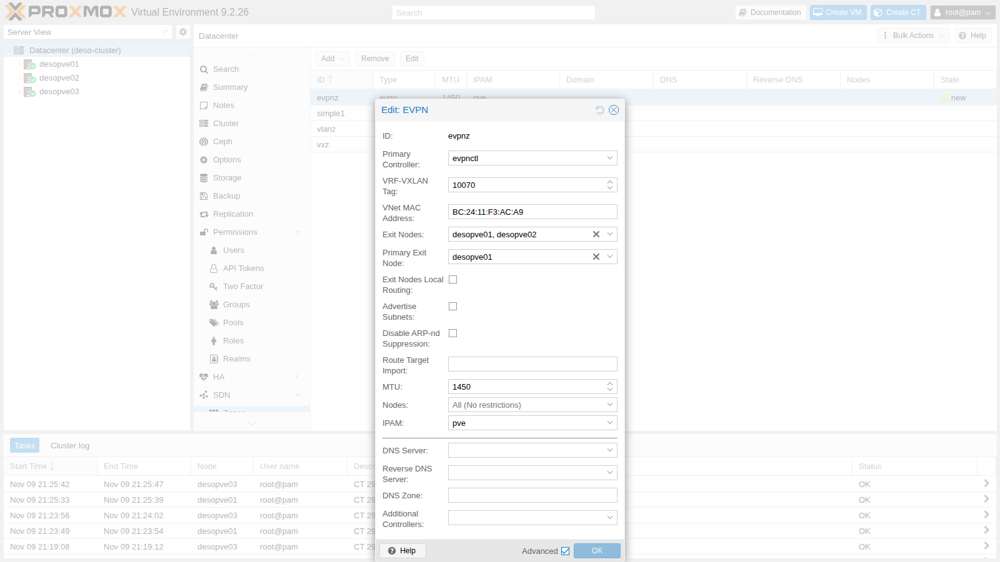
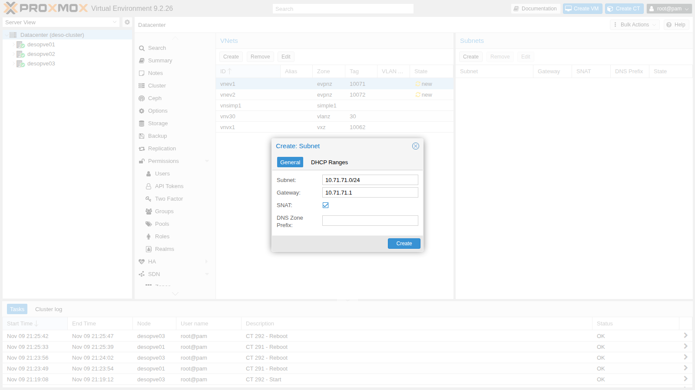

## Dipendenze

- **Lab precedenti:**
  - [Lab 29](/it/29-sdn-vxlan/): VXLAN, rete underlay `vmbr1.61` (10.61.10.0/24) e MTU dei guest;
  - [Lab 27](/it/27-sdn-simple/): subnet, gateway, SNAT e IPAM dell'SDN;
  - [Lab 22](/it/22-dedicated-networks/): rete di migrazione dedicata;
  - [Lab 17](/it/17-ceph-installation/): storage `rbd-vm` per i dischi dei guest.
- **Pacchetti:** `frr` e `frr-pythontools` sono installati dalla ISO di Proxmox VE; l'SDN abilita il servizio e scrive `/etc/frr/frr.conf` all'Apply. Si verifica con `dpkg -l frr frr-pythontools` e `systemctl is-enabled frr`:

  ```text
  ii  frr             10.6.1-1+pve3 amd64        FRRouting suite of internet protocols (BGP, OSPF, IS-IS, ...)
  ii  frr-pythontools 10.6.1-1+pve3 all          FRRouting suite - Python tools
  enabled
  ```

- **Nodi:** `desopve01`, `desopve02`, `desopve03`.
- **Immagini:** template `cephfs:vztmpl/debian-13-standard_13.6-1_amd64.tar.zst` ([Lab 20](/it/20-bridges-stable-names-vlans/)) e immagine cloud `local:import/debian-13-genericcloud-amd64.qcow2` su `desopve01`, scaricata nel [Lab 19](/it/19-fio-benchmark/).
- **Credenziali:** `root` / `<password-lab>` → [Appendice B](/it/b-credentials-and-addresses/).

## Obiettivi

- Una zona EVPN, `evpnz`, con la sua VRF e due VNet, e le sessioni iBGP con BFD stabilite tra i tre nodi: `vtysh` mostra le sessioni, i VNI e le route MAC/IP dei guest.
- Lo stesso gateway, con lo stesso IP e lo stesso MAC, su ogni nodo (*anycast gateway*): un container in `vnev2` raggiunge uno in `vnev1` su un altro nodo, ed esce dalla zona con l'indirizzo dell'*exit node* principale (SNAT).
- Una VM migrata a caldo su un altro nodo senza toccare la sua configurazione di rete, con il suo MAC annunciato ora dietro il nuovo nodo.
- Una caduta simulata dell'exit node principale, dopo la quale sai verificare se l'uscita è passata al nodo di riserva, e perché un flusso già aperto può restare bloccato.

## Come funziona

### Il piano di controllo

Nella zona VXLAN del lab 29 ogni nodo scopriva i MAC dal traffico e copiava i broadcast verso tutti. Con **EVPN** (RFC 7432 e 8365) i nodi si scambiano queste informazioni con **BGP** (famiglia `l2vpn evpn`): quando un guest si accende, il suo nodo annuncia agli altri il MAC e l'IP del guest.

| Tipo di route | Cosa annuncia | Esempio nel lab |
|---|---|---|
| Tipo 2 (MAC/IP) | MAC e IP di un guest e il VTEP dietro cui si trova | `bc:24:11:ca:34:84` / 10.71.71.11 dietro 10.61.10.21 |
| Tipo 3 (multicast) | quali VTEP partecipano a un VNI | i tre nodi per ogni VNet |
| Tipo 5 (prefisso IP) | una rete instradabile, per esempio la route di default di un exit node | 0.0.0.0/0 da `desopve01` |

I nodi formano tra loro sessioni **iBGP** con un ASN privato (65000) sugli indirizzi della rete underlay. L'SDN attiva su queste sessioni anche **BFD** (`neighbor VTEP bfd` nella configurazione del passo 4). Con i tempi predefiniti di FRR, 300 ms tra un pacchetto di controllo e l'altro e un moltiplicatore 3, un vicino che smette di rispondere viene dichiarato caduto dopo circa 900 ms, senza aspettare i timer di BGP; `vtysh -c "show bfd peers"` mostra i tempi effettivamente in uso.

### VRF, anycast gateway e routing distribuito

- **Zona EVPN = VRF.** Ogni zona è una tabella di routing separata (`vrf_evpnz`), cioè un tenant: le sue reti non si mescolano con quelle dell'host né con quelle di altre zone.
- **Anycast gateway.** Il gateway di ogni VNet esiste su **tutti** i nodi, con lo stesso IP e lo stesso MAC. Un guest parla sempre con il gateway del nodo su cui gira, e se migra trova lo stesso gateway.
- **Routing simmetrico.** Il traffico tra due VNet viene instradato dal nodo di partenza e attraversa la rete tra i nodi dentro il VNI di livello 3 della zona (**VRF-VXLAN tag**). Il nodo di arrivo lo consegna nella VNet di destinazione.

### Exit node

Per uscire dalla zona servono uno o più **exit node**: nodi che annunciano nella zona una route di default e collegano la VRF alla rete dell'host. Con **SNAT** nella subnet i guest escono con l'indirizzo dell'exit node. Se gli exit node sono più d'uno, con un **Primary Exit Node** tutto il traffico in uscita passa da quel nodo e gli altri restano di riserva; la documentazione di Proxmox VE lo richiede se si usa SNAT.

L'SNAT è *stateful*: l'exit node registra ogni flusso nella sua tabella di connection tracking (*conntrack*) e usa quella voce per tradurre le risposte. Come nel [Lab 24](/it/24-routing-nat/), una voce ha due metà: la richiesta come l'ha inviata il guest e la risposta come ci si aspetta che torni. Con SNAT la metà della risposta è indirizzata all'exit node, non al guest: il passo 8 usa questa lettura per capire cosa è successo durante il guasto.

### Ambiente e versioni della prova

Gli output e le misure che seguono vengono da prove eseguite a novembre 2026 in questa configurazione:

| Componente | Configurazione della prova |
|---|---|
| Proxmox VE | 9.2.26, kernel `7.0.14-28-pve` ([Lab 04](/it/04-first-access-repositories-updates/)) |
| FRR | 10.6.1-1+pve3, con la configurazione generata dall'SDN |
| Underlay | VLAN 61 (`vmbr1.61`, 10.61.10.0/24) su `vmbr1` e `bond0`, active-backup su porte 10 GbE, MTU 1500 ([Lab 21](/it/21-bonding/), [Lab 29](/it/29-sdn-vxlan/)) |
| Zona | exit node `desopve01` (principale) e `desopve02`, SNAT sulle due subnet, MTU dei guest 1450 |
| Guest | CT 301 e CT 302 dal template `debian-13-standard_13.6-1`, VM 303 dall'immagine cloud di Debian 13, tutti su `rbd-vm` (Ceph 20.2, [Lab 17](/it/17-ceph-installation/)) |
| Strumenti | `ping` dal CT 302 ogni 100 o 200 ms, log del task di migrazione, `vtysh`, `tcpdump`, `conntrack` |

**Cosa misurano le prove e cosa no.** La caduta dell'exit node è simulata spegnendo la sua interfaccia underlay: `desopve01` resta acceso e raggiungibile sulla rete di gestione, quindi non è il crash o la mancanza di alimentazione di un nodo. Il traffico è solo ICMP: nessuna connessione TCP è stata provata. Il `ping` mostra quello che vede un client, con la risoluzione del suo intervallo: non misura i tempi di BFD o della convergenza di BGP, e l'istante in cui l'interfaccia è stata spenta, rispetto al ping, non è stato registrato. La documentazione di Proxmox VE consiglia di disattivare il controllo stretto del percorso inverso (`rp_filter`) quando una zona ha più exit node; il suo valore sui nodi non è stato registrato.

## Procedura

### 1. Il controller EVPN

**Datacenter** → **SDN** → **Options** → **Controllers** → **Add** → **EVPN**:

- **ID** `evpnctl`;
- **ASN** `65000`, privato;
- **Peers** `10.61.10.21,10.61.10.22,10.61.10.23`: gli indirizzi underlay dei nodi.

Anche qui **SDN Fabric** è l'alternativa alla lista dei peer (lab 31).



### 2. La zona EVPN

1. **Zones** → **Add** → **EVPN**, con **Advanced** attivo:
   - **ID** `evpnz`, **Controller** `evpnctl`;
   - **VRF-VXLAN Tag** `10070`: il VNI di livello 3 della zona;
   - **Exit Nodes** `desopve01`, `desopve02`; **Primary Exit Node** `desopve01`;
   - **MTU** `1450`, come nel lab 29.

   Il **VNet MAC Address** lo genera Proxmox VE: è il MAC del gateway anycast, uguale su tutti i nodi.

   

   Il nodo principale si può impostare anche da riga di comando:

   ```bash title="root@desopve01"
   pvesh set /cluster/sdn/zones/evpnz --exitnodes-primary desopve01
   ```

### 3. Due VNet con subnet e SNAT

1. **VNets** → **Create**: `vnev1`, zona `evpnz`, **Tag** (VNI) `10071`. Nel pannello **Subnets** → **Create**: **Subnet** `10.71.71.0/24`, **Gateway** `10.71.71.1`, **SNAT** attivo:

   

2. La seconda VNet da riga di comando, poi Apply:

   ```bash title="root@desopve01"
   pvesh create /cluster/sdn/vnets --vnet vnev2 --zone evpnz --tag 10072
   pvesh create /cluster/sdn/vnets/vnev2/subnets --subnet 10.72.72.0/24 --type subnet --gateway 10.72.72.1 --snat 1
   pvesh set /cluster/sdn
   ```

### 4. Cosa genera l'SDN: FRR, VRF e gateway

1. In `/etc/frr/frr.conf` l'SDN scrive la VRF con il suo VNI, l'iBGP tra i nodi con BFD e l'annuncio di tutti i VNI. Sugli exit node aggiunge la route di default annunciata nella zona:

   ```text
   # estratto di /etc/frr/frr.conf su desopve01 (exit node)
   vrf vrf_evpnz
    vni 10070
   exit-vrf
   !
   router bgp 65000
    bgp router-id 10.61.10.21
    neighbor VTEP peer-group
    neighbor VTEP remote-as 65000
    neighbor VTEP bfd
    neighbor 10.61.10.22 peer-group VTEP
    neighbor 10.61.10.23 peer-group VTEP
    !
    address-family l2vpn evpn
     neighbor VTEP activate
     neighbor VTEP route-map MAP_VTEP_IN in
     neighbor VTEP route-map MAP_VTEP_OUT out
     advertise-all-vni
    exit-address-family
   exit
   !
   router bgp 65000 vrf vrf_evpnz
    !
    address-family l2vpn evpn
     default-originate ipv4
     default-originate ipv6
    exit-address-family
   exit
   ```

2. Le sessioni BGP con gli altri due nodi e i VNI conosciuti:

   ```bash title="root@desopve01"
   vtysh -c "show bgp l2vpn evpn summary"
   ```

   ```text output
   BGP router identifier 10.61.10.21, local AS number 65000 VRF default vrf-id 0
   ...
   Neighbor               V         AS   MsgRcvd   MsgSent   TblVer  InQ OutQ  Up/Down State/PfxRcd   PfxSnt Desc
   desopve02(10.61.10.22) 4      65000        25        31        3    0    0 00:00:37            3        7 FRRouting/10.6.1
   desopve03(10.61.10.23) 4      65000        25        24        3    0    0 00:00:30            5        7 FRRouting/10.6.1
   ```

   ```bash title="root@desopve01"
   vtysh -c "show evpn vni"
   ```

   ```text output
   VNI        Type VxLAN IF              # MACs   # ARPs   # Remote VTEPs  Tenant VRF      VLAN       BRIDGE
   10072      L2   vxlan_vnev2           0        0        2               vrf_evpnz       1          vnev2
   10071      L2   vxlan_vnev1           0        0        2               vrf_evpnz       1          vnev1
   10062      L2   vxlan_vnvx1           2        2        2               default         1          vnvx1
   10070      L3   vrfvx_evpnz           0        0        n/a             vrf_evpnz       1          vrfbr_evpnz
   ```

   I due VNI L2 sono le VNet, il VNI L3 è quello della VRF. Compare anche il VNI 10062 della zona VXLAN del lab 29: con `advertise-all-vni`, FRR annuncia ogni interfaccia VXLAN del nodo.

3. Il gateway anycast: stesso IP e stesso MAC su `desopve01` e `desopve03`:

   ```bash title="root@desopve01"
   ip -br link show vnev1
   ```

   ```text output
   vnev1            UP             bc:24:11:f3:ac:a9 <BROADCAST,MULTICAST,UP,LOWER_UP>
   ```

   ```bash title="root@desopve03"
   ip -br link show vnev1
   ```

   ```text output
   vnev1            UP             bc:24:11:f3:ac:a9 <BROADCAST,MULTICAST,UP,LOWER_UP>
   ```

   ```bash title="root@desopve03"
   ip -br -4 addr show vnev1
   ```

   ```text output
   vnev1            UP             10.71.71.1/24
   ```

### 5. Guest in VNet diverse su nodi diversi

1. CT 301 su `desopve01` nella VNet `vnev1` e CT 302 su `desopve03` nella VNet `vnev2`, con il gateway della subnet e MTU 1450. Come nel lab 29, l'MTU va scritta anche nel file di rete del container, poi si riavvia:

   ```bash title="root@desopve01"
   pct create 301 cephfs:vztmpl/debian-13-standard_13.6-1_amd64.tar.zst --hostname evpn-ct1 \
     --unprivileged 1 --features nesting=1 --cores 1 --memory 512 --rootfs rbd-vm:4 \
     --net0 name=eth0,bridge=vnev1,ip=10.71.71.11/24,gw=10.71.71.1,mtu=1450 --password
   pct start 301
   pct exec 301 -- sed -i '/address 10.71.71.11/a\	mtu 1450' /etc/network/interfaces
   pct reboot 301
   ```

   ```bash title="root@desopve03"
   pct create 302 cephfs:vztmpl/debian-13-standard_13.6-1_amd64.tar.zst --hostname evpn-ct2 \
     --unprivileged 1 --features nesting=1 --cores 1 --memory 512 --rootfs rbd-vm:4 \
     --net0 name=eth0,bridge=vnev2,ip=10.72.72.12/24,gw=10.72.72.1,mtu=1450 --password
   pct start 302
   pct exec 302 -- sed -i '/address 10.72.72.12/a\	mtu 1450' /etc/network/interfaces
   pct reboot 302
   ```

2. Il CT 302 raggiunge il CT 301 in un'altra VNet e su un altro nodo. Il primo salto è il gateway anycast sul nodo locale; il secondo, il nodo remoto, non risponde ai traceroute:

   ```bash title="root@desopve03"
   pct exec 302 -- ping -c3 -W1 10.71.71.11
   ```

   ```text output
   3 packets transmitted, 3 received, 0% packet loss, time 2031ms
   ```

   ```bash title="root@desopve03"
   pct exec 302 -- apt-get install -y traceroute    # il CT esce dall'exit node; proxy di apt impostato come negli altri guest
   pct exec 302 -- traceroute -n -w1 -q1 10.71.71.11
   ```

   ```text output
   traceroute to 10.71.71.11 (10.71.71.11), 30 hops max, 60 byte packets
    1  10.72.72.1  0.130 ms
    2  *
    3  10.71.71.11  1.096 ms
   ```

   ```bash title="root@desopve03"
   pct exec 302 -- ip neigh show 10.72.72.1
   ```

   ```text output
   10.72.72.1 dev eth0 lladdr bc:24:11:f3:ac:a9 REACHABLE
   ```

3. Sul nodo `desopve03`, che non è exit node, la tabella della VRF contiene la route di default verso l'exit node principale e una route /32 per ogni guest remoto, imparata da BGP:

   ```bash title="root@desopve03"
   vtysh -c "show ip route vrf vrf_evpnz"
   ```

   ```text output
   ...
   B>* 0.0.0.0/0 [200/0] via 10.61.10.21, vrfbr_evpnz onlink, weight 1, 00:02:34
   K * 0.0.0.0/0 [255/8192] unreachable (ICMP unreachable), weight 1, 00:02:39
   C>* 10.71.71.0/24 is directly connected, vnev1, weight 1, 00:02:39
   L>* 10.71.71.1/32 is directly connected, vnev1, weight 1, 00:02:39
   B>* 10.71.71.11/32 [200/0] via 10.61.10.21, vrfbr_evpnz onlink, weight 1, 00:00:19
   C>* 10.72.72.0/24 is directly connected, vnev2, weight 1, 00:00:30
   L>* 10.72.72.1/32 is directly connected, vnev2, weight 1, 00:00:30
   ```

4. Le route di tipo 2 con MAC e IP dei guest:

   ```bash title="root@desopve01"
   vtysh -c "show bgp l2vpn evpn route type macip"
   ```

   ```text output
   ...
   Route Distinguisher: 10.61.10.21:4
    *>  [2]:[0]:[48]:[bc:24:11:ca:34:84]:[32]:[10.71.71.11] RD 10.61.10.21:4
   Route Distinguisher: 10.61.10.23:5
    *>i [2]:[0]:[48]:[bc:24:11:46:74:e2]:[32]:[10.72.72.12] RD 10.61.10.23:5
   ```

### 6. Uscita dall'exit node con SNAT

1. Il CT 302 raggiunge il domain controller, fuori dalla zona. Sulla rete di gestione di `desopve01`, l'exit node principale, il traffico esce con l'indirizzo del nodo:

   ```bash title="root@desopve03"
   pct exec 302 -- ping -c3 -W1 172.27.199.20
   ```

   ```text output
   3 packets transmitted, 3 received, 0% packet loss, time 2003ms
   ```

   ```bash title="root@desopve01"
   tcpdump -lnni vmbr0 -c2 "icmp[icmptype]=icmp-echo and dst host 172.27.199.20"
   ```

   ```text output
   21:40:37.078886 IP 172.27.199.21 > 172.27.199.20: ICMP echo request, id 282, seq 1, length 64
   21:40:38.080689 IP 172.27.199.21 > 172.27.199.20: ICMP echo request, id 282, seq 2, length 64
   ```

2. Le regole SNAT le ha scritte l'SDN, su ogni exit node con il proprio indirizzo:

   ```bash title="root@desopve01"
   iptables -t nat -S POSTROUTING | grep -E "10.7[12]"
   ```

   ```text output
   -A POSTROUTING -s 10.71.71.0/24 -o vmbr0 -j SNAT --to-source 172.27.199.21
   -A POSTROUTING -s 10.72.72.0/24 -o vmbr0 -j SNAT --to-source 172.27.199.21
   ```

   ```bash title="root@desopve02"
   iptables -t nat -S POSTROUTING | grep -E "10.7[12]"
   ```

   ```text output
   -A POSTROUTING -s 10.71.71.0/24 -o vmbr0 -j SNAT --to-source 172.27.199.22
   -A POSTROUTING -s 10.72.72.0/24 -o vmbr0 -j SNAT --to-source 172.27.199.22
   ```

### 7. Migrazione a caldo con il gateway anycast

1. Una VM dall'immagine cloud Debian, con cloud-init (approfondito nel lab 40) e la scheda che eredita l'MTU della VNet (`mtu=1`):

   ```bash title="root@desopve01"
   qm create 303 --name evpn-vm1 --ostype l26 --memory 1024 --cores 1 \
     --net0 virtio,bridge=vnev1,mtu=1 --scsihw virtio-scsi-single \
     --scsi0 rbd-vm:0,import-from=local:import/debian-13-genericcloud-amd64.qcow2 \
     --ide2 rbd-vm:cloudinit --ipconfig0 ip=10.71.71.30/24,gw=10.71.71.1 \
     --ciuser labuser --cipassword '<password-lab>' --boot order=scsi0 --serial0 socket --vga serial0
   qm start 303
   qm showcmd 303 | grep -o 'host_mtu=[0-9]*'
   ```

   ```text output
   host_mtu=1450
   ```

   `host_mtu=1450` conferma che con `mtu=1` Proxmox VE passa alla scheda VirtIO l'MTU del bridge.

2. Prima della migrazione, `desopve03` vede il MAC della VM (`bc:24:11:45:63:6d`) dietro il VTEP di `desopve01`:

   ```bash title="root@desopve03"
   vtysh -c "show evpn mac vni 10071"
   ```

   ```text output
   MAC               Type   Flags Intf/Remote ES/VTEP                     VLAN  Seq #'s
   bc:24:11:ca:34:84 remote       10.61.10.21                                   0/0
   bc:24:11:45:63:6d remote       10.61.10.21                                   1/0
   ```

3. Dal CT 302 un ping ogni 100 ms verso la VM, mentre la VM migra a caldo da `desopve01` a `desopve02`:

   ```bash title="root@desopve03"
   pct exec 302 -- ping -i 0.1 -c 450 -q 10.71.71.30
   ```

   ```bash title="root@desopve01"
   qm migrate 303 desopve02 --online
   ```

   ```text output
   ...
   2026-11-09 21:42:03 average migration speed: 512.4 MiB/s - downtime 45 ms
   2026-11-09 21:42:03 migration status: completed
   2026-11-09 21:42:07 migration finished successfully (duration 00:00:10)
   ```

   ```text output
   450 packets transmitted, 440 received, 2.22222% packet loss, time 45465ms
   ```

   Sono tre osservazioni diverse, da tenere separate:

   - **Task:** la migrazione dura 10 secondi in tutto e il task riporta un fermo di 45 ms, la pausa della VM misurata da QEMU nell'ultima fase.
   - **Ping:** dal CT 302, con una richiesta ogni 100 ms, mancano 10 risposte su 450. Il riepilogo non dice se fossero consecutive; se lo erano, l'interruzione è durata circa un secondo.
   - **EVPN:** dopo la migrazione `desopve03` vede il MAC della VM dietro il VTEP di `desopve02` (passo successivo).

   **Interpretazione:** un'interruzione di circa un secondo, contro una pausa di 45 ms, è compatibile con il tempo che serve agli altri nodi per sapere dove si trova ora la VM: `desopve02` deve vedere un frame della VM e annunciarne il MAC con una route di tipo 2, e gli altri nodi devono installarla. La prova non misura queste fasi una per una. **Verifica:** `ping -D -O -i 0.1` stampa l'ora di ogni risposta e segnala quelle mancanti, così si vede se sono consecutive e quando iniziano rispetto al log del task; su `desopve02`, `tcpdump -eni vnev1 ether src bc:24:11:45:63:6d` mostra quando i primi frame della VM arrivano sul nodo di destinazione.

   La configurazione di rete della VM non è cambiata: il gateway 10.71.71.1, con lo stesso MAC, esiste anche su `desopve02`.

4. Dopo la migrazione il MAC è dietro il VTEP di `desopve02` e il numero di sequenza è salito: è il meccanismo di *MAC mobility* di EVPN.

   ```bash title="root@desopve03"
   vtysh -c "show evpn mac vni 10071"
   ```

   ```text output
   MAC               Type   Flags Intf/Remote ES/VTEP                     VLAN  Seq #'s
   bc:24:11:ca:34:84 remote       10.61.10.21                                   0/0
   bc:24:11:45:63:6d remote       10.61.10.22                                   2/1
   ```

5. La VM serviva solo per questa prova: `qm stop 303 && qm destroy 303 --purge`.

### 8. Caduta dell'exit node principale

1. Dal CT 302 un ping continuo verso il domain controller. Su `desopve01` si spegne l'interfaccia underlay, come se il nodo sparisse dalla rete tra i nodi (resta acceso sulla rete di gestione):

   ```bash title="root@desopve03"
   pct exec 302 -- ping -i 0.1 -c 300 -q 172.27.199.20
   ```

   ```bash title="root@desopve01"
   ip link set vmbr1.61 down
   ```

2. Dopo il guasto, su `desopve03` la route di default della VRF punta all'exit node di riserva, e su `desopve02` il traffico esce con l'indirizzo di quel nodo:

   ```bash title="root@desopve03"
   vtysh -c "show ip route vrf vrf_evpnz 0.0.0.0/0"
   ```

   ```text output
   Routing entry for 0.0.0.0/0
     Known via "bgp", distance 200, metric 200, vrf vrf_evpnz, best
     * 10.61.10.22, via vrfbr_evpnz onlink, weight 1
   ```

   ```bash title="root@desopve02"
   tcpdump -lnni vmbr0 -c2 "icmp and host 172.27.199.20"
   ```

   ```text output
   21:44:53.644292 IP 172.27.199.22 > 172.27.199.20: ICMP echo request, id 294, seq 37, length 64
   21:44:53.644875 IP 172.27.199.20 > 172.27.199.22: ICMP echo reply, id 294, seq 37, length 64
   ```

   Questi output sono fotografie scattate dopo il passaggio e non dicono quanto è durato. Il log di FRR su `desopve03` (`journalctl -u frr`) registra quando è caduta la sessione con 10.61.10.21, e per quale motivo.

3. Il ping già in corso **non** si è comportato allo stesso modo in tutte le prove. Su quattro tentativi:

   | Prova | Risposte perse | Il ping in corso |
   |---|---|---|
   | 1 | 152 su 400, ogni 100 ms (circa 15 s) | nessuna risposta fino al ripristino del collegamento |
   | 2 | 4 su 150, ogni 200 ms (circa 0,8 s) | ripreso attraverso `desopve02` |
   | 3 | 132 su 300, ogni 100 ms (circa 13 s) | nessuna risposta fino al ripristino del collegamento |
   | 4 | 9 su 200, ogni 100 ms (circa 0,9 s) | ripreso attraverso `desopve02` |

   Il tempo tra parentesi è calcolato, risposte perse × intervallo: presuppone che le perdite fossero consecutive, cosa che il riepilogo del ping non mostra. Nelle prove 2 e 4 l'interruzione è compatibile con il tempo di rilevamento di BFD (circa 900 ms) più il cambio di route, ma i due tempi non sono stati misurati separatamente.

   **Osservato nelle prove 1 e 3.** Su `desopve02` la voce di conntrack del ping in corso era **senza traduzione degli indirizzi**: nella metà della risposta la destinazione è 10.72.72.12, il guest, invece di 172.27.199.22, il nodo, e la voce è `[UNREPLIED]`. Per esempio:

   ```bash title="root@desopve02"
   conntrack -L -p icmp | grep 10.72.72.12
   ```

   ```text output
   icmp     1 29 src=10.72.72.12 dst=172.27.199.20 type=8 code=0 id=295 [UNREPLIED] src=172.27.199.20 dst=10.72.72.12 type=0 code=0 id=295 mark=0 use=1
   ```

   Un ping **nuovo**, lanciato durante il guasto, ha un identificativo ICMP diverso e quindi una voce nuova. Ha funzionato senza perdite:

   ```bash title="root@desopve03"
   pct exec 302 -- ping -c5 -W1 172.27.199.20
   ```

   ```text output
   5 packets transmitted, 5 received, 0% packet loss, time 4006ms
   ```

   **Interpretazione.** Senza traduzione, le richieste escono da `desopve02` con l'indirizzo privato del guest, e il DC risponde a 10.72.72.12, un indirizzo che nessun router fuori dalla zona sa raggiungere: è coerente con `[UNREPLIED]`. Perché la voce sia nata senza NAT è un'ipotesi. I primi pacchetti del flusso potrebbero essere arrivati a `desopve02` quando la sua route di default nella VRF puntava ancora a `desopve01`: in quel caso non sarebbero usciti da `vmbr0` e non avrebbero incontrato la regola SNAT (`-o vmbr0`). Il NAT si decide sul primo pacchetto di un flusso, e una voce ICMP scade solo dopo 30 secondi senza traffico (`nf_conntrack_icmp_timeout`): un ping ogni 100 ms la tiene viva finché continua. Nelle prove 2 e 4 gli eventi sarebbero avvenuti nell'ordine opposto. La prova non ne ha registrato i tempi.

   **Verifica:**

   - durante una prova bloccata, `tcpdump -lnni vmbr0 icmp and host 172.27.199.20` su `desopve02`: richieste in uscita da 10.72.72.12, senza risposte, confermano la traduzione mancante;
   - `conntrack -E -p icmp -o timestamp` su `desopve02`, insieme a `ip -ts monitor route`, mostra se la voce è nata prima o dopo che il nodo cambiasse la sua route di default;
   - si cancella la voce mentre il ping è bloccato (`conntrack -D -p icmp -s 10.72.72.12`): se il ping riprende subito, attraverso l'SNAT, la causa era la voce rimasta.

4. Si ripristina il collegamento e le sessioni BGP si ristabiliscono:

   ```bash title="root@desopve01"
   ip link set vmbr1.61 up
   vtysh -c "show bgp l2vpn evpn summary" | grep ^desopve
   ```

   ```text output
   desopve02(10.61.10.22) 4      65000       231       253       40    0    0 00:00:46            3        8 FRRouting/10.6.1
   desopve03(10.61.10.23) 4      65000       231       247       40    0    0 00:00:46            8        8 FRRouting/10.6.1
   ```

**Decisione e limiti.** La zona mantiene l'SNAT con un exit node principale, la configurazione che la documentazione di Proxmox VE richiede per l'SNAT con più exit node, e il router di upstream `rtr-core` resta fuori dal BGP, per non toccare l'infrastruttura del laboratorio. Un flusso già aperto può quindi restare bloccato quando l'uscita si sposta, e la prova mostra che non succede ogni volta. Due casi non sono stati provati:

- **Connessioni TCP.** L'ICMP tollera il cambio dell'indirizzo di origine: il DC risponde semplicemente a `desopve02`. Una connessione TCP aperta attraverso `desopve01`, invece, dopo il passaggio arriverebbe al server da un indirizzo che non appartiene a nessuna connessione aperta, e ci si aspetta che cada.
- **Un'uscita senza SNAT.** Gli exit node annunciano le subnet della zona via BGP ai router di upstream, che così possono mandare le risposte a qualunque exit node, senza uno stato NAT sui nodi. Quanto dura il passaggio in quella configurazione va misurato sulla propria rete.

## Verifica e test

Il lab è riuscito se ogni controllo della tabella dà il risultato atteso. Il comportamento di un flusso già aperto durante il guasto si registra, non si giudica: in questa prova non era ripetibile.

| Controllo | Risultato atteso | Osservato nella prova |
|---|---|---|
| Sessioni iBGP EVPN tra i 3 nodi | stabilite, con BFD | stabilite |
| Gateway anycast | stesso IP e MAC su ogni nodo | 10.71.71.1 e `bc:24:11:f3:ac:a9` su `desopve01` e `desopve03` |
| CT 302 (`vnev2`, `desopve03`) → CT 301 (`vnev1`, `desopve01`) | risponde, instradato nella VRF | 0% di perdita |
| Uscita verso il DC | indirizzo di origine dell'exit node principale | 172.27.199.21 |
| Migrazione a caldo della VM 303 | migrazione completata, MAC dietro il VTEP del nodo di destinazione | task: 10 s, fermo di 45 ms; ping ogni 100 ms: 10 risposte perse su 450; MAC dietro 10.61.10.22, sequenza 2/1 |
| Underlay dell'exit node principale spento | route di default verso `desopve02`, flussi nuovi in uscita con il suo indirizzo | route via 10.61.10.22; ping nuovo: 0% di perdita; ping in corso: 4 e 9 risposte perse in due prove, nessuna risposta fino al ripristino nelle altre due |
| Collegamento ripristinato | sessioni BGP di nuovo stabilite | entrambe le sessioni attive |

## Stato finale del lab

- **SDN:**
  - controller `evpnctl` (EVPN, ASN 65000, peer 10.61.10.21-23 sulla VLAN 61);
  - zona `evpnz` (VRF `vrf_evpnz`, VRF-VXLAN 10070, MTU 1450, exit node `desopve01` principale e `desopve02`);
  - VNet `vnev1` (VNI 10071, 10.71.71.0/24, gateway .1, SNAT) e `vnev2` (VNI 10072, 10.72.72.0/24, gateway .1, SNAT);
  - zone `simple1`, `vlanz` e `vxz` invariate.
- **Container**, accesi, senza avvio automatico, MTU 1450:
  - CT 301 `evpn-ct1` su `desopve01`, 10.71.71.11/24;
  - CT 302 `evpn-ct2` su `desopve03`, 10.72.72.12/24.
- VM 303 eliminata. `vmbr1.61` è di nuovo attiva su `desopve01`.

## Cosa hai imparato

- **Quando EVPN conviene rispetto alla semplice VXLAN:** quando le VNet devono instradare tra loro su ogni nodo, con una VRF per tenant e lo stesso gateway ovunque, e vuoi che MAC e IP siano distribuiti da BGP invece che imparati inondando l'underlay ([Lab 29](/it/29-sdn-vxlan/)).
- **Come far uscire la zona:** gli exit node con SNAT non chiedono nulla ai router di upstream, ma con più exit node serve un principale, e una commutazione può bloccare i flussi già aperti. Se i flussi aperti devono sopravvivere alla perdita di un exit node, progetta l'alternativa instradata, con le subnet annunciate via BGP, e provala sulla tua rete.
- **Come condurre una prova di guasto:** tieni separati il cambio di route, l'interruzione vista dal client e lo stato di conntrack; ripeti la prova più volte, perché qui l'esito è cambiato da un tentativo all'altro, e registra gli orari (`ping -D -O`, log di FRR, `conntrack -E`).
- **Cosa controllare dopo la caduta di un exit node:** la route di default della VRF su un nodo che non è exit node, l'indirizzo di origine su `vmbr0` del nodo di riserva e le eventuali voci di conntrack senza traduzione. Un flusso nuovo ti dice se l'uscita funziona; quello vecchio, se c'è uno stato rimasto a bloccarlo.
- **Quanto costa una migrazione a caldo in una zona EVPN:** il guest mantiene il gateway, ma l'interruzione vista da un client, qui circa un secondo, è molto più lunga della pausa riportata dal task, e si misura con un ping con l'orario.

## Riferimenti

- [Proxmox VE – SDN: zone EVPN, exit node e primary exit node](https://pve.proxmox.com/pve-docs/chapter-pvesdn.html#pvesdn_zone_plugin_evpn)
- [Proxmox VE – SDN: controller EVPN](https://pve.proxmox.com/pve-docs/chapter-pvesdn.html#pvesdn_controller_plugin_evpn)
- [Proxmox VE – SDN: subnet e opzione SNAT](https://pve.proxmox.com/pve-docs/chapter-pvesdn.html#pvesdn_config_subnet)
- [Proxmox VE – SDN: più exit node EVPN e `rp_filter`](https://pve.proxmox.com/pve-docs/chapter-pvesdn.html#_multiple_evpn_exit_nodes)
- [RFC 7432 – BGP MPLS-Based Ethernet VPN](https://www.rfc-editor.org/rfc/rfc7432)
- [RFC 7432, sezione 15 – MAC mobility e numeri di sequenza](https://www.rfc-editor.org/rfc/rfc7432#section-15)
- [RFC 8365 – A Network Virtualization Overlay Solution Using EVPN](https://www.rfc-editor.org/rfc/rfc8365)
- [FRRouting 10.6 – EVPN](https://docs.frrouting.org/en/stable-10.6/evpn.html)
- [FRRouting 10.6 – BFD, tempi predefiniti](https://docs.frrouting.org/en/stable-10.6/bfd.html)
- [Linux 7.0 – parametri di conntrack (`nf_conntrack_icmp_timeout`)](https://www.kernel.org/doc/html/v7.0/networking/nf_conntrack-sysctl.html)
- [conntrack(8) – elenco, osservazione e cancellazione delle voci](https://manpages.debian.org/trixie/conntrack/conntrack.8.en.html)
