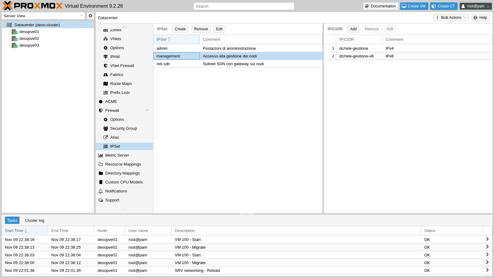
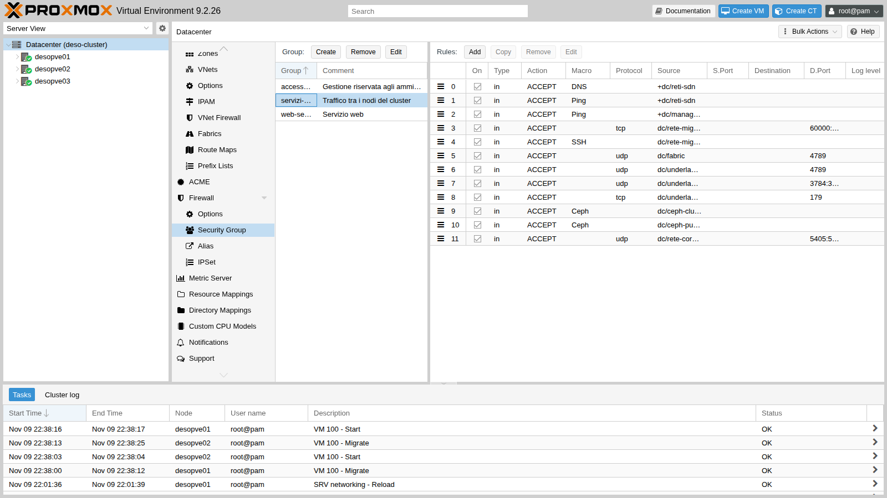
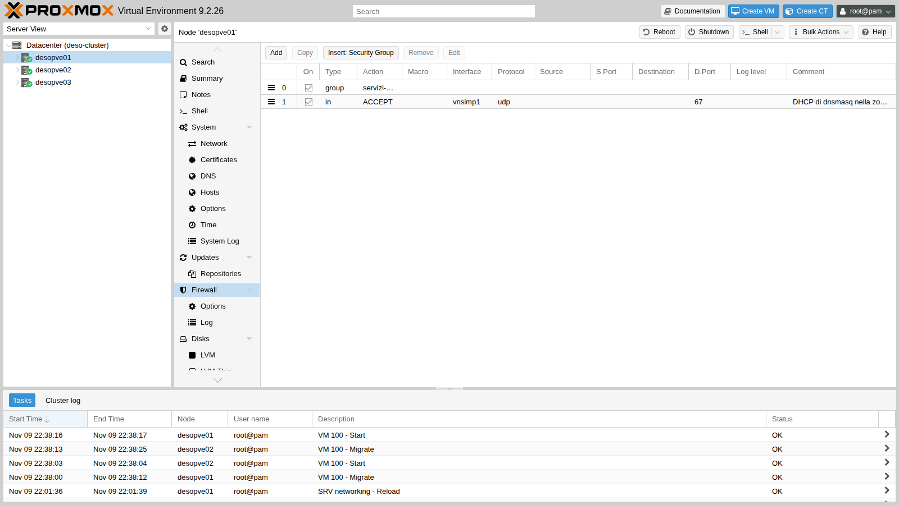
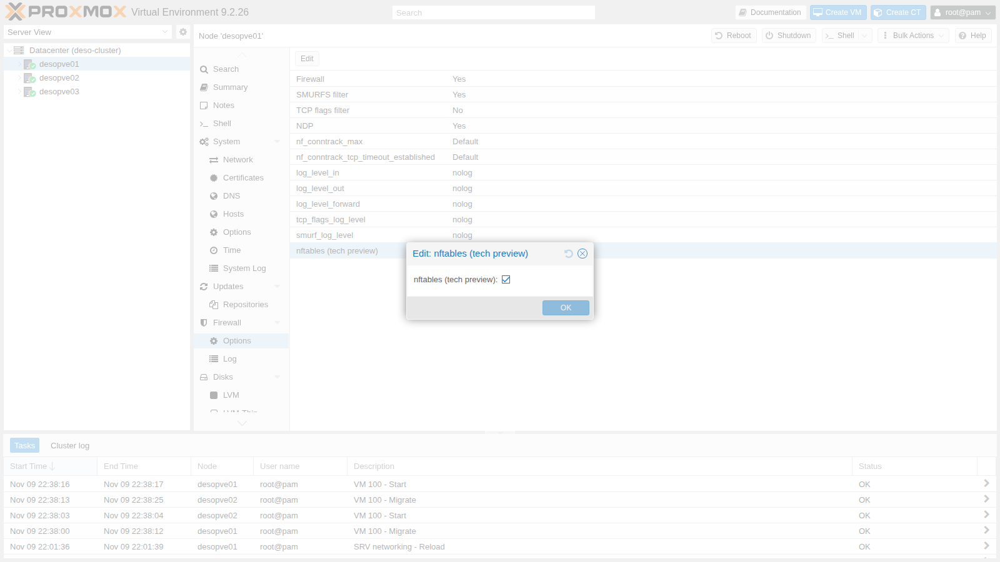
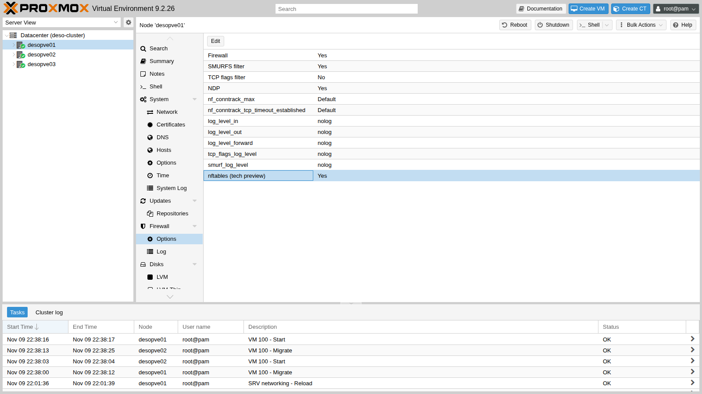
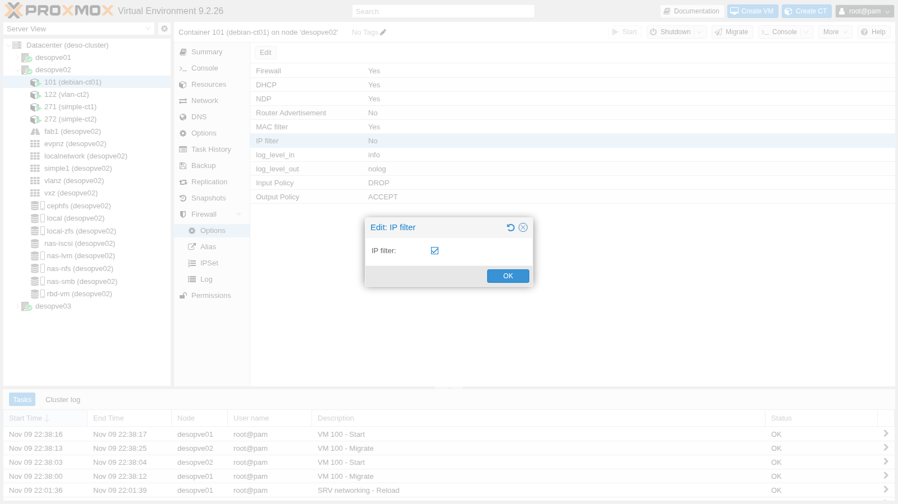
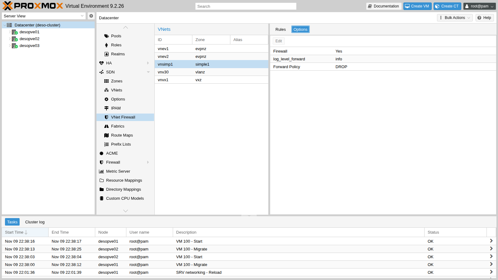
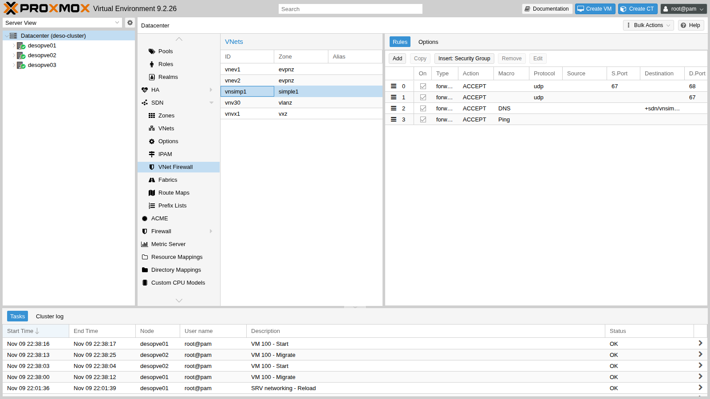

## Dipendenze

- **Lab precedenti:**
  - [Lab 32](/it/32-firewall-1/): firewall del Datacenter attivo, firewall degli host disattivato sui nodi del cluster, CT 101 protetto, script di prova `fwtest.ps1` sul DC;
  - [Lab 07](/it/07-first-vm-and-container/): VM 100, migrata a caldo per verificare la rete di migrazione;
  - [Lab 15](/it/15-iscsi-lvm-multipath/): percorsi iSCSI con multipath, controllati dopo l'attivazione;
  - [Lab 17](/it/17-ceph-installation/) e [Lab 22](/it/22-dedicated-networks/): reti di Ceph (VLAN 50/51), Corosync (VLAN 40) e migrazione (VLAN 100);
  - [Lab 27](/it/27-sdn-simple/): zona `simple1` con DHCP e DNS di `dnsmasq`, CT 271 e 272;
  - [Lab 29](/it/29-sdn-vxlan/), [Lab 30](/it/30-sdn-evpn/) e [Lab 31](/it/31-sdn-fabrics/): VXLAN, BGP/BFD sulla VLAN 61 e la fabric `fab1`;
  - [Lab 25](/it/25-ipv6/): gestione anche in IPv6 (`fd27:199::/64`).
- **Nodi:** `desopve01`, `desopve02`, `desopve03`. `desopve04` non cambia.
- **Credenziali:** `root` / `<password-lab>` → [Appendice B](/it/b-credentials-and-addresses/).

## Obiettivi

- Conoscere i due motori del firewall di Proxmox VE e passare a quello basato su **nftables**.
- Accendere il firewall degli **host** di un cluster con servizi su molte reti, senza interrompere nulla e con un piano di rientro automatico.
- Impedire a un guest di usare un indirizzo IP o MAC diverso da quello assegnato.
- Filtrare il traffico dentro una VNet con il firewall delle VNet.
- Leggere lo stato delle connessioni (conntrack) e riconoscere quando è conntrack a scartare i pacchetti.

## Come funziona

### Due motori per le stesse regole

Le regole si scrivono sempre allo stesso modo (GUI, `pvesh`, file `.fw`); cambia il programma che le traduce nel kernel. Il motore si sceglie **per nodo**, con l'opzione `nftables` del firewall del nodo.

| | `pve-firewall` (predefinito) | `proxmox-firewall` (nftables) |
|---|---|---|
| Tecnologia | iptables, ip6tables, ebtables, ipset | nftables |
| Guest con firewall | un bridge `fwbr` per ogni scheda | nessun bridge in più: le regole stanno in una tabella `bridge` |
| Dove si leggono le regole | `iptables -S`, `ipset list` | `nft list ruleset` |
| Firewall delle VNet SDN | non disponibile | disponibile |
| Stato in Proxmox VE 9.2 | stabile | nella GUI è ancora segnato *tech preview* |

Con nftables, sul nodo compaiono due tabelle:

- `inet proxmox-firewall`: host e traffico instradato;
- `bridge proxmox-firewall-guests`: guest e VNet.

### Il firewall dell'host in un cluster vero

Nel [Lab 32](/it/32-firewall-1/) si è visto che le regole automatiche dell'host coprono:

- la gestione (GUI, SSH, console) dal set `management`, a cui si aggiunge da sola la rete del cluster;
- Corosync tra i nodi.

Tutto il resto arriva sulla policy `DROP`. In questo cluster i servizi tra i nodi sono molti di più:

| Servizio | Rete | Porte |
|---|---|---|
| Corosync, secondo collegamento | VLAN 40, 10.40.10.0/24 | UDP 5405-5412 |
| Ceph public e cluster | VLAN 50/51, 10.50.10.0/24 e 10.51.10.0/24 | macro `Ceph` (TCP 6789, 3300, 6800-7300) |
| BGP del controller EVPN | VLAN 61, 10.61.10.0/24 | TCP 179 |
| BFD | VLAN 61 | UDP 3784-3785 |
| VXLAN della zona `evpnz` | VLAN 61 | UDP 4789 |
| VXLAN della zona `vxz` | fabric, 10.80.80.0/24 | UDP 4789 |
| Migrazione | VLAN 100, 10.100.10.0/24 | SSH e TCP 60000-60050 |
| DHCP e DNS di `dnsmasq` | VNet `vnsimp1` | UDP 67, DNS |
| Ping al gateway SDN | subnet SDN | ICMP echo |
| Gestione in IPv6 | `fd27:199::/64` | come per IPv4 |

OpenFabric non compare: usa pacchetti IS-IS di livello 2, non IP, e il firewall non li tocca.

### Il "dead man's switch"

Prima di accendere il firewall di un nodo da remoto si programma un **rientro automatico**: un timer che fra 4 minuti spegne di nuovo il firewall. Se tutto funziona, si disinnesca il timer. Se invece la modifica taglia fuori l'operatore o un servizio, il timer rimette le cose come prima senza bisogno di andare in console.

### Anti-spoofing

Ogni guest con il firewall attivo ha due protezioni contro l'uso di indirizzi altrui:

- **Filtro MAC** (`MAC filter`, attivo di default): il guest può trasmettere solo con il MAC configurato nella sua scheda.
- **Filtro IP** (`IP filter`, spento di default): il guest può usare come sorgente solo gli indirizzi del set `ipfilter-net<n>`. Se il set non viene creato a mano, Proxmox VE lo riempie con gli indirizzi configurati nella scheda e con l'indirizzo link-local IPv6 derivato dal MAC.

### Il firewall delle VNet

Le regole di una VNet hanno la direzione `forward` e una policy propria (`policy_forward`). Il ruleset generato in questo laboratorio mostra **dove** si applicano:

- al traffico **tra i guest della stessa VNet** (bridge, catena `forward` della tabella `bridge`);
- al traffico **tra la VNet e il nodo stesso** (catene `host-bridge-input` e `host-bridge-output`): gateway, DHCP, DNS.

Il traffico che dalla VNet viene **instradato verso altre reti** non passa da queste regole. Per filtrarlo servono le regole dei guest (in uscita) o quelle dell'host.

### conntrack

Il firewall è *stateful*: per ogni connessione il kernel tiene una voce nella tabella di conntrack (`NEW`, `ESTABLISHED`, `RELATED`, `INVALID`). Le risposte di una connessione permessa passano senza bisogno di regole. Un pacchetto che conntrack non riesce a collegare a nessuno stato valido è `INVALID` e viene scartato.

## Procedura

### 1. Le regole per i servizi del cluster

Prima gli alias delle reti del cluster:

```bash
A() { pvesh create /cluster/firewall/aliases --name "$1" --cidr "$2" --comment "$3"; }
A rete-corosync-2 10.40.10.0/24 "Corosync, secondo collegamento (VLAN 40)"
A ceph-public 10.50.10.0/24 "Ceph public network (VLAN 50)"
A ceph-cluster 10.51.10.0/24 "Ceph cluster network (VLAN 51)"
A underlay-evpn 10.61.10.0/24 "Underlay EVPN: BGP, BFD, VXLAN (VLAN 61)"
A fabric 10.80.80.0/24 "Indirizzi dei nodi nella fabric fab1"
A rete-migrazione 10.100.10.0/24 "Rete di migrazione (VLAN 100)"
A rete-gestione-v6 fd27:199::/64 "Rete di gestione IPv6"
```

Poi due IPSet:

- `management`, con la rete di gestione IPv4 e IPv6. Senza questo set, l'accesso in IPv6 verrebbe bloccato, come visto su `desopve04` nel [Lab 32](/it/32-firewall-1/).
- `reti-sdn`, con le subnet SDN che hanno il gateway sui nodi.



```bash
pvesh create /cluster/firewall/ipset --name management --comment "Accesso alla gestione dei nodi"
pvesh create /cluster/firewall/ipset/management --cidr dc/rete-gestione --comment "IPv4"
pvesh create /cluster/firewall/ipset/management --cidr dc/rete-gestione-v6 --comment "IPv6"
pvesh create /cluster/firewall/ipset --name reti-sdn --comment "Subnet SDN con gateway sui nodi"
for c in 10.60.60.0/24 10.71.71.0/24 10.72.72.0/24; do
  pvesh create /cluster/firewall/ipset/reti-sdn --cidr $c
done
```

Infine il security group `servizi-cluster`, con una regola per ogni riga della tabella vista sopra:



Da riga di comando, su un qualsiasi nodo. Ogni regola creata con `pvesh` va in cima al gruppo, quindi per ottenere l'ordine della tabella si parte dall'ultima:

```bash
G=/cluster/firewall/groups/servizi-cluster
pvesh create /cluster/firewall/groups --group servizi-cluster --comment "Traffico tra i nodi del cluster"
# ogni regola nuova va in cima: si creano dall'ultima alla prima
pvesh create $G --type in --action ACCEPT --source dc/rete-corosync-2 --proto udp --dport 5405:5412 --enable 1 --comment "Corosync link 1"
pvesh create $G --type in --action ACCEPT --macro Ceph --source dc/ceph-public --enable 1 --comment "Ceph public"
pvesh create $G --type in --action ACCEPT --macro Ceph --source dc/ceph-cluster --enable 1 --comment "Ceph cluster"
pvesh create $G --type in --action ACCEPT --source dc/underlay-evpn --proto tcp --dport 179 --enable 1 --comment "BGP (controller EVPN)"
pvesh create $G --type in --action ACCEPT --source dc/underlay-evpn --proto udp --dport 3784:3785 --enable 1 --comment "BFD"
pvesh create $G --type in --action ACCEPT --source dc/underlay-evpn --proto udp --dport 4789 --enable 1 --comment "VXLAN zona evpnz"
pvesh create $G --type in --action ACCEPT --source dc/fabric --proto udp --dport 4789 --enable 1 --comment "VXLAN zona vxz sulla fabric"
pvesh create $G --type in --action ACCEPT --macro SSH --source dc/rete-migrazione --enable 1 --comment "Migrazione: tunnel SSH"
pvesh create $G --type in --action ACCEPT --source dc/rete-migrazione --proto tcp --dport 60000:60050 --enable 1 --comment "Migrazione: porte dati"
pvesh create $G --type in --action ACCEPT --macro Ping --source +dc/management --enable 1 --comment "Ping dalla gestione"
pvesh create $G --type in --action ACCEPT --macro Ping --source +dc/reti-sdn --enable 1 --comment "Ping dei guest verso il gateway SDN"
pvesh create $G --type in --action ACCEPT --macro DNS --source +dc/reti-sdn --enable 1 --comment "DNS di dnsmasq per le zone SDN"
```

```text output
[group servizi-cluster] # Traffico tra i nodi del cluster

IN DNS(ACCEPT) -source +dc/reti-sdn # DNS di dnsmasq per le zone SDN
IN Ping(ACCEPT) -source +dc/reti-sdn # Ping dei guest verso il gateway SDN
IN Ping(ACCEPT) -source +dc/management # Ping dalla gestione
IN ACCEPT -source dc/rete-migrazione -p tcp -dport 60000:60050 # Migrazione: porte dati
IN SSH(ACCEPT) -source dc/rete-migrazione # Migrazione: tunnel SSH
IN ACCEPT -source dc/fabric -p udp -dport 4789 # VXLAN zona vxz sulla fabric
IN ACCEPT -source dc/underlay-evpn -p udp -dport 4789 # VXLAN zona evpnz
IN ACCEPT -source dc/underlay-evpn -p udp -dport 3784:3785 # BFD
IN ACCEPT -source dc/underlay-evpn -p tcp -dport 179 # BGP (controller EVPN)
IN Ceph(ACCEPT) -source dc/ceph-cluster # Ceph cluster
IN Ceph(ACCEPT) -source dc/ceph-public # Ceph public
IN ACCEPT -source dc/rete-corosync-2 -p udp -dport 5405:5412 # Corosync link 1
```

La regola per il DHCP di `dnsmasq` deve indicare l'interfaccia `vnsimp1`, perché la richiesta DHCP arriva con sorgente `0.0.0.0`. In un security group l'interfaccia non è ammessa:

```text
400 Parameter verification failed.
type: parameter -i not allowed for this rule type
```

Va quindi nelle regole di ciascun nodo, insieme al gruppo:

```bash
for n in desopve01 desopve02 desopve03; do
  pvesh create /nodes/$n/firewall/rules --type in --action ACCEPT --proto udp --dport 67 \
    --iface vnsimp1 --enable 1 --comment "DHCP di dnsmasq nella zona simple1"
  pvesh create /nodes/$n/firewall/rules --type group --action servizi-cluster --enable 1
done
```



Fin qui nessuna regola è attiva: il firewall dei nodi è ancora spento.

### 2. Accendere nftables e il firewall, un nodo alla volta

Il passaggio dalla GUI è in **Nodo → Firewall → Options**: doppio clic su `nftables (tech preview)` e poi su `Firewall`.



In questo lab il passaggio si fa da riga di comando, un nodo alla volta, con lo script [`fwenable.sh`](/files/33/fwenable.sh). Si copia sul nodo e si lancia come root, per esempio dal DC:

```powershell
scp fwenable.sh root@desopve03.proxmox.community:
ssh root@desopve03.proxmox.community ./fwenable.sh
```

Lo script:

1. programma il rientro automatico con `systemd-run`: dopo 4 minuti ferma `proxmox-firewall`, cancella le sue tabelle e solo alla fine prova a disattivare il firewall nella configurazione;
2. attiva insieme firewall e nftables e avvia `proxmox-firewall`;
3. dopo 25 secondi controlla tutti i servizi: firewall, quorum, Corosync, Ceph, BGP, fabric e multipath.

Il rientro lavora in locale per un motivo preciso. Se l'attivazione taglia Corosync e il nodo perde il quorum, `/etc/pve` diventa di sola lettura e `pvesh set` fallisce. Fermando prima il servizio e cancellando le tabelle, il nodo torna comunque raggiungibile, e `proxmox-firewall` fermo non ricrea le regole al ciclo successivo:

```bash
systemd-run --unit=fw-dms --on-active=240 /bin/sh -c "\
  systemctl stop proxmox-firewall; \
  nft delete table inet proxmox-firewall; \
  nft delete table bridge proxmox-firewall-guests; \
  pvesh set /nodes/$N/firewall/options --enable 0 --nftables 0 || true"
```

Il rientro è stato provato su `desopve03` con un ritardo di 15 secondi al posto di 240. Dopo lo scatto il nodo non ha più tabelle del firewall, il servizio è fermo e le opzioni sono tornate a `No`:

```bash
nft list tables | grep -c proxmox
systemctl is-active proxmox-firewall
pvesh get /nodes/desopve03/firewall/options --output-format json
```

```text output
0
inactive
{"digest":"e6af7727c9dfe3d89839c54416cd1ca62764752f","enable":0,"nftables":0}
```

Per riaccendere il firewall dopo un rientro servono entrambi i comandi:

```bash
pvesh set /nodes/desopve03/firewall/options --enable 1 --nftables 1
systemctl start proxmox-firewall
```

Il primo nodo è `desopve03`:

```text
attivato: 22:34:24
== desopve03: 22:34:50
Status: enabled/running (pending changes)
table inet proxmox-firewall
Quorate:          Yes
4
    health: HEALTH_OK
    osd: 7 osds: 7 up (since 4h), 7 in (since 4h)
desopve01(10.61.10.21) FRRouting/10.6.1 3
desopve02(10.61.10.22) FRRouting/10.6.1 3
2
2
```

Corosync ha 4 collegamenti `connected` (2 per ogni altro nodo), Ceph è sano con tutti gli OSD, le due sessioni BGP sono su, i 2 vicini OpenFabric e i 2 percorsi iSCSI sono attivi. Le prove dei guest sulle zone che attraversano `desopve03`:

```text
# CT 292 (vxz, su desopve03) → CT 291 (vxz, su desopve01)
2 packets transmitted, 2 received, 0% packet loss, time 1001ms
# CT 302 (evpnz) → il suo gateway anycast
2 packets transmitted, 2 received, 0% packet loss, time 1051ms
# CT 302 → CT 301 (altra VNet, altro nodo) e → DC tramite l'exit node
5 packets transmitted, 5 received, 0% packet loss, time 4062ms
3 packets transmitted, 3 received, 0% packet loss, time 2003ms
```

Tutto in ordine, quindi si disinnesca il rientro automatico:

```bash
systemctl stop fw-dms.timer
```

:::note
`(pending changes)` in `pve-firewall status` è normale con nftables: il vecchio servizio confronta le regole iptables, che su questo nodo non vengono più generate.
:::

Poi tocca a `desopve02`, che ospita il CT 101, i CT della zona `simple1` e il server DHCP di `dnsmasq`. Oltre ai servizi di cluster, che risultano tutti in ordine come su `desopve03`, si verificano il rinnovo DHCP del CT 271 e le regole del CT 101, che ora sono in nftables. Su `desopve02`:

```bash
nft list tables
pct exec 271 -- dhclient -v eth0 2>&1 | grep -E "DHCPACK|bound"
pct exec 271 -- ping -c2 10.60.60.1 | grep transmitted
```

e dal DC lo script del Lab 32, `.\fwtest.ps1`:

```text
table inet proxmox-firewall
table bridge proxmox-firewall-guests
DHCPACK of 10.60.60.100 from 10.60.60.1
bound to 10.60.60.100 -- renewal in 2147483648 seconds.
2 packets transmitted, 2 received, 0% packet loss, time 1021ms
DC 172.27.199.20 (admin)           HTTP ok        SSH ok        ping ok
CT 121 VLAN 10 (via router01, NAT) HTTP ok        SSH BLOCCATO  ping BLOCCATO
CT 403 10.99.99.2 (rete instradata) HTTP BLOCCATO  SSH BLOCCATO  ping BLOCCATO
```

La matrice del CT 101 è identica a quella del [Lab 32](/it/32-firewall-1/): cambiare motore non ha cambiato il comportamento. Ultimo nodo, `desopve01`, poi la migrazione a caldo della VM 100 avanti e indietro, che usa la VLAN 100: `qm migrate 100 desopve02 --online` su `desopve01` e, per il ritorno, `qm migrate 100 desopve01 --online` su `desopve02`:

```text
2026-11-09 22:38:01 use dedicated network address for sending migration traffic (10.100.10.22)
2026-11-09 22:38:02 starting migration of VM 100 to node 'desopve02' (10.100.10.22)
2026-11-09 22:38:08 migration status: completed
2026-11-09 22:38:12 migration finished successfully (duration 00:00:11)
2026-11-09 22:38:25 migration finished successfully (duration 00:00:11)
```

E l'accesso di gestione dal DC in IPv6:

```powershell
foreach ($h in 'fd27:199::21', 'fd27:199::22', 'fd27:199::23') {
  "$h ssh/22 -> " + (Test-NetConnection $h -Port 22 -InformationLevel Quiet)
}
'desopve02 (per nome) 8006 -> ' + (Test-NetConnection desopve02.proxmox.community -Port 8006 -InformationLevel Quiet)
```

```text output
fd27:199::21 ssh/22 -> True
fd27:199::22 ssh/22 -> True
fd27:199::23 ssh/22 -> True
desopve02 (per nome) 8006 -> True
```



### 3. Cosa resta fuori

Il firewall dell'host serve a **bloccare** qualcosa: un servizio nuovo che nessuna regola prevede. Per la prova si avvia un server web temporaneo sulla porta 8080 di `desopve01` e si accende il log dell'host:

```bash
# su desopve01
pvesh set /nodes/desopve01/firewall/options --log_level_in info
python3 -m http.server 8080 &
```

Le prove arrivano da tre direzioni: da `desopve02` sulla rete di gestione e sulla rete di migrazione, e dal CT 403 della rete instradata:

```bash
# su desopve02
echo "== da desopve02 sulla rete di gestione verso 172.27.199.21:8080"
nc -zw3 172.27.199.21 8080 && echo ok || echo BLOCCATO
echo "== da desopve02 sulla rete di migrazione verso 10.100.10.21:8080"
nc -zw3 10.100.10.21 8080 && echo ok || echo BLOCCATO
nc -zw3 10.100.10.21 22 && echo "ssh sulla rete di migrazione: ok" || echo "ssh sulla rete di migrazione: BLOCCATO"
# su desopve04
echo "== dal CT 403 verso SSH di desopve01"
pct exec 403 -- nc -zw3 172.27.199.21 22 && echo ok || echo BLOCCATO
```

```text output
== da desopve02 sulla rete di gestione verso 172.27.199.21:8080
BLOCCATO
== da desopve02 sulla rete di migrazione verso 10.100.10.21:8080
BLOCCATO
ssh sulla rete di migrazione: ok
== dal CT 403 verso SSH di desopve01
BLOCCATO
```

Nel log dell'host (`/var/log/pve-firewall.log` di `desopve01`) c'è una riga per ogni tentativo. Qui una per sorgente, con il campo `MAC` abbreviato:

```text
0 6 cluster-in 10/Nov/2026:11:24:30 +0100 DROP: IN=vmbr0 PHYSIN=nic0 MAC=… SRC=172.27.199.22 DST=172.27.199.21 LEN=60 TOS=0x00 PREC=0x00 TTL=64 ID=45701 DF PROTO=TCP SPT=46276 DPT=8080 SEQ=2350225254 ACK=0 WINDOW=64240 SYN
0 6 cluster-in 10/Nov/2026:11:24:31 +0100 DROP: IN=vmbr1.100 MAC=… SRC=10.100.10.22 DST=10.100.10.21 LEN=60 TOS=0x00 PREC=0x00 TTL=64 ID=19649 DF PROTO=TCP SPT=35884 DPT=8080 SEQ=3357649525 ACK=0 WINDOW=64240 SYN
0 6 cluster-in 10/Nov/2026:11:24:36 +0100 DROP: IN=vmbr0 PHYSIN=nic0 MAC=… SRC=10.99.99.2 DST=172.27.199.21 LEN=60 TOS=0x00 PREC=0x00 TTL=63 ID=10176 DF PROTO=TCP SPT=49136 DPT=22 SEQ=3228452114 ACK=0 WINDOW=64240 SYN
```

Sulla rete di migrazione passa solo ciò che serve alla migrazione (SSH); la porta 8080 no, nemmeno dalla gestione. Finita la prova si ferma il server e il log dell'host torna a `nolog`:

```bash
kill %1
pvesh set /nodes/desopve01/firewall/options --delete log_level_in
```

### 4. Il ruleset nftables

Il security group diventa una catena della tabella `inet proxmox-firewall`:

```bash
nft list chain inet proxmox-firewall group-servizi-cluster-in
```

```text output
table inet proxmox-firewall {
	chain group-servizi-cluster-in {
		udp dport 53 ip saddr @v4-dc/reti-sdn ip saddr != @v4-dc/reti-sdn-nomatch accept
		udp dport 53 ip6 saddr @v6-dc/reti-sdn ip6 saddr != @v6-dc/reti-sdn-nomatch accept
		tcp dport 53 ip saddr @v4-dc/reti-sdn ip saddr != @v4-dc/reti-sdn-nomatch accept
		tcp dport 53 ip6 saddr @v6-dc/reti-sdn ip6 saddr != @v6-dc/reti-sdn-nomatch accept
		icmp type echo-request ip saddr @v4-dc/reti-sdn ip saddr != @v4-dc/reti-sdn-nomatch accept
		icmpv6 type echo-request ip6 saddr @v6-dc/reti-sdn ip6 saddr != @v6-dc/reti-sdn-nomatch accept
		icmp type echo-request ip saddr @v4-dc/management ip saddr != @v4-dc/management-nomatch accept
		icmpv6 type echo-request ip6 saddr @v6-dc/management ip6 saddr != @v6-dc/management-nomatch accept
		tcp dport 60000-60050 ip saddr 10.100.10.0/24 accept
		tcp dport 22 ip saddr 10.100.10.0/24 accept
		udp dport 4789 ip saddr 10.80.80.0/24 accept
		udp dport 4789 ip saddr 10.61.10.0/24 accept
		udp dport 3784-3785 ip saddr 10.61.10.0/24 accept
		tcp dport 179 ip saddr 10.61.10.0/24 accept
		tcp dport 6789 ip saddr 10.51.10.0/24 accept
		tcp dport 3300 ip saddr 10.51.10.0/24 accept
		tcp dport 6800-7300 ip saddr 10.51.10.0/24 accept
		tcp dport 6789 ip saddr 10.50.10.0/24 accept
		tcp dport 3300 ip saddr 10.50.10.0/24 accept
		tcp dport 6800-7300 ip saddr 10.50.10.0/24 accept
		udp dport 5405-5412 ip saddr 10.40.10.0/24 accept
	}
}
```

Le macro si espandono nelle singole porte (`Ceph` diventa tre regole), gli alias diventano indirizzi e gli IPSet diventano *set* nftables (`@v4-dc/management`), con un set `-nomatch` per le eccezioni.

### 5. Anti-spoofing sul CT 101

**CT 101 → Firewall → Options**, doppio clic su `IP filter`, spunta e **OK**.



Il set `ipfilter-net0` non è stato creato a mano, quindi Proxmox VE lo genera dalla configurazione della scheda:

```text
	set v4-guest-101/ipfilter-net0 {
		type ipv4_addr
		flags interval
		auto-merge
		elements = { 172.27.199.101 }
	}

	set v6-guest-101/ipfilter-net0 {
		type ipv6_addr
		flags interval
		auto-merge
		elements = { fe80::be24:11ff:fe0c:3184 }
	}
```

E le regole in uscita del guest:

```text
	chain guest-101-out {
		jump pre-vm-out
		iifname "veth101i0" ip saddr != @v4-guest-101/ipfilter-net0 drop
		iifname "veth101i0" ip saddr @v4-guest-101/ipfilter-net0-nomatch drop
		iifname "veth101i0" ip6 saddr != @v6-guest-101/ipfilter-net0 drop
		iifname "veth101i0" ip6 saddr @v6-guest-101/ipfilter-net0-nomatch drop
		iifname "veth101i0" arp saddr ip != @v4-guest-101/ipfilter-net0 drop
		iifname . ether saddr != { "veth101i0" . bc:24:11:0c:31:84 } drop
		iifname . arp saddr ether != { "veth101i0" . bc:24:11:0c:31:84 } drop
```

Le ultime due righe sono il filtro MAC, anche per le risposte ARP. Le prove, dall'interno del CT 101, dove l'utente `root` del container può cambiare indirizzi a piacere:

```bash
pct exec 101 -- bash -c '
  ip addr add 172.27.199.199/24 dev eth0
  ping -c2 -W2 172.27.199.20                      # dal suo indirizzo .101
  ping -c2 -W2 -I 172.27.199.199 172.27.199.20    # con un indirizzo non suo
  ip addr del 172.27.199.199/24 dev eth0'
```

```text output
-- ping dal suo indirizzo (.101):
2 packets transmitted, 2 received, 0% packet loss, time 1024ms
-- ping con sorgente falsa (.199):
2 packets transmitted, 0 received, 100% packet loss, time 1020ms
```

```bash
pct exec 101 -- bash -c '
  M=$(cat /sys/class/net/eth0/address)
  ip link set eth0 address 02:11:22:33:44:55; ip neigh flush dev eth0
  ping -c2 -W2 172.27.199.20
  ip link set eth0 address $M; ip neigh flush dev eth0
  ping -c2 -W2 172.27.199.20'
```

```text output
-- MAC cambiato in 02:11:22:33:44:55:
2 packets transmitted, 0 received, 100% packet loss, time 1028ms
-- MAC originale bc:24:11:0c:31:84:
2 packets transmitted, 2 received, 0% packet loss, time 1002ms
```

:::caution[Attenzione con IPv6]
il set generato contiene l'indirizzo IPv4 configurato e il link-local, non gli indirizzi presi con SLAAC. Il CT 101 sta su `vmbr0`, dove `rtr-core` annuncia `fd27:199::/64` ([Lab 25](/it/25-ipv6/)), e si è preso `fd27:199::be24:11ff:fe0c:3184`. Con l'IP filter attivo il suo traffico IPv6 globale viene scartato, mentre il link-local funziona:

```bash
pct exec 101 -- ping -6 -c2 -W2 fd27:199::20    # il DC
pct exec 101 -- ping -6 -c2 -W2 fe80::1%eth0    # il router, link-local
```

```text output
2 packets transmitted, 0 received, 100% packet loss, time 1002ms
rtt min/avg/max/mdev = 0.741/0.746/0.751/0.005 ms
```

Se il guest deve usare IPv6, il set `ipfilter-net0` va creato a mano con tutti gli indirizzi ammessi: IPv4, prefisso IPv6 e link-local.
:::

### 6. Il firewall della VNet `vnsimp1`

**Datacenter → SDN → VNet Firewall**, si sceglie `vnsimp1`. Nella scheda **Options**:

- `Firewall`: `Yes`;
- `Forward Policy`: `DROP`;
- `log_level_forward`: `info`.



Con la sola regola "Ping tra i guest della VNet", le prove dal CT 271 mostrano subito un effetto collaterale: il ping verso il gateway passa, ma DNS e DHCP del nodo no. Il log:

```text
0 6 bridge-vnsimp1 09/Nov/2026:22:47:33 +0100 DROP: IN=vnsimp1 PHYSIN=veth271i0 MAC=… SRC=10.60.60.100 DST=10.60.60.1 LEN=76 TOS=0x00 PREC=0x00 TTL=64 ID=1033 DF PROTO=UDP SPT=56538 DPT=53 LEN=56
0 6 bridge-vnsimp1 09/Nov/2026:22:48:19 +0100 DROP: OUT=vnsimp1 SRC=10.60.60.1 DST=10.60.60.100 LEN=328 TOS=0x00 PREC=0xC0 TTL=64 ID=58206 PROTO=UDP SPT=67 DPT=68 LEN=308
```

La policy `DROP` della VNet vale anche per il traffico tra i guest e il **nodo**, in entrambe le direzioni: la richiesta DNS verso `10.60.60.1` e la risposta DHCP del nodo (`OUT=vnsimp1`, porta 67 → 68). Servono tre regole in più. Per il DNS si usa il set `+sdn/vnsimp1-gateway`, che Proxmox VE genera da solo per ogni VNet.



```bash
V=/cluster/sdn/vnets/vnsimp1/firewall
pvesh create $V/rules --type forward --action ACCEPT --macro Ping --enable 1 \
  --comment "Ping tra i guest della VNet"
pvesh create $V/rules --type forward --action ACCEPT --macro DNS --dest +sdn/vnsimp1-gateway \
  --enable 1 --comment "DNS verso il gateway (dnsmasq)"
pvesh create $V/rules --type forward --action ACCEPT --proto udp --dport 67 --enable 1 \
  --comment "DHCP verso dnsmasq"
pvesh create $V/rules --type forward --action ACCEPT --proto udp --sport 67 --dport 68 --enable 1 \
  --comment "Risposte DHCP di dnsmasq"
pvesh set $V/options --enable 1 --policy_forward DROP --log_level_forward info
cat /etc/pve/sdn/firewall/vnsimp1.fw
```

```text output
[OPTIONS]

log_level_forward: info
enable: 1
policy_forward: DROP

[RULES]

FORWARD ACCEPT -p udp -dport 68 -sport 67 # Risposte DHCP di dnsmasq
FORWARD ACCEPT -p udp -dport 67 # DHCP verso dnsmasq
FORWARD DNS(ACCEPT) -dest +sdn/vnsimp1-gateway # DNS verso il gateway (dnsmasq)
FORWARD Ping(ACCEPT) # Ping tra i guest della VNet
```

Le prove dal CT 271, con un servizio di prova in ascolto sulla porta 9000 del CT 272:

```text
DHCPACK of 10.60.60.100 from 10.60.60.1
bound to 10.60.60.100 -- renewal in 2147483648 seconds.
2 packets transmitted, 2 received, 0% packet loss, time 1008ms
tcp9000-BLOCCATO
fd27:199::20    desopve-dc01.proxmox.community
```

Nell'ordine:

- il rinnovo DHCP funziona;
- il ping dal CT 271 al CT 272 passa;
- il TCP verso la porta 9000 del CT 272 è bloccato dalla policy;
- il DNS tramite il gateway risponde.

Il traffico **instradato fuori** dalla VNet, invece, non cambia:

```text
-- instradato fuori dalla VNet:
DC tcp/445: ok
```

Il motivo è nel ruleset. La mappa che collega la VNet alle sue regole viene usata solo in tre punti: ingresso e uscita del nodo (tabella `inet`) e inoltro dentro il bridge (tabella `bridge`), non nella catena `forward` del routing.

```text
	chain host-bridge-input {
		type filter hook input priority filter - 1; policy accept;
		iifname vmap @bridge-map
	}

	chain host-bridge-output {
		type filter hook output priority filter + 1; policy accept;
		oifname vmap @bridge-map
	}
...
	chain forward {
		type filter hook forward priority 0; policy accept;
		meta ibrname . meta obrname vmap @bridge-map
	}
```

L'ultima catena è della tabella `bridge`: la chiave `meta ibrname . meta obrname` vale `"vnsimp1" . "vnsimp1"` solo per il traffico che entra ed esce dallo stesso bridge, cioè tra i guest della VNet.

### 7. conntrack

Una connessione SSH dal DC al CT 101, vista sul nodo:

```bash
conntrack -L -d 172.27.199.101 | grep "dport=22 "
sysctl net.netfilter.nf_conntrack_count net.netfilter.nf_conntrack_max \
       net.netfilter.nf_conntrack_tcp_timeout_established
```

```text output
tcp      6 431994 ESTABLISHED src=172.27.199.20 dst=172.27.199.101 sport=51596 dport=22 src=172.27.199.101 dst=172.27.199.20 sport=22 dport=51596 [ASSURED] mark=101 use=1
net.netfilter.nf_conntrack_count = 235
net.netfilter.nf_conntrack_max = 262144
net.netfilter.nf_conntrack_tcp_timeout_established = 432000
```

Come si legge:

- **Stato:** `ESTABLISHED` e `[ASSURED]` (traffico visto in entrambe le direzioni).
- **Le due tuple:** andata e ritorno della connessione.
- **`mark=101`:** il firewall ha marcato la connessione con l'ID del guest.
- **Timeout:** 431994 secondi rimanenti, perché per Proxmox VE una connessione TCP stabilita resta in tabella **5 giorni** se inattiva.

`nf_conntrack_max` e `nf_conntrack_tcp_timeout_established` si regolano per nodo in **Nodo → Firewall → Options**: nello screenshot del passo 2 compaiono con il valore `Default`. Su un nodo con molti guest e molte connessioni brevi, la tabella piena fa scartare connessioni nuove (`nf_conntrack: table full, dropping packet` nel log del kernel).

**Un caso reale: il traffico "a gomito" sullo stesso nodo.** Il CT 271 (zona `simple1`, esce in SNAT con l'indirizzo del nodo 172.27.199.22) prova a raggiungere il web del CT 101, che sta sullo **stesso nodo** e ha il firewall attivo. HTTP dalla rete di gestione è permesso, eppure:

```text
FW CT101 spento: HTTP ok
FW CT101 acceso: BLOCCATO
```

Nel log del firewall non c'è nessun DROP, e con `tcpdump` sulla scheda del CT 101 non arriva nessun pacchetto. La tabella di conntrack mostra la traduzione fatta ma mai completata:

```text
tcp      6 95 SYN_SENT src=10.60.60.100 dst=172.27.199.101 sport=55280 dport=80 [UNREPLIED] src=172.27.199.101 dst=172.27.199.22 sport=80 dport=55280 mark=0 use=1
```

I contatori di conntrack crescono di 2 a ogni tentativo, cioè il SYN e la sua ritrasmissione:

```text
prima:  insert_failed=39 drop=39
dopo 1 tentativo: insert_failed=41 drop=41
```

Il pacchetto viene tracciato una prima volta quando il nodo lo instrada e applica la SNAT, e una seconda quando lo consegna al guest attraverso il firewall del bridge. Il secondo inserimento collide con il primo (`insert_failed`) e conntrack scarta il pacchetto (`drop`). In quel momento non lo ha cambiato nemmeno `nf_conntrack_allow_invalid: 1` sul nodo; l'opzione è stata poi riportata al default.

La spiegazione più probabile sta nella regola che l'SDN aggiunge per la zona Simple ([Lab 27](/it/27-sdn-simple/)). Con il motore iptables il traffico dei guest con firewall passa dai bridge `fwbr…` e questa regola lo traccia in una zona separata, quindi i due tracciamenti non collidono. Con nftables i bridge `fwbr` non esistono, la regola non si applica mai e i due tracciamenti finiscono nella stessa zona:

```bash
iptables -t raw -S | grep zone | sort -u
```

```text output
-A PREROUTING -i fwbr+ -j CT --zone 1
```

Il fenomeno però non è sistematico. Ripetendo la prova in un secondo momento, con la stessa configurazione e sempre con nftables, la connessione è riuscita:

```bash
pct exec 271 -- bash -c 'exec 3<>/dev/tcp/172.27.199.101/80; printf "GET / HTTP/1.0\r\n\r\n" >&3; head -1 <&3'
```

```text output
HTTP/1.1 200 OK
```

In pratica:

- il traffico "a gomito" tra un guest in SNAT e un guest con firewall sullo **stesso** nodo è un caso delicato: può fallire senza lasciare traccia nel log del firewall;
- da un altro nodo, o senza SNAT, lo stesso servizio è raggiungibile, come mostrano le prove dei passi precedenti;
- quando qualcosa "sparisce" senza lasciare traccia nel log del firewall, `conntrack -S` è il primo posto da guardare.

## Verifica e test

| Prova | Atteso | Risultato |
|---|---|---|
| Firewall e nftables attivi su `desopve01`-`03` | tabelle `inet proxmox-firewall` (+ `bridge` dove ci sono guest con firewall) | ok |
| Quorum, Corosync su 2 link, Ceph `HEALTH_OK`, 7 OSD | invariati dopo ogni nodo | ok |
| BGP, vicini OpenFabric, percorsi iSCSI | invariati | ok |
| VXLAN `vxz`, EVPN tra VNet e verso l'esterno | ping senza perdite | ok |
| DHCP e DNS di `dnsmasq` nella zona `simple1` | `DHCPACK` | ok |
| Migrazione a caldo sulla VLAN 100 | completata, andata e ritorno | ok |
| Gestione via IPv6 dal DC | SSH e GUI raggiungibili | ok |
| Porta 8080 non prevista, SSH da rete non di gestione | bloccate e registrate | ok |
| IP falso e MAC falso dal CT 101 | 100% di perdita; con i valori giusti 0% | ok |
| VNet `vnsimp1`: ping e DHCP/DNS sì, TCP tra guest no | come atteso dopo le regole | ok |
| Traffico instradato fuori dalla VNet | non filtrato dalle regole della VNet | verificato |
| SNAT verso un guest con firewall sullo stesso nodo | scartato da conntrack (`insert_failed`) durante le prove, riuscito ripetendo la prova | verificato |

## Stato finale del lab

- **Nodi `desopve01`, `desopve02`, `desopve03`:**
  - firewall **attivo** con **nftables**;
  - regole: `GROUP servizi-cluster` e `IN ACCEPT -i vnsimp1 -p udp -dport 67`;
  - log dell'host `nolog`; nessun timer di rientro attivo.
- **Datacenter:**
  - alias `rete-corosync-2`, `ceph-public`, `ceph-cluster`, `underlay-evpn`, `fabric`, `rete-migrazione`, `rete-gestione-v6`;
  - IPSet `management` (IPv4 + IPv6) e `reti-sdn`;
  - security group `servizi-cluster`;
  - restano alias, IPSet e gruppi del [Lab 32](/it/32-firewall-1/).
- **CT 101:** come nel Lab 32, più `IP filter: Yes`; il suo indirizzo IPv6 preso con SLAAC resta bloccato dall'IP filter.
- **VNet `vnsimp1`:** firewall attivo, `policy_forward: DROP`, log `info`, quattro regole (DHCP ×2, DNS verso il gateway, Ping).
- **`desopve04`:** invariato dal [Lab 32](/it/32-firewall-1/), con il motore iptables.
- **Script:** [`fwenable.sh`](/files/33/fwenable.sh) per l'attivazione con rientro automatico.

## Cosa hai imparato

- Le regole sono le stesse con iptables e con nftables; con nftables il firewall dei guest non usa bridge aggiuntivi ed è disponibile il firewall delle VNet.
- In un cluster vero le regole automatiche dell'host non bastano: ogni rete dedicata (Ceph, Corosync, underlay SDN, migrazione) va prevista prima di accendere il firewall, anche in IPv6.
- Un rientro automatico programmato rende sicura una modifica che potrebbe tagliare fuori l'operatore.
- `IP filter` e `MAC filter` impediscono a un guest di presentarsi con indirizzi altrui.
- Il firewall di una VNet filtra il traffico tra i guest e verso il nodo, compresi DHCP e DNS del gateway, ma non quello instradato verso altre reti.
- Quando un pacchetto sparisce senza log, `conntrack -L` e `conntrack -S` mostrano se è stato conntrack a scartarlo.

## Riferimenti

- [Proxmox VE – Firewall: nftables](https://pve.proxmox.com/pve-docs/chapter-pve-firewall.html#pve_firewall_nft)
- [Proxmox VE – Firewall: IP Address Filtering / ipfilter](https://pve.proxmox.com/pve-docs/chapter-pve-firewall.html#pve_firewall_ipfilter_section)
- [Proxmox VE – SDN: Firewall Integration](https://pve.proxmox.com/pve-docs/chapter-pvesdn.html#pvesdn_firewall_integration)
- [Proxmox VE – Firewall: Ports used by Proxmox VE](https://pve.proxmox.com/pve-docs/chapter-pve-firewall.html#_ports_used_by_proxmox_ve)
- [conntrack-tools – manuale di conntrack(8)](https://conntrack-tools.netfilter.org/manual.html)
