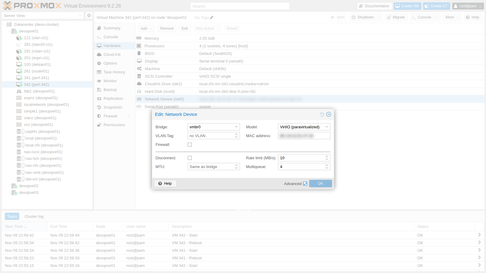

## Dipendenze

- **Lab precedenti:**
  - [Lab 20](/it/20-bridges-stable-names-vlans/) e [Lab 21](/it/21-bonding/): `vmbr1` VLAN-aware su `bond0`, CT 121 e 122 nella VLAN 10;
  - [Lab 22](/it/22-dedicated-networks/): reti dedicate e MTU del laboratorio;
  - [Lab 29](/it/29-sdn-vxlan/): CT 291 e 292 sulla VNet VXLAN `vnvx1` (MTU 1450);
  - [Lab 32](/it/32-firewall-1/) e [Lab 33](/it/33-firewall-2/): firewall del CT 101 e script di prova [`fwtest.ps1`](/files/32/fwtest.ps1) sul DC;
  - [Lab 26](/it/26-virtual-router/): `router01`, gateway 10.10.10.1 dei CT nella VLAN 10;
  - [Lab 05](/it/05-ssh-shell-cli/): chiave SSH del DC, autorizzata sui nodi e copiata nelle VM di prova;
  - [Lab 24](/it/24-routing-nat/) e [Lab 25](/it/25-ipv6/): CT 404 su `desopve04`.
- **Risorse:** l'immagine cloud `debian-13-genericcloud-amd64.qcow2` in `local:import` di `desopve01`, scaricata nel [Lab 19](/it/19-fio-benchmark/). Con questa si creano due VM di prova con cloud-init, approfondito nel Lab 40.
- **Credenziali:** `root` / `<password-lab>` → [Appendice B](/it/b-credentials-and-addresses/).

## Obiettivi

- Una misura prima e dopo dell'effetto di **multiqueue** tra due VM, con un flusso e con quattro, da cui decidere se attivarlo.
- Il **limite di banda** `rate` di una scheda verificato nelle due direzioni, con il meccanismo che lo applica (`tc`) letto sul nodo.
- Gli offload attivi e l'MTU di un percorso letti con `ethtool` e `ping -M do`, sapendo che cosa mostra ciascuna prova e che cosa no.
- Un kit di comandi per la diagnosi di rete di un nodo Proxmox VE, provato sul laboratorio.
- Sei guasti tipici riprodotti e risolti seguendo lo schema **sintomo → verifica → causa → correzione**, ciascuno con la prova del ripristino.

## Come funziona

### Da dove passa un pacchetto

Prima di cercare un guasto conviene avere in mente il percorso. Per una VM o un CT su `vmbr1`:

```text
guest eth0 ──► tap<vmid>i0 (VM) / veth<vmid>i0 (CT) ──► vmbr1 (VLAN-aware) ──► bond0 ──► nic3/nic4 ──► rete
                    │                                     │
              firewall del guest                    tabella VLAN e MAC
              (nftables: tabella bridge)            (bridge vlan / bridge fdb)
```

Ogni freccia è un punto in cui si può guardare con `tcpdump`, e ogni oggetto ha il suo comando per leggerne lo stato.

### Multiqueue

Una scheda VirtIO ha di default **una** coda di trasmissione e una di ricezione, servite da un solo thread `vhost` sull'host e da una sola CPU nel guest. Con `queues=N` la scheda ne espone N: il traffico di più connessioni si distribuisce su più CPU, sia nel guest sia sull'host. Serve quando una sola coda è il collo di bottiglia e ci sono CPU libere; non moltiplica la banda di una singola connessione. La documentazione di Proxmox VE consiglia un numero di code pari a quello delle vCPU del guest; avverte anche che più code aumentano il carico di CPU di host e guest al crescere del traffico, e suggerisce l'opzione solo per VM che gestiscono molte connessioni in ingresso, come router, reverse proxy o server web molto carichi.

### Limite di banda

`rate=` sulla scheda è espresso in MB/s: Proxmox VE lo moltiplica per 1024 × 1024, quindi `rate=10` vale 10 MiB/s, cioè 83,9 Mbit/s. Viene applicato con il traffic control di Linux sull'interfaccia `tap` dell'host, in due modi diversi:

- **verso il guest:** con una coda `htb`, che rallenta i pacchetti (*shaping*);
- **dal guest:** con un `police` sull'ingresso, che scarta quello che supera il limite (*policing*).

Per TCP la differenza si sente, come si vedrà nelle misure.

### Ambiente e versioni della prova

Le misure dei passi 2-4 vengono da una prova eseguita a novembre 2026 nella configurazione descritta qui sotto. Con versioni, opzioni o hardware diversi, gli stessi comandi danno numeri diversi.

| Componente | Configurazione della prova |
|---|---|
| Proxmox VE | 9.2.26, kernel `7.0.14-28-pve` ([Lab 04](/it/04-first-access-repositories-updates/)); QEMU 11.1.3 ([Lab 35](/it/35-kvm-qemu/)) |
| Nodo | `desopve01`, 4 core e 32 GB di RAM ([Lab 01](/it/01-lab-architecture/)), con i guest e i servizi lasciati dai lab precedenti: per esempio il CT 121, la VM `router01` (passo 5) e gli OSD di Ceph ([Lab 17](/it/17-ceph-installation/)) |
| VM di prova | due VM Debian 13 dall'immagine cloud, 4 vCPU di tipo `host` e 2 GiB di RAM ciascuna, scheda VirtIO su `vmbr0`, entrambe su `desopve01`: 8 vCPU su 4 core |
| Strumento | iperf3 3.18 nei guest, TCP con le opzioni predefinite, prove da 8 secondi; i valori sono quelli della riga `receiver`, cioè i dati arrivati al ricevitore (con `-P 4`, la riga `SUM` è l'aggregato dei quattro flussi) |
| Rete | MTU 1500 ([Lab 21](/it/21-bonding/)); il traffico tra le due VM resta dentro il nodo, senza passare da schede fisiche o switch |

**Cosa misura e cosa non misura.** Le prove di multiqueue e del limite di banda misurano il traffico TCP tra due VM dello stesso nodo: le CPU del nodo e dei guest, il percorso virtio/vhost e il bridge. Non dicono nulla del traffico che attraversa la rete fisica, e non misurano l'uso delle CPU durante le prove. Ogni caso ha due giri da 8 secondi (multiqueue) o uno solo (limite di banda): danno un ordine di grandezza e il verso di un effetto, non una statistica.

## Procedura

### 1. Le VM di prova

Due VM Debian 13 identiche sullo stesso nodo (`desopve01`), sulla rete di gestione, create dall'immagine cloud con l'utente `labuser` e le chiavi SSH autorizzate sul nodo, tra cui quella del DC ([Lab 05](/it/05-ssh-shell-cli/)):

```bash
for id in 341 342; do
  ip=172.27.199.$((id-200))
  qm create $id --name perf-$id --memory 2048 --cores 4 --cpu host \
    --net0 virtio,bridge=vmbr0 --scsihw virtio-scsi-single \
    --scsi0 local-zfs:0,import-from=local:import/debian-13-genericcloud-amd64.qcow2 \
    --ide2 local-zfs:cloudinit --boot order=scsi0 \
    --ipconfig0 ip=$ip/24,gw=172.27.199.1 --nameserver 172.27.199.20 \
    --ciuser labuser --sshkeys /root/.ssh/authorized_keys --serial0 socket --vga serial0
  qm start $id
done
```

Le due VM prendono temporaneamente gli indirizzi .141 e .142 e vengono eliminate a fine lab. Se hai già svolto il [Lab 41](/it/41-lxc-containers/), dove .141 e .142 appartengono ai CT 141 e 142, scegli due indirizzi liberi (per esempio .181 e .182) cambiando `$((id-200))`.

Dal DC si entra in ciascuna VM con `ssh labuser@172.27.199.141` (e `.142`) e si installa `iperf3` tramite il proxy del laboratorio:

```bash
echo 'Acquire::http::Proxy "http://proxy.proxmox.community:3128";' | sudo tee /etc/apt/apt.conf.d/90proxy
sudo apt-get update && sudo apt-get install -y iperf3
echo "$(hostname): $(iperf3 --version | head -1); code: $(ls /sys/class/net/eth0/queues | tr '\n' ' ')"
```

```text output
perf-341: iperf 3.18 (cJSON 1.7.15); code: rx-0 tx-0
perf-342: iperf 3.18 (cJSON 1.7.15); code: rx-0 tx-0
```

`rx-0 tx-0`: una sola coda per direzione.

### 2. Multiqueue: prima e dopo

Server `iperf3` sulla 342, client sulla 341. Due giri, 8 secondi ciascuno, con 1 e con 4 flussi paralleli:

```bash
# sulla 342
iperf3 -s -D
# sulla 341
for giro in 1 2; do
  echo "== 1 flusso";  iperf3 -c 172.27.199.142 -t 8      | grep receiver
  echo "== 4 flussi";  iperf3 -c 172.27.199.142 -t 8 -P 4 | grep "SUM.*receiver"
done
```

**Una coda (default):**

```text
== 1 flusso
[  5]   0.00-8.00   sec  10.5 GBytes  11.3 Gbits/sec                  receiver
== 4 flussi
[SUM]   0.00-8.01   sec  11.0 GBytes  11.8 Gbits/sec                  receiver
== 1 flusso
[  5]   0.00-8.00   sec  11.4 GBytes  12.3 Gbits/sec                  receiver
== 4 flussi
[SUM]   0.00-8.02   sec  11.8 GBytes  12.7 Gbits/sec                  receiver
```

Si attivano 4 code su entrambe: **Hardware → Network Device → Advanced → Multiqueue: 4**, poi riavvio delle VM. Da riga di comando va ripetuto il MAC della scheda (si legge con `qm config <id> | grep net0`), altrimenti Proxmox VE ne genera uno nuovo:

```bash
for id in 341 342; do
  qm set $id --net0 virtio=<MAC-della-VM>,bridge=vmbr0,queues=4
  qm reboot $id
done
```

Nel guest ora ci sono 4 code per direzione:

```bash
ls /sys/class/net/eth0/queues | tr '\n' ' '; echo
ethtool -l eth0 | grep -E "parameters|maximums|hardware|Combined"
```

```text output
rx-0 rx-1 rx-2 rx-3 tx-0 tx-1 tx-2 tx-3
Channel parameters for eth0:
Pre-set maximums:
Combined:	4
Current hardware settings:
Combined:	4
```

**Quattro code:**

```text
== 1 flusso
[  5]   0.00-8.01   sec  11.4 GBytes  12.2 Gbits/sec                  receiver
== 4 flussi
[SUM]   0.00-8.02   sec  9.11 GBytes  9.76 Gbits/sec                  receiver
== 1 flusso
[  5]   0.00-8.00   sec  12.1 GBytes  13.0 Gbits/sec                  receiver
== 4 flussi
[SUM]   0.00-8.02   sec  9.04 GBytes  9.68 Gbits/sec                  receiver
```

| Riga `receiver` di iperf3, due giri | 1 flusso | 4 flussi (aggregato `SUM`) |
|---|---|---|
| 1 coda | 11,3-12,3 Gbit/s | 11,8-12,7 Gbit/s |
| 4 code | 12,2-13,0 Gbit/s | 9,7-9,8 Gbit/s |

- **Misura:** con quattro flussi l'aggregato passa da 11,8-12,7 Gbit/s con una coda a 9,7-9,8 Gbit/s con quattro, circa il 20% in meno, in entrambi i giri. Con un flusso si passa da 11,3-12,3 a 12,2-13,0 Gbit/s: gli intervalli si sovrappongono, quindi nessuna differenza dimostrata.
- **Interpretazione:** il calo con quattro flussi è compatibile con una contesa per le CPU: le due VM hanno in tutto 8 vCPU su un nodo da 4 core, e con quattro code per scheda lavorano anche più thread `vhost`. La documentazione di Proxmox VE avverte proprio che più code aumentano il carico di CPU. La prova però non ha misurato l'uso delle CPU, quindi non lo dimostra.
- **Verifica:** durante la prova, sul nodo, `top -H` (o `pidstat -t 1`, dal pacchetto `sysstat`) mostra quanta CPU usano i thread `vhost-<pid>` e quelli delle vCPU, e `mpstat -P ALL 1` se i quattro core sono saturi. Ripetere la prova con le due VM su nodi diversi, o con meno vCPU, dice se il calo dipende dalla contesa.

In questo laboratorio, quindi, multiqueue non va attivato. Può rendere quando:

- la VM ha molte connessioni contemporanee (server web, proxy, router virtuali);
- l'host ha core liberi;
- una singola coda è il limite misurato.

Va sempre verificato con un test prima e dopo, come qui.

### 3. Limite di banda

Sulla VM 342 si impone un limite di 10 MB/s (`rate=10`), lasciando le 4 code.

 Sul nodo il limite diventa:

```bash
tc -s qdisc show dev tap342i0
tc filter show dev tap342i0 parent ffff: | grep police
```

```text output
qdisc htb 1: root refcnt 257 r2q 10 default 0x1 direct_packets_stat 1 direct_qlen 1000
 Sent 13626 bytes 9 pkt (dropped 0, overlimits 0 requeues 0)
 backlog 0b 0p requeues 0
qdisc ingress ffff: parent ffff:fff1 ----------------
 Sent 0 bytes 0 pkt (dropped 0, overlimits 0 requeues 0)
 backlog 0b 0p requeues 0
 police 0x1 rate 83886Kbit burst 1Mb mtu 64Kb action drop overhead 0b
```

Il `police` mostra `rate 83886Kbit`, cioè 10 × 1024 × 1024 byte al secondo = 83,9 Mbit/s, con un *burst* di 1 MiB (`burst 1Mb`): il valore impostato in MB/s viene applicato in MiB/s.

Le misure nelle due direzioni, un flusso TCP per volta:

```text
== verso la VM 342 (ingresso della VM limitata)
[  5]   0.00-8.00   sec  79.9 MBytes  83.7 Mbits/sec    4            sender
[  5]   0.00-8.16   sec  77.8 MBytes  80.0 Mbits/sec                  receiver
== dalla VM 342 (uscita della VM limitata, -R)
[  5]   0.00-8.00   sec  48.6 MBytes  51.0 Mbits/sec  4639            sender
[  5]   0.00-8.00   sec  47.8 MBytes  50.1 Mbits/sec                  receiver
```

- **Verso la VM.**
  - **Misura:** 80,0 Mbit/s sulla riga `receiver`, con 4 ritrasmissioni.
  - **Interpretazione:** è il 95% del limite di 83,9 Mbit/s. iperf3 conta solo i dati dell'applicazione, mentre il limite conta i pacchetti interi: con frame da 1500 byte le intestazioni valgono circa il 4-5%, quindi il risultato è compatibile con un limite rispettato quasi esattamente. Le poche ritrasmissioni sono coerenti con la coda `htb`, che ritarda i pacchetti invece di scartarli, e con TCP che si adegua.
  - **Verifica:** dopo la prova, `tc -s class show dev tap342i0` mostra i byte passati dalla classe `htb`, intestazioni comprese, da confrontare con i 77,8 MBytes (MiB) che iperf3 riporta come ricevuti.
- **Dalla VM.**
  - **Misura:** 50,1 Mbit/s sulla riga `receiver`, con **4639 ritrasmissioni**.
  - **Interpretazione:** è il 60% del limite. È compatibile con il `police`, che scarta i pacchetti oltre il limite: TCP interpreta le perdite come congestione e rallenta più del necessario.
  - **Verifica:** dopo la prova, `tc -s filter show dev tap342i0 parent ffff:` mostra i contatori del `police`, da confrontare con le ritrasmissioni.

In questa configurazione, con un solo flusso TCP tra due VM dello stesso nodo, il limite è risultato preciso sul traffico **verso** il guest, mentre in uscita ha reso il 60% del valore impostato. Con più flussi, con UDP o con un altro algoritmo di controllo della congestione il rapporto può cambiare: va misurato con il traffico reale.

### 4. Offload e MTU del percorso

Gli offload spostano lavoro dalla CPU alla scheda o al kernel: calcolo dei checksum, segmentazione dei pacchetti grandi (TSO/GSO), aggregazione in ricezione (GRO). Su una porta fisica del nodo e sulla `tap` di una VM:

```bash
for i in nic0 tap341i0; do
  echo "-- $i"
  ethtool -k $i | grep -E "^(rx-checksumming|tx-checksumming|tcp-segmentation-offload|generic-segmentation-offload|generic-receive-offload):"
done
```

```text output
-- nic0
rx-checksumming: on
tx-checksumming: on
tcp-segmentation-offload: on
generic-segmentation-offload: on
generic-receive-offload: on
-- tap341i0
rx-checksumming: off [fixed]
tx-checksumming: on
tcp-segmentation-offload: on
generic-segmentation-offload: on
generic-receive-offload: on
```

Le due VM dello stesso nodo si scambiano traffico senza passare da schede fisiche: la velocità delle porte del nodo (10 GbE, [Lab 01](/it/01-lab-architecture/)) non limita le prove dei passi 2 e 3. Con TSO, GSO e GRO attivi, il kernel può spostare blocchi fino a 64 KB invece di frame da 1500 byte: è compatibile con i 9,7-13,0 Gbit/s misurati, ma la prova non ha misurato quanto contino gli offload. Per verificarlo, ripeti `iperf3` dopo aver spento TSO e GSO nel guest (`ethtool -K eth0 tso off gso off`, solo per la prova). Gli offload sono anche il motivo per cui un `tcpdump` sulla `tap` mostra pacchetti più grandi dell'MTU; spegnerli serve per la diagnosi.

L'MTU di un percorso si misura con pacchetti a dimensione crescente e il bit *Don't Fragment* (`-M do`). 1472 byte di dati + 28 di intestazioni ICMP e IP fanno 1500. Dalla VM 341:

```bash
ping -M do -s 1472 -c1 172.27.199.22 | grep transmitted
ping -M do -s 1473 -c1 172.27.199.22
```

```text output
1 packets transmitted, 1 received, 0% packet loss, time 0ms
PING 172.27.199.22 (172.27.199.22) 1473(1501) bytes of data.
ping: sendmsg: Message too long
```

La prova da 1472 byte passa: il percorso dalla VM 341 a `desopve02` (172.27.199.22), attraverso la rete fisica, porta pacchetti da 1500 byte. Quella da 1473 viene rifiutata dal guest stesso (`sendmsg: Message too long`) prima di partire, perché supera l'MTU della sua interfaccia: mostra l'MTU della VM, non il limite degli switch. Quello lo misura il [Lab 21](/it/21-bonding/): il percorso tra i nodi regge pacchetti fino a 8938 byte (8910 di dati ICMP), mentre i jumbo frame da 9000 byte non passano. La rete di gestione ha quindi MTU 1500 perché è l'MTU impostata sulle schede.

### 5. Il kit di diagnosi

| Domanda | Comando |
|---|---|
| In che VLAN è la porta di un guest? | `bridge vlan show dev veth121i0` |
| Dove ha imparato un MAC il bridge? | `bridge fdb show br vmbr1` |
| Il bond è sano e quale link usa? | `cat /proc/net/bonding/bond0` |
| Che tipo di interfaccia è, con che parametri? | `ip -d link show <if>` |
| Arriva il traffico? Con che tag? | `tcpdump -eni <if> <filtro>` |
| Il firewall è acceso? Con quali regole? | `pve-firewall status`, `nft list ruleset` |
| Che fine ha fatto una connessione? | `conntrack -L`, `conntrack -S`, `conntrack -C` |
| I protocolli dinamici sono su? | `vtysh -c "show bgp summary"` |
| Quali socket sono aperti? | `ss -tulpn` |

Esempi reali, su `desopve01`:

```text
== bridge vlan show dev veth121i0
port              vlan-id
veth121i0         10 PVID Egress Untagged
== bridge fdb show br vmbr1 | grep " vlan 10 " | grep -v permanent
bc:24:11:10:9a:74 dev bond0 vlan 10 master vmbr1
bc:24:11:af:bc:fc dev veth121i0 vlan 10 master vmbr1
bc:24:11:23:9b:72 dev tap261i1 vlan 10 master vmbr1
== bond0
Bonding Mode: fault-tolerance (active-backup)
Currently Active Slave: nic3
MII Status: up
Slave Interface: nic3
MII Status: up
Slave Interface: nic4
== conntrack
467
```

- `bridge vlan`: la porta del CT 121 ha `PVID` 10 ed `Egress Untagged`. Il bridge aggiunge e toglie il tag 10, e il guest vede traffico senza tag.
- `bridge fdb`: nella VLAN 10 il bridge conosce tre MAC. Due sono su porte locali: il CT 121 (`veth121i0`) e la seconda scheda di `router01` (`tap261i1`). Il terzo, `bc:24:11:10:9a:74`, è il CT 122, che sta su un altro nodo ed è stato imparato dal trunk `bond0`. Le voci `permanent`, escluse dal filtro, sono gli indirizzi del bridge stesso.

### 6. Sei guasti riprodotti e risolti

Ogni comando va eseguito sul nodo che ospita il guest: i CT 101 e 122 stanno su `desopve02`, i CT 121 e 291 su `desopve01`, il CT 404 su `desopve04`.

#### Guasto 1 – VLAN sbagliata

**Provocato:** il CT 122 passa per errore dal tag 10 al tag 11.

```bash
pct set 122 --net0 name=eth0,bridge=vmbr1,gw=10.10.10.1,hwaddr=BC:24:11:10:9A:74,ip=10.10.10.122/24,tag=11
```

**Sintomo:** il CT 121, nella stessa subnet, non raggiunge più il CT 122.

```text
2 packets transmitted, 0 received, 100% packet loss, time 1010ms
```

**Verifica:** sul nodo del CT 122, la porta e il traffico in arrivo dal trunk.

```text
port              vlan-id
veth122i0         11 PVID Egress Untagged
... ethertype 802.1Q (0x8100), length 64: vlan 10, p 0, ethertype ARP (0x0806), Request who-has 10.10.10.122 tell ...
... ethertype 802.1Q (0x8100), length 64: vlan 10, p 0, ethertype ARP (0x0806), Request who-has 10.10.10.122 tell ...
```

**Causa:** le richieste ARP arrivano sul `bond0` con il tag 10, ma la porta del CT è nella VLAN 11: il bridge non gliele consegna.

**Correzione:** di nuovo `tag=10`:

```bash
pct set 122 --net0 name=eth0,bridge=vmbr1,gw=10.10.10.1,hwaddr=BC:24:11:10:9A:74,ip=10.10.10.122/24,tag=10,type=veth
```

```text output
veth122i0         10 PVID Egress Untagged
2 packets transmitted, 2 received, 0% packet loss, time 1001ms
```

#### Guasto 2 – MTU sbagliata su una VNet VXLAN

La VNet `vnvx1` ha MTU 1450: 50 byte se ne vanno nell'incapsulamento VXLAN. Nel CT 291, con l'MTU corretta, un pacchetto più grande viene rifiutato già dal sistema del guest, che sa di non poterlo spedire:

```text
mtu 1450
1 packets transmitted, 1 received, 0% packet loss, time 0ms
PING 10.62.62.12 (10.62.62.12) 1423(1451) bytes of data.
ping: sendmsg: Message too long
```

**Provocato:** nel CT l'interfaccia viene portata a 1500.

```bash
pct exec 291 -- ip link set eth0 mtu 1500
```

**Sintomo:** i pacchetti piccoli passano, quelli pieni no. Il guest prova a spedire, ma la sua interfaccia è più grande del collegamento verso l'host, che ha 1450:

```text
ping: sendmsg: No buffer space available
ping: sendmsg: No buffer space available
2 packets transmitted, 0 received, 100% packet loss, time 4021ms
2 packets transmitted, 2 received, 0% packet loss, time 1001ms
```

La prima prova usa pacchetti da 1472 byte, la seconda da 1422.

**Verifica:** `ip link show eth0` nel guest e `ping -M do` a dimensioni crescenti, fino a trovare il limite.

**Causa:** MTU del guest maggiore di quella della VNet. Con traffico reale il sintomo tipico è "SSH entra ma si blocca appena c'è tanto output", oppure "le pagine piccole si aprono, i download no".

**Correzione:** MTU 1450 (nel [Lab 29](/it/29-sdn-vxlan/) anche nel file di rete del CT, perché resti dopo un riavvio).

```text
1 packets transmitted, 1 received, 0% packet loss, time 0ms
```

#### Guasto 3 – Una regola del firewall che blocca

**Provocato:** sul CT 101 si aggiunge in cima una regola sbagliata.

```bash
pvesh create /nodes/desopve02/lxc/101/firewall/rules --type in --action DROP \
  --macro HTTP --source dc/dc01 --enable 1 --comment "regola di prova errata"
```

**Sintomo:** dal DC il web del CT 101 non risponde più, mentre SSH e ping sì.

```text
DC 172.27.199.20 (admin)           HTTP BLOCCATO  SSH ok        ping ok
```

**Verifica:** il log del firewall **non** mostra niente. La regola non ha `log`, e il log del guest (`log_level_in`) registra solo ciò che arriva alla policy. Bisogna guardare le regole:

```text
Status: enabled/running (pending changes)
0
table bridge proxmox-firewall-guests {
	chain guest-101-in {
		jump pre-vm-in
		oifname "veth101i0" arp daddr ip != @v4-guest-101/ipfilter-net0 drop
		jump allow-dhcp-in
		jump allow-ndp-in
		ct mark set 0x00000065
		tcp dport 80 ip saddr 172.27.199.20 drop
```

```text
[RULES]

IN HTTP(DROP) -source dc/dc01 # regola di prova errata
OUT REJECT -dest dc/dc01 -p tcp -dport 445 -log info # Nessuna connessione SMB verso il DC
GROUP web-server
GROUP accesso-admin
```

**Causa:** la regola `DROP` è in posizione 0 e vince sul gruppo `web-server`, che viene dopo.

**Correzione:** si elimina la regola in posizione 0, con `pvesh delete /nodes/desopve02/lxc/101/firewall/rules/0`. Dopo il ciclo di aggiornamento del firewall, dal DC con `.\fwtest.ps1`:

```text
DC 172.27.199.20 (admin)           HTTP ok        SSH ok        ping ok
```

:::tip
Sulle regole `DROP` e `REJECT` scritte a mano conviene attivare `log`, come per la regola in uscita del [Lab 32](/it/32-firewall-1/). Così il guasto si vede subito nel log.
:::

#### Guasto 4 – Gateway mancante

**Provocato:** il CT 122 perde il gateway (`gw=` tolto da `net0`).

**Sintomo:** la propria subnet funziona, il resto no, e con un errore immediato invece di un timeout:

```text
1 packets transmitted, 1 received, 0% packet loss, time 0ms
ping: connect: Network is unreachable
```

La prima riga è il ping verso 10.10.10.121, la seconda quello verso 172.27.199.20.

**Verifica:** `ip route` nel guest.

```text
10.10.10.0/24 dev eth0 proto kernel scope link src 10.10.10.122
```

**Causa:** non c'è una rotta `default`.

**Correzione:** `gw=10.10.10.1` di nuovo su `net0`:

```bash
pct set 122 --net0 name=eth0,bridge=vmbr1,gw=10.10.10.1,hwaddr=BC:24:11:10:9A:74,ip=10.10.10.122/24,tag=10,type=veth
```

```text output
default via 10.10.10.1 dev eth0
1 packets transmitted, 1 received, 0% packet loss, time 0ms
```

:::note
`connect: Network is unreachable` è un errore locale: il guest non ha una rotta per quella destinazione, e il pacchetto non parte nemmeno. Un timeout, invece, vuol dire che il pacchetto è partito ma qualcosa lungo la strada l'ha perso o non ha risposto.
:::

#### Guasto 5 – Bridge senza porta fisica

**Provocato:** su `desopve04` si crea un bridge `vmbr7` senza porte e il CT 404 viene collegato lì invece che a `vmbr0`.

```bash
ip link add vmbr7 type bridge && ip link set vmbr7 up
pct set 404 --net0 bridge=vmbr7,name=eth0,gw=172.27.199.1,hwaddr=BC:24:11:3C:C6:8C,ip=172.27.199.125/24,ip6=auto,type=veth
```

**Sintomo:** il CT è acceso, la sua interfaccia è `UP`, ma non raggiunge nemmeno il gateway.

```text
2 packets transmitted, 0 received, 100% packet loss, time 1015ms
```

**Verifica:** a quale bridge è collegato e quali porte ha quel bridge.

```text
bridge=vmbr7
porte di vmbr7:
veth404i0@nic0: 1500 master vmbr7 state forwarding
porte di vmbr0:
nic0: 1500 master vmbr0 state forwarding
```

**Causa:** `vmbr7` ha come unica porta la `veth` del CT. Non c'è nessuna scheda fisica e quindi nessuna uscita dal nodo. È lo stesso comportamento, voluto, della rete privata `vmbr9` del [Lab 24](/it/24-routing-nat/), che esce solo tramite il routing del nodo.

:::note
Il suffisso `@nic0` dopo `veth404i0` non vuol dire che la veth sia collegata a `nic0`. È il nome dell'interfaccia all'altro capo della coppia, che sta dentro il container: `iproute2` lo cerca per numero tra le interfacce dell'host e mostra un nome che non c'entra.
:::

**Correzione:** il CT torna su `vmbr0` e il bridge di prova viene eliminato:

```bash
pct set 404 --net0 bridge=vmbr0,name=eth0,gw=172.27.199.1,hwaddr=BC:24:11:3C:C6:8C,ip=172.27.199.125/24,ip6=auto,type=veth
ip link del vmbr7
```

```text output
2 packets transmitted, 2 received, 0% packet loss, time 1002ms
```

#### Guasto 6 – Indirizzo IP duplicato

**Provocato:** al CT 121 viene aggiunto per errore l'indirizzo del CT 122.

```bash
pct exec 121 -- ip addr add 10.10.10.122/24 dev eth0
```

**Sintomo atteso**, non riprodotto in questa prova, che passa subito alla verifica: connessioni verso 10.10.10.122 che a volte funzionano e a volte no, sessioni che cadono, a seconda di quale MAC hanno in cache gli altri host.

**Verifica:** il rilevamento dei duplicati di `arping` (`-D`) dal CT 122 sul proprio indirizzo. Il comando non c'è nel template: si installa nel CT 122, che esce attraverso `router01`, dopo aver impostato il proxy di `apt` come nelle VM del passo 1 (`pct exec 122 -- apt-get install -y iputils-arping`). Prima del guasto nessuno risponde (uscita 0), dopo risponde un altro MAC (uscita 1):

```text
ARPING 10.10.10.122 from 0.0.0.0 eth0
Sent 2 probes (2 broadcast(s))
Received 0 response(s)
exit=0
-- con il doppione:
ARPING 10.10.10.122 from 0.0.0.0 eth0
Unicast reply from 10.10.10.122 [BC:24:11:AF:BC:FC]  1.407ms
Sent 1 probes (1 broadcast(s))
Received 1 response(s)
exit=1
```

**Causa:** il MAC che risponde, `bc:24:11:af:bc:fc`, è quello del CT 121. Il prefisso `bc:24:11` indica una scheda virtuale di Proxmox VE; da lì, con `bridge fdb` o cercando il MAC nelle configurazioni dei guest, si risale al guest.

**Correzione:** l'indirizzo viene tolto dal CT 121, su `desopve01`: `pct exec 121 -- ip addr del 10.10.10.122/24 dev eth0`.

:::note
Un parente stretto di questo guasto è l'**ARP flux** del [Lab 15](/it/15-iscsi-lvm-multipath/): un nodo con due interfacce sullo stesso segmento che risponde all'ARP dalla scheda sbagliata. Si riconosce allo stesso modo, con `arping` e guardando quale MAC risponde.
:::

### 7. Un segnale da tenere d'occhio: regole NAT ripetute

Nella tabella NAT di `desopve02` le regole SNAT delle zone SDN compaiono più volte:

```bash
iptables -t nat -S POSTROUTING | sort | uniq -c | sort -rn | head -4
```

```text output
     12 -A POSTROUTING -s 10.60.60.0/24 -o vmbr0 -j SNAT --to-source 172.27.199.22
      5 -A POSTROUTING -s 10.72.72.0/24 -o vmbr0 -j SNAT --to-source 172.27.199.22
      5 -A POSTROUTING -s 10.71.71.0/24 -o vmbr0 -j SNAT --to-source 172.27.199.22
      1 -P POSTROUTING ACCEPT
```

È compatibile con il meccanismo visto nel [Lab 24](/it/24-routing-nat/), qui con regole generate dall'SDN: ogni ricarica della rete (`ifreload`, anche quella fatta dall'**Apply** dell'SDN) riesegue i `post-up` che aggiungono la regola. Per verificarlo, cerca le righe che le aggiungono (`grep -rn SNAT /etc/network/interfaces.d/`) e conta le copie prima e dopo il prossimo `ifreload -a` o **Apply**: se la spiegazione è giusta, ogni regola cresce di una copia. Qui non fa danni, perché vale la prima regola che corrisponde e le copie sono identiche. Diventa però un problema quando una regola viene cambiata: la vecchia resta in tabella, prima della nuova. Il riavvio del nodo ricostruisce la tabella da zero.

## Verifica e test

La prova è riuscita se ogni misura ha il suo prima e dopo nelle stesse condizioni, e se ogni guasto, dopo la correzione, torna al comportamento iniziale. I valori osservati sono quelli della prova descritta in [Ambiente e versioni della prova](#ambiente-e-versioni-della-prova).

| Prova | Criterio di successo | Osservato in questa prova |
|---|---|---|
| Multiqueue 1 → 4 code, 4 flussi tra due VM dello stesso nodo | misura prima e dopo, due giri, nelle stesse condizioni | da 11,8-12,7 a 9,7-9,8 Gbit/s: nessun vantaggio in questo laboratorio |
| `rate=10` verso la VM | vicino a 83,9 Mbit/s, poche ritrasmissioni | 80,0 Mbit/s (`receiver`), 4 ritrasmissioni |
| `rate=10` dalla VM | sotto il limite, con ritrasmissioni (policing) | 50,1 Mbit/s (`receiver`), 4639 ritrasmissioni |
| MTU della rete di gestione | 1472 byte di dati passano, 1473 rifiutati dal guest | come atteso |
| Guasto 1 VLAN | trovato con `bridge vlan` e `tcpdump -e`; ping di nuovo riuscito | trovato e risolto |
| Guasto 2 MTU VXLAN | trovato con `ping -M do`; ping di nuovo riuscito con MTU 1450 | trovato e risolto |
| Guasto 3 regola firewall | trovato con le regole compilate (nessun log); HTTP di nuovo `ok` | trovato e risolto |
| Guasto 4 gateway | trovato con `ip route`; rotta `default` di nuovo presente | trovato e risolto |
| Guasto 5 bridge senza porta | trovato con `bridge link`; ping di nuovo riuscito | trovato e risolto |
| Guasto 6 IP duplicato | trovato con `arping -D` (uscita 1, MAC del CT 121) | trovato e risolto |

## Stato finale del lab

- **VM 341 `perf-341` e 342 `perf-342`:** eliminate al termine delle misure, su `desopve01`, con `qm stop <id> && qm destroy <id> --purge`.
- **Guest dei guasti:** CT 122, 291, 101, 121 e 404 riportati esattamente alla configurazione di partenza, verificata dopo ogni correzione. Il bridge `vmbr7` di prova su `desopve04` è stato eliminato. Nel CT 122 resta installato il pacchetto `iputils-arping`.
- **Regole NAT ripetute:** lasciate come sono; si azzerano al prossimo riavvio dei nodi.
- Il percorso B è completo: rete, SDN e firewall restano configurati come descritto negli stati finali dei lab 20-33.

## Cosa hai imparato

- **Quando attivare multiqueue:** solo dopo una misura prima e dopo con un traffico simile a quello reale (molte connessioni) e con CPU libere sul nodo; qui, con 8 vCPU su 4 core, l'aggregato di quattro flussi è sceso del 20%.
- **Come usare `rate` e cosa aspettarsi:** il valore è in MiB/s; verso il guest il limite è preciso (shaping), in uscita dal guest il policing scarta pacchetti e con TCP rende meno del valore impostato. Prima di contare su un limite in uscita, lo misuri con il tuo traffico.
- **Come leggere una misura di banda tra VM dello stesso nodo:** non attraversa la rete fisica, quindi non dice nulla delle porte e degli switch; contano le CPU, vhost e gli offload.
- **Da dove partire in una diagnosi:** dal percorso del pacchetto (guest, porta del bridge, VLAN, bond, firewall, conntrack, routing), con il comando che mostra lo stato di ogni tratto; un errore locale immediato (`Network is unreachable`) e un timeout indicano tratti diversi.
- **Come rendere visibili i blocchi del firewall:** `log` sulle regole `DROP` e `REJECT` scritte a mano; senza log, la causa si trova solo nelle regole compilate (`nft list ruleset`).

## Riferimenti

- [Proxmox VE – Network Device: Multiqueue](https://pve.proxmox.com/pve-docs/chapter-qm.html#qm_network_device)
- [Proxmox VE – `qm`: opzione `rate` delle schede di rete (`net[n]`)](https://pve.proxmox.com/pve-docs/qm.1.html)
- [Proxmox VE – Network Configuration](https://pve.proxmox.com/pve-docs/chapter-sysadmin.html#sysadmin_network_configuration)
- [Linux 7.0 – bonding driver](https://www.kernel.org/doc/html/v7.0/networking/bonding.html)
- [iproute2 – bridge(8)](https://man7.org/linux/man-pages/man8/bridge.8.html)
- [`tc-htb(8)`: lo shaping in uscita dalla `tap`](https://man7.org/linux/man-pages/man8/tc-htb.8.html)
- [`tc-police(8)`: il policing in ingresso](https://man7.org/linux/man-pages/man8/tc-police.8.html)
- [iperf3 – opzioni `-P` e `-R`, righe sender e receiver](https://software.es.net/iperf/invoking.html)
