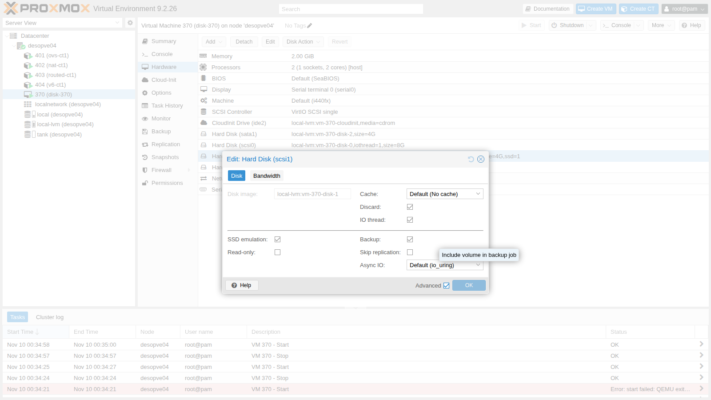
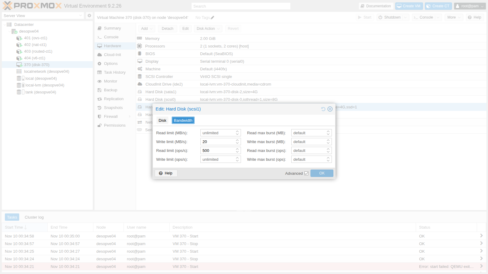

## Dipendenze

- **Lab precedenti:**
  - [Lab 35](/it/35-kvm-qemu/): processo QEMU, `qm showcmd` e monitor;
  - [Lab 09](/it/09-lvm-and-lvm-thin/): thin pool LVM e il suo riempimento;
  - [Lab 19](/it/19-fio-benchmark/): metodo di misura con `fio`.
- **Nodo e storage:** `desopve04`, nodo autonomo, con lo storage `local-lvm` (thin pool `pve/data`), così le prove non pesano sul cluster.
- **Risorse:** l'immagine cloud `debian-13-genericcloud-amd64.qcow2` in `local:import` di `desopve04`, scaricata nel [Lab 19](/it/19-fio-benchmark/), e la chiave SSH del DC ([Lab 05](/it/05-ssh-shell-cli/)). Con l'immagine si crea una VM con cloud-init (approfondito nel Lab 40).
- **Indirizzi:** VM di prova 370 su 172.27.199.170.
- **Credenziali:** `root` / `<password-lab>` → [Appendice B](/it/b-credentials-and-addresses/).

## Obiettivi

- Una VM di prova con tre dischi sullo stesso storage, uno per controller (VirtIO SCSI, VirtIO Block, SATA), misurati con lo stesso script: sai dire quali differenze superano la variabilità della prova e quali no.
- Per ognuna delle cinque modalità di **cache** sai dove si trovano i dati quando il guest riceve la conferma di una scrittura, e lo verifichi con il monitor di QEMU e con la memoria "sporca" del nodo.
- Una combinazione di **Async IO** e cache che impedisce l'avvio della VM, riconosciuta dal messaggio di errore e corretta.
- Spazio restituito al thin pool con **discard** e **fstrim**, verificato con `lvs` sul nodo, e il disco esposto al guest come SSD.
- Limiti di banda e IOPS di un disco applicati a VM accesa e verificati con una misura.

## Come funziona

Un disco virtuale passa da tre livelli:

```text
guest: driver del disco ──► controller virtuale (SCSI / VirtIO Block / SATA)
QEMU:  blockdev ──► cache (page cache del nodo sì/no, flush sì/no) ──► aio (io_uring / native / threads)
nodo:  volume sullo storage (qui un thin LV di LVM)
```

**Controller.**

- **VirtIO SCSI:** controller paravirtualizzato; con **VirtIO SCSI single** ogni disco ha il proprio controller e può avere un **IO thread** dedicato. Supporta discard, molti dischi e l'hotplug. È il default consigliato.
- **VirtIO Block:** paravirtualizzato anche lui, più semplice: un dispositivo PCI per disco (`/dev/vdX`), senza il livello SCSI.
- **SATA (e IDE):** controller emulati, che ogni sistema operativo riconosce senza driver. In genere ogni operazione costa di più al processo QEMU, e non possono avere un IO thread: in Proxmox VE l'opzione vale solo per VirtIO SCSI single e VirtIO Block. Si usano per installare sistemi senza driver VirtIO o per compatibilità.

**IO thread.** Con `iothread=1` l'I/O del disco gira in un thread dedicato invece che nel thread principale di QEMU. Con più dischi lavorano in parallelo, e l'I/O non rallenta la gestione della VM.

**Cache.** Decide se QEMU usa la page cache del nodo e come tratta i *flush*, le richieste con cui il guest chiede che i dati già scritti diventino stabili:

| Modalità | Page cache del nodo | Flush del guest | Cosa si può perdere se il nodo cade |
|---|---|---|---|
| `none` (default) | no (O_DIRECT) | rispettati | ciò che il guest non ha ancora consolidato con un flush, come con un disco fisico che ha una cache in scrittura |
| `writethrough` | sì, solo in lettura | non servono: ogni scrittura è confermata solo quando è sullo storage | nessuna delle scritture già confermate |
| `writeback` | sì | rispettati | come con `none`, ma ciò che non è ancora consolidato sta nella RAM del nodo e può essere molto di più |
| `directsync` | no (O_DIRECT) | non servono: ogni scrittura è confermata solo quando è sullo storage | nessuna delle scritture già confermate |
| `unsafe` | sì | **ignorati** | anche dati che il guest crede già al sicuro |

**Async IO.**

- **`io_uring`:** il default per la maggior parte degli storage, l'interfaccia asincrona moderna di Linux.
- **`native`:** l'AIO classico del kernel; funziona solo con O_DIRECT, cioè con `cache=none` o `directsync`.
- **`threads`:** un pool di thread che fa I/O sincrono, il più compatibile.

**Discard.** Quando il guest cancella dati può dire al disco "questi blocchi sono liberi" (TRIM/UNMAP). Con `discard=on` QEMU passa la richiesta allo storage, e un thin pool rilascia lo spazio. Con il default `discard=ignore` il guest crede di aver liberato lo spazio, ma il nodo non se ne accorge.

### Ambiente e versioni della prova

I risultati riportati più avanti vengono da una prova eseguita a novembre 2026 nella configurazione descritta qui sotto. Servono per leggerli correttamente: con versioni, opzioni o hardware diversi, gli stessi comandi danno numeri diversi.

| Componente | Configurazione della prova |
|---|---|
| Proxmox VE | 9.2.26, kernel `7.0.14-28-pve` ([Lab 04](/it/04-first-access-repositories-updates/)); QEMU 11.1.3 ([Lab 35](/it/35-kvm-qemu/)) |
| Nodo | `desopve04`, nodo autonomo con 4 core e 16 GB di RAM ([Lab 01](/it/01-lab-architecture/)) |
| Storage | `local-lvm`: thin pool `pve/data` da 14 GiB sul disco di sistema di `desopve04` ([Lab 03](/it/03-install-proxmox-ve/), [Lab 09](/it/09-lvm-and-lvm-thin/)), occupato al 23,7% prima del lab |
| VM di prova | Debian 13 da immagine cloud, 2 vCPU di tipo `host`, 2 GiB di RAM; dischi di prova da 4 GiB: `scsi1` (VirtIO SCSI single, `iothread=1`), `virtio1` (VirtIO Block, `iothread=1`), `sata1` (SATA, senza IO thread) |
| Opzioni dei dischi | predefinite (`cache=none`, `aio=io_uring`, `discard=ignore`) salvo dove una sezione dice altrimenti |
| Strumento | `fio` dai repository di Debian 13 (versione non registrata in questo lab; nel [Lab 19](/it/19-fio-benchmark/), con la stessa immagine, è la 3.39), con `--direct=1 --ioengine=libaio`, lanciato da [`fiorun.sh`](/files/37/fiorun.sh) |
| Area di prova | 2 GiB per disco, scritti prima delle misure; prove da 12-20 secondi più 2 di riscaldamento; uno o due giri per configurazione |

I modelli di dischi e controller del nodo sono oscurati, come indicato nelle [convenzioni del manuale](/it/the-lab/#convenzioni): i numeri vanno letti come proprietà di questa configurazione.

**Cosa misura e cosa non misura.** La prova misura il percorso completo visto dal guest: driver, controller virtuale, QEMU (cache e aio), il thin pool LVM e il disco del nodo. Non isola i singoli livelli: un valore alto o basso non dice da solo quale livello lo ha prodotto. Misura una VM sola e un disco alla volta; l'attività degli altri guest del nodo durante la prova non è stata registrata. Con uno o due giri brevi, una differenza tra due configurazioni conta solo se supera lo scarto tra giri della stessa configurazione: per `scsi1` con le opzioni predefinite, nelle sezioni 2-4 questo lab ha misurato tra 26.063 e 29.085 IOPS in lettura casuale e tra 8.247 e 14.864 IOPS in scrittura casuale.

## Procedura

### 1. La VM di prova

Una VM con il disco di sistema e tre dischi da 4 GiB sullo stesso storage, ognuno con un controller diverso:

```bash
qm create 370 --name disk-370 --memory 2048 --cores 2 --cpu host --ostype l26 \
  --net0 virtio,bridge=vmbr0 --scsihw virtio-scsi-single \
  --scsi0 local-lvm:0,import-from=local:import/debian-13-genericcloud-amd64.qcow2,iothread=1 \
  --ide2 local-lvm:cloudinit --boot order=scsi0 \
  --ipconfig0 ip=172.27.199.170/24,gw=172.27.199.1 --nameserver 172.27.199.20 \
  --ciuser labuser --sshkeys /root/.ssh/authorized_keys --serial0 socket --vga serial0
qm resize 370 scsi0 8G
qm set 370 --scsi1 local-lvm:4,iothread=1 --virtio1 local-lvm:4,iothread=1 --sata1 local-lvm:4
qm start 370
```

```text output
  WARNING: Sum of all thin volume sizes (36.00 GiB) exceeds the size of thin pool pve/data and the amount of free space in volume group (<6.13 GiB).
scsi1: local-lvm:vm-370-disk-1,iothread=1,size=4G
virtio1: local-lvm:vm-370-disk-3,iothread=1,size=4G
sata1: local-lvm:vm-370-disk-2,size=4G
```

L'avviso è l'overprovisioning del [Lab 09](/it/09-lvm-and-lvm-thin/): i volumi sommano 36 GiB su un pool da 14. Durante il lab si scrive al massimo una parte di ogni disco e si controlla il pool con `lvs`.

Nel guest:

```text
NAME SIZE ROTA TRAN   MODEL         DISC-MAX
sda    8G    1        QEMU HARDDISK       1G
sdb    4G    1 sata   QEMU HARDDISK       2G
sdc    4G    1        QEMU HARDDISK       1G
vda    4G    1 virtio                     2G
```

`ROTA 1`: tutti i dischi si presentano come dischi rotativi.

:::caution[Attenzione ai nomi dei dischi nel guest]
Dopo un riavvio della VM, nel laboratorio `sdb` e `sdc` si sono scambiati: il disco SCSI e quello SATA possono essere rilevati in ordine diverso da un avvio all'altro. Un test lanciato su `/dev/sdX` può così finire sul disco sbagliato senza alcun errore. Nei test e in `/etc/fstab` si usano i nomi stabili in `/dev/disk/by-id`: Proxmox VE dà a ogni disco SCSI l'identificativo `drive-scsiN`.

```text
ata-QEMU_HARDDISK_QM00007 -> ../../sdc
scsi-0QEMU_QEMU_HARDDISK_drive-scsi1 -> ../../sdb
```
:::

Le misure usano `fio` con O_DIRECT nel guest, su una zona da 2 GiB di ogni disco riempita prima del test. Ogni prova dura 12-20 secondi. Le prove le lancia lo script [`fiorun.sh`](/files/37/fiorun.sh), da copiare nel guest (per esempio con `scp` dal DC, che entra con `ssh labuser@172.27.199.170`). Esegue `fio` con `--direct=1 --ioengine=libaio --size=2G --time_based --ramp_time=2` e stampa una riga per prova:

- `IOPS`: operazioni completate al secondo;
- `MB/s`: la banda di fio (`bw`, in KiB/s) divisa per 1024, quindi in **MiB/s**, l'unità usata nelle tabelle di questo lab;
- `lat media` e `p99`: media e 99° percentile della **latenza di completamento** (*clat*, dall'invio dell'operazione al suo completamento), in microsecondi; non comprendono il tempo di sottomissione (le tre latenze di fio sono spiegate nel [Lab 19](/it/19-fio-benchmark/));
- con `--fsync=1` la latenza stampata è quella della sola scrittura: il tempo degli `fsync` fio lo riporta a parte, e lo script non lo stampa.

`fio` si installa nel guest tramite il proxy del laboratorio, impostato come nel [Lab 36](/it/36-memory/):

```bash
sudo apt-get install -y fio
./fiorun.sh disk/by-id/scsi-0QEMU_QEMU_HARDDISK_drive-scsi1 r4k randread 4k 32 15
```

### 2. Controller: VirtIO SCSI, VirtIO Block e SATA

Due giri consecutivi, con le opzioni predefinite:

```text
== giro 1
VirtIO-SCSI+iothread randread4k IOPS=   26867  MB/s=  105.0  lat media=   1161 us  p99=   2998 us
VirtIO-SCSI+iothread randwrite4k IOPS=    8247  MB/s=   32.2  lat media=   3865 us  p99=  45351 us
VirtIO-SCSI+iothread write1M IOPS=     284  MB/s=  284.9  lat media=  27874 us  p99= 379585 us
VirtIO-Block+iothread randread4k IOPS=   30766  MB/s=  120.2  lat media=   1014 us  p99=   2736 us
VirtIO-Block+iothread randwrite4k IOPS=    7546  MB/s=   29.5  lat media=   4220 us  p99=  32637 us
VirtIO-Block+iothread write1M IOPS=     563  MB/s=  563.1  lat media=  14024 us  p99=  71827 us
SATA randread4k              IOPS=    8155  MB/s=   31.9  lat media=   3804 us  p99=   6193 us
SATA randwrite4k             IOPS=    5767  MB/s=   22.5  lat media=   5436 us  p99=  32375 us
SATA write1M                 IOPS=     468  MB/s=  468.7  lat media=  17126 us  p99= 114819 us
== giro 2
VirtIO-SCSI+iothread randread4k IOPS=   29085  MB/s=  113.6  lat media=   1072 us  p99=   2671 us
VirtIO-SCSI+iothread randwrite4k IOPS=   10540  MB/s=   41.2  lat media=   3007 us  p99=  23200 us
VirtIO-SCSI+iothread write1M IOPS=     652  MB/s=  652.1  lat media=  12245 us  p99=  78119 us
VirtIO-Block+iothread randread4k IOPS=   29454  MB/s=  115.1  lat media=   1060 us  p99=   2736 us
VirtIO-Block+iothread randwrite4k IOPS=    7146  MB/s=   27.9  lat media=   4451 us  p99=  28705 us
VirtIO-Block+iothread write1M IOPS=     628  MB/s=  628.9  lat media=  12534 us  p99=  63701 us
SATA randread4k              IOPS=    7748  MB/s=   30.3  lat media=   4003 us  p99=   6128 us
SATA randwrite4k             IOPS=    2646  MB/s=   10.3  lat media=  11972 us  p99= 304087 us
SATA write1M                 IOPS=     344  MB/s=  344.2  lat media=  22930 us  p99= 214958 us
```

| Controller (valori dei due giri) | Letture casuali 4k | Scritture casuali 4k | Scrittura sequenziale 1M |
|---|---|---|---|
| VirtIO SCSI + iothread | 26.900-29.100 IOPS | 8.200-10.500 IOPS | 285-652 MiB/s |
| VirtIO Block + iothread | 29.500-30.800 IOPS | 7.100-7.500 IOPS | 563-629 MiB/s |
| SATA | 7.700-8.200 IOPS | 2.600-5.800 IOPS | 344-469 MiB/s |

Ogni punto qui sotto separa ciò che la prova ha misurato da come lo interpretiamo, e indica la verifica che servirebbe.

1. **Letture casuali 4k.**
   - **Misura:** VirtIO SCSI 26.867 e 29.085 IOPS, VirtIO Block 30.766 e 29.454, SATA 8.155 e 7.748. La latenza di completamento media è di 1,0-1,2 ms per i due VirtIO e di 3,8-4,0 ms per SATA.
   - **Interpretazione:** i due controller VirtIO si sovrappongono. SATA fa il 25-30% delle letture dei VirtIO, con una latenza 3-4 volte più alta. È compatibile con il costo di un controller emulato, ma il disco SATA è anche l'unico senza IO thread: la prova non separa i due fattori.
   - **Verifica:** ripeti la prova su `scsi1` con `iothread=0`, per vedere quanto pesa il solo IO thread; durante la prova, sul nodo, `top -H -p $(cat /var/run/qemu-server/370.pid)` mostra quali thread di QEMU lavorano (vCPU, IO thread, thread principale).
2. **Scritture casuali 4k.**
   - **Misura:** VirtIO SCSI 8.247 e 10.540 IOPS, VirtIO Block 7.546 e 7.146, SATA 5.767 e 2.646.
   - **Interpretazione:** VirtIO SCSI è sopra VirtIO Block in entrambi i giri, ma lo stesso disco con le stesse opzioni ha dato tra 8.247 e 14.864 IOPS nelle sezioni 2-4: la differenza non è dimostrata. Nel secondo giro SATA dimezza (da 5.767 a 2.646 IOPS, con un p99 di 304 ms); la prova non dice perché.
   - **Verifica:** più giri, più lunghi, alternando l'ordine dei dischi; sul nodo, durante la prova, `iostat -x 1` (pacchetto `sysstat`) mostra se il disco fisico è saturo (`%util`, `w_await`).
3. **Scrittura sequenziale 1M.**
   - **Misura:** VirtIO SCSI 285 e 652 MiB/s, VirtIO Block 563 e 629, SATA 469 e 344.
   - **Interpretazione:** lo scarto tra i due giri dello stesso disco (VirtIO SCSI: più del doppio) è più grande delle differenze tra controller, quindi questa prova non li ordina. Le cache in scrittura del disco o del controller del nodo e le scritture in background sono cause possibili, che la prova non isola.
   - **Verifica:** come al punto 2, con una scrittura abbastanza lunga da superare le cache.

**In sintesi:** l'unica cosa che questa prova mostra con sicurezza è che in lettura casuale SATA resta molto sotto i due VirtIO. Tra VirtIO SCSI e VirtIO Block, in questo laboratorio, le differenze stanno dentro la variabilità della prova.

### 3. Le modalità di cache

**Hardware → Hard Disk → Edit**, con **Advanced**, mostra tutte le opzioni del disco:



Per `scsi1` si provano le cinque modalità. Ogni cambio richiede di spegnere e riaccendere la VM:

```bash
qm set 370 --scsi1 local-lvm:vm-370-disk-1,iothread=1,cache=writeback
qm stop 370 && qm start 370
```

Quattro prove per modalità sul disco `/dev/disk/by-id/scsi-0QEMU_QEMU_HARDDISK_drive-scsi1`. La prima è una scrittura alla volta, seguita ogni volta da un `fsync`: è il comportamento di un database che conferma le transazioni. In questa riga `IOPS` conta i cicli scrittura + `fsync` al secondo.

```text
== cache=none
fsync ogni scrittura QD1     IOPS=     545  MB/s=    2.1  lat media=   1418 us  p99=   4014 us
randwrite 4k QD32            IOPS=    8693  MB/s=   34.0  lat media=   3654 us  p99=  22938 us
randread 4k QD32             IOPS=   26063  MB/s=  101.8  lat media=   1200 us  p99=   3097 us
write 1M QD8                 IOPS=     317  MB/s=  317.5  lat media=  24870 us  p99= 160432 us
== cache=writeback
fsync ogni scrittura QD1     IOPS=     575  MB/s=    2.2  lat media=    182 us  p99=    692 us
randwrite 4k QD32            IOPS=   30334  MB/s=  118.5  lat media=   1025 us  p99=   1679 us
randread 4k QD32             IOPS=   32097  MB/s=  125.4  lat media=    971 us  p99=   2867 us
write 1M QD8                 IOPS=    2508  MB/s= 2508.7  lat media=   3018 us  p99=   9241 us
== cache=writethrough
fsync ogni scrittura QD1     IOPS=     501  MB/s=    2.0  lat media=   1901 us  p99=  13042 us
randwrite 4k QD32            IOPS=    9728  MB/s=   38.0  lat media=   3366 us  p99=  17695 us
randread 4k QD32             IOPS=   27700  MB/s=  108.2  lat media=   1129 us  p99=   4686 us
write 1M QD8                 IOPS=     537  MB/s=  537.4  lat media=  15002 us  p99=  56361 us
== cache=directsync
fsync ogni scrittura QD1     IOPS=     717  MB/s=    2.8  lat media=   1315 us  p99=   3686 us
randwrite 4k QD32            IOPS=    5583  MB/s=   21.8  lat media=   5725 us  p99=  41157 us
randread 4k QD32             IOPS=   29685  MB/s=  116.0  lat media=   1054 us  p99=   2966 us
write 1M QD8                 IOPS=     430  MB/s=  430.6  lat media=  18228 us  p99=  57934 us
== cache=unsafe
fsync ogni scrittura QD1     IOPS=    4399  MB/s=   17.2  lat media=    101 us  p99=    387 us
randwrite 4k QD32            IOPS=   30261  MB/s=  118.2  lat media=   1028 us  p99=   1876 us
randread 4k QD32             IOPS=   30653  MB/s=  119.7  lat media=   1015 us  p99=   2310 us
write 1M QD8                 IOPS=    2386  MB/s= 2386.9  lat media=   3172 us  p99=   9241 us
```

| Cache | Scrittura + fsync, QD1 (cicli al secondo) | Scritture casuali 4k QD32 | Scrittura sequenziale 1M QD8 |
|---|---|---|---|
| `none` | 545 | 8.700 IOPS | 318 MiB/s |
| `writethrough` | 501 | 9.700 IOPS | 537 MiB/s |
| `directsync` | 717 | 5.600 IOPS | 431 MiB/s |
| `writeback` | 575 | 30.300 IOPS | 2.509 MiB/s |
| `unsafe` | **4.399** | 30.300 IOPS | 2.387 MiB/s |

1. **`writeback` e `unsafe` senza `fsync`.**
   - **Misura:** in scrittura sequenziale 1M, 2.509 MiB/s con `writeback` e 2.387 con `unsafe`, contro 318-537 MiB/s delle altre tre modalità; in scrittura casuale 4k QD32, circa 30.300 IOPS contro 5.583-9.728.
   - **Interpretazione:** è compatibile con scritture assorbite dalla page cache del nodo, che queste due modalità usano anche in scrittura: il guest riceve la conferma prima che i dati arrivino al disco. La prova sulla memoria "sporca" più sotto va nella stessa direzione.
   - **Verifica:** durante la prova, sul nodo, `grep -E '^(Dirty|Writeback):' /proc/meminfo` ogni secondo e `iostat -x 1` sul disco fisico: se il guest scrive a 2,5 GiB/s mentre il disco scrive al suo ritmo abituale, la differenza sta nella RAM.
2. **Una scrittura alla volta, ciascuna seguita da `fsync`.**
   - **Misura:** `none` 545 cicli al secondo, `writethrough` 501, `directsync` 717, `writeback` 575, `unsafe` 4.399. La latenza stampata riguarda la sola scrittura: 182 µs con `writeback`, 101 µs con `unsafe`, 1.315-1.901 µs con le altre tre.
   - **Interpretazione:** con `writeback` la scrittura si completa in RAM (182 µs), ma ogni ciclo dura circa 1,7 ms (1/575 di secondo), quasi come con `none` (1,8 ms): il tempo in più sta fuori dalla scrittura, ed è compatibile con un `fsync` che aspetta che il nodo porti i dati su disco. Con `unsafe` i cicli al secondo sono quasi otto volte di più: è coerente con i flush ignorati, che il monitor conferma qui sotto. Con `writethrough` e `directsync` la scrittura occupa quasi tutto il ciclo, perché è già sincrona.
   - **Verifica:** fio misura a parte la durata degli `fsync` (`jobs[0].sync.lat_ns` nell'output JSON, che lo script non stampa); sul nodo, `iostat -x 1` mostra i flush al secondo che arrivano al disco (colonna `f/s`).
3. **Le altre misure.**
   - **Misura:** `none`, `writethrough` e `directsync` danno 5.583-9.728 IOPS in scrittura casuale e 318-537 MiB/s in scrittura sequenziale; le letture casuali stanno tra 26.063 e 32.097 IOPS con tutte e cinque le modalità.
   - **Interpretazione:** sono differenze dello stesso ordine della variabilità misurata per la stessa configurazione (vedi [Ambiente e versioni della prova](#ambiente-e-versioni-della-prova)), quindi la prova non ordina queste tre modalità e non mostra un effetto della cache sulle letture. Non dice nemmeno cosa limiti le letture: il disco, il thin pool, QEMU o le due vCPU del guest.
   - **Verifica:** `iostat -x 1` sul nodo durante la prova di lettura: se il disco fisico serve le letture allo stesso ritmo, arrivano al disco; se è quasi fermo, arrivano da una cache.

Il monitor mostra la configurazione effettiva: con `unsafe` su `scsi1`, i nodi di quel disco riportano `writeback, ignore flushes` (qui sotto solo le righe `Cache mode`):

```text title="qm monitor" frame="terminal"
info block -n
```

```text output
    Cache mode:       writeback
    Cache mode:       writeback, ignore flushes
    Cache mode:       writeback, ignore flushes
```

**Dove stanno i dati quando il guest crede di averli scritti.** Nel guest si scrive 1 GiB direttamente sul disco, con `fsync` finale (`conv=fsync`), e subito dopo si guarda sul nodo la memoria "sporca", cioè i dati ancora da scrivere sul disco:

```bash
dd if=/dev/urandom of=/dev/disk/by-id/scsi-0QEMU_QEMU_HARDDISK_drive-scsi1 bs=1M count=1024 oflag=direct conv=fsync   # nel guest
grep ^Dirty: /proc/meminfo                                                                                         # sul nodo
```

```text output
== cache=writeback
1073741824 bytes (1.1 GB, 1.0 GiB) copied, 6.10631 s, 176 MB/s
  nodo subito dopo: Dirty: 1456 kB
== cache=unsafe
1073741824 bytes (1.1 GB, 1.0 GiB) copied, 4.60421 s, 233 MB/s
  nodo subito dopo: Dirty: 1050036 kB
```

- **Misura:** subito dopo il `dd`, che termina con un `fsync`, il contatore `Dirty` del nodo vale 1.456 kB con `writeback` e 1.050.036 kB con `unsafe`, cioè circa il GiB appena scritto.
- **Interpretazione:** con `writeback` il `fsync` del guest ha costretto il nodo a scrivere i dati fuori dalla page cache: è compatibile con dati già sul disco del nodo quando il `fsync` ritorna. Con `unsafe` il GiB che il guest considera al sicuro era ancora nella RAM del nodo: un'interruzione di corrente in quel momento lo cancellerebbe, e il guest non lo saprebbe mai.
- **Limiti della prova:** `Dirty` conta tutta la memoria sporca del nodo ed è stato letto una volta sola. La velocità di `dd` (176 e 233 MB/s) qui non misura lo storage: comprende la generazione dei dati casuali con `/dev/urandom` nel guest e una sola scrittura da 1 MiB alla volta.
- **Verifica:** leggi `Dirty` e `Writeback` ogni secondo per un minuto dopo il `dd`: con `unsafe` dovrebbero scendere man mano che il kernel del nodo scrive i dati, entro l'intervallo impostato da `vm.dirty_expire_centisecs`.

**Quale scegliere.** `unsafe` va bene solo per dati usa e getta, per esempio durante l'installazione di un sistema che diventerà un template. `writeback` ha senso quando il guest usa correttamente i flush e la RAM del nodo è protetta da un'interruzione di corrente (UPS): quello che il guest non ha ancora consolidato può essere molto. Il default `none` è la scelta prudente.

### 4. Async IO

`scsi1` con `cache=none`, due giri per modalità:

```text
== aio=io_uring
randread 4k QD32             IOPS=   27460  MB/s=  107.3  lat media=   1137 us  p99=   3064 us
randwrite 4k QD32            IOPS=   13340  MB/s=   52.1  lat media=   2385 us  p99=  13959 us
randread 4k QD32             IOPS=   27121  MB/s=  106.0  lat media=   1155 us  p99=   3293 us
randwrite 4k QD32            IOPS=   14864  MB/s=   58.1  lat media=   2179 us  p99=  11600 us
== aio=native
randread 4k QD32             IOPS=   32438  MB/s=  126.7  lat media=    967 us  p99=   2933 us
randwrite 4k QD32            IOPS=    6043  MB/s=   23.6  lat media=   5268 us  p99=  50594 us
randread 4k QD32             IOPS=   33112  MB/s=  129.4  lat media=    948 us  p99=   3031 us
randwrite 4k QD32            IOPS=   12222  MB/s=   47.8  lat media=   2594 us  p99=  16908 us
== aio=threads
randread 4k QD32             IOPS=   31479  MB/s=  123.0  lat media=    996 us  p99=   2769 us
randwrite 4k QD32            IOPS=    6368  MB/s=   24.9  lat media=   4995 us  p99=  31326 us
randread 4k QD32             IOPS=   30716  MB/s=  120.0  lat media=   1021 us  p99=   3064 us
randwrite 4k QD32            IOPS=    7674  MB/s=   30.0  lat media=   4142 us  p99=  57410 us
```

1. **Letture.**
   - **Misura:** `io_uring` 27.460 e 27.121 IOPS, `native` 32.438 e 33.112, `threads` 31.479 e 30.716.
   - **Interpretazione:** `native` e `threads` sono sopra `io_uring` in entrambi i giri, del 13-22%, e sopra tutte le letture di `scsi1` con le opzioni predefinite (26.063-29.085 IOPS). È un indizio di un vantaggio in lettura casuale per questa configurazione, non una prova: le modalità sono state misurate una dopo l'altra, con due giri ciascuna.
   - **Verifica:** più giri, alternando le modalità (`io_uring`, `native`, `threads`, poi di nuovo `io_uring`), ciascuno dopo il riavvio della VM, e prove più lunghe.
2. **Scritture.**
   - **Misura:** `io_uring` 13.340 e 14.864 IOPS, `native` 6.043 e 12.222, `threads` 6.368 e 7.674.
   - **Interpretazione:** la stessa configurazione di `io_uring` aveva dato 8.247-10.540 IOPS nella sezione 2 e 8.693 nella sezione 3, e `native` raddoppia tra un giro e l'altro: lo scarto della configurazione identica copre le differenze tra le modalità. In scrittura la prova non indica un vincitore.
   - **Verifica:** come al punto 1.

**Quale scegliere.** `io_uring` resta il default sensato per questo storage, finché una misura ripetuta sul tuo storage non mostra un vantaggio stabile di un'altra modalità. `threads` serve per gli storage con cui le altre modalità danno problemi: per alcuni tipi, per esempio LVM thick e CIFS, Proxmox VE non usa `io_uring` nemmeno come default. La modalità effettiva di un disco si legge in `qm showcmd 370 --pretty`.

#### Una combinazione che impedisce l'avvio

**Configurazione provata.** `aio=native` con `cache=writeback` su `scsi1`:

```bash
qm stop 370
qm set 370 --scsi1 local-lvm:vm-370-disk-1,iothread=1,aio=native,cache=writeback
qm start 370
```

**Errore osservato.** `qm set` accetta la configurazione, ma l'avvio fallisce:

```text output
kvm: -blockdev {...,"file":{"aio":"native","cache":{"direct":false,"no-flush":false},...,"driver":"host_device","filename":"/dev/pve/vm-370-disk-1",...}: aio=native was specified, but it requires cache.direct=on, which was not specified.
start failed: QEMU exited with code 1
```

Il messaggio dice il vincolo: `native` richiede `cache.direct=on`, cioè O_DIRECT, che tra le modalità di Proxmox VE hanno solo `none` e `directsync`. In questa versione (Proxmox VE 9.2.26 con QEMU 11.1.3) la combinazione non viene rifiutata quando si salva la configurazione, ma solo all'avvio della VM.

**Decisione.** Tornare a una combinazione valida prima di proseguire: qui le opzioni predefinite, togliendo `aio` e `cache` dalla riga del disco.

```bash
qm set 370 --scsi1 local-lvm:vm-370-disk-1,iothread=1
qm start 370
```

**Risultato.** La VM riparte con `cache=none` e `aio=io_uring`, e la sezione seguente parte da questa configurazione.

### 5. Discard, fstrim ed emulazione SSD

Su `scsi1` si crea un filesystem ext4. Si scrive un file da 1 GiB, lo si cancella e si chiede al guest di segnalare i blocchi liberi con `fstrim`. Sul nodo si guarda l'occupazione del volume thin:

```bash
# nel guest
D=/dev/disk/by-id/scsi-0QEMU_QEMU_HARDDISK_drive-scsi1
sudo mkfs.ext4 -F $D && sudo mkdir -p /mnt/t && sudo mount $D /mnt/t
sudo dd if=/dev/urandom of=/mnt/t/prova bs=1M count=1024 conv=fsync
sudo rm /mnt/t/prova && sudo fstrim -v /mnt/t
# sul nodo, prima e dopo
lvs pve/vm-370-disk-1
```

**Con il default `discard=ignore`:**

```text
 vm-370-disk-1 50.00          ← prima (zona riempita per i test)
file-1GiB-scritto
 vm-370-disk-1 50.79
/mnt/t: 2.9 GiB (3068858368 bytes) trimmed
 vm-370-disk-1 50.79          ← dopo fstrim: nessun cambiamento
```

Il guest dichiara di aver liberato 2,9 GiB, ma il volume resta al 50,79%: con `discard=ignore` QEMU non passa le richieste allo storage.

**Con `discard=on` e `ssd=1`** (spegnendo e riaccendendo la VM):

```bash
qm set 370 --scsi1 local-lvm:vm-370-disk-1,iothread=1,discard=on,ssd=1
```

```text output
sdb rotational=0
/mnt/t: 3.9 GiB (4142604288 bytes) trimmed
 vm-370-disk-1 3.46           ← il volume restituisce 1,9 GiB al pool
file-1GiB-scritto
 vm-370-disk-1 28.46
/mnt/t: 6 MiB (6283264 bytes) trimmed
 vm-370-disk-1 28.46          ← fstrim lanciato subito dopo rm
/mnt/t: 1.1 GiB (1197453312 bytes) trimmed
 vm-370-disk-1 3.46           ← fstrim dopo sync e qualche secondo
 data 65.69                   ← thin pool del nodo: era al 79%
```

- **`ssd=1`:** il guest vede un disco non rotativo (`rotational=0`). Cosa cambi di conseguenza dipende dal sistema e dalle applicazioni del guest, e questa prova non lo misura; secondo la documentazione di Proxmox VE, alcuni sistemi operativi richiedono l'emulazione SSD anche per mandare i TRIM. Sui dischi VirtIO Block l'emulazione SSD non è disponibile.
- **`discard=on`:** lo spazio liberato nel guest torna al thin pool. Il volume passa dal 50,79% al 3,46% (1,9 GiB restituiti) e il thin pool del nodo dal 79% al 65,69%.
- **Il trim subito dopo `rm`:** libera solo 6 MiB, mentre dopo `sync` e qualche secondo libera 1,1 GiB. È compatibile con il modo in cui ext4 rende disponibili i blocchi di un file cancellato solo al commit del journal, che per default avviene ogni 5 secondi; per verificarlo, ripeti la prova con `sync` subito prima di `fstrim`, senza attesa. In ogni caso Debian lancia `fstrim` ogni settimana con `fstrim.timer`, che nel guest risulta `enabled`: lo spazio torna anche senza intervento.

Su uno storage thin (LVM-thin, ZFS, Ceph, qcow2), senza `discard=on` lo spazio liberato nel guest resta occupato sul nodo, come hai visto qui con `discard=ignore`; il [Lab 09](/it/09-lvm-and-lvm-thin/) mostra lo stesso meccanismo per i container (`pct fstrim`). Quando un thin pool si riempie più di quanto giustifichino i dati dei guest, è una delle prime cose da controllare: confronta lo spazio occupato nel guest (`df`) con quello del volume sul nodo (`lvs`).

### 6. Limiti di banda e IOPS

Nella scheda **Bandwidth** della stessa finestra si limitano lettura e scrittura, in MB/s e in operazioni al secondo, con un eventuale *burst* temporaneo:



I limiti si applicano **a caldo**, senza riavviare la VM:

```bash
qm set 370 --scsi1 local-lvm:vm-370-disk-1,iothread=1,discard=on,ssd=1,mbps_wr=20,iops_rd=500
```

```text output
== senza limiti
write 1M QD8                 IOPS=     723  MB/s=  724.0  lat media=  10849 us  p99=  67633 us
randread 4k QD32             IOPS=   27229  MB/s=  106.4  lat media=   1148 us  p99=   3031 us
update VM 370: -scsi1 local-lvm:vm-370-disk-1,iothread=1,discard=on,ssd=1,mbps_wr=20,iops_rd=500
status: running
== con limiti (applicati a caldo)
write 1M QD8                 IOPS=      19  MB/s=   20.0  lat media= 403898 us  p99= 599785 us
randread 4k QD32             IOPS=     497  MB/s=    2.0  lat media=  64070 us  p99=  66322 us
```

- **Misura:** con i limiti, la scrittura 1M QD8 fa 20,0 MiB/s, con una latenza di completamento media di 404 ms (p99 600 ms); la lettura 4k QD32 fa 497 IOPS, con 64 ms di media. Senza limiti erano 724 MiB/s e 27.229 IOPS. `fio` non ha riportato errori.
- **Interpretazione:** i limiti sono rispettati. Proxmox VE converte `mbps_wr=20` in 20 × 1024 × 1024 byte al secondo, cioè 20 MiB/s, la stessa unità che stampa lo script; il limite di lettura era di 500 operazioni al secondo. Le latenze sono quelle che ci si aspetta da una coda: con una portata fissa, la latenza vale circa la profondità della coda divisa per la portata, cioè 8 / 20 al secondo = 0,40 s e 32 / 497 al secondo ≈ 64 ms. Il guest quindi non riceve errori: le sue richieste aspettano in coda.
- **Verifica:** `qm showcmd 370 --pretty` mostra il limite in byte al secondo (`bps-write` 20971520).

Serve a evitare che una VM rumorosa saturi uno storage condiviso con le altre; i limiti di CPU e il resto si vedono nel Lab 42.

## Verifica e test

La prova è riuscita se ogni sezione ha prodotto le righe di `fiorun.sh` per tutti i dischi e tutte le modalità, e se i controlli qui sotto danno il risultato atteso. I valori osservati sono quelli della prova descritta in [Ambiente e versioni della prova](#ambiente-e-versioni-della-prova).

| Controllo | Risultato atteso | Osservato in questa prova |
|---|---|---|
| Nomi dei dischi nel guest | i test usano `/dev/disk/by-id`, mai `sdX` | `sdb` e `sdc` scambiati dopo un riavvio; test su `drive-scsi1` |
| Controller | ogni differenza confrontata con lo scarto tra i due giri | SATA al 25-30% dei VirtIO in lettura casuale; VirtIO SCSI e Block non distinguibili |
| Cache `unsafe` | `ignore flushes` nel monitor; dati ancora in `Dirty` sul nodo dopo un `fsync` del guest | `writeback, ignore flushes`; `Dirty` 1.050.036 kB (con `writeback` 1.456 kB) |
| `aio=native` con `cache=writeback` | la VM non parte; con una combinazione valida riparte | errore `requires cache.direct=on`; VM riavviata con le opzioni predefinite |
| Discard | con `discard=on` il `fstrim` del guest abbassa l'occupazione del volume; con `ignore` no | dal 50,79% al 3,46% con `on`; invariata con `ignore` |
| Limiti di I/O | applicati a VM accesa, misura vicina al limite, nessun errore nel guest | 20,0 MiB/s e 497 IOPS; latenze medie 404 ms e 64 ms |

## Stato finale del lab

- **VM 370 `disk-370`:** eliminata con i suoi quattro dischi (`qm stop 370 && qm destroy 370 --purge`).
- **Thin pool `pve/data` di `desopve04`:** tornato al 23,7%, come prima del lab.
- Nessuna modifica ai nodi del cluster.

## Cosa hai imparato

- **Scegliere il controller del disco:** VirtIO SCSI single con IO thread come default, oppure VirtIO Block, che in questa prova non si distingue; SATA solo finché il guest non ha i driver VirtIO, perché in lettura casuale ha reso il 25-30% dei VirtIO.
- **Scegliere la cache in base a dove possono stare i dati già confermati:** `none` come default; `writeback` solo se il guest usa i flush e la RAM del nodo è protetta da un'interruzione di corrente; `unsafe` solo per dati usa e getta. Il monitor (`info block`) e il contatore `Dirty` del nodo mostrano cosa succede davvero.
- **Lasciare `aio` al default** finché una misura ripetuta sul tuo storage non mostra un vantaggio stabile; `native` solo con `cache=none` o `directsync`, altrimenti la VM non parte.
- **Attivare `discard=on` sugli storage thin** e controllare che nel guest qualcosa mandi i trim (`fstrim.timer`), confrontando lo spazio nel guest con `lvs` sul nodo.
- **Usare i limiti di I/O per proteggere uno storage condiviso**, sapendo che il guest li vede come latenza (profondità della coda divisa per il limite), non come errori.
- **Leggere un confronto di prestazioni:** prima di attribuire una differenza all'opzione cambiata, la confronti con lo scarto tra ripetizioni della stessa configurazione.
- **Identificare i dischi nei guest** con `/dev/disk/by-id`, non con `sdX`.

## Riferimenti

- [Proxmox VE – Dischi delle VM: cache, discard, IO thread, emulazione SSD](https://pve.proxmox.com/pve-docs/chapter-qm.html#qm_hard_disk)
- [Proxmox VE wiki – Performance Tweaks: modalità di cache dei dischi](https://pve.proxmox.com/wiki/Performance_Tweaks#Disk_Cache)
- [QEMU 11.1 – Opzioni dei dispositivi a blocchi (`-drive`: cache, aio, discard, detect-zeroes)](https://qemu.readthedocs.io/en/stable-11.1/system/invocation.html#hxtool-1)
- [fio – lettura dell'output: slat, clat e lat](https://fio.readthedocs.io/en/latest/fio_doc.html#interpreting-the-output)
- [`proc_meminfo(5)` – i contatori `Dirty` e `Writeback`](https://man7.org/linux/man-pages/man5/proc_meminfo.5.html)
