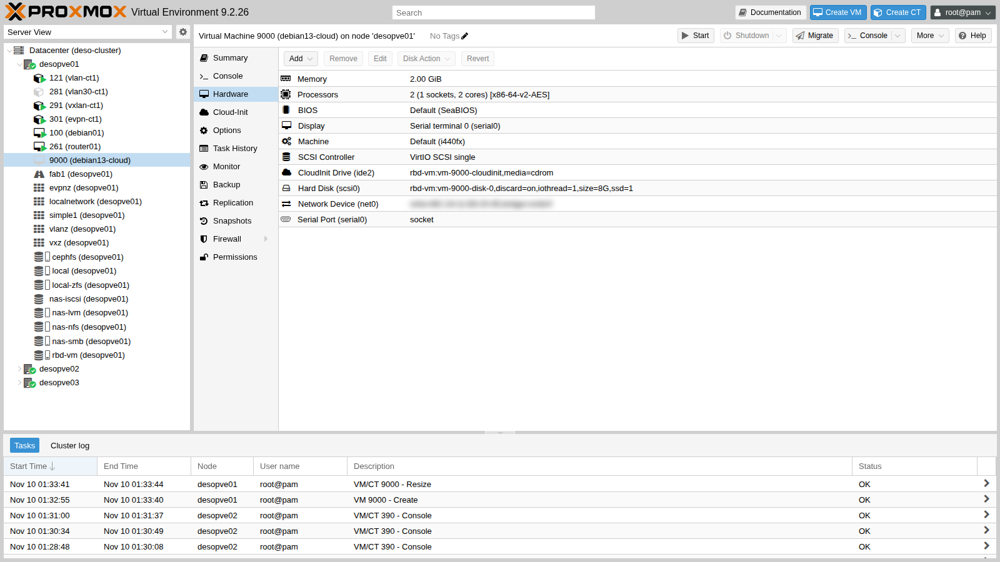
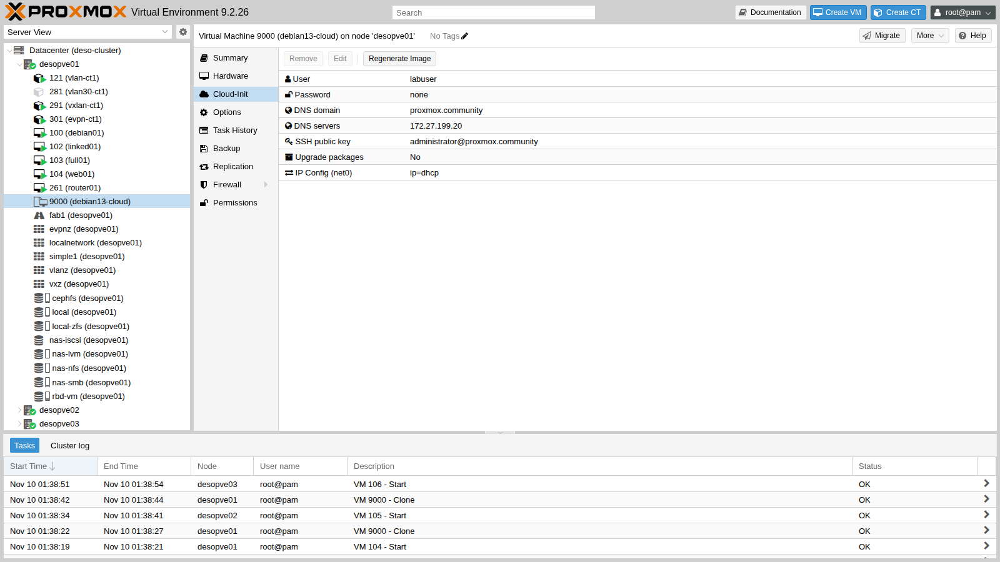
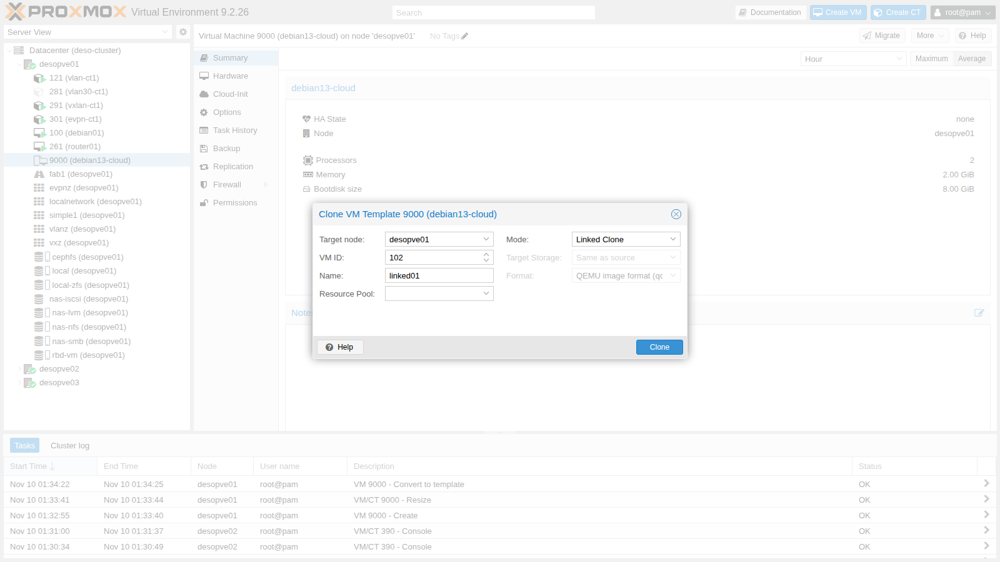

## Dipendenze

- **Lab precedenti:**
  - [Lab 19](/it/19-fio-benchmark/): l'immagine cloud Debian 13 in `local:import` di `desopve01`;
  - [Lab 05](/it/05-ssh-shell-cli/): la chiave SSH dell'utente `administrator` sul DC;
  - [Lab 17](/it/17-ceph-installation/): lo storage condiviso `rbd-vm` e CephFS;
  - [Lab 27](/it/27-sdn-simple/): la VNet `vnsimp1` con DHCP e IPAM;
  - [Lab 38](/it/38-linux-vm-guest-agent/): QEMU Guest Agent.
- **Nodi e storage:** cluster `desopve01`-`03`; template su `rbd-vm`; snippets su `cephfs`.
- **Rete:** il proxy `proxy.proxmox.community:3128` per i pacchetti dei guest.
- **Indirizzi:** VM 102 su 172.27.199.102; VM 103 in DHCP sulla VNet `vnsimp1`; VM 104-106 su 172.27.199.104-106.
- **Credenziali:** utente `labuser` con chiave SSH, senza password → [Appendice B](/it/b-credentials-and-addresses/).

## Obiettivi

- Trasformare un'immagine cloud in un **template** con **cloud-init**.
- Capire la differenza tra **linked clone** e **full clone**, con tempi e spazio misurati.
- Configurare utente, chiavi, IP statico e **DHCP** dalla scheda Cloud-Init.
- Leggere quello che Proxmox VE passa al guest con `qm cloudinit dump`.
- Aggiungere configurazione personalizzata con gli **snippets** (`cicustom`).
- Creare tre VM pronte all'uso, su tre nodi, con un ciclo di comandi.

## Come funziona

**Template.** Un template è una VM in sola lettura: non si avvia e i suoi dischi diventano **dischi base** (`base-9000-disk-0`). Si usa solo come sorgente di cloni.

**Linked clone e full clone.**

| | Linked clone | Full clone |
|---|---|---|
| Disco | copy-on-write sul disco base del template | copia completa e indipendente |
| Tempo | pochi secondi | proporzionale ai dati da copiare |
| Spazio iniziale | quasi zero | quanto i dati del disco |
| Vincoli | stesso storage del template; il template non si può eliminare finché esistono cloni | nessuno: può andare su un altro storage |

Lo storage deve supportare i cloni a livello di disco: Ceph RBD (clone di uno snapshot), ZFS, LVM-thin, qcow2 (backing file).

**Cloud-init.** Le immagini cloud non hanno un installer: al primo avvio `cloud-init` legge la configurazione da un **datasource**. Proxmox VE usa il datasource *NoCloud*: genera un piccolo CD (il drive **CloudInit**) con tre file:

- `user-data`: utente, chiavi SSH, hostname, pacchetti;
- `network-config`: indirizzi, gateway, DNS;
- `meta-data`: l'`instance-id`.

Quando cambi un parametro Cloud-Init, Proxmox VE rigenera il CD con un nuovo `instance-id`, e al riavvio successivo cloud-init applica di nuovo la configurazione.

**Snippets.** Con `cicustom` si possono sostituire o integrare i file generati con file propri, salvati in uno storage con contenuto **Snippets**. Il tipo `vendor` si *aggiunge* allo user-data di Proxmox VE invece di sostituirlo: utente, chiavi e rete restano quelli della scheda Cloud-Init.

## Procedura

### 1. L'immagine cloud

L'immagine `debian-13-genericcloud-amd64.qcow2` è stata scaricata nel [Lab 19](/it/19-fio-benchmark/) nello storage `local`, contenuto **Import**:

```text
image: /var/lib/vz/import/debian-13-genericcloud-amd64.qcow2
file format: qcow2
virtual size: 3 GiB (3221225472 bytes)
disk size: 324 MiB
```

È un sistema già installato: 3 GiB di disco virtuale, 324 MiB di dati reali.

### 2. La VM base con il drive Cloud-Init

Il disco si importa direttamente durante la creazione, con `import-from`:

```bash
qm create 9000 --name debian13-cloud --ostype l26 --memory 2048 --cores 2 --cpu x86-64-v2-AES \
  --scsihw virtio-scsi-single \
  --scsi0 rbd-vm:0,import-from=local:import/debian-13-genericcloud-amd64.qcow2,discard=on,ssd=1,iothread=1 \
  --ide2 rbd-vm:cloudinit --boot order=scsi0 --serial0 socket --vga serial0 \
  --net0 virtio,bridge=vmbr0 --agent enabled=1
qm resize 9000 scsi0 8G
```

```text output
transferred 3.0 GiB of 3.0 GiB (100.00%)
scsi0: successfully created disk 'rbd-vm:vm-9000-disk-0,discard=on,iothread=1,size=3G,ssd=1'
Resizing image: 100% complete...done.
```

- **`--ide2 rbd-vm:cloudinit`** crea il drive Cloud-Init. Sta su `rbd-vm` come il disco, così i cloni funzionano su ogni nodo.
- **`--serial0 socket --vga serial0`:** le immagini cloud Debian usano la console seriale; la console della VM diventa xterm.js ([Lab 38](/it/38-linux-vm-guest-agent/)).
- **`qm resize`:** il disco passa da 3 a 8 GiB. Al primo avvio cloud-init allarga partizione e filesystem da solo.

I parametri Cloud-Init. La chiave pubblica del DC è già tra quelle autorizzate sul nodo ([Lab 05](/it/05-ssh-shell-cli/)); per il template si isola solo quella:

```bash
grep administrator@proxmox.community /root/.ssh/authorized_keys > /root/lab40-dc.pub
qm set 9000 --ciuser labuser --sshkeys /root/lab40-dc.pub --ipconfig0 ip=dhcp \
  --nameserver 172.27.199.20 --searchdomain proxmox.community --ciupgrade 0
```

- **`--sshkeys`:** un file con la chiave pubblica di `administrator` del DC ([Lab 05](/it/05-ssh-shell-cli/)). Nessuna password: si entra solo con la chiave.
- **`--ipconfig0 ip=dhcp`:** nel template; ogni clone avrà il suo indirizzo.
- **`--ciupgrade 0`:** l'opzione **Upgrade packages** è attiva di default e al primo avvio lancia l'aggiornamento dei pacchetti. Nel laboratorio il guest non ha ancora il proxy configurato, quindi la si disattiva nel template: il proxy lo imposta lo snippet della sezione 8.

Nella vista **Hardware** compare il **CloudInit Drive (ide2)**:



e nella scheda **Cloud-Init** la configurazione, modificabile anche da qui:



### 3. Conversione in template

**More → Convert to template** (o `qm template 9000`). Il disco viene rinominato in `base-9000-disk-0` e Ceph ne crea lo snapshot protetto `__base__`, sorgente di tutti i linked clone.

### 4. Linked clone

**More → Clone** sul template. **Mode** è **Linked Clone** e **Target Storage** è bloccato su "Same as source":



Il task dura **2 secondi**. Il disco del clone è un clone RBD dello snapshot del template:

```bash
rbd info rbd-vm/vm-102-disk-0 | grep -E "parent|size"
rbd du -p rbd-vm
```

```text output
	size 8 GiB in 2048 objects
	parent: rbd-vm/base-9000-disk-0@__base__
NAME                       PROVISIONED  USED
base-9000-disk-0@__base__        8 GiB  1.1 GiB
base-9000-disk-0                 8 GiB      0 B
vm-102-cloudinit                 4 MiB    4 MiB
vm-102-disk-0                    8 GiB   12 MiB
```

Il clone occupa **12 MiB**: legge i dati comuni dal disco base e scrive solo le differenze.

Un IP statico e l'avvio:

```bash
qm set 102 --ipconfig0 ip=172.27.199.102/24,gw=172.27.199.1
qm start 102
```

Dopo meno di un minuto si entra con la chiave del DC:

```bash title="labuser@linked01"
hostname -f
```

```text output
linked01.proxmox.community
```

```bash title="labuser@linked01"
cloud-init status --long
```

```text output
status: done
extended_status: degraded done
...
recoverable_errors:
DEPRECATED:
	- 'user' of type string is deprecated in 22.2 and scheduled to be removed in 27.2. Use 'users' list instead.
```

```bash title="labuser@linked01"
ip -br -4 a | grep -v "^lo"
```

```text output
eth0             UP             172.27.199.102/24
```

```bash title="labuser@linked01"
df -h / | tail -1
```

```text output
/dev/sda1       7.7G  596M  6.8G   8% /
```

```bash title="labuser@linked01"
sudo -n true && echo "sudo senza password: ok"
```

```text output
sudo senza password: ok
```

- L'**hostname** è il nome del clone: Proxmox VE lo passa a cloud-init.
- Il filesystem è già cresciuto a **7,7 GiB**.
- **`degraded done`** non indica un errore: cloud-init segnala solo un avviso di deprecazione sul formato dello user-data generato da Proxmox VE (la chiave `user`). La configurazione è applicata.
- L'utente creato da cloud-init ha `sudo` senza password, la prassi delle immagini cloud.

### 5. Full clone e i suoi vincoli

Un full clone verso un altro nodo, su uno storage locale:

```bash
qm clone 9000 103 --name full01 --full --storage local-zfs --target desopve02
```

```text output
can't clone to non-shared storage 'local-zfs'
```

Per clonare **su un altro nodo** lo storage di destinazione deve essere **condiviso**. Sullo stesso nodo il full clone su `local-zfs` funziona:

```bash
time qm clone 9000 103 --name full01 --full --storage local-zfs
```

```text output
transferred 8.0 GiB of 8.0 GiB (100.00%)

real	0m11.967s
```

```text output
NAME                       USED  REFER
rpool/data/vm-103-disk-0   542M   542M
```

**12 secondi** contro 2, e 542 MiB occupati subito. Il disco è indipendente: il template si potrebbe eliminare senza conseguenze per questa VM.

### 6. DHCP con la VNet SDN

La VM 103 va sulla VNet `vnsimp1` del [Lab 27](/it/27-sdn-simple/), che ha DHCP e IPAM, con l'IP in DHCP:

```bash
qm set 103 --net0 virtio,bridge=vnsimp1 --ipconfig0 ip=dhcp
qm cloudinit dump 103 network
```

```text output
version: 1
config:
    - type: physical
      name: eth0
      mac_address: 'bc:24:11:06:db:69'
      subnets:
      - type: dhcp4
    - type: nameserver
      address:
      - '172.27.199.20'
      search:
      - 'proxmox.community'
```

All'avvio l'IPAM di Proxmox VE assegna l'indirizzo e il DHCP della zona lo consegna:

```text
{'hostname': 'full01', 'ip': '10.60.60.102', 'mac': 'BC:24:11:06:DB:69', 'subnet': '10.60.60.0/24', 'vmid': 103, 'vnet': 'vnsimp1', 'zone': 'simple1'}
0 bc:24:11:06:db:69 10.60.60.102 * ff:ca:53:09:5a:00:02:00:00:ab:11:cf:d3:17:39:9a:c9:d3:ff
2 packets transmitted, 2 received, 0% packet loss, time 1056ms
```

La prima riga viene dall'IPAM (`pvesh get /cluster/sdn/ipams/pve/status`), la seconda dal file dei lease del DHCP sul nodo, la terza è un ping dal nodo.

### 7. Cosa riceve il guest: `qm cloudinit dump`

Lo user-data che Proxmox VE genera per il template:

```bash
qm cloudinit dump 9000 user
```

```text output
#cloud-config
hostname: debian13-cloud
manage_etc_hosts: true
fqdn: debian13-cloud.proxmox.community
user: labuser
ssh_authorized_keys:
  - ssh-ed25519 AAAAC3NzaC1lZDI1NTE5AAAAIC7iIUcNX6/zxPH06HIwBM0Txccu3wAqjjIBFBmR1rCo administrator@proxmox.community
chpasswd:
  expire: False
users:
  - default
```

È qui la chiave `user` che cloud-init segnala come deprecata. Quando un clone non si comporta come previsto, `qm cloudinit dump <vmid> user|network|meta` è il primo controllo.

### 8. Snippets: configurazione aggiuntiva

Lo storage `cephfs` è condiviso tra i nodi: si abilita il contenuto **Snippets** e ci si salva un file di *vendor-data*:

```bash
pvesm set cephfs --content iso,backup,vztmpl,snippets
```

`/mnt/pve/cephfs/snippets/web-vendor.yaml`:

```yaml
#cloud-config
# vendor-data: si aggiunge allo user-data generato da Proxmox VE (utente, chiavi, rete)
apt:
  http_proxy: http://proxy.proxmox.community:3128
  https_proxy: http://proxy.proxmox.community:3128
package_update: true
packages:
  - qemu-guest-agent
  - nginx
runcmd:
  - systemctl enable --now qemu-guest-agent
  - echo "<h1>$(hostname) - creata dal template 9000</h1>" > /var/www/html/index.html
```

```text
Volid                           Format  Type      Size VMID
cephfs:snippets/web-vendor.yaml snippet snippets  408
```

Lo snippet configura il proxy per apt, installa guest agent e nginx e scrive una pagina con il nome della VM.

### 9. Tre VM da template, su tre nodi, da CLI

`qm` agisce solo sulle VM del nodo su cui si lancia; per lavorare su tutto il cluster da un solo nodo si usa l'API con `pvesh`:

```bash
for i in 1 2 3; do
  id=$((103+i)); n=desopve0$i
  pvesh create /nodes/desopve01/qemu/9000/clone --newid $id --name web0$i --target $n
  pvesh set /nodes/$n/qemu/$id/config --ipconfig0 ip=172.27.199.$id/24,gw=172.27.199.1 \
    --cicustom vendor=cephfs:snippets/web-vendor.yaml
  pvesh create /nodes/$n/qemu/$id/status/start
done
```

Tempo di ogni clone, misurato con `date` prima e dopo il comando:

```text
clone 9000 -> 104 su desopve01: 2.5 s
clone 9000 -> 105 su desopve02: 5.7 s
clone 9000 -> 106 su desopve03: 2.9 s
```

Il linked clone su un altro nodo funziona perché `rbd-vm` è condiviso. Dopo circa un minuto, il tempo di installare i pacchetti, le tre VM rispondono:

```bash
for id in 104 105 106; do curl -s http://172.27.199.$id/; done
```

```text output
<h1>web01 - creata dal template 9000</h1>
<h1>web02 - creata dal template 9000</h1>
<h1>web03 - creata dal template 9000</h1>
```

Il guest agent risponde su tutti e tre i nodi:

```bash
for p in "desopve01 104" "desopve02 105" "desopve03 106"; do set -- $p
  pvesh create /nodes/$1/qemu/$2/agent/ping && echo "agent VM $2 su $1: ok"; done
```

```text output
agent VM 104 su desopve01: ok
agent VM 105 su desopve02: ok
agent VM 106 su desopve03: ok
```

e cloud-init ha finito:

```bash
# su desopve02, che ospita la VM 105
qm guest exec 105 -- cloud-init status
```

```text output
status: done
```

## Verifica e test

- Il template 9000 ha il disco base `base-9000-disk-0` con lo snapshot `__base__` su Ceph.
- Un linked clone si crea in 2 secondi e occupa 12 MiB; un full clone dello stesso disco su ZFS richiede 12 secondi e 542 MiB.
- Un clone verso un altro nodo su uno storage locale viene rifiutato: serve uno storage condiviso.
- Con `ip=dhcp` su una VNet con IPAM il clone riceve l'indirizzo assegnato dall'IPAM.
- Un vendor snippet su storage condiviso installa pacchetti e servizi al primo avvio, su qualsiasi nodo.
- Tre VM complete partono da template con un ciclo di `pvesh`, e in un minuto servono una pagina web e rispondono al guest agent.

## Stato finale del lab

- **Template 9000 `debian13-cloud`** su `desopve01`, disco su `rbd-vm`: utente `labuser`, chiave del DC, `ipconfig0 ip=dhcp`, `ciupgrade 0`.
- **VM 104-106 `web01`-`web03`**, linked clone del template, accese su `desopve01`, `02` e `03`, indirizzi 172.27.199.104-106: nginx e guest agent, snippet `vendor=cephfs:snippets/web-vendor.yaml`. Servono come carico per i lab di backup, migrazione e HA.
- **Storage `cephfs`:** contenuto `snippets` attivo, con `web-vendor.yaml`.
- **VM 102 e 103:** eliminate con `qm stop <id> && qm destroy <id> --purge`, insieme ai loro dischi e all'indirizzo nell'IPAM.

## Cosa hai imparato

- Un'immagine cloud con un drive Cloud-Init diventa un template riusabile in pochi comandi; `import-from` importa il disco in un passo.
- I linked clone sono istantanei e leggeri ma legati al template e al suo storage; i full clone sono indipendenti e più lenti.
- Il clone su un altro nodo richiede uno storage condiviso.
- Cloud-init applica nome, utente, chiavi e rete al primo avvio, e allarga da solo il disco.
- `qm cloudinit dump` mostra esattamente ciò che riceve il guest.
- Con un vendor snippet si aggiungono pacchetti e comandi senza perdere la configurazione della scheda Cloud-Init.
- Per automatizzare su tutto il cluster si usa `pvesh`, perché `qm` vede solo le VM del nodo locale.

## Riferimenti

- [Proxmox VE – Cloud-Init Support](https://pve.proxmox.com/pve-docs/chapter-qm.html#qm_cloud_init)
- [Proxmox VE wiki – Cloud-Init Support](https://pve.proxmox.com/wiki/Cloud-Init_Support)
- [Proxmox VE – Templates and Clones](https://pve.proxmox.com/pve-docs/chapter-qm.html#qm_copy_and_clone)
- [cloud-init – NoCloud datasource](https://cloudinit.readthedocs.io/en/latest/reference/datasources/nocloud.html)
- [Debian Cloud Images](https://cloud.debian.org/images/cloud/)
