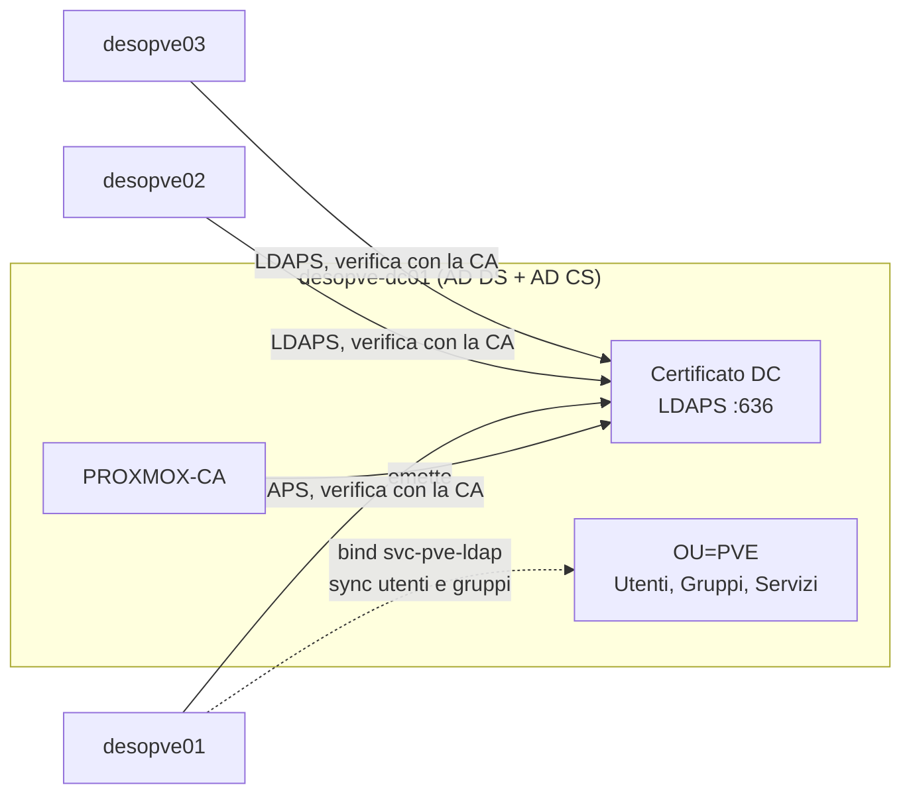
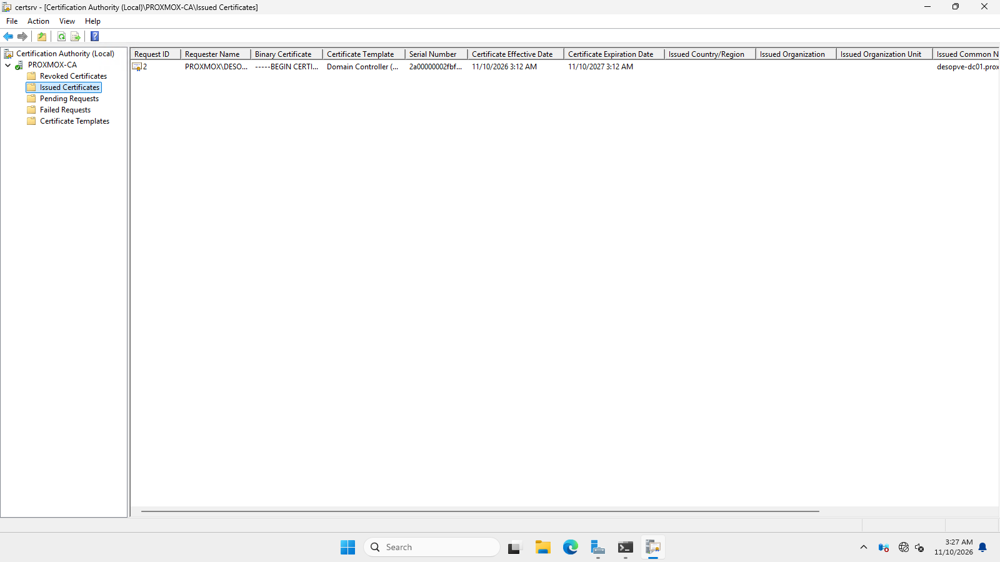
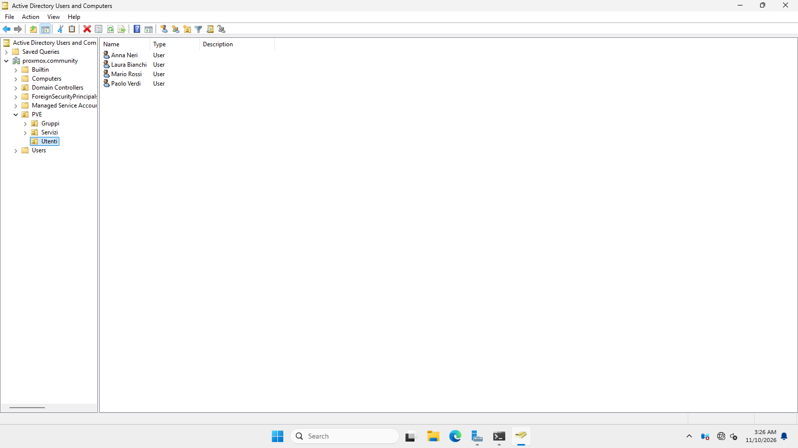
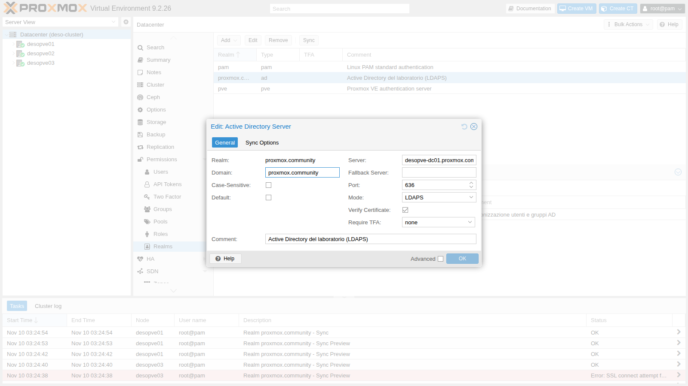
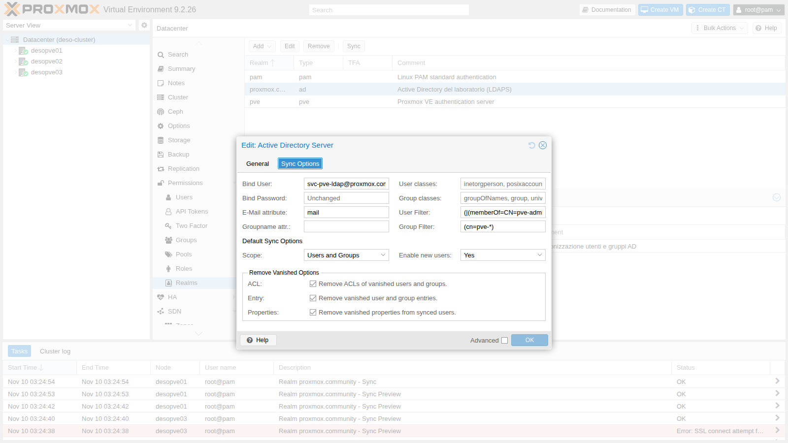
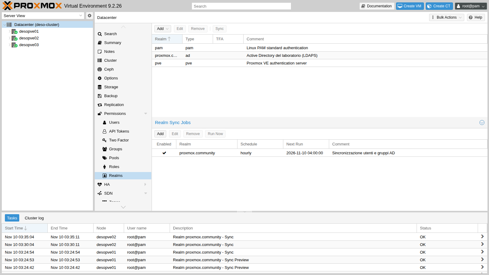
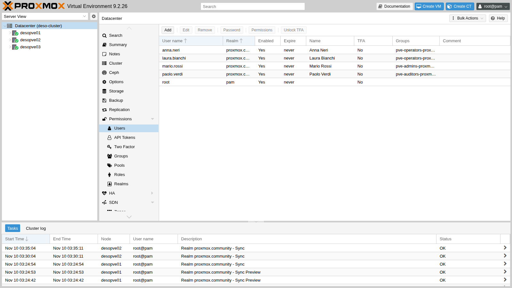
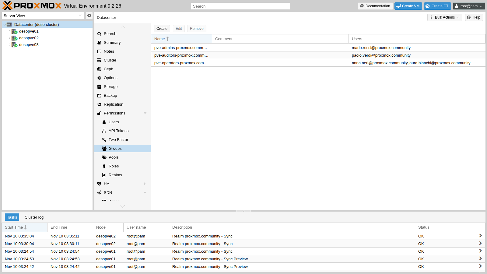
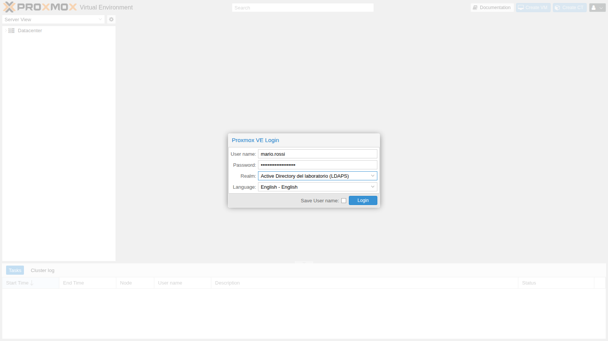
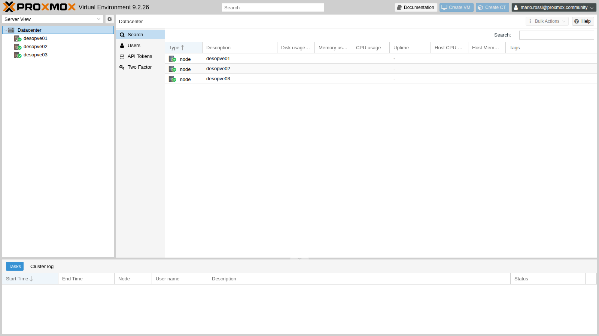

## Dipendenze

- **Lab precedenti:**
  - [Lab 02](/it/02-domain-controller/): il domain controller `desopve-dc01` con il dominio `proxmox.community`;
  - [Lab 05](/it/05-ssh-shell-cli/): l'accesso SSH ai nodi e la CLI `pveum`;
  - [Lab 06](/it/06-cluster-corosync/): il cluster `desopve01`-`03`, con la configurazione dei realm condivisa;
  - [Lab 33](/it/33-firewall-2/): il firewall dei nodi. Il traffico verso il DC sulla porta 636 parte dai nodi ed è permesso dalla policy di uscita.
- **Sistemi:** DC `desopve-dc01.proxmox.community` (172.27.199.20), nodi `desopve01`-`03`.
- **Credenziali:** `Administrator` del dominio; account di servizio `svc-pve-ldap`; utenti di prova del dominio, tutti con `<password-lab>` → [Appendice B](/it/b-credentials-and-addresses/).

## Obiettivi

- Installare una **CA Enterprise** (AD CS) sul domain controller e ottenere il certificato per **LDAPS**.
- Rendere la CA attendibile su tutti i nodi e verificare la catena con `openssl`.
- Preparare in AD un'**OU dedicata** con utenti, gruppi e un **account di servizio** per il bind, non l'Administrator.
- Creare in Proxmox VE un realm **Active Directory** su LDAPS con verifica del certificato.
- Sincronizzare utenti e gruppi con filtri e opzioni di sync, a mano e con un **job pianificato**.
- Entrare nella GUI come utente del dominio.

## Come funziona

**Realm.** Un realm è una sorgente di autenticazione. Proxmox VE ne ha due predefiniti, `pam` (utenti Linux del nodo) e `pve` (utenti propri). Un realm di tipo **Active Directory** verifica la password direttamente sul domain controller: Proxmox VE non conosce né salva le password degli utenti.

**Utenti e sincronizzazione.** Per entrare, un utente del dominio deve esistere anche in Proxmox VE come `nome@realm`. La **sincronizzazione** legge utenti e gruppi da AD e li crea o aggiorna in Proxmox VE. I gruppi diventano `nomegruppo-realm` e portano con sé i membri. I permessi (ACL), argomento del [Lab 44](/it/44-users-groups-roles-pools-tokens/), si assegnano ai gruppi sincronizzati.

**Perché LDAPS.** Con LDAP semplice (porta 389) la password del bind e quella di ogni login viaggiano in chiaro. LDAPS (porta 636) cifra la connessione con TLS. Perché TLS serva a qualcosa, il nodo deve **verificare** il certificato del DC, quindi deve fidarsi della CA che lo ha emesso.

**AD CS e autoenrollment.** Una CA *Enterprise Root* è integrata con Active Directory: appena installata, i domain controller richiedono da soli un certificato con il template *Domain Controller*. È quello che AD DS usa per LDAPS, senza configurazioni aggiuntive.

**Account di servizio.** Per leggere utenti e gruppi serve un account del dominio. Ogni utente del dominio può leggere la directory, quindi basta un account normale, senza privilegi, dedicato a questo uso. L'Administrator non va mai usato per il bind: la sua password finirebbe sui nodi.



## Procedura

### 1. Autorità di certificazione sul DC

In PowerShell come amministratore sul DC:

```powershell
Install-WindowsFeature ADCS-Cert-Authority -IncludeManagementTools
Install-AdcsCertificationAuthority -CAType EnterpriseRootCA -CACommonName "PROXMOX-CA" `
  -KeyLength 4096 -HashAlgorithmName SHA256 -ValidityPeriod Years -ValidityPeriodUnits 10 -Force
Get-Service CertSvc
```

```text output
Install-WindowsFeature: Success=True Restart=No Features=Active Directory Certificate Services, Certification Authority, Active Directory Certificate Services Tools, Certification Authority Management Tools
Install-AdcsCertificationAuthority: ErrorId=0

Name     Status
----     ------
CertSvc Running
```

Una CA radice da 4096 bit con SHA-256, valida 10 anni. Non serve riavviare.

### 2. Il certificato del DC e LDAPS

Il DC chiede il suo certificato al primo ciclo di autoenrollment; `certutil -pulse` lo anticipa:

```powershell
certutil -pulse
Get-ChildItem Cert:\LocalMachine\My
```

```text output
CertUtil: -pulse command completed successfully.
CN=desopve-dc01.proxmox.community | CN=PROXMOX-CA, DC=proxmox, DC=community | Client Authentication,Server Authentication | 2027-11-10 | DNS Name=desopve-dc01.proxmox.community
```

Il certificato ha l'uso **Server Authentication** e il nome del DC nel *Subject Alternative Name*: è quello che serve a LDAPS. Nella console **Certification Authority** (`certsrv.msc`) compare tra i certificati emessi, con il template *Domain Controller*:



AD DS lo usa subito, senza riavvio. Dal nodo `desopve01`:

```bash
openssl s_client -connect desopve-dc01.proxmox.community:636 </dev/null 2>&1 | grep -E "subject=|issuer=|Verify return code"
```

```text output
subject=CN=desopve-dc01.proxmox.community
issuer=DC=community, DC=proxmox, CN=PROXMOX-CA
Verify return code: 21 (unable to verify the first certificate)
```

LDAPS risponde, ma il nodo non conosce `PROXMOX-CA` e non può verificare il certificato.

### 3. La CA sui nodi

Il certificato della CA, in formato PEM, si esporta dal DC:

```powershell
$c = Get-ChildItem Cert:\LocalMachine\Root | Where-Object { $_.Subject -like 'CN=PROXMOX-CA*' }
& {
  "-----BEGIN CERTIFICATE-----"
  [Convert]::ToBase64String($c.RawData, 'InsertLineBreaks')
  "-----END CERTIFICATE-----"
} | Set-Content -Encoding ascii C:\proxmox-ca.pem
foreach ($n in 1..3) { scp C:\proxmox-ca.pem root@desopve0$n.proxmox.community: }
```

Il file arriva nella home di `root` di ogni nodo, con l'OpenSSH del [Lab 05](/it/05-ssh-shell-cli/). Prima di distribuirlo se ne controlla l'impronta:

```bash
openssl x509 -in proxmox-ca.pem -noout -subject -dates -fingerprint -sha256
```

```text output
subject=DC = community, DC = proxmox, CN = PROXMOX-CA
notBefore=Nov 10 02:12:38 2026 GMT
notAfter=Nov 10 02:22:38 2036 GMT
sha256 Fingerprint=6E:73:BB:89:E6:54:BF:97:99:BE:19:01:E2:E9:0C:BA:BB:6D:92:66:A7:B3:33:9A:E1:43:64:A8:3B:8E:2F:56
```

Su **ogni** nodo del cluster il file va in `/usr/local/share/ca-certificates/` con estensione `.crt`, poi si aggiorna l'archivio di sistema:

```bash
cp proxmox-ca.pem /usr/local/share/ca-certificates/proxmox-ca.crt
update-ca-certificates
openssl s_client -connect desopve-dc01.proxmox.community:636 -verify_hostname desopve-dc01.proxmox.community </dev/null 2>&1 | grep -E "^depth|Verify return code"
```

```text output
== desopve01
depth=1 DC=community, DC=proxmox, CN=PROXMOX-CA
depth=0 CN=desopve-dc01.proxmox.community
Verify return code: 0 (ok)
== desopve02
Verify return code: 0 (ok)
== desopve03
Verify return code: 0 (ok)
```

La catena è completa e il nome corrisponde. La configurazione dei realm è condivisa dal cluster, ma l'archivio dei certificati è di ogni nodo: la CA serve su tutti.

### 4. OU, account di servizio, utenti e gruppi in AD

Un'OU dedicata `PVE` con tre sotto-OU, l'account di servizio, tre gruppi e tre utenti:

```powershell
$base = 'DC=proxmox,DC=community'
New-ADOrganizationalUnit -Name 'PVE' -Path $base
foreach ($ou in 'Utenti','Gruppi','Servizi') { New-ADOrganizationalUnit -Name $ou -Path "OU=PVE,$base" }
$pw = ConvertTo-SecureString '<password-lab>' -AsPlainText -Force
New-ADUser -Name 'svc-pve-ldap' -SamAccountName 'svc-pve-ldap' -UserPrincipalName 'svc-pve-ldap@proxmox.community' `
  -Path "OU=Servizi,OU=PVE,$base" -AccountPassword $pw -Enabled $true -PasswordNeverExpires $true `
  -CannotChangePassword $true -Description 'Bind LDAP dei nodi Proxmox VE (sola lettura)'
foreach ($g in 'pve-admins','pve-operators','pve-auditors') {
  New-ADGroup -Name $g -GroupScope Global -GroupCategory Security -Path "OU=Gruppi,OU=PVE,$base" }
New-ADUser -Name 'Mario Rossi' -GivenName Mario -Surname Rossi -SamAccountName mario.rossi `
  -UserPrincipalName mario.rossi@proxmox.community -EmailAddress mario.rossi@proxmox.community `
  -Path "OU=Utenti,OU=PVE,$base" -AccountPassword $pw -Enabled $true
Add-ADGroupMember pve-admins -Members mario.rossi
New-ADUser -Name 'Laura Bianchi' -GivenName Laura -Surname Bianchi -SamAccountName laura.bianchi `
  -UserPrincipalName laura.bianchi@proxmox.community -EmailAddress laura.bianchi@proxmox.community `
  -Path "OU=Utenti,OU=PVE,$base" -AccountPassword $pw -Enabled $true
Add-ADGroupMember pve-operators -Members laura.bianchi
New-ADUser -Name 'Paolo Verdi' -GivenName Paolo -Surname Verdi -SamAccountName paolo.verdi `
  -UserPrincipalName paolo.verdi@proxmox.community -EmailAddress paolo.verdi@proxmox.community `
  -Path "OU=Utenti,OU=PVE,$base" -AccountPassword $pw -Enabled $true
Add-ADGroupMember pve-auditors -Members paolo.verdi
```

Per la prova del filtro crea anche un utente **fuori** dall'OU, `utente.esterno`, nel contenitore standard `CN=Users`:

```powershell
New-ADUser -Name 'Utente Esterno' -SamAccountName utente.esterno -UserPrincipalName utente.esterno@proxmox.community `
  -Path "CN=Users,$base" -AccountPassword $pw -Enabled $true
```

```text output
ObjectClass        DistinguishedName
-----------        -----------------
user               CN=Laura Bianchi,OU=Utenti,OU=PVE,DC=proxmox,DC=community
user               CN=Mario Rossi,OU=Utenti,OU=PVE,DC=proxmox,DC=community
user               CN=Paolo Verdi,OU=Utenti,OU=PVE,DC=proxmox,DC=community
group              CN=pve-admins,OU=Gruppi,OU=PVE,DC=proxmox,DC=community
group              CN=pve-auditors,OU=Gruppi,OU=PVE,DC=proxmox,DC=community
group              CN=pve-operators,OU=Gruppi,OU=PVE,DC=proxmox,DC=community
user               CN=svc-pve-ldap,OU=Servizi,OU=PVE,DC=proxmox,DC=community
pve-admins: mario.rossi
pve-operators: laura.bianchi
pve-auditors: paolo.verdi
```

La struttura in **Active Directory Users and Computers** (l'utente Anna Neri si aggiunge al punto 7):



### 5. Il realm Active Directory in Proxmox VE

Da **Datacenter** → **Permissions** → **Realms** → **Add** → **Active Directory Server**, oppure da CLI:

```bash
pveum realm add proxmox.community --type ad --domain proxmox.community \
  --server1 desopve-dc01.proxmox.community --port 636 --mode ldaps --verify 1 \
  --bind_dn 'svc-pve-ldap@proxmox.community' --password '<password-lab>' \
  --base_dn 'OU=PVE,DC=proxmox,DC=community' \
  --sync_attributes 'email=mail,firstname=givenName,lastname=sn' \
  --group_filter '(cn=pve-*)' \
  --sync-defaults-options 'scope=both,enable-new=1,remove-vanished=acl;entry;properties' \
  --case-sensitive 0 --check-connection 1 --comment 'Active Directory del laboratorio (LDAPS)'
```

- **`--mode ldaps --port 636 --verify 1`:** connessione cifrata con verifica del certificato attraverso l'archivio di sistema del nodo (`capath` di default `/etc/ssl/certs`).
- **`--bind_dn`:** l'account di servizio, nella forma `utente@dominio` accettata da AD. La password viene salvata in `/etc/pve/priv/realm/proxmox.community.pw`, leggibile solo da root.
- **`--base_dn`:** la sincronizzazione cerca solo dentro l'OU `PVE`.
- **`--sync_attributes`:** mappa e-mail, nome e cognome sugli attributi AD.
- **`--group_filter '(cn=pve-*)'`:** solo i gruppi che iniziano con `pve-`.
- **`--case-sensitive 0`:** in AD i nomi utente non distinguono maiuscole e minuscole, e così deve fare il realm.
- **`--check-connection 1`:** prova il bind prima di salvare.

La scheda **General**:



e la scheda **Sync Options**, con le opzioni predefinite di sincronizzazione:



Le opzioni di **Remove Vanished** decidono cosa succede quando un utente o un gruppo sparisce da AD:

- **Entry:** l'utente o il gruppo viene eliminato da Proxmox VE;
- **ACL:** vengono eliminati i suoi permessi;
- **Properties:** vengono svuotati i campi (e-mail, nome) non più presenti in AD.

### 6. Prima sincronizzazione

**La verifica serve davvero.** Su `desopve03` togli per un momento la CA dall'archivio di sistema e prova una sincronizzazione di prova:

```bash
mv /usr/local/share/ca-certificates/proxmox-ca.crt /root/ && update-ca-certificates --fresh
pveum realm sync proxmox.community --dry-run
```

```text output
(dry test run) starting sync for realm proxmox.community
SSL connect attempt failed error:0A000086:SSL routines::certificate verify failed
```

Senza la CA il nodo rifiuta la connessione. Rimetti la CA su `desopve03`:

```bash
mv /root/proxmox-ca.crt /usr/local/share/ca-certificates/ && update-ca-certificates
```

La stessa prova da `desopve01`:

```text
(dry test run) starting sync for realm proxmox.community
got data from server, updating users and groups
syncing users (remove-vanished opts: acl;entry;properties)
adding user 'laura.bianchi@proxmox.community'
adding user 'mario.rossi@proxmox.community'
adding user 'paolo.verdi@proxmox.community'
adding user 'svc-pve-ldap@proxmox.community'
syncing groups (remove-vanished opts: acl;entry;properties)
adding group 'pve-admins-proxmox.community'
adding group 'pve-auditors-proxmox.community'
adding group 'pve-operators-proxmox.community'

NOTE: Dry test run, changes were NOT written to the configuration.
```

`utente.esterno` non compare perché è fuori dall'OU, ma compare l'account di servizio `svc-pve-ldap`, che non deve essere un utente di Proxmox VE. Un **filtro utenti** limita la sincronizzazione ai membri dei gruppi `pve-*`:

```bash
G='OU=Gruppi,OU=PVE,DC=proxmox,DC=community'
pveum realm modify proxmox.community --filter \
  "(|(memberOf=CN=pve-admins,$G)(memberOf=CN=pve-operators,$G)(memberOf=CN=pve-auditors,$G))"
pveum realm sync proxmox.community --dry-run
```

```text output
adding user 'laura.bianchi@proxmox.community'
adding user 'mario.rossi@proxmox.community'
adding user 'paolo.verdi@proxmox.community'
adding group 'pve-admins-proxmox.community'
adding group 'pve-auditors-proxmox.community'
adding group 'pve-operators-proxmox.community'
NOTE: Dry test run, changes were NOT written to the configuration.
```

Ora la sincronizzazione vera, dal pulsante **Sync** della GUI o da CLI:

```bash
pveum realm sync proxmox.community
```

```text output
successfully updated users and groups configuration
laura.bianchi@proxmox.community Laura Bianchi laura.bianchi@proxmox.community enable=1
mario.rossi@proxmox.community Mario Rossi mario.rossi@proxmox.community enable=1
paolo.verdi@proxmox.community Paolo Verdi paolo.verdi@proxmox.community enable=1
pve-admins-proxmox.community mario.rossi@proxmox.community
pve-operators-proxmox.community laura.bianchi@proxmox.community
pve-auditors-proxmox.community paolo.verdi@proxmox.community
```

Nome, cognome ed e-mail arrivano da AD grazie a `sync_attributes`.

### 7. Sincronizzazione pianificata

Un **Realm Sync Job** ripete la sincronizzazione in automatico. Per la prova lo pianifico ogni 5 minuti:

```bash
pvesh create /cluster/jobs/realm-sync/sync-ad --realm proxmox.community --schedule "*/5" \
  --scope both --enable-new 1 --remove-vanished "acl;entry;properties" \
  --comment "Sincronizzazione utenti e gruppi AD"
```

Poi in AD aggiungi un'utente, Anna Neri, al gruppo `pve-operators` (`$base` e `$pw` come al passo 4):

```powershell
New-ADUser -Name 'Anna Neri' -GivenName Anna -Surname Neri -SamAccountName anna.neri `
  -UserPrincipalName anna.neri@proxmox.community -EmailAddress anna.neri@proxmox.community `
  -Path "OU=Utenti,OU=PVE,$base" -AccountPassword $pw -Enabled $true
Add-ADGroupMember pve-operators -Members anna.neri
```

Senza fare altro, il job viene eseguito da uno dei nodi del cluster:

```text
desopve02 auth-realm-sync root@pam 03:35:04 OK
desopve02 auth-realm-sync root@pam 03:30:04 OK
desopve01 auth-realm-sync root@pam 03:24:54 OK
```

e il nuovo utente compare in Proxmox VE, già nel gruppo giusto:

```text
anna.neri@proxmox.community anna.neri@proxmox.community
pve-operators-proxmox.community anna.neri@proxmox.community,laura.bianchi@proxmox.community
```

Per l'uso normale riporto il job a una volta all'ora:

```bash
pvesh set /cluster/jobs/realm-sync/sync-ad --schedule hourly
```

Il job compare sotto i realm, con **Run Now** per lanciarlo subito:



Utenti e gruppi sincronizzati in **Permissions** → **Users** e **Groups**:





### 8. Login di un utente del dominio

Nella pagina di login il realm compare con il suo commento:



L'accesso riesce, ma Mario non ha ancora nessun permesso: vede i nodi senza dati, nessun guest e nessuno storage, e nel menu solo le proprie impostazioni.



I permessi si assegnano ai gruppi nel [Lab 44](/it/44-users-groups-roles-pools-tokens/).

## Verifica e test

Login tramite l'API, che usa lo stesso meccanismo della GUI:

```bash
t(){ curl -sk -o /dev/null -w "$1 -> HTTP %{http_code}\n" --data-urlencode "username=$1" \
  --data-urlencode "password=$2" https://desopve01.proxmox.community:8006/api2/json/access/ticket; }
t mario.rossi@proxmox.community '<password-lab>'
t mario.rossi@proxmox.community 'sbagliata'
t utente.esterno@proxmox.community '<password-lab>'
t svc-pve-ldap@proxmox.community '<password-lab>'
```

```text output
mario.rossi@proxmox.community -> HTTP 200
mario.rossi@proxmox.community -> HTTP 401
utente.esterno@proxmox.community -> HTTP 401
svc-pve-ldap@proxmox.community -> HTTP 401
```

- Un utente sincronizzato entra con la password del dominio; con una password sbagliata no.
- `utente.esterno` ha una password valida in AD ma non entra: non esiste in Proxmox VE, perché è fuori dall'OU e dal filtro.
- L'account di servizio non è un utente di Proxmox VE e non può entrare nella GUI.
- Senza la CA nell'archivio del nodo la connessione LDAPS viene rifiutata (`certificate verify failed`).
- Un utente aggiunto in AD compare in Proxmox VE alla successiva esecuzione del job pianificato.

## Stato finale del lab

- **DC `desopve-dc01`:**
  - AD CS con la CA Enterprise Root `PROXMOX-CA` (4096 bit, SHA-256, valida fino al 2036);
  - certificato *Domain Controller* per LDAPS sulla porta 636;
  - OU `OU=PVE,DC=proxmox,DC=community` con le sotto-OU `Utenti`, `Gruppi`, `Servizi`;
  - account di servizio `svc-pve-ldap` (OU `Servizi`);
  - gruppi `pve-admins` (mario.rossi), `pve-operators` (laura.bianchi, anna.neri), `pve-auditors` (paolo.verdi);
  - `utente.esterno` in `CN=Users`, escluso dalla sincronizzazione.
- **Nodi `desopve01`-`03`:** CA in `/usr/local/share/ca-certificates/proxmox-ca.crt`, nell'archivio di sistema.
- **Realm `proxmox.community`** (tipo `ad`, LDAPS con verifica), filtro utenti sui membri dei gruppi `pve-*`, filtro gruppi `(cn=pve-*)`.
- **Utenti sincronizzati:** `mario.rossi`, `laura.bianchi`, `paolo.verdi`, `anna.neri` `@proxmox.community`, senza permessi.
- **Gruppi sincronizzati:** `pve-admins-proxmox.community`, `pve-operators-proxmox.community`, `pve-auditors-proxmox.community`.
- **Job `sync-ad`:** sincronizzazione ogni ora con `remove-vanished acl;entry;properties`.

## Cosa hai imparato

- Una CA Enterprise in AD fa ottenere da sola ai domain controller il certificato per LDAPS.
- LDAPS serve solo se il client verifica il certificato: la CA va installata su **ogni** nodo.
- Il bind si fa con un account di servizio dedicato e senza privilegi, mai con l'Administrator.
- Base DN, filtro utenti e filtro gruppi decidono chi entra in Proxmox VE; un dry-run mostra l'effetto prima di scrivere.
- Gli utenti del dominio entrano con la password di AD, ma devono essere sincronizzati per esistere in Proxmox VE.
- Un Realm Sync Job tiene allineati utenti e gruppi; Remove Vanished decide cosa succede a chi sparisce da AD.

## Riferimenti

- [Proxmox VE – User Management, Authentication Realms](https://pve.proxmox.com/pve-docs/chapter-pveum.html#pveum_authentication_realms)
- [Proxmox VE – Microsoft Active Directory (AD)](https://pve.proxmox.com/pve-docs/chapter-pveum.html#pveum_ad)
- [Proxmox VE – Syncing LDAP-Based Realms](https://pve.proxmox.com/pve-docs/chapter-pveum.html#pveum_ldap_sync)
- [Microsoft – Install the Certification Authority](https://learn.microsoft.com/windows-server/networking/core-network-guide/cncg/server-certs/install-the-certification-authority)
- [Microsoft – LDAP over SSL (LDAPS) certificate](https://learn.microsoft.com/troubleshoot/windows-server/active-directory/enable-ldap-over-ssl-3rd-certification-authority)
