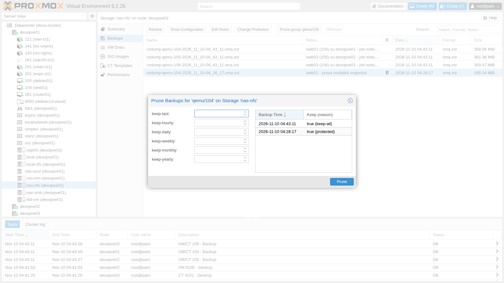
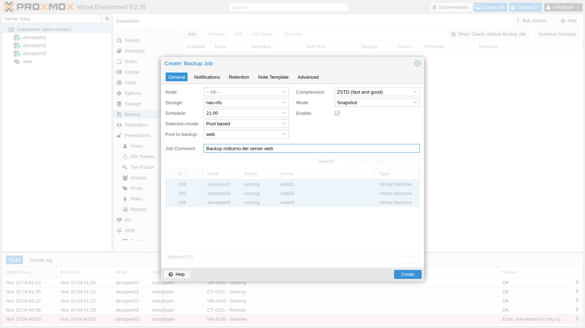
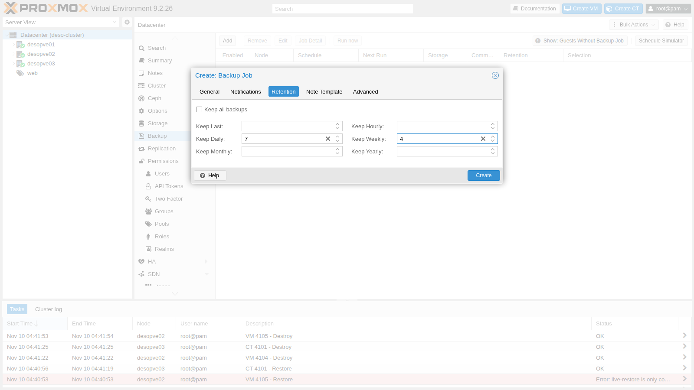
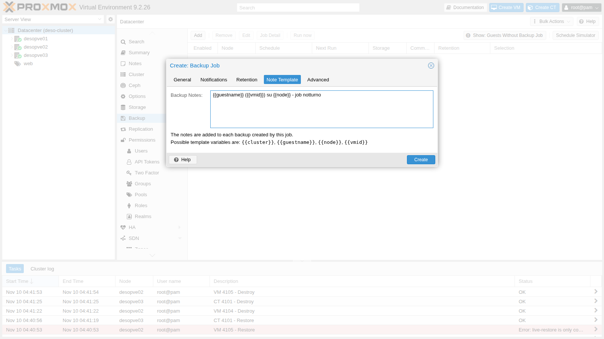
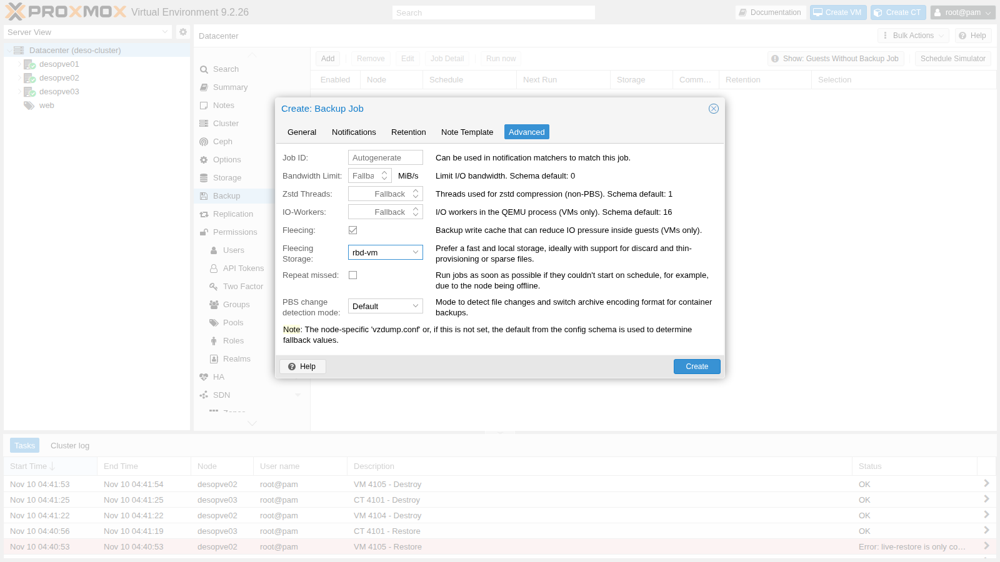
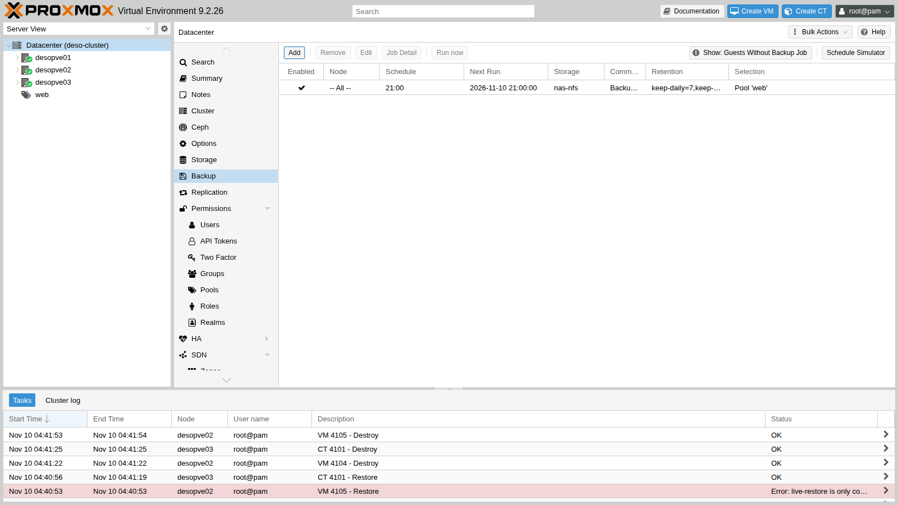
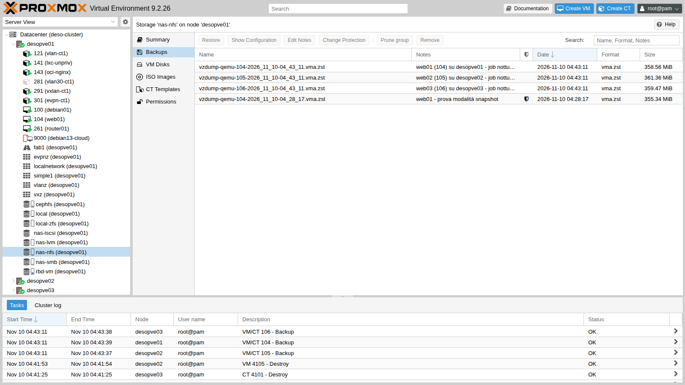

## Dipendenze

- **Lab precedenti:**
  - [Lab 13](/it/13-nfs/), [Lab 14](/it/14-smb-cifs/) e [Lab 17](/it/17-ceph-installation/): gli storage `nas-nfs`, `nas-smb` e `cephfs`, che accettano il contenuto *VZDump backup file*;
  - [Lab 38](/it/38-linux-vm-guest-agent/) e [Lab 40](/it/40-templates-cloud-init-clones/): le VM con il guest agent (`debian01`, `web01`-`web03`);
  - [Lab 07](/it/07-first-vm-and-container/) e [Lab 41](/it/41-lxc-containers/): i container 101 e 141;
  - [Lab 44](/it/44-users-groups-roles-pools-tokens/): il pool `web`, usato per scegliere cosa salvare.
- **Sistemi:** nodi `desopve01`-`03`, NAS `desonas`. Le misure di fermo usano un `ping` dalla rete di gestione.
- **Credenziali:** `root@pam` → [Appendice B](/it/b-credentials-and-addresses/).

## Obiettivi

- Capire e misurare le tre **modalità** di backup: *snapshot*, *suspend*, *stop*.
- Confrontare gli algoritmi di **compressione**.
- Salvare su storage diversi (NFS, CephFS, SMB) e usare il **fleecing**.
- Escludere dischi dal backup e capire cosa succede ai **bind mount** dei container.
- Proteggere un backup e applicare una **retention** (prune), prima simulata e poi reale.
- Creare un **job pianificato** con le note automatiche.
- **Ripristinare** una VM e un container su un altro nodo e un altro storage.

## Come funziona

`vzdump` è lo strumento di backup integrato. Produce **un file per guest** (`vzdump-qemu-<vmid>-<data>.vma.zst` per le VM, `vzdump-lxc-<vmid>-<data>.tar.zst` per i container) su uno storage che accetta il contenuto *backup*. Ogni file contiene tutto: configurazione e dischi. Non ci sono backup incrementali: ogni volta si salva tutto il contenuto, compresso. Per i backup incrementali con deduplica serve Proxmox Backup Server ([Lab 47](/it/47-proxmox-backup-server/)).

**Modalità.**

| Modalità | VM | Container |
|---|---|---|
| **snapshot** | la VM resta accesa; QEMU tiene traccia dei blocchi mentre li copia, quindi il backup è coerente con l'istante di partenza. Con il guest agent, i filesystem vengono "congelati" per un attimo (`fs-freeze`/`fs-thaw`) | snapshot dello storage (ZFS, Ceph, LVM-thin), poi copia dallo snapshot |
| **suspend** | la VM viene messa in pausa per avviare il backup, poi riparte | `rsync` a caldo, pausa, secondo `rsync` |
| **stop** | spegnimento pulito; la VM riparte appena il backup è avviato, e la copia continua in background | il container resta spento per **tutta** la durata del backup e riparte alla fine: fermo potenzialmente lungo |

**Fleecing.** Durante un backup *snapshot*, quando il guest vuole scrivere su un blocco non ancora copiato, QEMU deve prima copiare quel blocco sul backup. Se la destinazione è lenta, il guest rallenta. Con il fleecing il blocco vecchio va invece in un'**immagine temporanea su uno storage veloce** (idealmente locale, thin e con discard) e il guest scrive subito.

**Retention (prune).** Le opzioni `keep-last`, `keep-hourly`, `keep-daily`, `keep-weekly`, `keep-monthly`, `keep-yearly` dicono quanti backup tenere per ciascun intervallo. Dopo ogni backup del job, quelli non coperti vengono cancellati. Un backup **protetto** non viene mai cancellato dal prune.

## Procedura

### 1. Gli storage di destinazione

```bash
pvesm status --content backup
```

```text output
Name           Type     Status     Total (KiB)      Used (KiB) Available (KiB)        %
cephfs       cephfs     active       100483072         7921664        92561408    7.88%
local           dir     active        45995008         1143936        44851072    2.49%
nas-nfs         nfs     active        56481792               0        56481792    0.00%
nas-smb        cifs     active        57458048          977024        56481024    1.70%
```

`local` è sul disco del nodo: se si perde il nodo, si perdono anche i backup. In produzione i backup vanno **fuori** dal nodo.

### 2. Le tre modalità, misurate

Facciamo tre backup della VM 104 (`web01`, disco di 8 GiB su Ceph, guest agent attivo) su `nas-nfs`, mentre da un'altra macchina un `ping` ogni 0,2 secondi verso la VM misura le interruzioni:

```bash
vzdump 104 --mode snapshot --storage nas-nfs --compress zstd --notes-template '{{guestname}} - prova modalità snapshot'
```

```text output
INFO: backup mode: snapshot
INFO: creating vzdump archive '/mnt/pve/nas-nfs/dump/vzdump-qemu-104-2026_11_10-04_28_17.vma.zst'
INFO: issuing guest-agent 'fs-freeze' command
INFO: starting backup via QMP command
INFO: issuing guest-agent 'fs-thaw' command
INFO: started backup task '461881ef-c1a7-4b5e-9526-4a451d72f0a8'
INFO: resuming VM again
INFO: archive file size: 355MB
INFO: Finished Backup of VM 104 (00:00:17)
```

Lo stesso con `--mode suspend` e `--mode stop`:

```text
INFO: backup mode: suspend
INFO: suspending guest
INFO: resuming VM again after 4 seconds
INFO: Finished Backup of VM 104 (00:00:31)
```

```text
INFO: backup mode: stop
INFO: stopping virtual guest
INFO: starting kvm to execute backup task
INFO: resuming VM again after 13 seconds
INFO: Finished Backup of VM 104 (00:00:38)
```

| Modalità | Durata | Cosa ha visto il ping |
|---|---|---|
| snapshot | 17 s | 144 risposte su 144, nessuna interruzione |
| suspend | 29-31 s | nessuna risposta persa, ma ritardate fino a **3,0 s** (la VM era in pausa e ha risposto alla ripresa) |
| stop | 38 s | 106 risposte su 219: **circa 23 secondi** senza rete, tra spegnimento e riavvio del sistema operativo |

*snapshot* è la modalità da usare quasi sempre: nessun fermo e, con il guest agent, filesystem coerenti. *stop* dà la coerenza massima per applicazioni che non sopportano la pausa, ma costa un riavvio.

### 3. Compressione

Lo stesso backup della VM 104 con i quattro algoritmi:

```bash
for C in 0 lzo gzip zstd; do vzdump 104 --mode snapshot --storage nas-nfs --compress $C; done
```

| Compressione | File | Dimensione | Durata |
|---|---|---|---|
| nessuna (`0`) | `.vma` | 1,15 GB | 33 s |
| `lzo` | `.vma.lzo` | 521 MB | 41 s |
| `gzip` | `.vma.gz` | 381 MB | 1 min 10 s |
| `zstd` (1 thread, il default della GUI) | `.vma.zst` | 353 MB | 25 s (17 s in una seconda prova) |
| `zstd` con `--zstd 0` (metà dei core) | `.vma.zst` | 354 MB | 14 s |

Il disco da 8 GiB contiene circa 1,2 GB di dati: i blocchi vuoti non finiscono nel backup. **zstd** è il miglior compromesso ed è il default della GUI; da CLI il default di `--compress` è `0` (nessuna compressione), quindi va indicato `--compress zstd` o impostato in `/etc/vzdump.conf`. `--zstd 0` usa metà dei core del nodo per comprimere. Le durate su uno storage di rete condiviso variano da una prova all'altra: confronta l'ordine di grandezza, non il secondo.

### 4. Container e destinazione CephFS

Il container 101 (rootfs su `local-zfs`) in modalità snapshot su `cephfs`:

```bash
vzdump 101 --mode snapshot --storage cephfs --compress zstd
```

```text output
INFO: filesystem type on dumpdir is 'ceph' -using /var/tmp/vzdumptmp430726_101 for temporary files
INFO: including mount point rootfs ('/') in backup
INFO: backup mode: snapshot
INFO: create storage snapshot 'vzdump'
INFO: creating vzdump archive '/mnt/pve/cephfs/dump/vzdump-lxc-101-2026_11_10-04_34_41.tar.zst'
INFO: archive file size: 208MB
INFO: Finished Backup of VM 101 (00:00:28)
```

Per i container vzdump crea uno **snapshot dello storage** (`vzdump` su ZFS) e lo archivia. Su CephFS i file temporanei vanno in `/var/tmp` del nodo.

### 5. Escludere dischi; i bind mount

Aggiungiamo alla VM 100 un secondo disco con l'opzione `backup=0` (in GUI: *Hardware → Edit → Advanced → Backup* senza spunta) e facciamo il backup:

```bash
qm set 100 --scsi1 rbd-vm:1,backup=0
vzdump 100 --mode snapshot --storage cephfs --compress zstd
```

```text output
INFO: include disk 'scsi0' 'rbd-vm:vm-100-disk-0' 16G
INFO: exclude disk 'scsi1' 'rbd-vm:vm-100-disk-1' (backup=no)
INFO: archive file size: 5.53GB
INFO: Finished Backup of VM 100 (00:02:25)
```

Si escludono così, per esempio, i dischi di cache o di dati salvati in altro modo. Attenzione: al restore quel disco **non** c'è. Finita la prova, togli e cancella il disco aggiunto:

```bash
qm disk unlink 100 --idlist scsi1 --force
```

Nei container, i **bind mount** (cartelle del nodo montate nel CT) sono sempre esclusi; i mount point su storage sono esclusi per default e inclusi solo con `backup=1`, come il `mp0` del CT 141:

```bash
vzdump 141 --mode snapshot --storage cephfs --compress zstd
```

```text output
INFO: including mount point mp0 ('/data') in backup
INFO: excluding bind mount point mp1 ('/condivisa') from backup (not a volume)
INFO: excluding bind mount point mp2 ('/progetti') from backup (not a volume)
```

I dati dei bind mount vanno salvati a parte, sul nodo o sullo storage che li ospita.

### 6. Fleecing verso uno storage lento

Salviamo la VM 104 sulla condivisione SMB, con il fleecing su Ceph:

```bash
vzdump 104 --mode snapshot --storage nas-smb --compress zstd --fleecing enabled=1,storage=rbd-vm
```

```text output
INFO: starting new backup job: vzdump 104 --storage nas-smb --mode snapshot --fleecing '1,storage=rbd-vm' --compress zstd
INFO: drive-scsi0: attaching fleecing image rbd-vm:vm-104-fleece-0 to QEMU
INFO: archive file size: 354MB
INFO: removing (old) fleecing image 'rbd-vm:vm-104-fleece-0'
INFO: Finished Backup of VM 104 (00:00:19)
```

Per ogni disco vzdump crea un'immagine `vm-<vmid>-fleece-N` sullo storage indicato e la cancella alla fine. Lo storage del fleecing deve essere **veloce** e avere spazio per i blocchi riscritti durante il backup: idealmente locale, thin e con discard (ZFS, LVM-thin); qui si usa Ceph RBD, condiviso ma veloce.

### 7. Backup protetti e retention

Dopo le prove, la VM 104 ha almeno otto backup su `nas-nfs`. Proteggiamo il primo (in GUI: *Change Protection*):

```bash
pvesh set /nodes/desopve01/storage/nas-nfs/content/nas-nfs:backup/vzdump-qemu-104-2026_11_10-04_28_17.vma.zst --protected 1
```

Nella vista dello storage il backup ora ha lo scudo della protezione.

Simuliamo una retention `keep-last=2`:

```bash
pvesm prune-backups nas-nfs --vmid 104 --keep-last 2 --dry-run 1
```

```text output
NOTE: this is only a preview and might not be what a subsequent
prune call does if backups are removed/added in the meantime.

Backup                                                            Backup-ID Prune-Mark
vzdump-qemu-104-2026_11_10-04_28_17.vma.zst         qemu/104  protected
vzdump-qemu-104-2026_11_10-04_28_48.vma.zst         qemu/104     remove
vzdump-qemu-104-2026_11_10-04_29_36.vma.zst         qemu/104     remove
vzdump-qemu-104-2026_11_10-04_30_50.vma.zst         qemu/104     remove
vzdump-qemu-104-2026_11_10-04_31_25.vma             qemu/104     remove
vzdump-qemu-104-2026_11_10-04_31_59.vma.lzo         qemu/104     remove
vzdump-qemu-104-2026_11_10-04_32_42.vma.gz          qemu/104     remove
vzdump-qemu-104-2026_11_10-04_33_54.vma.zst         qemu/104     remove
vzdump-qemu-104-2026_11_10-04_34_21.vma.zst         qemu/104       keep
vzdump-qemu-104-2026_11_10-04_39_45.vma.zst         qemu/104       keep
```

Poi una retention reale `keep-last=3`:

```bash
pvesm prune-backups nas-nfs --vmid 104 --keep-last 3
pvesm list nas-nfs --vmid 104
```

```text output
vzdump-qemu-104-2026_11_10-04_28_17.vma.zst
vzdump-qemu-104-2026_11_10-04_33_54.vma.zst
vzdump-qemu-104-2026_11_10-04_34_21.vma.zst
vzdump-qemu-104-2026_11_10-04_39_45.vma.zst
```

Restano gli ultimi tre più quello protetto. Dalla GUI si fa lo stesso con **Prune group**, che mostra per ogni backup se e perché viene tenuto:



### 8. Un job pianificato

In **Datacenter → Backup → Add** creiamo il job notturno per il pool `web`. Nella scheda *General*: storage `nas-nfs`, *Schedule* `21:00`, *Selection mode* **Pool based** con il pool `web`, modalità *Snapshot*, compressione *ZSTD*:



*Retention:* `keep-daily=7`, `keep-weekly=4`, cioè un backup al giorno per una settimana e uno a settimana per un mese.



*Note Template:* le note di ogni backup si compongono con le variabili `{{guestname}}`, `{{vmid}}`, `{{node}}`, `{{cluster}}`:



*Advanced:* fleecing attivo su `rbd-vm`. Il pannello mostra anche i default che si possono cambiare (thread di zstd, banda, I/O worker):



Il job viene salvato in `/etc/pve/jobs.cfg`:

```text
vzdump: backup-c5fdd165-9aa0
	comment Backup notturno dei server web
	schedule 21:00
	compress zstd
	enabled 1
	fleecing 1,storage=rbd-vm
	mode snapshot
	notes-template {{guestname}} ({{vmid}}) su {{node}} - job notturno
	notification-mode notification-system
	pool web
	prune-backups keep-daily=7,keep-weekly=4
	repeat-missed 0
	storage nas-nfs
```



Con **Run now** lo eseguiamo subito: parte un task `vzdump` su ogni nodo che ospita una VM del pool. Nel log della VM 104 si vede anche la retention:

```text
INFO: drive-scsi0: attaching fleecing image rbd-vm:vm-104-fleece-0 to QEMU
INFO: prune older backups with retention: keep-daily=7, keep-weekly=4
INFO: removing backup 'nas-nfs:backup/vzdump-qemu-104-2026_11_10-04_33_54.vma.zst'
INFO: removing backup 'nas-nfs:backup/vzdump-qemu-104-2026_11_10-04_34_21.vma.zst'
INFO: removing backup 'nas-nfs:backup/vzdump-qemu-104-2026_11_10-04_39_45.vma.zst'
INFO: pruned 3 backup(s) not covered by keep-retention policy
INFO: removing (old) fleecing image 'rbd-vm:vm-104-fleece-0'
INFO: Finished Backup of VM 104 (00:00:28)
```

`keep-daily=7` tiene **un** backup per giorno, il più recente: i tre backup di oggi fatti prima sono stati cancellati. Quello protetto è rimasto. Nella vista dello storage si vedono le note generate dal modello e lo scudo dei backup protetti:



:::note
La retention si può impostare sul **job** (come qui) oppure sullo **storage** (*Datacenter → Storage → Edit → Backup Retention*): quella del job ha la precedenza.
:::

### 9. Restore su un altro nodo e un altro storage

Ripristiniamo l'ultimo backup della VM 104 come nuova VM 4104 su `desopve02`, sullo storage locale `local-zfs`. Con `--unique` vengono generati nuovi indirizzi MAC, per non creare un doppione in rete:

```bash
V=$(pvesm list nas-nfs --vmid 104 | awk 'NR>1 {v=$1} END {print v}')   # il backup più recente
time qmrestore $V 4104 --storage local-zfs --unique 1
qm config 4104 | grep -E '^(name|scsi0|net0|agent)'
```

```text output
new volume ID is 'local-zfs:vm-4104-cloudinit'
new volume ID is 'local-zfs:vm-4104-disk-0'
progress 100% (read 8589934592 bytes, duration 8 sec)
total bytes read 8589934592, sparse bytes 7360720896 (85.7%)
space reduction due to 4K zero blocks 4.29%

real	0m18.836s
agent: enabled=1
name: web01
net0: virtio=BC:24:11:22:EA:5E,bridge=vmbr0
scsi0: local-zfs:vm-4104-disk-0,discard=on,iothread=1,size=8G,ssd=1
```

L'originale aveva il disco su Ceph; il restore lo ha messo su ZFS locale. La copia **non va avviata** finché ha lo stesso IP dell'originale.

Il **live-restore** (la VM parte subito mentre i dati arrivano in background) non è disponibile con i file vzdump:

```bash
qmrestore $V 4105 --storage local-zfs --live-restore 1
```

```text output
error before or during data restore, some or all disks were not completely restored. VM 4105 state is NOT cleaned up.
live-restore is only compatible with backup images from a Proxmox Backup Server
```

Lo vedremo nel [Lab 47](/it/47-proxmox-backup-server/) con Proxmox Backup Server.

Il restore del container 101 come CT 4101 su `desopve03`:

```bash
time pct restore 4101 cephfs:backup/vzdump-lxc-101-2026_11_10-04_34_41.tar.zst --storage local-zfs --unique 1
pct config 4101 | grep -E '^(hostname|rootfs|net0|unprivileged)'
```

```text output
extracting archive '/mnt/pve/cephfs/dump/vzdump-lxc-101-2026_11_10-04_34_41.tar.zst'
Total bytes read: 715776000 (683MiB, 31MiB/s)
merging backed-up and given configuration..

real	0m24.179s
hostname: debian-ct01
net0: name=eth0,bridge=vmbr0,firewall=1,gw=172.27.199.1,hwaddr=BC:24:11:1D:C4:48,ip=172.27.199.101/24,type=veth
rootfs: local-zfs:subvol-4101-disk-0,size=8G
unprivileged: 1
```

Il container ripristinato resta **non privilegiato** come l'originale. In GUI il restore si fa selezionando il backup nello storage e premendo **Restore**, oppure dalla scheda *Backup* del guest.

Puliamo le copie di prova:

```bash
qm destroy 4104 --purge 1
qm destroy 4105 --purge 1    # la VM lasciata dal live-restore fallito
pct destroy 4101 --purge 1
```

### 10. Hook script

Per eseguire azioni prima e dopo i backup (fermare un'applicazione, copiare il file altrove, mandare un messaggio) vzdump chiama uno script a ogni fase (`job-start`, `backup-start`, `pre-stop`, `post-restart`, `backup-end`, `job-end`…). Un esempio commentato è fornito con Proxmox VE:

```bash
ls /usr/share/doc/pve-manager/examples/ | grep -i hook
```

```text output
vzdump-hook-script.pl
```

Lo script si attiva con l'opzione `script` del job o in `/etc/vzdump.conf`.

## Verifica e test

| Prova | Risultato atteso | Esito |
|---|---|---|
| Backup *snapshot* con guest agent | `fs-freeze`/`fs-thaw`, nessuna interruzione | ok |
| Backup *suspend* | pausa di 4 s, risposte ritardate fino a 3 s | ok |
| Backup *stop* | circa 23 s senza rete, VM riaccesa da sola | ok |
| Compressione | zstd il più piccolo e tra i più veloci | ok |
| Disco con `backup=0` | `exclude disk 'scsi1'` | ok |
| Bind mount di un CT | `excluding bind mount point … (not a volume)` | ok |
| Fleecing | immagine `vm-104-fleece-0` creata e rimossa | ok |
| Backup protetto | marcato `protected` e mai cancellato dal prune | ok |
| Job pianificato | backup del pool `web` su tre nodi, note dal modello, retention applicata | ok |
| Restore di VM e CT su altro nodo e storage | VM 4104 e CT 4101 creati, nuovi MAC | ok |
| Live-restore da file vzdump | rifiutato: serve PBS | ok |

## Stato finale del lab

- **Job pianificato** `backup-c5fdd165-9aa0`: pool `web` (VM 104-106) ogni giorno alle 21:00 su `nas-nfs`, snapshot, zstd, fleecing su `rbd-vm`, retention `keep-daily=7,keep-weekly=4`, note `{{guestname}} ({{vmid}}) su {{node}} - job notturno`.
- **Backup presenti:**
  - `nas-nfs`: VM 104, 105, 106 del job; VM 104 della prova *snapshot*, **protetto**;
  - `cephfs`: CT 101, CT 141, VM 100;
  - `nas-smb`: VM 104 (prova di fleecing) e il backup del CT 101 del Lab 14.
- VM 100 di nuovo con il solo disco `scsi0`; VM 4104 e 4105 e CT 4101 eliminati.

## Cosa hai imparato

- vzdump salva un file completo per guest; per backup incrementali e deduplica serve PBS.
- *snapshot* non ferma il guest e, con il guest agent, congela i filesystem; *suspend* lo mette in pausa; *stop* spegne la VM solo per avviare il backup, ma tiene spento il container per tutto il backup.
- zstd (default della GUI, da indicare in CLI) è la scelta giusta; `--zstd 0` usa più core.
- Si possono escludere dischi (`backup=0`); i mount point dei container entrano solo con `backup=1`, i bind mount mai.
- Il fleecing protegge le prestazioni del guest quando la destinazione è lenta.
- La retention conserva un backup per intervallo e non tocca i backup protetti; si simula prima con `--dry-run`.
- Un job pianificato per pool salva da solo anche le VM aggiunte al pool in futuro.
- Il restore può cambiare nodo e storage; `--unique` evita MAC duplicati; il live-restore richiede PBS.

## Riferimenti

- [Proxmox VE – Backup and Restore](https://pve.proxmox.com/pve-docs/chapter-vzdump.html)
- [Proxmox VE – Backup Modes](https://pve.proxmox.com/pve-docs/chapter-vzdump.html#_backup_modes)
- [Proxmox VE – Backup Retention](https://pve.proxmox.com/pve-docs/chapter-vzdump.html#vzdump_retention)
- [Proxmox VE – Backup Fleecing](https://pve.proxmox.com/pve-docs/chapter-vzdump.html#_vm_backup_fleecing)
- [Proxmox VE – vzdump(1)](https://pve.proxmox.com/pve-docs/vzdump.1.html)
