## Dipendenze

- **Lab precedenti:**
  - [Lab 25](/it/25-ipv6/): la configurazione IPv6 degli host (file `90-ipv6-host.conf`);
  - [Lab 03](/it/03-install-proxmox-ve/): l'installer di Proxmox, molto simile a quello di PBS;
  - [Lab 38](/it/38-linux-vm-guest-agent/): il guest agent e il *fs-freeze*;
  - [Lab 40](/it/40-templates-cloud-init-clones/): il template 9000 e le VM `web01`-`web03`;
  - [Lab 44](/it/44-users-groups-roles-pools-tokens/): il pool `web` e gli API token;
  - [Lab 46](/it/46-vzdump-backup/): `vzdump`, modalità e retention.
- **Sistemi:**
  - server `desopbs01` (172.27.199.40): 4 core, 8 GB di RAM, disco di sistema da 32 GB e **due dischi da 100 GB** per il datastore;
  - nodi `desopve01`-`03`;
  - VM `web01`-`web03` (104-106) e il CT 121.
- **Rete:** dal cluster verso PBS serve la porta TCP **8007**. PBS usa il proxy del laboratorio per gli aggiornamenti.
- **Credenziali:** `root@pam` di PBS e del cluster → [Appendice B](/it/b-credentials-and-addresses/).

## Obiettivi

- Installare PBS 4, configurare repository, proxy e NTP e aggiornarlo.
- Creare un **datastore su ZFS mirror** dalla GUI.
- Collegare il cluster con un **utente e un API token con permessi minimi**.
- Misurare la **deduplica** e i backup incrementali con la *dirty bitmap* (VM) e il *metadata mode* (CT).
- **Cifrare** i backup lato client e capire cosa succede se si perde la chiave.
- Pianificare **verify**, **prune** e **garbage collection** e leggerne i risultati.
- Recuperare un **singolo file** e fare un **live-restore**.
- Copiare i backup su un secondo datastore con un **sync job**.

## Come funziona

Con `vzdump` su uno storage di file (Lab 46) ogni backup è un archivio completo. PBS cambia tre cose:

1. **Chunk e deduplica.** Il client divide i dati in blocchi (*chunk*), ne calcola l'hash SHA-256 e li salva nella cartella `.chunks` del datastore. Un chunk già presente non viene salvato di nuovo, qualunque sia la VM da cui arriva. Un backup è un **indice** che elenca i chunk.
2. **Incrementali veri.** Per le VM, QEMU tiene una **dirty bitmap**: sa quali blocchi sono cambiati dall'ultimo backup e legge solo quelli. Per i container, il *metadata mode* confronta i metadati dei file con il backup precedente e rilegge solo i file cambiati.
3. **Servizi sul server.** PBS verifica i chunk (*verify*), applica la retention (*prune*), libera lo spazio dei chunk non più usati (*garbage collection*), copia i backup altrove (*sync*) e permette di aprire un backup per estrarre file.

**Cifratura lato client.** Con una chiave di cifratura, il nodo PVE cifra i chunk **prima** di inviarli: PBS conserva dati che non può leggere. La chiave resta sul cluster; se si perde, i backup diventano inutilizzabili.

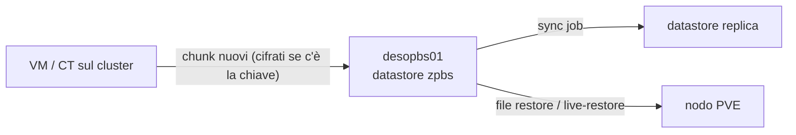

## Procedura

### 1. Installazione

L'installer è lo stesso di Proxmox VE (Lab 03). Si avvia dalla ISO `proxmox-backup-server_4.2-1.iso` e si sceglie **Install Proxmox Backup Server (Graphical)**.

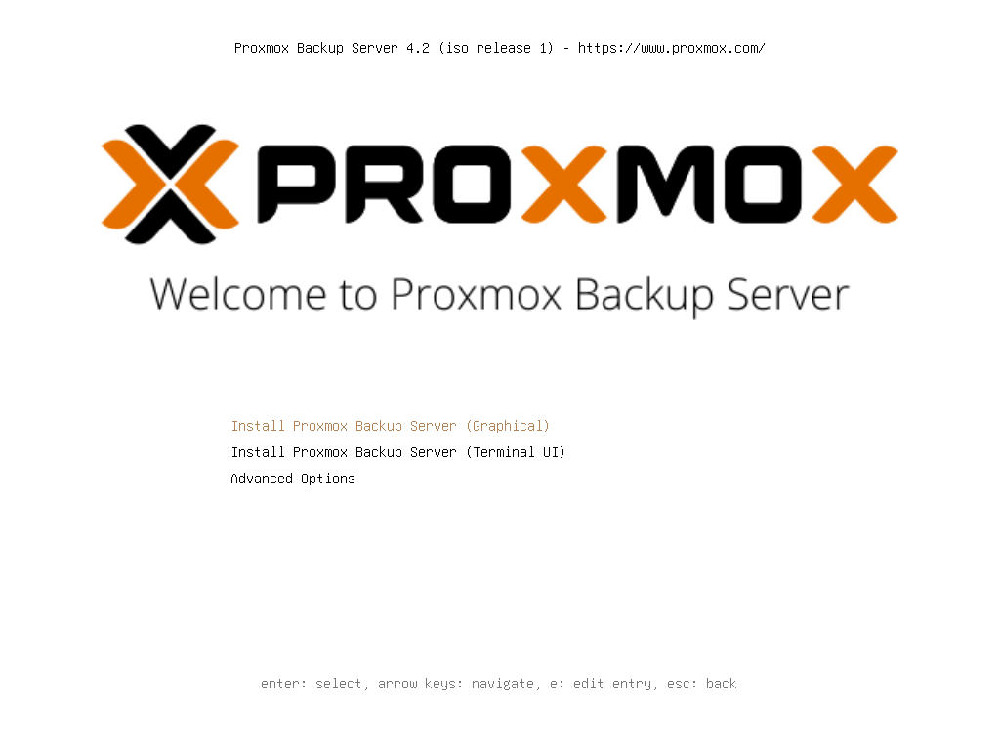

Come disco di sistema si usa **solo** il disco da 32 GB, `/dev/sda`. I due dischi da 100 GB restano liberi: diventeranno il datastore.

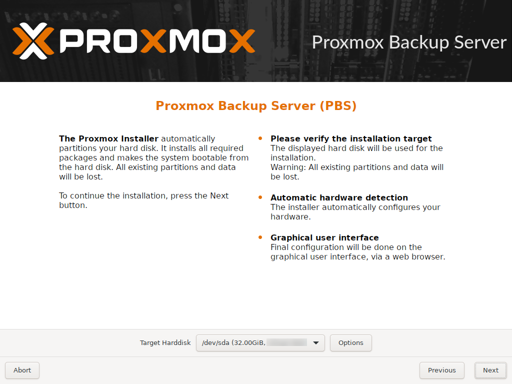

Rete: `desopbs01.proxmox.community`, 172.27.199.40/24, gateway 172.27.199.1, DNS 172.27.199.20. Anche qui l'opzione **Pin network interface names** è attiva per default: la scheda si chiama `nic0`.

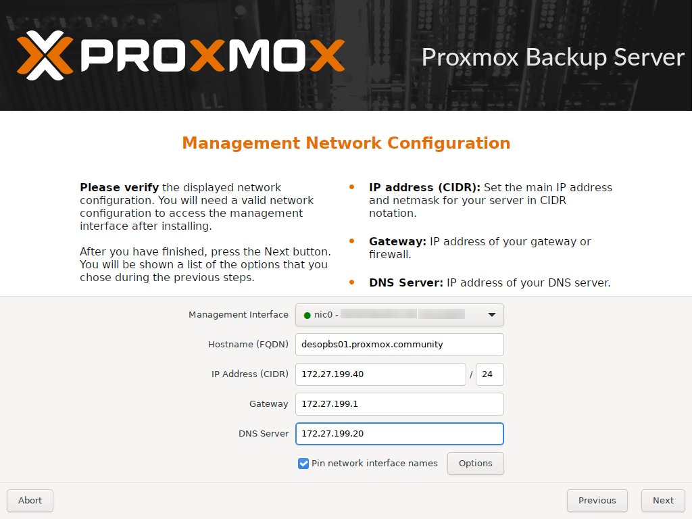

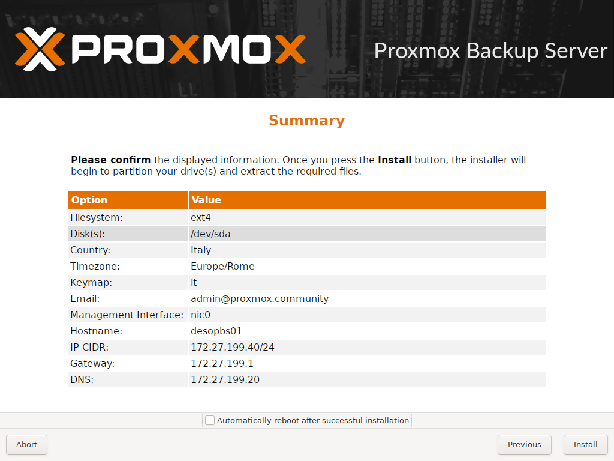

Dopo il riavvio la console indica l'indirizzo della GUI, sulla porta **8007**.

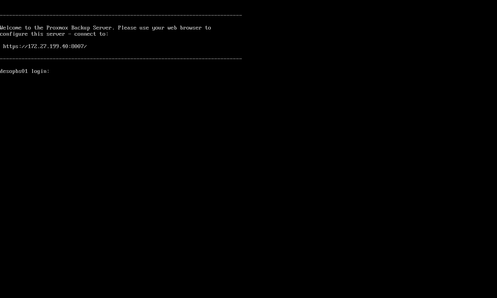

### 2. Primo accesso, repository, proxy, NTP e aggiornamento

Si accede a `https://172.27.199.40:8007` come `root`, realm *Linux PAM*.

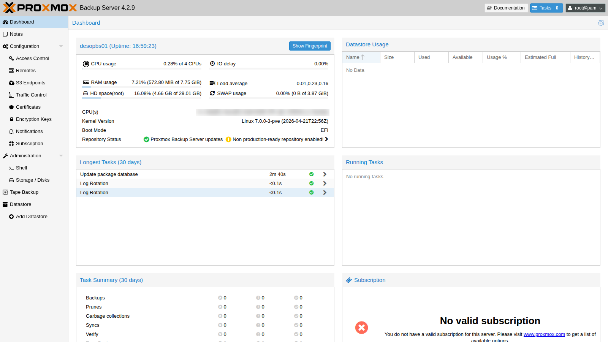

Come per PVE (Lab 04): si disattiva il repository *enterprise* e si aggiunge il *no-subscription*. Poi si configura il proxy per `apt` e per PBS, si punta l'NTP al server del laboratorio e si aggiorna.

```bash
# repository
sed -i "s/^Types: deb$/Types: deb\nEnabled: false/" /etc/apt/sources.list.d/pbs-enterprise.sources
cat > /etc/apt/sources.list.d/pbs-no-subscription.sources <<'EOF'
Types: deb
URIs: http://download.proxmox.com/debian/pbs
Suites: trixie
Components: pbs-no-subscription
Signed-By: /usr/share/keyrings/proxmox-archive-keyring.gpg
EOF

# proxy: per apt e per PBS (download, notifiche)
echo 'Acquire::http::Proxy "http://proxy.proxmox.community:3128";' > /etc/apt/apt.conf.d/80proxy
proxmox-backup-manager node update --http-proxy http://proxy.proxmox.community:3128

# NTP verso il server del laboratorio
sed -i 's/^pool /#pool /' /etc/chrony/chrony.conf
echo "server ntp.proxmox.community iburst" > /etc/chrony/sources.d/lab.sources
systemctl restart chrony
chronyc sources | tail -1
```

```text output
^* netsvc.proxmox.community      3   6    17     1    -22us[  -71us] +/-   22ms
```

:::note
Prima di questa modifica `timedatectl` riportava `System clock synchronized: no`: sul server dei backup l'ora sbagliata confonde retention e verifiche.
:::

```bash
apt update && apt full-upgrade -y
proxmox-backup-manager versions
```

```text output
proxmox-backup-server 4.2.9-1 running version: 4.2.9
```

**Administration → Repositories** conferma la configurazione: *enterprise* disattivato, *no-subscription* attivo.

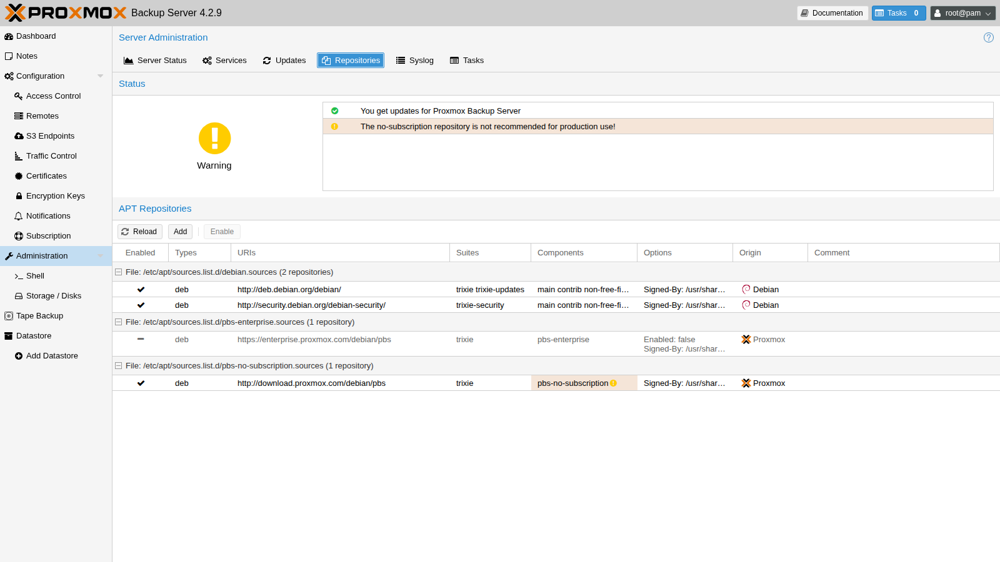

**IPv6 come sui nodi.** Come per i nodi nel [Lab 25](/it/25-ipv6/), anche qui niente autoconfigurazione dagli RA del router e link-local non derivati dal MAC. Si crea lo stesso file `/etc/sysctl.d/90-ipv6-host.conf`, si applica con `sysctl --system` e vale del tutto dal riavvio successivo. Su `desopbs01`:

```bash
cat /etc/sysctl.d/90-ipv6-host.conf
```

```text output
# Indirizzi IPv6 del nodo solo statici: nessuna interfaccia accetta gli RA o si autoconfigura (SLAAC).
# Il carattere * vale anche per le schede che compaiono dopo l'avvio (systemd le applica a ogni nuova interfaccia).
net.ipv6.conf.*.accept_ra = 0
net.ipv6.conf.*.autoconf = 0
# Link-local non derivati dal MAC (RFC 7217, "stable privacy" con segreto casuale)
net.ipv6.conf.all.addr_gen_mode = 3
net.ipv6.conf.default.addr_gen_mode = 3
```

### 3. Datastore su ZFS mirror

**Administration → Storage / Disks → ZFS → Create: ZFS**:

- Name `zpbs`, RAID Level **Mirror**, Compression `on`, ashift 12;
- i dischi `/dev/sdb` e `/dev/sdc`;
- **Add as Datastore** spuntato: PBS crea il pool e, sopra, il datastore con lo stesso nome.

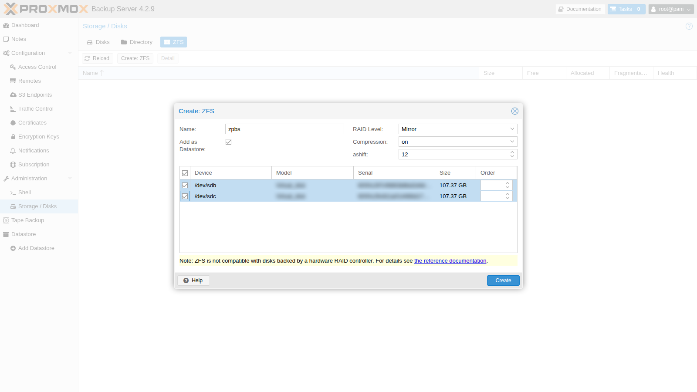

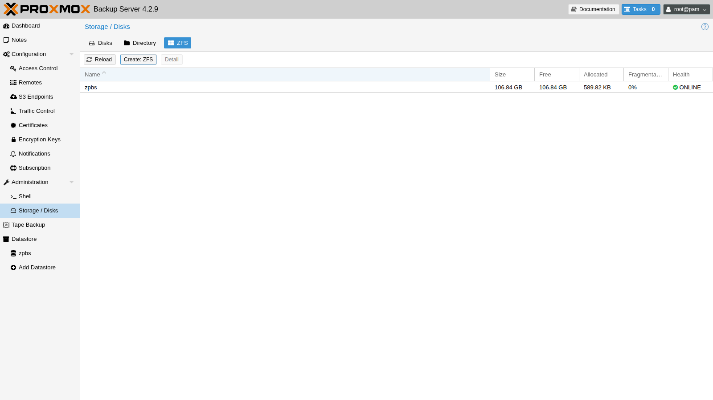

```bash
proxmox-backup-manager datastore list
```

```text output
┌──────┬─────────────────────┬─────────┐
│ name │ path                │ comment │
╞══════╪═════════════════════╪═════════╡
│ zpbs │ /mnt/datastore/zpbs │         │
└──────┴─────────────────────┴─────────┘
```

Il mirror protegge dal guasto di un disco. PBS controlla l'integrità dei **chunk** (verify), ma non sostituisce la ridondanza dei dischi.

### 4. Utente e token per il cluster, con permessi minimi

Il cluster **non** deve usare `root@pam` di PBS. Si crea un utente del realm interno di PBS, un suo token e si dà il ruolo **DatastoreBackup** solo su quel datastore:

```bash
proxmox-backup-manager user create pve-backup@pbs --comment "Backup dal cluster PVE"
proxmox-backup-manager user generate-token pve-backup@pbs pve --comment "token per il cluster PVE"
```

```text output
Result: {
  "tokenid": "pve-backup@pbs!pve",
  "value": "<segreto>"
}
```

Il segreto compare **una sola volta**: va copiato subito.

```bash
for a in 'pve-backup@pbs' 'pve-backup@pbs!pve'; do
  proxmox-backup-manager acl update /datastore/zpbs DatastoreBackup --auth-id "$a"
done
proxmox-backup-manager acl list
```

```text output
┌────────────────────┬─────────────────┬───────────┬─────────────────┐
│ ugid               │ path            │ propagate │ roleid          │
╞════════════════════╪═════════════════╪═══════════╪═════════════════╡
│ pve-backup@pbs     │ /datastore/zpbs │         1 │ DatastoreBackup │
├────────────────────┼─────────────────┼───────────┼─────────────────┤
│ pve-backup@pbs!pve │ /datastore/zpbs │         1 │ DatastoreBackup │
└────────────────────┴─────────────────┴───────────┴─────────────────┘
```

Il permesso va dato **sia all'utente sia al token**: come in PVE (Lab 44), un token con privilegi separati ha l'intersezione dei permessi.

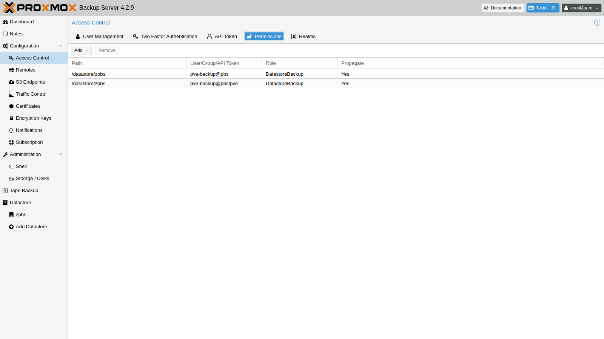

Con **DatastoreBackup** il cluster può creare backup e ripristinare quelli **di cui è proprietario**, ma non vede né cancella i backup di altri. Se un cluster viene compromesso, non può svuotare l'intero datastore.

### 5. Lo storage PBS nel cluster

Serve l'impronta del certificato di PBS. Si legge in **Dashboard → Show Fingerprint** oppure da CLI:

```bash
proxmox-backup-manager cert info | grep -i fingerprint
```

```text output
Fingerprint (sha256): 31:0b:24:ed:32:07:8f:84:23:bd:2d:66:4f:15:aa:66:da:55:c0:e0:26:45:8f:19:78:f5:3e:cc:a6:2f:34:18
```

Su PVE: **Datacenter → Storage → Add → Proxmox Backup Server**. ID `pbs01`, Server `172.27.199.40`, Username `pve-backup@pbs!pve`, come Password il segreto del token, Datastore `zpbs`, Fingerprint.

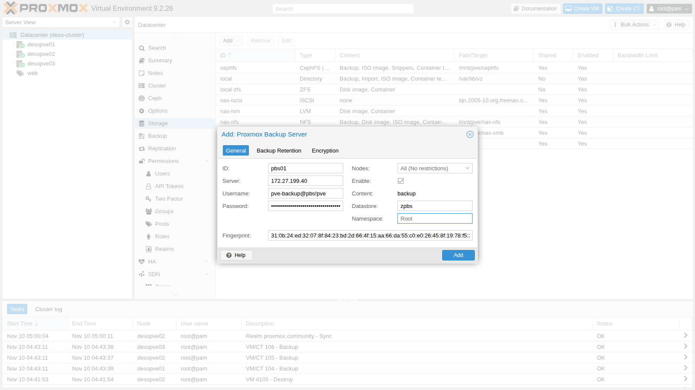

:::note
Nel lab l'elenco a discesa *Datastore* è rimasto vuoto; il nome si può scrivere a mano. `pvesm scan pbs 172.27.199.40 'pve-backup@pbs!pve' --password … --fingerprint …` conferma che il datastore `zpbs` è visibile con quel token.
:::

```bash
pvesm status --storage pbs01
```

```text output
Name         Type     Status     Total (KiB)      Used (KiB) Available (KiB)        %
pbs01         pbs     active       101088896           24960       101063936    0.02%
```

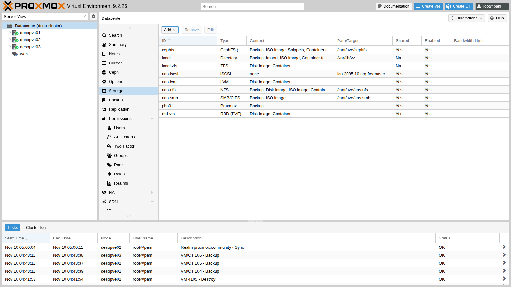

Il segreto finisce in `/etc/pve/priv/storage/pbs01.pw`, leggibile solo da root e replicato su tutti i nodi.

### 6. Primo backup, incrementale e deduplica

Primo backup della VM 104 (`web01`, disco da 8 GiB):

```bash
vzdump 104 --storage pbs01 --mode snapshot
```

```text output
INFO: scsi0: dirty-bitmap status: created new
INFO: backup is sparse: 6.61 GiB (82%) total zero data
INFO: backup was done incrementally, reused 6.82 GiB (85%)
INFO: transferred 8.00 GiB in 17 seconds (481.9 MiB/s)
INFO: Finished Backup of VM 104 (00:00:18)
```

Il disco è in gran parte vuoto: i chunk fatti di zeri sono tutti uguali e vengono salvati una volta sola.

Secondo backup, subito dopo:

```text
INFO: scsi0: dirty-bitmap status: OK (24.0 MiB of 8.0 GiB dirty)
INFO: using fast incremental mode (dirty-bitmap), 24.0 MiB dirty of 8.0 GiB total
INFO: backup was done incrementally, reused 7.98 GiB (99%)
INFO: transferred 24.00 MiB in 1 seconds (24.0 MiB/s)
INFO: Finished Backup of VM 104 (00:00:02)
```

**18 s contro 2 s.** QEMU ha letto solo i 24 MiB cambiati.

:::note
La dirty bitmap vive nella memoria di QEMU: dopo uno spegnimento della VM, o se il backup precedente non è sul server, il primo backup rilegge tutto il disco. Resta comunque deduplicato.
:::

Poi le VM 105 e 106, cloni dello stesso template:

```text
== 105
INFO: backup was done incrementally, reused 6.82 GiB (85%)
INFO: transferred 8.00 GiB in 14 seconds (585.1 MiB/s)
== 106
INFO: backup was done incrementally, reused 6.83 GiB (85%)
INFO: transferred 8.00 GiB in 14 seconds (585.1 MiB/s)
```

*reused* conta solo i chunk che il client sa già presenti, cioè quelli del backup precedente **dello stesso gruppo**. I chunk uguali tra VM diverse vengono comunque scartati dal server: lo si vede nel fattore di deduplica (passo 8).

**Container con il metadata mode.** Per i CT si usa il formato a due archivi (`.mpxar` metadati + `.ppxar` contenuto):

```bash
vzdump 121 --storage pbs01 --mode snapshot --pbs-change-detection-mode metadata
```

Primo backup:

```text
INFO: root.ppxar: had to backup 651.636 MiB of 651.636 MiB (compressed 226.725 MiB) in 34.01 s (average 19.16 MiB/s)
INFO: Finished Backup of VM 121 (00:00:42)
```

Secondo backup:

```text
INFO: Change detection summary:
INFO: root.ppxar: reused 651.636 MiB from previous snapshot for unchanged files (343 chunks)
INFO: root.ppxar: had to backup 8 MiB of 659.636 MiB (compressed 257.076 KiB) in 3.14 s (average 2.55 MiB/s)
INFO: root.ppxar: backup was done incrementally, reused 651.636 MiB (98.8%)
INFO: Finished Backup of VM 121 (00:00:08)
```

**42 s contro 8 s.** Il client non ha riletto i file invariati.

### 7. Il backup nella GUI di PVE

Lo storage `pbs01` mostra i backup con formato `pbs-vm` / `pbs-ct` e lo stato della verifica.

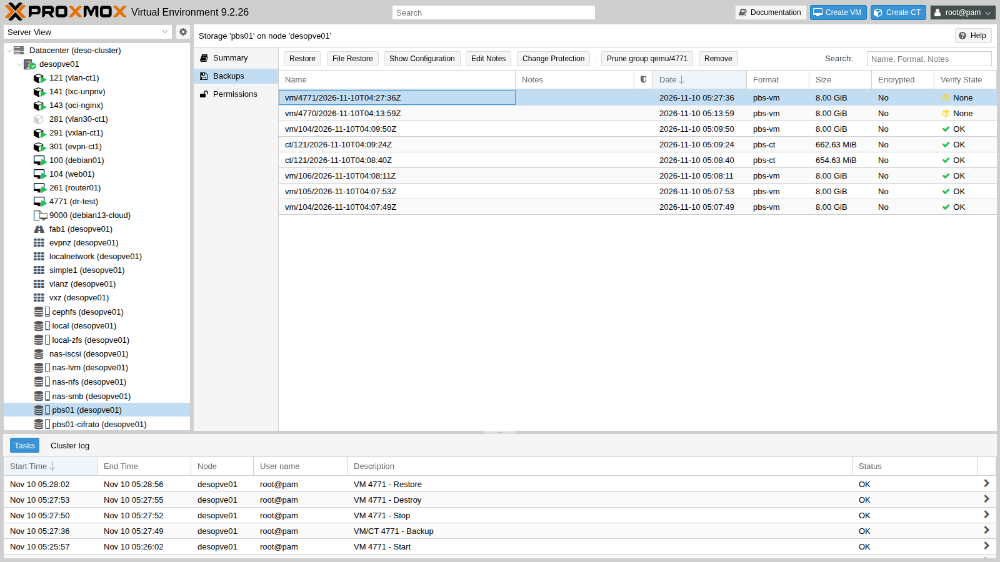

### 8. Verify, prune e garbage collection

A questo punto la VM 104 ha tre backup: i due del passo 6 e un terzo, fatto subito dopo con lo stesso `vzdump 104 --storage pbs01 --mode snapshot`. Il prune con `keep-last 2` toglie il più vecchio.

```bash
proxmox-backup-manager verify-job create verify-zpbs --store zpbs --schedule "sat 03:00" \
  --ignore-verified true --outdated-after 30 --comment "verifica settimanale"
proxmox-backup-manager verify-job run verify-zpbs        # circa 4 s nel lab

proxmox-backup-manager prune-job create prune-zpbs --store zpbs --schedule daily \
  --keep-last 2 --keep-daily 7 --keep-weekly 4 --comment "retention del datastore"
proxmox-backup-manager prune-job run prune-zpbs
```

```text output
retention options: --keep-last 2 --keep-daily 7 --keep-weekly 4
keep ct/121/2026-11-10T04:08:40Z
keep ct/121/2026-11-10T04:09:24Z
keep vm/105/2026-11-10T04:07:53Z
keep vm/106/2026-11-10T04:08:11Z
remove vm/104/2026-11-10T04:07:23Z
keep vm/104/2026-11-10T04:07:49Z
keep vm/104/2026-11-10T04:09:50Z
```

- La **verify** rilegge i chunk e ne ricontrolla l'hash; `--ignore-verified` con `--outdated-after 30` riverifica ogni snapshot al massimo una volta al mese.
- Il **prune** cancella solo gli **indici** dei backup. I chunk restano finché la garbage collection non stabilisce che nessun indice li usa più.

```bash
proxmox-backup-manager garbage-collection start zpbs
```

```text output
Removed garbage: 0 B
Removed chunks: 0
Pending removals: 1.963 MiB (in 5 chunks)
Original data usage: 33.286 GiB
On-Disk usage: 618.932 MiB (1.82%)
On-Disk chunks: 754
Deduplication factor: 55.07
Average chunk size: 840.564 KiB
TASK OK
```

Si leggono due cose:

- **Deduplication factor 55,07.** 33,3 GiB di backup occupano 619 MiB: zeri, VM clonate dallo stesso template e backup ripetuti condividono gli stessi chunk.
- **Pending removals.** I chunk del backup appena eliminato **non** vengono cancellati subito. La GC rimuove solo i chunk non toccati da almeno 24 ore e 5 minuti, per non cancellare chunk che un backup in corso sta riusando. Lo spazio torna alla GC del giorno dopo.

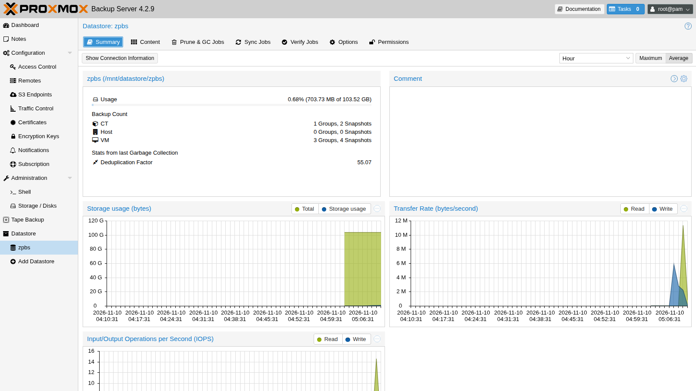

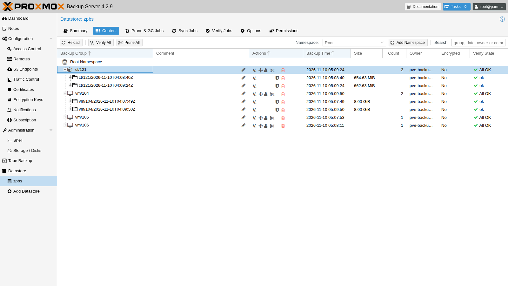

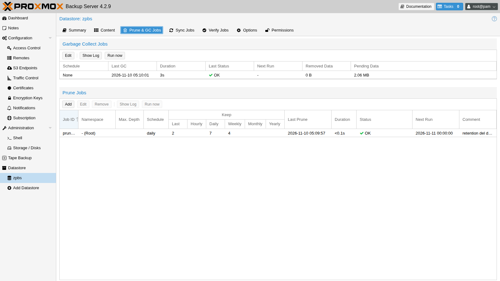

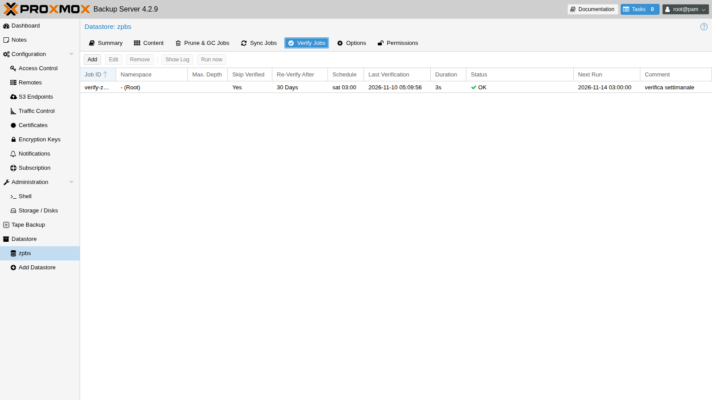

### 9. Cifratura lato client e chiave persa

Si crea un namespace `cifrati` e un secondo storage PVE che lo usa **con una chiave di cifratura**:

```bash
# su PBS
proxmox-backup-client namespace create cifrati --repository root@pam@localhost:zpbs

# su un nodo PVE
pvesm add pbs pbs01-cifrato --server 172.27.199.40 --datastore zpbs --namespace cifrati \
  --username 'pve-backup@pbs!pve' --password '<segreto-del-token>' \
  --fingerprint 31:0b:24:...:34:18 --content backup --encryption-key autogen
ls -l /etc/pve/priv/storage/ | grep pbs
```

```text output
-rw------- 1 root www-data 255 Nov 10 05:11 pbs01-cifrato.enc
-rw------- 1 root www-data  37 Nov 10 05:11 pbs01-cifrato.pw
-rw------- 1 root www-data  37 Nov 10 05:06 pbs01.pw
```

```bash
vzdump 105 --storage pbs01-cifrato --mode snapshot
```

```text output
INFO: enabling encryption
INFO: transferred 8.00 GiB in 13 seconds (630.2 MiB/s)
INFO: Finished Backup of VM 105 (00:00:14)
```

PBS mostra il backup come **Encrypted**. Dalla GUI di PBS non si può aprire: il server non ha la chiave.

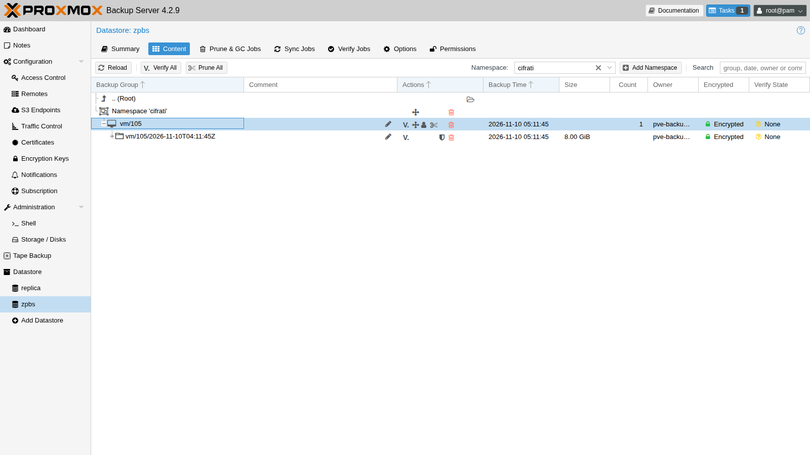

**Dove sta la chiave.** In `/etc/pve/priv/storage/pbs01-cifrato.enc`, quindi su tutti i nodi del cluster. È anche nei backup di `/etc/pve`, se esistono. Se si perde il cluster, si perde la chiave.

```bash
proxmox-backup-client key show /etc/pve/priv/storage/pbs01-cifrato.enc
```

```text output
│ path        │ "/etc/pve/priv/storage/pbs01-cifrato.enc" │
│ kdf         │ none                                      │
│ fingerprint │ ea:2f:5a:2f:aa:61:d2:14:4f:ad:39:3c:...   │
```

Va copiata **fuori dal cluster** subito dopo la creazione:

- in un password manager o in una cassaforte, come file;
- su carta: `proxmox-backup-client key paperkey <file.enc> --output-format text` produce un testo stampabile con QR code.

**Prova: restore senza chiave.** Uno storage che punta allo stesso namespace, ma senza chiave:

```bash
pvesm add pbs pbs01-senza-chiave … --namespace cifrati      # stessi parametri, niente --encryption-key
qmrestore pbs01-senza-chiave:backup/vm/105/2026-11-10T04:11:45Z 4799 --storage rbd-vm
```

```text output
Error: missing key - manifest was created with key ea:2f:5a:2f:aa:61:d2:14
error before or during data restore, some or all disks were not completely restored. VM 4799 state is NOT cleaned up.
```

Senza chiave il backup è **irrecuperabile**: né Proxmox né nessun altro può riaprirlo. Il restore fallito lascia una VM 4799 bloccata: si pulisce con `qm unlock 4799 && qm destroy 4799 --purge`, poi si rimuove lo storage di prova.

### 10. File restore

Per questo passo e per il successivo serve una VM con dati da recuperare: la VM 4771 `dr-test`, un clone del template con nginx e guest agent. Si crea, si scrive un file "importante", si salva su PBS e poi si **distrugge**, come in un disastro:

```bash
qm clone 9000 4771 --name dr-test
qm set 4771 --ipconfig0 ip=172.27.199.177/24,gw=172.27.199.1 --cicustom vendor=cephfs:snippets/web-vendor.yaml
qm start 4771
# dopo il primo avvio, quando l'agent risponde (qm agent 4771 ping)
qm guest exec 4771 -- sh -c 'echo dati-importanti-$(date +%s) > /root/marker.txt'
vzdump 4771 --storage pbs01 --mode snapshot
qm stop 4771 && qm destroy 4771 --purge
```

```text output
INFO: issuing guest-agent 'fs-freeze' command
INFO: issuing guest-agent 'fs-thaw' command
INFO: transferred 8.00 GiB in 12 seconds (682.7 MiB/s)
INFO: Finished Backup of VM 4771 (00:00:13)
```

Ora il file restore. Dalla GUI di PVE: storage `pbs01` → **Backups** → si sceglie il backup della 4771 → **File Restore**. PVE avvia sul nodo una piccola VM di servizio, che legge il backup da PBS e ne monta i filesystem.

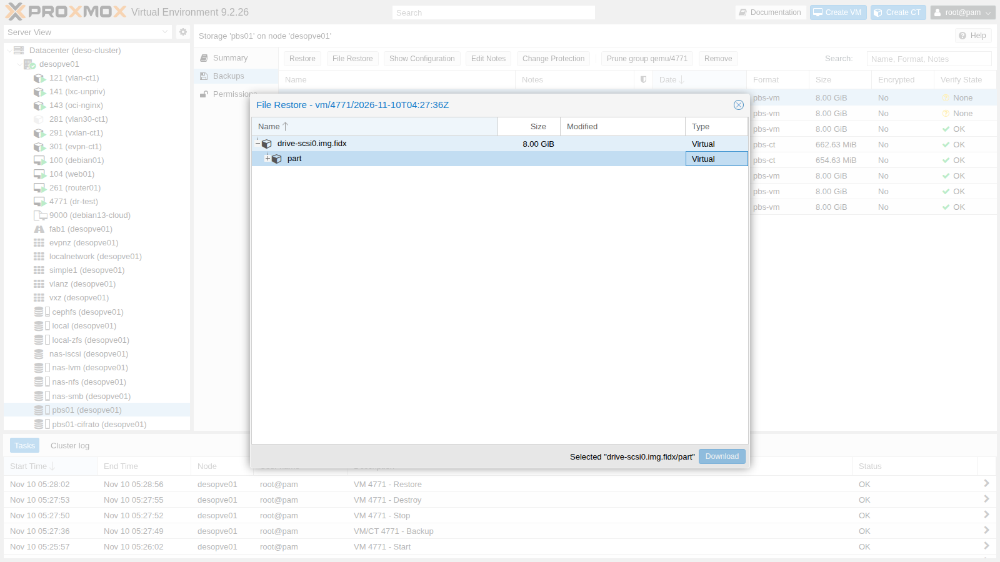

:::note
Se la finestra mostra il disco e il livello `part` ma non scende nelle partizioni (per esempio per un timeout al primo avvio della VM di servizio), la stessa operazione da riga di comando funziona ed è quella che usa la GUI:
:::

```bash
export PBS_REPOSITORY='pve-backup@pbs!pve@172.27.199.40:zpbs' PBS_PASSWORD='<segreto>' PBS_FINGERPRINT=31:0b:...:34:18
S=vm/4771/2026-11-10T04:27:36Z
proxmox-file-restore list $S /drive-scsi0.img.fidx/part
proxmox-file-restore list $S /drive-scsi0.img.fidx/part/1/root
proxmox-file-restore extract $S /drive-scsi0.img.fidx/part/1/root/marker.txt /tmp/ripristino
cat /tmp/ripristino/marker.txt
```

```text output
│ d    │ 1    │               │ 8455699968 │
│ d    │ 14   │               │    3145728 │
│ d    │ 15   │               │  130023424 │
...
│ f    │ marker.txt │    1794284847 │   27 │
...
dati-importanti-1794284846
```

Il file è stato estratto senza ripristinare la VM. La VM di servizio resta accesa qualche minuto dopo l'ultimo uso; finché è attiva, lo snapshot è bloccato e non si può cancellare.

### 11. Live-restore: ripartire prima che il restore finisca

Scenario di disaster recovery: la VM 4771 `dr-test`, salvata e distrutta al passo 10, va rimessa in servizio al più presto.

```bash
qmrestore pbs01:backup/vm/4771/2026-11-10T04:27:36Z 4771 --storage rbd-vm --live-restore 1
```

```text output
starting VM for live-restore
repository: 'pve-backup@pbs!pve@172.27.199.40:zpbs', snapshot: 'vm/4771/2026-11-10T04:27:36Z'
restoring 'drive-scsi0' to 'rbd-vm:vm-4771-disk-0'
restore-drive-scsi0: transferred 8.0 GiB of 8.0 GiB (100.00%) in 49s
restore-drive-scsi0: stream-job finished
restore-drive jobs finished successfully, removing all tracking block devices to disconnect from Proxmox Backup Server
```

La VM viene **accesa all'inizio**: i blocchi che le servono vengono letti da PBS su richiesta, il resto viene copiato in background.

| Misura nel lab | Tempo |
|---|---|
| Copia completa del disco da 8 GiB | 55 s |
| Pagina nginx raggiungibile | 67 s |

Su un disco piccolo e quasi vuoto il vantaggio è nullo: boot e copia si contendono la stessa banda. Il live-restore serve con dischi grandi, quando la copia completa richiederebbe ore e il sistema operativo ha bisogno solo di pochi GB per partire. Il file `/root/marker.txt` scritto prima del backup è integro.

:::note
Durante il live-restore la VM dipende da PBS: se PBS si ferma prima della fine, la VM resta bloccata in I/O.
:::

Finita la prova, elimina la VM e il suo backup:

```bash
qm stop 4771 && qm destroy 4771 --purge
pvesm free pbs01:backup/vm/4771/2026-11-10T04:27:36Z
```

**Una lezione dal lab: backup senza guest agent.** Il primo tentativo di questo esercizio, con un clone **senza** guest agent (VM 4770) salvato circa 50 s dopo il primo avvio, ha prodotto un backup in cui `/etc/netplan/50-cloud-init.yaml` era **vuoto**. La VM ripristinata partiva, ma senza rete. Il file era stato scritto da cloud-init pochi secondi prima: senza `fs-freeze` lo snapshot è solo *crash-consistent* e prende il disco com'è, con i dati ancora in cache nel guest. Con il guest agent il backup congela i filesystem e il problema non si ripresenta (Lab 38).

### 12. Sync job verso un secondo datastore

In produzione la copia va su **un altro PBS**, in un'altra sede (*remote*). Nel lab si mostra lo stesso meccanismo con un secondo datastore locale:

```bash
zfs create -o mountpoint=/mnt/datastore/replica zpbs/replica
proxmox-backup-manager datastore create replica /mnt/datastore/replica \
  --comment "copia locale (in produzione: su un altro PBS)"
proxmox-backup-manager sync-job create sync-replica --store replica --remote-store zpbs \
  --schedule hourly --remove-vanished false --comment "copia del datastore zpbs"
proxmox-backup-manager sync-job run sync-replica     # 11 s la prima volta, 1 s la seconda
```

```text output
NAME           USED  REFER
zpbs          1.72G  1.02G
zpbs/replica   718M   718M
```

Anche il sync trasferisce solo i chunk mancanti: la seconda esecuzione dura 1 s. Con `--remove-vanished false` i backup cancellati dal prune sull'origine **restano** sulla copia, che ha una retention propria.

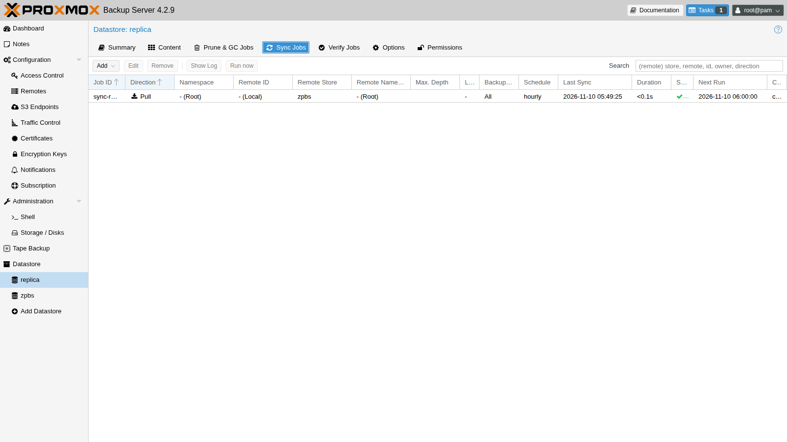

**Backend S3 (PBS 4).** Il menu **S3 Endpoints** permette di creare datastore su object storage compatibile S3 (AWS, MinIO, Ceph RGW…), con una cache locale. Nel laboratorio non c'è un endpoint S3, quindi non è provato.

### 13. Job pianificato verso PBS

Per i lab successivi si aggiunge un job notturno del pool `web` verso PBS:

```bash
pvesh create /cluster/backup --id pbs-notturno --pool web --storage pbs01 --schedule "22:30" \
  --mode snapshot --enabled 1 --notes-template "{{guestname}} ({{vmid}}) - PBS" \
  --comment "backup notturno del pool web su PBS"
```

La retention la applica PBS (prune job `prune-zpbs`), quindi nel job PVE non serve.

Le notifiche di GC, verify e sync si configurano in **Configuration → Notifications**; il tema è il Lab 51.

## Verifica e test

| Prova | Risultato nel lab |
|---|---|
| Backup VM 104, primo e secondo | 18 s contro 2 s (24 MiB letti con la dirty bitmap) |
| Backup CT 121, metadata mode | 42 s contro 8 s (98,8% riusato) |
| Fattore di deduplica dopo la GC | 55,07 (33,3 GiB in 619 MiB) |
| Verify del datastore | circa 4 s, tutti gli snapshot *ok* |
| Prune `keep-last 2` | rimosso il backup più vecchio della VM 104 |
| Restore di un backup cifrato senza chiave | `missing key`: irrecuperabile |
| File restore di `/root/marker.txt` | estratto dal backup |
| Live-restore della VM distrutta | copia completa 55 s, servizio online a 67 s |
| Sync verso `replica` | 11 s la prima volta, 1 s la seconda |

## Stato finale del lab

- **desopbs01** (PBS 4.2.9): repository no-subscription, proxy, NTP verso `ntp.proxmox.community`.
  - Pool ZFS `zpbs` (mirror di `sdb` e `sdc`).
  - Datastore `zpbs` (namespace root e `cifrati`) e `replica` (dataset `zpbs/replica`).
  - Utente `pve-backup@pbs` con token `pve`, ruolo DatastoreBackup su `/datastore/zpbs`.
  - Job: `verify-zpbs` (sabato 03:00), `prune-zpbs` (giornaliero: keep-last 2, daily 7, weekly 4), `sync-replica` (ogni ora), GC giornaliera di default.
- **Cluster:**
  - storage `pbs01` (namespace root) e `pbs01-cifrato` (namespace `cifrati`, con chiave in `/etc/pve/priv/storage/pbs01-cifrato.enc`);
  - job `pbs-notturno`: pool `web` alle 22:30 su `pbs01`. Il job vzdump su `nas-nfs` del Lab 46 resta.
- **Backup su PBS:** VM 104 (2), 105, 106, CT 121 (2); VM 105 anche cifrata.
- **Pulizia:** VM di prova 4770, 4771 e 4799 eliminate, con i loro backup.

## Cosa hai imparato

- PBS salva **chunk deduplicati**: lo stesso dato occupa spazio una volta sola, tra backup e tra VM.
- La **dirty bitmap** (VM) e il **metadata mode** (CT) rendono i backup successivi rapidissimi.
- Il cluster va collegato con un **token** con **DatastoreBackup**, non con root.
- Con la **cifratura lato client** PBS non può leggere i dati; la chiave va custodita **fuori** dal cluster, perché senza chiave il backup è perso.
- **Prune** cancella gli indici; la **GC** libera lo spazio dopo 24 ore; la **verify** controlla l'integrità.
- Da PBS si possono recuperare **singoli file** e fare un **live-restore**, che conviene con dischi grandi.
- Un backup senza **guest agent** è solo crash-consistent: i file appena scritti possono risultare vuoti.
- Il **sync job** copia solo i chunk mancanti; in produzione va verso un altro PBS.

## Riferimenti

- [Proxmox Backup Server – Documentation](https://pbs.proxmox.com/docs/)
- [PBS – Backup Storage (datastore, GC, verify)](https://pbs.proxmox.com/docs/storage.html)
- [PBS – Managing Remotes & Sync](https://pbs.proxmox.com/docs/managing-remotes.html)
- [PBS – Encryption](https://pbs.proxmox.com/docs/backup-client.html#encryption)
- [PBS – User Management and API tokens](https://pbs.proxmox.com/docs/user-management.html)
- [Proxmox VE – Proxmox Backup Server storage](https://pve.proxmox.com/pve-docs/chapter-pvesm.html#storage_pbs)
- [Proxmox VE – Live-Restore](https://pve.proxmox.com/pve-docs/chapter-vzdump.html#vzdump_restore)
