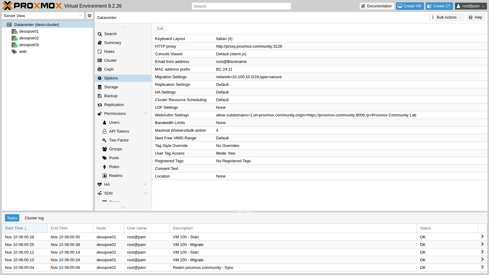
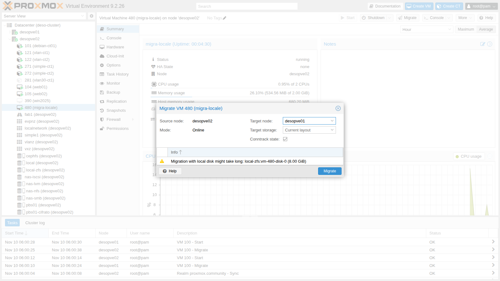
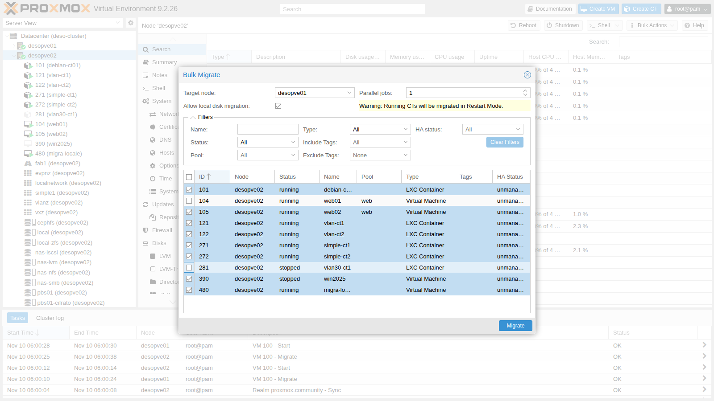
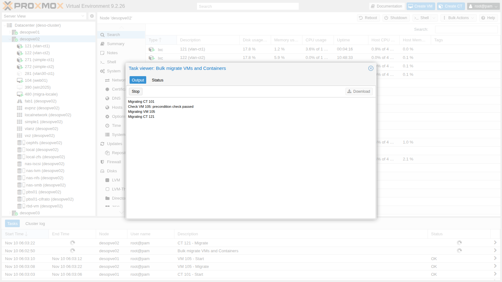

## Dipendenze

- **Lab precedenti:**
  - [Lab 06](/it/06-cluster-corosync/): il cluster `deso-cluster` e il nodo autonomo `desopve04`;
  - [Lab 11](/it/11-zfs-replication/): la migrazione con la replica ZFS;
  - [Lab 17](/it/17-ceph-installation/): lo storage condiviso `rbd-vm`;
  - [Lab 22](/it/22-dedicated-networks/): la rete di migrazione VLAN 100 (10.100.10.0/24);
  - [Lab 33](/it/33-firewall-2/): il firewall con nftables, che apre le porte 60000-60050 sulla rete di migrazione;
  - [Lab 40](/it/40-templates-cloud-init-clones/): il template 9000 e le VM `web01`-`web03`.
- **Sistemi:**
  - nodi `desopve01`-`03` e `desopve04`;
  - VM 100 `debian01` e 104 `web01`, entrambe su `rbd-vm`;
  - CT 121 e 122 sulla VLAN 10 ([Lab 20](/it/20-bridges-stable-names-vlans/)), CT 101 ([Lab 07](/it/07-first-vm-and-container/)), CT 271 e 272 ([Lab 27](/it/27-sdn-simple/)), CT 281 ([Lab 28](/it/28-sdn-vlan-qinq/)), VM 390 ([Lab 39](/it/39-windows-vm-virtio/)): servono alla bulk migration;
  - il pool ZFS `tank` di `desopve04` ([Lab 10](/it/10-zfs/)) e lo snippet `web-vendor.yaml` su `cephfs` ([Lab 40](/it/40-templates-cloud-init-clones/));
  - una VM di prova su `local-zfs`, creata nel lab.
- **Misure:** un `ping` ogni 0,2 s verso la VM, dalla rete di gestione o da un altro CT, durante ogni migrazione.
- **Credenziali:** `root@pam` → [Appendice B](/it/b-credentials-and-addresses/).

## Obiettivi

- Misurare la migrazione **live** con storage condiviso e quella **offline**.
- Migrare a caldo una VM con **dischi locali**.
- Capire la migrazione dei **container** (restart mode).
- Usare la **bulk migration** e conoscerne la trappola.
- Confrontare le modalità **secure** e **insecure** sulla rete dedicata.
- Migrare una VM **tra cluster diversi** con `qm remote-migrate`, andata e ritorno, e scoprirne i limiti.

## Come funziona

**Live migration di una VM.** Sul nodo di destinazione parte un processo QEMU vuoto. La RAM viene copiata mentre la VM lavora; le pagine riscritte vengono ricopiate, finché ne resta così poco da chiudere in una pausa brevissima (*downtime*, limite di default 100 ms). Con lo storage condiviso i dischi non si muovono.

**Dischi locali.** Con `--with-local-disks` i dischi vengono copiati **prima** della RAM con un *drive-mirror* via NBD. Quando sono sincronizzati, si migra la RAM come sopra. Il tempo cresce con la dimensione dei dischi.

**Container.** LXC non ha una live migration: il CT viene **spento, spostato e riacceso** (*restart mode*). Con lo storage condiviso si sposta solo la configurazione.

**Rete di migrazione.** In **Datacenter → Options → Migration Settings** si sceglie la rete (qui la VLAN 100) e il tipo:

- **secure**: la RAM passa in un tunnel SSH;
- **insecure**: la RAM passa in chiaro su TCP (porte 60000-60050), più leggera per la CPU. Ha senso solo su una rete dedicata e fidata.



**Tra cluster.** `qm remote-migrate` usa l'API del cluster di destinazione con un **API token** e l'impronta del certificato. Tutto il traffico, dischi e RAM, passa in un tunnel *websocket* sulla porta 8006. È ancora una funzione *sperimentale*, solo da CLI (dalla GUI la offre Proxmox Datacenter Manager, Lab 53).

## Procedura

### 1. Live con storage condiviso

`web01` (VM 104) ha il disco su Ceph (`rbd-vm`):

```bash
qm migrate 104 desopve02 --online
```

```text output
2026-11-10 05:55:53 conntrack state migration not supported or disabled, active connections might get dropped
2026-11-10 05:55:53 use dedicated network address for sending migration traffic (10.100.10.22)
2026-11-10 05:55:58 migration downtime limit: 100 ms
2026-11-10 05:56:00 average migration speed: 1.0 GiB/s - downtime 33 ms
2026-11-10 05:56:00 migration completed, transferred 281.4 MiB VM-state
2026-11-10 05:56:03 migration finished successfully (duration 00:00:10)
```

- **10 s** in tutto: si copiano solo 281 MiB di RAM, dalla VLAN 100.
- **Downtime 33 ms** per QEMU.
- Il `ping` ogni 0,2 s, dalla rete di gestione, ha avuto al massimo **0,84 s** tra due risposte. Dopo lo spostamento la rete deve imparare la nuova posizione del MAC della VM (QEMU invia pacchetti di annuncio): quel tempo dipende dagli switch, non da Proxmox.

**Conntrack (novità 9.x).** La prima riga avvisa che lo stato delle connessioni tracciate dal firewall **non** viene migrato. Con il firewall nftables (Lab 33) si può chiedere di portarlo con la VM:

```bash
qm migrate 104 desopve01 --online --with-conntrack-state 1     # da desopve02: riporta anche la VM al suo nodo
```

```text output
2026-11-10 06:11:33 average migration speed: 1.0 GiB/s - downtime 93 ms
2026-11-10 06:11:33 migrated 0 conntrack state entries
2026-11-10 06:11:36 flushing conntrack state for guest on source node
2026-11-10 06:11:40 migration finished successfully (duration 00:00:14)
```

Le voci migrate sono 0 perché `web01` non ha il firewall attivo sulla scheda. L'opzione serve per i guest con il firewall attivo: senza le voci di conntrack, sul nodo di destinazione il firewall scarterebbe come *invalid* i pacchetti delle connessioni già aperte. Nella GUI l'opzione **Conntrack state** è spuntata per default.

### 2. Offline

Il CT 281 è spento e ha il disco su Ceph:

```bash
time pct migrate 281 desopve02
```

```text output
2026-11-10 05:56:17 volume 'rbd-vm:vm-281-disk-0' is on shared storage 'rbd-vm'
2026-11-10 05:56:18 migration finished successfully (duration 00:00:01)
real	0m3.636s
```

Con lo storage condiviso un guest spento si sposta in un secondo: cambia solo il nodo che ne possiede la configurazione.

### 3. Live con dischi locali

Una VM di prova (480 `migra-locale`) clonata dal template su `local-zfs`, quindi con il disco **solo** su `desopve01`:

```bash
qm clone 9000 480 --name migra-locale --full 1 --storage local-zfs
qm set 480 --ipconfig0 ip=172.27.199.148/24,gw=172.27.199.1 --agent enabled=1 --cicustom vendor=cephfs:snippets/web-vendor.yaml
qm start 480
```

Dalla GUI il pulsante **Migrate** avvisa che serve copiare il disco e chiede lo storage di destinazione.



```bash
qm migrate 480 desopve02 --online --with-local-disks --targetstorage local-zfs
```

```text output
2026-11-10 05:58:03 scsi0: start migration to nbd:unix:/run/qemu-server/480_nbd.migrate:exportname=drive-scsi0
mirror-scsi0: successfully switched to actively synced mode
2026-11-10 05:58:28 starting online/live migration on unix:/run/qemu-server/480.migrate
2026-11-10 05:58:30 average migration speed: 1.0 GiB/s - downtime 88 ms
2026-11-10 05:58:30 migration completed, transferred 611.1 MiB VM-state
mirror-scsi0: Completed successfully.
2026-11-10 05:58:37 migration finished successfully (duration 00:00:45)
```

| | Storage condiviso (VM 104) | Disco locale (VM 480) |
|---|---|---|
| Durata | 10 s | 45 s (25 s solo per il disco) |
| Downtime di QEMU | 33 ms | 88 ms |
| Pausa massima del ping | 0,84 s | 3,73 s |

Il disco occupava solo 653 MiB (thin): un disco pieno da centinaia di GB richiede di conseguenza decine di minuti. Con la replica ZFS (Lab 11) si copia solo la differenza dall'ultima replica: nel lab **20 s contro 1 min 13 s**.

### 4. Container: restart mode

Il CT 121 (VLAN 10) viene misurato **dal CT 122**, che sta nella stessa VLAN:

```bash
pct exec 122 -- sh -c "ping -D -i 0.2 10.10.10.121 > /tmp/p121.log &"   # sul nodo del CT 122
pct migrate 121 desopve02 --restart                                    # sul nodo del CT 121
```

```text output
2026-11-10 05:59:03 starting migration of CT 121 to node 'desopve02' (10.100.10.22)
2026-11-10 05:59:03 volume 'rbd-vm:vm-121-disk-0' is on shared storage 'rbd-vm'
2026-11-10 05:59:04 start container on target node
2026-11-10 05:59:09 migration finished successfully (duration 00:00:10)
```

Pausa massima del ping: **11,65 s**, cioè arresto, avvio e DHCP del CT. Per un CT "spostare" significa sempre **riavviare**: i servizi devono tollerarlo. Senza `--restart` la migrazione di un CT acceso viene rifiutata ("not implemented", [Lab 41](/it/41-lxc-containers/)).

### 5. Bulk migration (e la sua trappola)

**Nodo → Bulk Actions → Bulk Migrate** sposta più guest in un colpo, con un numero di lavori in parallelo (*Parallel jobs*) e l'opzione **Allow local disk migration**.



:::caution
All'apertura **tutti i guest del nodo sono già selezionati**: cliccare su un guest lo **deseleziona**. Prova guidata della trappola: su `desopve02` apri **Bulk Migrate** verso `desopve01` e, come se volessi spostare solo il CT 281, cliccalo. In realtà lo hai deselezionato: con **Migrate** partono tutti gli altri otto. I CT vengono riavviati sul nodo di destinazione, perché il restart mode vale anche qui (lo avvisa la scritta gialla).
:::



```text
Check VM 105: precondition check passed
Migrating VM 105
Migrating CT 121
Migrating CT 122
Migrating CT 271
Migrating CT 272
Check VM 390: precondition check passed
Migrating VM 390
Check VM 480: precondition check passed
Migrating VM 480
All jobs finished, used 8 workers in total.
TASK OK
```

8 guest in **137 s** con 1 lavoro alla volta. Per rimetterli a posto si usa l'equivalente da CLI, con l'elenco esplicito e 2 lavori in parallelo:

```bash
pvesh create /nodes/desopve01/migrateall --target desopve02 --vms 101,105,122,271,272,390 --maxworkers 2
```

6 guest in **43 s**. Prima di confermare una bulk migration, controlla la colonna di selezione oppure usa i filtri (stato, pool, tag).

### 6. Secure contro insecure

La VM 100 ha 2 GiB di RAM. Per rendere la prova significativa, dentro il guest si riempie la RAM con 900 MiB di dati casuali, non comprimibili:

```bash
qm guest exec 100 -- sh -c "dd if=/dev/urandom of=/dev/shm/riempi bs=1M count=900"
qm migrate 100 desopve02 --online --migration_type secure
qm migrate 100 desopve01 --online --migration_type insecure     # dal nodo 02
```

```text output
== insecure 100 02->01
2026-11-10 05:59:59 starting online/live migration on tcp:10.100.10.21:60000
2026-11-10 06:00:04 average migration speed: 413.0 MiB/s - downtime 21 ms
2026-11-10 06:00:04 migration completed, transferred 1.1 GiB VM-state
```

| Prova | Velocità media | Durata |
|---|---|---|
| secure | 413 MiB/s | 14 s |
| insecure | 413 MiB/s | 14 s |
| secure (ripetuta) | 413 MiB/s | 14 s |
| insecure (ripetuta) | 688 MiB/s | 12 s |

I valori vengono dalla riga `average migration speed` dei log dei task: tre prove su quattro hanno dato proprio 413 MiB/s. Con 1,1 GiB di RAM da copiare, nel lab la differenza è piccola: il limite è la banda della rete di migrazione, non la cifratura. Su reti da 25-100 Gbit/s e VM con centinaia di GB di RAM, SSH diventa il collo di bottiglia e *insecure* sulla rete dedicata fa risparmiare minuti. In *insecure* la destinazione apre la porta 60000: il firewall deve permetterla sulla rete di migrazione (gruppo `servizi-cluster`, Lab 33).

### 7. Migrazione tra cluster: `qm remote-migrate`

Destinazione: `desopve04`, che è un "datacenter" separato con il suo `local-lvm` e il pool ZFS `tank`.

**Sul nodo di destinazione** si crea un token e si legge l'impronta del certificato:

```bash
pveum user token add root@pam migra --privsep 0 --comment "migrazione remota dal cluster"
pvenode cert info | grep -B1 -A1 pve-ssl.pem
```

Il token deve poter creare VM, allocare storage e usare il bridge sulla destinazione. Qui si usa `root@pam` senza separazione dei privilegi; in produzione conviene un utente dedicato.

**Primo tentativo**, verso `local-lvm`:

```bash
qm remote-migrate 480 480 \
  'host=172.27.199.24,apitoken=PVEAPIToken=root@pam!migra=<segreto>,fingerprint=84:D3:F2:…' \
  --target-bridge vmbr0 --target-storage local-lvm --online
```

```text output
ERROR: … failed to handle 'disk-import' command - no matching import/export format found for storage 'local-lvm'
migration aborted
```

Il disco di **cloud-init** (`ide2`, su `local-zfs`) non si migra a caldo: viene **esportato** come stream ZFS, e LVM-thin non sa importarlo. Il disco principale, invece, passa con il mirror NBD su qualunque storage.

**Secondo tentativo**, verso `tank` (ZFS):

```text
ERROR: … failed to handle 'config' command - storage 'cephfs' does not exist
migration aborted
```

La configurazione della VM cita uno snippet su `cephfs` (`cicustom`), uno storage che sulla destinazione non esiste. Lo snippet serviva solo al primo avvio:

```bash
qm set 480 --delete cicustom
```

**Terzo tentativo**, riuscito:

```text
2026-11-10 06:08:35 start migrate command to unix:/run/qemu-server/480.migrate
tunnel: established new WS for forwarding '/run/qemu-server/480.migrate'
2026-11-10 06:08:38 average migration speed: 682.9 MiB/s - downtime 31 ms
2026-11-10 06:08:38 migration completed, transferred 624.6 MiB VM-state
mirror-scsi0: Completed successfully.
2026-11-10 06:08:41 migration finished successfully (duration 00:00:52)
```

52 s, downtime di 31 ms, pausa massima del ping 3,11 s. La pagina web della VM ha continuato a rispondere dall'altro "datacenter".

Sul cluster la VM **resta**, spenta e bloccata (`lock: migrate`): per default `remote-migrate` non cancella l'originale. Si elimina a mano dopo aver verificato la copia:

```bash
qm unlock 480 && qm destroy 480 --purge
```

**Ritorno** al cluster, eseguito su `desopve04` con un token del cluster e `--delete 1`, che cancella l'origine a fine migrazione. Il token e l'impronta si preparano su `desopve01`:

```bash
pveum user token add root@pam rientro --privsep 0 --comment "rientro dalla migrazione remota"
pvenode cert info | grep -B1 -A1 pve-ssl.pem
```

Poi su `desopve04`:

```bash
qm remote-migrate 480 480 \
  'host=172.27.199.21,apitoken=PVEAPIToken=root@pam!rientro=<segreto>,fingerprint=14:32:84:…' \
  --target-bridge vmbr0 --target-storage local-zfs --online --delete 1
```

```text output
2026-11-10 06:10:46 average migration speed: 682.9 MiB/s - downtime 62 ms
2026-11-10 06:10:46 migration completed, transferred 626.2 MiB VM-state
2026-11-10 06:10:50 migration finished successfully (duration 00:00:32)
```

Su `desopve04` la VM non c'è più.

:::caution
Non lanciare `remote-migrate` in una pipe che può chiudersi prima della fine (per esempio `| head`): il comando viene interrotto a metà e lascia sulla destinazione una VM vuota bloccata in `lock: create`, da pulire con `qm unlock` e `qm destroy`. Meglio lanciarlo dentro `screen` o `tmux`.
:::

**Limiti di `remote-migrate` visti nel lab:**

- solo CLI ed etichettato come sperimentale;
- servono token, impronta e permessi sulla destinazione;
- le configurazioni che citano storage, snippet o bridge assenti sulla destinazione falliscono;
- i dischi non migrati a caldo (cloud-init, VM spente) richiedono formati di export compatibili tra gli storage;
- l'origine resta per default; con `--delete 1` sparisce.

### 8. Ripristino

A fine lab rimetti i guest al loro posto. La VM 104 è già tornata su `desopve01` con la prova del conntrack, e il CT 121 con la bulk migration; restano il CT 281, la VM 480 tornata dal "datacenter" remoto e i token:

```bash
pct migrate 281 desopve01                    # su desopve02 (il CT è spento)
qm stop 480 && qm destroy 480 --purge        # su desopve01
pveum user token remove root@pam rientro     # su desopve01
pveum user token remove root@pam migra       # su desopve04
```

## Verifica e test

| Prova | Risultato nel lab |
|---|---|
| Live, storage condiviso (VM 104) | 10 s, downtime 33 ms, ping max 0,84 s |
| Offline, storage condiviso (CT 281) | 1 s |
| Live, disco locale (VM 480, 8 GiB thin) | 45 s, downtime 88 ms, ping max 3,73 s |
| CT in restart mode (CT 121) | 10 s, servizio fermo 11,65 s |
| Bulk migration, 8 guest | 137 s con 1 lavoro alla volta; 6 guest in 43 s con 2 |
| secure contro insecure | 413 contro 413-688 MiB/s, 12-14 s |
| Remote-migrate verso `desopve04` | 52 s, downtime 31 ms (dopo 2 errori istruttivi) |
| Remote-migrate di ritorno con `--delete 1` | 32 s, origine eliminata |

## Stato finale del lab

- Guest di nuovo nella posizione iniziale:
  - VM 100, 104 e 261 e CT 121, 141, 143, 281, 291, 301 su `desopve01`;
  - CT 101, 122, 271, 272, VM 105 e 390 su `desopve02`;
  - VM 106 e CT 123, 282, 292, 302 su `desopve03`.
- VM di prova 480 eliminata; nessun residuo su `desopve04`.
- Token `root@pam!migra` (su `desopve04`) e `root@pam!rientro` (sul cluster) rimossi.
- Datacenter: `migration: secure,network=10.100.10.0/24`, invariato.
- PBS e i job del Lab 47 invariati.

## Cosa hai imparato

- Con lo storage condiviso una live migration copia solo la RAM: secondi, con un downtime di decine di ms.
- Con i dischi locali si copia prima il disco: il tempo cresce con i dati, e la replica ZFS lo riduce.
- I container si migrano solo riavviandoli.
- La bulk migration preseleziona **tutti** i guest: si controlla prima di confermare.
- *insecure* conviene solo su reti dedicate molto veloci e con VM grandi; il firewall deve aprire le porte 60000-60050.
- Il **conntrack state** si può migrare con il firewall nftables (novità 9.x).
- `qm remote-migrate` sposta VM tra cluster con un token; storage, snippet e formati devono essere compatibili sulla destinazione, e l'origine resta se non si usa `--delete 1`.

## Riferimenti

- [Proxmox VE – Migration (qm)](https://pve.proxmox.com/pve-docs/chapter-qm.html#qm_migration)
- [Proxmox VE – Container Migration](https://pve.proxmox.com/pve-docs/chapter-pct.html#pct_migration)
- [Proxmox VE – Migration settings](https://pve.proxmox.com/pve-docs/chapter-pvecm.html#pvecm_migration)
- [Proxmox VE – qm(1), remote-migrate](https://pve.proxmox.com/pve-docs/qm.1.html)
- [Proxmox VE – Firewall, conntrack](https://pve.proxmox.com/pve-docs/chapter-pve-firewall.html)
