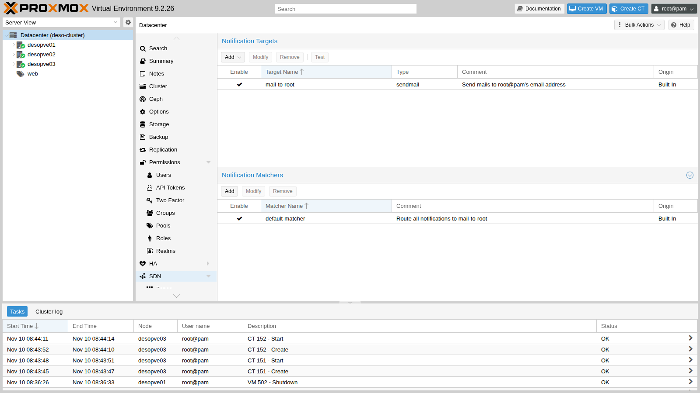
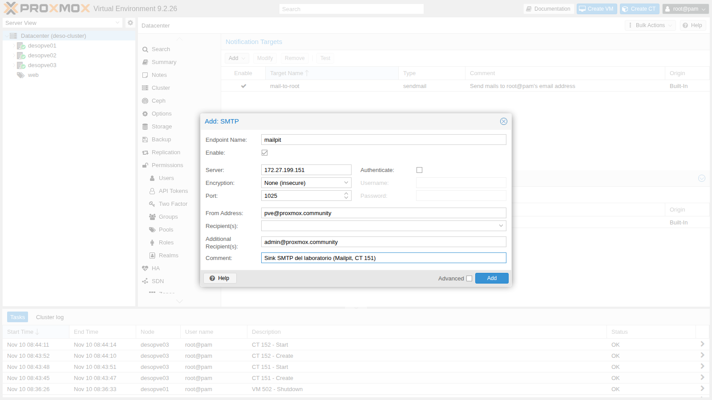
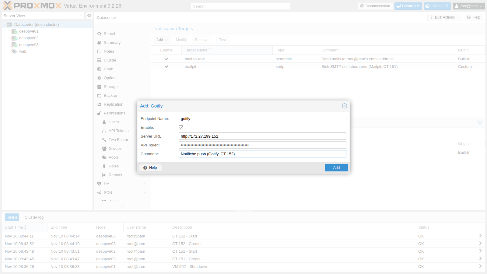
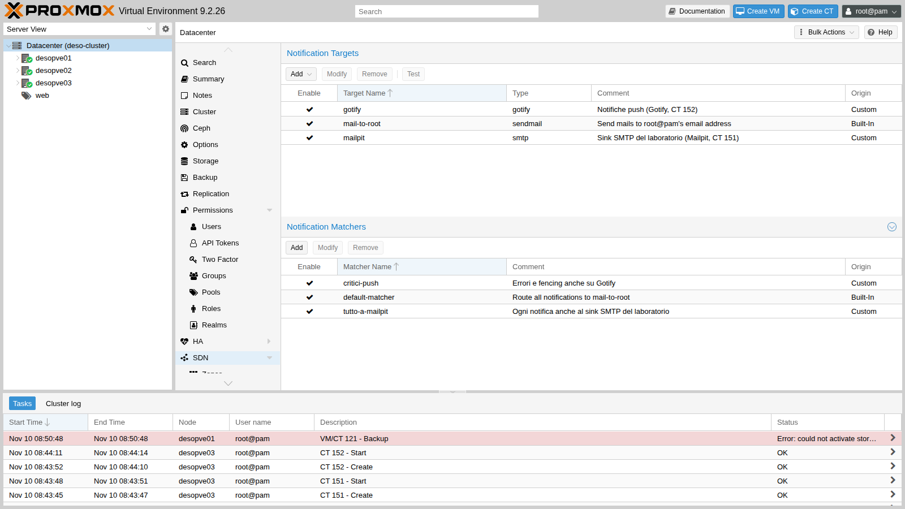
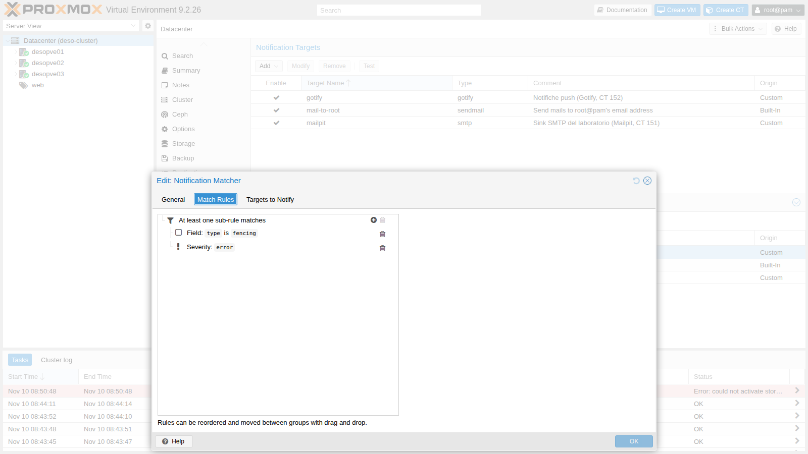
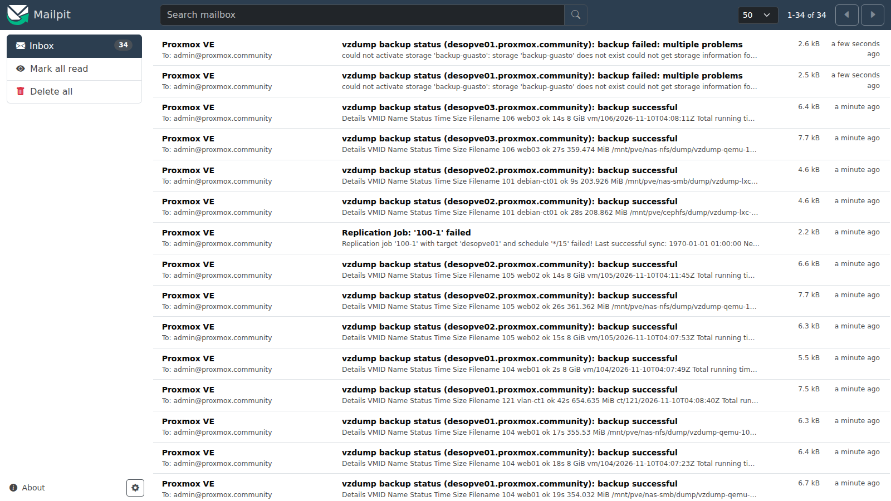
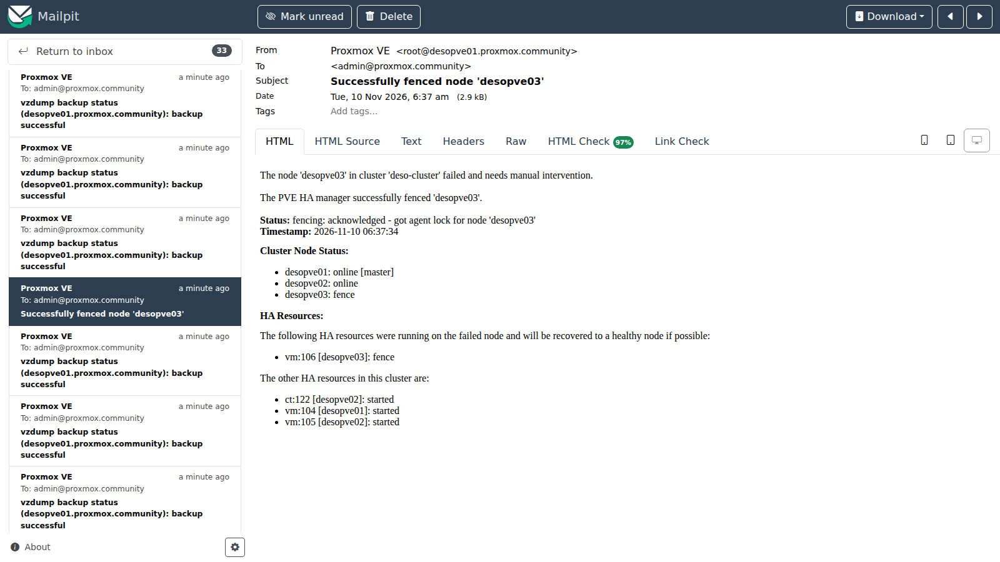
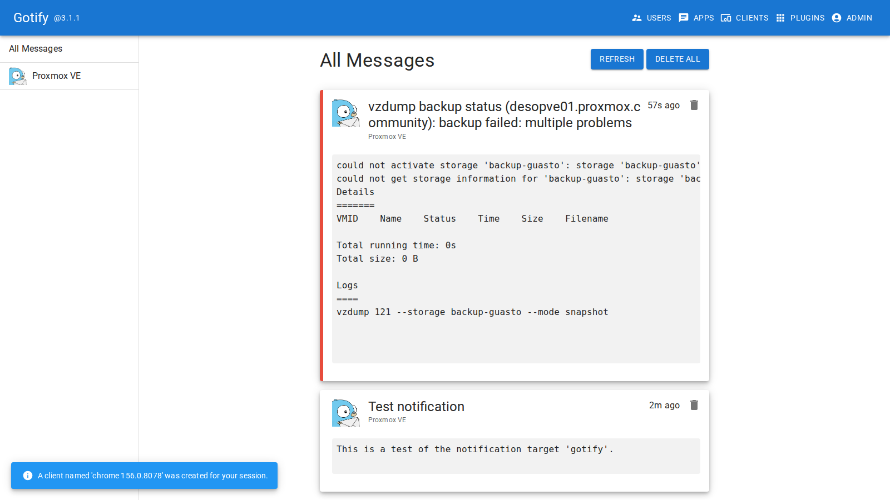
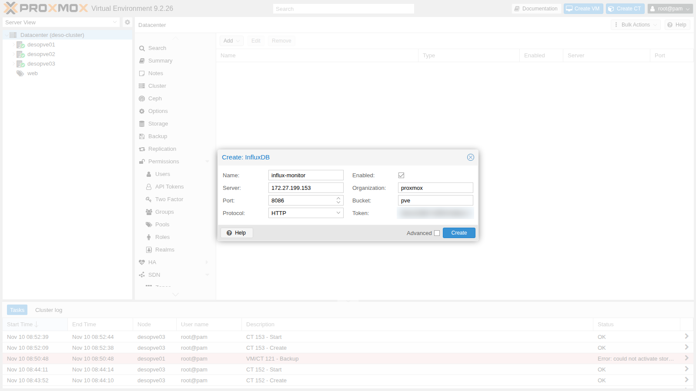
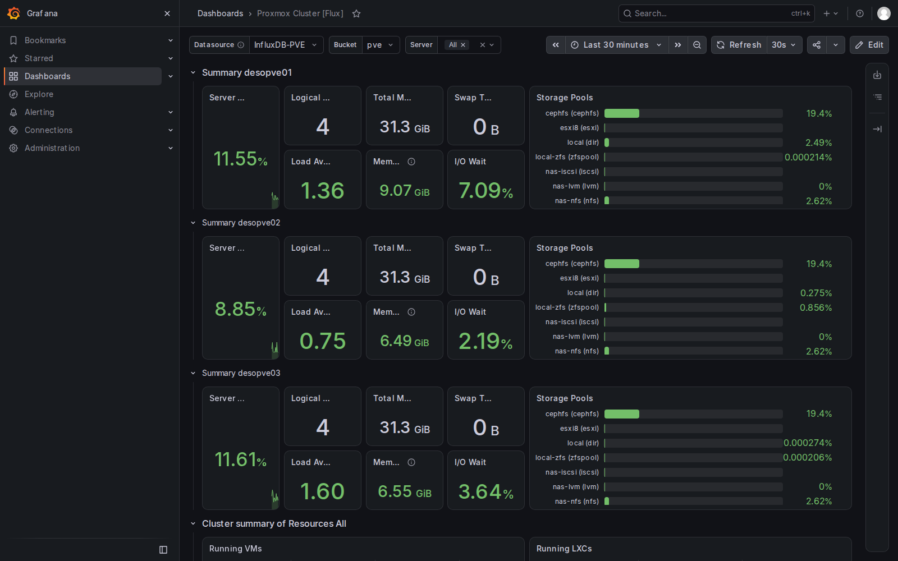

## Dipendenze

- **Lab precedenti:**
  - [Lab 07](/it/07-first-vm-and-container/): container da template;
  - [Lab 04](/it/04-first-access-repositories-updates/): il proxy del laboratorio, configurato nel Datacenter e per `apt`;
  - [Lab 41](/it/41-lxc-containers/): i container da immagine OCI e il download con `skopeo` dietro proxy;
  - [Lab 32](/it/32-firewall-1/) e [lab 33](/it/33-firewall-2/): firewall del Datacenter, IPSet `management`;
  - [Lab 46](/it/46-vzdump-backup/) e [lab 49](/it/49-high-availability/): i job di backup e il fencing che hanno generato notifiche.
- **Sistemi:** il cluster `deso-cluster` (`desopve01`-`03`), gli storage `cephfs` (template) e `rbd-vm` (dischi dei container).
- **Indirizzi nuovi:** CT 151 `mailpit` 172.27.199.151, CT 152 `gotify` 172.27.199.152, CT 153 `monitor` 172.27.199.153.
- **Credenziali:** `root@pam` e la password del laboratorio → [Appendice B](/it/b-credentials-and-addresses/).

## Obiettivi

- Capire dove finiscono le notifiche di Proxmox VE con la configurazione predefinita, e perché a volte non arrivano.
- Configurare il **sistema di notifiche**: target SMTP, Gotify e sendmail, matcher per gravità e tipo di evento.
- Inviare le **metriche** del cluster a InfluxDB 2 e visualizzarle in Grafana.
- Leggere i **log** dei servizi di Proxmox VE e dei task, e centralizzarli con rsyslog.
- Proteggere i servizi nuovi con il firewall senza interrompere metriche e log.

## Come funziona

**Notifiche.** Dalla versione 8.1 ogni evento che Proxmox VE vuole comunicare (backup, replica, fencing, aggiornamenti disponibili, posta di sistema) passa per un unico sistema di notifiche, configurato in **Datacenter → Notifications** e salvato in `/etc/pve/notifications.cfg` (i segreti in `/etc/pve/priv/notifications.cfg`).

- Un **target** è una destinazione: `sendmail` (usa l'MTA locale, cioè Postfix), `smtp` (parla direttamente con un server di posta), `gotify` (notifiche push) e `webhook` (una richiesta HTTP con un corpo personalizzabile).
- Un **matcher** decide quali notifiche vanno a quali target. Le regole guardano la **gravità** (`info`, `notice`, `warning`, `error`), i **campi** dell'evento (per esempio `type=vzdump`, `type=fencing`, `type=replication`, `type=package-updates`, `hostname`, `job-id`) e il **calendario**. La modalità `all` richiede che tutte le regole valgano, `any` che ne basti una.
- Ogni notifica viene valutata da **tutti** i matcher: se due matcher la mandano allo stesso destinatario, arriva due volte.

La configurazione predefinita ha un solo target, `mail-to-root`, che invia con `sendmail` all'indirizzo email di `root@pam`, e un matcher `default-matcher` che gli manda tutto.

**Metriche.** Ogni nodo invia periodicamente le statistiche di nodi, guest e storage a uno o più **metric server**: Graphite o InfluxDB. Con InfluxDB 2 si usa il protocollo HTTP(S) con organizzazione, bucket e token. Proxmox VE non conserva lo storico oltre i suoi grafici RRD: per storico lungo, allarmi e dashboard si usa un database esterno come InfluxDB e uno strumento come Grafana.

**Log.** I servizi di Proxmox VE scrivono nel journal di systemd: `pveproxy` (interfaccia web e API), `pvedaemon` (operazioni privilegiate), `pve-cluster` (filesystem `/etc/pve`), `corosync`, `pve-ha-crm` e `pve-ha-lrm` (alta disponibilità), `pvestatd` (statistiche). Ogni operazione avviata dall'interfaccia o dall'API è un **task** con un identificativo (UPID) e un log proprio in `/var/log/pve/tasks/`. Per avere i log di tutti i nodi in un posto solo, e conservarli anche se un nodo si guasta, si inoltrano a un server centrale.

## Procedura

### 1. Dove sono finite le notifiche?

La configurazione predefinita, con il solo target `mail-to-root`:



L'indirizzo di `root@pam` è `admin@proxmox.community`, impostato all'installazione nel [lab 03](/it/03-install-proxmox-ve/). Le notifiche dei lab precedenti, però, nessuno le ha mai lette. La coda di Postfix su `desopve01`:

```bash
postqueue -p | head -8
```

```text output
-Queue ID-  --Size-- ----Arrival Time---- -Sender/Recipient-------
4339E298E9*    9722 Tue Nov 10 04:37:39  root@desopve01.proxmox.community
                                         admin@proxmox.community

C321B2A7B8     7395 Tue Nov 10 05:09:22  root@desopve01.proxmox.community
         (connect to proxmox.community[fd27:199::20]:25: Connection timed out)
                                         admin@proxmox.community
```

Sui tre nodi ci sono **31 messaggi bloccati**, tra cui proprio le notifiche del fencing del [lab 49](/it/49-high-availability/):

```text
desopve01 7A1F02D550 | Subject: Trying to fence node 'desopve03'
desopve01 93AAE2D572 | Subject: Successfully fenced node 'desopve03'
desopve02 1EE3118167 | Subject: Replication Job: '100-1' failed
desopve01 4339E298E9 | Subject: vzdump backup status (desopve01.proxmox.community): backup successful
…
```

Il motivo: il dominio `proxmox.community` non ha un record MX nel DNS del laboratorio, quindi Postfix prova a consegnare direttamente all'indirizzo del dominio, cioè al domain controller, sulla porta 25. Lì non c'è nessun server di posta, e i messaggi restano in coda per giorni. **Una notifica che nessuno riceve è come nessuna notifica.** Il primo controllo, dopo l'installazione di un cluster, è verificare che le email arrivino davvero.

### 2. Un server di posta di prova: Mailpit

In laboratorio non serve un vero server di posta: basta un "sink" SMTP che accetta tutti i messaggi e li mostra in una pagina web. Mailpit è un'immagine OCI di 15 MB. Come nel [lab 41](/it/41-lxc-containers/), `skopeo` non usa il proxy del Datacenter, quindi lo si passa nella variabile d'ambiente:

```bash
cd /mnt/pve/cephfs/template/cache
HTTPS_PROXY=http://proxy.proxmox.community:3128 skopeo copy \
  docker://docker.io/axllent/mailpit:latest oci-archive:axllent_mailpit_latest.tar
HTTPS_PROXY=http://proxy.proxmox.community:3128 skopeo copy \
  docker://docker.io/gotify/server:latest oci-archive:gotify_server_latest.tar

# su desopve03
pct create 151 cephfs:vztmpl/axllent_mailpit_latest.tar --hostname mailpit --unprivileged 1 \
  --memory 256 --rootfs rbd-vm:2 --net0 name=eth0,bridge=vmbr0,ip=172.27.199.151/24,gw=172.27.199.1
pct start 151
```

```text output
Detected OCI archive
Auto-Enabling host-managed network for network device net0.
Detected container architecture: amd64
```

Proxmox VE prende dall'immagine il processo da avviare (`entrypoint: /mailpit`). Mailpit riceve la posta sulla porta 1025 e mostra i messaggi su `http://172.27.199.151:8025`.

### 3. Target SMTP

**Datacenter → Notifications → Add → SMTP**: Endpoint Name `mailpit`, server `172.27.199.151`, porta `1025`, cifratura **None (insecure)** perché il sink non ha TLS, senza autenticazione, mittente `pve@proxmox.community`, destinatario `admin@proxmox.community`.



In produzione si usa il server di posta aziendale o un servizio esterno con **STARTTLS** o **TLS** e un utente dedicato. La password finisce in `/etc/pve/priv/notifications.cfg`, leggibile solo da root.

A differenza di `sendmail`, il target SMTP **non passa da Postfix**: Proxmox VE parla direttamente con il server, quindi una coda locale piena non lo blocca. Il pulsante **Test** invia un messaggio di prova, che arriva subito in Mailpit.

### 4. Target Gotify e una trappola: il proxy del Datacenter

Gotify è un server di notifiche push con un'app per smartphone. Il container 152 nasce dall'immagine scaricata al passo 2, come il 151, sullo stesso nodo `desopve03`:

```bash
pct create 152 cephfs:vztmpl/gotify_server_latest.tar --hostname gotify --unprivileged 1 --memory 256 \
  --rootfs rbd-vm:2 --net0 name=eth0,bridge=vmbr0,ip=172.27.199.152/24,gw=172.27.199.1
pct start 152
```

 Al primo avvio l'utente è `admin`/`admin`: si cambia la password e si crea un'**applicazione**, che fornisce il token per inviare messaggi:

```bash
curl -s -u admin:admin -X POST http://172.27.199.152/current/user/password \
  -H 'Content-Type: application/json' -d '{"pass":"<password-lab>"}'
curl -s -u 'admin:<password-lab>' -X POST http://172.27.199.152/application \
  -H 'Content-Type: application/json' -d '{"name":"Proxmox VE","description":"Notifiche del cluster deso-cluster"}'
```

Il token va nel target **Gotify** (Endpoint Name `gotify`):



Il test però fallisce:

```bash
pvesh create /cluster/notifications/targets/gotify/test
```

```text output
500 Could not test target: could not notify via endpoint(s): gotify: CONNECT proxy failed: proxy server responded 403/403
```

I target **Gotify** e **Webhook** usano il **proxy HTTP del Datacenter** impostato nel [lab 04](/it/04-first-access-repositories-updates/), anche verso un indirizzo interno. Il log del proxy lo conferma:

```text
CONNECT   Nov 10 07:49:34.599 [91799]: Request (file descriptor 5): CONNECT 172.27.199.152:80 HTTP/1.1
NOTICE    Nov 10 07:49:34.603 [91799]: Proxying refused on filtered domain "172.27.199.152"
```

Il proxy del laboratorio accetta solo una lista di domini esterni. La soluzione è lasciar passare dal proxy anche le destinazioni interne della rete di gestione (`172.27.199.0/24` e `*.proxmox.community`). In un'azienda si chiede la stessa eccezione a chi gestisce il proxy. Dopo la modifica:

```text
Test notification  | 1 | ``` This is a test of the notification target 'gotify'.  ```
```

Il target SMTP e il metric server InfluxDB del passo 7 invece **non** passano dal proxy: nel log del proxy non compare nessuna richiesta verso le loro porte.

### 5. Matcher: chi riceve cosa

Due matcher nuovi, creati da riga di comando:

```bash
pvesh create /cluster/notifications/matchers --name tutto-a-mailpit --mode all \
  --target mailpit --comment "Ogni notifica anche al sink SMTP del laboratorio"
pvesh create /cluster/notifications/matchers --name critici-push --mode any \
  --match-severity error --match-field exact:type=fencing \
  --target gotify --comment "Errori e fencing anche su Gotify"
```

Il risultato in `/etc/pve/notifications.cfg`:

```text
matcher: tutto-a-mailpit
	comment Ogni notifica anche al sink SMTP del laboratorio
	mode all
	target mailpit

matcher: critici-push
	comment Errori e fencing anche su Gotify
	match-field exact:type=fencing
	match-severity error
	mode any
	target gotify
```



Nel matcher `critici-push` la modalità **any** fa scattare la regola con un errore **oppure** con un fencing: la regola sul campo `type` cattura le notifiche di fencing qualunque sia la loro gravità, anche quella di un fencing riuscito.



### 6. Sbloccare la coda di Postfix e provare un errore vero

Il target `sendmail` (`mail-to-root`) resta utile: lo usano anche altri programmi del sistema, per esempio cron e `smartd`. Si fa consegnare Postfix al server di posta del laboratorio, su ogni nodo:

```bash
postconf -e 'relayhost = [172.27.199.151]:1025'
postfix reload
postqueue -f
postqueue -p | tail -1
```

```text output
Mail queue is empty
```

Le parentesi quadre dicono a Postfix di non cercare il record MX e di usare direttamente quell'indirizzo. I 31 messaggi bloccati arrivano tutti in Mailpit:

```text
totale 32
28 vzdump backup status
1 Replication Job: '100-1' failed
1 Successfully fenced node 'desopve03'
1 Trying to fence node 'desopve03'
1 Test notification
```



La notifica di fencing del lab 49 descrive cosa è successo e quali risorse HA sono state recuperate:



Per provare il percorso degli errori serve un errore vero. Un backup verso uno storage che non esiste:

```bash
vzdump 121 --storage backup-guasto --mode snapshot
```

```text output
INFO: notified via target `mail-to-root`
INFO: notified via target `mailpit`
INFO: notified via target `gotify`
could not activate storage 'backup-guasto': storage 'backup-guasto' does not exist could not get storage information for 'backup-guasto': storage 'backup-guasto' does not exist
```

La stessa notifica è passata per tre target. In Mailpit arriva **due volte**: una tramite `mail-to-root` (Postfix) e una tramite il target SMTP. In Gotify arriva con priorità 9, la più alta, perché la gravità è `error`:



### 7. Metriche: InfluxDB 2 e Grafana

Un container Debian 13 dedicato, il CT 153 `monitor`, con InfluxDB 2, Grafana e rsyslog dai repository ufficiali (via proxy):

```bash
# su desopve03
pct create 153 cephfs:vztmpl/debian-13-standard_13.6-1_amd64.tar.zst --hostname monitor \
  --unprivileged 1 --features nesting=1 --cores 2 --memory 2048 --swap 512 --rootfs rbd-vm:10 \
  --net0 name=eth0,bridge=vmbr0,ip=172.27.199.153/24,gw=172.27.199.1 \
  --nameserver 172.27.199.20 --searchdomain proxmox.community --password '<password-lab>'
pct start 153
pct enter 153
```

Dentro il container:

```bash
echo 'Acquire::http::Proxy "http://proxy.proxmox.community:3128";' > /etc/apt/apt.conf.d/80proxy
export https_proxy=http://proxy.proxmox.community:3128
apt-get update && apt-get install -y curl gpg
install -d -m 0755 /etc/apt/keyrings
curl -fsSL https://repos.influxdata.com/influxdata-archive.key | gpg --dearmor -o /etc/apt/keyrings/influxdata.gpg
curl -fsSL https://apt.grafana.com/gpg.key | gpg --dearmor -o /etc/apt/keyrings/grafana.gpg
echo "deb [signed-by=/etc/apt/keyrings/influxdata.gpg] https://repos.influxdata.com/debian stable main" > /etc/apt/sources.list.d/influxdata.list
echo "deb [signed-by=/etc/apt/keyrings/grafana.gpg] https://apt.grafana.com stable main" > /etc/apt/sources.list.d/grafana.list
apt-get update && apt-get install -y influxdb2 influxdb2-cli grafana rsyslog
systemctl enable --now influxdb grafana-server
```

```text output
grafana 13.3.0
influxdb2 2.9.1-1
rsyslog 8.2504.0-1+deb13u2
```

Configurazione iniziale di InfluxDB: organizzazione `proxmox`, bucket `pve` con 30 giorni di conservazione, e due token separati, uno che può **solo scrivere** (per Proxmox VE) e uno che può **solo leggere** (per Grafana):

```bash
influx setup --org proxmox --bucket pve --username admin --password '<password-lab>' --retention 30d --force
BID=$(influx bucket list --org proxmox --name pve --hide-headers | cut -f1)
influx auth create --org proxmox --write-bucket $BID --description pve-scrittura
influx auth create --org proxmox --read-bucket $BID --description grafana-lettura
```

In Proxmox VE: **Datacenter → Metric Server → Add → InfluxDB**, ID `influx-monitor`, protocollo **HTTP**, server `172.27.199.153`, porta `8086`, organizzazione `proxmox`, bucket `pve`, token di scrittura.



La configurazione finisce in `/etc/pve/status.cfg`, valida per tutti i nodi:

```text
influxdb: influx-monitor
	port 8086
	server 172.27.199.153
	bucket pve
	influxdbproto http
	organization proxmox
```

Dopo pochi secondi arrivano i dati. Le misure presenti nel bucket e l'ultimo valore di CPU di due nodi:

```text
ballooninfo blockstat cpustat memory nics proxmox-support system
```

```text
           host:string                  _value:float
----------------------  ----------------------------
             desopve02             0.146134663341646
             desopve03                        0.2536
```

In Grafana (`http://172.27.199.153:3000`) si aggiunge una data source di tipo **InfluxDB** con linguaggio **Flux**, organizzazione `proxmox`, bucket `pve` e il token di sola lettura. La verifica risponde `datasource is working. 1 buckets found`. Poi si importa la dashboard pubblica "Proxmox Cluster [Flux]" (ID 15356 su grafana.com). L'import per ID lo fa il servizio `grafana-server`, che non usa il proxy: dietro un proxy si scarica il JSON dal container (sul proxy serve il dominio `grafana.com`) e lo si carica con **Dashboards → New → Import → Upload dashboard JSON file**, associandolo a questa data source:

```bash
curl -x http://proxy.proxmox.community:3128 -fsS -o /root/proxmox-flux.json \
  https://grafana.com/api/dashboards/15356/revisions/latest/download
```




Se hai svolto il [lab 50](/it/50-import-from-esxi/), nell'elenco degli storage compare anche lo storage di import, che non ha spazio proprio.

### 8. Log: journal, task e inoltro centralizzato

Il journal conserva la storia dei servizi. Il fencing del lab 49, visto dal gestore HA su `desopve01`:

```bash
journalctl -u pve-ha-crm --since "2026-11-10 06:35" --until "2026-11-10 06:40" -o short-iso | grep -iE "fenc|recover|node .desopve03"
```

```text output
2026-11-10T06:35:54+01:00 desopve01 pve-ha-crm[1679]: node 'desopve03': state changed from 'online' => 'unknown'
2026-11-10T06:36:44+01:00 desopve01 pve-ha-crm[1679]: service 'vm:106': state changed from 'started' to 'fence'
2026-11-10T06:36:44+01:00 desopve01 pve-ha-crm[1679]: node 'desopve03': state changed from 'unknown' => 'fence'
2026-11-10T06:37:44+01:00 desopve01 pve-ha-crm[1679]: fencing: acknowledged - got agent lock for node 'desopve03'
2026-11-10T06:37:44+01:00 desopve01 pve-ha-crm[1679]: recover service 'vm:106' from fenced node 'desopve03' to node 'desopve02'
```

E Corosync, pochi secondi prima, quando il nodo è sparito:

```text
2026-11-10T06:35:38+01:00 desopve01 corosync[120106]:   [KNET  ] link: host: 3 link: 0 is down
2026-11-10T06:35:38+01:00 desopve01 corosync[120106]:   [KNET  ] link: host: 3 link: 1 is down
2026-11-10T06:35:38+01:00 desopve01 corosync[120106]:   [KNET  ] host: host: 3 has no active links
```

I task del nodo, con il backup fallito del passo 6:

```bash
pvenode task list --limit 4
tail -n 1 /var/log/pve/tasks/index
```

```text output
│ UPID:desopve01:000AED42:0064A85D:6AF2CCD8:vzdump:121:root@pam:     │ vzdump     │ 121 │ root@pam │ 2026-11-10 08:50:48 │ 2026-11-10 08:50:48 │ ERROR  │
UPID:desopve01:000AED42:0064A85D:6AF2CCD8:vzdump:121:root@pam: 6AF2CCD8 could not activate storage 'backup-guasto': storage 'backup-guasto' does not exist …
```

Il **server centrale** è rsyslog nel CT 153, che riceve su TCP 514 e scrive un file per nodo e per programma:

```text
# /etc/rsyslog.d/10-ricezione.conf (CT 153)
module(load="imtcp")
input(type="imtcp" port="514" ruleset="remoti")
template(name="PerHost" type="string" string="/var/log/remote/%HOSTNAME%/%PROGRAMNAME%.log")
ruleset(name="remoti") {
    action(type="omfile" dynaFile="PerHost" createDirs="on")
}
```

I nodi Proxmox VE 9 usano solo il journal: rsyslog va installato. Su ogni nodo:

```bash
apt-get install -y rsyslog
cat > /etc/rsyslog.d/90-remoto.conf <<'EOF'
*.* action(type="omfwd" target="172.27.199.153" port="514" protocol="tcp"
           queue.type="LinkedList" queue.filename="inoltro-remoto"
           queue.saveOnShutdown="on" action.resumeRetryCount="-1")
EOF
systemctl restart rsyslog
logger -t lab51 "prova di inoltro da $(hostname)"
```

La coda su disco (`queue.filename`) conserva i messaggi se il server centrale è irraggiungibile e li invia quando torna. Sul CT 153 arrivano le prove e, riavviando il CT 101 su `desopve02`, anche i task reali:

```text
2026-11-10T08:57:33+00:00 desopve01 lab51: prova di inoltro da desopve01
2026-11-10T08:57:40+00:00 desopve02 lab51: prova di inoltro da desopve02
2026-11-10T08:57:48+00:00 desopve03 lab51: prova di inoltro da desopve03
2026-11-10T08:58:03+00:00 desopve02 pct[632504]: <root@pam> end task UPID:desopve02:0009A6B9:0053EFD3:6AF2CE89:vzstop:101:root@pam: OK
2026-11-10T08:58:07+00:00 desopve02 pct[632503]: <root@pam> end task UPID:desopve02:0009A6D8:0053F113:6AF2CE8C:vzstart:101:root@pam: OK
```

Gli orari erano in UTC perché il container nasce con quel fuso: dopo `timedatectl set-timezone Europe/Rome` coincidono con quelli dei nodi.

### 9. Firewall per i servizi nuovi

Il firewall degli host dei nodi ([lab 33](/it/33-firewall-2/)) filtra solo il traffico **in ingresso** ai nodi: metriche, log e notifiche sono connessioni **in uscita**, e la politica di uscita è `ACCEPT`. Il container `monitor`, invece, espone tre servizi e va protetto. Un IPSet con i nodi e le regole del container:

```bash
pvesh create /cluster/firewall/ipset --name nodi-pve --comment "Nodi Proxmox VE del laboratorio"
for i in 21 22 23 24; do pvesh create /cluster/firewall/ipset/nodi-pve --cidr 172.27.199.$i; done
```

Crea `/etc/pve/firewall/153.fw` con questo contenuto (oppure le stesse regole da **CT 153 → Firewall**):

```text
# /etc/pve/firewall/153.fw
[OPTIONS]
enable: 1
policy_in: DROP

[RULES]
IN ACCEPT -source +nodi-pve -p tcp -dport 8086 -log nolog # metriche dai nodi verso InfluxDB
IN ACCEPT -source +nodi-pve -p tcp -dport 514 -log nolog # log dei nodi verso rsyslog
IN ACCEPT -source +management -p tcp -dport 3000 -log nolog # Grafana dalla rete di gestione
IN SSH(ACCEPT) -source +management -log nolog
IN Ping(ACCEPT) -log nolog
```

Infine `firewall=1` sulla scheda del container (`pct set 153 --net0 …,firewall=1`).

## Verifica e test

| Prova | Risultato |
|---|---|
| Coda di Postfix con il target predefinito | 31 notifiche bloccate da giorni, fencing compreso |
| Test del target SMTP | messaggio in Mailpit |
| Test del target Gotify con il proxy che filtra | errore `CONNECT proxy failed: 403` |
| Test del target Gotify dopo l'eccezione sul proxy | messaggio in Gotify |
| `postqueue -f` con `relayhost` verso Mailpit | coda vuota, 31 messaggi consegnati |
| Backup fallito (`vzdump` verso uno storage inesistente) | tre target, due copie in Mailpit, priorità 9 in Gotify |
| Metriche in InfluxDB | misure `system`, `cpustat`, `memory`, `nics`, `blockstat`, `ballooninfo` |
| Grafana | dashboard con i dati dei tre nodi |
| `logger` sui nodi e riavvio del CT 101 | righe in `/var/log/remote/<nodo>/` sul CT 153 |
| Porta 8086 dal CT 101 (non è un nodo), con il firewall del CT 153 | bloccata |
| Porta 8086 da `desopve01`, Grafana dalla rete di gestione, log dopo il firewall | consentiti |

## Stato finale del lab

- **Notifiche** (`/etc/pve/notifications.cfg`):
  - target `mail-to-root` (sendmail, predefinito), `mailpit` (SMTP verso 172.27.199.151:1025) e `gotify` (http://172.27.199.152, token in `/etc/pve/priv/notifications.cfg`);
  - matcher `default-matcher` (tutto a `mail-to-root`), `tutto-a-mailpit` (tutto a `mailpit`), `critici-push` (errori o fencing a `gotify`).
- **Postfix** sui nodi 01-03: `relayhost = [172.27.199.151]:1025`, coda vuota.
- **Proxy del laboratorio:** ammesse anche le destinazioni interne `172.27.199.0/24` e `*.proxmox.community`.
- **CT 151 `mailpit`** su `desopve03`, acceso (immagine OCI, 172.27.199.151, SMTP 1025, web 8025). I messaggi stanno in memoria: si perdono al riavvio del container.
- **CT 152 `gotify`** su `desopve03`, acceso (immagine OCI, 172.27.199.152, utente `admin`, applicazione "Proxmox VE").
- **CT 153 `monitor`** su `desopve03`, acceso (Debian 13, 172.27.199.153): InfluxDB 2.9 (organizzazione `proxmox`, bucket `pve`, 30 giorni, token `pve-scrittura` e `grafana-lettura`), Grafana 13.3 (`admin`, dashboard "Proxmox Cluster [Flux]"), rsyslog in ascolto su TCP 514; firewall attivo con le regole del passo 9.
- **Metric server** `influx-monitor` nel Datacenter.
- **rsyslog** installato sui nodi 01-03 con `/etc/rsyslog.d/90-remoto.conf`.
- **IPSet** `nodi-pve` (172.27.199.21-24) nel firewall del Datacenter.
- I template OCI `axllent_mailpit_latest.tar` e `gotify_server_latest.tar` restano su `cephfs`.

## Cosa hai imparato

- Con la configurazione predefinita le notifiche partono via Postfix verso l'email di `root@pam`: se il dominio non ha un server di posta raggiungibile, restano **in coda** e nessuno se ne accorge.
- Un target **SMTP** parla direttamente con il server di posta e non dipende dalla coda locale; `relayhost` sistema anche `sendmail`.
- I target **Gotify** e **Webhook** passano dal **proxy del Datacenter**, anche verso indirizzi interni.
- I **matcher** si combinano: ogni notifica viene valutata da tutti, e destinatari sovrapposti ricevono duplicati.
- Il **metric server** InfluxDB riceve le statistiche di tutti i nodi; con token separati per scrittura e lettura, Grafana non può modificare i dati.
- I log dei servizi stanno nel **journal**, quelli delle operazioni nei **task**; rsyslog con una coda su disco li centralizza senza perderli se il server è giù.
- Un servizio di monitoraggio va protetto come gli altri: solo i nodi scrivono, solo la gestione legge.

## Riferimenti

- [Proxmox VE – Notifications](https://pve.proxmox.com/pve-docs/chapter-notifications.html)
- [Proxmox VE – External Metric Server](https://pve.proxmox.com/pve-docs/chapter-sysadmin.html#external_metric_server)
- [InfluxDB 2 – Install on Linux](https://docs.influxdata.com/influxdb/v2/install/)
- [Grafana – Install on Debian or Ubuntu](https://grafana.com/docs/grafana/latest/setup-grafana/installation/debian/)
- [Grafana – dashboard "Proxmox Cluster [Flux]"](https://grafana.com/grafana/dashboards/15356)
- [Mailpit](https://mailpit.axllent.org/) e [Gotify](https://gotify.net/docs/)
- [rsyslog – omfwd](https://www.rsyslog.com/doc/configuration/modules/omfwd.html)
