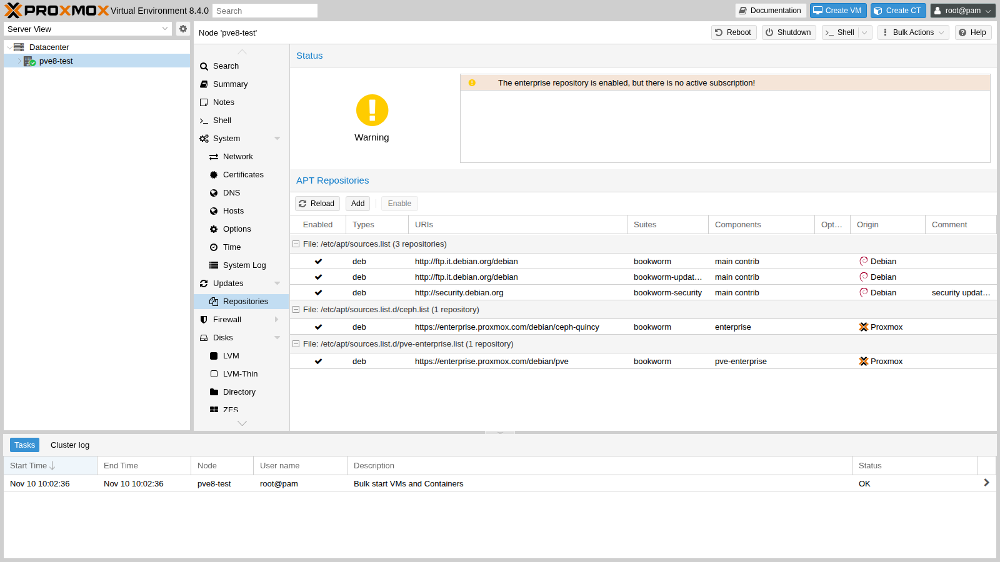
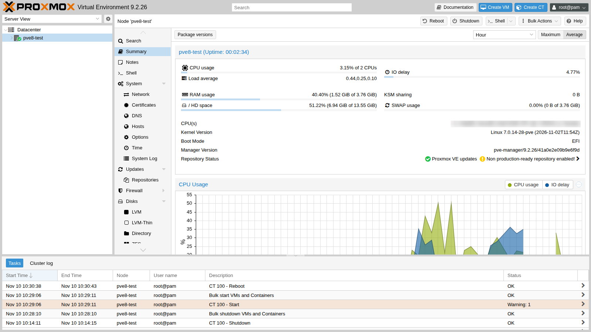
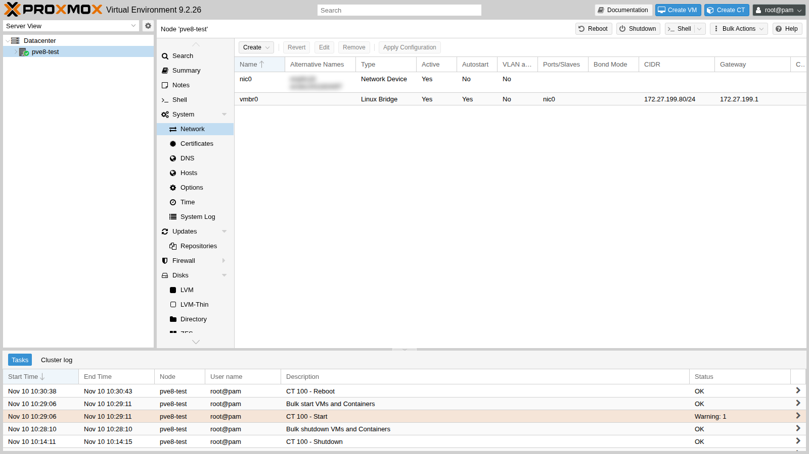
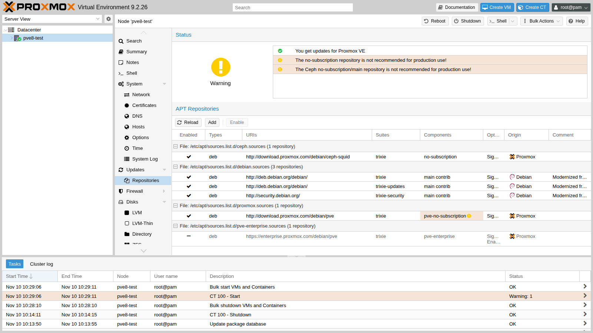

Proxmox VE 9 si basa su Debian 13 *trixie*, Proxmox VE 8 su Debian 12 *bookworm*: il passaggio è un **aggiornamento di versione maggiore**, fatto sul posto (*in place*), un nodo alla volta. In questa appendice lo esegui davvero, dall'inizio alla fine, su un nodo di prova Proxmox VE 8.4, seguendo la guida ufficiale e risolvendo uno per uno gli avvisi dello strumento di controllo `pve8to9`. In fondo trovi la procedura per un cluster con Ceph.

## Dipendenze

- **Lab precedenti:** [Lab 03](/it/03-install-proxmox-ve/) per l'installazione, [Lab 04](/it/04-first-access-repositories-updates/) per repository, proxy e aggiornamenti, [Lab 10](/it/10-zfs/) per il pool `tank` di `desopve04`.
- **Nodo di prova:** `pve8-test.proxmox.community` (172.27.199.80), una VM su `desopve04` (VMID 800, CPU di tipo `host`, così Proxmox VE può usare KVM dentro la VM: 2 vCPU, 4 GiB di RAM, disco da 32 GiB sullo storage `tank`, firmware UEFI), installata con la ISO ufficiale `proxmox-ve_8.4-1.iso`. È un nodo usa e getta: alla fine dell'appendice si elimina.
- **Servizi del laboratorio:** proxy `proxy.proxmox.community:3128`, NTP, DNS `172.27.199.20`, gateway `rtr-core`.
- **Credenziali:** `root` / `<password-lab>` → [Appendice B](/it/b-credentials-and-addresses/).

## Obiettivi

- Preparare un nodo 8.4 all'aggiornamento e portarlo all'ultima versione 8.4.x.
- Usare `pve8to9 --full` prima, durante e dopo l'aggiornamento, risolvendo gli avvisi.
- Passare i repository a *trixie* nel formato **deb822**.
- Eseguire l'aggiornamento, gestire i file di configurazione cambiati e verificare il nodo dopo il riavvio.
- Conoscere l'ordine corretto per un cluster con Ceph e alta disponibilità.

## Come funziona

**Un aggiornamento di versione maggiore** cambia insieme la distribuzione Debian, il kernel (dal 6.8 della 8.4 al 7.0 della 9.2), QEMU, LXC, ZFS e molti servizi di sistema. Non si reinstalla nulla: `apt` sostituisce i pacchetti e la configurazione dei guest resta in `/etc/pve`.

**`pve8to9`** è uno script di controllo incluso negli ultimi pacchetti 8.4. Non modifica niente: verifica versioni, cluster, Ceph, storage, guest, bootloader e servizi, e classifica i risultati in `PASS`, `SKIP`, `NOTICE`, `WARN` e `FAIL`. Va eseguito **più volte**: prima dell'aggiornamento, dopo ogni correzione, prima del riavvio e dopo.

**Il formato deb822** sostituisce le righe `deb …` dei file `.list` con file `.sources` a campi (`Types`, `URIs`, `Suites`, `Components`, `Signed-By`). Proxmox VE 9 lo usa per i propri repository.

**Provare prima su un nodo di prova** è il consiglio esplicito della guida ufficiale: un nodo 8.4 installato in una VM, con una configurazione simile a quella di produzione, permette di vedere in anticipo avvisi, domande e tempi.

## Procedura

### 1. Il nodo di prova, installato in automatico

Per non ripetere l'installazione guidata del [Lab 03](/it/03-install-proxmox-ve/), il nodo di prova usa l'**installazione automatica**: un file di risposte `answer.toml` incorporato nella ISO.

1. Su `desopve04` scarica la ISO 8.4 tramite il proxy (sul proxy serve `enterprise.proxmox.com`) e verificane l'impronta: quella calcolata da `sha256sum` deve coincidere con la riga del file `SHA256SUMS` della stessa cartella.

   ```bash
   cd /var/lib/vz/template/iso
   export https_proxy=http://proxy.proxmox.community:3128
   wget https://enterprise.proxmox.com/iso/proxmox-ve_8.4-1.iso https://enterprise.proxmox.com/iso/SHA256SUMS
   grep proxmox-ve_8.4-1.iso SHA256SUMS; sha256sum proxmox-ve_8.4-1.iso
   ```

   ```text output
   d237d70ca48a9f6eb47f95fd4fd337722c3f69f8106393844d027d28c26523d8  proxmox-ve_8.4-1.iso
   ```

2. Installa l'assistente e scrivi il file di risposte. Contiene la password di `root` in chiaro: tienilo in una cartella in memoria come `/dev/shm` e cancellalo appena creata la ISO (`rm /dev/shm/answer.toml`).

   ```toml
   [global]
   keyboard = "it"
   country = "it"
   fqdn = "pve8-test.proxmox.community"
   mailto = "admin@proxmox.community"
   timezone = "Europe/Rome"
   root-password = "<password-lab>"

   [network]
   source = "from-answer"
   cidr = "172.27.199.80/24"
   dns = "172.27.199.20"
   gateway = "172.27.199.1"
   filter.ID_NET_DRIVER = "virtio_net"

   [disk-setup]
   filesystem = "ext4"
   disk-list = ["sda"]
   ```

   ```bash title="root@desopve04"
   apt install proxmox-auto-install-assistant
   proxmox-auto-install-assistant validate-answer /dev/shm/answer.toml
   ```

   ```text output
   The answer file was parsed successfully, no errors found!
   ```

   ```bash title="root@desopve04"
   proxmox-auto-install-assistant prepare-iso proxmox-ve_8.4-1.iso --fetch-from iso \
         --answer-file /dev/shm/answer.toml --output /var/lib/vz/template/iso/pve84-auto.iso
   ```

   ```text output
   Checking provided answer file...
   Copying source ISO to temporary location...
   Preparing ISO...
   Moving prepared ISO to target location...
   Final ISO is available at /var/lib/vz/template/iso/pve84-auto.iso.
   ```

   :::note[Chiavi con il trattino]
   Dalla ISO 8.4-1 le chiavi del file di risposte si scrivono in *kebab-case* (`root-password`, `disk-list`). Con il vecchio stile (`root_password`, `disk_list`) l'assistente segnala `deprecated key` e la validazione termina con `Error: Found issues in the answer file`.
   :::

3. Crea la VM con il disco su `tank` e avviala. L'ordine di avvio mette prima il disco: al primo avvio è vuoto e parte la ISO, dopo l'installazione parte il sistema installato, senza ripetere l'installazione.

   ```bash title="root@desopve04"
   qm create 800 --name pve8-test --memory 4096 --cores 2 --cpu host --machine q35 \
         --bios ovmf --efidisk0 tank:1,efitype=4m,pre-enrolled-keys=0 --scsihw virtio-scsi-single \
         --scsi0 tank:32,discard=on,iothread=1 --net0 virtio,bridge=vmbr0 \
         --ide2 local:iso/pve84-auto.iso,media=cdrom --boot "order=scsi0;ide2" --ostype l26
   qm start 800
   ```

4. Pochi minuti dopo il nodo risponde in SSH:

   ```bash title="root@pve8-test"
   hostname -f; pveversion
   ```

   ```text output
   pve8-test.proxmox.community
   pve-manager/8.4.0/ec58e45e1bcdf2ac (running kernel: 6.8.12-9-pve)
   ```

### 2. Portare il nodo all'ultima versione 8.4

La guida ufficiale richiede come punto di partenza l'**ultima** 8.4. Il nodo appena installato ha i repository *enterprise*, senza sottoscrizione:



1. Imposta il proxy per `apt`, usa il mirror Debian consentito dal proxy e passa ai repository *no-subscription* di bookworm, come nel [Lab 04](/it/04-first-access-repositories-updates/):

   ```bash
   echo 'Acquire::http::Proxy "http://proxy.proxmox.community:3128";' > /etc/apt/apt.conf.d/76pveproxy
   sed -i 's#http://ftp.it.debian.org/debian#http://deb.debian.org/debian#' /etc/apt/sources.list
   sed -i 's/^deb/#deb/' /etc/apt/sources.list.d/pve-enterprise.list /etc/apt/sources.list.d/ceph.list
   echo "deb http://download.proxmox.com/debian/pve bookworm pve-no-subscription" > /etc/apt/sources.list.d/pve-no-subscription.list
   echo "deb http://download.proxmox.com/debian/ceph-squid bookworm no-subscription" > /etc/apt/sources.list.d/ceph-squid.list
   ```

2. Aggiorna e riavvia nel nuovo kernel:

   ```bash title="root@pve8-test"
   apt update && apt dist-upgrade
   ```

   ```text output
   232 upgraded, 8 newly installed, 0 to remove and 0 not upgraded.
   ```

   ```bash title="root@pve8-test"
   reboot
   ```

   ```text output
   …
   ```

   ```bash title="root@pve8-test"
   pveversion
   ```

   ```text output
   pve-manager/8.4.21/2606ac850d46da29 (running kernel: 6.8.12-43-pve)
   ```

3. Per avere un guest da "portare" attraverso l'aggiornamento, crea un container Debian 12. Il primo `pveam update` fallisce: `apt` usa il proxy del suo file di configurazione, mentre `pveam` usa quello del **datacenter**.

   ```bash title="root@pve8-test"
   pveam update
   ```

   ```text output
   update failed - see /var/log/pveam.log for details
   ```

   ```bash title="root@pve8-test"
   pvesh set /cluster/options --http_proxy http://proxy.proxmox.community:3128
   pveam update
   ```

   ```text output
   update successful
   ```

   ```bash title="root@pve8-test"
   pveam download local debian-12-standard_12.12-1_amd64.tar.zst
   pct create 100 local:vztmpl/debian-12-standard_12.12-1_amd64.tar.zst --hostname ct-test \
         --unprivileged 1 --memory 512 --rootfs local-lvm:4 \
         --net0 name=eth0,bridge=vmbr0,ip=172.27.199.81/24,gw=172.27.199.1 --onboot 1
   pct start 100
   ```

### 3. Il controllo con `pve8to9`

```bash
pve8to9 --full
```

Estratto dell'output reale (le righe `PASS` sono omesse):

```text
= CHECKING VERSION INFORMATION FOR PVE PACKAGES =
PASS: proxmox-ve package has version >= 8.4-0
PASS: running kernel '6.8.12-43-pve' is considered suitable for upgrade.

= CHECKING CLUSTER HEALTH/SETTINGS =
SKIP: standalone node.

= VIRTUAL GUEST CHECKS =
WARN: 1 running guest(s) detected - consider migrating or stopping them.

= MISCELLANEOUS CHECKS =
NOTICE: Less than 10 GB free space on root file system.
INFO: Checking bootloader configuration...
FAIL: systemd-boot meta-package installed. This will cause problems on upgrades of other boot-related packages.
      Remove 'systemd-boot' See https://pve.proxmox.com/wiki/Upgrade_from_8_to_9#sd-boot-warning for more information.
NOTICE: storage 'local-lvm' has guest volumes with autoactivation enabled
WARN: The matching CPU microcode package 'intel-microcode' could not be found!

= SUMMARY =
TOTAL:    42
PASSED:   31
SKIPPED:  5
WARNINGS: 2
FAILURES: 1
```

Ogni voce si affronta così:

1. **`FAIL: systemd-boot meta-package installed`.** Prima controlla quale bootloader usa il nodo. Qui è UEFI con GRUB, e `proxmox-boot-tool` non è in uso (gestisce le partizioni ESP delle installazioni con root su ZFS, in BIOS e in UEFI; `systemd-boot` si usa solo con ZFS e UEFI senza Secure Boot):

   ```bash title="root@pve8-test"
   proxmox-boot-tool status
   ```

   ```text output
   E: /etc/kernel/proxmox-boot-uuids does not exist.
   ```

   ```bash title="root@pve8-test"
   dpkg -l | grep -E "^ii  (grub-efi-amd64 |systemd-boot)"
   ```

   ```text output
   ii  grub-efi-amd64          2.06-13+pmx7
   ii  systemd-boot            252.39-1~deb12u2
   ii  systemd-boot-efi:amd64  252.39-1~deb12u2
   ```

   ```bash title="root@pve8-test"
   apt remove systemd-boot
   ```

   Il meta-pacchetto si può rimuovere senza rischi: il nodo continua ad avviarsi con GRUB.

2. **`NOTICE … autoactivation enabled`.** Da Proxmox VE 9 i volumi LVM dei guest non si attivano più da soli all'avvio: li attiva Proxmox VE quando servono. Su storage LVM **condivisi** (iSCSI, FC) è fortemente consigliato convertire anche i volumi esistenti; su storage locali è facoltativo. Lo script, senza opzioni, chiede conferma e in un contesto non interattivo risponde no; con `--assume-yes` esegue:

   ```bash title="root@pve8-test"
   /usr/share/pve-manager/migrations/pve-lvm-disable-autoactivation --assume-yes
   ```

   ```text output
     Logical volume pve/vm-100-disk-0 changed.
   PASS: all guest volumes on storage 'local-lvm' now have autoactivation disabled
   ```

3. **Nomi delle schede di rete.** Il kernel nuovo può cambiare i nomi delle schede derivati dall'indirizzo PCI: se `enp6s18` diventasse un altro nome, il bridge `vmbr0` resterebbe senza porta e il nodo **senza rete**. Lo strumento `pve-network-interface-pinning`, già presente nell'ultima 8.4, fissa i nomi a `nicN` legandoli al MAC:

   ```bash title="root@pve8-test"
   pve-network-interface-pinning generate
   ```

   ```text output
   Name for link 'enp6s18' will change to 'nic0'
   Generating link files
   Successfully generated .link files in '/usr/local/lib/systemd/network/'
   Updating /etc/network/interfaces.new
   Successfully updated Proxmox VE configuration files.

   Please reboot to apply the changes to your configuration
   ```

   Il riavvio arriva comunque a fine aggiornamento: i nomi nuovi si applicano in quel momento.

4. **`WARN: 1 running guest(s)`.** In un cluster i guest si migrano su un altro nodo; su un nodo singolo si spengono: `pct shutdown 100`.

5. **`WARN … intel-microcode`.** Su un server fisico abilita il componente `non-free-firmware` e installa `intel-microcode` (o `amd64-microcode`). Il nodo di prova è una VM: il microcode lo gestisce l'host, quindi l'avviso si può ignorare.

6. **`NOTICE: Less than 10 GB free`.** Il minimo richiesto è 5 GB, consigliati 10: qui ci sono 8,7 GB liberi, sufficienti.

Secondo giro del controllo:

```text
NOTICE: Less than 10 GB free space on root file system.
WARN: The matching CPU microcode package 'intel-microcode' could not be found!
TOTAL:    42
PASSED:   35
SKIPPED:  5
WARNINGS: 1
FAILURES: 0
```

### 4. I repository di trixie in formato deb822

1. Debian: sostituisci *bookworm* con *trixie*.

   ```bash
   sed -i 's/bookworm/trixie/g' /etc/apt/sources.list
   ```

2. Proxmox VE e Ceph: togli i vecchi file `.list` e crea i nuovi `.sources`. Il repository Ceph va aggiornato anche se Ceph non è installato: alcuni pacchetti client vengono da lì.

   ```bash
   rm /etc/apt/sources.list.d/{pve-no-subscription,ceph-squid,pve-enterprise,ceph}.list
   cat > /etc/apt/sources.list.d/proxmox.sources << EOF
   Types: deb
   URIs: http://download.proxmox.com/debian/pve
   Suites: trixie
   Components: pve-no-subscription
   Signed-By: /usr/share/keyrings/proxmox-archive-keyring.gpg
   EOF
   cat > /etc/apt/sources.list.d/ceph.sources << EOF
   Types: deb
   URIs: http://download.proxmox.com/debian/ceph-squid
   Suites: trixie
   Components: no-subscription
   Signed-By: /usr/share/keyrings/proxmox-archive-keyring.gpg
   EOF
   ```

3. Verifica che `apt` veda **solo** i repository di trixie:

   ```bash title="root@pve8-test"
   apt update && apt policy
   ```

   ```text output
   …
    500 http://deb.debian.org/debian trixie/contrib amd64 Packages
    500 http://deb.debian.org/debian trixie/main amd64 Packages
    500 http://deb.debian.org/debian trixie-updates/main amd64 Packages
    500 http://download.proxmox.com/debian/ceph-squid trixie/no-subscription amd64 Packages
    500 http://download.proxmox.com/debian/pve trixie/pve-no-subscription amd64 Packages
    500 http://security.debian.org trixie-security/contrib amd64 Packages
    500 http://security.debian.org trixie-security/main amd64 Packages
   ```

### 5. L'aggiornamento

```bash
apt dist-upgrade
```

La guida ufficiale raccomanda di eseguirlo dalla console del server, o da SSH dentro `tmux`/`screen`, **mai** dalla console web della GUI, che si interrompe durante l'aggiornamento. Durante l'esecuzione `apt` chiede cosa fare dei file di configurazione modificati. Le risposte consigliate dalla guida:

| File | Risposta consigliata |
|---|---|
| `/etc/issue` | tenere la versione installata (la rigenera Proxmox VE all'avvio) |
| `/etc/lvm/lvm.conf` | la guida indica la versione del pacchetto se non l'hai modificato tu; ma controlla il `global_filter` di Proxmox VE (vedi sotto) |
| `/etc/ssh/sshd_config` | versione del pacchetto, se non l'hai modificato tu |
| `/etc/default/grub` | tenere la versione installata, se contiene opzioni del kernel aggiunte da te |
| `/etc/chrony/chrony.conf` | versione del pacchetto; le personalizzazioni vanno in `conf.d` o `sources.d` |

Nel laboratorio l'aggiornamento è stato lanciato in modo non interattivo dentro un'unità di systemd, così una disconnessione SSH non lo interrompe. È stata tenuta la versione installata di tutti i file, e le differenze si controllano dopo:

```bash title="root@pve8-test"
systemd-run --unit=pve-upgrade89 --setenv=DEBIAN_FRONTEND=noninteractive apt-get -y -o Dpkg::Options::=--force-confdef \
      -o Dpkg::Options::=--force-confold dist-upgrade
journalctl -fu pve-upgrade89
```

```text output
…
593 upgraded, 155 newly installed, 59 to remove and 0 not upgraded.
```

- **Durata:** 12 minuti e 26 secondi (dalle 10:14:40 alle 10:27:06), sul disco della VM di prova. Su un server con SSD bastano pochi minuti; su dischi meccanici può servire più di un'ora.
- **Pacchetti rimossi:** sono librerie rinominate in Debian 13 (per esempio `libgnutls30` → `libgnutls30t64`): la loro sostituzione è normale.

Al termine `apt` ha lasciato due versioni nuove da valutare:

```bash title="root@pve8-test"
find /etc -name "*.dpkg-dist"
```

```text output
/etc/issue.dpkg-dist
/etc/lvm/lvm.conf.dpkg-dist
```

```bash title="root@pve8-test"
diff <(grep -vE '^\s*#|^\s*$' /etc/lvm/lvm.conf) <(grep -vE '^\s*#|^\s*$' /etc/lvm/lvm.conf.dpkg-dist)
```

```text output
…
< devices {
<      global_filter=["r|/dev/zd.*|","r|/dev/rbd.*|"]
```

Il `lvm.conf` installato contiene il **filtro di Proxmox VE**, che impedisce a LVM di esaminare i volumi ZFS e Ceph dei guest: la versione del pacchetto non lo ha. Qui la scelta giusta è tenere la versione installata. Se scegli quella del pacchetto, devi reinserire il filtro. Per `/etc/issue` vale la regola della tabella. Dopo la verifica i file `.dpkg-dist` si eliminano.

Il controllo **prima del riavvio**:

```text
WARN: a suitable kernel (proxmox-kernel-7.0) is installed, but an unsuitable (6.8.12-43-pve) is booted, missing reboot?!
WARN: No (active) time synchronisation daemon (NTP) detected, but synchronized systems are important, especially for cluster and/or ceph!
```

Il primo avviso dice semplicemente che serve il riavvio. Il secondo deriva da `chrony`, che nella fase di aggiornamento non è ripartito:

```text
chronyd[23845]: chronyd version 4.8 starting (+CMDMON +REFCLOCK +RTC +PRIVDROP +SCFILTER +SIGND +NTS +SECHASH +IPV6 -DEBUG)
chronyd[23845]: Fatal error : Could not send notification to $NOTIFY_SOCKET
systemd[1]: Failed to start chrony.service - chrony, an NTP client/server.
```

Il nuovo `chronyd` parla con il `systemd` di bookworm, ancora in esecuzione fino al riavvio. È un errore **transitorio**: dopo il riavvio il servizio parte normalmente.

### 6. Il riavvio e le verifiche

```bash title="root@pve8-test"
reboot
```

```text output
…
```

```bash title="root@pve8-test"
uname -r; pveversion
```

```text output
7.0.14-28-pve
pve-manager/9.2.26/41a0e2e09b9e6f9d (running kernel: 7.0.14-28-pve)
```

```bash title="root@pve8-test"
pveversion -v | grep -E "^(proxmox-ve|pve-qemu-kvm|qemu-server|lxc-pve|zfsutils-linux|corosync|ifupdown2)"
```

```text output
proxmox-ve: 9.2.0 (running kernel: 7.0.14-28-pve)
corosync: 3.2.0-pve1
ifupdown2: 3.3.0-1+pmx13
lxc-pve: 7.0.0-2
pve-qemu-kvm: 11.1.3-1
qemu-server: 9.2.15
zfsutils-linux: 2.4.4-pve1
```

```bash title="root@pve8-test"
systemctl is-active chrony pveproxy pvedaemon pvestatd pve-cluster pve-firewall
```

```text output
active
active
active
active
active
active
```

```bash title="root@pve8-test"
systemctl --failed --no-legend
ip -br link | grep -v lo
```

```text output
nic0             UP             …
vmbr0            UP             …
```

- Tutti i servizi sono attivi e non ci sono unità fallite.
- La scheda ora si chiama `nic0` e `vmbr0` la usa come porta: il pinning del passo 3 ha funzionato.





Il container è ripartito da solo (`onboot`), ma il task di avvio riporta un avviso:

```bash title="root@pve8-test"
pvenode task log <UPID dell'avvio del CT 100>
```

```text output
WARN: Systemd 252 detected. You may need to enable nesting.
TASK WARNINGS: 1
```

```bash title="root@pve8-test"
pct set 100 --features nesting=1 && pct reboot 100
pct exec 100 -- systemctl is-system-running
```

```text output
running
```

Il container era stato creato da riga di comando senza la funzionalità `nesting`, che la GUI attiva per default nei container non privilegiati. Con Proxmox VE 9 il systemd dei container la richiede: attivala prima di aggiornare, o subito dopo.

Infine `pve8to9` resta solo con l'avviso sul microcode, che sulla VM di prova non ha effetto:

```text
TOTAL:    42
PASSED:   34
SKIPPED:  5
WARNINGS: 1
FAILURES: 1
```

Il `FAIL` residuo è `unable to determine installed intel-microcode version`: su un nodo fisico si risolve installando il pacchetto del microcode.

### 7. Dopo l'aggiornamento: repository moderni

1. Converti anche il `sources.list` di Debian nel formato deb822:

   ```bash title="root@pve8-test"
   apt modernize-sources
   ```

   ```text output
   Rewrite 1 sources? [Y/n] Y
   Modernizing /etc/apt/sources.list...
   - Writing /etc/apt/sources.list.d/debian.sources
   ```

   Il vecchio file resta come `sources.list.bak`: dopo la verifica si può eliminare.

2. **Il repository enterprise ricompare.** Il pacchetto `pve-manager` di Proxmox VE 9 installa il file `pve-enterprise.sources`, e senza sottoscrizione `apt update` fallisce:

   ```text output
   E: The repository 'https://enterprise.proxmox.com/debian/pve trixie InRelease' is not signed.
   ```

   ```bash title="root@pve8-test"
   dpkg -S /etc/apt/sources.list.d/pve-enterprise.sources
   ```

   ```text output
   pve-manager: /etc/apt/sources.list.d/pve-enterprise.sources
   ```

   Il file appartiene al pacchetto, quindi non va cancellato ma **disattivato**: dalla GUI (**Repositories → Disable**) o con il campo `Enabled: false`:

   ```bash
   echo "Enabled: false" >> /etc/apt/sources.list.d/pve-enterprise.sources
   ```



### 8. Pulizia

Il nodo di prova ha esaurito il suo compito. La ISO preparata contiene la password di `root` in chiaro: qui si sovrascrive con `shred` prima di cancellarla (su SSD e su filesystem copy-on-write come ZFS `shred` non garantisce la cancellazione, quindi la password del nodo di prova non va riusata altrove):

```bash
qm stop 800; qm destroy 800 --purge 1 --destroy-unreferenced-disks 1
shred -u /var/lib/vz/template/iso/pve84-auto.iso
rm /var/lib/vz/template/iso/proxmox-ve_8.4-1.iso /var/lib/vz/template/iso/SHA256SUMS
apt remove proxmox-auto-install-assistant
```

## Aggiornare un cluster con Ceph e alta disponibilità

:::note[Procedura]
Questa parte **non** è stata eseguita nel laboratorio, che è già su Proxmox VE 9.2: riassume i passi della [guida ufficiale](https://pve.proxmox.com/wiki/Upgrade_from_8_to_9) per un cluster. Segui sempre la guida aggiornata prima di intervenire in produzione.
:::

1. **Prerequisiti su tutti i nodi:**
   - ultima versione 8.4 installata;
   - cluster sano (`pvecm status`) e Ceph in `HEALTH_OK`;
   - backup recenti e verificati di tutti i guest;
   - accesso alla console fuori banda (IPMI/iKVM) di ogni nodo.
2. **Ceph prima di tutto.** Proxmox VE 9 richiede Ceph **19.2 Squid**. Se il cluster usa Quincy o Reef, aggiorna Ceph *prima* di aggiornare Proxmox VE, con le guide [Ceph Quincy to Reef](https://pve.proxmox.com/wiki/Ceph_Quincy_to_Reef) e [Ceph Reef to Squid](https://pve.proxmox.com/wiki/Ceph_Reef_to_Squid). Controlla con `ceph --version` su ogni nodo.
3. **Un nodo alla volta:**
   - libera il nodo: migra i guest altrove, o metti il nodo in manutenzione HA con `ha-manager crm-command node-maintenance enable <nodo>`;
   - imposta `ceph osd set noout`, per evitare ribilanciamenti durante il riavvio;
   - esegui sul nodo i passi 3–6 di questa appendice e verifica `pvecm status`, `ceph -s` e i servizi;
   - togli la manutenzione e passa al nodo successivo; alla fine `ceph osd unset noout`.
4. **Migrazioni in un cluster misto:** spostare un guest da un nodo 8 a un nodo 9 funziona sempre; il contrario può funzionare ma non è supportato. Aggiorna quindi i nodi senza far tornare indietro i guest. Se una migrazione avviata dalla GUI di un nodo già aggiornato dà errori, ripetila dalla GUI del nodo ancora alla versione 8.
5. **HA:** i gruppi HA vengono convertiti automaticamente in **HA rules** quando **tutti** i nodi sono alla versione 9 (vedi il [Lab 49](/it/49-high-availability/)). In caso di problemi controlla `journalctl -eu pve-ha-crm` sul nodo CRM attivo.
6. **Bootloader:** con ZFS come root e UEFI senza Secure Boot il nodo si avvia con `systemd-boot`, gestito da `proxmox-boot-tool`. Rimuovi il meta-pacchetto `systemd-boot` quando `pve8to9` lo chiede, e tieni `systemd-boot-efi` e `systemd-boot-tools` se lo script lo indica. Con LVM su UEFI assicurati che `grub-efi-amd64` sia installato.
7. **Reti:** fissa i nomi delle schede con `pve-network-interface-pinning generate` **prima** dell'aggiornamento su tutti i nodi. Un nome cambiato su una scheda di Corosync o di Ceph isola il nodo.
8. **Altre novità di Debian 13 da conoscere:**
   - `/etc/sysctl.conf` non viene più letto: sposta le impostazioni in `/etc/sysctl.d/<NN>-<nome>.conf`;
   - `/tmp` diventa un `tmpfs` che usa fino al 50% della RAM, e i file in `/tmp` e `/var/tmp` vengono puliti periodicamente;
   - dopo l'aggiornamento di tutti i nodi Ceph può segnalare chiavi di servizio considerate non sicure: la guida spiega la migrazione delle chiavi.
9. **Ceph dopo Proxmox VE:** il cluster resta su Squid. Le installazioni nuove della 9.2 usano Ceph 20 Tentacle, come nel [Lab 17](/it/17-ceph-installation/). Quando vuoi passare a Tentacle, segui la guida [Ceph Squid to Tentacle](https://pve.proxmox.com/wiki/Ceph_Squid_to_Tentacle), sempre un nodo alla volta.

## Verifica e test

- `pveversion` riporta `pve-manager/9.2.26` con kernel `7.0.14-28-pve`.
- `pve8to9 --full` non segnala problemi bloccanti; restano solo gli avvisi sul microcode, attesi in una VM.
- `apt policy` elenca solo repository di trixie; quello enterprise è disattivato.
- La scheda di rete si chiama `nic0` e la rete funziona.
- Il container creato su 8.4 riparte dopo l'aggiornamento e raggiunge il gateway.

## Stato finale del lab

- La VM di prova 800 `pve8-test` è **eliminata**, insieme ai suoi dischi su `tank`.
- Le ISO e il file di risposte sono distrutti, e su `desopve04` l'assistente dell'installazione automatica è disinstallato.
- Il resto del laboratorio è invariato.

## Cosa hai imparato

- Un aggiornamento di versione maggiore si prova prima su un nodo di prova: in un'ora si scoprono avvisi e domande che in produzione costerebbero caro.
- `pve8to9` si esegue a ogni passo; ogni `FAIL` e `WARN` ha una causa precisa, da risolvere o da capire.
- Nel laboratorio sono emersi problemi reali:
  - il meta-pacchetto `systemd-boot` da togliere;
  - i volumi LVM con l'attivazione automatica;
  - `chrony` che non riparte prima del riavvio;
  - il container che chiede `nesting`;
  - il repository enterprise che ricompare dopo l'aggiornamento.
- I nomi delle schede vanno fissati prima dell'aggiornamento: un nodo senza rete dopo il riavvio si recupera solo dalla console.
- In un cluster l'ordine conta: prima Ceph Squid, poi un nodo alla volta, con `noout` e la manutenzione HA.

## Riferimenti

- [Upgrade from 8 to 9](https://pve.proxmox.com/wiki/Upgrade_from_8_to_9)
- [Package Repositories](https://pve.proxmox.com/wiki/Package_Repositories)
- [Automated Installation](https://pve.proxmox.com/wiki/Automated_Installation)
- [Ceph Reef to Squid](https://pve.proxmox.com/wiki/Ceph_Reef_to_Squid) e [Ceph Squid to Tentacle](https://pve.proxmox.com/wiki/Ceph_Squid_to_Tentacle)
- [Proxmox VE Roadmap – note di rilascio e problemi noti della 9.x](https://pve.proxmox.com/wiki/Roadmap)
- [Debian 13 trixie – Release Notes](https://www.debian.org/releases/trixie/release-notes/)
