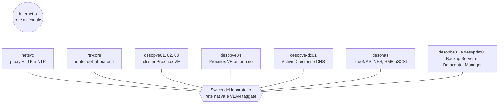

import { Aside, Steps } from '@astrojs/starlight/components';
import Section from '../../../components/home/Section.astro';
import Diagram from '../../../components/home/Diagram.astro';
import PathRail from '../../../components/home/PathRail.astro';
import PathGrid from '../../../components/home/PathGrid.astro';
import PathCard from '../../../components/home/PathCard.astro';
import FeatureGrid from '../../../components/home/FeatureGrid.astro';
import Feature from '../../../components/home/Feature.astro';
import CtaBand from '../../../components/home/CtaBand.astro';

<Section id="one-lab" eyebrow="Il laboratorio">

## Un solo laboratorio, costruito lab dopo lab

Non sono esercizi isolati. Tutti i lab si svolgono sullo **stesso laboratorio**, che cresce man mano: ogni lab parte da quello che i precedenti hanno lasciato configurato e lo descrive nella sezione **Stato finale**. Così, alla fine del percorso, hai costruito e messo alla prova un datacenter Proxmox VE completo.

Il [Lab 01](/it/01-lab-architecture/) descrive l'hardware, le reti, le VLAN e il piano degli indirizzi, e spiega come preparare tutto prima di cominciare.

<Diagram caption="Il laboratorio: un solo switch con VLAN taggate collega tutte le macchine del percorso.">

</Diagram>

</Section>

<Section id="the-path" eyebrow="Il percorso">

## Parte 0, poi A → B → C → D

I quattro percorsi si seguono in quest'ordine. Prima di ogni lab controlla le sue **Dipendenze**: il [grafo delle dipendenze](/it/the-lab/#dipendenze-tra-i-lab) le riassume tutte.

<PathRail
  label="Il percorso in breve"
  parts={[
    { id: '0', name: 'Lab di base', labs: 7, href: '/it/01-lab-architecture/' },
    { id: 'A', name: 'Storage', labs: 12, href: '/it/08-storage-model/' },
    { id: 'B', name: 'Rete', labs: 15, href: '/it/20-bridges-stable-names-vlans/' },
    { id: 'C', name: 'Calcolo', labs: 8, href: '/it/35-kvm-qemu/' },
    { id: 'D', name: 'Servizi integrati', labs: 11, href: '/it/43-active-directory-realm-ldaps/' },
  ]}
/>

<PathGrid>
  <PathCard part="0" icon="server" title="Parte 0 – Il laboratorio di base" range="Lab 01–07" count="7 lab" href="/it/01-lab-architecture/" cta="Lab 01">
    Domain controller, installazione di Proxmox VE, repository e aggiornamenti, SSH e CLI, cluster a tre nodi, prima VM e primo container.
  </PathCard>
  <PathCard part="A" icon="storage" title="A – Storage" range="Lab 08–19" count="12 lab" href="/it/08-storage-model/" cta="Lab 08">
    LVM, ZFS e replica, NAS con NFS, SMB e iSCSI multipath, snapshot, Ceph dall'installazione ai guasti, benchmark con fio.
  </PathCard>
  <PathCard part="B" icon="network" title="B – Rete" range="Lab 20–34" count="15 lab" href="/it/20-bridges-stable-names-vlans/" cta="Lab 20">
    Bridge e VLAN, bond, reti dedicate, Open vSwitch, routing e NAT, IPv6, router virtuale, SDN fino a EVPN e Fabrics, firewall.
  </PathCard>
  <PathCard part="C" icon="cpu" title="C – Calcolo" range="Lab 35–42" count="8 lab" href="/it/35-kvm-qemu/" cta="Lab 35">
    KVM e QEMU sotto il cofano, memoria, dischi e controller virtuali, VM Linux e Windows, template e cloud-init, container LXC, hotplug e limiti.
  </PathCard>
  <PathCard part="D" icon="shield" title="D – Servizi integrati" range="Lab 43–53" count="11 lab" href="/it/43-active-directory-realm-ldaps/" cta="Lab 43">
    Active Directory, permessi e token, 2FA, backup con vzdump e Proxmox Backup Server, migrazioni, alta disponibilità, import da ESXi, metriche, API, Datacenter Manager.
  </PathCard>
  <PathCard part="+" icon="book" title="Appendici" range="Appendici A–D" href="/it/a-upgrade-8-to-9/" cta="Appendice A">
    Aggiornamento da Proxmox VE 8 a 9, credenziali e indirizzi, risoluzione dei problemi, come ricostruire il laboratorio in virtuale.
  </PathCard>
</PathGrid>

</Section>

<Section id="lab-structure" eyebrow="Ogni lab">

## Come è fatto ogni lab

Ogni lab ha la stessa struttura, così sai sempre dove trovare le cose.

<FeatureGrid>
  <Feature icon="dependencies" title="Dipendenze">I lab da completare prima, le macchine e i servizi necessari.</Feature>
  <Feature icon="objectives" title="Obiettivi e Come funziona">La teoria essenziale per capire cosa succede.</Feature>
  <Feature icon="procedure" title="Procedura">Passi numerati: ogni azione nell'interfaccia web con il suo screenshot, ogni comando con l'output reale.</Feature>
  <Feature icon="verify" title="Verifica e test">Spesso con guasti simulati e misurati.</Feature>
  <Feature icon="state" title="Stato finale">Cosa resta configurato per i lab successivi.</Feature>
  <Feature icon="learned" title="Cosa hai imparato">I concetti chiave, più i Riferimenti alla documentazione ufficiale.</Feature>
</FeatureGrid>

</Section>

<Section id="getting-started" eyebrow="Da qui">

## Come iniziare

<Steps>

1. Leggi il [Lab 01](/it/01-lab-architecture/): l'hardware, le reti e la preparazione dello switch, del router e del server di servizi.

2. Scegli la **password del laboratorio**: nel manuale compare come `<password-lab>` ([Appendice B](/it/b-credentials-and-addresses/)).

3. Prosegui in ordine con i lab della Parte 0, poi con i percorsi A, B, C e D.

</Steps>

Non hai i server? L'[Appendice D](/it/d-rebuild-as-virtual/) spiega come ricostruire lo stesso laboratorio in virtuale su un unico server Proxmox VE.

<Aside type="note" title="Dati hardware oscurati">
Negli screenshot sono oscurati i dati che identificano l'hardware del laboratorio: numeri di serie dei dischi, indirizzi MAC delle schede di rete dei server, modelli di CPU e di dischi. Negli output testuali gli stessi dati sono sostituiti da segnaposto come `<seriale-disco-1>`. Sul tuo hardware vedrai valori diversi.
</Aside>

</Section>

<CtaBand
  id="contribute"
  eyebrow="Una community aperta"
  title="Come contribuire"
  primary={{ text: 'Contribuisci', href: '/it/contributing/' }}
  secondary={{ text: 'Next-Guard/Proxmox', href: 'https://github.com/Next-Guard/Proxmox' }}
>
  Proxmox Community nasce per crescere con chi usa Proxmox ogni giorno. Hai una guida, un'esperienza di produzione, una correzione o una traduzione? Ogni proposta arriva come pull request su GitHub e viene rivista prima della pubblicazione.
</CtaBand>
