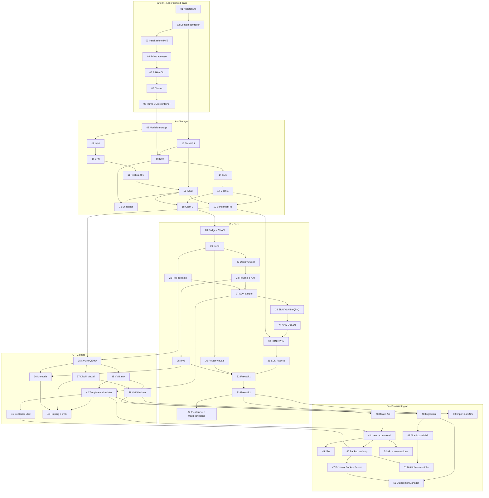

Un percorso pratico su **Proxmox VE 9.2**: si parte da un laboratorio vuoto e si arriva a un datacenter completo con cluster, storage condiviso, Ceph, SDN, backup e alta disponibilità.

Ogni lab segue la stessa struttura:

- **Dipendenze**: lab da completare prima, macchine e servizi necessari;
- **Obiettivi** e **Come funziona**: la teoria essenziale per capire cosa succede;
- **Procedura**: passi numerati, ogni azione nell'interfaccia web con il suo screenshot e ogni comando con l'output reale;
- **Verifica e test**, anche con guasti simulati;
- **Stato finale del lab**: cosa resta configurato per i lab successivi.

Le credenziali e gli indirizzi usati in tutto il manuale sono nell'[Appendice B](/it/b-credentials-and-addresses/).

## Convenzioni

- **Laboratorio.** Tutti i lab si svolgono sullo stesso laboratorio, descritto e preparato nel [Lab 01](/it/01-lab-architecture/): server fisici, uno switch con VLAN, un router e un server di servizi di rete. Per ricostruirlo in virtuale su un unico server Proxmox VE c'è l'[Appendice D](/it/d-rebuild-as-virtual/).
- **Password.** `<password-lab>` indica l'unica password del laboratorio, scelta da te: vedi l'[Appendice B](/it/b-credentials-and-addresses/#la-password-del-laboratorio).
- **Dati hardware oscurati.** Negli screenshot sono oscurati i dati che identificano l'hardware del laboratorio: numeri di serie dei dischi, indirizzi MAC delle schede di rete dei server, modelli di CPU e di dischi. Negli output testuali gli stessi dati sono sostituiti da segnaposto come `<seriale-disco-1>`. Sul tuo hardware vedrai valori diversi.
- **Output.** I blocchi di codice riportano comandi e output reali del laboratorio; i prompt (`root@desopve01:~#`, `PS C:\>`) indicano dove eseguire il comando.

## Come è organizzato

Si parte dalla **Parte 0**, che costruisce il laboratorio di base. Poi i quattro percorsi si svolgono **nell'ordine A → B → C → D**: molti lab riusano quello che i precedenti hanno lasciato configurato, per esempio Ceph (lab 17) e le reti del percorso B. Prima di ogni lab controlla le sue **Dipendenze**; il grafo in fondo a questa pagina le riassume.

### Parte 0 – Il laboratorio di base

| Lab | Titolo |
|---|---|
| 01 | [Architettura e preparazione del laboratorio](/it/01-lab-architecture/) |
| 02 | [Domain controller Windows Server 2025: AD, DNS e NTP](/it/02-domain-controller/) |
| 03 | [Installazione di Proxmox VE 9.2 (ZFS RAID1 ed ext4)](/it/03-install-proxmox-ve/) |
| 04 | [Primo accesso, repository e aggiornamenti](/it/04-first-access-repositories-updates/) |
| 05 | [SSH, shell e strumenti da riga di comando (`pvesh`, `qm`, `pct`)](/it/05-ssh-shell-cli/) |
| 06 | [Cluster a tre nodi e Corosync](/it/06-cluster-corosync/) |
| 07 | [Prima VM e primo container](/it/07-first-vm-and-container/) |

### Percorso A – Storage

| Lab | Titolo |
|---|---|
| 08 | [Il modello di storage di Proxmox VE: tipi di contenuto, formati, thin provisioning](/it/08-storage-model/) |
| 09 | [LVM e LVM-thin: creazione, estensione, overprovisioning, pool pieno](/it/09-lvm-and-lvm-thin/) |
| 10 | [ZFS: pool, mirror e RAIDZ, ARC, compressione, snapshot, send/receive, guasto e resilver](/it/10-zfs/) |
| 11 | [Replica ZFS tra nodi e failover manuale](/it/11-zfs-replication/) |
| 12 | [NAS TrueNAS: installazione e preparazione](/it/12-truenas-nas/) |
| 13 | [NFS: export, opzioni di mount, prestazioni, caduta del NAS](/it/13-nfs/) |
| 14 | [SMB/CIFS: condivisione autenticata, permessi e confronto con NFS](/it/14-smb-cifs/) |
| 15 | [iSCSI con LVM condiviso e multipath, caduta di un percorso](/it/15-iscsi-lvm-multipath/) |
| 16 | [Snapshot: con e senza RAM, rollback, alberi e volume chain](/it/16-snapshots/) |
| 17 | [Ceph 1: architettura, installazione, pool RBD e CephFS](/it/17-ceph-installation/) |
| 18 | [Ceph 2: crescita, manutenzione, configurazione dei pool e guasti](/it/18-ceph-growth-maintenance-failures/) |
| 19 | [Benchmark comparativo dello storage con fio](/it/19-fio-benchmark/) |

### Percorso B – Rete

| Lab | Titolo |
|---|---|
| 20 | [Linux bridge, nomi stabili delle schede di rete, bridge VLAN-aware](/it/20-bridges-stable-names-vlans/) |
| 21 | [Bond: active-backup, balance-alb e LACP, caduta di un link](/it/21-bonding/) |
| 22 | [Reti dedicate: Corosync, migrazione e storage](/it/22-dedicated-networks/) |
| 23 | [Open vSwitch: bridge, bond e VLAN con OVS](/it/23-open-vswitch/) |
| 24 | [Routing e NAT sull'host: masquerading, configurazione routed, port forwarding](/it/24-routing-nat/) |
| 25 | [IPv6: dual stack, RA e SLAAC](/it/25-ipv6/) |
| 26 | [Router e firewall virtuale tra VLAN: MikroTik CHR (OPNsense come alternativa)](/it/26-virtual-router/) |
| 27 | [SDN 1: zona Simple, SNAT, DHCP e IPAM](/it/27-sdn-simple/) |
| 28 | [SDN 2: zone VLAN e QinQ](/it/28-sdn-vlan-qinq/) |
| 29 | [SDN 3: zona VXLAN](/it/29-sdn-vxlan/) |
| 30 | [SDN 4: EVPN con BGP, exit node e anycast gateway](/it/30-sdn-evpn/) |
| 31 | [SDN 5: Fabrics (OpenFabric) e full mesh instradato](/it/31-sdn-fabrics/) |
| 32 | [Firewall 1: datacenter, nodo e VM, security group, IPSet, alias, macro, log](/it/32-firewall-1/) |
| 33 | [Firewall 2: nftables, firewall degli host, anti-spoofing, VNet SDN, conntrack](/it/33-firewall-2/) |
| 34 | [Prestazioni e risoluzione dei problemi di rete](/it/34-network-performance-troubleshooting/) |

### Percorso C – Calcolo

| Lab | Titolo |
|---|---|
| 35 | [KVM e QEMU sotto il cofano: processo QEMU, tipi di CPU, compatibilità per la migrazione](/it/35-kvm-qemu/) |
| 36 | [Memoria: ballooning, KSM, hugepages, NUMA, overcommit](/it/36-memory/) |
| 37 | [Dischi e controller virtuali: VirtIO SCSI e Block, iothread, cache, discard](/it/37-virtual-disks-controllers/) |
| 38 | [VM Linux e QEMU Guest Agent: console seriale, opzioni, spegnimento, fsfreeze e rimozione con purge](/it/38-linux-vm-guest-agent/) |
| 39 | [VM Windows e driver VirtIO: Windows Server 2025 con UEFI, TPM, VirtIO SCSI e guest agent](/it/39-windows-vm-virtio/) |
| 40 | [Template, cloud-init e cloni: linked e full, snippets e deploy da CLI](/it/40-templates-cloud-init-clones/) |
| 41 | [Container LXC: privilegiati e non privilegiati, mount point, funzionalità, limiti e confronto con le VM](/it/41-lxc-containers/) |
| 42 | [Hotplug, resize a caldo, peso e tetto di CPU, pressione (PSI)](/it/42-hotplug-resize-limits/) |

### Percorso D – Servizi integrati

| Lab | Titolo |
|---|---|
| 43 | [Identità: realm Active Directory con LDAPS e sincronizzazione](/it/43-active-directory-realm-ldaps/) |
| 44 | [Utenti, gruppi, ruoli, pool e API token](/it/44-users-groups-roles-pools-tokens/) |
| 45 | [Autenticazione a due fattori: TOTP, WebAuthn, codici di recupero](/it/45-two-factor-authentication/) |
| 46 | [Backup con vzdump: modalità, compressione, fleecing](/it/46-vzdump-backup/) |
| 47 | [Proxmox Backup Server 4: datastore, deduplica, cifratura, verify, prune, file restore, sync](/it/47-proxmox-backup-server/) |
| 48 | [Migrazioni live, offline, con dischi locali, bulk e tra cluster](/it/48-migrations/) |
| 49 | [Alta disponibilità: HA rules, fencing, arm/disarm, bilanciamento dinamico](/it/49-high-availability/) |
| 50 | [Importare VM da VMware ESXi](/it/50-import-from-esxi/) |
| 51 | [Notifiche, metriche e log: SMTP, Gotify, matcher, InfluxDB e Grafana, rsyslog](/it/51-notifications-metrics-logs/) |
| 52 | [API e automazione: `pvesh`, ticket e CSRF, API token, Ansible e OpenTofu](/it/52-api-automation/) |
| 53 | [Proxmox Datacenter Manager: remote PVE e PBS, dashboard, aggiornamenti, migrazione tra remote](/it/53-datacenter-manager/) |

### Appendici

| | Titolo |
|---|---|
| A | [Aggiornamento da Proxmox VE 8 a 9: `pve8to9`, repository deb822, cluster e Ceph](/it/a-upgrade-8-to-9/) |
| B | [Credenziali e indirizzi del laboratorio](/it/b-credentials-and-addresses/) |
| C | [Risoluzione dei problemi: i problemi reali del laboratorio e dove guardare](/it/c-troubleshooting/) |
| D | [Ricostruire il laboratorio in virtuale su un server Proxmox VE](/it/d-rebuild-as-virtual/) |

## Dipendenze tra i lab

