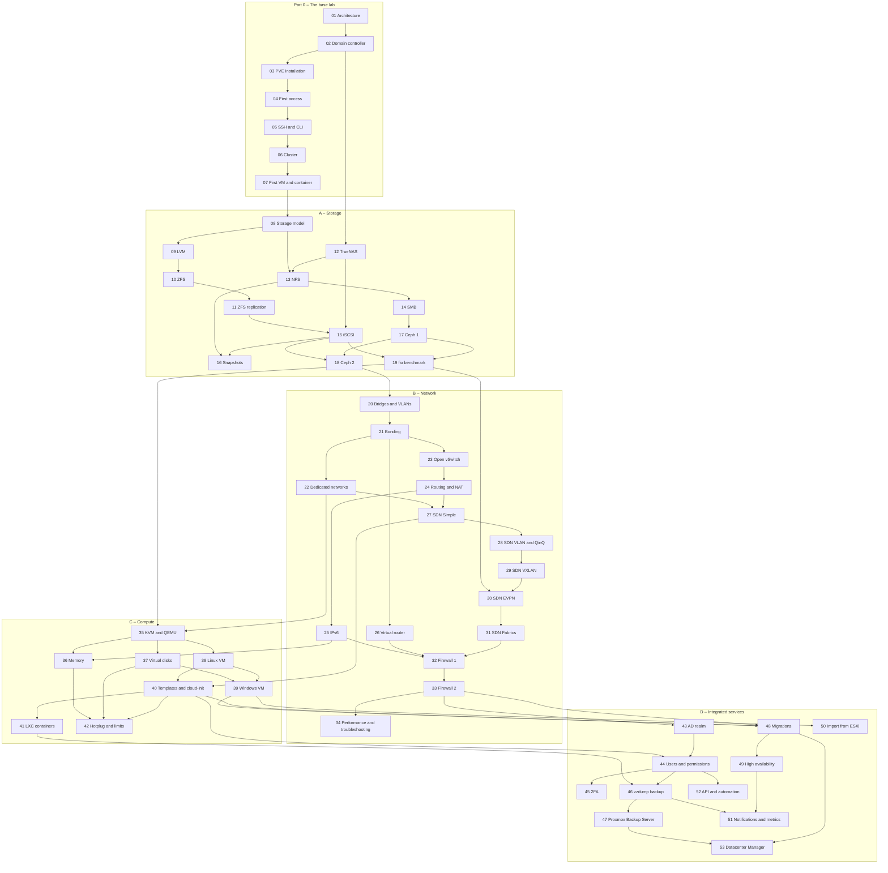

A hands-on path through **Proxmox VE 9.2**: you start from an empty lab and end up with a complete datacenter with a cluster, shared storage, Ceph, SDN, backup and high availability.

Every lab follows the same structure:

- **Dependencies**: the labs to complete first, the machines and services you need;
- **Objectives** and **How it works**: the essential theory to understand what happens;
- **Procedure**: numbered steps, every action in the web interface with its screenshot and every command with its real output;
- **Verification and tests**, including simulated failures;
- **Final lab state**: what stays configured for the following labs.

The credentials and addresses used throughout the manual are in [Appendix B](/b-credentials-and-addresses/).

## Conventions

- **Lab.** All the labs take place on the same lab, described and prepared in [Lab 01](/01-lab-architecture/): physical servers, a switch with VLANs, a router and a network services server. To rebuild it as virtual machines on a single Proxmox VE server, see [Appendix D](/d-rebuild-as-virtual/).
- **Password.** `<lab-password>` stands for the single lab password, which you choose: see [Appendix B](/b-credentials-and-addresses/#the-lab-password).
- **Redacted hardware data.** In the screenshots, the data that identify the lab hardware are redacted: disk serial numbers, MAC addresses of the servers' network cards, CPU and disk models. In the text output, the same data are replaced by placeholders such as `<seriale-disco-1>`. On your hardware you will see different values.
- **Output.** The code blocks show real commands and output from the lab; the prompts (`root@desopve01:~#`, `PS C:\>`) show where to run each command.

## How it is organized

You start with **Part 0**, which builds the base lab. The four tracks then follow **in the order A → B → C → D**: many labs reuse what the previous ones left configured, for example Ceph (lab 17) and the networks of track B. Before each lab, check its **Dependencies**; the graph at the bottom of this page summarizes them.

### Part 0 – The base lab

| Lab | Title |
|---|---|
| 01 | [Lab architecture and preparation](/01-lab-architecture/) |
| 02 | [Windows Server 2025 domain controller: AD, DNS and NTP](/02-domain-controller/) |
| 03 | [Installing Proxmox VE 9.2 (ZFS RAID1 and ext4)](/03-install-proxmox-ve/) |
| 04 | [First access, repositories and updates](/04-first-access-repositories-updates/) |
| 05 | [SSH, shell and command-line tools (`pvesh`, `qm`, `pct`)](/05-ssh-shell-cli/) |
| 06 | [Three-node cluster and Corosync](/06-cluster-corosync/) |
| 07 | [First VM and first container](/07-first-vm-and-container/) |

### Track A – Storage

| Lab | Title |
|---|---|
| 08 | [The Proxmox VE storage model: content types, formats, thin provisioning](/08-storage-model/) |
| 09 | [LVM and LVM-thin: creation, extension, overprovisioning, full pool](/09-lvm-and-lvm-thin/) |
| 10 | [ZFS: pools, mirror and RAIDZ, ARC, compression, snapshots, send/receive, failure and resilver](/10-zfs/) |
| 11 | [ZFS replication between nodes and manual failover](/11-zfs-replication/) |
| 12 | [TrueNAS NAS: installation and preparation](/12-truenas-nas/) |
| 13 | [NFS: exports, mount options, performance, NAS outage](/13-nfs/) |
| 14 | [SMB/CIFS: authenticated share, permissions and comparison with NFS](/14-smb-cifs/) |
| 15 | [iSCSI with shared LVM and multipath, path failure](/15-iscsi-lvm-multipath/) |
| 16 | [Snapshots: with and without RAM, rollback, trees and volume chain](/16-snapshots/) |
| 17 | [Ceph 1: architecture, installation, RBD pools and CephFS](/17-ceph-installation/) |
| 18 | [Ceph 2: growth, maintenance, pool configuration and failures](/18-ceph-growth-maintenance-failures/) |
| 19 | [Comparative storage benchmark with fio](/19-fio-benchmark/) |

### Track B – Network

| Lab | Title |
|---|---|
| 20 | [Linux bridges, stable network interface names, VLAN-aware bridges](/20-bridges-stable-names-vlans/) |
| 21 | [Bonding: active-backup, balance-alb and LACP, link failure](/21-bonding/) |
| 22 | [Dedicated networks: Corosync, migration and storage](/22-dedicated-networks/) |
| 23 | [Open vSwitch: bridges, bonds and VLANs with OVS](/23-open-vswitch/) |
| 24 | [Routing and NAT on the host: masquerading, routed configuration, port forwarding](/24-routing-nat/) |
| 25 | [IPv6: dual stack, RA and SLAAC](/25-ipv6/) |
| 26 | [Virtual router and firewall between VLANs: MikroTik CHR (OPNsense as an alternative)](/26-virtual-router/) |
| 27 | [SDN 1: Simple zone, SNAT, DHCP and IPAM](/27-sdn-simple/) |
| 28 | [SDN 2: VLAN and QinQ zones](/28-sdn-vlan-qinq/) |
| 29 | [SDN 3: VXLAN zone](/29-sdn-vxlan/) |
| 30 | [SDN 4: EVPN with BGP, exit nodes and anycast gateway](/30-sdn-evpn/) |
| 31 | [SDN 5: Fabrics (OpenFabric) and routed full mesh](/31-sdn-fabrics/) |
| 32 | [Firewall 1: datacenter, node and VM, security groups, IPSets, aliases, macros, logging](/32-firewall-1/) |
| 33 | [Firewall 2: nftables, host firewall, anti-spoofing, SDN VNets, conntrack](/33-firewall-2/) |
| 34 | [Network performance and troubleshooting](/34-network-performance-troubleshooting/) |

### Track C – Compute

| Lab | Title |
|---|---|
| 35 | [KVM and QEMU under the hood: the QEMU process, CPU types, migration compatibility](/35-kvm-qemu/) |
| 36 | [Memory: ballooning, KSM, hugepages, NUMA, overcommit](/36-memory/) |
| 37 | [Virtual disks and controllers: VirtIO SCSI and Block, iothread, cache, discard](/37-virtual-disks-controllers/) |
| 38 | [Linux VM and QEMU Guest Agent: serial console, options, shutdown, fsfreeze and removal with purge](/38-linux-vm-guest-agent/) |
| 39 | [Windows VM and VirtIO drivers: Windows Server 2025 with UEFI, TPM, VirtIO SCSI and guest agent](/39-windows-vm-virtio/) |
| 40 | [Templates, cloud-init and clones: linked and full, snippets and deployment from the CLI](/40-templates-cloud-init-clones/) |
| 41 | [LXC containers: privileged and unprivileged, mount points, features, limits and comparison with VMs](/41-lxc-containers/) |
| 42 | [Hotplug, online resize, CPU weight and limit, pressure (PSI)](/42-hotplug-resize-limits/) |

### Track D – Integrated services

| Lab | Title |
|---|---|
| 43 | [Identity: Active Directory realm with LDAPS and synchronization](/43-active-directory-realm-ldaps/) |
| 44 | [Users, groups, roles, pools and API tokens](/44-users-groups-roles-pools-tokens/) |
| 45 | [Two-factor authentication: TOTP, WebAuthn, recovery keys](/45-two-factor-authentication/) |
| 46 | [Backup with vzdump: modes, compression, fleecing](/46-vzdump-backup/) |
| 47 | [Proxmox Backup Server 4: datastore, deduplication, encryption, verify, prune, file restore, sync](/47-proxmox-backup-server/) |
| 48 | [Migrations: live, offline, with local disks, bulk and between clusters](/48-migrations/) |
| 49 | [High availability: HA rules, fencing, arm/disarm, dynamic load balancing](/49-high-availability/) |
| 50 | [Importing VMs from VMware ESXi](/50-import-from-esxi/) |
| 51 | [Notifications, metrics and logs: SMTP, Gotify, matchers, InfluxDB and Grafana, rsyslog](/51-notifications-metrics-logs/) |
| 52 | [API and automation: `pvesh`, tickets and CSRF, API tokens, Ansible and OpenTofu](/52-api-automation/) |
| 53 | [Proxmox Datacenter Manager: PVE and PBS remotes, dashboard, updates, migration between remotes](/53-datacenter-manager/) |

### Appendices

| | Title |
|---|---|
| A | [Upgrading from Proxmox VE 8 to 9: `pve8to9`, deb822 repositories, cluster and Ceph](/a-upgrade-8-to-9/) |
| B | [Lab credentials and addresses](/b-credentials-and-addresses/) |
| C | [Troubleshooting: the real problems of the lab and where to look](/c-troubleshooting/) |
| D | [Rebuilding the lab as virtual machines on a Proxmox VE server](/d-rebuild-as-virtual/) |

## Dependencies between labs

